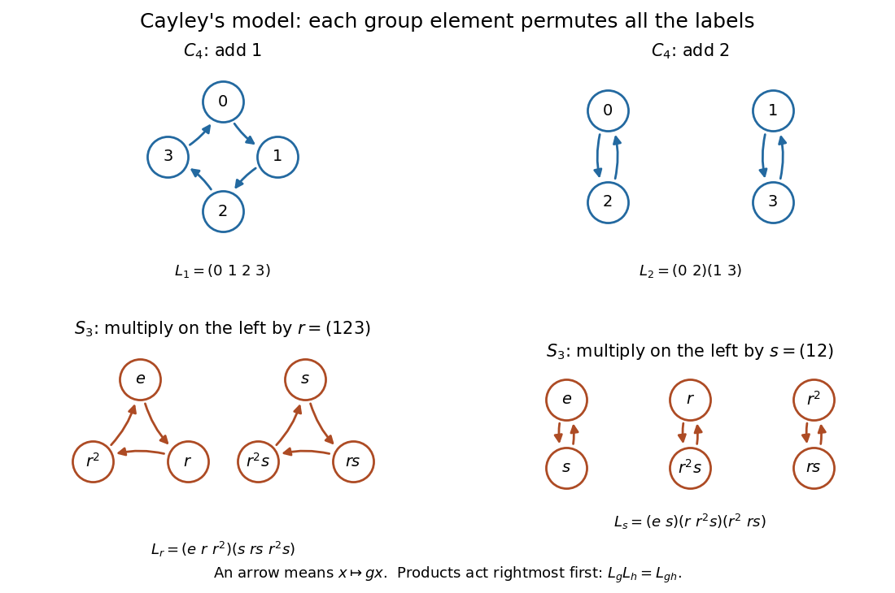
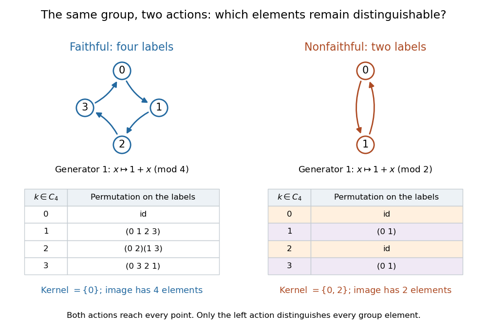

<h1 id="cayley-s-theorem">Cayley's theorem</h1>

↑ **Parent:** [Group embedding](group-embedding.md)  
ⓦ [Wiki](https://en.wikipedia.org/wiki/Cayley's_theorem)

Every [group](group-split.md) $G$ is [isomorphic](isomorphism.md) to a [subgroup](subgroup.md) of the [symmetric group](symmetric-group.md) on its underlying [set](set-split.md). The construction uses the [left regular action](left-regular-action.md): each [group element](group-element.md) $g$ becomes a [permutation](permutation.md) of all the [group elements](group-element.md), given by

$$
L_g:G\longrightarrow G,\qquad L_g(x)=gx,\qquad \lambda:G\hookrightarrow\operatorname{Sym}(G),\quad g\longmapsto L_g.
$$

For a [finite group](finite-group.md) of [group order](order-of-a-finite-group.md) $n$, labeling these elements by $1,\ldots,n$ gives a [group embedding](group-embedding.md) into $S_n$. The same construction works for an [infinite group](infinite-group.md), with the [symmetric group](symmetric-group.md) of all [bijections](bijection.md) of its underlying [set](set-split.md).[Theorem 1.22 and Corollary 1.23, printed page 16: left multiplication embeds a group into its symmetric group](group-theory-v4-01-by-james-s-milne.md)

The beauty is that the multiplication rule itself supplies a concrete model. Whatever the [group elements](group-element.md) originally represent, each one rearranges the entire [group](group-split.md) by multiplication. A product becomes [function composition](function-composition.md), and no distinctions between [group elements](group-element.md) are lost. For a [finite group](finite-group.md), a row of its [Cayley table](cayley-table.md) lists the images under one $L_g$: the multiplication table is already a catalogue of [permutations](permutation.md).

Throughout this construction, products of [permutations](permutation.md) act rightmost first:

$$
(\sigma\tau)(x)=(\sigma\circ\tau)(x)=\sigma(\tau(x)),\qquad L_gL_h=L_{gh}.
$$

Thus $L_gL_h$ first multiplies by $h$, then by $g$. This is a left [group action](group-action-split.md), not a license to reverse the multiplication order in a [nonabelian group](non-abelian-group.md). Ordinary right multiplication $R_g(x)=xg$ instead satisfies $R_gR_h=R_{hg}$ with this convention; replacing it by $x\mapsto xg^{-1}$ restores the [group homomorphism](group-homomorphism.md) law.[Example 2.10, printed page 7: left multiplication and the reversed composition law for right multiplication](group-actions-by-keith-conrad.md)

For an explicit [cyclic group](cyclic-group.md) example, take $C_4=\mathbb Z/4\mathbb Z$ under addition, using [modular arithmetic](modular-arithmetic-split.md). Its [left regular action](left-regular-action.md) consists of $L_k(x)=k+x\pmod4$. In [permutation cycles](permutation-cycle.md) on the labels $0,1,2,3$,

$$
L_0=\operatorname{id},\qquad L_1=(0\ 1\ 2\ 3),\qquad L_2=(0\ 2)(1\ 3),\qquad L_3=(0\ 3\ 2\ 1).
$$

The [function composition](function-composition.md) $L_1L_1=L_2$ sends $0$ to $2$, $1$ to $3$, $2$ to $0$, and $3$ to $1$: squaring the four-point [permutation cycle](permutation-cycle.md) produces two [disjoint permutation cycles](disjoint-permutation-cycles.md). Also $L_1L_3=L_0$. These four [permutations](permutation.md) form a [cyclic subgroup](cyclic-subgroup.md) of $S_4$, reproducing addition in $C_4$ exactly.

For a [nonabelian group](non-abelian-group.md) example, let $G=S_3$, with $r=(123)$, $s=(12)$, and $e$ its [identity element](identity-element.md). The six [group elements](group-element.md) are $e,r,r^2,s,rs,r^2s$, where $r^3=s^2=e$ and $sr=r^2s$. Now the labels being permuted are themselves [permutations](permutation.md) of three points. Computing the [left regular action](left-regular-action.md) gives [permutations](permutation.md) of these six labels:

$$
L_r=(e\ r\ r^2)(s\ rs\ r^2s),\qquad L_s=(e\ s)(r\ r^2s)(r^2\ rs).
$$

For example, $L_s(r)=sr=r^2s$; putting $rs$ here would accidentally switch to right multiplication. Noncommutativity survives in the model:

$$
(L_rL_s)(e)=rs=(13),\qquad (L_sL_r)(e)=sr=(23).
$$

These different outputs prove that $L_rL_s\ne L_sL_r$. The [group generators](generator-of-a-group.md) $r,s$ become [group generators](generator-of-a-group.md) $L_r,L_s$ of a six-element [subgroup](subgroup.md) of $S_6$.

**[Figure 8](#cayley-left-translation-cycles). Left regular action as permutation cycles for $C_4$ and $S_3$**. Each arrow sends a label $x$ to $gx$, or to $k+x$ in the additive [cyclic group](cyclic-group.md). The top panels show the translations by $1$ and $2$ in $C_4$; the bottom panels show multiplication by $r$ and $s$ in the [symmetric group](symmetric-group.md) $S_3$. Each panel depicts one [permutation](permutation.md), decomposed into [disjoint permutation cycles](disjoint-permutation-cycles.md).

Why does a [group action](group-action-split.md) here produce a [group embedding](group-embedding.md)? Any [group action](group-action-split.md) on a [set](set-split.md) $X$ gives a [group homomorphism](group-homomorphism.md) $\rho:G\to\operatorname{Sym}(X)$; it is a [group embedding](group-embedding.md) precisely when it is a [faithful group action](faithful-group-action.md). The [group kernel](kernel-of-a-group-homomorphism.md) consists of the [group elements](group-element.md) fixing every point of $X$. In the [left regular action](left-regular-action.md), $L_g(e)=g$, so fixing the [identity element](identity-element.md) already forces $g=e$. In fact every [stabilizer subgroup](stabilizer-subgroup.md) is trivial, since $gx=x$ forces $g=e$; this stronger property makes the [left regular action](left-regular-action.md) a [regular group action](regular-group-action.md).[Theorem 1.2, printed pages 1-2: injectivity by evaluating at the identity; Theorem 1.7 and following paragraph, printed page 3: actions as homomorphisms and their kernels](group-actions-by-keith-conrad.md)

Compare two [group actions](group-action-split.md) of the same [cyclic group](cyclic-group.md) $C_4$. Its [left regular action](left-regular-action.md) on four labels distinguishes all four [group elements](group-element.md). On $X=\{0,1\}$, the rule $k\cdot x=k+x\pmod2$ defines a [transitive group action](transitive-group-action.md), but $0$ and $2$ both fix both points, while $1$ and $3$ both exchange them. Its [group kernel](kernel-of-a-group-homomorphism.md) is $\{0,2\}$, so it is not a [faithful group action](faithful-group-action.md). Its image is a two-element [subgroup](subgroup.md) of $S_2$, [isomorphic](isomorphism.md) to the [quotient group](quotient-group.md) $C_4/\{0,2\}$ rather than to $C_4$.

**[Figure 9](#cayley-faithful-and-nonfaithful-actions). A faithful group action preserves all four translations; a two-point group action merges them**. Both panels start with the same [cyclic group](cyclic-group.md) $C_4$. The arrows show the [group action](group-action-split.md) of its [group generator](generator-of-a-group.md) $1$, and the tables show all four resulting [permutations](permutation.md). On four points the [group kernel](kernel-of-a-group-homomorphism.md) is $\{0\}$; on two points it is $\{0,2\}$. Reachability of every point does not imply a [faithful group action](faithful-group-action.md).

The guaranteed number $|G|$ of labels need not be the smallest possible for a [faithful group action](faithful-group-action.md). The [symmetric group](symmetric-group.md) $S_3$ naturally acts faithfully on $\{1,2,3\}$: a [permutation](permutation.md) fixing all three labels is the [identity element](identity-element.md). Its [left regular action](left-regular-action.md) uses six labels instead. Three is the smallest possible here, since $S_1$ and $S_2$ have fewer than six elements and cannot contain an [isomorphic](isomorphism.md) copy of $S_3$. Moreover, in the natural three-point [group action](group-action-split.md), the [stabilizer subgroup](stabilizer-subgroup.md) of $1$ is $\{e,(23)\}$: a [faithful group action](faithful-group-action.md) can have nontrivial point [stabilizer subgroups](stabilizer-subgroup.md). Cayley's construction supplies a universal model, while a smaller model can reveal particular [symmetries](symmetry-physics.md).

The proof is short. Each $L_g$ is a [bijection](bijection.md) with inverse $L_{g^{-1}}$. [Associativity](associative-property.md) gives

$$
L_g(L_h(x))=g(hx)=(gh)x=L_{gh}(x),
$$

so $\lambda$ is a [group homomorphism](group-homomorphism.md). If $L_g=L_h$, evaluating both at the [identity element](identity-element.md) gives $g=L_g(e)=L_h(e)=h$. Hence $\lambda$ is [injective](injective-function.md), and its image is the required [isomorphic](isomorphism.md) [subgroup](subgroup.md). No finiteness assumption entered the argument.

The historical connection is unusually close to the notation. The opening paragraph of [Arthur Cayley](arthur-cayley.md)'s 1854 paper already treats [permutations](permutation.md) as one example of operations on a collection of quantities and explicitly performs the rightmost operation first in a product. It also allows noncommutativity while insisting on [associativity](associative-property.md). The modern [left regular action](left-regular-action.md) shows how that viewpoint reaches every abstract [group](group-split.md), by choosing the [group](group-split.md) itself as the [set](set-split.md) to be acted on.[Abstract awakenings in algebra: Early group theory in the works of Lagrange, Cauchy, and Cayley by Janet Heine Barnett, Section 3.1, printed page 50: reproduced opening paragraph of Arthur Cayley's On the theory of groups, as depending on the symbolic equation theta^n = 1; reference 5, printed page 91: original publication in 1854](abstract-awakenings-in-algebra-early-group-theory-in-the-works-of-lagrange-cauchy-and-cayley-by-janet-heine-barnett.md)

**Table of contents**

- [Symmetric-group embedding at one less than the group order](symmetric-group-embedding-at-one-less-than-the-group-order.md)

## ↑ Ancestors (6)

1. [Group embedding](group-embedding.md)
2. [Group theory](group-theory-split.md)
3. [Algebra](algebra-split.md)
4. [Area of mathematics](area-of-mathematics.md)
5. [Mathematics](mathematics-split.md)
6. [Codex Wiki](split.md)

## ← Incoming links (3)

- [Coset action](coset-action.md)
- [Faithful group action](faithful-group-action.md)
- [Group](group-split.md)
