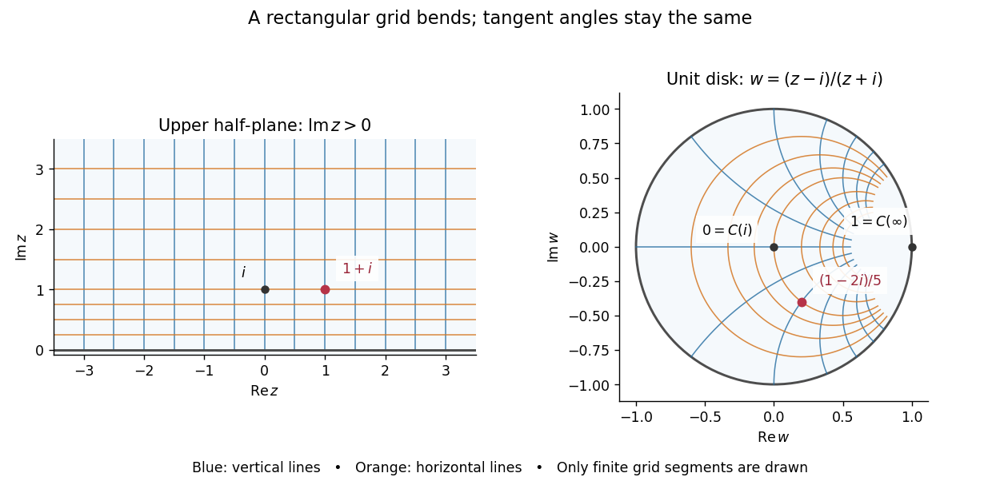

# Cayley transform between the half-plane and disk

↑ **Parent:** [Complex analysis](complex-analysis-split.md)

The [Cayley transform](cayley-transform-complex-analysis.md) gives a [conformal bijection](biholomorphism.md) between an unbounded half-plane and the [unit disc](unit-disc.md). Two conventions are useful. For the [right half-plane](right-half-plane.md), use

$$
R(z)=\frac{z-1}{z+1},\qquad R^{-1}(w)=\frac{1+w}{1-w},\qquad 1-|R(z)|^2=\frac{4\operatorname{Re}z}{|z+1|^2}.
$$

For the [upper half-plane](upper-half-plane-complex-analysis.md), use

$$
C(z)=\frac{z-i}{z+i},\qquad C^{-1}(w)=i\frac{1+w}{1-w},\qquad 1-|C(z)|^2=\frac{4\operatorname{Im}z}{|z+i|^2}.
$$

Rotating the [upper half-plane](upper-half-plane-complex-analysis.md) onto the [right half-plane](right-half-plane.md) by $z\mapsto-iz$ explains the relationship $C(z)=R(-iz)$. The factors of $i$ distinguish which half-plane is mapped onto the [unit disc](unit-disc.md). [Orloff, MIT Topic 10, Example 10.14 and section 10.11](https://ocw.mit.edu/courses/18-04-complex-variables-with-applications-spring-2018/ef46ddd9941227b8700c945bb7475ae9_MIT18_04S18_topic10.pdf)

**[Figure 3](#image-the-upper-half-plane-cayley-transform-bends-a-rectangular-grid-into-the-unit-disc-while-preserving-angles-at-intersections). The upper half-plane Cayley transform bends a rectangular grid into the unit disc while preserving angles at intersections**.

In particular, $C(i)=0$, $C(2i)=1/3$ and $C(1+i)=(1-2i)/5$. The whole positive imaginary axis becomes the real diameter: $C(iy)=(y-1)/(y+1)$ for $y>0$. Horizontal grid lines become [circles](circle.md) tangent to the [unit circle](complex-unit-circle.md) at $1$ when completed by their endpoint at infinity; they are not [hyperbolic geodesics](geodesic-in-the-poincare-half-plane-model.md).

On the [Riemann sphere](riemann-sphere.md), $C$ maps the extended [real line](real-line.md) onto the [unit circle](complex-unit-circle.md):

$$
C(-1)=i,\qquad C(0)=-1,\qquad C(1)=-i,\qquad C(\infty)=1.
$$

Every finite real $x$ has $|C(x)|=1$; the remaining point $w=1$ corresponds to infinity. The [pole](pole.md) $z=-i$ is outside the [upper half-plane](upper-half-plane-complex-analysis.md), and the [pole](pole.md) of $C^{-1}$ at $w=1$ is on the [boundary](boundary-of-a-set.md) of the [unit disc](unit-disc.md). Neither [pole](pole.md) obstructs the interior [conformal bijection](biholomorphism.md).

For a short verification, subtract the squared [moduli](modulus.md):

$$
|z+i|^2-|z-i|^2=4\operatorname{Im}z,\qquad \operatorname{Im}C^{-1}(w)=\frac{1-|w|^2}{|1-w|^2}.
$$

These identities put each interior image in the required domain; solving $w(z+i)=z-i$ gives the stated [inverse function](inverse-function.md). Both maps are [holomorphic](holomorphic-function-split.md), with $C'(z)=2i/(z+i)^2\ne0$, so the [conformal bijection](biholomorphism.md) preserves Euclidean [angles](angle.md) between tangent directions.

[Euclidean distance](euclidean-distance.md) is not preserved: $i$ and $2i$ are one unit apart, whereas $0$ and $1/3$ are only one third of a unit apart. The striking feature is that $C$ does preserve length for the [hyperbolic metrics](hyperbolic-metric.md) of the [Poincaré half-plane model](poincare-half-plane-model.md) and [Poincaré disk model](poincare-disk-model.md):

$$
ds_{\mathbb H}=\frac{|dz|}{\operatorname{Im}z},\qquad ds_{\mathbb D}=\frac{2|dw|}{1-|w|^2},\qquad \frac{2|C'(z)|\,|dz|}{1-|C(z)|^2}=\frac{|dz|}{\operatorname{Im}z}.
$$

Consequently it is an [isometry](isometry.md) for these [hyperbolic metrics](hyperbolic-metric.md), including their induced [hyperbolic distances](hyperbolic-distance.md). For the same example, the corresponding [hyperbolic geodesic](geodesic-in-the-poincare-half-plane-model.md) segments have equal length:

$$
\int_1^2\frac{dy}{y}=\log2=\int_0^{1/3}\frac{2\,dr}{1-r^2}.
$$

Thus the [Cayley transform](cayley-transform-complex-analysis.md) lets us choose the most convenient picture: a straight [boundary](boundary-of-a-set.md) for calculations, or a bounded [unit disc](unit-disc.md) for visualization. It also transports [automorphisms of the unit disk](automorphism-of-the-unit-disk.md) into [upper half-plane automorphisms](conformal-automorphism-of-the-upper-half-plane.md) by [function composition](function-composition.md) $C^{-1}\circ g\circ C$.

## ↑ Ancestors (5)

1. [Complex analysis](complex-analysis-split.md)
2. [Analysis](analysis-split.md)
3. [Area of mathematics](area-of-mathematics.md)
4. [Mathematics](mathematics-split.md)
5. [Codex Wiki](split.md)

## ← Incoming links (16)

- [Carathéodory derivative bound for the right half-plane](caratheodory-derivative-bound-for-the-right-half-plane.md)
- [Hyperbolic tube around a radial segment](hyperbolic-tube-around-a-radial-segment.md)
- [Lemniscatic integral](lemniscatic-integral.md)
- [Solution](past-exam-of-the-mathematics-course-of-the-university-of-cambridge/2001/ib/paper-1/4b/solution.md)
- [Solution](past-exam-of-the-mathematics-course-of-the-university-of-cambridge/2001/iii/paper-8/1/iii/solution.md)
- [Solution](past-exam-of-the-mathematics-course-of-the-university-of-cambridge/2002/iii/paper-5/2/solution.md)
- [Solution](past-exam-of-the-mathematics-course-of-the-university-of-cambridge/2002/iii/paper-5/4/solution.md)
- [Solution](past-exam-of-the-mathematics-course-of-the-university-of-cambridge/2003/ib/paper-1/16b/solution.md)
- [Solution](past-exam-of-the-mathematics-course-of-the-university-of-cambridge/2003/iii/paper-9/1/a/solution.md)
- [Solution](past-exam-of-the-mathematics-course-of-the-university-of-cambridge/2006/ib/paper-2/14d/solution.md)
- [Solution](past-exam-of-the-mathematics-course-of-the-university-of-cambridge/2015/iii/paper-68/1/c/solution.md)
- [Solution](past-exam-of-the-mathematics-course-of-the-university-of-cambridge/2017/iii/paper-132/1/a/solution.md)
- [Solution](past-exam-of-the-mathematics-course-of-the-university-of-cambridge/2018/ib/paper-3/13f/c/solution.md)
- [Solution](past-exam-of-the-mathematics-course-of-the-year-1-of-the-natural-sciences-course-of-the-university-of-cambridge/2011/paper-2/19/b/solution.md)
- [Right half-plane](right-half-plane.md)
- [Upper half-plane (complex analysis)](upper-half-plane-complex-analysis.md)
