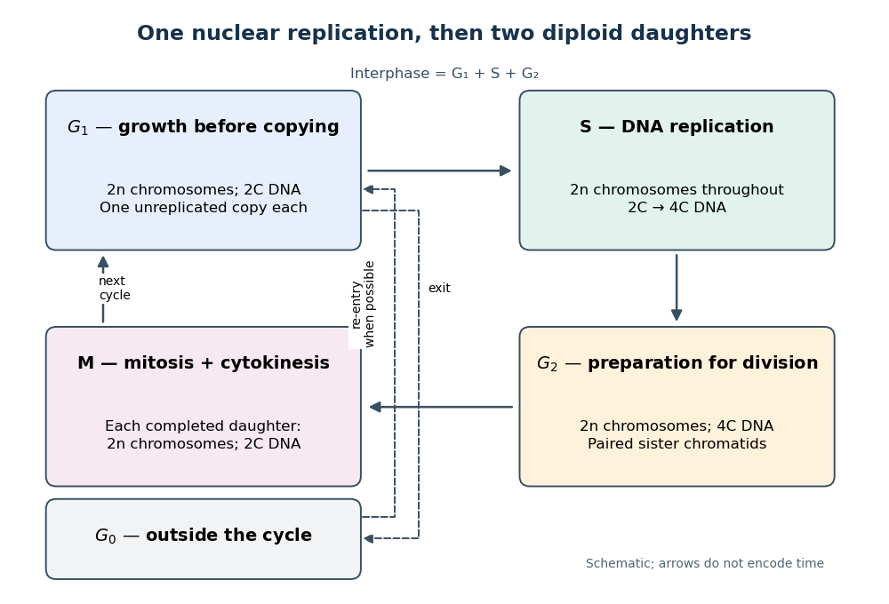

# Cell cycle

↑ **Parent:** [Biological cell](biological-cell-split.md)  
ⓦ [Wiki](https://en.wikipedia.org/wiki/Cell_cycle)

The [cell cycle](cell-cycle-split.md) is the sequence of events by which a [biological cell](biological-cell-split.md) prepares for and completes division, including [DNA replication](dna-replication.md) and distribution of [chromosomes](chromosome.md). In [Saccharomyces cerevisiae](saccharomyces-cerevisiae.md), changing bud appearance provides an accessible readout; see the Burgess, Powers and Mell account and Hartwell, Culotti and Reid's primary study cited there.

For a typical cycling [diploid](diploid.md) [eukaryotic](eukaryote.md) [biological cell](biological-cell-split.md), the order is [G1 phase](g1-phase.md), [S phase](s-phase.md), [G2 phase](g2-phase.md), then [M phase](m-phase.md). [DNA replication](dna-replication.md) doubles nuclear [DNA](deoxyribonucleic-acid.md) amount during [S phase](s-phase.md); [mitosis](mitosis.md) distributes the copies, and [cytokinesis](cytokinesis.md) separates the daughters. The useful distinction is between copying a library and allocating its copies: [DNA replication](dna-replication.md) changes how much material exists, whereas division changes which [biological cell](biological-cell-split.md) contains it.

**[Figure 1](#image-the-cell-cycle-copying-nuclear-dna-once-then-distributing-it-to-two-daughters). The cell cycle: copying nuclear DNA once, then distributing it to two daughters**. Original schematic for a typical cycling [diploid](diploid.md) [eukaryotic](eukaryote.md) [biological cell](biological-cell-split.md). Each box states nuclear [DNA](deoxyribonucleic-acid.md) content and [chromosome](chromosome.md) count; [M phase](m-phase.md) is summarized by its completed daughters. Arrow lengths do not represent phase durations. The [G0 phase](g0-phase.md) branch shows reversible withdrawal where re-entry is possible, rather than claiming that all nondividing [biological cells](biological-cell-split.md) can return.

[Gene expression](gene-expression.md) continues to supply [RNA](ribonucleic-acid.md) and [proteins](protein-split.md) as the [biological cell](biological-cell-split.md) grows; it is different from duplicating the [genome](genome.md). In the [yeast cross-species complementation experiment](yeast-cross-species-complementation-experiment.md), restored growth requires successful repeated [cell cycles](cell-cycle-split.md), but growth alone does not locate a defect within a phase. Bud appearance in [Saccharomyces cerevisiae](saccharomyces-cerevisiae.md) provides another readout, while a [flow cytometric DNA-content assay](flow-cytometric-dna-content-assay.md) asks how much nuclear [DNA](deoxyribonucleic-acid.md) is present and [DNA pulse labeling](dna-pulse-labeling.md) asks whether new [DNA](deoxyribonucleic-acid.md) was synthesized during an exposure.

**Table of contents**

- [Quiescence](quiescence.md)
- [Mitotic exit network](mitotic-exit-network.md)
- [Centrosome orientation checkpoint](centrosome-orientation-checkpoint.md)
- [Spindle position checkpoint](spindle-position-checkpoint.md)
  - [Bub2-Bfa1 complex](bub2-bfa1-complex.md)
- [cdc mutant](cdc-mutant.md)
- [Cdh1](cdh1.md)
- [RB](rb.md)
- [Cell-cycle arrest](cell-cycle-arrest.md)
  - [Cellular senescence](cellular-senescence.md)
  - [p21](p21.md)
- [Sic1](sic1.md)
- [Oriented cell division](oriented-cell-division.md)
- [SCF ubiquitin ligase](scf-ubiquitin-ligase.md)
- [Geminin](geminin.md)
- [Fucci](fucci.md)
- [Cytostatic factor](cytostatic-factor.md)
- [Anaphase-promoting complex](anaphase-promoting-complex.md)
- [Maturation-promoting factor](maturation-promoting-factor.md)
- [RB pathway](rb-pathway.md)
- [Cdc20](cdc20.md)
- [Replication checkpoint](replication-checkpoint.md)
- [DNA damage checkpoint](dna-damage-checkpoint.md)
- [Endoreduplication](endoreduplication.md)
- [Cleavage division](cleavage-division.md)
- [Interphase](interphase.md)
  - [G1 phase](g1-phase.md)
  - [S phase](s-phase.md)
  - [G2 phase](g2-phase.md)
- [M phase](m-phase.md)
  - [Mitosis](mitosis.md)
    - [Prophase](prophase.md)
    - [Prometaphase](prometaphase.md)
    - [Metaphase](metaphase.md)
    - [Anaphase](anaphase.md)
    - [Telophase](telophase.md)
    - [Mitotic daughter chromosome accounting](mitotic-daughter-chromosome-accounting.md)
    - [Spindle checkpoint](spindle-checkpoint.md)
      - [Bub3](bub3.md)
      - [BubR1](bubr1.md)
      - [Mad2](mad2.md)
      - [Mitotic checkpoint complex](mitotic-checkpoint-complex.md)
      - [Kinetochore ablation experiment](kinetochore-ablation-experiment.md)
  - [Cytokinesis](cytokinesis.md)
    - [Abscission](abscission.md)
    - [Midbody](midbody.md)
    - [Actomyosin ring](actomyosin-ring.md)
    - [Cleavage furrow](cleavage-furrow.md)
      - [Toroidal sand dollar egg experiment](toroidal-sand-dollar-egg-experiment.md)
    - [Cell plate](cell-plate.md)
- [G0 phase](g0-phase.md)
- [Cell-cycle DNA content](cell-cycle-dna-content.md)
- [Cell cycle analysis](cell-cycle-analysis.md)
  - [Double thymidine block](double-thymidine-block.md)
  - [DNA pulse labeling](dna-pulse-labeling.md)
    - [DNA synthesis labeling with EdU](dna-synthesis-labeling-with-edu.md)
- [Spindle apparatus](spindle-apparatus.md)
  - [Spindle pole body](spindle-pole-body.md)
  - [Central spindle](central-spindle.md)
  - [Mitotic aster](mitotic-aster.md)

## ↑ Ancestors (3)

1. [Biological cell](biological-cell-split.md)
2. [Biology](biology-split.md)
3. [Codex Wiki](split.md)

## ← Incoming links (24)

- [Anaphase-promoting complex](anaphase-promoting-complex.md)
- [CDK1 activity and protein abundance](cdk1-activity-and-protein-abundance.md)
- [CDK1 phosphorylation state](cdk1-phosphorylation-state.md)
- [Cell cycle](cell-cycle-split.md)
- [Cell-cycle activation feedback](cell-cycle-activation-feedback.md)
- [Cell cycle analysis](cell-cycle-analysis.md)
- [Cellular differentiation](cellular-differentiation.md)
- [Cyclin](cyclin.md)
- [Cyclin-dependent kinase 1](cyclin-dependent-kinase-1.md)
- [DNA pulse labeling](dna-pulse-labeling.md)
- [Flow cytometric DNA-content assay](flow-cytometric-dna-content-assay.md)
- [Mitosis](mitosis.md)
- [Nuclear DNA content](nuclear-dna-content.md)
- [Solution](past-exam-of-the-biochemistry-course-of-the-university-of-cambridge/2024/paper-3/section-ii/5/solution.md)
- [Solution](past-exam-of-the-biochemistry-course-of-the-university-of-cambridge/2025/paper-3/section-i/1/solution.md)
- [Solution](past-exam-of-the-genetics-course-of-the-university-of-cambridge/2024/paper-1/3/solution.md)
- [Solution](past-exam-of-the-systems-biology-course-of-the-university-of-cambridge/2024/paper-4/section-ii/2-3/solution.md)
- [Solution](past-exam-of-the-zoology-course-of-the-university-of-cambridge/2024/paper-zl6/3/solution.md)
- [Solution](past-exam-of-the-zoology-course-of-the-university-of-cambridge/2024/paper-zl6/5/solution.md)
- [Solution](past-exam-of-the-zoology-course-of-the-university-of-cambridge/2025/paper-zl6/1/solution.md)
- [Saccharomyces cerevisiae](saccharomyces-cerevisiae.md)
- [Terminal differentiation](terminal-differentiation.md)
- [Unicellular organism](unicellular-organism.md)
- [Xenopus laevis egg extract](xenopus-laevis-egg-extract.md)
