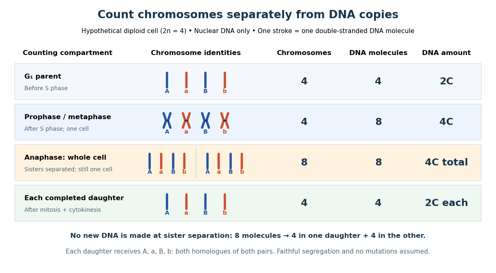
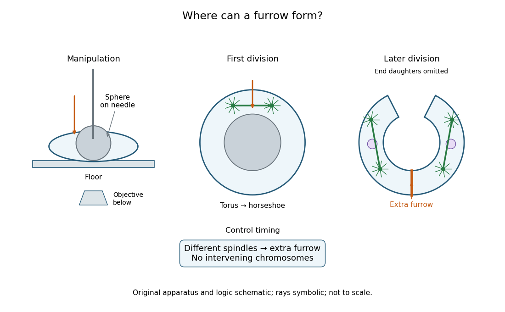

# Cell cycle

↑ **Parent:** [Biological cell](biological-cell.md)  
ⓦ [Wiki](https://en.wikipedia.org/wiki/Cell_cycle)

The [cell cycle](cell-cycle.md) is the sequence of events by which a [biological cell](biological-cell.md) prepares for and completes division, including [DNA replication](molecular-genetics.md#dna-replication) and distribution of [chromosomes](genetics.md#chromosome). In [Saccharomyces cerevisiae](organism.md#saccharomyces-cerevisiae), changing bud appearance provides an accessible readout; see the Burgess, Powers and Mell account and Hartwell, Culotti and Reid's primary study cited there.

For a typical cycling [diploid](genetics.md#diploid) [eukaryotic](organism.md#eukaryote) [biological cell](biological-cell.md), the order is [G1 phase](#g1-phase), [S phase](#s-phase), [G2 phase](#g2-phase), then [M phase](#m-phase). [DNA replication](molecular-genetics.md#dna-replication) doubles nuclear [DNA](polymer.md#deoxyribonucleic-acid) amount during [S phase](#s-phase); [mitosis](#mitosis) distributes the copies, and [cytokinesis](#cytokinesis) separates the daughters. The useful distinction is between copying a library and allocating its copies: [DNA replication](molecular-genetics.md#dna-replication) changes how much material exists, whereas division changes which [biological cell](biological-cell.md) contains it.

**[Figure 1](#image-the-cell-cycle-copying-nuclear-dna-once-then-distributing-it-to-two-daughters). The cell cycle: copying nuclear DNA once, then distributing it to two daughters**. Original schematic for a typical cycling [diploid](genetics.md#diploid) [eukaryotic](organism.md#eukaryote) [biological cell](biological-cell.md). Each box states nuclear [DNA](polymer.md#deoxyribonucleic-acid) content and [chromosome](genetics.md#chromosome) count; [M phase](#m-phase) is summarized by its completed daughters. Arrow lengths do not represent phase durations. The [G0 phase](#g0-phase) branch shows reversible withdrawal where re-entry is possible, rather than claiming that all nondividing [biological cells](biological-cell.md) can return.

[Gene expression](molecular-genetics.md#gene-expression) continues to supply [RNA](polymer.md#ribonucleic-acid) and [proteins](protein.md) as the [biological cell](biological-cell.md) grows; it is different from duplicating the [genome](molecular-genetics.md#genome). In the [yeast cross-species complementation experiment](biology.md#yeast-cross-species-complementation-experiment), restored growth requires successful repeated [cell cycles](cell-cycle.md), but growth alone does not locate a defect within a phase. Bud appearance in [Saccharomyces cerevisiae](organism.md#saccharomyces-cerevisiae) provides another readout, while a [flow cytometric DNA-content assay](biology.md#flow-cytometric-dna-content-assay) asks how much nuclear [DNA](polymer.md#deoxyribonucleic-acid) is present and [DNA pulse labeling](#dna-pulse-labeling) asks whether new [DNA](polymer.md#deoxyribonucleic-acid) was synthesized during an exposure.

**Table of contents**

- [Quiescence](#quiescence)
- [Mitotic exit network](#mitotic-exit-network)
- [Centrosome orientation checkpoint](#centrosome-orientation-checkpoint)
- [Spindle position checkpoint](#spindle-position-checkpoint)
  - [Bub2-Bfa1 complex](#bub2-bfa1-complex)
- [cdc mutant](#cdc-mutant)
- [Cdh1](#cdh1)
- [RB](#rb)
- [Cell-cycle arrest](#cell-cycle-arrest)
  - [Cellular senescence](#cellular-senescence)
  - [p21](#p21)
- [Sic1](#sic1)
- [Oriented cell division](#oriented-cell-division)
- [SCF ubiquitin ligase](#scf-ubiquitin-ligase)
- [Geminin](#geminin)
- [Fucci](#fucci)
- [Cytostatic factor](#cytostatic-factor)
- [Anaphase-promoting complex](#anaphase-promoting-complex)
- [Maturation-promoting factor](#maturation-promoting-factor)
- [RB pathway](#rb-pathway)
- [Cdc20](#cdc20)
- [Replication checkpoint](#replication-checkpoint)
- [DNA damage checkpoint](#dna-damage-checkpoint)
- [Endoreduplication](#endoreduplication)
- [Cleavage division](#cleavage-division)
- [Interphase](#interphase)
  - [G1 phase](#g1-phase)
  - [S phase](#s-phase)
  - [G2 phase](#g2-phase)
- [M phase](#m-phase)
  - [Mitosis](#mitosis)
    - [Prophase](#prophase)
    - [Prometaphase](#prometaphase)
    - [Metaphase](#metaphase)
    - [Anaphase](#anaphase)
    - [Telophase](#telophase)
    - [Mitotic daughter chromosome accounting](#mitotic-daughter-chromosome-accounting)
    - [Spindle checkpoint](#spindle-checkpoint)
      - [Bub3](#bub3)
      - [BubR1](#bubr1)
      - [Mad2](#mad2)
      - [Mitotic checkpoint complex](#mitotic-checkpoint-complex)
      - [Kinetochore ablation experiment](#kinetochore-ablation-experiment)
  - [Cytokinesis](#cytokinesis)
    - [Abscission](#abscission)
    - [Midbody](#midbody)
    - [Actomyosin ring](#actomyosin-ring)
    - [Cleavage furrow](#cleavage-furrow)
      - [Toroidal sand dollar egg experiment](#toroidal-sand-dollar-egg-experiment)
    - [Cell plate](#cell-plate)
- [G0 phase](#g0-phase)
- [Cell-cycle DNA content](#cell-cycle-dna-content)
- [Cell cycle analysis](#cell-cycle-analysis)
  - [Double thymidine block](#double-thymidine-block)
  - [DNA pulse labeling](#dna-pulse-labeling)
    - [DNA synthesis labeling with EdU](#dna-synthesis-labeling-with-edu)
- [Spindle apparatus](#spindle-apparatus)
  - [Spindle pole body](#spindle-pole-body)
  - [Central spindle](#central-spindle)
  - [Mitotic aster](#mitotic-aster)

## Quiescence

↑ **Parent:** [Cell cycle](cell-cycle.md)

## Mitotic exit network

↑ **Parent:** [Cell cycle](cell-cycle.md)

The budding-yeast signalling network promoting sustained [Cdc14](enzyme.md#cdc14) activity and completion of mitosis. Its upstream [Tem1](enzyme.md#tem1) activity is restrained during an active [spindle position checkpoint](#spindle-position-checkpoint).

## Centrosome orientation checkpoint

↑ **Parent:** [Cell cycle](cell-cycle.md)

A mechanism delaying mitotic entry when interphase centrosomes are misoriented relative to the niche in fly male [germline stem cells](biological-cell.md#germline-stem-cell). It couples geometry to the timing of an oriented division.

## Spindle position checkpoint

↑ **Parent:** [Cell cycle](cell-cycle.md)

A surveillance mechanism that restrains mitotic exit when the budding-yeast spindle is mispositioned. It is distinct from kinetochore-attachment surveillance by the [spindle checkpoint](#spindle-checkpoint).

### Bub2-Bfa1 complex

↑ **Parent:** [Spindle position checkpoint](#spindle-position-checkpoint)

The bipartite GTPase-activating complex that inhibits [Tem1](enzyme.md#tem1) in budding yeast. Its localization and phosphorylation connect the [spindle position checkpoint](#spindle-position-checkpoint) to mitotic exit.

## cdc mutant

↑ **Parent:** [Cell cycle](cell-cycle.md)

A cell-division-cycle mutant identified by a defect in cycle progression. A conditional growth defect alone does not establish a stage-specific cycle function.

## Cdh1

↑ **Parent:** [Cell cycle](cell-cycle.md)

A regulatory coactivator of the [anaphase-promoting complex](#anaphase-promoting-complex). Its activity helps maintain low mitotic-cyclin abundance during late mitosis and G1, before the next cell-cycle programme.

## RB

↑ **Parent:** [Cell cycle](cell-cycle.md)

The retinoblastoma tumour-suppressor protein, which restrains E2F-dependent proliferation when appropriately active. Regulation by cyclin-dependent kinases couples this restraint to cell-cycle signals.

## Cell-cycle arrest

↑ **Parent:** [Cell cycle](cell-cycle.md)

A pause or block in progression through the cell cycle. It can permit repair or become durable; arrest is not itself proof that molecular damage has been repaired.

### Cellular senescence

↑ **Parent:** [Cell-cycle arrest](#cell-cycle-arrest)

A durable cell state involving proliferative arrest and additional cellular changes. Its secretory effects can influence immune clearance and neighbouring tissue, so arrest and tissue-level benefit should be assessed separately.

### p21

↑ **Parent:** [Cell-cycle arrest](#cell-cycle-arrest)

A cyclin-dependent-kinase inhibitor induced in many p53-dependent arrest responses. Lower kinase activity helps restrain proliferation while stress is assessed.

## Sic1

↑ **Parent:** [Cell cycle](cell-cycle.md)

A budding-yeast cyclin-dependent-kinase inhibitor. Phosphorylation-dependent recognition by an SCF ubiquitin ligase couples its destruction to S-phase entry.

## Oriented cell division

↑ **Parent:** [Cell cycle](cell-cycle.md)

Division with a preferred spindle or daughter-placement direction relative to tissue axes. An association with organ elongation requires causal tests before division orientation can be assigned the shaping role.

## SCF ubiquitin ligase

↑ **Parent:** [Cell cycle](cell-cycle.md)

An SKP1–cullin–F-box [ubiquitin ligase](protein.md#ubiquitin-ligase) complex directing substrate-selective ubiquitination. Recognition of degradation signals couples substrate destruction to cellular state.

## Geminin

↑ **Parent:** [Cell cycle](cell-cycle.md)

A replication-control [protein](protein.md) whose regulated degradation motif is used in the original [Fucci](#fucci) reporters.

## Fucci

↑ **Parent:** [Cell cycle](cell-cycle.md)

A fluorescent ubiquitination-based cell-cycle indicator using phase-dependent stability of reporter fusions. The original [Cdt1](molecular-genetics.md#cdt1) and [geminin](#geminin) reporters distinguish much of [G1 phase](#g1-phase) from [S phase](#s-phase)/[G2 phase](#g2-phase)/[M phase](#m-phase), rather than reporting all phase boundaries independently.[Abstract and reporter design](biology-bibliography.md#visualizing-spatiotemporal-dynamics-of-multicellular-cell-cycle-progression-by-asako-sakaue-sawano-and-others)

## Cytostatic factor

↑ **Parent:** [Cell cycle](cell-cycle.md)

[Cytostatic factor](#cytostatic-factor) denotes activity maintaining the meiotic arrest of an unfertilized vertebrate egg. Calcium-dependent release of arrest permits the regulated destruction of mitotic cyclins and completion of meiosis.

## Anaphase-promoting complex

↑ **Parent:** [Cell cycle](cell-cycle.md)  
ⓦ [Wiki](https://en.wikipedia.org/wiki/Anaphase-promoting_complex)

The [anaphase-promoting complex](#anaphase-promoting-complex) is a regulated [ubiquitin ligase](protein.md#ubiquitin-ligase) that uses regulatory cofactors to target selected [cell cycle](cell-cycle.md) [proteins](protein.md) for destruction. Degradation of mitotic cyclins helps reset kinase activity during exit, while other substrates coordinate [chromosome](genetics.md#chromosome) separation.

## Maturation-promoting factor

↑ **Parent:** [Cell cycle](cell-cycle.md)

[Maturation-promoting factor](#maturation-promoting-factor) is the cyclin–CDK activity that can drive meiotic maturation and mitotic events. A mitotic cyclin–CDK1 complex connects changing cyclin availability to phosphorylation-dependent cell-cycle transitions.

## RB pathway

↑ **Parent:** [Cell cycle](cell-cycle.md)

A regulatory system involving retinoblastoma [protein](protein.md) and E2F-associated control of cell-cycle [gene](genetics.md#gene) expression and entry into [DNA](polymer.md#deoxyribonucleic-acid) replication.

## Cdc20

↑ **Parent:** [Cell cycle](cell-cycle.md)

An APC/C-associated regulatory [protein](protein.md) controlled by the [spindle checkpoint](#spindle-checkpoint) and involved in triggering destruction of [anaphase](#anaphase) substrates.

## Replication checkpoint

↑ **Parent:** [Cell cycle](cell-cycle.md)

A surveillance and response system coordinating replication stress with fork protection, origin use and subsequent cell-cycle events.

## DNA damage checkpoint

↑ **Parent:** [Cell cycle](cell-cycle.md)

A control system that changes cell-cycle progression in response to damaged [DNA](polymer.md#deoxyribonucleic-acid). Checkpoint activation is a response to damage rather than a guarantee that every lesion will be repaired.

## Endoreduplication

↑ **Parent:** [Cell cycle](cell-cycle.md)

Replication of nuclear [DNA](polymer.md#deoxyribonucleic-acid) without a corresponding normal mitotic division, producing increased [genome](molecular-genetics.md#genome) copy number. It illustrates that replication and cell division can be developmentally uncoupled.

## Cleavage division

↑ **Parent:** [Cell cycle](cell-cycle.md)

An early embryonic division that partitions the egg's contents among [blastomeres](biological-cell.md#blastomere), initially with little overall growth relative to later development.

## Interphase

↑ **Parent:** [Cell cycle](cell-cycle.md)  
ⓦ [Wiki](https://en.wikipedia.org/wiki/Interphase)

[Interphase](#interphase) comprises [G1 phase](#g1-phase), [S phase](#s-phase) and [G2 phase](#g2-phase), including growth and [DNA replication](molecular-genetics.md#dna-replication).

### G1 phase

↑ **Parent:** [Interphase](#interphase)  
ⓦ [Wiki](https://en.wikipedia.org/wiki/G1_phase)

During [G1 phase](#g1-phase), growth and preparation precede [DNA replication](molecular-genetics.md#dna-replication). The ordinary [diploid](genetics.md#diploid) nuclear state is $2n,2C$.

### S phase

↑ **Parent:** [Interphase](#interphase)  
ⓦ [Wiki](https://en.wikipedia.org/wiki/S_phase)

During [S phase](#s-phase), nuclear [DNA replication](molecular-genetics.md#dna-replication) produces paired [sister chromatids](genetics.md#sister-chromatids). [DNA](polymer.md#deoxyribonucleic-acid) content rises from $2C$ to $4C$, while the [chromosome](genetics.md#chromosome) count remains $2n$.

### G2 phase

↑ **Parent:** [Interphase](#interphase)  
ⓦ [Wiki](https://en.wikipedia.org/wiki/G2_phase)

[G2 phase](#g2-phase) follows completed nuclear [DNA replication](molecular-genetics.md#dna-replication) and precedes [mitosis](#mitosis). The ordinary [diploid](genetics.md#diploid) state is $2n,4C$. [Biology 2e, §10.2, Interphase and its G1, S and G2 subsections; Figure 10.5](biology-bibliography.md#biology-2e-by-mary-ann-clark-and-others/the-cell-cycle)

## M phase

↑ **Parent:** [Cell cycle](cell-cycle.md)

[M phase](#m-phase) includes [mitosis](#mitosis) and ordinarily [cytokinesis](#cytokinesis), which can overlap in time.

### Mitosis

↑ **Parent:** [M phase](#m-phase)  
ⓦ [Wiki](https://en.wikipedia.org/wiki/Mitosis)

[Mitosis](#mitosis) allocates copied [chromosomes](genetics.md#chromosome) to daughter [cell nuclei](biological-cell.md#cell-nucleus). The [spindle apparatus](#spindle-apparatus) aligns [sister chromatids](genetics.md#sister-chromatids) before separation in [anaphase](#anaphase).

The copying has already occurred during [S phase](#s-phase), before [mitosis](#mitosis). Nuclear [chromosome segregation](genetics.md#chromosome-segregation) and [cytokinesis](#cytokinesis), the partition of the [cytoplasm](biological-cell.md#cytoplasm), are distinct processes: two daughter [cell nuclei](biological-cell.md#cell-nucleus) can form inside one undivided [biological cell](biological-cell.md).[Biology 2e by Mary Ann Clark and others; §10.2, Interphase and The Mitotic Phase; Figure 10.5: replication precedes nuclear division, which can occur without cytokinesis](biology-bibliography.md#biology-2e-by-mary-ann-clark-and-others/the-cell-cycle)

The original cartoon follows a hypothetical [diploid](genetics.md#diploid) [animal](organism.md#animal) [biological cell](biological-cell.md) with $2n=4$. Its two [homologous chromosome](genetics.md#homologous-chromosome) pairs are $A,a$ and $B,b$; upper- and lower-case letters identify homologues, not dominant and recessive [alleles](genetics.md#allele). In [prophase](#prophase) and [metaphase](#metaphase), each replicated [chromosome](genetics.md#chromosome) contains two [sister chromatids](genetics.md#sister-chromatids): four replicated [chromosomes](genetics.md#chromosome) contain eight [chromatids](genetics.md#chromatid), rather than eight replicated [chromosomes](genetics.md#chromosome). The X shape depicts two associated copies, not the shape of every [chromosome](genetics.md#chromosome) throughout the [cell cycle](cell-cycle.md).

**[Figure 2](#image-mitosis-partitions-replicated-chromosomes-cytokinesis-separates-the-daughters). Mitosis partitions replicated chromosomes; cytokinesis separates the daughters**. Original schematic of a hypothetical $2n=4$ [animal](organism.md#animal) [biological cell](biological-cell.md), drawn with open [mitosis](#mitosis). Colors and letters follow the four original [chromosomes](genetics.md#chromosome); paired strokes represent [sister chromatids](genetics.md#sister-chromatids). Every [anaphase](#anaphase) pole and each completed daughter receives $A,a,B,b$. Green lines represent selected [spindle apparatus](#spindle-apparatus) [microtubules](mathematical-biology.md#microtubule); dark dots mark [centromere](genetics.md#centromere) regions. The intermediate [prometaphase](#prometaphase) is described below. Geometry and arrow spacing are illustrative, not recorded images or elapsed times.

This open [mitosis](#mitosis) cartoon shows [nuclear envelope](biological-cell.md#nuclear-envelope) breakdown and reassembly. Closed [mitosis](#mitosis) in some [yeasts](organism.md#yeast) retains the [nuclear envelope](biological-cell.md#nuclear-envelope) while daughter [chromosomes](genetics.md#chromosome) separate inside it; the cartoon is therefore not a universal cellular architecture.[Chapter 8, The Nucleus during Mitosis, Dissolution of the Nuclear Envelope; Figures 8.29–8.30: open and closed mitosis](biology-bibliography.md#the-cell-a-molecular-approach-2nd-edition-by-geoffrey-m-cooper)

#### Prophase

↑ **Parent:** [Mitosis](#mitosis)  
ⓦ [Wiki](https://en.wikipedia.org/wiki/Prophase)

In [prophase](#prophase), replicated [chromosomes](genetics.md#chromosome) condense and the [spindle apparatus](#spindle-apparatus) begins to organize.

#### Prometaphase

↑ **Parent:** [Mitosis](#mitosis)  
ⓦ [Wiki](https://en.wikipedia.org/wiki/Prometaphase)

In open [mitosis](#mitosis), [nuclear envelope](biological-cell.md#nuclear-envelope) breakdown permits [spindle apparatus](#spindle-apparatus) [microtubules](mathematical-biology.md#microtubule) to reach [kinetochores](genetics.md#kinetochore) at [centromere](genetics.md#centromere) regions.

#### Metaphase

↑ **Parent:** [Mitosis](#mitosis)  
ⓦ [Wiki](https://en.wikipedia.org/wiki/Metaphase)

In [metaphase](#metaphase), replicated [chromosomes](genetics.md#chromosome) align near the [spindle apparatus](#spindle-apparatus) equator, with their two [sister chromatids](genetics.md#sister-chromatids) connected through [kinetochores](genetics.md#kinetochore) toward opposite poles.

#### Anaphase

↑ **Parent:** [Mitosis](#mitosis)  
ⓦ [Wiki](https://en.wikipedia.org/wiki/Anaphase)

In mitotic [anaphase](#anaphase), [sister chromatids](genetics.md#sister-chromatids) separate into daughter [chromosomes](genetics.md#chromosome) moving toward opposite poles.

Release of [cohesin](protein.md#cohesin)-mediated association permits the sister [centromere](genetics.md#centromere) regions to separate. Each former [chromatid](genetics.md#chromatid) is then counted as an independent daughter [chromosome](genetics.md#chromosome). This changes the counting convention without making additional [DNA](polymer.md#deoxyribonucleic-acid) copies. For the $2n=4$ example, the whole undivided [biological cell](biological-cell.md) transiently contains eight daughter [chromosomes](genetics.md#chromosome), four moving toward each pole. Movement toward poles and separation of the poles both contribute to partition in the illustrated [animal](organism.md#animal) setting.[Biology 2e by Mary Ann Clark and others; §10.2, Karyokinesis, Figure 10.6 and Anaphase: release of cohesion, daughter chromosomes and spindle elongation](biology-bibliography.md#biology-2e-by-mary-ann-clark-and-others/the-cell-cycle)

#### Telophase

↑ **Parent:** [Mitosis](#mitosis)  
ⓦ [Wiki](https://en.wikipedia.org/wiki/Telophase)

In open [mitosis](#mitosis), [telophase](#telophase) includes reassembly of [nuclear envelopes](biological-cell.md#nuclear-envelope) around the separated [chromosome](genetics.md#chromosome) groups and relaxation of their condensation.[Biology 2e by Mary Ann Clark and others; §10.2, Telophase and Figure 10.6](biology-bibliography.md#biology-2e-by-mary-ann-clark-and-others/the-cell-cycle)

#### Mitotic daughter chromosome accounting

↑ **Parent:** [Mitosis](#mitosis)

Count the same hypothetical [diploid](genetics.md#diploid) [animal](organism.md#animal) [biological cell](biological-cell.md) in three ways: [chromosomes](genetics.md#chromosome), double-stranded [DNA](polymer.md#deoxyribonucleic-acid) [molecules](molecule.md), and nuclear [DNA](polymer.md#deoxyribonucleic-acid) amount. Assume one continuous double-stranded [DNA](polymer.md#deoxyribonucleic-acid) [molecule](molecule.md) per unreplicated [chromosome](genetics.md#chromosome) or replicated [chromatid](genetics.md#chromatid), complete [S phase](#s-phase), and no losses or [mutations](genetics.md#mutation). Exclude [mitochondrion](biological-cell.md#mitochondria) [DNA](polymer.md#deoxyribonucleic-acid). Here $n=2$ is the size of one [haploid](genetics.md#haploid) set, and $C$ is its unreplicated nuclear [DNA](polymer.md#deoxyribonucleic-acid) amount, as defined in [cell-cycle DNA content](#cell-cycle-dna-content). A double-stranded [DNA](polymer.md#deoxyribonucleic-acid) [molecule](molecule.md) counts as one, despite containing two strands.

| Stage and compartment | [Chromosomes](genetics.md#chromosome) | Double-stranded [DNA](polymer.md#deoxyribonucleic-acid) [molecules](molecule.md) | Nuclear [DNA](polymer.md#deoxyribonucleic-acid) amount |
| --- | --- | --- | --- |
| One [G1 phase](#g1-phase) parent | 4 unreplicated | 4 | $2C$ |
| One [prophase](#prophase) or [metaphase](#metaphase) [biological cell](biological-cell.md) | 4 replicated | 8 in 4 pairs of [sister chromatids](genetics.md#sister-chromatids) | $4C$ |
| Whole undivided [anaphase](#anaphase) [biological cell](biological-cell.md) | 8 separated daughter [chromosomes](genetics.md#chromosome) | 8 | $4C$ total |
| One [anaphase](#anaphase) pole's allocation | 4 daughter [chromosomes](genetics.md#chromosome) | 4 | $2C$ allocated |
| Each daughter after [mitosis](#mitosis) and [cytokinesis](#cytokinesis) | 4 unreplicated | 4 | $2C$ each |

**[Figure 3](#image-four-replicated-chromosomes-eight-dna-molecules-then-four-of-each-per-daughter). Four replicated chromosomes, eight DNA molecules, then four of each per daughter**. Original accounting diagram for $2n=4$, counting nuclear [DNA](polymer.md#deoxyribonucleic-acid) only. Each colored stroke represents one double-stranded [DNA](polymer.md#deoxyribonucleic-acid) [molecule](molecule.md); the small bridge in a replicated pair indicates association, not a new [DNA](polymer.md#deoxyribonucleic-acid) [molecule](molecule.md). The eight separate strokes in the whole [anaphase](#anaphase) [biological cell](biological-cell.md) are already partitioning into two groups. The final row states counts per daughter, not their sum.

The allocation can be checked copy by copy. [DNA replication](molecular-genetics.md#dna-replication) turns $A$ into $A_1,A_2$, $a$ into $a_1,a_2$, and similarly for $B,b$. One daughter receives $A_1,a_1,B_1,b_1$ and the other $A_2,a_2,B_2,b_2$. Each therefore inherits the same four [chromosome](genetics.md#chromosome) identities and the same [gene](genetics.md#gene) and [allele](genetics.md#allele) content as the unreplicated parent, under the stated assumptions. Across both daughters there are $4+4=8$ [DNA](polymer.md#deoxyribonucleic-acid) [molecules](molecule.md) and $2C+2C=4C$: partition conserves the material present after [S phase](#s-phase).

The transient whole-cell count of eight does not mean that each daughter's [ploidy](genetics.md#ploidy) has doubled. Each completed daughter is [diploid](genetics.md#diploid), containing both homologues of each [homologous chromosome](genetics.md#homologous-chromosome) pair. This differs from separating [homologous chromosomes](genetics.md#homologous-chromosome) during [meiosis I](genetics.md#meiosis-i). Faithful [mitosis](#mitosis) preserves a nuclear [genome](molecular-genetics.md#genome) through growth and renewal; equal inherited [genes](genetics.md#gene) need not imply equal [gene expression](molecular-genetics.md#gene-expression) or equal [cell fate](organism.md#cell-fate). [Mutations](genetics.md#mutation) or [chromosome segregation](genetics.md#chromosome-segregation) errors can break the ideal inheritance pattern.

#### Spindle checkpoint

↑ **Parent:** [Mitosis](#mitosis)  
ⓦ [Wiki](https://en.wikipedia.org/wiki/Spindle_checkpoint)

The [spindle checkpoint](#spindle-checkpoint) can delay [anaphase](#anaphase) while [kinetochore](genetics.md#kinetochore) attachment is incomplete. This couples progression to the state of the [spindle apparatus](#spindle-apparatus), rather than requiring every [biological cell](biological-cell.md) to separate its [sister chromatids](genetics.md#sister-chromatids) after a fixed waiting time. Alignment in a picture alone is not a demonstration that this control is satisfied.[Biology 2e, §10.3, Regulation at Internal Checkpoints, Figure 10.11 and The M Checkpoint](biology-bibliography.md#biology-2e-by-mary-ann-clark-and-others/control-of-the-cell-cycle)

##### Bub3

↑ **Parent:** [Spindle checkpoint](#spindle-checkpoint)

A checkpoint component participating in kinetochore-associated signalling and mitotic checkpoint complexes.

##### BubR1

↑ **Parent:** [Spindle checkpoint](#spindle-checkpoint)

A checkpoint regulator involved in attachment surveillance and inhibitory complexes controlling [anaphase-promoting complex](#anaphase-promoting-complex)–[Cdc20](#cdc20).

##### Mad2

↑ **Parent:** [Spindle checkpoint](#spindle-checkpoint)

A checkpoint component participating in inhibition of [Cdc20](#cdc20) as part of the [mitotic checkpoint complex](#mitotic-checkpoint-complex).

##### Mitotic checkpoint complex

↑ **Parent:** [Spindle checkpoint](#spindle-checkpoint)

A [protein](protein.md) assembly that inhibits productive [anaphase-promoting complex](#anaphase-promoting-complex)–[Cdc20](#cdc20) activity while kinetochore-associated checkpoint signalling remains active.

##### Kinetochore ablation experiment

↑ **Parent:** [Spindle checkpoint](#spindle-checkpoint)

In 1995, [Conly L. Rieder](biology.md#conly-l-rieder), [Richard W. Cole](biology.md#richard-w-cole), [Alexey Khodjakov](biology.md#alexey-khodjakov) and [Greenfield Sluder](biology.md#greenfield-sluder) tested whether an unattached [kinetochore](genetics.md#kinetochore) supplies the inhibitory signal delaying [anaphase](#anaphase). Living PtK1 [biological cells](biological-cell.md) on glass coverslips were mounted in Rose chambers at $35$–$37\,{}^\circ\mathrm{C}$. An inverted microscope with a $60\times$ objective recorded [differential interference contrast microscopy](optical-instrument.md#differential-interference-contrast-microscopy) video. A pulsed $532\,\mathrm{nm}$ [laser](laser.md) focused through that objective destroyed selected [chromosome](genetics.md#chromosome) regions. The readout was [chromosome](genetics.md#chromosome) movement and [anaphase](#anaphase) onset before and after surgery.[pp. 941–942, Abstract and Materials and Methods: Cell Culture; Laser Microsurgery and Video-enhanced Light Microscopy](biology-bibliography.md#the-checkpoint-delaying-anaphase-in-response-to-chromosome-monoorientation-is-mediated-by-an-inhibitory-signal-produced-by-unattached-kinetochores-by-conly-l-rieder-and-others)

Destroying the last unattached [kinetochore](genetics.md#kinetochore) permitted [anaphase](#anaphase) without that [chromosome](genetics.md#chromosome) aligning. Cutting [chromosome](genetics.md#chromosome) arms served as a damage control: progression still awaited attachment of the last naturally one-pole-attached [chromosome](genetics.md#chromosome). Correlative [electron microscopy](optics.md#electron-microscopy) checked the absence of the targeted [kinetochore](genetics.md#kinetochore). Together these results located an inhibitory activity in or near the unattached [kinetochore](genetics.md#kinetochore), rather than establishing a requirement for alignment itself.[pp. 943–947, arm-cutting control, Table I, Figures 1, 5 and 6; destruction of the last unattached kinetochore and correlative electron microscopy](biology-bibliography.md#the-checkpoint-delaying-anaphase-in-response-to-chromosome-monoorientation-is-mediated-by-an-inhibitory-signal-produced-by-unattached-kinetochores-by-conly-l-rieder-and-others)

This intervention localized control; it did not identify every signaling [molecule](molecule.md) or guarantee faithful inheritance after damage. The cultured PtK1 preparation differs from the hypothetical $2n=4$ cartoon. Neither the cartoon nor this experiment establishes identical control in every [species](biology.md#species).

### Cytokinesis

↑ **Parent:** [M phase](#m-phase)  
ⓦ [Wiki](https://en.wikipedia.org/wiki/Cytokinesis)

[Cytokinesis](#cytokinesis) partitions the [cytoplasm](biological-cell.md#cytoplasm). Without [cytokinesis](#cytokinesis), two [cell nuclei](biological-cell.md#cell-nucleus) can share one [biological cell](biological-cell.md). [Biology 2e, §10.2, The Mitotic Phase, Figure 10.6 and Cytokinesis](biology-bibliography.md#biology-2e-by-mary-ann-clark-and-others/the-cell-cycle)

[Cytokinesis](#cytokinesis) makes physically separate daughter [biological cells](biological-cell.md) by partitioning their [cytoplasm](biological-cell.md#cytoplasm) and completing their [cell membrane](cell-membrane.md) boundaries. [Mitosis](#mitosis) divides nuclear material. These processes can overlap during [M phase](#m-phase), but completion of one does not imply completion of the other.[Biology 2e by Mary Ann Clark and others; §10.2, The Mitotic Phase and Cytokinesis: nuclear division versus physical daughter-cell separation](biology-bibliography.md#biology-2e-by-mary-ann-clark-and-others/the-cell-cycle)

For an original compartment-counting example, consider a hypothetical [diploid](genetics.md#diploid) [biological cell](biological-cell.md) after two daughter [cell nuclei](biological-cell.md#cell-nucleus) have formed. Let $n=5$ be the number of [chromosomes](genetics.md#chromosome) in one [haploid](genetics.md#haploid) set, and let $C$ be that set's unreplicated nuclear [DNA](polymer.md#deoxyribonucleic-acid) amount, as in [cell-cycle DNA content](#cell-cycle-dna-content). Assume faithful [mitosis](#mitosis), no nuclear [DNA replication](molecular-genetics.md#dna-replication) during the partition, and no loss of nuclear [DNA](polymer.md#deoxyribonucleic-acid); exclude [mitochondrion](biological-cell.md#mitochondria) [DNA](polymer.md#deoxyribonucleic-acid).

| Counting boundary | Before [cytokinesis](#cytokinesis) | After [cytokinesis](#cytokinesis) |
| --- | --- | --- |
| [Biological cells](biological-cell.md) | 1 | 2 |
| [Cell nuclei](biological-cell.md#cell-nucleus) in each [biological cell](biological-cell.md) | 2 | 1 |
| Each [cell nucleus](biological-cell.md#cell-nucleus) | $2n=10$ [chromosomes](genetics.md#chromosome), $2C$ | $2n=10$ [chromosomes](genetics.md#chromosome), $2C$ |
| Nuclear [DNA](polymer.md#deoxyribonucleic-acid) per [biological cell](biological-cell.md) | $4C$ | $2C$ |
| Nuclear [DNA](polymer.md#deoxyribonucleic-acid) across all descendants | $4C$ | $4C$ |

The check is to follow the two existing [cell nuclei](biological-cell.md#cell-nucleus): initially one boundary encloses both; finally each daughter boundary encloses one. The total remains two [cell nuclei](biological-cell.md#cell-nucleus), twenty [chromosomes](genetics.md#chromosome) and $2C+2C=4C$ of nuclear [DNA](polymer.md#deoxyribonucleic-acid). Thus the amount per [biological cell](biological-cell.md) halves because the counting boundary changes, without any new [DNA replication](molecular-genetics.md#dna-replication) or change of nuclear [ploidy](genetics.md#ploidy). Doubling the number of [biological cells](biological-cell.md) need not double their combined material.

**[Figure 4](#image-cytokinesis-inward-cleavage-furrow-versus-outward-cell-plate-growth). Cytokinesis: inward cleavage furrow versus outward cell plate growth**. Original sectional cartoons of an [animal](organism.md#animal) [biological cell](biological-cell.md) and a [plant](organism.md#plant) [biological cell](biological-cell.md), each already containing two $2n,2C$ daughter [cell nuclei](biological-cell.md#cell-nucleus). Orange marks intersections with an [actomyosin ring](#actomyosin-ring); green marks a growing [cell plate](#cell-plate) and the new partition. Stages illustrate geometry, not measured times or a universal order relative to [mitosis](#mitosis).

Coordinating [chromosome segregation](genetics.md#chromosome-segregation) with [cytoplasm](biological-cell.md#cytoplasm) partition lets descendants inherit nuclear information inside separate working compartments. Equal nuclear [DNA](polymer.md#deoxyribonucleic-acid) allocations do not require equal daughter sizes or equal allocations of every [organelle](biological-cell.md#organelle). The geometry of [cytokinesis](#cytokinesis) connects an internal allocation to the creation of two independently bounded [biological cells](biological-cell.md).

#### Abscission

↑ **Parent:** [Cytokinesis](#cytokinesis)

The final membrane-separation event that resolves the intercellular bridge between daughter cells, distinct from earlier furrow ingression.

#### Midbody

↑ **Parent:** [Cytokinesis](#cytokinesis)

A structure within the late intercellular bridge that organises events associated with final cell separation.

#### Actomyosin ring

↑ **Parent:** [Cytokinesis](#cytokinesis)  
ⓦ [Wiki](https://en.wikipedia.org/wiki/Actomyosin_ring)

An [actomyosin ring](#actomyosin-ring) is a contractile assembly containing [actin](protein.md#actin) filaments and [myosin II](protein.md#myosin-ii). In typical [animal](organism.md#animal) [cytokinesis](#cytokinesis), it forms in the [cell cortex](biological-cell.md#cell-cortex) beneath the [cell membrane](cell-membrane.md). Its contraction draws the boundary inward to produce a [cleavage furrow](#cleavage-furrow); an inward groove is not yet complete separation of the daughters.[The Cell: A Molecular Approach, 2nd edition, Chapter 14, The Events of M Phase, Cytokinesis and Figure 14.30: actin–myosin II ring beneath the plasma membrane](biology-bibliography.md#the-cell-a-molecular-approach-2nd-edition-by-geoffrey-m-cooper/the-events-of-m-phase)

#### Cleavage furrow

↑ **Parent:** [Cytokinesis](#cytokinesis)  
ⓦ [Wiki](https://en.wikipedia.org/wiki/Cleavage_furrow)

A [cleavage furrow](#cleavage-furrow) is the inward indentation of the [cell membrane](cell-membrane.md) during [cytokinesis](#cytokinesis). It is the visible deformation; the [actomyosin ring](#actomyosin-ring) is machinery beneath that boundary.[Biology 2e by Mary Ann Clark and others; §10.2, Cytokinesis, animal-cell paragraph and Figure 10.9](biology-bibliography.md#biology-2e-by-mary-ann-clark-and-others/the-cell-cycle)

##### Toroidal sand dollar egg experiment

↑ **Parent:** [Cleavage furrow](#cleavage-furrow)

In 1961, [Raymond Rappaport](biology.md#raymond-rappaport) gently removed membrane and jelly from [sand dollar](organism.md#sand-dollar) [ova](biology.md#ovum) with a constricted pipette. After [fertilization](biology.md#fertilization), he used an inverted [optical microscope](optical-instrument.md#optical-microscope) and rack-and-pinion manipulator to press a needle-mounted glass sphere through an egg onto the chamber floor, producing a [torus](topological-surface.md#torus)-shaped [biological cell](biological-cell.md). Visible [spindle apparatus](#spindle-apparatus) positions and [cleavage furrow](#cleavage-furrow) progression were the readout.[Experiments concerning the cleavage stimulus in sand dollar eggs, pp. 81–82, Materials and Methods: egg preparation, inverted microscope and sphere manipulation](biology-bibliography.md#experiments-concerning-the-cleavage-stimulus-in-sand-dollar-eggs-by-raymond-rappaport)

First [cytokinesis](#cytokinesis) opened one side into a horseshoe containing two [cell nuclei](biological-cell.md#cell-nucleus). During the next division, daughters separated from its free ends; an additional [cleavage furrow](#cleavage-furrow) crossed between [mitotic asters](#mitotic-aster) of different [spindle apparatuses](#spindle-apparatus). Control eggs supplied the timing comparison. This region lacked intervening [chromosomes](genetics.md#chromosome) or a previous nearby [spindle apparatus](#spindle-apparatus). This supported [mitotic aster](#mitotic-aster)-associated positioning, without identifying the signal or establishing universal necessity.[pp. 81–82, introductory experiment summary, Results §1 and Figure 1 legend: horseshoe, second division, control comparison and furrowing between separate mitotic figures](biology-bibliography.md#experiments-concerning-the-cleavage-stimulus-in-sand-dollar-eggs-by-raymond-rappaport)

**[Figure 5](#image-manipulation-and-inference-in-the-toroidal-sand-dollar-egg-experiment). Manipulation and inference in the toroidal sand dollar egg experiment**. Original apparatus and logic schematic; [mitotic aster](#mitotic-aster) rays are symbolic.

#### Cell plate

↑ **Parent:** [Cytokinesis](#cytokinesis)  
ⓦ [Wiki](https://en.wikipedia.org/wiki/Cell_plate)

A [cell plate](#cell-plate) is an internal partition assembled during [plant](organism.md#plant) [cytokinesis](#cytokinesis) by fusion of [transport vesicles](biological-cell.md#transport-vesicle). It grows outward to join the parental [cell membrane](cell-membrane.md), providing daughter boundaries and material for a new [plant cell wall](biological-cell.md#plant-cell-wall).[The Cell: A Molecular Approach, 2nd edition by Geoffrey M. Cooper; Chapter 14, The Events of M Phase, Cytokinesis and Figure 14.31: vesicle fusion, outward expansion and joining the parental plasma membrane](biology-bibliography.md#the-cell-a-molecular-approach-2nd-edition-by-geoffrey-m-cooper/the-events-of-m-phase)

## G0 phase

↑ **Parent:** [Cell cycle](cell-cycle.md)  
ⓦ [Wiki](https://en.wikipedia.org/wiki/G0_phase)

[G0 phase](#g0-phase) describes withdrawal from the division cycle. Some [biological cells](biological-cell.md) re-enter [G1 phase](#g1-phase); others remain nondividing. [Metabolism](biology.md#metabolism) and [gene expression](molecular-genetics.md#gene-expression) can continue. [Biology 2e, §10.2, G0 Phase](biology-bibliography.md#biology-2e-by-mary-ann-clark-and-others/the-cell-cycle) In the ordinary [diploid](genetics.md#diploid) case, $2C$ alone cannot distinguish [G0 phase](#g0-phase) from [G1 phase](#g1-phase).

## Cell-cycle DNA content

↑ **Parent:** [Cell cycle](cell-cycle.md)

Let $n$ count [chromosomes](genetics.md#chromosome) in one complete set, and let $C$ denote the nuclear [DNA](polymer.md#deoxyribonucleic-acid) amount in one unreplicated [haploid](genetics.md#haploid) set of this [organism](organism.md). [Ploidy](genetics.md#ploidy) counts sets, whereas $C$ units count material; $C$ is not a universal mass shared by all [species](biology.md#species). Here we count a paired replicated [chromosome](genetics.md#chromosome) as one until its [sister chromatids](genetics.md#sister-chromatids) separate. A copied [diploid](genetics.md#diploid) [genome](molecular-genetics.md#genome) is therefore still [diploid](genetics.md#diploid) through [S phase](#s-phase): $2n$ persists even as $2C$ becomes $4C$.

An original bookkeeping example uses a hypothetical [diploid](genetics.md#diploid) [biological cell](biological-cell.md) with $n=3$. Name its three [homologous chromosome](genetics.md#homologous-chromosome) pairs $A,a$, $B,b$ and $D,d$. Assume ordinary nuclear [DNA replication](molecular-genetics.md#dna-replication), no [chromosome](genetics.md#chromosome) loss, and one continuous double-stranded [DNA](polymer.md#deoxyribonucleic-acid) [molecule](molecule.md) per unreplicated [chromosome](genetics.md#chromosome) or replicated [chromatid](genetics.md#chromatid). Count nuclear material only, excluding [mitochondrion](biological-cell.md#mitochondria) [DNA](polymer.md#deoxyribonucleic-acid).

| Stage and counting compartment | [Chromosomes](genetics.md#chromosome) | Double-stranded [DNA](polymer.md#deoxyribonucleic-acid) [molecules](molecule.md) | Nuclear [DNA](polymer.md#deoxyribonucleic-acid) amount |
| --- | --- | --- | --- |
| One [G1 phase](#g1-phase) [biological cell](biological-cell.md) | 6 unreplicated | 6 | $2C$ |
| One [G2 phase](#g2-phase) [biological cell](biological-cell.md) | 6 replicated | 12 in 6 pairs of [sister chromatids](genetics.md#sister-chromatids) | $4C$ |
| Whole undivided [anaphase](#anaphase) [biological cell](biological-cell.md) | 12 separated daughter [chromosomes](genetics.md#chromosome) | 12 | $4C$ total |
| Each completed daughter [cell nucleus](biological-cell.md#cell-nucleus) | 6 unreplicated | 6 | $2C$ each |

For example, $A$ becomes the paired copies $A_1,A_2$ during [S phase](#s-phase). They remain one replicated [chromosome](genetics.md#chromosome) until separation. Each completed daughter receives one $A$ copy and one $a$ copy, and similarly for the other two pairs. Across both daughters, $2\times6=12$ double-stranded [DNA](polymer.md#deoxyribonucleic-acid) [molecules](molecule.md) and $2(2C)=4C$: division allocates the copied material without another round of [DNA replication](molecular-genetics.md#dna-replication).

The whole undivided [anaphase](#anaphase) [biological cell](biological-cell.md) transiently contains $4n$ separately counted daughter [chromosomes](genetics.md#chromosome). This counting change does not establish a four-set [ploidy](genetics.md#ploidy) in a completed daughter [genome](molecular-genetics.md#genome): each pole receives $2n$, and each completed daughter [cell nucleus](biological-cell.md#cell-nucleus) is [diploid](genetics.md#diploid). Always state whether a number refers to one [cell nucleus](biological-cell.md#cell-nucleus), one pole, or the entire undivided [biological cell](biological-cell.md). Compare [meiotic DNA content](genetics.md#meiotic-dna-content): after [meiosis I](genetics.md#meiosis-i), a [haploid](genetics.md#haploid) [cell nucleus](biological-cell.md#cell-nucleus) can contain $2C$, so amount alone cannot determine [ploidy](genetics.md#ploidy).

## Cell cycle analysis

↑ **Parent:** [Cell cycle](cell-cycle.md)  
ⓦ [Wiki](https://en.wikipedia.org/wiki/Cell_cycle_analysis)

[Cell cycle analysis](#cell-cycle-analysis) assigns evidence to stages of the [cell cycle](cell-cycle.md). A [flow cytometric DNA-content assay](biology.md#flow-cytometric-dna-content-assay) measures accumulated nuclear [DNA](polymer.md#deoxyribonucleic-acid), whereas [DNA pulse labeling](#dna-pulse-labeling) detects synthesis over an exposure window. Agreement between these readouts is useful because an amount and a synthesis event answer different questions.

### Double thymidine block

↑ **Parent:** [Cell cycle analysis](#cell-cycle-analysis)

### DNA pulse labeling

↑ **Parent:** [Cell cycle analysis](#cell-cycle-analysis)

[DNA pulse labeling](#dna-pulse-labeling) exposes [biological cells](biological-cell.md) to a detectable precursor for a bounded interval. After removal, later sampling can follow the labeled material and descendants. A short pulse asks about synthesis during that interval; overnight labeling instead accumulates evidence across many hours. Detectable synthesis does not by itself prove completion of a [cell cycle](cell-cycle.md), and [DNA repair](molecular-genetics.md#dna-repair) can also incorporate precursors.

#### DNA synthesis labeling with EdU

↑ **Parent:** [DNA pulse labeling](#dna-pulse-labeling)

[EdU labeling](#dna-synthesis-labeling-with-edu) uses a modified [nucleoside](molecule.md#nucleoside), 5-ethynyl-2'-deoxyuridine, incorporated into newly synthesized [DNA](polymer.md#deoxyribonucleic-acid), then chemically couples it to a fluorescent reporter.

A 2008 experiment injected adult mice with $100\,\mathrm{\mu g}$ of this label and inspected intestinal sections 96 hours later. Fixed sections on slides received $10\,\mathrm{\mu M}$ Alexa568-azide for 10 minutes. Imaging with a [fluorescence microscope](fluorescence.md#fluorescence-microscope) combined the reporter image with a Hoechst [DNA](polymer.md#deoxyribonucleic-acid) counterstain and a transmitted-light view. Labeled [cell nuclei](biological-cell.md#cell-nucleus) marked descendants of [biological cells](biological-cell.md) synthesizing [DNA](polymer.md#deoxyribonucleic-acid) during exposure, rather than identifying current [S phase](#s-phase) at collection. [A chemical method for fast and sensitive detection of DNA synthesis in vivo, Figure 4 legend: mouse pulse, section preparation and imaging](biology-bibliography.md#a-chemical-method-for-fast-and-sensitive-detection-of-dna-synthesis-in-vivo-by-adrian-salic-and-timothy-j-mitchison)

The same study's cultured-cell controls compared overnight $10\,\mathrm{\mu M}$ label, no label, and label with $10\,\mathrm{mM}$ [hydroxyurea](molecular-genetics.md#hydroxyurea). No-label samples had little reporter background; [hydroxyurea](molecular-genetics.md#hydroxyurea) strongly suppressed incorporation. The camera detected residual signal with a 3-second exposure versus 40 milliseconds under otherwise identical settings, demonstrating why acquisition settings matter. These controls support synthesis-dependent labeling, without proving that every labeled [biological cell](biological-cell.md) completes division. [Figure 2 legend, A–M: NIH 3T3 controls, fluorescence and differential interference contrast imaging, exposure-time comparison](biology-bibliography.md#a-chemical-method-for-fast-and-sensitive-detection-of-dna-synthesis-in-vivo-by-adrian-salic-and-timothy-j-mitchison)

## Spindle apparatus

↑ **Parent:** [Cell cycle](cell-cycle.md)

The [spindle apparatus](#spindle-apparatus) distributes [chromosomes](genetics.md#chromosome) during division of a [cell nucleus](biological-cell.md#cell-nucleus).

### Spindle pole body

↑ **Parent:** [Spindle apparatus](#spindle-apparatus)

The microtubule-organizing structure at a yeast spindle pole. Its location relative to mother and bud contributes to spatial regulation of mitotic exit.

### Central spindle

↑ **Parent:** [Spindle apparatus](#spindle-apparatus)

The overlapping spindle microtubule array assembled between segregating [chromosome](genetics.md#chromosome) masses during [anaphase](#anaphase), contributing to cytokinetic organisation.

### Mitotic aster

↑ **Parent:** [Spindle apparatus](#spindle-apparatus)

A [mitotic aster](#mitotic-aster) is a radial array of [microtubules](mathematical-biology.md#microtubule) around a pole of the [spindle apparatus](#spindle-apparatus).

## ↑ Ancestors (3)

1. [Biological cell](biological-cell.md)
2. [Biology](biology.md)
3. [Codex Wiki](README.md)

## ← Incoming links (24)

- [Anaphase-promoting complex](#anaphase-promoting-complex)
- [CDK1 activity and protein abundance](signal-transduction.md#cdk1-activity-and-protein-abundance)
- [CDK1 phosphorylation state](signal-transduction.md#cdk1-phosphorylation-state)
- [Cell cycle](cell-cycle.md)
- [Cell-cycle activation feedback](signal-transduction.md#cell-cycle-activation-feedback)
- [Cell cycle analysis](#cell-cycle-analysis)
- [Cellular differentiation](organism.md#cellular-differentiation)
- [Cyclin](protein.md#cyclin)
- [Cyclin-dependent kinase 1](signal-transduction.md#cyclin-dependent-kinase-1)
- [DNA pulse labeling](#dna-pulse-labeling)
- [Flow cytometric DNA-content assay](biology.md#flow-cytometric-dna-content-assay)
- [Mitosis](#mitosis)
- [Nuclear DNA content](genetics.md#nuclear-dna-content)
- [Solution](past-exam-of-the-biochemistry-course-of-the-university-of-cambridge/2024/paper-3.md#section-ii/5/solution)
- [Solution](past-exam-of-the-biochemistry-course-of-the-university-of-cambridge/2025/paper-3.md#section-i/1/solution)
- [Solution](past-exam-of-the-genetics-course-of-the-university-of-cambridge/2024/paper-1.md#3/solution)
- [Solution](past-exam-of-the-systems-biology-course-of-the-university-of-cambridge/2024/paper-4.md#section-ii/2-3/solution)
- [Solution](past-exam-of-the-zoology-course-of-the-university-of-cambridge/2024/paper-zl6.md#3/solution)
- [Solution](past-exam-of-the-zoology-course-of-the-university-of-cambridge/2024/paper-zl6.md#5/solution)
- [Solution](past-exam-of-the-zoology-course-of-the-university-of-cambridge/2025/paper-zl6.md#1/solution)
- [Saccharomyces cerevisiae](organism.md#saccharomyces-cerevisiae)
- [Terminal differentiation](organism.md#terminal-differentiation)
- [Unicellular organism](organism.md#unicellular-organism)
- [Xenopus laevis egg extract](signal-transduction.md#xenopus-laevis-egg-extract)
