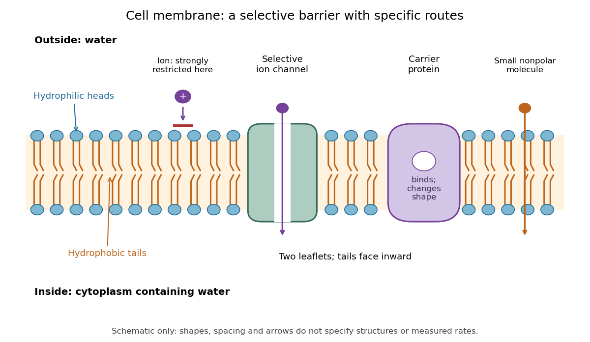

# Cell membrane

↑ **Parent:** [Biological cell](biological-cell-split.md)  
ⓦ [Wiki](https://en.wikipedia.org/wiki/Cell_membrane)

The [cell membrane](cell-membrane-split.md), also called the [plasma membrane](cell-membrane-split.md), is the selective boundary separating a [biological cell](biological-cell-split.md)'s [cytoplasm](cytoplasm.md) from its surroundings. Both [prokaryotes](prokaryote.md) and [eukaryotes](eukaryote.md) have a [cell membrane](cell-membrane-split.md). Where a [cell wall](cell-wall.md) is present, it is a distinct structure outside the [cell membrane](cell-membrane-split.md); the two names are not synonyms. This separation lets a [biological cell](biological-cell-split.md) maintain internal conditions while exchanging material through [membrane transport](membrane-transport.md). See [NHGRI: cell membrane](https://www.genome.gov/genetics-glossary/Cell-Membrane-Plasma-Membrane).

The familiar architecture is a [lipid bilayer](lipid-bilayer.md) containing [membrane proteins](membrane-protein.md). In a [phospholipid](phospholipid.md)-based [lipid bilayer](lipid-bilayer.md), two [membrane leaflets](membrane-leaflet.md) face opposite ways: [hydrophilic](hydrophilicity.md) heads face the [water](water.md) on each side, while [hydrophobic](hydrophobicity.md) tails face one another in the interior. The heads are therefore exposed both outside and inside the [biological cell](biological-cell-split.md). This arrangement combines a water-facing surface with a barrier to many water-soluble [solutes](solute.md); the schematic represents organization rather than an atomistic structure. See [Alberts et al., Molecular Biology of the Cell: the lipid bilayer](https://www.ncbi.nlm.nih.gov/books/NBK26871/).

**[Figure 1](#image-two-membrane-leaflets-and-selective-routes-through-a-cell-membrane). Two membrane leaflets and selective routes through a cell membrane**. Original [cell membrane](cell-membrane-split.md) schematic showing [phospholipids](phospholipid.md), [hydrophilic](hydrophilicity.md) heads, [hydrophobic](hydrophobicity.md) tails, an [ion channel](ion-channel.md), and a [carrier protein](carrier-protein.md). Arrows illustrate possible passage, not measured rates. Shapes, sizes, spacing and numbers of [molecules](molecule-split.md) are illustrative.

[Selective permeability](selective-permeability.md) means that different substances cross at different rates under comparable conditions. Small [nonpolar](nonpolar-molecule.md) [molecules](molecule-split.md) can pass through a [lipid bilayer](lipid-bilayer.md) by [diffusion](diffusion.md), while [ions](ion.md) encounter a strong barrier without a suitable route. An [ion channel](ion-channel.md) supplies a selective water-filled pathway when open; a [carrier protein](carrier-protein.md) binds a [solute](solute.md) and changes shape to expose it to the other side. These [membrane proteins](membrane-protein.md) therefore add specific routes to the barrier. An open [ion channel](ion-channel.md) permits [passive transport](passive-transport.md), whereas a [carrier protein](carrier-protein.md) can mediate either [passive transport](passive-transport.md) or [active transport](active-transport.md). See [Alberts et al.: principles of membrane transport](https://www.ncbi.nlm.nih.gov/books/NBK26815/).

The useful combination is retention plus controlled exchange: a completely impermeable boundary would prevent uptake, whereas unrestricted mixing would erase differences in [concentration](concentration.md) and [membrane potential](membrane-potential-split.md). The [fluid mosaic model](fluid-mosaic-model.md) connects these functions to an organized but mobile [lipid bilayer](lipid-bilayer.md) containing [proteins](protein-split.md).

**Table of contents**

- [GLUT1](glut1.md)
- [GLUT2](glut2.md)
- [Lipid divide](lipid-divide.md)
- [Membrane fission](membrane-fission.md)
- [Membrane fusion](membrane-fusion.md)
  - [Vesicle docking](vesicle-docking.md)
  - [Content mixing assay](content-mixing-assay.md)
  - [Lipid mixing assay](lipid-mixing-assay.md)
  - [Hemifusion](hemifusion.md)
  - [SNARE protein](snare-protein.md)
    - [Syntaxin-4](syntaxin-4.md)
    - [SNARE complex](snare-complex.md)
      - [Trans-SNARE complex](trans-snare-complex.md)
    - [t-SNARE](t-snare.md)
    - [v-SNARE](v-snare.md)
    - [SNAP-25](snap-25.md)
- [Membrane curvature](membrane-curvature.md)
- [Homeoviscous adaptation](homeoviscous-adaptation.md)
- [Membrane nanodomain](membrane-nanodomain.md)
- [Selective permeability](selective-permeability.md)
  - [Membrane permeability](membrane-permeability.md)
  - [Semipermeable membrane](semipermeable-membrane.md)
- [Membrane protein](membrane-protein.md)
  - [Ferroportin](ferroportin.md)
  - [Transferrin receptor 1](transferrin-receptor-1.md)
  - [OmpX](ompx.md)
  - [Membrane mimic](membrane-mimic.md)
  - [Nephrin](nephrin.md)
  - [Cargo receptor](cargo-receptor.md)
  - [Integrin](integrin.md)
  - [Hydrophobic mismatch](hydrophobic-mismatch.md)
  - [Integral membrane protein](integral-membrane-protein.md)
    - [Transmembrane protein](transmembrane-protein.md)
      - [Tail-anchored protein](tail-anchored-protein.md)
  - [Peripheral membrane protein](peripheral-membrane-protein.md)
  - [Lipid-anchored protein](lipid-anchored-protein.md)
  - [Membrane topology](membrane-topology.md)
  - [Lateral mobility of membrane proteins](lateral-mobility-of-membrane-proteins.md)
    - [Mouse-human heterokaryon membrane-mixing experiment](mouse-human-heterokaryon-membrane-mixing-experiment.md)
  - [Membrane transport protein](membrane-transport-protein.md)
    - [Nucleotide-sugar transporter](nucleotide-sugar-transporter.md)
    - [Scramblase](scramblase.md)
    - [Flippase](flippase.md)
    - [ATP-binding cassette transporter](atp-binding-cassette-transporter.md)
    - [AcrB](acrb.md)
    - [Multidrug efflux pump](multidrug-efflux-pump.md)
    - [GLUT4](glut4.md)
    - [Carrier protein](carrier-protein.md)
- [Gap junction](gap-junction.md)
- [Ion channel](ion-channel.md)
  - [GORK](gork.md)
  - [SLAC1](slac1.md)
  - [Mechanosensitive ion channel](mechanosensitive-ion-channel.md)
    - [MscL](mscl.md)
    - [MscS](mscs.md)
  - [Channel desensitization](channel-desensitization.md)
  - [Ligand-gated ion channel](ligand-gated-ion-channel.md)
  - [Selectivity filter](selectivity-filter.md)
  - [ATP-sensitive potassium channel](atp-sensitive-potassium-channel.md)
- [Membrane transport](membrane-transport.md)
  - [Membrane trafficking](membrane-trafficking.md)
    - [Retromer](retromer.md)
    - [Vesicle tethering](vesicle-tethering.md)
  - [Bacterial flagellar motor](bacterial-flagellar-motor.md)
    - [FliN](flin.md)
    - [FliM](flim.md)
    - [FliG](flig.md)
    - [MotB](motb.md)
    - [MotA](mota.md)
  - [CFTR](cftr.md)
  - [Protonophore](protonophore.md)
  - [SGLT1](sglt1.md)
  - [Phosphotransferase system](phosphotransferase-system.md)
    - [EIIA glucose](eiia-glucose.md)
  - [Lactose permease](lactose-permease.md)
  - [Endosomal sorting complexes required for transport](endosomal-sorting-complexes-required-for-transport.md)
  - [COPI](copi.md)
    - [Coatomer](coatomer.md)
  - [COPII](copii.md)
    - [Sec13-Sec31 complex](sec13-sec31-complex.md)
    - [Sec23-Sec24 complex](sec23-sec24-complex.md)
  - [Adaptor protein complex](adaptor-protein-complex.md)
    - [AP1 adaptor complex](ap1-adaptor-complex.md)
    - [AP2 adaptor complex](ap2-adaptor-complex.md)
  - [Alternating access](alternating-access.md)
  - [Passive transport](passive-transport.md)
    - [Facilitated diffusion](facilitated-diffusion.md)
    - [Osmosis](osmosis.md)
      - [Water potential](water-potential.md)
        - [Solute potential](solute-potential.md)
      - [Osmotic pressure](osmotic-pressure.md)
        - [Osmometry](osmometry.md)
          - [Reduced osmotic-pressure intercept](reduced-osmotic-pressure-intercept.md)
        - [Osmosis concentration-pressure example](osmosis-concentration-pressure-example.md)
      - [Membrane osmometer](membrane-osmometer.md)
      - [Osmotic concentration](osmotic-concentration.md)
      - [Tonicity](tonicity.md)
        - [Permeating solute](permeating-solute.md)
        - [Hypotonic solution](hypotonic-solution.md)
        - [Hypertonic solution](hypertonic-solution.md)
        - [Isotonic solution](isotonic-solution.md)
      - [Cytolysis](cytolysis.md)
  - [Active transport](active-transport.md)
    - [Proton pump](proton-pump.md)
      - [Vacuolar proton ATPase](vacuolar-proton-atpase.md)
    - [Secondary active transport](secondary-active-transport.md)
    - [Sodium-potassium ATPase](sodium-potassium-atpase.md)
  - [Exocytosis](exocytosis.md)
  - [Endocytosis](endocytosis.md)
    - [Synaptic vesicle recycling](synaptic-vesicle-recycling.md)
    - [Clathrin-mediated endocytosis](clathrin-mediated-endocytosis.md)
    - [Phagocytosis](phagocytosis.md)
- [Fluid mosaic model](fluid-mosaic-model.md)

## ↑ Ancestors (3)

1. [Biological cell](biological-cell-split.md)
2. [Biology](biology-split.md)
3. [Codex Wiki](split.md)

## ← Incoming links (96)

- [Action potential](action-potential.md)
- [Actomyosin ring](actomyosin-ring.md)
- [Adrenergic adipocyte assay](adrenergic-adipocyte-assay.md)
- [Animal](animal.md)
- [ATP synthase](atp-synthase.md)
- [Bacteria](bacteria.md)
- [Bacterial outer membrane](bacterial-outer-membrane.md)
- [Biological cell](biological-cell-split.md)
- [Biology](biology-split.md)
- [Carrier protein](carrier-protein.md)
- [Cell cortex](cell-cortex.md)
- [Cell envelope](cell-envelope.md)
- [Cell fusion](cell-fusion.md)
- [Cell membrane](cell-membrane-split.md)
- [Cell plate](cell-plate.md)
- [Cell-surface receptor](cell-surface-receptor.md)
- [Cell wall](cell-wall.md)
- [Chemical synapse](chemical-synapse.md)
- [Cholesterol](cholesterol.md)
- [Cleavage furrow](cleavage-furrow.md)
- [Cytokinesis](cytokinesis.md)
- [Cytoplasm](cytoplasm.md)
- [Electrical synapse](electrical-synapse.md)
- [Endocytosis](endocytosis.md)
- [Endosome](endosome.md)
- [Eukaryote](eukaryote.md)
- [Exocytosis](exocytosis.md)
- [Fluid mosaic model](fluid-mosaic-model.md)
- [G protein-coupled receptor](g-protein-coupled-receptor.md)
- [Gigaohm seal](gigaohm-seal.md)
- [Gram-negative bacteria](gram-negative-bacteria.md)
- [Gram-positive bacteria](gram-positive-bacteria.md)
- [Insulin](insulin.md)
- [Intracellular recording of membrane potential](intracellular-recording-of-membrane-potential.md)
- [Ion channel](ion-channel.md)
- [Ionotropic receptor](ionotropic-receptor.md)
- [IP3-sensitive calcium store](ip3-sensitive-calcium-store.md)
- [Lamellipodium](lamellipodium.md)
- [Lateral mobility of membrane proteins](lateral-mobility-of-membrane-proteins.md)
- [Lipid](lipid.md)
- [Lysosome](lysosome.md)
- [Membrane bleb](membrane-bleb.md)
- [Membrane capacitance](membrane-capacitance.md)
- [Membrane charge separation](membrane-charge-separation.md)
- [Membrane leaflet](membrane-leaflet.md)
- [Membrane mimic](membrane-mimic.md)
- [Membrane potential](membrane-potential-split.md)
- [Membrane protein](membrane-protein.md)
- [Membrane topology](membrane-topology.md)
- [Membrane transport](membrane-transport.md)
- [Metabotropic receptor](metabotropic-receptor.md)
- [Multicellular organism](multicellular-organism.md)
- [Nernst equilibrium potential](nernst-equilibrium-potential.md)
- [Neuron](neuron.md)
- [Organism](organism-split.md)
- [Osmosis](osmosis.md)
- [Osmotic concentration](osmotic-concentration.md)
- [Pancreatic IP3 store fractionation experiment](pancreatic-ip3-store-fractionation-experiment.md)
- [Passive membrane response in current clamp](passive-membrane-response-in-current-clamp.md)
- [Solution](past-exam-of-the-biochemistry-course-of-the-university-of-cambridge/2024/paper-1/section-i/1/solution.md)
- [Solution](past-exam-of-the-biochemistry-course-of-the-university-of-cambridge/2024/paper-1/section-i/2/solution.md)
- [Solution](past-exam-of-the-biochemistry-course-of-the-university-of-cambridge/2024/paper-1/section-ii/5/solution.md)
- [Solution](past-exam-of-the-biochemistry-course-of-the-university-of-cambridge/2024/paper-2/section-ii/5/solution.md)
- [Solution](past-exam-of-the-biochemistry-course-of-the-university-of-cambridge/2024/paper-5/section-2/k/solution.md)
- [Solution](past-exam-of-the-biochemistry-course-of-the-university-of-cambridge/2024/paper-5/section-2/q/solution.md)
- [Solution](past-exam-of-the-quantum-condensed-matter-course-of-the-university-of-cambridge/2005/section-a/a1/b/solution.md)
- [Solution](past-exam-of-the-systems-biology-course-of-the-university-of-cambridge/2024/paper-1/section-i/1-1/solution.md)
- [Solution](past-exam-of-the-zoology-course-of-the-university-of-cambridge/2025/paper-zm6/1/solution.md)
- [Patch clamp](patch-clamp.md)
- [Peptidoglycan](peptidoglycan.md)
- [Phagocytosis](phagocytosis.md)
- [Phospholipid](phospholipid.md)
- [Plant](plant.md)
- [Plant cell wall](plant-cell-wall.md)
- [Plasmolysis](plasmolysis.md)
- [Prokaryote](prokaryote.md)
- [Proton-motive force](proton-motive-force.md)
- [Protoplast](protoplast.md)
- [Receptor (biochemistry)](receptor-biochemistry.md)
- [Receptor tyrosine kinase](receptor-tyrosine-kinase.md)
- [Reversal potential](reversal-potential.md)
- [Secretory protein routing](secretory-protein-routing.md)
- [Selective permeability](selective-permeability.md)
- [Signal transduction](signal-transduction-split.md)
- [Southern blot](southern-blot.md)
- [Synapse](synapse.md)
- [Synaptic cleft](synaptic-cleft.md)
- [Synaptic integration](synaptic-integration.md)
- [Synaptic potential](synaptic-potential.md)
- [Synaptic vesicle](synaptic-vesicle.md)
- [Tonicity](tonicity.md)
- [Trans-Golgi network](trans-golgi-network.md)
- [Trypan blue exclusion test](trypan-blue-exclusion-test.md)
- [Turgor pressure](turgor-pressure.md)
- [Unicellular organism](unicellular-organism.md)
- [Western blot membrane](western-blot-membrane.md)
