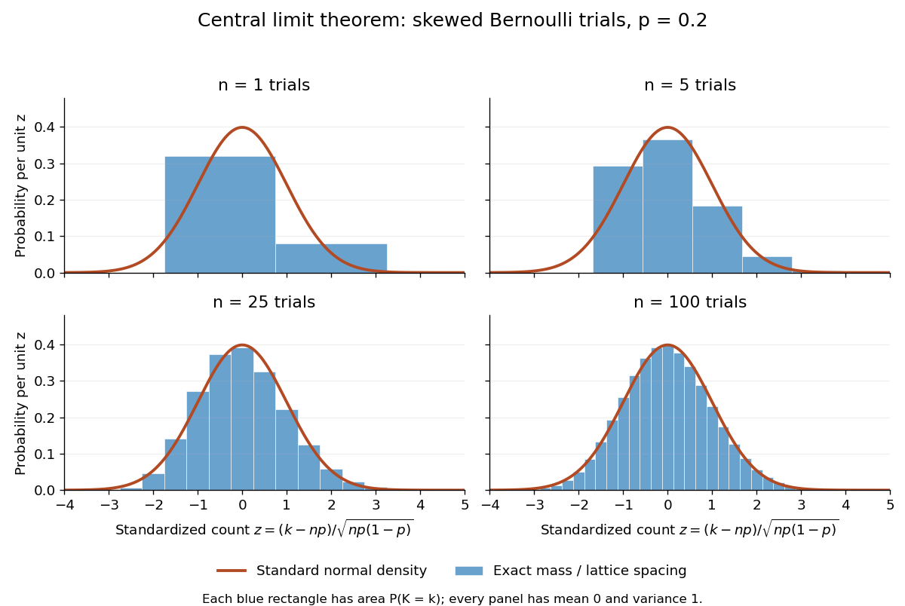

# Central limit theorem

↑ **Parent:** [Convergence of random variables](convergence-of-random-variables-split.md)  
ⓦ [Wiki](https://en.wikipedia.org/wiki/Central_limit_theorem)

Let $X_1,X_2,\ldots$ be real [independent and identically distributed random variables](independent-and-identically-distributed-random-variables.md) with [expected value](expected-value.md) $\mu=\mathbb E[X_1]$ and finite, strictly positive [variance](variance-split.md) $\sigma^2=\mathbb E[(X_1-\mu)^2]$. Write $S_n=\sum_{j=1}^nX_j$ and $\overline X_n=S_n/n$ for their sum and [sample mean](sample-mean.md). The [central limit theorem](central-limit-theorem.md) states

$$
Z_n=\frac{S_n-n\mu}{\sigma\sqrt n}
=\frac{\sqrt n(\overline X_n-\mu)}{\sigma}
\xrightarrow{d}N(0,1).
$$

Precisely, for every real $z$,

$$
\mathbb P(Z_n\leq z)\longrightarrow\Phi(z),
\qquad
\Phi(z)=\frac1{\sqrt{2\pi}}\int_{-\infty}^z e^{-u^2/2}\,du,
$$

where $\Phi$ is the [standard normal distribution function](standard-normal-distribution-function.md). The conclusion is [convergence in distribution](convergence-in-distribution.md) to the [standard normal distribution](standard-normal-distribution.md). If the [variance](variance-split.md) is zero, every observation equals $\mu$ [almost surely](almost-sure-convergence.md); the displayed normalization is then undefined and there is no fluctuating error to describe.

The striking feature is that the observations need not have a [normal distribution](normal-distribution.md). They may be binary, bounded, or strongly skewed. Their detailed [probability distribution](probability-distribution.md) disappears from this limit except through the [expected value](expected-value.md) and [variance](variance-split.md). The subtraction removes predictable growth: $\mathbb E[S_n]=n\mu$. The division implements [variance normalization](variance-normalization.md): [variance additivity for independent random variables](variance-additivity-for-independent-random-variables.md) gives $\operatorname{Var}(S_n)=n\sigma^2$, so every $Z_n$ has [expected value](expected-value.md) zero and [variance](variance-split.md) one. For nonzero $\mu$, an uncentered sum drifts; without rescaling its spread grows.

For a concrete example, let each $X_j$ have a [Bernoulli distribution](bernoulli-distribution.md) with success [probability](probability.md) $p=0.2$. Then $K_n=S_n$ has a [binomial distribution](binomial-distribution.md), with [expected value](expected-value.md) $np$ and [variance](variance-split.md) $np(1-p)$. Its exact [probability mass function](probability-mass-function.md) and its normalized count are

$$
\mathbb P(K_n=k)=\binom nk p^k(1-p)^{n-k},\quad k=0,\ldots,n,
\qquad
Z_n=\frac{K_n-np}{\sqrt{np(1-p)}}.
$$

Here $\binom nk$ is a [binomial coefficient](binomial-coefficient.md). Individual trials are conspicuously skewed, yet their centered, rescaled counts approach the same [standard normal distribution](standard-normal-distribution.md) as sums of fair trials.

**[Figure 2](#image-exact-standardized-binomial-distributions-approach-the-standard-normal-curve). Exact standardized binomial distributions approach the standard normal curve**. For [independent](independent-random-variables.md) [Bernoulli trials](bernoulli-trial.md) with $p=0.2$, each blue bar has width equal to the normalized lattice spacing and area equal to the exact [binomial distribution](binomial-distribution.md) mass at its center. Heights are mass divided by spacing, so they can be compared with the orange [probability density function](probability-density-function.md) of the [standard normal distribution](standard-normal-distribution.md). All four normalized counts have [expected value](expected-value.md) zero and [variance](variance-split.md) one. The rectangles visualize discrete masses; they do not make the discrete [probability distributions](probability-distribution.md) continuous.

At $n=100$, $K_n$ has [expected value](expected-value.md) $20$ and [standard deviation](standard-deviation.md) $4$. The exact [binomial distribution](binomial-distribution.md) gives $\mathbb P(16\leq K_n\leq24)=0.740141\ldots$. A [normal approximation](normal-approximation.md) with the [continuity correction](continuity-correction.md) uses the interval $15.5$ to $24.5$:

$$
\mathbb P(16\leq K_n\leq24)
\approx\Phi\left(\frac{24.5-20}{4}\right)-\Phi\left(\frac{15.5-20}{4}\right)
=0.739411\ldots.
$$

The small discrepancy is an approximation error, not an equality supplied by the [central limit theorem](central-limit-theorem.md).

The [strong law of large numbers](strong-law-of-large-numbers.md) and [weak law of large numbers](weak-law-of-large-numbers.md) locate the average: $\overline X_n\to\mu$, respectively by [almost sure convergence](almost-sure-convergence.md) and [convergence in probability](convergence-in-probability.md). The [central limit theorem](central-limit-theorem.md) magnifies that shrinking error and describes its shape. In terms of the [sample mean](sample-mean.md), the resulting [normal approximation](normal-approximation.md) is $N(\mu,\sigma^2/n)$, with [standard error](standard-error.md) $\sigma/\sqrt n$. This explains why four times as many [independent](independent-random-variables.md) observations halve the [standard error](standard-error.md). When $\sigma$ is known, $\overline X_n\pm1.96\sigma/\sqrt n$ has approximately $95\%$ coverage for $\mu$ at large $n$, giving a [confidence interval](confidence-interval.md). This coverage refers to repeated samples, not a guarantee for an individual interval.

A useful application is the [Monte Carlo method](monte-carlo-method.md): estimate a success [probability](probability.md) by the proportion of successful simulated trials. Nicholas Metropolis and S. Ulam's original paper, "The Monte Carlo Method" (1949), illustrates this with games of solitaire and estimation of a region's volume by randomly selected points, and discusses why estimates require probabilistic error control. The [strong law of large numbers](strong-law-of-large-numbers.md) justifies convergence of such proportions for [independent](independent-random-variables.md) repetitions; the [central limit theorem](central-limit-theorem.md) supplies their large-sample error scale when $0<p<1$.[Metropolis and Ulam, The Monte Carlo Method, JASA 44 (1949), 335–341, especially pp. 336–337](https://hedibert.org/wp-content/uploads/2013/12/1949MetropolisUlam.pdf)

There are three useful limits to this picture:
- A [heavy-tailed distribution](heavy-tailed-distribution.md) can have infinite [variance](variance-split.md), so the displayed hypothesis must be checked. A [Pareto distribution](pareto-distribution.md) with minimum one and shape $3/2$ has finite [expected value](expected-value.md) three but infinite [variance](variance-split.md). The [strong law of large numbers](strong-law-of-large-numbers.md) still applies, but the stated [central limit theorem](central-limit-theorem.md) does not. More dramatically, the [Cauchy sample mean has an unchanged distribution](cauchy-sample-mean-has-an-unchanged-distribution.md): even averaging need not concentrate when the [expected value](expected-value.md) is undefined. A [heavy-tailed distribution](heavy-tailed-distribution.md) with finite [variance](variance-split.md) is allowed by the stated [central limit theorem](central-limit-theorem.md).
- [Independence](independent-random-variables.md) matters. If all $X_j$ equal the same nonconstant [Bernoulli random variable](bernoulli-distribution.md), then $S_n=nX_1$ and $\overline X_n=X_1$. There is no accumulation of new information, and the [variance](variance-split.md) of the sum grows like $n^2$, not $n$. Other versions of the [central limit theorem](central-limit-theorem.md) can allow dependence, but require hypotheses controlling it.
- [Convergence in distribution](convergence-in-distribution.md) is a limiting assertion, with no universal sample size or error rate under finite [variance](variance-split.md) alone. It does not automatically give accurate relative estimates of very small tail [probabilities](probability.md). Nor does it mean that discrete point masses converge as [probability density functions](probability-density-function.md): a [binomial distribution](binomial-distribution.md) remains discrete for every finite $n$. If the success [probability](probability.md) changes with $n$ so that $np_n\to\lambda$ and $p_n\to0$, the relevant result is the [Poisson limit theorem](poisson-limit-theorem.md), rather than the fixed-$p$ argument above.

A historical original-paper reference is J. W. Lindeberg's "Eine neue Herleitung des Exponentialgesetzes in der Wahrscheinlichkeitsrechnung" (1922), published in Mathematische Zeitschrift 15, pp. 211–225. The [Lindeberg condition](lindeberg-condition.md) and [Lindeberg-Feller central limit theorem](lindeberg-feller-central-limit-theorem.md) below describe a version for sums whose summands need not share a [probability distribution](probability-distribution.md).[Lindeberg, Eine neue Herleitung des Exponentialgesetzes in der Wahrscheinlichkeitsrechnung (1922)](https://doi.org/10.1007/BF01494395)

A brief proof outline uses the [characteristic function](characteristic-function.md) of $Y=(X_1-\mu)/\sigma$. Its [expected value](expected-value.md) is zero and its [variance](variance-split.md) is one, so the finite [second moment](second-moment.md) gives

$$
\varphi_Y(u)=1-\frac{u^2}{2}+o(u^2)\quad(u\to0).
$$

The [Taylor expansion](taylor-expansion.md) of the complex exponential, with its remainder controlled by $Y^2$, and the [dominated convergence theorem](dominated-convergence-theorem.md) justify this step without a third-moment assumption. [Independence](independent-random-variables.md) then gives the [characteristic function](characteristic-function.md) of $Z_n$:

$$
\varphi_{Z_n}(t)=\left(\varphi_Y(t/\sqrt n)\right)^n
=\left(1-\frac{t^2}{2n}+o(n^{-1})\right)^n\longrightarrow e^{-t^2/2}.
$$

The limit is the [characteristic function](characteristic-function.md) of the [standard normal distribution](standard-normal-distribution.md); the [Lévy continuity theorem](levy-continuity-theorem.md) turns this into [convergence in distribution](convergence-in-distribution.md).

**Table of contents**

- [Lindeberg-Feller central limit theorem](lindeberg-feller-central-limit-theorem.md)
  - [Lyapunov condition](lyapunov-condition.md)
- [Gaussian tails force an unbounded normalized partial-sum limsup](gaussian-tails-force-an-unbounded-normalized-partial-sum-limsup.md)
- [Normal approximation](normal-approximation.md)
  - [Continuity correction](continuity-correction.md)
- [Lindeberg condition](lindeberg-condition.md)
- [Hilbert-space central limit theorem](hilbert-space-central-limit-theorem.md)
- [Self-normalized central limit theorem with a second-moment denominator](self-normalized-central-limit-theorem-with-a-second-moment-denominator.md)
- [Donsker's theorem](donsker-s-theorem.md)
  - [Fourth-moment tightness of polygonal random walks](fourth-moment-tightness-of-polygonal-random-walks.md)
  - [Random-walk maximum limit from Donsker invariance](random-walk-maximum-limit-from-donsker-invariance.md)
  - [Integrated random-walk limit](integrated-random-walk-limit.md)
- [Multivariate central limit theorem](multivariate-central-limit-theorem.md)

## ↑ Ancestors (6)

1. [Convergence of random variables](convergence-of-random-variables-split.md)
2. [Probability theory](probability-theory-split.md)
3. [Probability and statistics](probability-and-statistics-split.md)
4. [Area of mathematics](area-of-mathematics.md)
5. [Mathematics](mathematics-split.md)
6. [Codex Wiki](split.md)

## ← Incoming links (107)

- [Baseline logit estimator in a group-factor binomial model](baseline-logit-estimator-in-a-group-factor-binomial-model.md)
- [Binomial proportion](binomial-proportion.md)
- [Central limit theorem](central-limit-theorem.md)
- [Central limit theorem for a geometrically ergodic Markov chain](central-limit-theorem-for-a-geometrically-ergodic-markov-chain.md)
- [Certain ruin with nonpositive loading and finite claim variance](certain-ruin-with-nonpositive-loading-and-finite-claim-variance.md)
- [Convergence of random variables](convergence-of-random-variables-split.md)
- [Exponential-rate maximum-likelihood estimator](exponential-rate-maximum-likelihood-estimator.md)
- [Extreme value theory](extreme-value-theory.md)
- [Functional statistic](functional-statistic.md)
- [Gaussian tails force an unbounded normalized partial-sum limsup](gaussian-tails-force-an-unbounded-normalized-partial-sum-limsup.md)
- [Influence function of the mean](influence-function-of-the-mean.md)
- [Law of large numbers](law-of-large-numbers.md)
- [Log-stretch fluctuations in an isotropic renovating shear](log-stretch-fluctuations-in-an-isotropic-renovating-shear.md)
- [Long-run variance of a stationary process](long-run-variance-of-a-stationary-process.md)
- [Moderate deviation principle](moderate-deviation-principle.md)
- [Normal approximation](normal-approximation.md)
- [Normal distribution](normal-distribution.md)
- [Normal mean confidence interval with known variance](normal-mean-confidence-interval-with-known-variance.md)
- [Solution](past-exam-of-the-mathematics-course-of-the-university-of-cambridge/2001/iii/paper-26/4/solution.md)
- [Solution](past-exam-of-the-mathematics-course-of-the-university-of-cambridge/2001/iii/paper-32/4/solution.md)
- [Solution](past-exam-of-the-mathematics-course-of-the-university-of-cambridge/2001/iii/paper-46/2/solution.md)
- [Solution](past-exam-of-the-mathematics-course-of-the-university-of-cambridge/2002/iii/paper-38/4/solution.md)
- [Solution](past-exam-of-the-mathematics-course-of-the-university-of-cambridge/2002/iii/paper-51/3/solution.md)
- [Solution](past-exam-of-the-mathematics-course-of-the-university-of-cambridge/2003/ib/paper-2/12h/solution.md)
- [Solution](past-exam-of-the-mathematics-course-of-the-university-of-cambridge/2003/iii/paper-41/1/i/solution.md)
- [Solution](past-exam-of-the-mathematics-course-of-the-university-of-cambridge/2003/iii/paper-41/4/solution.md)
- [Solution](past-exam-of-the-mathematics-course-of-the-university-of-cambridge/2003/iii/paper-41/6/vi/solution.md)
- [Solution](past-exam-of-the-mathematics-course-of-the-university-of-cambridge/2003/iii/paper-43/5/solution.md)
- [Solution](past-exam-of-the-mathematics-course-of-the-university-of-cambridge/2004/iii/paper-40/4/i/solution.md)
- [Solution](past-exam-of-the-mathematics-course-of-the-university-of-cambridge/2005/ia/paper-2/4f/solution.md)
- [Solution](past-exam-of-the-mathematics-course-of-the-university-of-cambridge/2005/iii/paper-41/5/ii/solution.md)
- [Solution](past-exam-of-the-mathematics-course-of-the-university-of-cambridge/2005/iii/paper-42/4/solution.md)
- [Solution](past-exam-of-the-mathematics-course-of-the-university-of-cambridge/2005/iii/paper-42/6/i/solution.md)
- [Solution](past-exam-of-the-mathematics-course-of-the-university-of-cambridge/2005/iii/paper-48/5/d/solution.md)
- [Solution](past-exam-of-the-mathematics-course-of-the-university-of-cambridge/2006/ii/paper-4/27j/a/solution.md)
- [Solution](past-exam-of-the-mathematics-course-of-the-university-of-cambridge/2006/ii/paper-4/27j/b/solution.md)
- [Solution](past-exam-of-the-mathematics-course-of-the-university-of-cambridge/2006/iii/paper-42/1/i/solution.md)
- [Solution](past-exam-of-the-mathematics-course-of-the-university-of-cambridge/2006/iii/paper-42/1/solution.md)
- [Solution](past-exam-of-the-mathematics-course-of-the-university-of-cambridge/2006/iii/paper-42/2/solution.md)
- [Solution](past-exam-of-the-mathematics-course-of-the-university-of-cambridge/2007/iii/paper-43/3/solution.md)
- [Solution](past-exam-of-the-mathematics-course-of-the-university-of-cambridge/2007/iii/paper-44/2/solution.md)
- [Solution](past-exam-of-the-mathematics-course-of-the-university-of-cambridge/2007/iii/paper-48/4/solution.md)
- [Solution](past-exam-of-the-mathematics-course-of-the-university-of-cambridge/2008/ii/paper-3/26i/solution.md)
- [Solution](past-exam-of-the-mathematics-course-of-the-university-of-cambridge/2008/iii/paper-42/4/solution.md)
- [Solution](past-exam-of-the-mathematics-course-of-the-university-of-cambridge/2008/iii/paper-87/1/i/solution.md)
- [Solution](past-exam-of-the-mathematics-course-of-the-university-of-cambridge/2009/ii/paper-2/28i/solution.md)
- [Solution](past-exam-of-the-mathematics-course-of-the-university-of-cambridge/2009/ii/paper-3/6a/solution.md)
- [Solution](past-exam-of-the-mathematics-course-of-the-university-of-cambridge/2009/iii/paper-101/1/a/solution.md)
- [Solution](past-exam-of-the-mathematics-course-of-the-university-of-cambridge/2009/iii/paper-101/2/a/solution.md)
- [Solution](past-exam-of-the-mathematics-course-of-the-university-of-cambridge/2010/ii/paper-1/28j/solution.md)
- [Solution](past-exam-of-the-mathematics-course-of-the-university-of-cambridge/2010/ii/paper-3/25i/solution.md)
- [Solution](past-exam-of-the-mathematics-course-of-the-university-of-cambridge/2010/iii/paper-28/2/b/iii/solution.md)
- [Solution](past-exam-of-the-mathematics-course-of-the-university-of-cambridge/2010/iii/paper-31/1/solution.md)
- [Solution](past-exam-of-the-mathematics-course-of-the-university-of-cambridge/2011/ii/paper-3/25k/iii/solution.md)
- [Solution](past-exam-of-the-mathematics-course-of-the-university-of-cambridge/2012/iii/paper-39/2/solution.md)
- [Solution](past-exam-of-the-mathematics-course-of-the-university-of-cambridge/2014/ia/paper-2/10f/solution.md)
- [Solution](past-exam-of-the-mathematics-course-of-the-university-of-cambridge/2014/iii/paper-31/3/solution.md)
- [Solution](past-exam-of-the-mathematics-course-of-the-university-of-cambridge/2014/iii/paper-36/4/a/solution.md)
- [Solution](past-exam-of-the-mathematics-course-of-the-university-of-cambridge/2014/iii/paper-36/4/d/solution.md)
- [Solution](past-exam-of-the-mathematics-course-of-the-university-of-cambridge/2015/ii/paper-4/22j/b/solution.md)
- [Solution](past-exam-of-the-mathematics-course-of-the-university-of-cambridge/2015/ii/paper-4/24j/solution.md)
- [Solution](past-exam-of-the-mathematics-course-of-the-university-of-cambridge/2015/iii/paper-37/5/b/solution.md)
- [Solution](past-exam-of-the-mathematics-course-of-the-university-of-cambridge/2015/iii/paper-37/6/i/d/solution.md)
- [Solution](past-exam-of-the-mathematics-course-of-the-university-of-cambridge/2016/ib/paper-3/20h/b/solution.md)
- [Solution](past-exam-of-the-mathematics-course-of-the-university-of-cambridge/2016/iii/paper-208/2/2/3/solution.md)
- [Solution](past-exam-of-the-mathematics-course-of-the-university-of-cambridge/2016/iii/paper-208/5/a/solution.md)
- [Solution](past-exam-of-the-mathematics-course-of-the-university-of-cambridge/2016/iii/paper-209/2/a/solution.md)
- [Solution](past-exam-of-the-mathematics-course-of-the-university-of-cambridge/2016/iii/paper-209/3/solution.md)
- [Solution](past-exam-of-the-mathematics-course-of-the-university-of-cambridge/2017/ia/paper-2/9f/c/solution.md)
- [Solution](past-exam-of-the-mathematics-course-of-the-university-of-cambridge/2017/ii/paper-2/26k/b/solution.md)
- [Solution](past-exam-of-the-mathematics-course-of-the-university-of-cambridge/2018/ia/paper-2/11f/b/solution.md)
- [Solution](past-exam-of-the-mathematics-course-of-the-university-of-cambridge/2018/ii/paper-1/29k/c/solution.md)
- [Solution](past-exam-of-the-mathematics-course-of-the-university-of-cambridge/2019/ii/paper-2/28j/a/solution.md)
- [Solution](past-exam-of-the-mathematics-course-of-the-university-of-cambridge/2019/ii/paper-2/28j/d/solution.md)
- [Solution](past-exam-of-the-mathematics-course-of-the-university-of-cambridge/2019/ii/paper-3/28j/a/solution.md)
- [Solution](past-exam-of-the-mathematics-course-of-the-university-of-cambridge/2019/ii/paper-4/28j/b/ii/solution.md)
- [Solution](past-exam-of-the-mathematics-course-of-the-university-of-cambridge/2019/ii/paper-4/28j/b/iv/solution.md)
- [Solution](past-exam-of-the-mathematics-course-of-the-university-of-cambridge/2020/ii/paper-2/28j/solution.md)
- [Solution](past-exam-of-the-mathematics-course-of-the-university-of-cambridge/2021/ii/paper-3/28j/a/solution.md)
- [Solution](past-exam-of-the-mathematics-course-of-the-university-of-cambridge/2022/ib/paper-2/6h/b/solution.md)
- [Solution](past-exam-of-the-mathematics-course-of-the-university-of-cambridge/2022/ii/paper-1/29k/b/solution.md)
- [Solution](past-exam-of-the-mathematics-course-of-the-university-of-cambridge/2022/ii/paper-3/26g/solution.md)
- [Solution](past-exam-of-the-mathematics-course-of-the-university-of-cambridge/2022/ii/paper-3/28k/c/solution.md)
- [Solution](past-exam-of-the-mathematics-course-of-the-university-of-cambridge/2022/iii/paper-205/3/solution.md)
- [Solution](past-exam-of-the-mathematics-course-of-the-university-of-cambridge/2022/iii/paper-225/4/solution.md)
- [Solution](past-exam-of-the-mathematics-course-of-the-university-of-cambridge/2023/iii/paper-201/3/b/solution.md)
- [Solution](past-exam-of-the-mathematics-course-of-the-university-of-cambridge/2024/ia/paper-2/11f/ii/solution.md)
- [Solution](past-exam-of-the-mathematics-course-of-the-university-of-cambridge/2024/iii/paper-207/2/a/solution.md)
- [Solution](past-exam-of-the-mathematics-course-of-the-university-of-cambridge/2024/iii/paper-221/4/iii/solution.md)
- [Solution](past-exam-of-the-mathematics-course-of-the-university-of-cambridge/2024/iii/paper-223/1/c/solution.md)
- [Solution](past-exam-of-the-mathematics-course-of-the-university-of-cambridge/2025/ia/paper-2/11f/d/solution.md)
- [Solution](past-exam-of-the-mathematics-course-of-the-university-of-cambridge/2025/iii/paper-207/3/b/ii/solution.md)
- [Solution](past-exam-of-the-mathematics-course-of-the-university-of-cambridge/2025/iii/paper-221/2/a/solution.md)
- [Solution](past-exam-of-the-mathematics-course-of-the-university-of-cambridge/2026/ia/paper-2/10f/v/solution.md)
- [Solution](past-exam-of-the-mathematics-course-of-the-university-of-cambridge/2026/iii/paper-201/4/d/i/solution.md)
- [Solution](past-exam-of-the-mathematics-course-of-the-university-of-cambridge/2026/iii/paper-205/2/solution.md)
- [Solution](past-exam-of-the-mathematics-course-of-the-university-of-cambridge/2026/iii/paper-223/3/c/solution.md)
- [Polynomial tails prevent exponential tilting](polynomial-tails-prevent-exponential-tilting.md)
- [Power-law velocity-correlation dispersion](power-law-velocity-correlation-dispersion.md)
- [Probability theory](probability-theory-split.md)
- [Sandwich variance of an M-estimator](sandwich-variance-of-an-m-estimator.md)
- [Short-memory time series](short-memory-time-series.md)
- [Strong law of large numbers](strong-law-of-large-numbers.md)
- [Strong mixing of a stationary process](strong-mixing-of-a-stationary-process.md)
- [Studentization of the generalized covariance measure statistic](studentization-of-the-generalized-covariance-measure-statistic.md)
- [U-statistic central limit theorem](u-statistic-central-limit-theorem.md)
- [Weak law of large numbers](weak-law-of-large-numbers.md)
