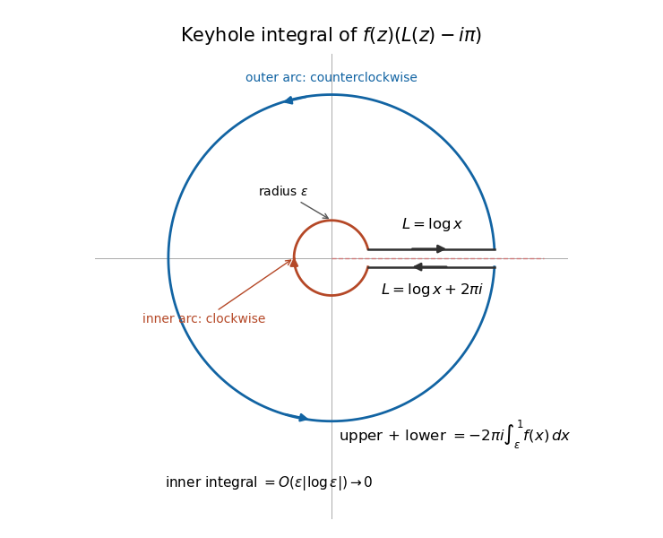

# Centred logarithmic keyhole identity

↑ **Parent:** [Analytic logarithm on the positive-axis slit plane](analytic-logarithm-on-the-positive-axis-slit-plane.md)

For an [entire function](entire-function.md) $f$, use the [complex logarithm](complex-logarithm.md) $L$ with argument in $(0,2\pi)$. The unit-circle integral in the title uses the branch's one-sided boundary values at its crossing with the cut. On a keyhole contour, the outward upper bank has $L=\log x$, and the inward lower bank has $L=\log x+2\pi i$. Their combined integral of $f(L-i\pi)$ is $-2\pi i\int_\varepsilon^1f(x)dx$. The inner circle contributes $O(\varepsilon|\log\varepsilon|)$, which vanishes. The [Cauchy integral theorem](cauchy-s-integral-theorem.md) on the slit plane therefore gives the identity.

On $z=e^{i\theta}$, $|L-i\pi|=|\theta-\pi|\leq\pi$. The [estimation lemma](estimation-lemma.md) consequently gives

$$
\left|\int_0^1f(x)dx\right|\leq\frac1{2\pi}\int_0^{2\pi}|f(e^{i\theta})||\theta-\pi|d\theta\leq\frac12\int_0^{2\pi}|f(e^{i\theta})|d\theta.
$$

Subtracting the middle branch value $i\pi$ centres the weight and produces this bound. The contour crosses the cut only in the limiting boundary-value interpretation, so it is not a closed contour inside the logarithm's domain.

**[Figure 4](#image-opposite-bank-orientations-turn-a-logarithmic-jump-into-a-real-segment-integral). Opposite bank orientations turn a logarithmic jump into a real-segment integral**.

## ↑ Ancestors (6)

1. [Analytic logarithm on the positive-axis slit plane](analytic-logarithm-on-the-positive-axis-slit-plane.md)
2. [Complex logarithm](complex-logarithm.md)
3. [Analysis](analysis-split.md)
4. [Area of mathematics](area-of-mathematics.md)
5. [Mathematics](mathematics-split.md)
6. [Codex Wiki](split.md)

## ← Incoming links (2)

- [Solution](past-exam-of-the-metric-spaces-and-complex-analysis-course-of-the-university-of-oxford/2017/3/b/iii/solution.md)
- [Shifted Hilbert quadratic-form bound](shifted-hilbert-quadratic-form-bound.md)
