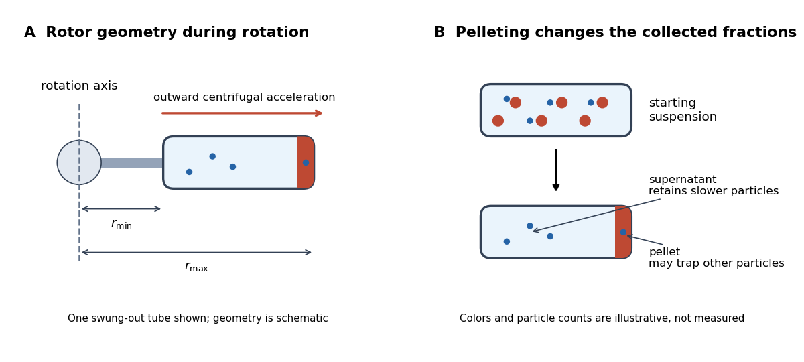

# Centrifugation

↑ **Parent:** [Biology](biology-split.md)  
ⓦ [Wiki](https://en.wikipedia.org/wiki/Centrifugation)

[Centrifugation](centrifugation.md) separates suspended material by its motion relative to a rotating liquid. A [centrifuge rotor](centrifuge-rotor.md) creates an outward [centrifugal acceleration](centrifugal-acceleration.md) in the [rotating reference frame](rotating-reference-frame.md); material denser than its surroundings tends to move outward, opposed by [drag force](drag-physics.md). Collected material can form a [centrifugation pellet](centrifugation-pellet.md), leaving a [supernatant](supernatant.md), or remain in separated zones within a [density gradient](density-gradient.md). The useful question is which physical difference the separation exploits: a difference in [sedimentation coefficient](sedimentation-coefficient.md) or a difference in [buoyant density](buoyant-density.md).

**[Figure 8](#image-centrifuge-rotor-geometry-and-the-centrifugation-pellet-supernatant-distinction). Centrifuge rotor geometry and the centrifugation pellet–supernatant distinction**. Original schematic of one swung-out tube during rotation and a conceptual pelleting comparison. [Rotor radius](rotor-radius.md) increases toward the tube's outer end. Colors and particle counts illustrate incomplete separation and trapping; they are not measured recovery fractions. The tube remains horizontal in this depiction of the rotating geometry.

[Centrifugation](centrifugation.md) makes otherwise slow settling useful for studying [biological cells](biological-cell.md), [organelles](organelle.md), [proteins](protein.md) and [DNA](deoxyribonucleic-acid.md). Separation and identification are different steps: a [centrifugation pellet](centrifugation-pellet.md) is a collected fraction, not proof that it contains only one kind of [organelle](organelle.md). The [lysozyme wall-removal experiment](lysozyme-wall-removal-experiment.md) illustrates a complementary readout: testing material released into the separated liquid can be more informative than inspecting the retained solids.

**Table of contents**

- [Centrifuge rotor](centrifuge-rotor.md)
  - [Rotor radius](rotor-radius.md)
  - [Relative centrifugal force](relative-centrifugal-force.md)
- [Centrifugation pellet](centrifugation-pellet.md)
- [Supernatant](supernatant.md)
- [Sedimentation coefficient](sedimentation-coefficient.md)
- [Differential centrifugation](differential-centrifugation.md)
- [Density-gradient centrifugation](density-gradient-centrifugation.md)
  - [Isopycnic centrifugation](isopycnic-centrifugation.md)
    - [Buoyant density](buoyant-density.md)
    - [Cesium chloride density gradient](cesium-chloride-density-gradient.md)
  - [Rate-zonal centrifugation](rate-zonal-centrifugation.md)

## ↑ Ancestors (2)

1. [Biology](biology-split.md)
2. [Codex Wiki](split.md)

## ← Incoming links (3)

- [Centrifugation](centrifugation.md)
- [Centrifugation pellet](centrifugation-pellet.md)
- [Lysozyme wall-removal experiment](lysozyme-wall-removal-experiment.md)
