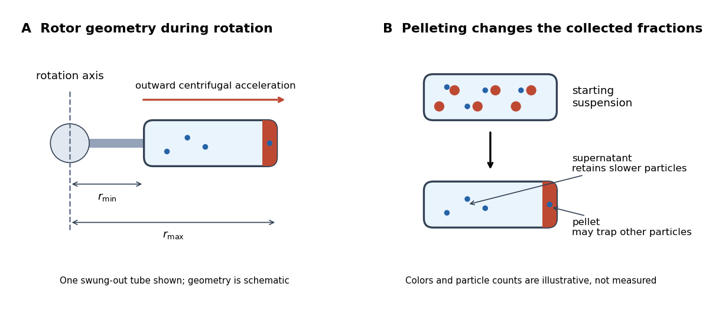
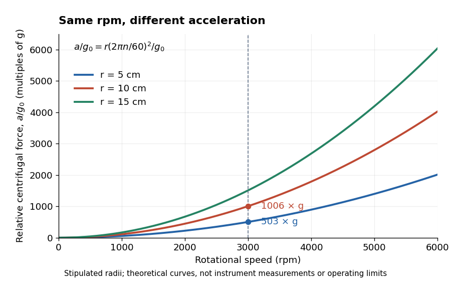
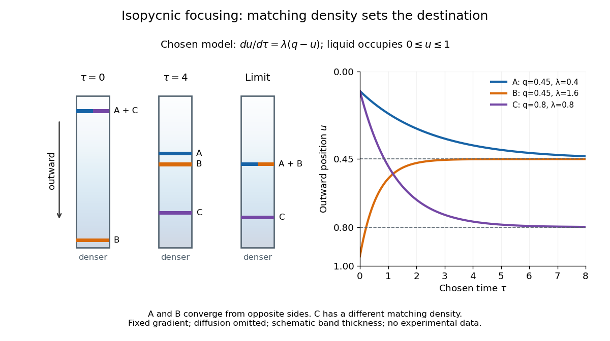
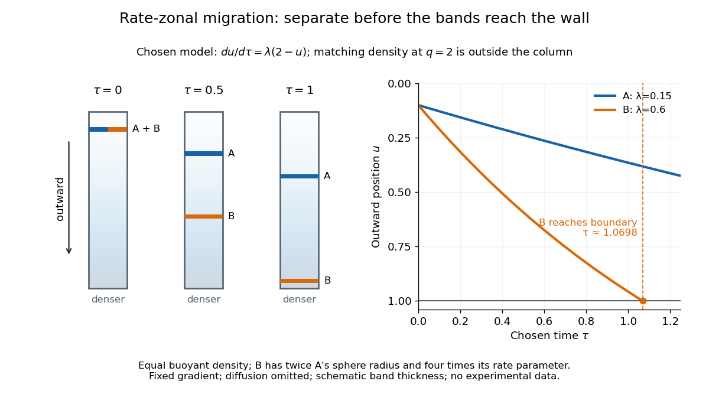

# Centrifugation

↑ **Parent:** [Biology](biology.md)  
ⓦ [Wiki](https://en.wikipedia.org/wiki/Centrifugation)

[Centrifugation](centrifugation.md) separates suspended material by its motion relative to a rotating liquid. A [centrifuge rotor](#centrifuge-rotor) creates an outward [centrifugal acceleration](mathematical-physics.md#centrifugal-acceleration) in the [rotating reference frame](mathematical-physics.md#rotating-reference-frame); material denser than its surroundings tends to move outward, opposed by [drag force](fluid-mechanics.md#drag-physics). Collected material can form a [centrifugation pellet](#centrifugation-pellet), leaving a [supernatant](#supernatant), or remain in separated zones within a [density gradient](gravity-wave.md#density-gradient). The useful question is which physical difference the separation exploits: a difference in [sedimentation coefficient](#sedimentation-coefficient) or a difference in [buoyant density](#buoyant-density).

**[Figure 1](#image-centrifuge-rotor-geometry-and-the-centrifugation-pellet-supernatant-distinction). Centrifuge rotor geometry and the centrifugation pellet–supernatant distinction**. Original schematic of one swung-out tube during rotation and a conceptual pelleting comparison. [Rotor radius](#rotor-radius) increases toward the tube's outer end. Colors and particle counts illustrate incomplete separation and trapping; they are not measured recovery fractions. The tube remains horizontal in this depiction of the rotating geometry.

[Centrifugation](centrifugation.md) makes otherwise slow settling useful for studying [biological cells](biological-cell.md), [organelles](biological-cell.md#organelle), [proteins](protein.md) and [DNA](polymer.md#deoxyribonucleic-acid). Separation and identification are different steps: a [centrifugation pellet](#centrifugation-pellet) is a collected fraction, not proof that it contains only one kind of [organelle](biological-cell.md#organelle). The [lysozyme wall-removal experiment](biological-cell.md#lysozyme-wall-removal-experiment) illustrates a complementary readout: testing material released into the separated liquid can be more informative than inspecting the retained solids.

**Table of contents**

- [Centrifuge](#centrifuge)
  - [Centrifugal separator](#centrifugal-separator)
- [Analytical ultracentrifugation](#analytical-ultracentrifugation)
  - [Molar mass from sedimentation and diffusion](#molar-mass-from-sedimentation-and-diffusion)
- [Microcentrifuge](#microcentrifuge)
- [Centrifuge rotor](#centrifuge-rotor)
  - [Rotor radius](#rotor-radius)
  - [Relative centrifugal force](#relative-centrifugal-force)
- [Centrifugation pellet](#centrifugation-pellet)
- [Supernatant](#supernatant)
- [Sedimentation coefficient](#sedimentation-coefficient)
- [Differential centrifugation](#differential-centrifugation)
- [Density-gradient centrifugation](#density-gradient-centrifugation)
  - [Density-gradient flotation](#density-gradient-flotation)
  - [Isopycnic centrifugation](#isopycnic-centrifugation)
    - [Linear-gradient isopycnic focusing](#linear-gradient-isopycnic-focusing)
    - [Buoyant density](#buoyant-density)
    - [Cesium chloride density gradient](#cesium-chloride-density-gradient)
  - [Rate-zonal centrifugation](#rate-zonal-centrifugation)
    - [Finite-time rate-zonal separation](#finite-time-rate-zonal-separation)

## Centrifuge

↑ **Parent:** [Centrifugation](centrifugation.md)

Apparatus that rotates samples to separate components according to their sedimentation behaviour.

### Centrifugal separator

↑ **Parent:** [Centrifuge](#centrifuge)

## Analytical ultracentrifugation

↑ **Parent:** [Centrifugation](centrifugation.md)  
ⓦ [Wiki](https://en.wikipedia.org/wiki/Analytical_ultracentrifugation)

Analytical ultracentrifugation observes concentration profiles during rotation, rather than only recovering a separated pellet. Sector-shaped sample cells rotate past optical detectors. Absorbance scans measure attenuation at selected radii. A [Rayleigh interferometer](physical-optics.md#rayleigh-interferometer) compares a sample sector with a solvent reference, converting concentration-dependent refractive-index changes into fringe shifts. Repeating scans follows a sedimentation boundary or the approach to a stationary distribution.[Radial concentration scans, synchronized absorbance detection and reference-sector interference](biochemistry-and-biophysics-bibliography.md#optical-systems-used-for-auc-by-beckman-coulter-life-sciences)

For a dilute solute of buoyant mass $m_b$ and translational friction $f_h$, radial force balance gives $s=m_b/f_h$, where $s$ is the [sedimentation coefficient](#sedimentation-coefficient). [Diffusion](thermodynamics.md#diffusion) supplies $D=k_BT/f_h$. A velocity experiment resolves boundary motion and broadening; a [sedimentation equilibrium](suspension-chemistry.md#sedimentation-equilibrium) experiment instead measures $d\ln c/d(r^2)=m_b\omega^2/(2k_BT)$. This follows from the [Boltzmann distribution](thermodynamics.md#boltzmann-distribution) in centrifugal potential $-m_b\omega^2r^2/2$. The two approaches separate frictional size information from buoyant mass information; shape, hydration and solvent properties must be specified to infer a unique geometric dimension.

### Molar mass from sedimentation and diffusion

↑ **Parent:** [Analytical ultracentrifugation](#analytical-ultracentrifugation)

Let $M$ be molar mass in $\mathrm{kg\,mol^{-1}}$, $\bar v$ partial specific volume, $\rho_s$ solvent density, and $N_A$ the [Avogadro constant](physics.md#avogadro-constant). The buoyant molecular mass is $m_b=M(1-\bar v\rho_s)/N_A$. Combining [sedimentation coefficient](#sedimentation-coefficient) $s=m_b/f_h$ and the thermal diffusion-friction relation $D=k_BT/f_h$ eliminates the unknown friction and proves the displayed formula, with $R_{\rm gas}=N_Ak_B$. Once friction is known, $R_h=f_h/(6\pi\eta)$ defines a [hydrodynamic radius](mixture.md#hydrodynamic-radius) using [Stokes's law](stokes-flow.md#stokes-s-law). Mass and radius are different inferences: an extended molecule need not occupy the volume of that friction-equivalent sphere.

## Microcentrifuge

↑ **Parent:** [Centrifugation](centrifugation.md)

A [microcentrifuge](#microcentrifuge) performs [centrifugation](centrifugation.md) of small sample tubes, as used to concentrate [biological cells](biological-cell.md) and separate debris in the [PV92 teaching experiment](molecular-genetics.md#pv92-teaching-experiment).

## Centrifuge rotor

↑ **Parent:** [Centrifugation](centrifugation.md)

A [centrifuge rotor](#centrifuge-rotor) holds sample vessels around the rotation axis. A fixed-angle [centrifuge rotor](#centrifuge-rotor) holds tubes at a fixed inclination; a swinging-bucket [centrifuge rotor](#centrifuge-rotor) lets them swing outward during rotation. Material moves away from the axis, so a [centrifugation pellet](#centrifugation-pellet) can first collect against an outer tube wall rather than travel along the entire tube axis. Geometry sets both the [rotor radius](#rotor-radius) and the travel distance.[Basics: Centrifugal Force & Centrifuge Type, Fixed-angle or swing-bucket rotors? and Fixed-angle rotor: tube orientation and pellet position](biochemistry-and-biophysics-bibliography.md#basics-centrifugal-force-and-centrifuge-type-by-eppendorf)

### Rotor radius

↑ **Parent:** [Centrifuge rotor](#centrifuge-rotor)

The [rotor radius](#rotor-radius) $r$ is the perpendicular distance from the rotation axis to a specified sample position, not the tube's length. A filled tube spans a range $r_{\min}\leq r\leq r_{\max}$. Consequently, one rotational speed produces different local [centrifugal accelerations](mathematical-physics.md#centrifugal-acceleration) along that range. A reported [relative centrifugal force](#relative-centrifugal-force) needs a stated reference position, such as the outermost sample radius.

### Relative centrifugal force

↑ **Parent:** [Centrifuge rotor](#centrifuge-rotor)

[Relative centrifugal force](#relative-centrifugal-force) is the [dimensionless](physics.md#dimensionless-quantity) ratio of the local [centrifugal acceleration](mathematical-physics.md#centrifugal-acceleration) magnitude $a$ to the conventional gravitational reference $g_0=9.80665\,\mathrm{m\,s^{-2}}$. Despite its name, it is an acceleration ratio: the actual [force](force.md) on a specified [mass](classical-mechanics.md#mass) $m$ is $ma$. With [angular speed](rigid-body-dynamics.md#angular-speed) $\omega$ and [rotor radius](#rotor-radius) $r$, $a=\omega^2r$. If $n$ is the numerical rotational speed in revolutions per minute and $r_{\mathrm{cm}}$ the numerical [rotor radius](#rotor-radius) in centimetres, unit conversion gives

$$
\omega=\frac{2\pi n}{60}\,\mathrm{s^{-1}},\qquad
\mathrm{RCF}=\frac{(r_{\mathrm{cm}}/100)(2\pi n/60)^2}{9.80665}
\simeq1.118\times10^{-5}r_{\mathrm{cm}}n^2.
$$

Thus rpm alone does not specify the [centrifugal acceleration](mathematical-physics.md#centrifugal-acceleration).[Important definitions, Rcm vs rpm, and How to calculate relative centrifugal force: radius dependence and acceleration ratio](biochemistry-and-biophysics-bibliography.md#basics-centrifugal-force-and-centrifuge-type-by-eppendorf)

**[Figure 2](#image-relative-centrifugal-force-for-stipulated-rotor-radii-and-rotational-speeds). Relative centrifugal force for stipulated rotor radii and rotational speeds**. Original theoretical curves calculated from $a=\omega^2r$ with $g_0=9.80665\,\mathrm{m\,s^{-2}}$. The [rotor radii](#rotor-radius) of $5$, $10$ and $15\,\mathrm{cm}$ are chosen examples, not specifications of real [centrifuge rotors](#centrifuge-rotor). The plotted range is not an instrument operating limit or a recommendation.

For a stipulated $3000\,\mathrm{rpm}$, [rotor radii](#rotor-radius) of $5$ and $10\,\mathrm{cm}$ give approximately $503$ and $1006$ times $g_0$. Doubling the [rotor radius](#rotor-radius) doubles [relative centrifugal force](#relative-centrifugal-force); doubling rpm quadruples it. Even equal [relative centrifugal forces](#relative-centrifugal-force) do not guarantee equal separation: travel distance, elapsed time, [viscosity](dynamic-viscosity.md), sample [density](fluid-mechanics.md#density) and particle shape still matter. These are comparisons of a [mathematical model](mathematics.md#mathematical-model), not instructions for running an instrument.

## Centrifugation pellet

↑ **Parent:** [Centrifugation](centrifugation.md)

A [centrifugation pellet](#centrifugation-pellet) is material accumulated against the vessel wall by [centrifugation](centrifugation.md). Its existence establishes collection, not purity; other suspended material can be trapped or co-sediment.

## Supernatant

↑ **Parent:** [Centrifugation](centrifugation.md)

A [supernatant](#supernatant) is the liquid remaining above settled or pelleted material. It can contain dissolved [molecules](molecule.md) and particles that have not reached the [centrifugation pellet](#centrifugation-pellet); a visually clear [supernatant](#supernatant) need not be chemically empty.

## Sedimentation coefficient

↑ **Parent:** [Centrifugation](centrifugation.md)

The [sedimentation coefficient](#sedimentation-coefficient) $s$ is radial drift [velocity](classical-mechanics.md#velocity) divided by local [centrifugal acceleration](mathematical-physics.md#centrifugal-acceleration). It has units of time and combines particle properties with those of the surrounding liquid. In a dilute, deterministic [mathematical model](mathematics.md#mathematical-model) with negligible particle [inertia](classical-mechanics.md#inertia), an effective displaced volume $V$, particle [mass](classical-mechanics.md#mass) $m$, local liquid [density](fluid-mechanics.md#density) $\rho_f$ and [linear friction coefficient](fluid-mechanics.md#linear-friction-coefficient) $f>0$ give

$$
f v=(m-\rho_f V)\omega^2r,\qquad s=\frac{v}{\omega^2r}=\frac{m-\rho_f V}{f}.
$$

The subtraction represents [buoyancy](fluid-mechanics.md#buoyancy). Equal [mass](classical-mechanics.md#mass) does not imply equal $s$: changing shape changes [drag force](fluid-mechanics.md#drag-physics), and changing the medium changes both [buoyancy](fluid-mechanics.md#buoyancy) and [viscosity](dynamic-viscosity.md).[An Introduction to Ultracentrifugation, The Physics Behind the Technology: mass, size, shape, medium density and viscosity](https://www.beckman.com/resources/technologies/centrifugation/ultracentrifugation/)

For an isolated [sphere](euclidean-geometry.md#sphere) of radius $b$ and uniform [density](fluid-mechanics.md#density) $\rho_p$, [Stokes's law](stokes-flow.md#stokes-s-law) supplies $f=6\pi\eta b$, where $\eta$ is dynamic [viscosity](dynamic-viscosity.md), and $m=(4\pi/3)b^3\rho_p$. Therefore

$$
s=\frac{2b^2(\rho_p-\rho_f)}{9\eta}.
$$

This original force-balance check predicts fourfold $s$ on doubling $b$ with everything else fixed, and zero drift when $\rho_p=\rho_f$. It applies to dilute isolated [spheres](euclidean-geometry.md#sphere) in [Stokes flow](stokes-flow.md), not arbitrary folded [proteins](protein.md) or crowded suspensions. If $s$ and $\omega$ remain constant in a uniform medium, the [ordinary differential equation](differential-equation.md#ordinary-differential-equation) $dr/dt=s\omega^2r$ has the [exponential function](calculus.md#exponential-function) solution $r(t)=r(0)e^{s\omega^2t}$. Arrival at an outer boundary therefore depends on starting position as well as $s$; a separation has no universal size cutoff.

## Differential centrifugation

↑ **Parent:** [Centrifugation](centrifugation.md)  
ⓦ [Wiki](https://en.wikipedia.org/wiki/Differential_centrifugation)

[Differential centrifugation](#differential-centrifugation) successively separates [centrifugation pellets](#centrifugation-pellet) from [supernatants](#supernatant) by differences in settling rate. A first [centrifugation pellet](#centrifugation-pellet) can enrich faster-settling material; a later [centrifugation pellet](#centrifugation-pellet) from its [supernatant](#supernatant) can enrich slower-settling material. The fractions overlap because particles have different starting positions and can become trapped. [Differential centrifugation](#differential-centrifugation) is consequently an enrichment method, not automatic identification or complete purification.[Particle Separation: differential pelleting, smaller particles initially near the tube bottom, and incomplete separation](https://www.beckman.com/resources/technologies/centrifugation/principles/particle-separation/)

## Density-gradient centrifugation

↑ **Parent:** [Centrifugation](centrifugation.md)

[Density-gradient centrifugation](#density-gradient-centrifugation) uses a liquid whose [density](fluid-mechanics.md#density) varies along the separation direction. A band does not by itself establish which mechanism produced it: [rate-zonal centrifugation](#rate-zonal-centrifugation) separates by migration rate before equilibrium, whereas [isopycnic centrifugation](#isopycnic-centrifugation) uses equilibrium positions set by [buoyant density](#buoyant-density).

The distinction is between a moving clock and a restoring balance. In [rate-zonal centrifugation](#rate-zonal-centrifugation), two species may occupy different positions because their [sedimentation coefficients](#sedimentation-coefficient) differ, even when their [buoyant densities](#buoyant-density) agree. In [isopycnic centrifugation](#isopycnic-centrifugation), two differently sized species can converge to the same band because their [buoyant densities](#buoyant-density) agree. Conversely, equal [mass](classical-mechanics.md#mass) does not ensure equal migration [velocity](classical-mechanics.md#velocity): shape affects [drag force](fluid-mechanics.md#drag-physics), and medium [density](fluid-mechanics.md#density) affects [buoyancy](fluid-mechanics.md#buoyancy).[The Physics Behind the Technology; Rate Zonal Centrifugation; Isopycnic Centrifugation: migration properties versus matching density](biochemistry-and-biophysics-bibliography.md#an-introduction-to-ultracentrifugation-by-beckman-coulter-life-sciences)

The worked [finite-time rate-zonal separation](#finite-time-rate-zonal-separation) and [linear-gradient isopycnic focusing](#linear-gradient-isopycnic-focusing) examples isolate these mechanisms in chosen [mathematical models](mathematics.md#mathematical-model). The actual [DNA](polymer.md#deoxyribonucleic-acid) experiment described under [isopycnic centrifugation](#isopycnic-centrifugation) illustrates the second mechanism; its initial collection of [biological cells](biological-cell.md) into [centrifugation pellets](#centrifugation-pellet) is a different operation from the later molecular banding. Collecting liquid fractions from a tube can recover material at different positions, but the position alone does not identify its [molecules](molecule.md) or establish purity.

### Density-gradient flotation

↑ **Parent:** [Density-gradient centrifugation](#density-gradient-centrifugation)

Separation in which a particle's buoyant properties cause it to move toward a lower-density part of a gradient. A [liposome](mathematical-biology.md#liposome) fraction can thereby be separated from unassociated soluble [proteins](protein.md); copurification alone does not demonstrate correct [membrane topology](cell-membrane.md#membrane-topology).

### Isopycnic centrifugation

↑ **Parent:** [Density-gradient centrifugation](#density-gradient-centrifugation)

In [isopycnic centrifugation](#isopycnic-centrifugation), a species concentrates near the position where the liquid's [density](fluid-mechanics.md#density) matches its [buoyant density](#buoyant-density). In a [density gradient](gravity-wave.md#density-gradient) increasing outward, material displaced inward encounters less-dense liquid and tends to move outward; material displaced outward encounters denser liquid and tends to move inward. [Diffusion](thermodynamics.md#diffusion) broadens the resulting band. If the [density gradient](gravity-wave.md#density-gradient) never reaches the species' [buoyant density](#buoyant-density), a matching equilibrium position need not exist within the vessel.[An Introduction to Ultracentrifugation, Isopycnic Centrifugation: matching buoyant density and diffusion in equilibrium gradients](https://www.beckman.com/resources/technologies/centrifugation/ultracentrifugation/)

The 1958 paper [The replication of DNA in Escherichia coli by Matthew Meselson and Franklin W. Stahl](molecular-biology-and-genetics-bibliography.md#the-replication-of-dna-in-escherichia-coli-by-matthew-meselson-and-franklin-w-stahl) (pp. 672–676, Figures 1–4) makes the distinction concrete. Its separation apparatus was a Spinco Model E ultracentrifuge with an [Escherichia coli](organism.md#escherichia-coli) lysate in a [cesium chloride density gradient](#cesium-chloride-density-gradient). Ultraviolet [wave absorption](wave.md#wave-absorption) photographs of the rotating sample were scanned with a recording microdensitometer: peak position reported [buoyant density](#buoyant-density), while signal above baseline reported [DNA](polymer.md#deoxyribonucleic-acid) [concentration](mathematical-physics.md#concentration).[p. 676, Experimental: Spinco Model E and recording microdensitometer; p. 675, Figure 4: peak position and baseline](molecular-biology-and-genetics-bibliography.md#the-replication-of-dna-in-escherichia-coli-by-matthew-meselson-and-franklin-w-stahl)

Cultures received labeled [nitrogen](chemical-substance.md#nitrogen); chilled [biological cells](biological-cell.md) were collected as [centrifugation pellets](#centrifugation-pellet) and disrupted before molecular banding.[pp. 673–674, Experimental: labeled growth medium, chilled collection and detergent disruption](molecular-biology-and-genetics-bibliography.md#the-replication-of-dna-in-escherichia-coli-by-matthew-meselson-and-franklin-w-stahl)

Mixed lysates labeled fully with the [nitrogen](chemical-substance.md#nitrogen) [isotope](chemical-substance.md#isotope) $^{15}\mathrm{N}$ and unlabeled lysates supplied reference bands; a mixture including intermediate material checked its position relative to those references. Figure 1 followed band formation over time, helping distinguish a migrating distribution from an approximately stationary one. These controls address resolution, calibration and approach to equilibrium. They do not make every ultraviolet-absorbing component identifiable as [DNA](polymer.md#deoxyribonucleic-acid), or turn a band into a direct image of individual strands. The [DNA replication](molecular-genetics.md#dna-replication) article develops the copying inference; here the key result is a separation by [buoyant density](#buoyant-density), not a claim that heavier-labeled [DNA](polymer.md#deoxyribonucleic-acid) is physically larger.[pp. 672–673, Figures 1–2; p. 675, Figure 4 density references and microdensitometer baseline; p. 676, Experimental: Spinco Model E and ultraviolet photographs](molecular-biology-and-genetics-bibliography.md#the-replication-of-dna-in-escherichia-coli-by-matthew-meselson-and-franklin-w-stahl)

#### Linear-gradient isopycnic focusing

↑ **Parent:** [Isopycnic centrifugation](#isopycnic-centrifugation)

Why does an [isopycnic centrifugation](#isopycnic-centrifugation) band return after displacement? Choose a dilute [mathematical model](mathematics.md#mathematical-model) with outward coordinate $z$, constant local [centrifugal acceleration](mathematical-physics.md#centrifugal-acceleration) $a>0$, fixed displaced [volume](geometry-and-topology.md#volume) $V>0$, [linear friction coefficient](fluid-mechanics.md#linear-friction-coefficient) $f>0$, and an imposed liquid [density](fluid-mechanics.md#density) $\rho_f(z)=\rho_0+Gz$ with $G>0$. Treat the species' [buoyant density](#buoyant-density) $\rho_b$ as constant in this medium. The [sedimentation coefficient](#sedimentation-coefficient) force balance gives the [ordinary differential equation](differential-equation.md#ordinary-differential-equation)

$$
\frac{dz}{dt}=\frac{Va}{f}\bigl(\rho_b-\rho_f(z)\bigr)=-k(z-z_*),\qquad k=\frac{VaG}{f},\qquad z_*=\frac{\rho_b-\rho_0}{G}.
$$

Its [exponential function](calculus.md#exponential-function) solution is $z(t)=z_*+(z(0)-z_*)e^{-kt}$. The sign of the [velocity](classical-mechanics.md#velocity) reverses across $z_*$, proving [stable equilibrium](dynamical-systems.md#stable-equilibrium) when $z_*$ lies inside the liquid. Changing $V/f$ changes the approach time $1/k$, while $z_*$ depends on [buoyant density](#buoyant-density) and the imposed [density gradient](gravity-wave.md#density-gradient). A real [centrifuge rotor](#centrifuge-rotor) has radially varying [centrifugal acceleration](mathematical-physics.md#centrifugal-acceleration); the constant-$a$ approximation describes a short radial interval. Here the [density gradient](gravity-wave.md#density-gradient) is held fixed, rather than modeling its formation.

For an original [dimensionless](physics.md#dimensionless-quantity) example, let $u=z/L$ and $\tau=t/T$, where $L$ is column length and $T$ a chosen time scale. Write $q=z_*/L$ and $\lambda=kT$, so $u(\tau)=q+(u(0)-q)e^{-\lambda\tau}$. Species A and B have the same $q=0.45$ but different friction-dependent rates: $(\lambda_A,u_A(0))=(0.4,0.1)$ and $(\lambda_B,u_B(0))=(1.6,0.95)$. A moves outward and B inward, both toward $u=0.45$. Species C has $(q_C,\lambda_C,u_C(0))=(0.8,0.8,0.1)$ and approaches a separate band at $u=0.8$. At $\tau=4$, their positions are approximately $0.3793$, $0.4508$ and $0.7715$: a finite-time photograph would still show A short of its limiting position.

**[Figure 3](#image-isopycnic-centrifugation-different-approach-rates-can-lead-to-the-same-buoyant-density-band). Isopycnic centrifugation: different approach rates can lead to the same buoyant density band**. Original schematic tubes and deterministic trajectories for the stipulated [linear-gradient isopycnic focusing](#linear-gradient-isopycnic-focusing) model. A and B share a matching [density](fluid-mechanics.md#density) position; C has another. Tube shading represents an imposed increasing [density gradient](gravity-wave.md#density-gradient). Band thickness is schematic; [diffusion](thermodynamics.md#diffusion) is omitted from the plotted trajectories. The final tube shows the mathematical limit while rotation continues, not a measured result or a stopped tube.

An equilibrium band has finite width because [diffusion](thermodynamics.md#diffusion) opposes focusing. In the same local model, let $c(z)$ be [concentration](mathematical-physics.md#concentration) and let the constant [diffusion coefficient](brownian-motion.md#diffusion-coefficient) be $D>0$. Combining the restoring drift with [Fick's laws](mathematical-physics.md#fick-s-laws), zero net [flux](mathematical-physics.md#flux) requires

$$
J=-k(z-z_*)c-D\frac{dc}{dz}=0,\qquad c(z)=c(z_*)\exp\!\left[-\frac{k(z-z_*)^2}{2D}\right].
$$

Dividing by $c$ and integrating proves the [Gaussian function](calculus.md#gaussian-function) profile, whose [standard deviation](variance.md#standard-deviation) is $\sigma_z=\sqrt{D/k}$. This local result assumes that the band is narrow relative to its distance from the boundaries and that $D$, $k$ and the [density gradient](gravity-wave.md#density-gradient) vary negligibly across it. Equal [buoyant densities](#buoyant-density) therefore imply coincident centers in this model, not identical widths. A band outside the available [density](fluid-mechanics.md#density) range has no such interior restoring point.

#### Buoyant density

↑ **Parent:** [Isopycnic centrifugation](#isopycnic-centrifugation)

[Buoyant density](#buoyant-density) is the surrounding liquid [density](fluid-mechanics.md#density) at which a species has no net centrifugal drift under the stated conditions. It depends on interactions with the medium, including associated solvent, rather than necessarily equaling the dry substance's [density](fluid-mechanics.md#density). Equal [buoyant densities](#buoyant-density) can give overlapping bands even for differently sized [proteins](protein.md) or [DNA](polymer.md#deoxyribonucleic-acid) fragments.[An Introduction to Ultracentrifugation, Isopycnic Centrifugation: buoyant density depends on the surrounding medium](https://www.beckman.com/resources/technologies/centrifugation/ultracentrifugation/)

#### Cesium chloride density gradient

↑ **Parent:** [Isopycnic centrifugation](#isopycnic-centrifugation)

A [cesium chloride density gradient](#cesium-chloride-density-gradient) forms when the [salt](ionic-bonding.md#salt-chemistry) $\mathrm{CsCl}$ redistributes in a rotating [chemical solution](mixture.md#solution-chemistry). It can supply matching-density positions for [DNA](polymer.md#deoxyribonucleic-acid) during [isopycnic centrifugation](#isopycnic-centrifugation).[Types of Density Gradients and Types of Gradient Material: self-forming CsCl gradients and nucleic-acid separation](https://www.beckman.com/resources/technologies/centrifugation/density-gradient-centrifugation/)

### Rate-zonal centrifugation

↑ **Parent:** [Density-gradient centrifugation](#density-gradient-centrifugation)

[Rate-zonal centrifugation](#rate-zonal-centrifugation) resolves an initially narrow sample zone by differences in [sedimentation coefficient](#sedimentation-coefficient) during a finite interval. Its bands remain transient: extending the interval can carry material into a [centrifugation pellet](#centrifugation-pellet). Thus a [density gradient](gravity-wave.md#density-gradient) need not imply an equilibrium [buoyant density](#buoyant-density) measurement.[Types of Density Gradients, Rate Zonal Centrifugation and Table 1: migration rates before equilibrium or complete sedimentation](https://www.beckman.com/resources/technologies/centrifugation/density-gradient-centrifugation/)

A typical preparation layers a narrow sample above a preformed [density gradient](gravity-wave.md#density-gradient), often containing [sucrose](chemical-substance.md#sucrose). The initial zone must be narrow enough that differences in starting position do not overwhelm the later separation. The run ends while useful bands remain inside the liquid. In the simple case where all particles are denser than every part of the column, none has an interior [isopycnic centrifugation](#isopycnic-centrifugation) position.[Rate Zonal Centrifugation: top loading, preformed gradient, starting-zone width and stopping before pelleting](biochemistry-and-biophysics-bibliography.md#an-introduction-to-ultracentrifugation-by-beckman-coulter-life-sciences)[Types of Density Gradients: rate-zonal preformed sucrose gradients](biochemistry-and-biophysics-bibliography.md#density-gradient-centrifugation-by-beckman-coulter-life-sciences)

The [sedimentation coefficient](#sedimentation-coefficient) $s=(m-\rho_fV)/f$ explains why separation is not an ordering by [mass](classical-mechanics.md#mass) alone. At fixed local [centrifugal acceleration](mathematical-physics.md#centrifugal-acceleration), increasing displaced [volume](geometry-and-topology.md#volume) can increase [buoyancy](fluid-mechanics.md#buoyancy), while a less compact shape can increase the [linear friction coefficient](fluid-mechanics.md#linear-friction-coefficient) and reduce [velocity](classical-mechanics.md#velocity). Even for a [sphere](euclidean-geometry.md#sphere), [Stokes's law](stokes-flow.md#stokes-s-law) gives $s=2b^2(\rho_p-\rho_f)/(9\eta)$, so both the [density](fluid-mechanics.md#density) difference and the dynamic [viscosity](dynamic-viscosity.md) matter. The resulting [sedimentation coefficient](#sedimentation-coefficient) can change along a [density gradient](gravity-wave.md#density-gradient).

#### Finite-time rate-zonal separation

↑ **Parent:** [Rate-zonal centrifugation](#rate-zonal-centrifugation)

Consider two dilute populations of [spheres](euclidean-geometry.md#sphere) with the same [buoyant density](#buoyant-density) and radii $b$ and $2b$. Adopt the fixed linear [density gradient](gravity-wave.md#density-gradient) and constant local [centrifugal acceleration](mathematical-physics.md#centrifugal-acceleration) of [linear-gradient isopycnic focusing](#linear-gradient-isopycnic-focusing), with constant dynamic [viscosity](dynamic-viscosity.md) and negligible [diffusion](thermodynamics.md#diffusion). [Stokes's law](stokes-flow.md#stokes-s-law) makes $V/f$ proportional to $b^2$, so doubling radius multiplies the migration rate parameter by four, although the [mass](classical-mechanics.md#mass) increases eightfold.

Use $u=z/L$, $\tau=t/T$ and $q=(\rho_b-\rho_0)/(GL)=2$. The liquid occupies $0\leq u\leq1$, so the matching [density](fluid-mechanics.md#density) position lies beyond its outer boundary. Both populations begin at $u(0)=0.1$; choose $\lambda_A=0.15$ and $\lambda_B=0.6$. Their band-center trajectories are

$$
u_A(\tau)=2-1.9e^{-0.15\tau},\qquad u_B(\tau)=2-1.9e^{-0.6\tau}.
$$

At $\tau=0.5$, they lie at approximately $0.2373$ and $0.5924$; at $\tau=1$, at $0.3647$ and $0.9573$. Equal [buoyant density](#buoyant-density) has not prevented a useful finite-time separation. Solving $u_B(\tau)=1$ using the [natural logarithm](calculus.md#natural-logarithm) gives first boundary arrival at $\tau=\ln(1.9)/0.6\simeq1.0698$. The corresponding arrival for A is $\ln(1.9)/0.15\simeq4.2790$. Trajectories describe migration only until contact with the boundary; subsequent collection into a [centrifugation pellet](#centrifugation-pellet) is not represented by extending the curve beyond $u=1$.

**[Figure 4](#image-rate-zonal-centrifugation-equal-buoyant-density-different-finite-time-migration). Rate-zonal centrifugation: equal buoyant density, different finite-time migration**. Original schematic tubes and trajectories for the stipulated [finite-time rate-zonal separation](#finite-time-rate-zonal-separation) model. B represents [spheres](euclidean-geometry.md#sphere) with twice A's radius. Both matching [density](fluid-mechanics.md#density) positions lie outside the column. Tube shading shows an imposed increasing [density gradient](gravity-wave.md#density-gradient); band thickness is schematic. The marked boundary-arrival time is calculated from this model, not an experimental run time or an operating instruction.

This is the useful contrast with [isopycnic centrifugation](#isopycnic-centrifugation): stopping time helps determine the recovered positions in [rate-zonal centrifugation](#rate-zonal-centrifugation), whereas a stationary matching [density](fluid-mechanics.md#density) position sets the limiting band center in [isopycnic centrifugation](#isopycnic-centrifugation). Real resolution also depends on initial zone width, [diffusion](thermodynamics.md#diffusion) and variations in particle properties; distinct calculated centers alone do not prove that fractions will be pure.

## ↑ Ancestors (2)

1. [Biology](biology.md)
2. [Codex Wiki](README.md)

## ← Incoming links (13)

- [1973 plasmid construction experiment](molecular-genetics.md#1973-plasmid-construction-experiment)
- [Centrifugation](centrifugation.md)
- [Centrifugation pellet](#centrifugation-pellet)
- [Chloroplast dye-reduction experiment](biological-cell.md#chloroplast-dye-reduction-experiment)
- [Histone H1 kinase assay](signal-transduction.md#histone-h1-kinase-assay)
- [Lysozyme wall-removal experiment](biological-cell.md#lysozyme-wall-removal-experiment)
- [Microcentrifuge](#microcentrifuge)
- [Nirenberg and Matthaei experiment](molecular-genetics.md#nirenberg-and-matthaei-experiment)
- [Solution](past-exam-of-the-biochemistry-and-molecular-biology-course-of-the-university-of-cambridge/2025/paper-1.md#section-a/1/solution)
- [Solution](past-exam-of-the-medicine-course-of-the-university-of-oxford/1864/second-examination/clinical-examination.md#2/solution)
- [Perrin sedimentation experiment](brownian-motion.md#perrin-sedimentation-experiment)
- [Protease protection assay](protein.md#protease-protection-assay)
- [Rat-liver acid-phosphatase latency experiment](biological-cell.md#rat-liver-acid-phosphatase-latency-experiment)
