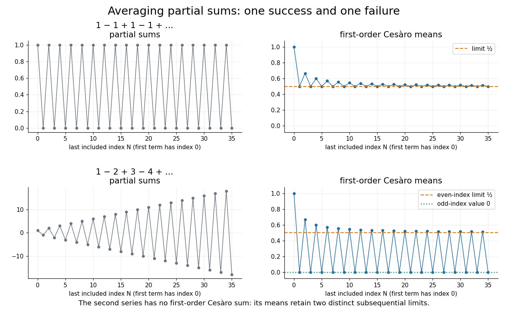

<h1 id="cesaro-summation">Cesàro summation</h1>

↑ **Parent:** [Summation method](summation-method.md)  
ⓦ [Wiki](https://en.wikipedia.org/wiki/Cesàro_summation)

[Cesàro summation](cesaro-summation.md) assigns a value to a [series](series-mathematics.md) when the [arithmetic means](arithmetic-mean.md) of its [partial sums](partial-sum.md) approach a finite [limit of a sequence](limit-of-a-sequence.md). Here we use the first-order method, often written $(C,1)$. For a real or complex [series](series-mathematics.md) beginning at index zero, define

$$
s_n=\sum_{k=0}^n a_k,\qquad
\sigma_N=\frac1{N+1}\sum_{n=0}^{N}s_n.
$$

It is [Cesàro summable](cesaro-summation.md) to $L$ when $\sigma_N\to L$. The averaging is applied to the [partial sums](partial-sum.md) $s_n$, rather than to the original terms $a_n$. This distinction is essential: the terms can average to zero while their accumulated sum keeps growing. [Cesàro Summation (Mathematica tutorial) by Vladimir Dobrushkin](cesaro-summation-mathematica-tutorial-by-vladimir-dobrushkin.md)

For [Grandi's series](grandi-s-series.md) $1-1+1-1+\cdots$, the [partial sums](partial-sum.md) alternate between one and zero. The [series](series-mathematics.md) is not a [convergent series](convergent-series.md), but the two values occupy asymptotically equal proportions of the averaging window. In the declared index convention,

$$
\sigma_{2m}=\frac{m+1}{2m+1},\qquad
\sigma_{2m+1}=\frac12,
$$

so **its first-order Cesàro sum is $1/2$**. This names a particular [summation method](summation-method.md); it does not turn the oscillating [partial sums](partial-sum.md) into an ordinarily [convergent sequence](convergent-sequence.md).

**[Figure 5](#image-cesaro-summation-succeeds-for-grandi-s-series-but-first-order-averaging-fails-for-1-2-plus-3-4-plus-cdots). Cesàro summation succeeds for Grandi's series, but first-order averaging fails for $1-2+3-4+\cdots$**. Original exact [partial sums](partial-sum.md) and [Cesàro means](cesaro-mean.md), with the first term indexed by zero. In the second row, the even and odd [subsequences](subsequence.md) of the averages have different limits.

Why is this useful? An oscillating approximation can retain stable information when its cumulative average settles. Because the [Cesàro theorem for convergent sequences](cesaro-theorem-for-convergent-sequences.md) preserves an existing [limit of a sequence](limit-of-a-sequence.md), this adds some new cases without changing the sum of any ordinarily convergent [series](series-mathematics.md). For [Fourier series](fourier-series-split.md), averaging the [Fourier partial sums](fourier-partial-sum.md) gives a [Fejér sum](fejer-sum.md); the existing [Fejér kernel](fejer-kernel.md) and approximation articles explain its effect on reconstruction. Averaging does not guarantee success for every oscillating [sequence](sequence.md), as the [bounded partial sums need not be Cesàro summable](bounded-partial-sums-need-not-be-cesaro-summable.md) example shows.

One historical motivation was the multiplication of [series](series-mathematics.md). In 1918, [A. F. Andersen](a-f-andersen.md) recalled [Ernesto Cesàro](ernesto-cesaro.md)'s product theorem and cited his 1890 publication at the start of a study of products involving [Cesàro summable](cesaro-summation.md) [series](series-mathematics.md). This connects the theory with preserving useful operations on sums, as well as with assigning a value to an isolated example. His paper treats several orders of summability; the examples here use only $(C,1)$.[§1, footnote, p. 3; §2, pp. 6–7](sur-la-multiplication-de-series-absolument-convergentes-par-des-series-sommables-par-la-methode-de-cesaro-by-a-f-andersen.md)

**Table of contents**

- [Weighted partial sums for Cesàro summation](weighted-partial-sums-for-cesaro-summation.md)
- [Grandi's series](grandi-s-series.md)
- [First-order Cesàro summation of a geometric series](first-order-cesaro-summation-of-a-geometric-series.md)
- [Cesàro sum](cesaro-sum.md)
- [Bounded partial sums need not be Cesàro summable](bounded-partial-sums-need-not-be-cesaro-summable.md)
- [Alternating integers have no first-order Cesàro sum](alternating-integers-have-no-first-order-cesaro-sum.md)

## ↑ Ancestors (8)

1. [Summation method](summation-method.md)
2. [Series (mathematics)](series-mathematics.md)
3. [Sequence and series](sequence-and-series-split.md)
4. [Real analysis](real-analysis-split.md)
5. [Analysis](analysis-split.md)
6. [Area of mathematics](area-of-mathematics.md)
7. [Mathematics](mathematics-split.md)
8. [Codex Wiki](split.md)

## ← Incoming links (9)

- [Alternating integers have no first-order Cesàro sum](alternating-integers-have-no-first-order-cesaro-sum.md)
- [Cesàro sum](cesaro-sum.md)
- [Cesàro summation](cesaro-summation.md)
- [Cesàro theorem for convergent sequences](cesaro-theorem-for-convergent-sequences.md)
- [Divergent series](divergent-series.md)
- [Grandi's series](grandi-s-series.md)
- [Regular summation method](regular-summation-method.md)
- [Series (mathematics)](series-mathematics.md)
- [Sur la multiplication de séries absolument convergentes par des séries sommables par la méthode de Cesàro by A. F. Andersen](sur-la-multiplication-de-series-absolument-convergentes-par-des-series-sommables-par-la-methode-de-cesaro-by-a-f-andersen.md)
