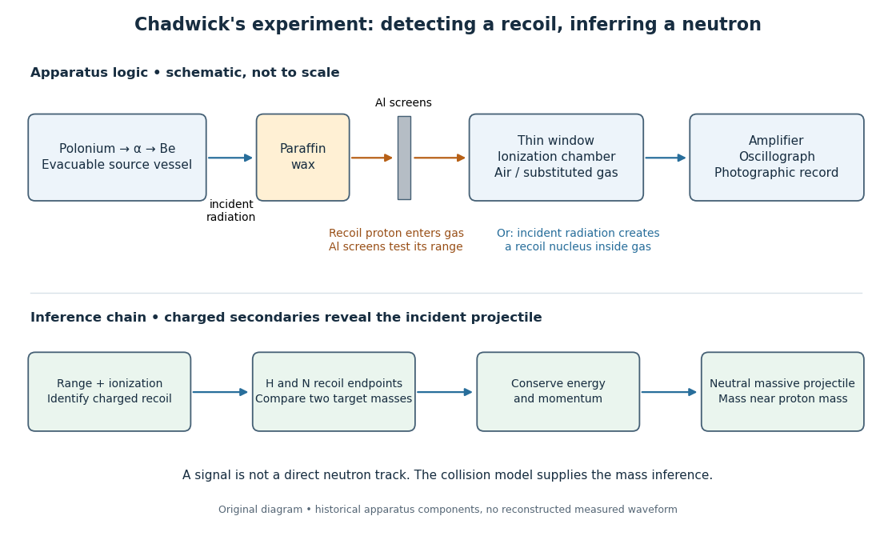

# Chadwick neutron discovery experiment

↑ **Parent:** [Neutron](neutron-split.md)

[Walther Bothe](walther-bothe.md) and [Herbert Becker](herbert-becker.md) observed penetrating radiation from [beryllium](beryllium.md) struck by [alpha particles](alpha-particle.md) before [James Chadwick](james-chadwick.md)'s interpretation.[Section 1, page 692: Bothe and Becker](the-existence-of-a-neutron-by-james-chadwick.md)

[Irène Joliot-Curie](irene-joliot-curie.md) and [Frédéric Joliot](frederic-joliot.md) found that adding material containing [hydrogen](hydrogen.md) increased [ionization](ionization.md), interpreting the ejected [protons](proton.md) as [Compton scattering](compton-scattering.md) recoils from extremely energetic [gamma rays](gamma-ray.md). [James Chadwick](james-chadwick.md) tested this interpretation against [nuclear recoils](nuclear-recoil.md) in other elements.[Page 312, opening paragraphs: Joliot-Curie observation and counter](possible-existence-of-a-neutron-by-james-chadwick.md)

The counter coupled a small [ionization chamber](ionization-chamber.md) to an [amplifier](amplifier.md) and [oscillograph](oscillograph.md): charged particles produced [ions](ion.md), and the electrical [signal](signal.md) gave a deflection. With [Norman Feather](norman-feather.md), [James Chadwick](james-chadwick.md) also observed [nitrogen](nitrogen.md) recoil tracks in a [cloud chamber](cloud-chamber.md).[Page 312: valve counter and Feather's expansion-chamber observations](possible-existence-of-a-neutron-by-james-chadwick.md)

The apparatus used [polonium](polonium.md) on [silver](silver.md) facing [beryllium](beryllium.md) inside an evacuable vessel. [Paraffin wax](paraffin-wax.md) before the [aluminium](aluminium.md) counter window supplied recoil [protons](proton.md); intervening [aluminium](aluminium.md) screens measured their [particle range](particle-range.md). Deflections were photographed on bromide paper. The first counter contained air; later fillings included [hydrogen](hydrogen.md), [helium](helium.md), [nitrogen](nitrogen.md), [oxygen](oxygen.md) and [argon](argon.md). Counts with wax absent included gas recoils; wax insertion added entering [protons](proton.md). Thick lead between source and counter hardly changed the initial counts, testing penetration against the low background.[Section 2, pages 694–697; figures 1–2](the-existence-of-a-neutron-by-james-chadwick.md)

**[Figure 3](#image-from-penetrating-radiation-to-a-charged-recoil-signal-and-a-mass-inference). From penetrating radiation to a charged recoil signal and a mass inference**.

The diagram separates two routes to a [signal](signal.md): a [proton](proton.md) entering from the wax and a [nuclear recoil](nuclear-recoil.md) created inside the chamber [gas](gas.md). Its lower row is a logical summary, rather than a reconstructed experimental trace. In either route the observed [ionization](ionization.md) belongs to a charged secondary particle; identifying the incident radiation requires an additional collision model.

In the February letter, a [photon](photon.md) interpretation requiring about $52\,\mathrm{MeV}$ for the [protons](proton.md) predicted only about $0.4\,\mathrm{MeV}$ for [nitrogen](nitrogen.md) recoils, below the observed [ionization](ionization.md). Here $1\,\mathrm{MeV}=10^6$ [electronvolts](electronvolt.md). [James Chadwick](james-chadwick.md) proposed a neutral particle near the [proton](proton.md) [mass](mass.md) and the [nuclear reaction](nuclear-reaction.md)

$$
{}^{9}_{4}\mathrm{Be}+{}^{4}_{2}\mathrm{He}
\longrightarrow{}^{12}_{6}\mathrm{C}+{}^{1}_{0}n.
$$

These are the letter's approximate historical values, not a modern [mass](mass.md) determination.[Page 312: photon/nitrogen discrepancy and proposed reaction](possible-existence-of-a-neutron-by-james-chadwick.md)

Why compare two materials? A [gamma ray](gamma-ray.md) is a [photon](photon.md), so its incident [momentum](momentum-split.md) is $E_\gamma/c$, where $c$ is the [speed of light](speed-of-light.md). A slow massive projectile instead has [momentum](momentum-split.md) $mv$ and [kinetic energy](kinetic-energy.md) $mv^2/2$. The relationship between incoming [momentum](momentum-split.md) and [energy](energy-split.md) therefore changes. An [elastic collision](elastic-collision.md) model must explain the recoil endpoints for both target [masses](mass.md) with the same incident projectile population. Calling the radiation neutral supplies no such agreement by itself.

The original measurements depended on [particle range](particle-range.md) calibration, material in the path, detector response and whether a recoil was fully stopped in the sensitive [gas](gas.md). Large deflections alone need not specify a complete recoil [energy](energy-split.md). The calculations below expose the ideal collision assumptions behind the inference; applying them to a measured spectrum requires checking those assumptions.

## ↑ Ancestors (7)

1. [Neutron](neutron-split.md)
2. [Nucleon](nucleon.md)
3. [Baryon](baryon.md)
4. [Hadron](hadron.md)
5. [Subatomic particle](subatomic-particle.md)
6. [Physics](physics-split.md)
7. [Codex Wiki](split.md)

## ← Incoming links (2)

- [Neutron](neutron-split.md)
- [Nobel Prize in Physics in 1935](nobel-prize-in-physics-in-1935.md)
