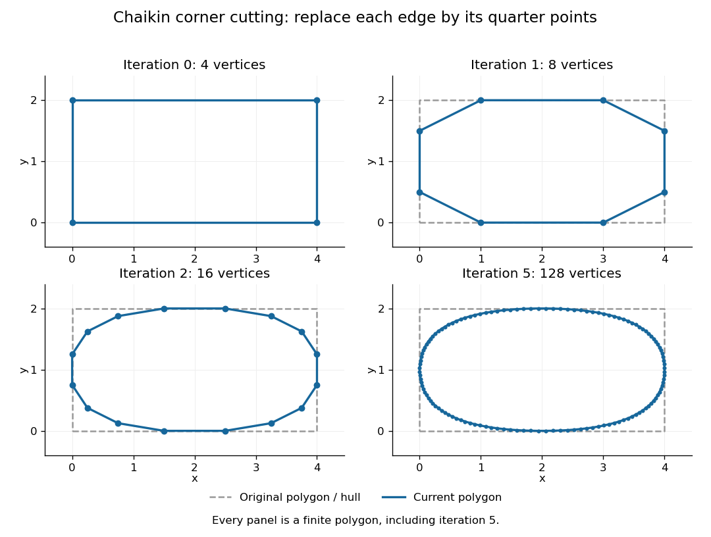
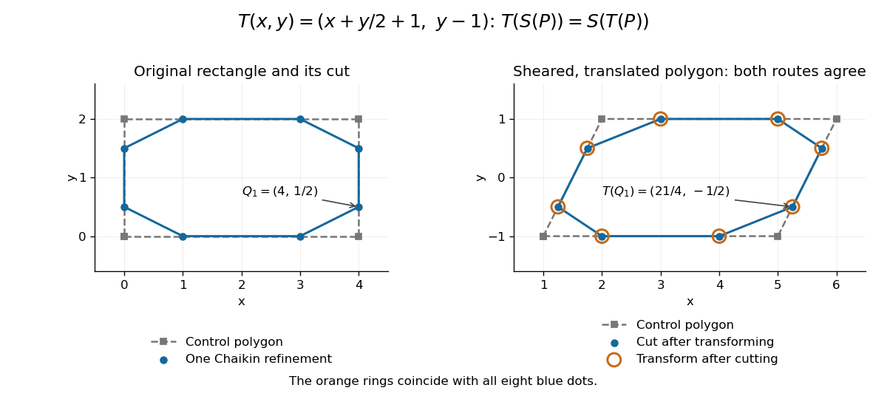

# Chaikin subdivision

↑ **Parent:** [Subdivision curve](subdivision-curve.md)

[Chaikin subdivision](chaikin-subdivision.md) generates a rounded [subdivision curve](subdivision-curve.md) by repeatedly cutting the corners off a [control polygon](control-polygon.md). Each edge contributes two new [control points](control-point.md), one a quarter of the way along the edge and the other three quarters of the way along it. Connecting these new [control points](control-point.md) in edge order replaces the old corners by shorter [line segments](line-segment.md). This makes [Chaikin subdivision](chaikin-subdivision.md) a useful way to draw a smooth outline from a small, editable set of [control points](control-point.md), without evaluating [B-spline](b-spline.md) basis functions at each drawing step. Joy presents both the corner-cutting rule and its closed version.[Kenneth I. Joy, Chaikin's Algorithms for Curves, §§Chaikin's Method and Example — A Closed Curve, UC Davis authored notes](https://www.cs.unc.edu/~dm/UNC/COMP258/LECTURES/Chaikins-Algorithm.pdf)

For a closed [control polygon](control-polygon.md) with $n\geq3$ [control points](control-point.md) $P_0,\ldots,P_{n-1}$, set $P_n=P_0$ and interpret indices cyclically. One refinement $S$ gives

$$
Q_i=\frac34P_i+\frac14P_{i+1},\qquad R_i=\frac14P_i+\frac34P_{i+1},\qquad 0\leq i<n,
$$

and the new [control polygon](control-polygon.md) is the ordered sequence

$$
S(P)=(Q_0,R_0,Q_1,R_1,\ldots,Q_{n-1},R_{n-1}).
$$

Close it by joining $R_{n-1}$ back to $Q_0$. Use the old [control points](control-point.md) for every average in the same refinement; updating them in place would define a different [algorithm](algorithm.md). One refinement produces $2n$ stored [control points](control-point.md), and $k$ refinements produce $2^kn$, counting entries even if some coordinates coincide. Open [control polygons](control-polygon.md) need an explicit endpoint convention: applying only the interior edge rule discards the original endpoints, whereas retaining endpoints changes the boundary rule. The closed analysis below uses cyclic indices throughout.

For a worked example, start with the rectangular [control polygon](control-polygon.md)

$$
P_0=(0,0),\quad P_1=(4,0),\quad P_2=(4,2),\quad P_3=(0,2).
$$

The first edge gives $Q_0=\tfrac34(0,0)+\tfrac14(4,0)=(1,0)$ and $R_0=\tfrac14(0,0)+\tfrac34(4,0)=(3,0)$. Applying [Chaikin subdivision](chaikin-subdivision.md) to all four edges, including the closing edge, gives exactly eight [control points](control-point.md) in this order:

$$
(1,0),\ (3,0),\ (4,\tfrac12),\ (4,\tfrac32),\ (3,2),\ (1,2),\ (0,\tfrac32),\ (0,\tfrac12).
$$

Thus the rectangle becomes an octagonal [control polygon](control-polygon.md). Two refinements have $16$ [control points](control-point.md), and five have $128$. The illustration shows finite [control polygons](control-polygon.md) at stages $0,1,2,5$; the last is already visually rounded but still consists of [line segments](line-segment.md).

**[Figure 8](#image-chaikin-corner-cutting-on-a-rectangle-at-iterations-zero-one-two-and-five). Chaikin corner cutting on a rectangle at iterations zero, one, two and five**. The dashed rectangle is the original [control polygon](control-polygon.md) and its [convex hull](convex-hull.md). Blue [line segments](line-segment.md) and dots show the current [control polygon](control-polygon.md) and [control points](control-point.md); no panel claims to be the exact limiting [curve](curve.md).

The [convex hull](convex-hull.md) property follows directly from the weights. Each new [control point](control-point.md) is a [convex combination](convex-combination.md) of the endpoints of one old edge, because the weights are nonnegative and sum to one. Consequently, if $H_k$ is the [convex hull](convex-hull.md) of the stage-$k$ [control points](control-point.md), then $H_{k+1}\subseteq H_k$. Every later [line segment](line-segment.md), and every limit point, stays in the original [convex hull](convex-hull.md). This gives a useful geometric enclosure. It also explains why [Chaikin subdivision](chaikin-subdivision.md) is approximating rather than an [interpolation](interpolation.md) rule: the rectangle's four original corners are outside the first octagon's [convex hull](convex-hull.md), so the limiting [curve](curve.md) cannot pass through them. A refinement [control polygon](control-polygon.md) generally lies off the limiting [curve](curve.md) as well.

For the cyclic uniform rule, the closed limit is the periodic quadratic uniform [B-spline](b-spline.md) [curve](curve.md) determined by the original [control points](control-point.md). Uniform refers to equal spacing in the [spline knot sequence](spline-knot-sequence.md), not equal physical lengths of edges of the [control polygon](control-polygon.md). An infinite uniform control sequence has the corresponding local description; arbitrary open endpoint conventions need separate treatment. Joy derives the quarter-point refinement by splitting quadratic uniform [B-spline](b-spline.md) spans.[Kenneth I. Joy, Quadratic Uniform B-Spline Curve Refinement, §§Splitting and Refinement and The General Refinement Procedure, UC Davis authored notes](https://www.cs.unc.edu/~dm/UNC/COMP258/LECTURES/Quadratic-B-Spline-Curve-Refinement.pdf)

Here is an explicit description of that closed limit, with cyclic indices and a unit parameter span for each original [control point](control-point.md):

$$
C_i(u)=\frac{(1-u)^2}{2}P_{i-1}+\left(\frac12+u-u^2\right)P_i+\frac{u^2}{2}P_{i+1},\qquad 0\leq u\leq1.
$$

Each coordinate is a [quadratic polynomial](quadratic-polynomial.md), and the three coefficients form a nonnegative [partition of unity](partition-of-unity.md). The span runs from $(P_{i-1}+P_i)/2$ to $(P_i+P_{i+1})/2$. Differentiating gives $C_i'(0)=P_i-P_{i-1}$ and $C_i'(1)=P_{i+1}-P_i$, so adjacent spans have matching values and matching first [derivatives](derivative.md). Their second [derivatives](derivative.md) generally differ. Thus the parameterized [curve](curve.md) is $C^1$, generally not $C^2$; degenerate [control points](control-point.md) can still make its [tangent vector](tangent-vector.md) vanish. For the rectangle, the span around $P_1=(4,0)$ is

$$
C_1(u)=(2+4u-2u^2,\ u^2),\qquad C_1(\tfrac12)=(\tfrac72,\tfrac14),
$$

which rounds the original corner between edge midpoints $(2,0)$ and $(4,1)$. For equally spaced abscissae, the centered [Chaikin basis function](chaikin-basis-function.md) gives the scalar graph version of this quadratic [B-spline](b-spline.md) representation and has support of width three original grid intervals.

Another useful property is [affine equivariance of a geometric basis](affine-equivariance-of-a-geometric-basis.md): refining and applying an [affine map](affine-map.md) commute. For $T(x)=Ax+b$,

$$
T(Q_i)=A\left(\frac34P_i+\frac14P_{i+1}\right)+b=\frac34T(P_i)+\frac14T(P_{i+1}),
$$

and the same calculation holds for $R_i$. The sum-to-one weights account for the [translation](translation-geometry.md). Therefore $T(S(P))=S(T(P))$ at every refinement, and also for the limit. A designer can apply a [shear mapping](shear-mapping.md), [translation](translation-geometry.md), or other [affine map](affine-map.md) to the original [control polygon](control-polygon.md) and obtain exactly the transformed outline.

For example, compose the [shear mapping](shear-mapping.md) $(x,y)\mapsto(x+y/2,y)$ with the [translation](translation-geometry.md) $(1,-1)$ to obtain $T(x,y)=(x+y/2+1,y-1)$. The rectangle's [control points](control-point.md) become $(1,-1),(5,-1),(6,1),(2,1)$. On its right edge, cutting first gives $Q_1=(4,1/2)$ and then $T(Q_1)=(21/4,-1/2)$. Transforming first and cutting instead gives $\tfrac34(5,-1)+\tfrac14(6,1)=(21/4,-1/2)$, the same [control point](control-point.md).

**[Figure 9](#image-shearing-and-translating-a-control-polygon-commutes-with-one-chaikin-refinement). Shearing and translating a control polygon commutes with one Chaikin refinement**. Left: the rectangle and its first refinement. Right: the transformed [control polygon](control-polygon.md), with blue dots from cutting after the [affine map](affine-map.md) and orange rings from applying the [affine map](affine-map.md) after cutting. All eight pairs coincide.

Historically, George M. Chaikin published “An algorithm for high-speed curve generation” in Computer Graphics and Image Processing 3(4), December 1974, pages 346–349. Its emphasis was practical curve generation through a recursive [algorithm](algorithm.md) using simple arithmetic, with applications including machine control and three-dimensional curves. The lasting appeal of [Chaikin subdivision](chaikin-subdivision.md) is how an elementary local average creates an entire smooth [B-spline](b-spline.md) [curve](curve.md).[G. M. Chaikin, An algorithm for high-speed curve generation, Computer Graphics and Image Processing 3(4), 346–349, 1974; publisher metadata and abstract](https://doi.org/10.1016/0146-664X(74)90028-8)

**Table of contents**

- [Chaikin basis function](chaikin-basis-function.md)
- [Polynomial degree preservation under Chaikin subdivision](polynomial-degree-preservation-under-chaikin-subdivision.md)

## ↑ Ancestors (7)

1. [Subdivision curve](subdivision-curve.md)
2. [Computer aided geometric design](computer-aided-geometric-design.md)
3. [Numerical analysis](numerical-analysis-split.md)
4. [Analysis](analysis-split.md)
5. [Area of mathematics](area-of-mathematics.md)
6. [Mathematics](mathematics-split.md)
7. [Codex Wiki](split.md)

## ← Incoming links (3)

- [Chaikin subdivision](chaikin-subdivision.md)
- [Solution](past-exam-of-the-mathematics-course-of-the-university-of-cambridge/2004/iii/paper-70/3/i/solution.md)
- [Subdivision curve](subdivision-curve.md)
