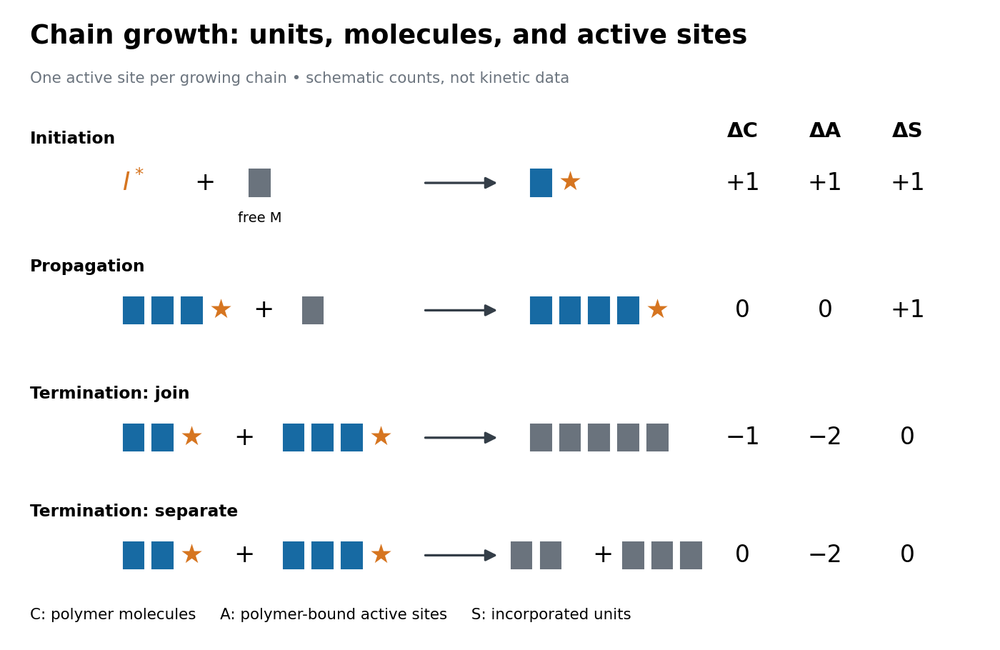

# Chain-growth polymerization

↑ **Parent:** [Polymerization](polymerization.md)  
ⓦ [Wiki](https://en.wikipedia.org/wiki/Chain-growth_polymerization)

In [chain-growth polymerization](chain-growth-polymerization.md), each growth step joins a [monomer](monomer.md) to a reactive site on a [polymer](polymer.md) chain and regenerates that reactive site. This is the precise mechanistic restriction in IUPAC's definition: growth occurs exclusively through these monomer–chain-site reactions. The word chain refers to the succession of site-regenerating [chemical reactions](chemical-reaction.md). It does not merely mean that the product looks like a long chain. [Chain-growth initiation](chain-growth-initiation.md) starts this succession; [chain-growth propagation](chain-growth-propagation.md) continues it; [chain-growth termination](chain-growth-termination.md) and [chain transfer in chain polymerization](chain-transfer-in-chain-polymerization.md) can change its fate.[chain polymerization, C00958, definition and notes 1–2; source recommendation p. 2306](iupac-compendium-of-chemical-terminology-fifth-edition-gold-book-by-international-union-of-pure-and-applied-chemistry.md)

The contrast with [step-growth polymerization](step-growth-polymerization.md) concerns the permitted joining partners. There, suitable reactive groups can join two existing chains, for example a two-unit chain and a three-unit chain. In [chain-growth propagation](chain-growth-propagation.md), a free [monomer](monomer.md) adds to a [polymerization-active site](polymerization-active-site.md). Release of a small byproduct is a separate classification question: IUPAC explicitly allows condensative [chain polymerization](chain-growth-polymerization.md).[chain polymerization, C00958, notes 3–6](iupac-compendium-of-chemical-terminology-fifth-edition-gold-book-by-international-union-of-pure-and-applied-chemistry.md) The useful consequence is that a few growing chains can incorporate many [monomer molecules](monomer-molecule.md) while much of the feed remains unreacted. Their [degree of polymerization](degree-of-polymerization.md) depends on how those units are shared among chains, as [finite chain-growth bookkeeping](finite-chain-growth-bookkeeping.md) makes explicit.

**[Figure 38](#image-chain-growth-active-site-bookkeeping). Chain-growth initiation, chain-growth propagation, and two possible chain-growth termination counts**. Original schematic for linear chains with one [polymerization-active site](polymerization-active-site.md) each. Blocks count [monomeric units](monomeric-unit.md); stars identify reactivity, not [electric charge](electric-charge.md). $I^*$ is a free initiating species, excluded from the count of polymer-bound sites. The two termination rows are alternative outcomes for two active chains, not consecutive reactions. Joining two chains preserves their incorporated-unit total while reducing the number of [polymer](polymer.md) [molecules](molecule.md). Neither row specifies a universal [reaction mechanism](reaction-mechanism.md) or rate.

**Table of contents**

- [Polymerization-active site](polymerization-active-site.md)
- [Chain-growth initiation](chain-growth-initiation.md)
- [Chain-growth propagation](chain-growth-propagation.md)
- [Chain-growth termination](chain-growth-termination.md)
- [Chain transfer in chain polymerization](chain-transfer-in-chain-polymerization.md)
- [Finite chain-growth bookkeeping](finite-chain-growth-bookkeeping.md)
- [Living versus terminating chain populations](living-versus-terminating-chain-populations.md)
- [NMR monitoring of chain polymerization](nmr-monitoring-of-chain-polymerization.md)
- [Size-exclusion characterization of chain polymers](size-exclusion-characterization-of-chain-polymers.md)
- [Monitoring chain polymerization in a sealed tube](monitoring-chain-polymerization-in-a-sealed-tube.md)
- [Living polymerization](living-polymerization.md)

## ↑ Ancestors (4)

1. [Polymerization](polymerization.md)
2. [Polymer](polymer.md)
3. [Chemistry](chemistry-split.md)
4. [Codex Wiki](split.md)

## ← Incoming links (5)

- [Chain-growth polymerization](chain-growth-polymerization.md)
- [Living polymerization](living-polymerization.md)
- [Polyaddition](polyaddition.md)
- [Polymerization](polymerization.md)
- [Radical chain reaction](radical-chain-reaction.md)
