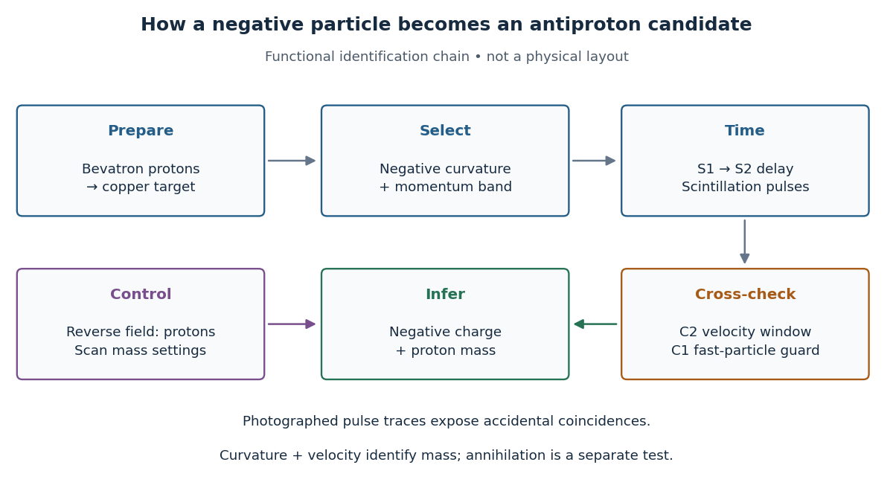

<h1 id="chamberlain-segre-antiproton-identification">Chamberlain-Segrè antiproton identification</h1>

↑ **Parent:** [Antiproton](antiproton.md)

In 1955, [Owen Chamberlain](owen-chamberlain.md), [Emilio Segrè](emilio-segre.md), [Clyde Wiegand](clyde-edward-wiegand.md), and [Thomas Ypsilantis](thomas-john-ypsilantis.md) used [Bevatron](bevatron.md) [protons](proton.md) on [copper](copper.md), selecting negative secondaries. [Magnetic fields](magnetic-field-split.md) selected $p=1.19\,\mathrm{GeV}/c$; [scintillation counters](scintillation-counter.md) S1 and S2 measured [time of flight](time-of-flight.md) over $40\,\mathrm{ft}$. [Cherenkov detector](cherenkov-detector.md) C1 flagged $\beta>0.79$; C2 accepted $0.75<\beta<0.78$ after material losses. S3 checked traversal. The cuts rejected negative [pions](pion.md).[UCRL-3172, pp. 3–5, Fig. 1, Table I](https://escholarship.org/content/qt46p0z8w7/qt46p0z8w7.pdf)

Chamberlain's 1959 account describes C2's [quartz](quartz.md) radiator, mirrors, and [photomultiplier](photomultiplier.md) readout. The trigger combined delayed [scintillation counter](scintillation-counter.md) signals with C2; photographed [oscilloscope](oscilloscope.md) traces exposed fast particles and [accidental coincidences](accidental-coincidence.md) through C1 pulses or extra pulses. Reversing the [magnetic fields](magnetic-field-split.md) provided a positive-[proton](proton.md) control and revealed an alignment error. Changing selected [momentum](momentum-split.md) at fixed [velocity](velocity.md) acceptance tested for a [proton](proton.md)-[mass](mass.md) peak.[1959 lecture, pp. 496–501, Figs. 7–11; Columbia scan](the-early-antiproton-work-by-owen-chamberlain.md)

Terminal-event studies remained unfinished; the 1955 identification did not rely on [annihilation](annihilation.md).[UCRL-3172, p. 13](https://escholarship.org/content/qt46p0z8w7/qt46p0z8w7.pdf)

**[Figure 1](#image-functional-chain-for-identifying-a-negative-particle-of-proton-mass). Functional chain for identifying a negative particle of proton mass**. An original functional diagram, with preparation, selection, independent [velocity](velocity.md) tests, and controls. Arrows indicate information flow, not the physical beamline layout.

The logic is useful far beyond this experiment. A [magnetic field](magnetic-field-split.md) separates [electric charge](electric-charge-split.md) signs and [magnetic rigidity](magnetic-rigidity.md), but particles of different [rest masses](invariant-mass.md) can share both. A [time of flight](time-of-flight.md) signal adds [velocity](velocity.md), while a [Cherenkov detector](cherenkov-detector.md) independently checks whether that [velocity](velocity.md) is plausible. An [accidental coincidence](accidental-coincidence.md) can imitate the delay of a slow particle without being one particle traversing the apparatus. Agreement between independent measurements is therefore part of the inference, rather than a redundant decoration.

## ↑ Ancestors (9)

1. [Antiproton](antiproton.md)
2. [Antiparticle](antiparticle.md)
3. [Mode expansion of a Dirac field](mode-expansion-of-a-dirac-field.md)
4. [Dirac field](dirac-field.md)
5. [Relativistic quantum field](relativistic-quantum-field-split.md)
6. [Quantum field theory](quantum-field-theory-split.md)
7. [Branches of physics](branches-of-physics.md)
8. [Physics](physics-split.md)
9. [Codex Wiki](split.md)

## ← Incoming links (1)

- [Antiproton](antiproton.md)
