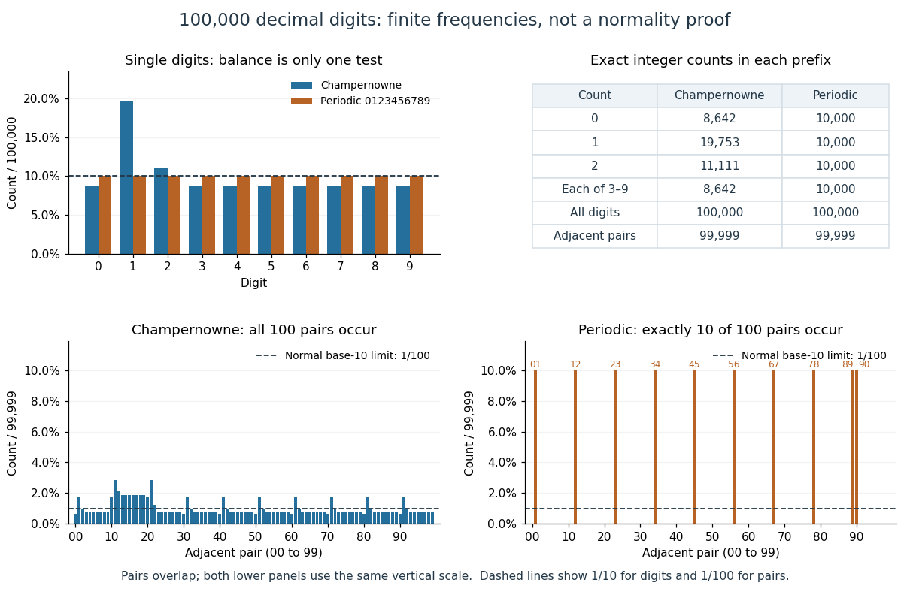

# Champernowne constant

↑ **Parent:** [Normal number](normal-number.md)  
ⓦ [Wiki](https://en.wikipedia.org/wiki/Champernowne_constant)

Form [Champernowne constant](champernowne-constant.md) by using [concatenation](concatenation.md) to join the [decimal representations](decimal-representation.md) of the [positive integers](positive-integer.md) $1,2,3,\ldots$ after the decimal point. Champernowne proved in 1933 that this particular [real number](real-number.md) is a [normal number](normal-number.md) in base ten. The construction is striking because its rule is completely explicit, while all finite [words](string.md) have the prescribed limiting [digit block frequencies](digit-block-frequency.md). [D. G. Champernowne, The Construction of Decimals Normal in the Scale of Ten, Journal of the London Mathematical Society 8, 254–260, 1933](https://doi.org/10.1112/jlms/s1-8.4.254) Copeland and Erdős explicitly recall this result at the start of their own paper. [Copeland and Erdős, Note on Normal Numbers, 1946, first paragraph](https://users.renyi.hu/~p_erdos/1946-01.pdf)

The first $100000$ digits of [Champernowne constant](champernowne-constant.md) have the following exact counts, in digit order $0,1,\ldots,9$:

$$
(8642,19753,11111,8642,8642,8642,8642,8642,8642,8642).
$$

For the $99999$ adjacent pairs fully inside that prefix, the [words](string.md) $00,01,12,99$ occur $642,1753,2088,753$ times respectively. Thus, for example, $F_{100000}(12)=2088/99999$, which is about $0.02088$, rather than $0.01$. The prefix ends partway through the [decimal representation](decimal-representation.md) of $22222$; the many leading ones in earlier [positive integers](positive-integer.md) help explain the visible imbalance.

**[Figure 5](#image-exact-digit-and-adjacent-pair-frequencies-in-two-prefixes-of-100000-decimal-digits). Exact digit and adjacent-pair frequencies in two prefixes of 100000 decimal digits**. The upper panels compare single-digit frequencies and list exact counts. The lower panels show all hundred overlapping pair frequencies, each with denominator $99999$, on the same vertical scale. The dashed $1/100$ line is the limiting reference for a [normal number](normal-number.md) in base ten. In the periodic prefix, pairs $01$ through $89$ occur $10000$ times each and $90$ occurs $9999$ times; all other pairs are absent.

These are finite counts, not a proof of the [normal number](normal-number.md) theorem: a finite prefix can be followed by an all-zero tail. The theorem for [Champernowne constant](champernowne-constant.md) concerns the infinite [limit](limit-of-a-function.md), and establishes base-ten normality, rather than [absolute normality](absolutely-normal-number.md). Nor do computations prove normality for familiar constants: the normality of [Pi](pi.md) and [Euler's number](e-mathematical-constant.md) remains unproved, as discussed by Bailey and Borwein. [David H. Bailey and Jonathan M. Borwein, Normal Numbers and Pseudorandom Generators, author manuscript, 2011, introduction](https://www.davidhbailey.com/dhbpapers/normal-pseudo.pdf)

## ↑ Ancestors (5)

1. [Normal number](normal-number.md)
2. [Number theory](number-theory-split.md)
3. [Area of mathematics](area-of-mathematics.md)
4. [Mathematics](mathematics-split.md)
5. [Codex Wiki](split.md)

## ← Incoming links (3)

- [Champernowne constant](champernowne-constant.md)
- [Normal number](normal-number.md)
- [Normality and equidistribution under integer multiplication](normality-and-equidistribution-under-integer-multiplication.md)
