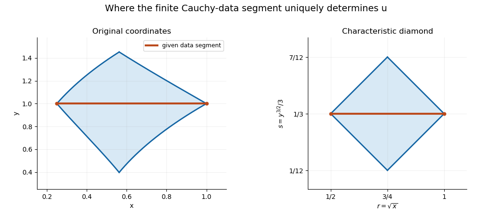

# Characteristic-coordinate domain of dependence

↑ **Parent:** [Domain of dependence](domain-of-dependence.md)

For the [one-dimensional wave equation](one-dimensional-wave-equation.md) $U_{ss}=U_{rr}$ with [Cauchy data](cauchy-data.md) on $s=s_0$, $a\leq r\leq b$, the solution is determined where both characteristic footpoints $r\pm(s-s_0)$ lie in $[a,b]$. This is the diamond displayed in the title, or $|r-(a+b)/2|+|s-s_0|\leq(b-a)/2$. In [characteristic coordinates](characteristic-coordinate.md), it is a rectangle of known arguments for the two travelling-wave functions. A smooth invertible [coordinate transformation](smooth-transition-map.md) maps it to a region bounded by the original equation's [characteristic curves](characteristic-curve.md); it need not remain a Euclidean diamond. Both forward and backward determination can be described this way. Outside the region, changing an unspecified part of one travelling-wave function can change the solution without changing the supplied finite data segment.

For $r=\sqrt x$, $s=y^{3/2}/3$ and data on $y=1$, $1/4\leq x\leq1$, the transformed segment is $s_0=1/3$, $a=1/2$, $b=1$. The known characteristic arguments lie in $[5/6,4/3]$ and $[1/6,2/3]$. The corresponding original region has curved boundaries despite being a rectangle in characteristic coordinates and a diamond in $(r,s)$ coordinates.

**[Figure 3](#image-an-invertible-nonlinear-coordinate-change-curves-a-wave-equation-domain-of-dependence). An invertible nonlinear coordinate change curves a wave-equation domain of dependence**.

## ↑ Ancestors (6)

1. [Domain of dependence](domain-of-dependence.md)
2. [Partial differential equation](partial-differential-equation-split.md)
3. [Analysis](analysis-split.md)
4. [Area of mathematics](area-of-mathematics.md)
5. [Mathematics](mathematics-split.md)
6. [Codex Wiki](split.md)

## ← Incoming links (1)

- [Solution](past-exam-of-the-differential-equations-1-course-of-the-university-of-oxford/2017/3/c/solution.md)
