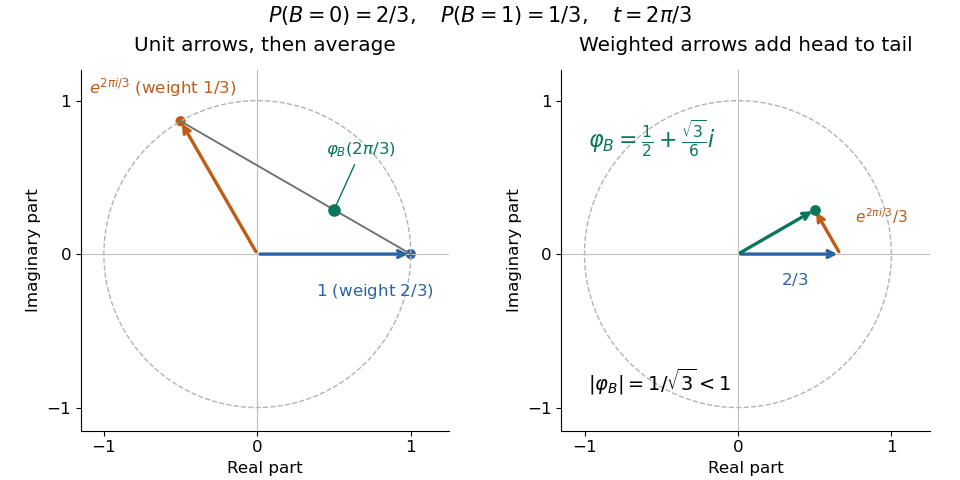
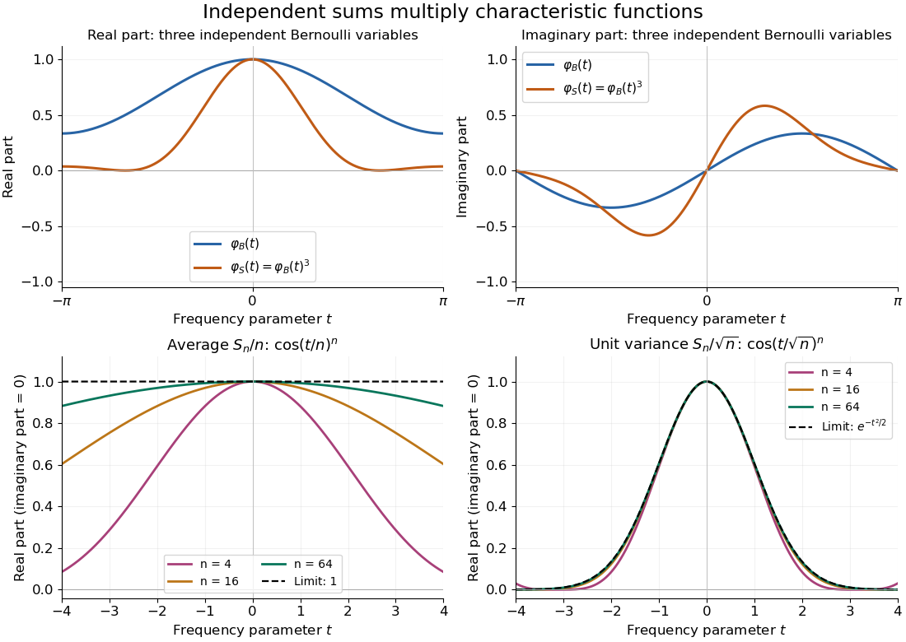

# Characteristic function

↑ **Parent:** [Probability theory](probability-theory.md)  
ⓦ [Wiki](https://en.wikipedia.org/wiki/Characteristic_function_(probability_theory))

The characteristic function of a real [random variable](random-variable.md) $X$ is

$$
\varphi_X(t)=\mathbb E[e^{itX}].
$$

It determines the [probability distribution](probability-distribution.md) of $X$.

Here $t\in\mathbb R$ and $i^2=-1$. By [Euler's formula](complex-analysis.md#euler-s-formula), its [real part](complex-analysis.md#real-part) and [imaginary part](complex-analysis.md#imaginary-part) are $\mathbb E[\cos(tX)]$ and $\mathbb E[\sin(tX)]$. The [complex exponential](calculus.md#complex-exponential-function) has absolute value one, so this [expected value](expected-value.md) exists for every real [random variable](random-variable.md), even without finite [absolute moments](expected-value.md#absolute-moment). Moreover,

$$
\varphi_X(0)=1,\qquad |\varphi_X(t)|\leq\mathbb E[|e^{itX}|]=1,\qquad
\varphi_X(-t)=\overline{\varphi_X(t)}.
$$

The bound uses the [triangle inequality for a vector-valued integral](topological-analysis.md#triangle-inequality-for-a-vector-valued-integral); the last identity is [complex conjugate](complex-analysis.md#complex-conjugate) symmetry.[§3.3.1 definition, printed p. 125; Theorem 3.3.1(a)–(c), printed p. 126](mathematics-bibliography.md#probability-theory-and-examples-fifth-edition-by-rick-durrett) Consequently the [real part](complex-analysis.md#real-part) is an [even function](calculus.md#even-function) and the [imaginary part](complex-analysis.md#imaginary-part) is an [odd function](calculus.md#odd-function).

For a [discrete probability distribution](discrete-probability-distribution.md) with values $x_j$ and [probabilities](probability-theory.md#probability) $p_j$, the [characteristic function](characteristic-function.md) is $\sum_jp_je^{itx_j}$: a weighted average of points on the [unit circle](complex-analysis.md#complex-unit-circle) in the [complex plane](complex-analysis.md#complex-plane). For example, if $B$ has the [Bernoulli distribution](discrete-probability-distribution.md#bernoulli-distribution) with $\mathbb P(B=1)=1/3$ and $\mathbb P(B=0)=2/3$, then

$$
\varphi_B(t)=\frac23+\frac13e^{it},\qquad
\varphi_B(2\pi/3)=\frac12+\frac{\sqrt3}{6}i,\qquad
|\varphi_B(2\pi/3)|=\frac1{\sqrt3}.
$$

Each point being averaged has absolute value one, but their directions partially cancel. At $t=\pi$, the same average is $1/3$; at $t=2\pi$, it returns to one. The [characteristic function](characteristic-function.md) is thus neither a [probability density function](continuous-probability-distribution.md#probability-density-function) nor a [probability mass function](probability-distribution.md#probability-mass-function): its argument is a frequency parameter, and its values can be [complex numbers](complex-analysis.md#complex-number). This [Bernoulli distribution](discrete-probability-distribution.md#bernoulli-distribution) has no [probability density function](continuous-probability-distribution.md#probability-density-function) with respect to [Lebesgue measure](measure-theory.md#lebesgue-measure), yet its [characteristic function](characteristic-function.md) is defined at every frequency.

**[Figure 1](#image-a-bernoulli-characteristic-function-as-a-weighted-average-on-the-unit-circle). A Bernoulli characteristic function as a weighted average on the unit circle**. At $t=2\pi/3$, the two [complex exponentials](calculus.md#complex-exponential-function) are $1$ and $e^{it}$. Left: their weighted average lies one third of the way along their connecting segment. Right: adding the weighted arrows $2/3$ and $e^{it}/3$ gives $\varphi_B(t)=1/2+i\sqrt3/6$. The dashed [unit circle](complex-analysis.md#complex-unit-circle) makes the absolute bound one visible.

For a [probability density function](continuous-probability-distribution.md#probability-density-function) $f$, the same definition becomes $\varphi_X(t)=\int_{\mathbb R}e^{itx}f(x)\,dx$, the [Fourier transform](fourier-transform.md) with the displayed sign convention. The [Laplace transform of a nonnegative random variable](probability-theory.md#laplace-transform-of-a-nonnegative-random-variable) instead uses $e^{-sX}$ for $s\geq0$, a real decaying weight. For the [Bernoulli distribution](discrete-probability-distribution.md#bernoulli-distribution) above, it is $2/3+e^{-s}/3$; neither transform is the [probability density function](continuous-probability-distribution.md#probability-density-function). The [uniqueness theorem for characteristic functions](#uniqueness-theorem-for-characteristic-functions) explains why the oscillating averages still retain the entire [probability law](probability-distribution.md), while the [characteristic function of a sum of independent variables](#characteristic-function-of-a-sum-of-independent-variables) turns combining laws into multiplication. These two properties make the representation useful even when directly computing a sum's [probability distribution](probability-distribution.md) is cumbersome.

**Table of contents**

- [Gil-Pelaez inversion formula](#gil-pelaez-inversion-formula)
- [Characteristic-function derivative under an absolute first moment](#characteristic-function-derivative-under-an-absolute-first-moment)
- [Characteristic-function derivatives from finite absolute moments](#characteristic-function-derivatives-from-finite-absolute-moments)
- [Characteristic-function tail bound](#characteristic-function-tail-bound)
- [Conditional characteristic function](#conditional-characteristic-function)
- [Empirical characteristic function](#empirical-characteristic-function)
  - [Empirical characteristic process](#empirical-characteristic-process)
- [Continuity of a characteristic function](#continuity-of-a-characteristic-function)
- [Unit modulus of a characteristic function](#unit-modulus-of-a-characteristic-function)
  - [Irrational unit-modulus frequencies force a point mass](#irrational-unit-modulus-frequencies-force-a-point-mass)
- [Characteristic function of a random vector](#characteristic-function-of-a-random-vector)
  - [Characteristic function of an isotropic Gaussian vector](#characteristic-function-of-an-isotropic-gaussian-vector)
  - [Orthogonally invariant random vector](#orthogonally-invariant-random-vector)
    - [Maxwell characterization of the normal distribution](#maxwell-characterization-of-the-normal-distribution)
- [Uniqueness theorem for characteristic functions](#uniqueness-theorem-for-characteristic-functions)
  - [Fourier-cutoff recovery of expectations from a characteristic function](#fourier-cutoff-recovery-of-expectations-from-a-characteristic-function)
- [Characteristic function of a sum of independent variables](#characteristic-function-of-a-sum-of-independent-variables)
  - [Three Bernoulli variables through characteristic functions](#three-bernoulli-variables-through-characteristic-functions)
  - [Characteristic functions of symmetric sign sums](#characteristic-functions-of-symmetric-sign-sums)
- [Lévy continuity theorem](#levy-continuity-theorem)
  - [Characteristic-function tightness bound](#characteristic-function-tightness-bound)
  - [Weak law from a characteristic-function expansion](#weak-law-from-a-characteristic-function-expansion)

## Gil-Pelaez inversion formula

↑ **Parent:** [Characteristic function](characteristic-function.md)

## Characteristic-function derivative under an absolute first moment

↑ **Parent:** [Characteristic function](characteristic-function.md)

If $\mathbb E|X|<\infty$, the [characteristic function](characteristic-function.md) $\phi(u)=\mathbb E e^{iuX}$ satisfies $\phi'(0)=i\mathbb E X$. The bound $|(e^{iuX}-1)/u|\leq|X|$ and the [dominated convergence theorem](measure-theory.md#dominated-convergence-theorem) justify differentiation at zero. For mean zero, $\psi(u)=|1-\phi(u)|/|u|$ extends continuously by $\psi(0)=0$, and $|1-\phi(u)^n|\leq n|u|\psi(u)$ by a finite [geometric series](sequence-and-series.md#geometric-series). This supplies a direct characteristic-function proof of the [weak law of large numbers](convergence-of-random-variables.md#weak-law-of-large-numbers).

// Target: martingale.bigb

## Characteristic-function derivatives from finite absolute moments

↑ **Parent:** [Characteristic function](characteristic-function.md)

If $m\geq1$ is an [integer](integer.md) and $\mathbb E[|X|^m]<\infty$, the [characteristic function](characteristic-function.md) has continuous [derivatives](calculus.md#derivative) through order $m$, with

$$
\varphi_X^{(k)}(t)=\mathbb E[(iX)^ke^{itX}],\qquad
\varphi_X^{(k)}(0)=i^k\mathbb E[X^k],\qquad 1\leq k\leq m.
$$

Thus finite [absolute moments](expected-value.md#absolute-moment) justify recovering [moments](expected-value.md#moment) from [derivatives](calculus.md#derivative).[§3.3.3, Theorem 3.3.18, printed p. 134](mathematics-bibliography.md#probability-theory-and-examples-fifth-edition-by-rick-durrett)

For a short justification of [differentiation under the integral sign](analysis.md#differentiation-under-the-integral-sign), the difference quotient for the $(k-1)$st [derivative](calculus.md#derivative) has integrand $(iX)^{k-1}e^{itX}(e^{ihX}-1)/h$. Its absolute value is at most $|X|^k$, since $|e^{iu}-1|\leq|u|$ for real $u$. Lower [absolute moments](expected-value.md#absolute-moment) are finite because $|X|^k\leq1+|X|^m$. Apply the [dominated convergence theorem](measure-theory.md#dominated-convergence-theorem) successively, then use the same integrable bound to obtain [continuity](calculus.md#continuous-function) of each [derivative](calculus.md#derivative).

For the [Bernoulli distribution](discrete-probability-distribution.md#bernoulli-distribution) with parameter $1/3$, direct [differentiation](calculus.md#differentiation) gives $\varphi_B'(0)=i/3$ and $\varphi_B''(0)=-1/3$, agreeing with $\mathbb E[B]=\mathbb E[B^2]=1/3$. Its [variance](variance.md) is therefore $1/3-(1/3)^2=2/9$. Existence and [continuity of a characteristic function](#continuity-of-a-characteristic-function) alone do not authorize these [moment](expected-value.md#moment) calculations: the standard [Cauchy distribution](probability-distribution.md#cauchy-distribution), whose [expected value](expected-value.md) is undefined, still has a [characteristic function](characteristic-function.md). The stated finite [absolute moment](expected-value.md#absolute-moment) hypothesis is a sufficient condition for the [derivative](calculus.md#derivative) formula, not an assumption built into the definition of a [characteristic function](characteristic-function.md).

## Characteristic-function tail bound

↑ **Parent:** [Characteristic function](characteristic-function.md)

Average $1-\cos(uy)$ over $0\le u\le1/\lambda$. Multiplication by $\lambda$ gives $1-\sin(y/\lambda)/(y/\lambda)$, with value zero at $y=0$. This is at least $1-\sin1$ when $|y|\ge\lambda$. [Tonelli's theorem](measure-theory.md#tonelli-theorem) then gives the displayed bound for a [probability measure](probability-space.md#probability-measure) with [characteristic function](characteristic-function.md) $\phi$. The bound converts control of the [characteristic function](characteristic-function.md) near zero into [tightness of probability measures](probability-space.md#uniform-tightness) and is useful in proving the [Lévy continuity theorem](#levy-continuity-theorem).

## Conditional characteristic function

↑ **Parent:** [Characteristic function](characteristic-function.md)

For a real [random variable](random-variable.md) $Y$ and a sigma-algebra $\mathcal G$, the conditional characteristic function is $\mathbb E[e^{i\theta Y}\mid\mathcal G]$. If it equals the nonrandom [characteristic function](characteristic-function.md) of a probability law for every $\theta$, then $Y$ has that law and is independent of $\mathcal G$. To verify the independence assertion, multiply the identity by any bounded $\mathcal G$-measurable test variable and use the [uniqueness theorem for characteristic functions](#uniqueness-theorem-for-characteristic-functions) on the resulting finite measures. Equality for rational $\theta$ extends by continuity, so simultaneous null sets can be arranged when needed.

## Empirical characteristic function

↑ **Parent:** [Characteristic function](characteristic-function.md)  
ⓦ [Wiki](https://en.wikipedia.org/wiki/Empirical_characteristic_function)

For a sample $X_1,\ldots,X_n$, $\varphi_n(u)=n^{-1}\sum_j e^{iuX_j}$ is the [characteristic function](characteristic-function.md) of the sample's [empirical measure](probability-space.md#empirical-measure). For [independent and identically distributed random variables](random-variable.md#independent-and-identically-distributed-random-variables), $\mathbb E\varphi_n(u)=\varphi(u)$ and $\operatorname{Var}_{\mathbb C}\varphi_n(u)=(1-|\varphi(u)|^2)/n$, without any moment condition on the observations.

### Empirical characteristic process

↑ **Parent:** [Empirical characteristic function](#empirical-characteristic-function)

The centered process $\mathcal C_n(u)=\sqrt n(\varphi_n(u)-\varphi(u))$ describes fluctuations of the [empirical characteristic function](#empirical-characteristic-function). At a fixed frequency, its real and imaginary parts satisfy a [multivariate central limit theorem](convergence-of-random-variables.md#multivariate-central-limit-theorem). A process-level limit requires further control over the frequency index.

## Continuity of a characteristic function

↑ **Parent:** [Characteristic function](characteristic-function.md)

Every characteristic function is uniformly continuous and satisfies $\varphi(0)=1$ and $|\varphi(t)|\leq1$. Continuity follows from the [dominated convergence theorem](measure-theory.md#dominated-convergence-theorem) applied to $e^{itX}$.

More explicitly, if $t_n\to t$, then $e^{it_nX}\to e^{itX}$ pointwise and $|e^{it_nX}|=1$. Apply the [dominated convergence theorem](measure-theory.md#dominated-convergence-theorem) to the [real part](complex-analysis.md#real-part) and [imaginary part](complex-analysis.md#imaginary-part) separately. There is no finite [moment](expected-value.md#moment) hypothesis. For [uniform continuity](topological-analysis.md#uniform-continuity), the stronger estimate

$$
\sup_{t\in\mathbb R}|\varphi_X(t+h)-\varphi_X(t)|
\leq\mathbb E[|e^{ihX}-1|]\longrightarrow0
\qquad(h\to0)
$$

follows by factoring out $e^{itX}$, whose absolute value is one. The integrand tends pointwise to zero and is bounded by two, so the [dominated convergence theorem](measure-theory.md#dominated-convergence-theorem) applies again. The bound is independent of $t$, which supplies [uniform continuity](topological-analysis.md#uniform-continuity) on the entire real line.[Theorem 3.3.1(d) and proof, printed p. 126](mathematics-bibliography.md#probability-theory-and-examples-fifth-edition-by-rick-durrett)

If the first [absolute moment](expected-value.md#absolute-moment) is finite, $|e^{iu}-1|\leq|u|$ additionally gives $|\varphi_X(t+h)-\varphi_X(t)|\leq|h|\mathbb E[|X|]$, a [Lipschitz continuity](real-analysis.md#lipschitz-continuity) estimate. The earlier argument matters because [continuity](calculus.md#continuous-function) survives even when this [expected value](expected-value.md) is infinite. For [convergence in distribution](convergence-of-random-variables.md#convergence-in-distribution), the separate [Lévy continuity theorem](#levy-continuity-theorem) concerns limits of whole sequences of [characteristic functions](characteristic-function.md); the argument here establishes [continuity](calculus.md#continuous-function) of one [characteristic function](characteristic-function.md).

## Unit modulus of a characteristic function

↑ **Parent:** [Characteristic function](characteristic-function.md)

If $|\varphi_X(u)|=1$, then $e^{iuX}$ is almost surely constant. Indeed,

$$
\mathbb E\left[\left|e^{iuX}-\mathbb E[e^{iuX}]\right|^2\right]
=1-|\varphi_X(u)|^2=0.
$$

Hence $uX\in\theta+2\pi\mathbb Z$ almost surely for some real $\theta$.

### Irrational unit-modulus frequencies force a point mass

↑ **Parent:** [Unit modulus of a characteristic function](#unit-modulus-of-a-characteristic-function)

If $u/v$ is irrational and $|\varphi_X(u)|=|\varphi_X(v)|=1$, then $X$ is almost surely constant. For independent copies $X,X'$, both $u(X-X')$ and $v(X-X')$ lie in $2\pi\mathbb Z$ almost surely; irrationality makes the two corresponding lattices intersect only at zero, so $X=X'$ almost surely. Two independent identically distributed variables can agree almost surely only when their common law is a point mass.

## Characteristic function of a random vector

↑ **Parent:** [Characteristic function](characteristic-function.md)

For an $\mathbb R^d$-valued random vector, the characteristic function is $\varphi_X(u)=\mathbb E[e^{i\langle u,X\rangle}]$. It determines the joint distribution and satisfies $\varphi_{AX}(u)=\varphi_X(A^Tu)$ for every deterministic matrix $A$.

### Characteristic function of an isotropic Gaussian vector

↑ **Parent:** [Characteristic function of a random vector](#characteristic-function-of-a-random-vector)

If $X\sim N(0,\sigma^2I_d)$, then

$$
\varphi_X(u)=\exp\left(-\frac{\sigma^2}{2}\lVert u\rVert^2\right).
$$

### Orthogonally invariant random vector

↑ **Parent:** [Characteristic function of a random vector](#characteristic-function-of-a-random-vector)

A random vector $X\in\mathbb R^d$ is orthogonally invariant when $AX$ has the same distribution as $X$ for every $A\in O(d)$. Its characteristic function is radial and real: $\varphi_X(u)=f(\lVert u\rVert^2)$ for a continuous function $f:[0,\infty)\to\mathbb R$.

#### Maxwell characterization of the normal distribution

↑ **Parent:** [Orthogonally invariant random vector](#orthogonally-invariant-random-vector)

If an orthogonally invariant random vector in dimension at least two has independent coordinates, then it is centered isotropic Gaussian, possibly degenerate at zero. Independence and rotational invariance give

$$
f(r+s)=f(r)f(s),
$$

while continuity and $f(0)=1$ imply $f(r)=e^{-\alpha r}$ for some $\alpha\geq0$. Thus $X\sim N(0,2\alpha I_d)$.

## Uniqueness theorem for characteristic functions

↑ **Parent:** [Characteristic function](characteristic-function.md)

Two finite Borel measures on $\mathbb R$ with the same characteristic function are equal. One proof convolves both measures with centered Gaussians, applies Fourier inversion to the smooth densities, and then lets the Gaussian variance tend to zero.

### Fourier-cutoff recovery of expectations from a characteristic function

↑ **Parent:** [Uniqueness theorem for characteristic functions](#uniqueness-theorem-for-characteristic-functions)

Let $f$ be compactly supported and continuous, let $g,\widehat g\in L^1(\mathbb R)$, and use $\widehat g(t)=\int g(x)e^{itx}\,dx$. If $g(0)\ne0$, then

$$
\mathbb E[f(Z)]
=\lim_{\varepsilon\downarrow0}
\frac1{2\pi g(0)}
\int_{\mathbb R}g(\varepsilon s)\widehat f(-s)\varphi_Z(s)\,ds.
$$

This follows by [Fubini's theorem](measure-theory.md#fubini-s-theorem), a change of variables, [Fourier inversion theorem](fourier-analysis.md#fourier-inversion-theorem), and [dominated convergence theorem](measure-theory.md#dominated-convergence-theorem). It gives a direct proof of the [uniqueness theorem for characteristic functions](#uniqueness-theorem-for-characteristic-functions) because the right side depends only on $\varphi_Z$.

## Characteristic function of a sum of independent variables

↑ **Parent:** [Characteristic function](characteristic-function.md)

Independence makes the characteristic function of a sum equal the product of the individual characteristic functions.

For mutually [independent random variables](random-variable.md#independent-random-variables) $X_1,\ldots,X_n$, write $S_n=\sum_{j=1}^nX_j$. Then

$$
\varphi_{S_n}(t)=\mathbb E\left[\prod_{j=1}^ne^{itX_j}\right]
=\prod_{j=1}^n\mathbb E[e^{itX_j}]
=\prod_{j=1}^n\varphi_{X_j}(t).
$$

This is the [expectation of a product of independent random variables](expected-value.md#expectation-of-a-product-of-independent-random-variables) applied to bounded [complex exponentials](calculus.md#complex-exponential-function); no [moment](expected-value.md#moment) hypothesis is needed.[§3.3.1, Theorem 3.3.2 and proof, printed p. 126](mathematics-bibliography.md#probability-theory-and-examples-fifth-edition-by-rick-durrett)

Identical [probability distributions](probability-distribution.md) are unnecessary. When the [random variables](random-variable.md) are [independent and identically distributed random variables](random-variable.md#independent-and-identically-distributed-random-variables), the product is $\varphi_X(t)^n$. A deterministic rescaling also follows directly from the definition: $\varphi_{aX+b}(t)=e^{itb}\varphi_X(at)$ for real $a,b$. Consequently the [sample mean](variance.md#sample-mean) has [characteristic function](characteristic-function.md) $\varphi_X(t/n)^n$, and a sum divided by $\sqrt n$ has [characteristic function](characteristic-function.md) $\varphi_X(t/\sqrt n)^n$.

The [independence](random-variable.md#independent-random-variables) assumption does real work. Let $X$ take $-1$ and $1$ with equal [probabilities](probability-theory.md#probability) and set $Y=X$. Both [characteristic functions](characteristic-function.md) are $\cos t$, but $\varphi_{X+Y}(t)=\cos(2t)$, not $\cos^2t$. At $t=\pi/2$ they give $-1$ and zero respectively. Knowing the two marginal [probability distributions](probability-distribution.md) does not determine the sum without their [joint probability distribution](probability-distribution.md#joint-probability-distribution).

### Three Bernoulli variables through characteristic functions

↑ **Parent:** [Characteristic function of a sum of independent variables](#characteristic-function-of-a-sum-of-independent-variables)

Let $B_1,B_2,B_3$ be [independent random variables](random-variable.md#independent-random-variables), each with the [Bernoulli distribution](discrete-probability-distribution.md#bernoulli-distribution) of parameter $1/3$, and let $S=B_1+B_2+B_3$. Multiplying their [characteristic functions](characteristic-function.md) and expanding by the [binomial theorem](binomial-coefficient.md#binomial-theorem) gives

$$
\varphi_S(t)=\left(\frac23+\frac13e^{it}\right)^3
=\frac8{27}+\frac{12}{27}e^{it}+\frac6{27}e^{2it}+\frac1{27}e^{3it}.
$$

The coefficients are exactly the [probability mass function](probability-distribution.md#probability-mass-function) of the [binomial distribution](discrete-probability-distribution.md#binomial-distribution) with parameters $3,1/3$: the sum takes $0,1,2,3$ with [probabilities](probability-theory.md#probability) $8/27,12/27,6/27,1/27$. Direct outcome counting verifies them: an outcome with $k$ ones has [probability](probability-theory.md#probability) $(1/3)^k(2/3)^{3-k}$, and there are $\binom3k$ such outcomes. The coefficients sum to one, recovering $\varphi_S(0)=1$.

At $t=\pi$, $\varphi_S(\pi)=(1/3)^3=1/27$. This is also $\mathbb P(S\text{ even})-\mathbb P(S\text{ odd})=(8+6-12-1)/27$: the [complex exponential](calculus.md#complex-exponential-function) now records [parity](quantum-mechanics.md#parity). The [moments](expected-value.md#moment) agree by two routes: [linearity of expectation](expected-value.md#linearity-of-expectation) gives $\mathbb E[S]=1$, while the [variance of a sum](variance.md#variance-of-a-sum) of [independent random variables](random-variable.md#independent-random-variables) gives $\operatorname{Var}(S)=3(2/9)=2/3$. Summing $k^2\mathbb P(S=k)$ gives the [second moment](expected-value.md#second-moment) $5/3$, also recovered as $-\varphi_S''(0)$.

**[Figure 2](#image-independent-products-and-the-different-limits-of-averages-and-variance-normalized-sign-sums). Independent products and the different limits of averages and variance-normalized sign sums**. Top: exact [real parts](complex-analysis.md#real-part) and [imaginary parts](complex-analysis.md#imaginary-part) of $\varphi_B(t)=2/3+e^{it}/3$ and its cube, the [characteristic function](characteristic-function.md) of the three-variable [binomial distribution](discrete-probability-distribution.md#binomial-distribution). Bottom: for [independent](random-variable.md#independent-random-variables) symmetric signs, $\cos(t/n)^n$ approaches one under averaging, whereas $\cos(t/\sqrt n)^n$ approaches $e^{-t^2/2}$ under [variance normalization](probability-theory.md#variance-normalization). All curves are exact model formulas; the finite curves illustrate the two limits rather than proving a general [central limit theorem](convergence-of-random-variables.md#central-limit-theorem).

### Characteristic functions of symmetric sign sums

↑ **Parent:** [Characteristic function of a sum of independent variables](#characteristic-function-of-a-sum-of-independent-variables)

Let $X_1,X_2,\ldots$ be [independent and identically distributed random variables](random-variable.md#independent-and-identically-distributed-random-variables) taking $-1$ and $1$ with equal [probabilities](probability-theory.md#probability), the [Rademacher distribution](probability-distribution.md#rademacher-distribution). The two opposite [complex exponentials](calculus.md#complex-exponential-function) give $\varphi_X(t)=(e^{it}+e^{-it})/2=\cos t$. Their [expected value](expected-value.md) is zero and their [variance](variance.md) is one. For $S_n=\sum_{j=1}^nX_j$, the [characteristic functions](characteristic-function.md) of its [sample mean](variance.md#sample-mean) and its [variance normalization](probability-theory.md#variance-normalization) are respectively

$$
\varphi_{S_n/n}(t)=\cos(t/n)^n,\qquad
\varphi_{S_n/\sqrt n}(t)=\cos(t/\sqrt n)^n.
$$

For each fixed $t$, the bases are positive for all sufficiently large $n$. The [Taylor expansion](calculus.md#taylor-expansion) $\log\cos u=-u^2/2+O(u^4)$ at zero then gives

$$
n\log\cos(t/n)=-\frac{t^2}{2n}+O(n^{-3})\longrightarrow0,
\qquad
n\log\cos(t/\sqrt n)=-\frac{t^2}{2}+O(n^{-1})\longrightarrow-\frac{t^2}{2}.
$$

Exponentiating proves the two displayed pointwise limits. The first limit is the [characteristic function](characteristic-function.md) of the constant zero; the second is that of the [standard normal distribution](probability-distribution.md#standard-normal-distribution). The [Lévy continuity theorem](#levy-continuity-theorem) gives the corresponding [convergence in distribution](convergence-of-random-variables.md#convergence-in-distribution) statements. Averaging has [variance](variance.md) $1/n$, whereas dividing the sum by $\sqrt n$ preserves [variance](variance.md) one. This sign calculation illustrates why the [law of large numbers](convergence-of-random-variables.md#law-of-large-numbers) and the [central limit theorem](convergence-of-random-variables.md#central-limit-theorem) use different scales; it is not a proof for arbitrary [probability distributions](probability-distribution.md).

<h2 id="levy-continuity-theorem">Lévy continuity theorem</h2>

↑ **Parent:** [Characteristic function](characteristic-function.md)  
ⓦ [Wiki](https://en.wikipedia.org/wiki/Lévy_continuity_theorem)

If the [characteristic functions](characteristic-function.md) $\varphi_n$ of [probability distributions](probability-distribution.md) $\mu_n$ converge pointwise to a function $\varphi$ that is continuous at zero, then $\varphi$ is a characteristic function and $\mu_n$ [converges in distribution](convergence-of-random-variables.md#convergence-in-distribution) to its distribution. Conversely, convergence in distribution implies pointwise convergence of the characteristic functions.

### Characteristic-function tightness bound

↑ **Parent:** [Lévy continuity theorem](#levy-continuity-theorem)

For a [probability measure](probability-space.md#probability-measure) on the real line with [characteristic function](characteristic-function.md) $\varphi$, averaging $1-\cos(tx)$ over $[-h,h]$ gives $1-\sin(hx)/(hx)$. This is at least $1/2$ when $|x|\geq2/h$. Integrating gives the displayed bound. Consequently pointwise convergence of [characteristic functions](characteristic-function.md) to a function continuous at zero implies [tightness of probability measures](probability-space.md#uniform-tightness), by the [dominated convergence theorem](measure-theory.md#dominated-convergence-theorem) on $[-h,h]$ and a separate tail bound for the finitely many initial measures.

### Weak law from a characteristic-function expansion

↑ **Parent:** [Lévy continuity theorem](#levy-continuity-theorem)

If [independent and identically distributed random variables](random-variable.md#independent-and-identically-distributed-random-variables) have [characteristic function](characteristic-function.md) $\varphi(t)=1+iat+o(|t|)$ at zero, then their [sample mean](variance.md#sample-mean) has [convergence in distribution](convergence-of-random-variables.md#convergence-in-distribution) to $a$: its [characteristic function](characteristic-function.md) is $\varphi(t/n)^n\to e^{iat}$. This is also [convergence in probability](convergence-of-random-variables.md#convergence-in-probability) by [convergence in distribution to a constant implies convergence in probability](convergence-of-random-variables.md#convergence-in-distribution-to-a-constant-implies-convergence-in-probability).

## ↑ Ancestors (5)

1. [Probability theory](probability-theory.md)
2. [Probability and statistics](probability-and-statistics.md)
3. [Area of mathematics](mathematics.md#area-of-mathematics)
4. [Mathematics](mathematics.md)
5. [Codex Wiki](README.md)

## ← Incoming links (148)

- [Almost sure convergence criterion for an independent Gaussian series](probability-distribution.md#almost-sure-convergence-criterion-for-an-independent-gaussian-series)
- [Brownian zero mode of a fluctuating interface](stochastic-process.md#brownian-zero-mode-of-a-fluctuating-interface)
- [Cauchy distribution](probability-distribution.md#cauchy-distribution)
- [Central limit theorem](convergence-of-random-variables.md#central-limit-theorem)
- [Characteristic function](characteristic-function.md)
- [Characteristic-function derivative under an absolute first moment](#characteristic-function-derivative-under-an-absolute-first-moment)
- [Characteristic-function derivatives from finite absolute moments](#characteristic-function-derivatives-from-finite-absolute-moments)
- [Characteristic function of a coalitional game](game-theory.md#characteristic-function-of-a-coalitional-game)
- [Characteristic function of a sum of independent variables](#characteristic-function-of-a-sum-of-independent-variables)
- [Characteristic-function tail bound](#characteristic-function-tail-bound)
- [Characteristic-function tightness bound](#characteristic-function-tightness-bound)
- [Characteristic functions of symmetric sign sums](#characteristic-functions-of-symmetric-sign-sums)
- [Coherent attenuation by a Gaussian phase screen](partial-differential-equation.md#coherent-attenuation-by-a-gaussian-phase-screen)
- [Conditional characteristic function](#conditional-characteristic-function)
- [Conditional characteristic-function criterion for Brownian increments](brownian-motion.md#conditional-characteristic-function-criterion-for-brownian-increments)
- [Continuity of a characteristic function](#continuity-of-a-characteristic-function)
- [Continuity of Lévy characteristic functions](stochastic-process.md#continuity-of-levy-characteristic-functions)
- [Debye scattering function for a Gaussian chain](mathematical-biology.md#debye-scattering-function-for-a-gaussian-chain)
- [Difference of independent Poisson processes](stochastic-process.md#difference-of-independent-poisson-processes)
- [Diffusion attenuation of a spin echo](nuclear-magnetic-resonance.md#diffusion-attenuation-of-a-spin-echo)
- [Dyadic cosine product](probability-distribution.md#dyadic-cosine-product)
- [Empirical characteristic function](#empirical-characteristic-function)
- [Exponential form of Lévy characteristic functions](stochastic-process.md#exponential-form-of-levy-characteristic-functions)
- [First Gaussian chaos](gaussian-process.md#first-gaussian-chaos)
- [Fourier deconvolution](nonparametric-statistics.md#fourier-deconvolution)
- [Gaussian autoregressive kernel variance correction](nonparametric-statistics.md#gaussian-autoregressive-kernel-variance-correction)
- [Gaussian chain](mathematical-biology.md#gaussian-chain)
- [Gaussian limit of a Brownian exit skeleton](brownian-motion.md#gaussian-limit-of-a-brownian-exit-skeleton)
- [Gaussian limit of the end-to-end distribution of a freely jointed chain](mathematical-biology.md#gaussian-limit-of-the-end-to-end-distribution-of-a-freely-jointed-chain)
- [Gaussian phase averaging](partial-differential-equation.md#gaussian-phase-averaging)
- [Gaussian phase-screen correlation](partial-differential-equation.md#gaussian-phase-screen-correlation)
- [Gaussian terminal value at a deterministic bracket level](martingale.md#gaussian-terminal-value-at-a-deterministic-bracket-level)
- [Gaussianity of deterministic Brownian stochastic integrals](stochastic-calculus.md#gaussianity-of-deterministic-brownian-stochastic-integrals)
- [Lamb-Mössbauer factor](mossbauer-effect.md#lamb-mossbauer-factor)
- [Lévy characterization of multidimensional Brownian motion](brownian-motion.md#levy-characterization-of-multidimensional-brownian-motion)
- [Lévy continuity theorem](#levy-continuity-theorem)
- [Lévy measure of a symmetric Laplace time-one law](stochastic-process.md#levy-measure-of-a-symmetric-laplace-time-one-law)
- [Linear combination of independent normal random variables](probability-distribution.md#linear-combination-of-independent-normal-random-variables)
- [Normal approximation to a compound Poisson aggregate](actuarial-statistics.md#normal-approximation-to-a-compound-poisson-aggregate)
- [Solution](past-exam-of-the-atomic-and-optical-physics-course-of-the-university-of-cambridge/2013/paper-1.md#1/i/solution)
- [Solution](past-exam-of-the-mathematics-course-of-the-university-of-cambridge/2001/iii/paper-21.md#3/solution)
- [Solution](past-exam-of-the-mathematics-course-of-the-university-of-cambridge/2001/iii/paper-21.md#6/a/solution)
- [Solution](past-exam-of-the-mathematics-course-of-the-university-of-cambridge/2001/iii/paper-21.md#6/b/solution)
- [Solution](past-exam-of-the-mathematics-course-of-the-university-of-cambridge/2001/iii/paper-22.md#3/solution)
- [Solution](past-exam-of-the-mathematics-course-of-the-university-of-cambridge/2001/iii/paper-24.md#3/b/solution)
- [Solution](past-exam-of-the-mathematics-course-of-the-university-of-cambridge/2001/iii/paper-32.md#6/i/solution)
- [Solution](past-exam-of-the-mathematics-course-of-the-university-of-cambridge/2001/iii/paper-33.md#3/solution)
- [Solution](past-exam-of-the-mathematics-course-of-the-university-of-cambridge/2002/iii/paper-27.md#1/solution)
- [Solution](past-exam-of-the-mathematics-course-of-the-university-of-cambridge/2002/iii/paper-27.md#5/a/solution)
- [Solution](past-exam-of-the-mathematics-course-of-the-university-of-cambridge/2003/iii/paper-29.md#4/a/solution)
- [Solution](past-exam-of-the-mathematics-course-of-the-university-of-cambridge/2003/iii/paper-29.md#4/b/solution)
- [Solution](past-exam-of-the-mathematics-course-of-the-university-of-cambridge/2003/iii/paper-33.md#2/b/solution)
- [Solution](past-exam-of-the-mathematics-course-of-the-university-of-cambridge/2004/iii/paper-28.md#5/a/solution)
- [Solution](past-exam-of-the-mathematics-course-of-the-university-of-cambridge/2004/iii/paper-28.md#5/b/solution)
- [Solution](past-exam-of-the-mathematics-course-of-the-university-of-cambridge/2004/iii/paper-28.md#5/c/solution)
- [Solution](past-exam-of-the-mathematics-course-of-the-university-of-cambridge/2004/iii/paper-28.md#6/b/solution)
- [Solution](past-exam-of-the-mathematics-course-of-the-university-of-cambridge/2004/iii/paper-28.md#6/c/solution)
- [Solution](past-exam-of-the-mathematics-course-of-the-university-of-cambridge/2004/iii/paper-30.md#3/d/solution)
- [Solution](past-exam-of-the-mathematics-course-of-the-university-of-cambridge/2004/iii/paper-33.md#4/solution)
- [Solution](past-exam-of-the-mathematics-course-of-the-university-of-cambridge/2004/iii/paper-34.md#3/solution)
- [Solution](past-exam-of-the-mathematics-course-of-the-university-of-cambridge/2004/iii/paper-41.md#1/i/solution)
- [Solution](past-exam-of-the-mathematics-course-of-the-university-of-cambridge/2004/iii/paper-41.md#1/ii/solution)
- [Solution](past-exam-of-the-mathematics-course-of-the-university-of-cambridge/2005/ia/paper-2.md#9f/solution)
- [Solution](past-exam-of-the-mathematics-course-of-the-university-of-cambridge/2005/iii/paper-34.md#1/c/solution)
- [Solution](past-exam-of-the-mathematics-course-of-the-university-of-cambridge/2005/iii/paper-34.md#6/b/solution)
- [Solution](past-exam-of-the-mathematics-course-of-the-university-of-cambridge/2005/iii/paper-34.md#6/c/solution)
- [Solution](past-exam-of-the-mathematics-course-of-the-university-of-cambridge/2005/iii/paper-38.md#1/b/solution)
- [Solution](past-exam-of-the-mathematics-course-of-the-university-of-cambridge/2005/iii/paper-43.md#2/solution)
- [Solution](past-exam-of-the-mathematics-course-of-the-university-of-cambridge/2005/iii/paper-46.md#1/solution)
- [Solution](past-exam-of-the-mathematics-course-of-the-university-of-cambridge/2006/ii/paper-3.md#24j/c/solution)
- [Solution](past-exam-of-the-mathematics-course-of-the-university-of-cambridge/2006/ii/paper-3.md#24j/solution)
- [Solution](past-exam-of-the-mathematics-course-of-the-university-of-cambridge/2006/iii/paper-35.md#2/a/solution)
- [Solution](past-exam-of-the-mathematics-course-of-the-university-of-cambridge/2007/iii/paper-33.md#3/d/solution)
- [Solution](past-exam-of-the-mathematics-course-of-the-university-of-cambridge/2007/iii/paper-36.md#1/b/solution)
- [Solution](past-exam-of-the-mathematics-course-of-the-university-of-cambridge/2007/iii/paper-45.md#1/solution)
- [Solution](past-exam-of-the-mathematics-course-of-the-university-of-cambridge/2007/iii/paper-80.md#3/b/i/solution)
- [Solution](past-exam-of-the-mathematics-course-of-the-university-of-cambridge/2008/iii/paper-39.md#4/i/solution)
- [Solution](past-exam-of-the-mathematics-course-of-the-university-of-cambridge/2008/iii/paper-42.md#3/solution)
- [Solution](past-exam-of-the-mathematics-course-of-the-university-of-cambridge/2008/iii/paper-42.md#4/solution)
- [Solution](past-exam-of-the-mathematics-course-of-the-university-of-cambridge/2008/iii/paper-50.md#3/b/solution)
- [Solution](past-exam-of-the-mathematics-course-of-the-university-of-cambridge/2008/iii/paper-83.md#2/solution)
- [Solution](past-exam-of-the-mathematics-course-of-the-university-of-cambridge/2009/iii/paper-101.md#1/a/solution)
- [Solution](past-exam-of-the-mathematics-course-of-the-university-of-cambridge/2009/iii/paper-31.md#2/solution)
- [Solution](past-exam-of-the-mathematics-course-of-the-university-of-cambridge/2009/iii/paper-31.md#3/solution)
- [Solution](past-exam-of-the-mathematics-course-of-the-university-of-cambridge/2009/iii/paper-75.md#3/solution)
- [Solution](past-exam-of-the-mathematics-course-of-the-university-of-cambridge/2010/ii/paper-2.md#29j/a/solution)
- [Solution](past-exam-of-the-mathematics-course-of-the-university-of-cambridge/2010/ii/paper-3.md#25i/solution)
- [Solution](past-exam-of-the-mathematics-course-of-the-university-of-cambridge/2010/iii/paper-28.md#2/b/i/solution)
- [Solution](past-exam-of-the-mathematics-course-of-the-university-of-cambridge/2010/iii/paper-28.md#2/b/iii/solution)
- [Solution](past-exam-of-the-mathematics-course-of-the-university-of-cambridge/2010/iii/paper-70.md#2/a/solution)
- [Solution](past-exam-of-the-mathematics-course-of-the-university-of-cambridge/2011/ii/paper-1.md#26k/ii/solution)
- [Solution](past-exam-of-the-mathematics-course-of-the-university-of-cambridge/2011/ii/paper-1.md#26k/iv/solution)
- [Solution](past-exam-of-the-mathematics-course-of-the-university-of-cambridge/2012/iii/paper-35.md#4/solution)
- [Solution](past-exam-of-the-mathematics-course-of-the-university-of-cambridge/2013/iii/paper-24.md#2/b/solution)
- [Solution](past-exam-of-the-mathematics-course-of-the-university-of-cambridge/2013/iii/paper-24.md#2/d/solution)
- [Solution](past-exam-of-the-mathematics-course-of-the-university-of-cambridge/2013/iii/paper-25.md#1/a/2/solution)
- [Solution](past-exam-of-the-mathematics-course-of-the-university-of-cambridge/2013/iii/paper-25.md#1/b/solution)
- [Solution](past-exam-of-the-mathematics-course-of-the-university-of-cambridge/2013/iii/paper-25.md#1/d/solution)
- [Solution](past-exam-of-the-mathematics-course-of-the-university-of-cambridge/2013/iii/paper-25.md#5/d/solution)
- [Solution](past-exam-of-the-mathematics-course-of-the-university-of-cambridge/2014/iii/paper-26.md#6/c/solution)
- [Solution](past-exam-of-the-mathematics-course-of-the-university-of-cambridge/2014/iii/paper-27.md#3/a/solution)
- [Solution](past-exam-of-the-mathematics-course-of-the-university-of-cambridge/2015/ii/paper-4.md#22j/b/solution)
- [Solution](past-exam-of-the-mathematics-course-of-the-university-of-cambridge/2015/ii/paper-4.md#22j/c/solution)
- [Solution](past-exam-of-the-mathematics-course-of-the-university-of-cambridge/2015/iii/paper-29.md#6/i/solution)
- [Solution](past-exam-of-the-mathematics-course-of-the-university-of-cambridge/2015/iii/paper-30.md#3/b/solution)
- [Solution](past-exam-of-the-mathematics-course-of-the-university-of-cambridge/2015/iii/paper-30.md#6/a/solution)
- [Solution](past-exam-of-the-mathematics-course-of-the-university-of-cambridge/2015/iii/paper-30.md#6/c/solution)
- [Solution](past-exam-of-the-mathematics-course-of-the-university-of-cambridge/2015/iii/paper-37.md#4/c/iii/solution)
- [Solution](past-exam-of-the-mathematics-course-of-the-university-of-cambridge/2016/iii/paper-201.md#6/b/solution)
- [Solution](past-exam-of-the-mathematics-course-of-the-university-of-cambridge/2016/iii/paper-201.md#6/c/solution)
- [Solution](past-exam-of-the-mathematics-course-of-the-university-of-cambridge/2016/iii/paper-202.md#4/d/solution)
- [Solution](past-exam-of-the-mathematics-course-of-the-university-of-cambridge/2016/iii/paper-208.md#3/1/solution)
- [Solution](past-exam-of-the-mathematics-course-of-the-university-of-cambridge/2016/iii/paper-208.md#4/c/solution)
- [Solution](past-exam-of-the-mathematics-course-of-the-university-of-cambridge/2016/iii/paper-209.md#2/a/solution)
- [Solution](past-exam-of-the-mathematics-course-of-the-university-of-cambridge/2016/iii/paper-209.md#2/d/solution)
- [Solution](past-exam-of-the-mathematics-course-of-the-university-of-cambridge/2016/iii/paper-335.md#1/b/solution)
- [Solution](past-exam-of-the-mathematics-course-of-the-university-of-cambridge/2016/iii/paper-335.md#1/c/solution)
- [Solution](past-exam-of-the-mathematics-course-of-the-university-of-cambridge/2017/iii/paper-217.md#2/solution)
- [Solution](past-exam-of-the-mathematics-course-of-the-university-of-cambridge/2018/iii/paper-201.md#6/a/solution)
- [Solution](past-exam-of-the-mathematics-course-of-the-university-of-cambridge/2018/iii/paper-201.md#6/b/solution)
- [Solution](past-exam-of-the-mathematics-course-of-the-university-of-cambridge/2018/iii/paper-201.md#6/c/solution)
- [Solution](past-exam-of-the-mathematics-course-of-the-university-of-cambridge/2018/iii/paper-202.md#1/iii/solution)
- [Solution](past-exam-of-the-mathematics-course-of-the-university-of-cambridge/2018/iii/paper-344.md#1/d/solution)
- [Solution](past-exam-of-the-mathematics-course-of-the-university-of-cambridge/2019/ii/paper-1.md#27k/a/solution)
- [Solution](past-exam-of-the-mathematics-course-of-the-university-of-cambridge/2019/ii/paper-3.md#26k/b/solution)
- [Solution](past-exam-of-the-mathematics-course-of-the-university-of-cambridge/2020/ia/paper-1.md#12f/c/solution)
- [Solution](past-exam-of-the-mathematics-course-of-the-university-of-cambridge/2020/ii/paper-4.md#26k/b/iii/solution)
- [Solution](past-exam-of-the-mathematics-course-of-the-university-of-cambridge/2021/ii/paper-1.md#28k/b/solution)
- [Solution](past-exam-of-the-mathematics-course-of-the-university-of-cambridge/2023/ii/paper-4.md#26k/b/solution)
- [Solution](past-exam-of-the-mathematics-course-of-the-university-of-cambridge/2023/iii/paper-205.md#1/b/ii/solution)
- [Solution](past-exam-of-the-mathematics-course-of-the-university-of-cambridge/2025/iii/paper-202.md#3/b/solution)
- [Solution](past-exam-of-the-mathematics-course-of-the-university-of-cambridge/2025/iii/paper-335.md#1/i/solution)
- [Planar rotational diffusion](thermodynamics.md#planar-rotational-diffusion)
- [Poisson central limit theorem](discrete-probability-distribution.md#poisson-central-limit-theorem)
- [Poisson stochastic integral with finite intensity](poisson-point-process.md#poisson-stochastic-integral-with-finite-intensity)
- [Product of two independent standard normal random variables](probability-distribution.md#product-of-two-independent-standard-normal-random-variables)
- [Ramsey ensemble coherence](quantum-system.md#ramsey-ensemble-coherence)
- [Rayleigh-normal scale mixture](statistical-modelling.md#rayleigh-normal-scale-mixture)
- [Self-similarity of a Cauchy process](stochastic-process.md#self-similarity-of-a-cauchy-process)
- [Skellam distribution](discrete-probability-distribution.md#skellam-distribution)
- [Standard Cauchy distribution](probability-distribution.md#standard-cauchy-distribution)
- [Static inhomogeneity refocusing](nuclear-magnetic-resonance.md#static-inhomogeneity-refocusing)
- [Subordination of a Lévy process](stochastic-process.md#subordination-of-a-levy-process)
- [Symmetric stable distribution](probability-distribution.md#symmetric-stable-distribution)
- [Three Bernoulli variables through characteristic functions](#three-bernoulli-variables-through-characteristic-functions)
- [Weak law forces a characteristic-function derivative](convergence-of-random-variables.md#weak-law-forces-a-characteristic-function-derivative)
- [Weak law from a characteristic-function expansion](#weak-law-from-a-characteristic-function-expansion)
- [Weak law without an absolute first moment](convergence-of-random-variables.md#weak-law-without-an-absolute-first-moment)
