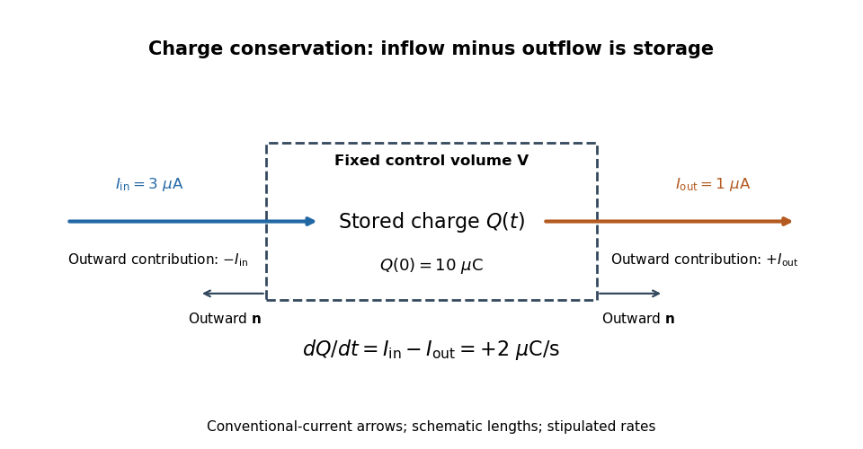
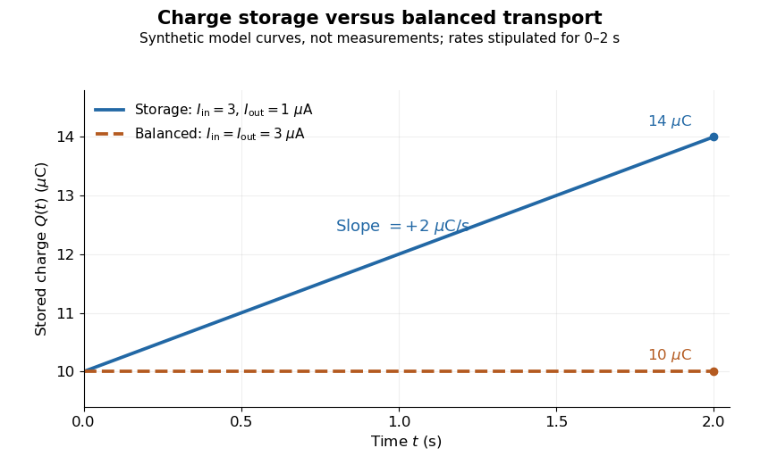

# Charge conservation

↑ **Parent:** [Electric charge](electric-charge-split.md)  
ⓦ [Wiki](https://en.wikipedia.org/wiki/Charge_conservation)

[Charge conservation](charge-conservation.md) says that the total signed [electric charge](electric-charge-split.md) of an isolated collection stays constant. More generally, a collection closed to [electric charge](electric-charge-split.md) exchange has constant total [electric charge](electric-charge-split.md), even if [energy](energy-split.md) crosses its boundary. This is the charge bookkeeping relevant to a [closed system](closed-system.md) or an [isolated system](isolated-system.md); isolation from [energy](energy-split.md) exchange is not required. Positive and negative [electric charge](electric-charge-split.md) count with opposite signs. Creating or removing an [electron](electron.md) and a [Positron](positron.md) together is compatible with [charge conservation](charge-conservation.md), because their combined [electric charge](electric-charge-split.md) is zero. [Feynman, Leighton and Sands, The Feynman Lectures on Physics, I.4.4: net charge conservation](https://www.feynmanlectures.caltech.edu/I_04.html#Ch4-S4).

Imagine a fixed box initially containing [electric charge](electric-charge-split.md) $Q(0)=10\,\mu\mathrm C$. Stipulate incoming [conventional current](conventional-current.md) $I_{\mathrm{in}}=3\,\mu\mathrm A$ and outgoing [conventional current](conventional-current.md) $I_{\mathrm{out}}=1\,\mu\mathrm A$ throughout $0\le t\le2\,\mathrm s$, with no other boundary transport. Since one [ampere](ampere.md) is one [coulomb](coulomb.md) per second, the stored [electric charge](electric-charge-split.md) grows at $2\,\mu\mathrm{C/s}$:

$$
\frac{dQ}{dt}=I_{\mathrm{in}}-I_{\mathrm{out}}=2\,\mu\mathrm{C/s},\qquad Q(t)=10\,\mu\mathrm C+(2\,\mu\mathrm{C/s})t,\qquad Q(2\,\mathrm s)=14\,\mu\mathrm C.
$$

If instead the outgoing [electric current](electric-current.md) also equals $3\,\mu\mathrm A$, the stored [electric charge](electric-charge-split.md) remains $10\,\mu\mathrm C$ while [electric charge](electric-charge-split.md) passes through. These are stipulated transport examples; constant terminal [electric currents](electric-current.md) alone do not guarantee a time-independent interior [charge density](charge-density.md).

**[Figure 5](#image-signed-electric-current-through-a-fixed-control-volume). Signed electric current through a fixed control volume**. [Source](charge-conservation-control-volume.py). The dashed box is an accounting boundary. Outward [unit normals](unit-normal.md) point left at the inlet and right at the outlet: the respective contributions to outward [electric current](electric-current.md) are $-I_{\mathrm{in}}$ and $+I_{\mathrm{out}}$. Arrow lengths are schematic.

**[Figure 6](#image-stored-electric-charge-with-unequal-and-balanced-terminal-electric-currents). Stored electric charge with unequal and balanced terminal electric currents**. [Source](charge-storage-versus-steady-current.py). Synthetic curves from the stipulated rates over $0\le t\le2\,\mathrm s$, with the same initial [electric charge](electric-charge-split.md); these are not measurements. Balanced transport keeps total [electric charge](electric-charge-split.md) fixed, and is compatible with steady transport.

Locally, [charge conservation](charge-conservation.md) is the [charge continuity equation](charge-continuity-equation.md), an instance of the general [continuity equation](continuity-equation.md):

$$
\partial_t\rho+\nabla\cdot\mathbf J=0.
$$

Here $\rho(\mathbf r,t)$ is signed volume [charge density](charge-density.md) and $\mathbf J(\mathbf r,t)$ is [current density](current-density.md). A positive [divergence](divergence.md) of [current density](current-density.md) means net outward transport from a small neighborhood, so its [charge density](charge-density.md) decreases. For a fixed [control volume](control-volume.md) $V$ with [closed surface](closed-surface.md) $\partial V$ and outward [unit normal](unit-normal.md) $\mathbf n$, the equivalent integrated balance is

$$
Q_V(t)=\int_V\rho\,dV,\qquad \frac{dQ_V}{dt}=-\oint_{\partial V}\mathbf J\cdot\mathbf n\,dA=-I_{\mathrm{out,net}}.
$$

The [surface integral](surface-integral.md) is signed: incoming positive [electric charge](electric-charge-split.md) contributes negatively to outward [electric current](electric-current.md), and outgoing positive [electric charge](electric-charge-split.md) contributes positively. Integrate the [charge continuity equation](charge-continuity-equation.md) over fixed $V$ and apply the [divergence theorem](divergence-theorem.md) to obtain this balance. Zero net boundary transport gives constant $Q_V$; the global and local statements describe the same [conservation law](conservation-law.md) at different scales. [Feynman, Leighton and Sands, II.13.2: local and integrated charge conservation](https://www.feynmanlectures.caltech.edu/II_13.html#Ch13-S2).

In a steady transport state, [charge density](charge-density.md) and [current density](current-density.md) are time-independent, so the [charge continuity equation](charge-continuity-equation.md) reduces to $\nabla\cdot\mathbf J=0$. At an [electrical circuit](electrical-circuit-split.md) junction, choose each terminal [electric current](electric-current.md) $I_k$ positive outward and assume the terminals account for all boundary transport. Then

$$
\sum_k I_k=-\frac{dQ_{\mathrm{junction}}}{dt}.
$$

[Kirchhoff's current law](kirchhoff-node-law.md), $\sum_k I_k=0$, follows when accumulation of [electric charge](electric-charge-split.md) at the junction is negligible. During storage, retain the same balance with its nonzero [derivative](derivative.md); [charge conservation](charge-conservation.md) continues to hold. This makes [charge conservation](charge-conservation.md) useful for checking [electrical circuit](electrical-circuit-split.md) models and for tracking the charging of a [capacitor](capacitor.md). [Ling, Sanny and Moebs, University Physics II, §10.3: Kirchhoff's junction rule](https://openstax.org/books/university-physics-volume-2/pages/10-3-kirchhoffs-rules).

The beautiful consistency with [Maxwell equations](maxwell-equations-split.md) is that the [electric field](electric-field-split.md) and [magnetic field](magnetic-field-split.md) already enforce this transport balance. For sufficiently smooth fields in vacuum [SI](international-system-of-units.md), take the [divergence](divergence.md) of the [Ampère-Maxwell equation](ampere-s-circuital-law.md), use that the [divergence of a curl is zero](divergence-of-a-curl-is-zero.md), and substitute [Gauss's law](gauss-s-law.md), $\nabla\cdot\mathbf E=\rho/\epsilon_0$. Constant [vacuum permittivity](vacuum-permittivity.md) $\epsilon_0$ gives

$$
0=\nabla\cdot\mathbf J+\epsilon_0\partial_t(\nabla\cdot\mathbf E)=\nabla\cdot\mathbf J+\partial_t\rho.
$$

The [displacement current](displacement-current.md) term supplies the part needed when [electric charge](electric-charge-split.md) accumulates. Historically, Maxwell added that term to extend the steady-current equation; see the existing [charge conservation from Maxwell equations](charge-conservation-from-maxwell-equations.md) for this connection. [Feynman, Leighton and Sands, II.18.1: Maxwell's added term and charge conservation](https://www.feynmanlectures.caltech.edu/II_18.html#Ch18-S1).

## ↑ Ancestors (5)

1. [Electric charge](electric-charge-split.md)
2. [Electromagnetism](electromagnetism-split.md)
3. [Branches of physics](branches-of-physics.md)
4. [Physics](physics-split.md)
5. [Codex Wiki](split.md)

## ← Incoming links (21)

- [Charge conservation](charge-conservation.md)
- [Electric charge](electric-charge-split.md)
- [Electric potential](electric-potential.md)
- [Electron-hole recombination](electron-hole-recombination.md)
- [Faraday's ice pail experiment](faraday-s-ice-pail-experiment.md)
- [Ionization-chamber charge-loss model](ionization-chamber-charge-loss-model.md)
- [Solution](past-exam-of-the-optics-and-electrodynamics-course-of-the-university-of-cambridge/2012/paper-1/4/solution.md)
- [Solution](past-exam-of-the-physics-b-course-of-the-university-of-cambridge/2010/paper-2a/section-b/b6/solution.md)
- [Solution](past-exam-of-the-physics-b-course-of-the-university-of-cambridge/2010/paper-2a/section-b/b8/solution.md)
- [Solution](past-exam-of-the-physics-b-course-of-the-university-of-cambridge/2012/paper-2/section-b/b7/solution.md)
- [Solution](past-exam-of-the-physics-b-course-of-the-university-of-cambridge/2015/paper-2/section-b/b7/solution.md)
- [Solution](past-exam-of-the-physics-b-course-of-the-university-of-cambridge/2017/paper-2/section-b/b6/a/solution.md)
- [Solution](past-exam-of-the-physics-b-course-of-the-university-of-cambridge/2018/paper-2/section-b/b6/b/solution.md)
- [Solution](past-exam-of-the-physics-b-course-of-the-university-of-cambridge/2021/paper-2/section-a/a5/solution.md)
- [Solution](past-exam-of-the-physics-b-course-of-the-university-of-cambridge/2022/paper-1/section-a/a4/solution.md)
- [Solution](past-exam-of-the-physics-course-of-the-year-1-of-the-natural-sciences-course-of-the-university-of-cambridge/2012/paper-1/section-e/e15/c/solution.md)
- [Solution](past-exam-of-the-physics-course-of-the-year-1-of-the-natural-sciences-course-of-the-university-of-cambridge/2015/paper-1/section-e/e15/d/solution.md)
- [Solution](past-exam-of-the-physics-course-of-the-year-1-of-the-natural-sciences-course-of-the-university-of-cambridge/2017/section-e/15/d/solution.md)
- [Solution](past-exam-of-the-relativity-course-of-the-university-of-cambridge/2012/paper-1/2/c/solution.md)
- [Photocurrent](photocurrent.md)
- [Steady fields in two leaky dielectric layers](steady-fields-in-two-leaky-dielectric-layers.md)
