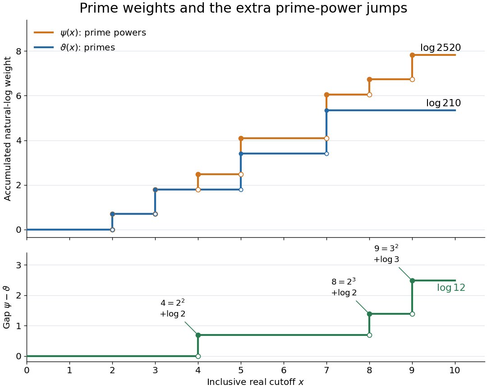

# Chebyshev function

↑ **Parent:** [Von Mangoldt function](von-mangoldt-function.md)  
ⓦ [Wiki](https://en.wikipedia.org/wiki/Chebyshev_function)

The two [Chebyshev functions](chebyshev-function.md) measure the total [natural logarithm](natural-logarithm.md) weight of [prime numbers](prime-number.md) or of [prime powers](prime-power.md) greater than one below a real cutoff $x\geq0$:

$$
\vartheta(x)=\sum_{p\leq x}\log p,
\qquad
\psi(x)=\sum_{n\leq x}\Lambda(n)
=\sum_{\substack{p^k\leq x\\k\geq1}}\log p.
$$

Here $p$ ranges over [prime numbers](prime-number.md), $n$ over [positive integers](positive-integer.md), and $k$ over [positive integers](positive-integer.md). The [Chebyshev theta function](chebyshev-theta-function.md) $\vartheta$, also written $\theta$, weights each [prime number](prime-number.md) once. The [Second Chebyshev function](second-chebyshev-function.md) $\psi$ weights every positive power of each [prime number](prime-number.md) separately. Both vanish for $0\leq x<2$; the inclusive cutoff makes them [right-continuous functions](right-continuous-function.md) and [nondecreasing functions](nondecreasing-function.md), constant between their jumps. [7.2: Chebyshev's Functions](elementary-number-theory/7-2-chebyshev-s-functions.md)

At $x=10$, the [prime numbers](prime-number.md) are $2,3,5,7$, while the extra [prime powers](prime-power.md) greater than one are $4,8,9$. Exactly,

$$
\begin{aligned}
\vartheta(10)&=\log2+\log3+\log5+\log7=\log210,\\
\psi(10)&=3\log2+2\log3+\log5+\log7=\log2520,\\
\psi(10)-\vartheta(10)&=2\log2+\log3=\log12.
\end{aligned}
$$

At each [prime number](prime-number.md) $p$, both [Chebyshev functions](chebyshev-function.md) jump by $\log p$. At a [prime power](prime-power.md) $p^k$ with $k\geq2$, only the [Second Chebyshev function](second-chebyshev-function.md) jumps, by $\log p$. At $6$ and $10$ neither jumps. Notice that the gap is already positive at $5$ and $7$: a shared jump does not remove the earlier contribution from $4$.

**[Figure 20](#image-chebyshev-prime-power-staircases). The Chebyshev functions separate at the extra prime powers $4$, $8$, and $9$**. The upper panel compares $\vartheta(x)$ and $\psi(x)$ for $0\leq x\leq10$. Solid endpoints include the jump at each contributing [integer](integer.md); open endpoints show the preceding value. The lower panel isolates $\psi(x)-\vartheta(x)$, which jumps by $\log2$ at $4$ and $8$ and by $\log3$ at $9$, reaching $\log12$. All logarithms are [natural logarithms](natural-logarithm.md).

Grouping the [prime powers](prime-power.md) by their exponent gives, for $x\geq2$,

$$
\psi(x)=\sum_{k=1}^{\lfloor\log x/\log2\rfloor}\vartheta(x^{1/k}),
\qquad
\psi(x)-\vartheta(x)=\sum_{k=2}^{\lfloor\log x/\log2\rfloor}\vartheta(x^{1/k}).
$$

The [floor function](floor-function.md) cutoff is exact: $p\geq2$ forces $2^k\leq x$ whenever $p^k\leq x$. For each exponent, $p^k\leq x$ is equivalent to $p\leq x^{1/k}$. An upper cutoff smaller than the lower one means an empty sum. [7.2: Chebyshev's Functions](elementary-number-theory/7-2-chebyshev-s-functions.md)

**Table of contents**

- [Second Chebyshev function](second-chebyshev-function.md)
  - [First integral of the Chebyshev function](first-integral-of-the-chebyshev-function.md)
    - [Smoothed explicit formula for the Chebyshev function](smoothed-explicit-formula-for-the-chebyshev-function.md)
  - [Integrated Chebyshev sum](integrated-chebyshev-sum.md)
  - [Chebyshev estimate](chebyshev-estimate.md)
    - [Chebyshev estimate from central binomial coefficients](chebyshev-estimate-from-central-binomial-coefficients.md)
  - [Riemann–von Mangoldt explicit formula](riemann-von-mangoldt-explicit-formula.md)
    - [Truncated explicit formula for the second Chebyshev function](truncated-explicit-formula-for-the-second-chebyshev-function.md)

## ↑ Ancestors (6)

1. [Von Mangoldt function](von-mangoldt-function.md)
2. [Arithmetic function](arithmetic-function.md)
3. [Number theory](number-theory-split.md)
4. [Area of mathematics](area-of-mathematics.md)
5. [Mathematics](mathematics-split.md)
6. [Codex Wiki](split.md)

## ← Incoming links (7)

- [Chebyshev function](chebyshev-function.md)
- [Chebyshev theta function](chebyshev-theta-function.md)
- [Solution](past-exam-of-the-mathematics-course-of-the-university-of-cambridge/2005/iii/paper-28/2/ii/solution.md)
- [Solution](past-exam-of-the-mathematics-course-of-the-university-of-cambridge/2006/iii/paper-28/1/solution.md)
- [Solution](past-exam-of-the-mathematics-course-of-the-university-of-cambridge/2009/ii/paper-3/1g/solution.md)
- [Second Chebyshev function](second-chebyshev-function.md)
- [Von Mangoldt function](von-mangoldt-function.md)
