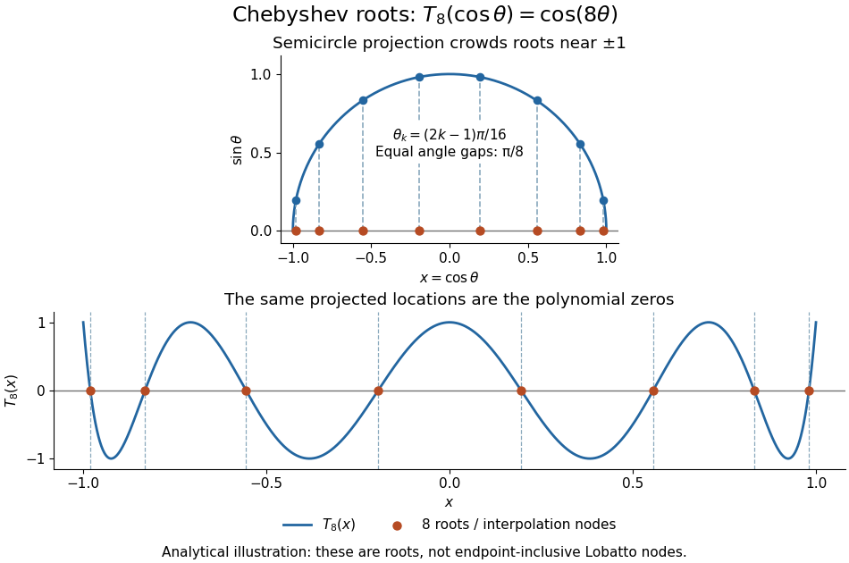

# Chebyshev polynomial

↑ **Parent:** [Numerical analysis](numerical-analysis-split.md)  
ⓦ [Wiki](https://en.wikipedia.org/wiki/Chebyshev_polynomial)

The first-kind [Chebyshev polynomial](chebyshev-polynomial.md) $T_n$ converts a multiple-angle [cosine](cosine.md) into a [polynomial](polynomial-split.md):

$$
T_n(\cos\theta)=\cos(n\theta),\qquad 0\leq\theta\leq\pi,\quad n\geq0.
$$

The [cosine addition formula](cosine-addition-formula.md) gives the [recurrence relation](recurrence-relation.md)

$$
T_0(x)=1,\qquad T_1(x)=x,\qquad T_{n+1}(x)=2xT_n(x)-T_{n-1}(x)\quad(n\geq1).
$$

This constructs [polynomials](polynomial-split.md) valid for every real $x$, including outside $[-1,1]$, where the real-angle description is unavailable. For example,

$$
T_2(x)=2x^2-1,\qquad T_3(x)=4x^3-3x,\qquad T_4(x)=8x^4-8x^2+1.
$$

For $n\geq1$, $T_n$ has [polynomial degree](degree-of-a-polynomial.md) $n$ and leading coefficient $2^{n-1}$. On $[-1,1]$ its [uniform norm](supremum-norm.md) is one, even as its oscillations become more numerous.[T. H. Koornwinder and collaborators, NIST Digital Library of Mathematical Functions, §18.5(i), equation 18.5.1: trigonometric representation](https://dlmf.nist.gov/18.5#i)[Koornwinder and collaborators, NIST DLMF, §18.9(i), Table 18.9.1: recurrence coefficients](https://dlmf.nist.gov/18.9#i)

The [polynomial roots](root-of-a-polynomial.md) of $T_n$ are especially simple:

$$
x_k=\cos\!\left(\frac{(2k-1)\pi}{2n}\right),\qquad k=1,\ldots,n.
$$

They correspond to equally spaced angles, but their locations in $x$ cluster near $-1$ and $1$. For $T_3$, the [polynomial roots](root-of-a-polynomial.md) are $\sqrt3/2,0,-\sqrt3/2$. For $T_8$, the positive [polynomial roots](root-of-a-polynomial.md) are approximately $0.980785,0.831470,0.555570,0.195090$, with their negatives completing the set. The distance from the right endpoint to the nearest [polynomial root](root-of-a-polynomial.md) is $1-\cos(\pi/(2n))\sim\pi^2/(8n^2)$; central neighboring [polynomial roots](root-of-a-polynomial.md) are separated on the larger scale $1/n$. The small change of [cosine](cosine.md) near angles zero and $\pi$ explains the clustering.

**[Figure 36](#image-analytical-illustration-of-the-eight-roots-of-t8-equally-spaced-angles-on-a-semicircle-project-to-endpoint-clustered-interpolation-nodes). Analytical illustration of the eight roots of T8: equally spaced angles on a semicircle project to endpoint-clustered interpolation nodes**.

These [polynomial roots](root-of-a-polynomial.md) supply $n$ [interpolation nodes](interpolation-node.md) for a [polynomial interpolation](polynomial-interpolation.md) of [polynomial degree](degree-of-a-polynomial.md) at most $n-1$. They differ from the $n+1$ [Chebyshev-Lobatto nodes](chebyshev-lobatto-node.md) $\cos(j\pi/n)$, which include both endpoints. This choice of [polynomial roots](root-of-a-polynomial.md) has nodal [polynomial](polynomial-split.md)

$$
\prod_{k=1}^n(x-x_k)=2^{1-n}T_n(x).
$$

The [monic Chebyshev extremal polynomial](monic-chebyshev-extremal-polynomial.md) minimizes the [uniform norm](supremum-norm.md) of this product among [monic polynomials](monic-polynomial.md) of [polynomial degree](degree-of-a-polynomial.md) $n$ on $[-1,1]$. Consequently, if $f$ has $n$ continuous [derivatives](derivative.md), the usual [polynomial interpolation error](polynomial-interpolation-error.md) gives the useful bound

$$
\|f-p\|_\infty\leq\frac{2^{1-n}}{n!}\max_{-1\leq x\leq1}|f^{(n)}(x)|,\qquad\deg p\leq n-1.
$$

This optimizes the nodal factor in that bound, not the actual error for every [function](function-split.md). Endpoint clustering helps control the large endpoint oscillations of [equally spaced interpolation](equally-spaced-interpolation.md) associated with [Runge's phenomenon](runge-s-phenomenon.md). The two node conventions and their geometric construction are discussed in Trefethen's authored text.[Lloyd N. Trefethen, Approximation Theory and Approximation Practice, Chapters 2–3 and Exercise 2.4: endpoint clustering, first-kind roots and polynomials](https://people.maths.ox.ac.uk/trefethen/ATAP/ATAPfirst6chapters.pdf)

The same [cosine substitution for polynomial approximation](cosine-substitution-for-polynomial-approximation.md) explains the weighted [orthogonality](orthogonal-vectors.md):

$$
\int_{-1}^1\frac{T_m(x)T_n(x)}{\sqrt{1-x^2}}\,dx=\int_0^\pi\cos(m\theta)\cos(n\theta)\,d\theta=\begin{cases}0,&m\ne n,\\\pi,&m=n=0,\\\pi/2,&m=n\geq1.\end{cases}
$$

The endpoint singularities of the weight are integrable. Thus the [Chebyshev polynomials](chebyshev-polynomial.md) are [orthogonal polynomials](orthogonal-polynomial.md) for this weight, making coefficients in a [least-squares polynomial in an orthogonal-polynomial basis](least-squares-polynomial-in-an-orthogonal-polynomial-basis.md) separate cleanly. Their [polynomial roots](root-of-a-polynomial.md) also give [Chebyshev–Gauss quadrature](chebyshev-gauss-quadrature.md), connecting [polynomial interpolation](polynomial-interpolation.md) to [Gaussian quadrature](gaussian-quadrature.md).[Koornwinder and collaborators, NIST DLMF, §18.3, Table 18.3.1: first-kind Chebyshev weight and normalization](https://dlmf.nist.gov/18.3)

Accuracy still depends on the target [function](function-split.md). The [absolute value function](absolute-value.md) $|x|$ has a corner at zero, so the hypothesis requiring continuous [derivatives](derivative.md) in the displayed [polynomial interpolation error](polynomial-interpolation-error.md) bound fails. Endpoint clustering cannot remove that corner. A jump poses a stronger obstruction: [polynomials](polynomial-split.md) are [continuous functions](continuous-function.md), so they cannot converge in the [uniform norm](supremum-norm.md) to a discontinuous [function](function-split.md) on the whole [interval](interval-mathematics.md). Chebfun's documented examples show persistent overshoot for such jumps; these are a limitation of global [polynomial interpolation](polynomial-interpolation.md), not a universal promise of rapid accuracy from [Chebyshev polynomials](chebyshev-polynomial.md).[Chebfun development team, Chebfun Guide, §4.3: polynomial interpolation of discontinuous functions](https://www.chebfun.org/docs/guide/guide04.html#4.3)

**Table of contents**

- [Chebyshev projection of a semicircle](chebyshev-projection-of-a-semicircle.md)
- [Chebyshev nodal derivative comparison](chebyshev-nodal-derivative-comparison.md)
- [Chebyshev polynomial of the second kind](chebyshev-polynomial-of-the-second-kind.md)
- [Rational cosine of an integral submultiple of pi](rational-cosine-of-an-integral-submultiple-of-pi.md)
- [Positivity of Chebyshev derivatives beyond the unit interval](positivity-of-chebyshev-derivatives-beyond-the-unit-interval.md)
- [Monic Chebyshev extremal polynomial](monic-chebyshev-extremal-polynomial.md)
- [Chebyshev polynomial domination lemma](chebyshev-polynomial-domination-lemma.md)
  - [Chebyshev interpolation represents external evaluation](chebyshev-interpolation-represents-external-evaluation.md)
- [Chebyshev differential equation](chebyshev-differential-equation.md)
  - [Chebyshev derivative Sturm-Liouville pair](chebyshev-derivative-sturm-liouville-pair.md)

## ↑ Ancestors (5)

1. [Numerical analysis](numerical-analysis-split.md)
2. [Analysis](analysis-split.md)
3. [Area of mathematics](area-of-mathematics.md)
4. [Mathematics](mathematics-split.md)
5. [Codex Wiki](split.md)

## ← Incoming links (33)

- [Bernstein inequality for algebraic polynomials](bernstein-inequality-for-algebraic-polynomials.md)
- [Chebyshev–Gauss quadrature](chebyshev-gauss-quadrature.md)
- [Chebyshev-Lobatto node](chebyshev-lobatto-node.md)
- [Chebyshev nodal derivative comparison](chebyshev-nodal-derivative-comparison.md)
- [Chebyshev polynomial](chebyshev-polynomial.md)
- [Duffin-Schaeffer polynomial derivative inequality](duffin-schaeffer-polynomial-derivative-inequality.md)
- [Solution](past-exam-of-the-mathematics-course-of-the-university-of-cambridge/2002/iii/paper-61/2/solution.md)
- [Solution](past-exam-of-the-mathematics-course-of-the-university-of-cambridge/2004/ib/paper-4/6c/solution.md)
- [Solution](past-exam-of-the-mathematics-course-of-the-university-of-cambridge/2005/ib/paper-2/18f/b/solution.md)
- [Solution](past-exam-of-the-mathematics-course-of-the-university-of-cambridge/2005/iii/paper-6/4/solution.md)
- [Solution](past-exam-of-the-mathematics-course-of-the-university-of-cambridge/2005/iii/paper-68/2/solution.md)
- [Solution](past-exam-of-the-mathematics-course-of-the-university-of-cambridge/2006/ia/paper-1/8a/i/solution.md)
- [Solution](past-exam-of-the-mathematics-course-of-the-university-of-cambridge/2006/iii/paper-67/4/b/solution.md)
- [Solution](past-exam-of-the-mathematics-course-of-the-university-of-cambridge/2006/iii/paper-9/3/solution.md)
- [Solution](past-exam-of-the-mathematics-course-of-the-university-of-cambridge/2007/ii/paper-1/2f/i/solution.md)
- [Solution](past-exam-of-the-mathematics-course-of-the-university-of-cambridge/2007/ii/paper-1/2f/ii/solution.md)
- [Solution](past-exam-of-the-mathematics-course-of-the-university-of-cambridge/2008/ib/paper-4/8d/solution.md)
- [Solution](past-exam-of-the-mathematics-course-of-the-university-of-cambridge/2008/iii/paper-75/3/a/solution.md)
- [Solution](past-exam-of-the-mathematics-course-of-the-university-of-cambridge/2008/iii/paper-75/4/b/solution.md)
- [Solution](past-exam-of-the-mathematics-course-of-the-university-of-cambridge/2009/ii/paper-2/2f/b/solution.md)
- [Solution](past-exam-of-the-mathematics-course-of-the-university-of-cambridge/2010/ii/paper-4/2f/solution.md)
- [Solution](past-exam-of-the-mathematics-course-of-the-university-of-cambridge/2010/iii/paper-62/3/a/solution.md)
- [Solution](past-exam-of-the-mathematics-course-of-the-university-of-cambridge/2010/iii/paper-62/3/b/solution.md)
- [Solution](past-exam-of-the-mathematics-course-of-the-university-of-cambridge/2013/iii/paper-61/4/b/solution.md)
- [Solution](past-exam-of-the-mathematics-course-of-the-university-of-cambridge/2013/iii/paper-61/6/b/solution.md)
- [Solution](past-exam-of-the-mathematics-course-of-the-university-of-cambridge/2017/ii/paper-3/39a/iii/solution.md)
- [Solution](past-exam-of-the-mathematics-course-of-the-university-of-cambridge/2019/ia/paper-2/6c/solution.md)
- [Solution](past-exam-of-the-mathematics-course-of-the-university-of-cambridge/2019/ii/paper-1/2h/solution.md)
- [Solution](past-exam-of-the-mathematics-course-of-the-university-of-cambridge/2021/iii/paper-157/2/d/solution.md)
- [Solution](past-exam-of-the-mathematics-course-of-the-university-of-cambridge/2024/ib/paper-2/3b/solution.md)
- [Solution](past-exam-of-the-mathematics-course-of-the-university-of-cambridge/2024/ii/paper-1/2g/a/solution.md)
- [Solution](past-exam-of-the-mathematics-course-of-the-university-of-cambridge/2024/iii/paper-318/2/c/solution.md)
- [Uniqueness of Chebyshev derivative-norming nodes](uniqueness-of-chebyshev-derivative-norming-nodes.md)
