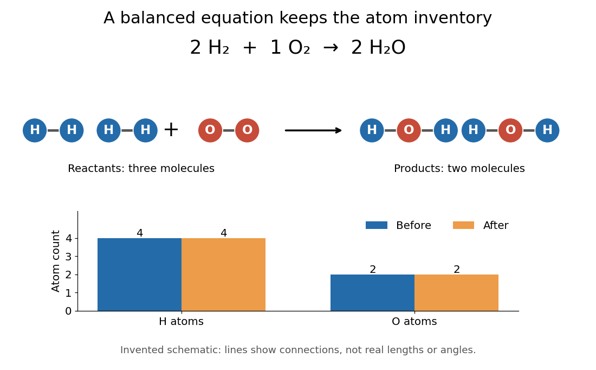

# Chemical equation

↑ **Parent:** [Chemical reaction](chemical-reaction.md)  
ⓦ [Wiki](https://en.wikipedia.org/wiki/Chemical_equation)

A [chemical equation](chemical-equation.md) represents a [chemical reaction](chemical-reaction.md) using [chemical formulas](chemical-formula.md), with [reactants](reactant.md) on the left and [reaction products](product-chemistry.md) on the right. A balanced [chemical equation](chemical-equation.md) has the same number of [chemical atoms](atom-physics.md) of each [chemical element](chemical-element.md) on both sides. For [molecular hydrogen](molecular-hydrogen.md) and [molecular oxygen](molecular-oxygen.md) forming [water](water.md),

$$
2\mathrm{H}_2+\mathrm{O}_2\longrightarrow2\mathrm{H}_2\mathrm{O}.
$$

The coefficients $2,1,2$ give the relative numbers of [molecules](molecule.md); the coefficient $1$ is normally omitted. Count [hydrogen](hydrogen.md) as $2\times2=4$ on the left and $2\times2=4$ on the right, and [oxygen](oxygen.md) as $1\times2=2$ on the left and $2\times1=2$ on the right. See [Flowers et al., Chemistry 2e, §4.1: writing and balancing chemical equations](https://openstax.org/books/chemistry-2e/pages/4-1-writing-and-balancing-chemical-equations).

**[Figure 65](#image-two-molecular-hydrogen-molecules-and-one-molecular-oxygen-molecule-account-for-two-water-molecules). Two molecular hydrogen molecules and one molecular oxygen molecule account for two water molecules**. Exactly four [hydrogen](hydrogen.md) and two [oxygen](oxygen.md) [chemical atoms](atom-physics.md) occur on each side. The circles and connecting lines are an invented schematic: they indicate grouping and [chemical bonds](chemical-bond.md), without representing actual [bond lengths](bond-length.md), [bond angles](bond-angle.md) or a [reaction mechanism](reaction-mechanism.md).

To balance the initial expression $\mathrm H_2+\mathrm O_2\longrightarrow\mathrm H_2\mathrm O$, first put $2$ before [water](water.md) to match the two [oxygen](oxygen.md) [chemical atoms](atom-physics.md). This creates four [hydrogen](hydrogen.md) [chemical atoms](atom-physics.md) on the right, so put $2$ before [molecular hydrogen](molecular-hydrogen.md). Changing a coefficient multiplies the entire [chemical formula](chemical-formula.md). Changing a subscript changes composition and usually the [chemical substance](chemical-substance.md): $2\mathrm H_2\mathrm O$ is two [water](water.md) [molecules](molecule.md), whereas $\mathrm H_2\mathrm O_2$ is one [hydrogen peroxide](hydrogen-peroxide.md) [molecule](molecule.md). Never balance a [chemical equation](chemical-equation.md) by changing its subscripts.

The bookkeeping follows from conservation of the [atomic nuclei](atomic-nucleus.md) in ordinary, non-nuclear [chemical reactions](chemical-reaction.md); [chemical bonds](chemical-bond.md) and the distribution of [Electrons](electron.md) can change. For a [chemical equation](chemical-equation.md) involving [ions](ion.md), total [electric charge](electric-charge.md) must also match. For example, the existing [self-ionization of water](self-ionization-of-water.md) equation has zero total [electric charge](electric-charge.md) on each side, since the $+1$ of [hydronium](hydronium.md) cancels the $-1$ of [hydroxide](hydroxide.md). See [2.6 Ionic and Molecular Compounds](chemistry-2e-by-paul-flowers-and-others/2-6-ionic-and-molecular-compounds.md) (§2.6: nuclei and ions).

The same $2:1:2$ ratio relates changes in [amount of substance](amount-of-substance.md): two [moles](mole-unit.md) of [molecular hydrogen](molecular-hydrogen.md) consumed per [mole](mole-unit.md) of [molecular oxygen](molecular-oxygen.md) correspond to two [moles](mole-unit.md) of [water](water.md) formed. A [mole](mole-unit.md) is a defined unit, not one [molecule](molecule.md); the little whole-number picture is an abstract counting model, not a claim that a macroscopic sample contains just five [molecules](molecule.md). See [molecular count and amount of substance](molecular-count-and-amount-of-substance.md) for the exact conversion and [BIPM, SI base unit: mole](https://www.bipm.org/en/si-base-units/mole) for the definition.

This is why a balanced [chemical equation](chemical-equation.md) is useful: [stoichiometry](stoichiometry.md) turns the same atom accounting into relations between measurable quantities. It does not determine [reaction rate](reaction-rate.md), the final conversion set by [chemical equilibrium](chemical-equilibrium.md), or the actual yield of recovered [reaction products](product-chemistry.md). The [limiting reagent](limiting-reagent.md) gives an upper bound under the specified [chemical reaction](chemical-reaction.md).

## ↑ Ancestors (3)

1. [Chemical reaction](chemical-reaction.md)
2. [Chemistry](chemistry-split.md)
3. [Codex Wiki](split.md)

## ← Incoming links (23)

- [Acidic permanganate-iron balance](acidic-permanganate-iron-balance.md)
- [Catalysed peroxide comparison](catalysed-peroxide-comparison.md)
- [Catalyst](catalyst.md)
- [Catalytic cycle](catalytic-cycle.md)
- [Chemical equation](chemical-equation.md)
- [Chemical formula](chemical-formula.md)
- [Chemical reaction](chemical-reaction.md)
- [Daniell cell](daniell-cell.md)
- [Electrochemistry](electrochemistry.md)
- [Electrode](electrode.md)
- [Electrolysis](electrolysis.md)
- [Elementary reaction](elementary-reaction.md)
- [Extent of reaction](extent-of-reaction.md)
- [Half-reaction](half-reaction.md)
- [Inorganic phosphate](inorganic-phosphate.md)
- [Molecularity](molecularity.md)
- [Rate law](rate-law.md)
- [Reaction intermediate](reaction-intermediate.md)
- [Reaction rate](reaction-rate.md)
- [Redox titration](redox-titration.md)
- [Second-order reaction](second-order-reaction.md)
- [Stoichiometry](stoichiometry.md)
- [Weak acid](weak-acid.md)
