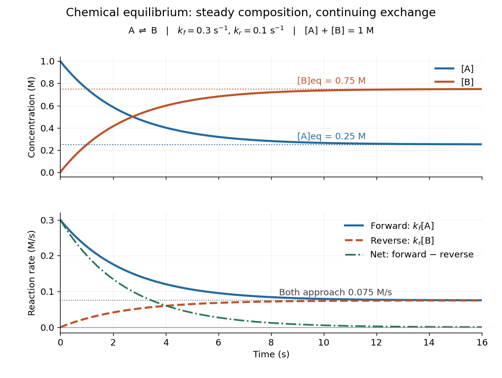

# Chemical equilibrium

↑ **Parent:** [Chemical potential](chemical-potential.md)  
ⓦ [Wiki](https://en.wikipedia.org/wiki/Chemical_equilibrium)

At [chemical equilibrium](chemical-equilibrium.md), a reversible [chemical reaction](chemical-reaction.md) has equal forward and reverse [reaction rates](reaction-rate.md), so its macroscopic composition stays constant. Individual [molecules](molecule.md) can keep changing identity: the reaction has not stopped. This dynamic balance is the definition described by the [IUPAC Gold Book, chemical equilibrium](https://goldbook.iupac.org/terms/view/C01023). Equal [reaction rates](reaction-rate.md) also need not mean equal [concentrations](concentration.md). A small population converting rapidly can balance a large population converting slowly.

This distinction gives two useful questions. Which composition is favored at the specified [temperature](temperature.md) and other constraints? [Thermodynamics](thermodynamics-split.md) answers through [chemical potentials](chemical-potential.md) and an [equilibrium constant](equilibrium-constant.md). How quickly does a prepared mixture approach that composition? [Chemical kinetics](chemical-kinetics.md) answers through [reaction rates](reaction-rate.md). Knowing the destination does not determine the journey's duration. A composition that barely changes during observation may reflect extremely slow [chemical kinetics](chemical-kinetics.md), so constancy alone does not establish [chemical equilibrium](chemical-equilibrium.md).

Consider the idealized elementary [chemical reaction](chemical-reaction.md)

$$
\mathrm A\rightleftharpoons\mathrm B,
\qquad k_f=0.3\,\mathrm{s}^{-1},\qquad k_r=0.1\,\mathrm{s}^{-1}.
$$

Assume a well-mixed [closed system](closed-system.md) at fixed [temperature](temperature.md) and [volume](volume.md), with first-order [law of mass action](law-of-mass-action.md) rates in both directions and no competing [chemical reactions](chemical-reaction.md). Write $a=[\mathrm A]$ and $b=[\mathrm B]$ for [concentrations](concentration.md) in $\mathrm M=\mathrm{mol}/\mathrm L$. The total $a+b=C=1\,\mathrm M$ is conserved because each conversion replaces one [molecule](molecule.md) by one [molecule](molecule.md). This conservation is special to the chosen [stoichiometry](stoichiometry.md).

The forward and reverse [reaction rates](reaction-rate.md), measured as conversions per unit [volume](volume.md) per unit time, are $J_f=k_fa$ and $J_r=k_rb$. Hence

$$
\frac{da}{dt}=-k_fa+k_rb=-(k_f+k_r)a+k_rC.
$$

Setting this [derivative](derivative.md) to zero gives

$$
a_{\rm eq}=\frac{k_rC}{k_f+k_r}=0.25\,\mathrm M,
\qquad b_{\rm eq}=0.75\,\mathrm M.
$$

With $a(0)=1\,\mathrm M$ and $b(0)=0$, solving the [ordinary differential equation](ordinary-differential-equation.md) yields

$$
a(t)=\bigl(0.25+0.75e^{-0.4t/\mathrm s}\bigr)\,\mathrm M,
\qquad b(t)=\bigl(0.75-0.75e^{-0.4t/\mathrm s}\bigr)\,\mathrm M.
$$

At $t=5\,\mathrm s$, these are approximately $0.3515\,\mathrm M$ and $0.6485\,\mathrm M$. Initially $J_f=0.3\,\mathrm{M/s}$ and $J_r=0$. At [chemical equilibrium](chemical-equilibrium.md), both are $0.075\,\mathrm{M/s}$, while the net [reaction rate](reaction-rate.md) $J_f-J_r$ is zero. The persistent exchange is visible in the lower panel even after the upper panel has nearly flattened.

**[Figure 51](#image-constant-equilibrium-composition-with-continuing-molecular-conversion). Constant equilibrium composition with continuing molecular conversion**. The idealized [chemical reaction](chemical-reaction.md) starts entirely in A. Upper panel: [concentrations](concentration.md). Lower panel: forward, reverse and net [reaction rates](reaction-rate.md). The equilibrium rates coincide at a positive value.

Why does [chemical equilibrium](chemical-equilibrium.md) also involve a [free energy](thermodynamic-free-energy.md) minimum? For a [closed system](closed-system.md) at fixed [temperature](temperature.md) and [pressure](pressure.md), without imposed non-expansion [work](work.md), stable equilibrium minimizes [Gibbs free energy](gibbs-free-energy.md) over compositions allowed by conserved elemental inventories. See [W. C. Carter, MIT thermodynamics notes, sections 2-1.14 and 2-1.19](https://ocw.mit.edu/courses/3-00-thermodynamics-of-materials-fall-2002/14c95abd6fac023d84bd33c5d74d787d_lecture_02_oneside.PDF). This is [constrained Gibbs minimization for chemical equilibrium](constrained-gibbs-minimization-for-chemical-equilibrium.md): freely minimizing over unrelated species amounts would change the inventory. At fixed [temperature](temperature.md) and [volume](volume.md), the appropriate potential is [Helmholtz free energy](helmholtz-free-energy.md). In either setting, varying an allowed [extent of reaction](extent-of-reaction.md) gives the corresponding [free energy](thermodynamic-free-energy.md) slope $\sum_i\nu_i\mu_i$, with molar [chemical potentials](chemical-potential.md) and signed [stoichiometric vector](stoichiometric-vector.md) entries. An interior equilibrium has zero slope; stability requires a minimum. For A converting to B, this says $\mu_{\mathrm B}=\mu_{\mathrm A}$.

The beauty of this connection is that molecular exchange, a macroscopic composition, and a geometric minimum describe the same balance. In the ideal concentration model, let $x=b/C$ and choose the standard molar [chemical potential](chemical-potential.md) difference consistent with $K=3$. Up to a composition-independent constant, the fixed-volume [Helmholtz free energy](helmholtz-free-energy.md) then obeys

$$
\frac{F}{nRT}=(1-x)\ln(1-x)+x\ln x-x\ln3,
$$

where $n$ is the conserved total [amount of substance](amount-of-substance.md) and $R$ the [molar gas constant](molar-gas-constant.md). Its [derivative](derivative.md) is $\ln[x/(1-x)]-\ln3$, vanishing at $x=3/4$. Its second [derivative](derivative.md) is $1/x+1/(1-x)>0$ inside $0<x<1$, so this balance is the unique minimum. The mixing [entropy](entropy.md) terms explain why the favored composition still contains A.

**Table of contents**

- [Chemical disequilibrium](chemical-disequilibrium.md)
- [Zero chemical potential from number-changing reactions](zero-chemical-potential-from-number-changing-reactions.md)
- [Chemical relaxation time](chemical-relaxation-time.md)
- [Equilibrium constant](equilibrium-constant.md)
  - [Dissociation constant](dissociation-constant.md)
- [Standard state](standard-state.md)
  - [Thermodynamic activity](thermodynamic-activity.md)
    - [Activity coefficient](activity-coefficient.md)
- [Reaction quotient](reaction-quotient.md)
- [Photon chemical potential](photon-chemical-potential.md)

## ↑ Ancestors (6)

1. [Chemical potential](chemical-potential.md)
2. [Thermodynamics](thermodynamics-split.md)
3. [Statistical physics](statistical-physics-split.md)
4. [Branches of physics](branches-of-physics.md)
5. [Physics](physics-split.md)
6. [Codex Wiki](split.md)

## ← Incoming links (97)

- [Acid-base chemistry](acid-base-chemistry.md)
- [Acid-base titration](acid-base-titration.md)
- [Acid dissociation constant](acid-dissociation-constant.md)
- [Activation energy](activation-energy.md)
- [Analytical concentration](analytical-concentration.md)
- [Antibody affinity](antibody-affinity.md)
- [Antibody equilibrium occupancy](antibody-equilibrium-occupancy.md)
- [Atmospheric carbon-to-oxygen ratio](atmospheric-carbon-to-oxygen-ratio.md)
- [Atmospheric condensate rainout](atmospheric-condensate-rainout.md)
- [Buffer capacity](buffer-capacity.md)
- [Buffer capacity measurement](buffer-capacity-measurement.md)
- [Buffer capacity of a monoprotic acid](buffer-capacity-of-a-monoprotic-acid.md)
- [Buffer solution](buffer-solution.md)
- [Cannibal phase of a decoupled sector](cannibal-phase-of-a-decoupled-sector.md)
- [Catalysed peroxide comparison](catalysed-peroxide-comparison.md)
- [Catalysis](catalysis.md)
- [Catalyst](catalyst.md)
- [Catalytic barriers and reaction free energy](catalytic-barriers-and-reaction-free-energy.md)
- [Catalytic selectivity](catalytic-selectivity.md)
- [Chemical disequilibrium](chemical-disequilibrium.md)
- [Chemical equation](chemical-equation.md)
- [Chemical equilibrium](chemical-equilibrium.md)
- [Chemical kinetics](chemical-kinetics.md)
- [Chemical potential](chemical-potential.md)
- [Chemical potential and Helmholtz free energy](chemical-potential-and-helmholtz-free-energy.md)
- [Chemical potential equality for particle exchange](chemical-potential-equality-for-particle-exchange.md)
- [Chemical reaction](chemical-reaction.md)
- [Chemical relaxation time](chemical-relaxation-time.md)
- [Deuterium equilibrium abundance](deuterium-equilibrium-abundance.md)
- [Dilution](dilution.md)
- [Electrochemistry](electrochemistry.md)
- [Electrolyte](electrolyte.md)
- [Electron-positron thermal pair abundance](electron-positron-thermal-pair-abundance.md)
- [Enzyme](enzyme.md)
- [Finite titrant response of a buffer](finite-titrant-response-of-a-buffer.md)
- [Glucose](glucose.md)
- [Glycine protonation](glycine-protonation.md)
- [Helmholtz free energy](helmholtz-free-energy.md)
- [Henderson-Hasselbalch equation](henderson-hasselbalch-equation.md)
- [Isoelectric point](isoelectric-point.md)
- [Kinetic equilibrium](kinetic-equilibrium.md)
- [Mechanical equilibrium](mechanical-equilibrium.md)
- [Neutralization](neutralization.md)
- [Solution](past-exam-of-the-mathematics-course-of-the-university-of-cambridge/2001/iii/paper-67/2/i/solution.md)
- [Solution](past-exam-of-the-mathematics-course-of-the-university-of-cambridge/2001/iii/paper-67/2/ii/solution.md)
- [Solution](past-exam-of-the-mathematics-course-of-the-university-of-cambridge/2002/iii/paper-71/2/a/solution.md)
- [Solution](past-exam-of-the-mathematics-course-of-the-university-of-cambridge/2002/iii/paper-71/2/c/solution.md)
- [Solution](past-exam-of-the-mathematics-course-of-the-university-of-cambridge/2003/iii/paper-55/3/solution.md)
- [Solution](past-exam-of-the-mathematics-course-of-the-university-of-cambridge/2004/iii/paper-56/2/solution.md)
- [Solution](past-exam-of-the-mathematics-course-of-the-university-of-cambridge/2005/ii/paper-4/15d/solution.md)
- [Solution](past-exam-of-the-mathematics-course-of-the-university-of-cambridge/2005/iii/paper-61/2/solution.md)
- [Solution](past-exam-of-the-mathematics-course-of-the-university-of-cambridge/2006/iii/paper-62/3/a/solution.md)
- [Solution](past-exam-of-the-mathematics-course-of-the-university-of-cambridge/2006/iii/paper-62/3/c/solution.md)
- [Solution](past-exam-of-the-mathematics-course-of-the-university-of-cambridge/2007/ii/paper-3/10a/solution.md)
- [Solution](past-exam-of-the-mathematics-course-of-the-university-of-cambridge/2007/iii/paper-62/2/a/solution.md)
- [Solution](past-exam-of-the-mathematics-course-of-the-university-of-cambridge/2007/iii/paper-62/2/b/solution.md)
- [Solution](past-exam-of-the-mathematics-course-of-the-university-of-cambridge/2008/ii/paper-1/10e/solution.md)
- [Solution](past-exam-of-the-mathematics-course-of-the-university-of-cambridge/2010/ii/paper-3/15d/solution.md)
- [Solution](past-exam-of-the-mathematics-course-of-the-university-of-cambridge/2011/ii/paper-4/10e/solution.md)
- [Solution](past-exam-of-the-mathematics-course-of-the-university-of-cambridge/2013/iii/paper-48/2/a/solution.md)
- [Solution](past-exam-of-the-mathematics-course-of-the-university-of-cambridge/2013/iii/paper-48/2/c/solution.md)
- [Solution](past-exam-of-the-mathematics-course-of-the-university-of-cambridge/2017/ii/paper-3/9c/a/solution.md)
- [Solution](past-exam-of-the-mathematics-course-of-the-university-of-cambridge/2017/iii/paper-310/3/b/solution.md)
- [Solution](past-exam-of-the-mathematics-course-of-the-university-of-cambridge/2017/iii/paper-310/3/d/solution.md)
- [Solution](past-exam-of-the-mathematics-course-of-the-university-of-cambridge/2017/iii/paper-317/4/solution.md)
- [Solution](past-exam-of-the-mathematics-course-of-the-university-of-cambridge/2018/iii/paper-315/3/a/solution.md)
- [Solution](past-exam-of-the-mathematics-course-of-the-university-of-cambridge/2018/iii/paper-315/3/b/ii/solution.md)
- [Solution](past-exam-of-the-mathematics-course-of-the-university-of-cambridge/2018/iii/paper-315/3/b/iii/solution.md)
- [Solution](past-exam-of-the-mathematics-course-of-the-university-of-cambridge/2019/ii/paper-3/14b/solution.md)
- [Solution](past-exam-of-the-mathematics-course-of-the-university-of-cambridge/2019/iii/paper-315/2/c/solution.md)
- [Solution](past-exam-of-the-mathematics-course-of-the-university-of-cambridge/2020/ii/paper-4/9d/solution.md)
- [Solution](past-exam-of-the-mathematics-course-of-the-university-of-cambridge/2022/iii/paper-310/2/a/solution.md)
- [Solution](past-exam-of-the-mathematics-course-of-the-university-of-cambridge/2023/ii/paper-3/9b/solution.md)
- [Reaction quotient](reaction-quotient.md)
- [Reaction rate](reaction-rate.md)
- [Receptor binding occupancy](receptor-binding-occupancy.md)
- [Residual electron freeze-out](residual-electron-freeze-out.md)
- [Resonance (chemistry)](resonance-chemistry.md)
- [Resonance hybrid](resonance-hybrid.md)
- [Reversible catalytic relaxation](reversible-catalytic-relaxation.md)
- [Reversible receptor phosphorylation model](reversible-receptor-phosphorylation-model.md)
- [Ribose](ribose.md)
- [Rotational monitoring of deuterium exchange](rotational-monitoring-of-deuterium-exchange.md)
- [Solubility](solubility.md)
- [Solvation](solvation.md)
- [Solvation thermodynamic balance](solvation-thermodynamic-balance.md)
- [Solvent-specific stabilization](solvent-specific-stabilization.md)
- [Steady state (chemistry)](steady-state-chemistry.md)
- [Thermal dissociation](thermal-dissociation.md)
- [Thermal equilibrium](thermal-equilibrium.md)
- [Thermodynamic equilibrium](thermodynamic-equilibrium.md)
- [Thermodynamic free energy](thermodynamic-free-energy.md)
- [Weak acid](weak-acid.md)
- [Weak acid dissociation fraction](weak-acid-dissociation-fraction.md)
- [Weak acid dissociation measurement](weak-acid-dissociation-measurement.md)
- [Zero chemical potential from number-changing reactions](zero-chemical-potential-from-number-changing-reactions.md)
- [Zeroth law of thermodynamics](zeroth-law-of-thermodynamics.md)
