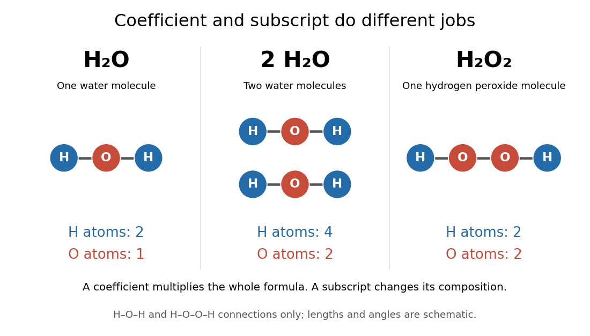

# Chemical formula

↑ **Parent:** [Chemical substance](chemical-substance.md)  
ⓦ [Wiki](https://en.wikipedia.org/wiki/Chemical_formula)

A [chemical formula](chemical-formula.md) uses symbols of [chemical elements](chemical-element.md) and numerical subscripts to record composition. In the [molecular formula](molecular-formula.md) $\mathrm H_2\mathrm O$ of [water](water.md), the subscript $2$ counts two [hydrogen](hydrogen.md) [chemical atoms](atom-physics.md), and the omitted subscript after $\mathrm O$ means one [oxygen](oxygen.md) [chemical atom](atom-physics.md). A [molecular formula](molecular-formula.md) describes one [molecule](molecule.md); a [chemical formula](chemical-formula.md) need not describe a discrete [molecule](molecule.md).

Read a preceding coefficient separately from the subscripts. One $\mathrm H_2\mathrm O$ contains two [hydrogen](hydrogen.md) and one [oxygen](oxygen.md) [chemical atom](atom-physics.md); $2\mathrm H_2\mathrm O$ contains four [hydrogen](hydrogen.md) and two [oxygen](oxygen.md) [chemical atoms](atom-physics.md) distributed between two [water](water.md) [molecules](molecule.md). In $\mathrm H_2\mathrm O_2$, the second subscript instead puts two [oxygen](oxygen.md) [chemical atoms](atom-physics.md) into each [hydrogen peroxide](hydrogen-peroxide.md) [molecule](molecule.md). Thus $2\mathrm H_2\mathrm O\ne\mathrm H_2\mathrm O_2$: the coefficient scales the whole [chemical formula](chemical-formula.md), while a subscript specifies its composition. See [Flowers et al., Chemistry 2e, §2.4: chemical formulas](https://openstax.org/books/chemistry-2e/pages/2-4-chemical-formulas).

**[Figure 80](#image-a-coefficient-counts-whole-molecules-a-subscript-counts-chemical-atoms-within-each-molecule). A coefficient counts whole molecules; a subscript counts chemical atoms within each molecule**. The three columns show one [water](water.md) [molecule](molecule.md), two [water](water.md) [molecules](molecule.md), and one [hydrogen peroxide](hydrogen-peroxide.md) [molecule](molecule.md). Their [hydrogen](hydrogen.md) counts are $2,4,2$ and their [oxygen](oxygen.md) counts are $1,2,2$. Connections are schematic $\mathrm{H-O-H}$ and $\mathrm{H-O-O-H}$, not models of actual [bond angles](bond-angle.md) or [bond lengths](bond-length.md).

For crystalline $\mathrm{NaCl}$, the [chemical formula](chemical-formula.md) specifies a $1:1$ ratio of [sodium](sodium.md) [ions](ion.md) $\mathrm{Na}^+$ to [chlorine](chlorine.md) [ions](ion.md) $\mathrm{Cl}^-$. Its [formula unit](formula-unit.md) is the accounting entity; the ordinary crystal is an extended arrangement of [ions](ion.md), rather than a collection of discrete $\mathrm{NaCl}$ [molecules](molecule.md). Specifying the entity matters when assigning an [amount of substance](amount-of-substance.md). See [formula unit](formula-unit.md) and [2.6 Ionic and Molecular Compounds](chemistry-2e-by-paul-flowers-and-others/2-6-ionic-and-molecular-compounds.md) (§2.6: ionic and molecular compounds).

A [molecular formula](molecular-formula.md) gives an atom inventory, not the full arrangement of [chemical bonds](chemical-bond.md) or the [molecular geometry](molecular-geometry.md). For example, $\mathrm C_6\mathrm H_{12}\mathrm O_6$ counts six [carbon](carbon.md), twelve [hydrogen](hydrogen.md), and six [oxygen](oxygen.md) [chemical atoms](atom-physics.md) in a [glucose](glucose.md) [molecule](molecule.md), but does not specify the pattern shown by its [Fischer projection](fischer-projection.md). Different structures can share a [molecular formula](molecular-formula.md). This compact inventory is useful for [chemical equation](chemical-equation.md) accounting precisely because it leaves the structural detail to other representations.

The choice of letters has an early explanation in [Jöns Jacob Berzelius, Essay on the Cause of Chemical Proportions (1813–1814), §III, transcribed by Carmen Giunta](https://web2.lemoyne.edu/~giunta/berzelius.html): letters made chemical signs easier to write and print, and formulas compressed information about composition. His numerical notation differed from modern subscripts; the lasting idea was to make proportions readable in ordinary text.

**Table of contents**

- [Molecular formula](molecular-formula.md)
- [Formula unit](formula-unit.md)

## ↑ Ancestors (3)

1. [Chemical substance](chemical-substance.md)
2. [Chemistry](chemistry-split.md)
3. [Codex Wiki](split.md)

## ← Incoming links (8)

- [Amino acid](amino-acid.md)
- [Chemical equation](chemical-equation.md)
- [Chemical formula](chemical-formula.md)
- [Citrate](citrate.md)
- [Citric acid](citric-acid.md)
- [Ion](ion.md)
- [Ionic bonding](ionic-bonding.md)
- [Tert-amyl bromide](tert-amyl-bromide.md)
