# Chemical kinetics

↑ **Parent:** [Chemical reaction](chemical-reaction.md)  
ⓦ [Wiki](https://en.wikipedia.org/wiki/Chemical_kinetics)

[Chemical kinetics](chemical-kinetics.md) studies how quickly [chemical reactions](chemical-reaction.md) proceed and how their [reaction rates](#reaction-rate) depend on composition and conditions. It connects a measured change in [concentration](mathematical-physics.md#concentration) to a [rate law](#rate-law), then uses a [rate equation](mathematical-biology.md#rate-equation) to predict future [concentrations](mathematical-physics.md#concentration). This makes it useful for choosing how long to wait for conversion and for testing a proposed [reaction mechanism](#reaction-mechanism). Changing [temperature](temperature.md), [reactant](chemical-reaction.md#reactant) [concentrations](mathematical-physics.md#concentration), or the presence of a [catalyst](#catalyst) can change [reaction rates](#reaction-rate); see [Flowers et al., Chemistry 2e, §12.2: factors affecting reaction rates](https://openstax.org/books/chemistry-2e/pages/12-2-factors-affecting-reaction-rates).

[Chemical equilibrium](chemical-potential.md#chemical-equilibrium) specifies the eventual balance under given constraints; [chemical kinetics](chemical-kinetics.md) determines how rapidly it is approached. At fixed [temperature](temperature.md) and [pressure](pressure.md), a decrease in [Gibbs free energy](thermodynamic-potential.md#gibbs-free-energy) favours conversion but does not guarantee a fast [chemical reaction](chemical-reaction.md): reaching a [transition state](#transition-state) can require crossing a substantial barrier. Thus a mixture can change imperceptibly over an observation period without being at [chemical equilibrium](chemical-potential.md#chemical-equilibrium). The distinction separates which direction is favoured from how long conversion takes. See [12.5 Collision Theory](chemistry-bibliography.md#chemistry-2e-by-paul-flowers-and-others/12-5-collision-theory) (§12.5: collision theory and reaction barriers) and [Chemistry 2e, §16.1: spontaneity and speed](https://openstax.org/books/chemistry-2e/pages/16-1-spontaneity).

**Table of contents**

- [Thermal reaction probability integral](#thermal-reaction-probability-integral)
- [Flux-side correlation function](#flux-side-correlation-function)
- [Chemical branching fraction](#chemical-branching-fraction)
- [Steady-state approximation](#steady-state-approximation)
  - [Reservoir relaxation test for a chemical steady state](#reservoir-relaxation-test-for-a-chemical-steady-state)
- [Chemical family](#chemical-family)
  - [HOx family](#hox-family)
  - [Fast family partition and slow family balance](#fast-family-partition-and-slow-family-balance)
- [Kinetic stability](#kinetic-stability)
- [Thermodynamic control](#thermodynamic-control)
- [Steady-state approximation in chemical kinetics](#steady-state-approximation-in-chemical-kinetics)
- [Thermal runaway](#thermal-runaway)
- [Third-body recombination](#third-body-recombination)
- [Isotope effect](#isotope-effect)
- [Temperature jump](#temperature-jump)
- [Dissociation rate constant](#dissociation-rate-constant)
- [Association rate constant](#association-rate-constant)
- [Kinetic isotope effect](#kinetic-isotope-effect)
  - [Beta-secondary kinetic isotope effect](#beta-secondary-kinetic-isotope-effect)
  - [Alpha-secondary kinetic isotope effect](#alpha-secondary-kinetic-isotope-effect)
- [Kinetic control](#kinetic-control)
- [Collision theory](#collision-theory)
- [Activation energy](#activation-energy)
  - [Apparent activation energy](#apparent-activation-energy)
  - [Arrhenius equation](#arrhenius-equation)
    - [Two-temperature Arrhenius extrapolation](#two-temperature-arrhenius-extrapolation)
    - [Pre-exponential factor](#pre-exponential-factor)
    - [Arrhenius plot](#arrhenius-plot)
    - [Modified Arrhenius equation](#modified-arrhenius-equation)
    - [Conductometric determination of activation energy](#conductometric-determination-of-activation-energy)
- [Reaction mechanism](#reaction-mechanism)
  - [Electron-pair arrow](#electron-pair-arrow)
  - [Consecutive first-order reaction mechanism](#consecutive-first-order-reaction-mechanism)
  - [Parallel first-order reaction mechanism](#parallel-first-order-reaction-mechanism)
  - [Acetone iodination rate-law experiment](#acetone-iodination-rate-law-experiment)
  - [Reaction intermediate](#reaction-intermediate)
    - [Tetrahedral intermediate](#tetrahedral-intermediate)
  - [Reaction coordinate](#reaction-coordinate)
    - [Dividing surface](#dividing-surface)
    - [Potential energy surface](#potential-energy-surface)
      - [Electronic state correlation diagram](#electronic-state-correlation-diagram)
      - [Conical intersection](#conical-intersection)
    - [Energy profile (chemistry)](#energy-profile-chemistry)
      - [Free-energy profile](#free-energy-profile)
      - [Potential-energy profile](#potential-energy-profile)
      - [Reaction energy barrier](#reaction-energy-barrier)
  - [Elementary reaction](#elementary-reaction)
    - [Molecularity](#molecularity)
- [Catalysis](#catalysis)
  - [Hydrogen-bond catalysis](#hydrogen-bond-catalysis)
  - [Metal ion catalysis](#metal-ion-catalysis)
  - [Proximity and orientation catalysis](#proximity-and-orientation-catalysis)
  - [Electrostatic catalysis](#electrostatic-catalysis)
  - [Covalent catalysis](#covalent-catalysis)
  - [Acid catalysis](#acid-catalysis)
  - [General base catalysis](#general-base-catalysis)
  - [General acid catalysis](#general-acid-catalysis)
  - [Transition state stabilization](#transition-state-stabilization)
  - [General base](#general-base)
  - [Catalytic cycle](#catalytic-cycle)
  - [Catalytic barriers and reaction free energy](#catalytic-barriers-and-reaction-free-energy)
  - [Reversible catalytic relaxation](#reversible-catalytic-relaxation)
  - [Catalytic selectivity](#catalytic-selectivity)
  - [Catalyst deactivation](#catalyst-deactivation)
  - [Homogeneous catalysis](#homogeneous-catalysis)
  - [Heterogeneous catalysis](#heterogeneous-catalysis)
    - [Catalytic surface site](#catalytic-surface-site)
    - [Catalyst particle size and accessible area](#catalyst-particle-size-and-accessible-area)
    - [Manganese dioxide peroxide contact demonstration](#manganese-dioxide-peroxide-contact-demonstration)
    - [Catalysed peroxide comparison](#catalysed-peroxide-comparison)
  - [Catalyst](#catalyst)
    - [Precatalyst](#precatalyst)
    - [Transition state theory](#transition-state-theory)
      - [Force-tilted activation barrier](#force-tilted-activation-barrier)
      - [Activation volume](#activation-volume)
      - [Activation entropy](#activation-entropy)
      - [Activation enthalpy](#activation-enthalpy)
      - [Eyring equation](#eyring-equation)
      - [Gibbs energy of activation](#gibbs-energy-of-activation)
        - [Enthalpy of activation](#enthalpy-of-activation)
        - [Entropy of activation](#entropy-of-activation)
- [Transition state](#transition-state)
- [Reaction rate](#reaction-rate)
  - [Disappearance rate](#disappearance-rate)
  - [Rate law](#rate-law)
    - [Integrated rate law](#integrated-rate-law)
    - [Order of reaction](#order-of-reaction)
      - [First-order reaction](#first-order-reaction)
        - [First-order rate constant](#first-order-rate-constant)
      - [Zero-order reaction](#zero-order-reaction)
      - [Second-order reaction](#second-order-reaction)
        - [Unequal-concentration second-order integration](#unequal-concentration-second-order-integration)
        - [Conductometric saponification assay](#conductometric-saponification-assay)
      - [Pseudo-first-order reaction](#pseudo-first-order-reaction)
- [Rate constant](#rate-constant)

## Thermal reaction probability integral

↑ **Parent:** [Chemical kinetics](chemical-kinetics.md)

For a one-dimensional channel, $k(T)Q_r=(2\pi\hbar)^{-1}\int_0^\infty e^{-\beta E}P(E)\,dE$. The reactant [partition function](canonical-ensemble.md#canonical-partition-function) and any length normalization must be specified.

## Flux-side correlation function

↑ **Parent:** [Chemical kinetics](chemical-kinetics.md)

A time correlation $C_{fs}(t)=\langle\delta(s_0)\dot s_0\Theta(s_t)\rangle$ correlating signed initial flux through a [dividing surface](#dividing-surface) with product-side occupation at a later time. Dividing by reactant population gives a rate on a plateau after microscopic recrossing and before macroscopic equilibration.

## Chemical branching fraction

↑ **Parent:** [Chemical kinetics](chemical-kinetics.md)

For competing irreversible pseudo-first-order channels with rates $k_j$, the fraction following channel $j$ is $f_j=k_j/\sum_l k_l$ when those conditions stay fixed during the intermediate's lifetime. A photochemical destruction rate must count only branches that actually remove the chosen species after fast recycling. For excited [oxygen](chemical-substance.md#oxygen), collisional deactivation followed by [ozone](chemical-substance.md#ozone) reformation is different from reaction with [water](chemical-substance.md#water) to make [hydroxyl radicals](chemistry.md#hydroxyl-radical).

## Steady-state approximation

↑ **Parent:** [Chemical kinetics](chemical-kinetics.md)

An approximation setting the time derivative of a transient population or intermediate concentration to zero when production and loss balance on the timescale considered. It differs from [thermal equilibrium](thermal-equilibrium.md).

### Reservoir relaxation test for a chemical steady state

↑ **Parent:** [Steady-state approximation](#steady-state-approximation)

For $dX/dt=P-kX$ with locally fixed coefficients, $X(t)=P/k+(X_0-P/k)e^{-kt}$. Setting $dX/dt\simeq0$ requires $1/k$ to be short compared with changes in production, loss and transport. A major reservoir can fail this test even when nearby [radicals](chemistry.md#radical-chemistry) rapidly adjust.

## Chemical family

↑ **Parent:** [Chemical kinetics](chemical-kinetics.md)

A set of species interconverted rapidly relative to the production or removal of the set as a whole. Fast interconversion can justify a concentration ratio without establishing that the total family concentration is in steady state.

### HOx family

↑ **Parent:** [Chemical family](#chemical-family)

In a simple stratospheric model, hydroxyl and hydroperoxyl radicals interconvert rapidly. Their total abundance is controlled by slower sources and termination reactions. Atomic hydrogen can be included in a broader family definition when its chemistry is treated explicitly.

### Fast family partition and slow family balance

↑ **Parent:** [Chemical family](#chemical-family)

For $X\rightleftharpoons Y$ with forward and reverse first-order rates $a,b$, the closed-family partition relaxes at rate $a+b$. Adding losses changes the relaxation eigenvalues. If family abundance evolves much more slowly, a quasi-equilibrium ratio can be useful; setting the entire family derivative to zero needs a separate timescale comparison.

## Kinetic stability

↑ **Parent:** [Chemical kinetics](chemical-kinetics.md)

Persistence over the observation [time](classical-mechanics.md#time-in-physics) because reaction pathways have sufficiently large barriers. It does not require the state to be the thermodynamic minimum.

## Thermodynamic control

↑ **Parent:** [Chemical kinetics](chemical-kinetics.md)

Product selection governed by equilibrium free energies after reversible interconversion, in contrast to [kinetic control](#kinetic-control) before equilibration.

## Steady-state approximation in chemical kinetics

↑ **Parent:** [Chemical kinetics](chemical-kinetics.md)

Approximation that formation and consumption of selected reactive intermediates nearly balance after an initial transient. It does not set their concentrations to zero or imply equilibrium of the stable reagents.

## Thermal runaway

↑ **Parent:** [Chemical kinetics](chemical-kinetics.md)

A feedback in which heat release raises temperature sufficiently to accelerate further heat release. Its occurrence depends on kinetics, heat capacity, transport and depletion; exothermicity alone does not prove an inevitable explosion.

## Third-body recombination

↑ **Parent:** [Chemical kinetics](chemical-kinetics.md)

Association stabilized by energy transfer to another collision partner. Counting removed reactive intermediates requires their stoichiometric factors, not just the event rate.

## Isotope effect

↑ **Parent:** [Chemical kinetics](chemical-kinetics.md)

## Temperature jump

↑ **Parent:** [Chemical kinetics](chemical-kinetics.md)

A rapid [temperature](temperature.md) perturbation that shifts equilibrium, allowing relaxation toward the new state to reveal kinetic processes.

## Dissociation rate constant

↑ **Parent:** [Chemical kinetics](chemical-kinetics.md)

The first-order rate constant for dissociation of a specified complex. For a single exponentially dissociating state its mean lifetime is the reciprocal of this constant.

## Association rate constant

↑ **Parent:** [Chemical kinetics](chemical-kinetics.md)

The rate constant for formation of an associated complex, with units of concentration inverse times time inverse for a bimolecular elementary step.

## Kinetic isotope effect

↑ **Parent:** [Chemical kinetics](chemical-kinetics.md)

A [kinetic isotope effect](#kinetic-isotope-effect) is a change in a reaction [rate constant](#rate-constant) caused by isotopic substitution. Solvent isotope effects can constrain proton-transfer pathways, but coupling and kinetic masking prevent interpreting every rate ratio as one isolated bond-breaking event.

### Beta-secondary kinetic isotope effect

↑ **Parent:** [Kinetic isotope effect](#kinetic-isotope-effect)

An isotope effect from a retained labeled bond adjacent to the reaction centre, often influenced by [hyperconjugation](chemistry.md#hyperconjugation) and its geometry.

### Alpha-secondary kinetic isotope effect

↑ **Parent:** [Kinetic isotope effect](#kinetic-isotope-effect)

An isotope effect from a retained labeled bond at the reaction centre, often reflecting changes in hybridization and bending vibrations.

## Kinetic control

↑ **Parent:** [Chemical kinetics](chemical-kinetics.md)

Under [kinetic control](#kinetic-control), the observed product distribution reflects competing formation rates rather than an equilibrated distribution. Heating may speed access to a lower-[Gibbs free energy](thermodynamic-potential.md#gibbs-free-energy) product, but does not itself prove that the equilibrium favors it.

## Collision theory

↑ **Parent:** [Chemical kinetics](chemical-kinetics.md)  
ⓦ [Wiki](https://en.wikipedia.org/wiki/Collision_theory)

[Collision theory](#collision-theory) estimates a gas-phase [reaction rate](#reaction-rate) by combining encounter frequency with energetic and geometrical requirements for reaction. For distinct hard spheres with contact separation $R$, the collision cross section is $\pi R^2$, and the mean relative speed is $\sqrt{8kT/(\pi\mu)}$. A reactive barrier and orientation restrictions reduce the fraction of collisions that react.

## Activation energy

↑ **Parent:** [Chemical kinetics](chemical-kinetics.md)  
ⓦ [Wiki](https://en.wikipedia.org/wiki/Activation_energy)

A small increase in [temperature](temperature.md) can produce a large increase in a [reaction rate](#reaction-rate). In the simplest [Arrhenius equation](#arrhenius-equation) model, warming from $300$ to $310\,\mathrm K$ increases a [rate constant](#rate-constant) with $E_a=80\,\mathrm{kJ\,mol^{-1}}$ by about $2.81$ times, even though the absolute [thermodynamic temperature](second-law-of-thermodynamics.md#thermodynamic-temperature) rises by only about $3.33\%$. This sensitivity helps explain why cooling can slow unwanted [chemical reactions](chemical-reaction.md) and why a hot process can become difficult to control. The comparison assumes the same [rate law](#rate-law) and [reactant](chemical-reaction.md#reactant) [concentrations](mathematical-physics.md#concentration); the [activation energy](#activation-energy) characterizes $k(T)$, rather than every change in the measured [reaction rate](#reaction-rate).

The physical motivation is the distribution of molecular [energies](energy.md). Warming changes the [Boltzmann distribution](thermodynamics.md#boltzmann-distribution), increasing the relative population of energetically costly configurations. A [transition state](#transition-state) can therefore become much more accessible than the modest change in average [kinetic energy](energy.md#kinetic-energy) might suggest. The [exponential function](calculus.md#exponential-function) in an [Arrhenius equation](#arrhenius-equation) captures such sensitivity in a simple model; it is not a universal formula for the fraction above every barrier in a [Maxwell-Boltzmann distribution](quantum-ideal-gas-statistics.md#maxwell-boltzmann-distribution).[§12.5, Activation Energy and the Arrhenius Equation: energy distributions and temperature sensitivity](chemistry-bibliography.md#chemistry-2e-by-paul-flowers-and-others/12-5-collision-theory)

[Activation energy](#activation-energy) quantifies how strongly a [rate constant](#rate-constant) depends on [thermodynamic temperature](second-law-of-thermodynamics.md#thermodynamic-temperature). For a positive [rate constant](#rate-constant) $k(T)$, the empirical definition is

$$
E_a(T)=RT^2\frac{d}{dT}\ln\frac{k(T)}{k_{\mathrm{ref}}},
$$

where $R$ is the [molar gas constant](ideal-gas.md#molar-gas-constant) and $k_{\mathrm{ref}}>0$ is a fixed reference with the same units as $k$. The ratio is a [dimensionless quantity](physics.md#dimensionless-quantity), keeping the [natural logarithm](calculus.md#natural-logarithm) meaningful without changing its [derivative](calculus.md#derivative). Thus $E_a$ is a molar [energy](energy.md), commonly in $\mathrm{J\,mol^{-1}}$ or $\mathrm{kJ\,mol^{-1}}$. The [Arrhenius equation](#arrhenius-equation) makes $E_a$ constant over its assumed range. This rate-based definition, and the need for care when identifying it with a threshold on a [potential energy surface](#potential-energy-surface), are stated in the [activation energy](chemistry-bibliography.md#iupac-compendium-of-chemical-terminology-fifth-edition-gold-book-by-international-union-of-pure-and-applied-chemistry/activation-energy).

In a simple barrier picture, reaching a [transition state](#transition-state) costs [energy](energy.md) relative to the starting [reactants](chemical-reaction.md#reactant). The height of that barrier is different from the difference between the [reactants](chemical-reaction.md#reactant) and [reaction products](chemical-reaction.md#product-chemistry). An energetically favourable endpoint can still be reached slowly. An [energy profile](#energy-profile-chemistry) makes the distinction visible, while an [Arrhenius plot](#arrhenius-plot) tests temperature sensitivity from [rate constants](#rate-constant). A measured $E_a$ need not equal a barrier read from an arbitrarily chosen diagram.

For a computed example, assume a [first-order reaction](#first-order-reaction) has $k(300\,\mathrm K)=0.100\,\mathrm{s^{-1}}$, constant $E_a=80\,\mathrm{kJ\,mol^{-1}}$, and a temperature-independent [pre-exponential factor](#pre-exponential-factor). The [Arrhenius equation](#arrhenius-equation) gives

$$
\frac{k(310\,\mathrm K)}{k(300\,\mathrm K)}
=\exp\left[\frac{80000}{8.314462618}\left(\frac1{300}-\frac1{310}\right)\right]
\approx2.81398.
$$

Hence $k(310\,\mathrm K)\approx0.281398\,\mathrm{s^{-1}}$. Its [half-life](analysis.md#half-life) falls from $\ln2/0.100\approx6.93147\,\mathrm s$ to $\ln2/0.281398\approx2.46322\,\mathrm s$. These are chosen model parameters, not measurements of an identified [chemical reaction](chemical-reaction.md). The exponent uses [kelvin](temperature.md#kelvin), not unconverted Celsius temperatures, and $80000\,\mathrm{J\,mol^{-1}}$ must match $R$ in $\mathrm{J\,mol^{-1}\,K^{-1}}$.

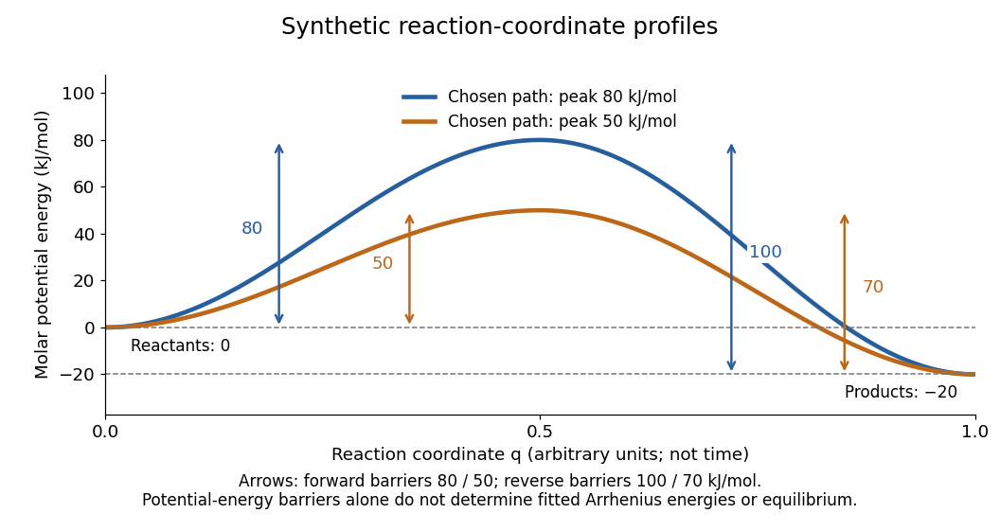

**[Figure 1](#image-activation-energy-potential-barriers). Synthetic potential-energy profiles: starting levels determine directional reaction energy barriers**. Original chosen profiles have [reactant](chemical-reaction.md#reactant) level $0$, [reaction product](chemical-reaction.md#product-chemistry) level $-20\,\mathrm{kJ\,mol^{-1}}$, and peak levels $80$ and $50\,\mathrm{kJ\,mol^{-1}}$. Forward [reaction energy barriers](#reaction-energy-barrier) are $80$ and $50$; reverse [reaction energy barriers](#reaction-energy-barrier) are $100$ and $70\,\mathrm{kJ\,mol^{-1}}$. The [reaction coordinate](#reaction-coordinate) is not time. These curves are illustrative functions, not laboratory measurements or calculated molecular [potential energy surfaces](#potential-energy-surface); their heights do not by themselves specify [Arrhenius activation energies](#activation-energy).

A microscopic [reaction energy barrier](#reaction-energy-barrier) belongs to a specified path on a [potential energy surface](#potential-energy-surface). An experimental [activation energy](#activation-energy) belongs to a specified [rate constant](#rate-constant) and its [temperature](temperature.md) dependence. A multi-step [reaction mechanism](#reaction-mechanism) can change which step controls the observed conversion, and a temperature-dependent [pre-exponential factor](#pre-exponential-factor) contributes to the observed [activation energy](#activation-energy). Even the [Gibbs energy of activation](#gibbs-energy-of-activation) of [transition state theory](#transition-state-theory) is a different quantity: it incorporates [entropy](entropy.md) as well as [enthalpy](enthalpy.md) and depends on the [standard states](chemical-potential.md#standard-state). These distinctions prevent a fitted [Arrhenius plot](#arrhenius-plot) from being mistaken for a direct microscopic energy measurement.[activation energy](chemistry-bibliography.md#iupac-compendium-of-chemical-terminology-fifth-edition-gold-book-by-international-union-of-pure-and-applied-chemistry/activation-energy)

[Catalysis](#catalysis) illustrates the separation between a path and its endpoints. At the same [temperature](temperature.md) and with the same [reactants](chemical-reaction.md#reactant), [reaction products](chemical-reaction.md#product-chemistry), and [standard states](chemical-potential.md#standard-state), a regenerated [catalyst](#catalyst) changes the available [reaction mechanism](#reaction-mechanism) and [rate constants](#rate-constant), while the overall standard change in [Gibbs free energy](thermodynamic-potential.md#gibbs-free-energy) and the [equilibrium constant](chemical-potential.md#equilibrium-constant) remain the same:

$$
K=\exp\left(-\frac{\Delta_rG^\circ}{RT}\right).
$$

For a reversible [first-order reaction](#first-order-reaction) pair $\mathrm A\rightleftharpoons\mathrm B$, consistency at [chemical equilibrium](chemical-potential.md#chemical-equilibrium) requires $k_f/k_r=K$. A model that multiplies only $k_f$ by a catalytic speedup while holding $k_r$ fixed would change this ratio and misrepresent [catalysis](#catalysis). This simple ratio applies to that specified [rate law](#rate-law); a multi-step catalytic [reaction mechanism](#reaction-mechanism) needs its own rate equations. A [potential-energy profile](#potential-energy-profile) alone cannot determine $K$, because its endpoint difference is not generally the standard change in [Gibbs free energy](thermodynamic-potential.md#gibbs-free-energy).[§13.3, Effect of a Catalyst: faster equilibration without changing equilibrium composition](chemistry-bibliography.md#chemistry-2e-by-paul-flowers-and-others/13-3-shifting-equilibria-le-chatelier’s-principle)

### Apparent activation energy

↑ **Parent:** [Activation energy](#activation-energy)

An [apparent activation energy](#apparent-activation-energy) reports the [temperature](temperature.md) sensitivity of an observed [rate constant](#rate-constant), without assuming that it equals one microscopic [reaction energy barrier](#reaction-energy-barrier). The [chain rule](calculus.md#chain-rule) converts the empirical [activation energy](#activation-energy) definition into the local slope of an [Arrhenius plot](#arrhenius-plot):

$$
E_{a,\mathrm{app}}(T)=-R\frac{d\ln(k/k_{\mathrm{ref}})}{d(1/T)}.
$$

The fixed reference $k_{\mathrm{ref}}$ keeps the [natural logarithm](calculus.md#natural-logarithm) dimensionless. A fitted straight-line slope estimates this quantity over the chosen [temperature](temperature.md) interval; curvature means that one number does not describe every local slope.[activation energy](chemistry-bibliography.md#iupac-compendium-of-chemical-terminology-fifth-edition-gold-book-by-international-union-of-pure-and-applied-chemistry/activation-energy)

For the explicit model $k(T)=A(T)\exp[-E_0/(RT)]$ with constant exponent parameter $E_0$, differentiation gives

$$
E_{a,\mathrm{app}}(T)=E_0+RT^2\frac{d}{dT}\ln\frac{A(T)}{A(T_*)},
$$

where $T_*$ is fixed. The second term demonstrates why a microscopic interpretation needs more than a slope. If $E_0$ were itself allowed to depend on [temperature](temperature.md), differentiation would also contribute $-T\,dE_0/dT$; simply inserting a variable $E_0(T)$ and naming it the measured [activation energy](#activation-energy) is generally incorrect.

An instructive [transition state theory](#transition-state-theory) example for an effective [first-order reaction](#first-order-reaction) is

$$
k(T)=\frac{k_{\mathrm B}T}{h}\exp\left(\frac{\Delta S^{\ddagger\circ}}{R}\right)\exp\left(-\frac{\Delta H^{\ddagger\circ}}{RT}\right).
$$

Here $k_{\mathrm B}$ and $h$ are the [Boltzmann constant](thermodynamics.md#boltzmann-constant) and [Planck constant](quantum-mechanics.md#planck-constant); $\Delta S^{\ddagger\circ}$ is the [entropy of activation](#entropy-of-activation), and $\Delta H^{\ddagger\circ}$ the [enthalpy of activation](#enthalpy-of-activation). With those two quantities constant over the chosen range and successful passage assumed, direct differentiation gives $E_{a,\mathrm{app}}=\Delta H^{\ddagger\circ}+RT$, while the [Gibbs energy of activation](#gibbs-energy-of-activation) is $\Delta G^{\ddagger\circ}=\Delta H^{\ddagger\circ}-T\Delta S^{\ddagger\circ}$. These are three distinguishable quantities. The stated [first-order reaction](#first-order-reaction) and fixed [standard states](chemical-potential.md#standard-state) matter when comparing these formulas with measurements.[Glossary of Terms Used in Physical Organic Chemistry (IUPAC Recommendations 1994): E entries](chemistry-bibliography.md#glossary-of-terms-used-in-physical-organic-chemistry-iupac-recommendations-1994-e-entries)

### Arrhenius equation

↑ **Parent:** [Activation energy](#activation-energy)  
ⓦ [Wiki](https://en.wikipedia.org/wiki/Arrhenius_equation)

The [Arrhenius equation](#arrhenius-equation) models the [temperature](temperature.md) dependence of a [rate constant](#rate-constant) by

$$
k(T)=A\exp\left(-\frac{E_a}{RT}\right),\qquad A>0,\quad T>0.
$$

Here $A$ is the [pre-exponential factor](#pre-exponential-factor), $E_a$ the [activation energy](#activation-energy), $R$ the [molar gas constant](ideal-gas.md#molar-gas-constant), and $T$ the absolute [thermodynamic temperature](second-law-of-thermodynamics.md#thermodynamic-temperature). In its original form, $A$ and $E_a$ are held constant over the range being modeled. It is an empirical relationship, not a universal rule for every [reaction mechanism](#reaction-mechanism). See the [Arrhenius equation](chemistry-bibliography.md#iupac-compendium-of-chemical-terminology-gold-book-by-international-union-of-pure-and-applied-chemistry/arrhenius-equation).

Eliminating $A$ between two positive [temperatures](temperature.md) gives the useful prediction

$$
\ln\frac{k(T_2)}{k(T_1)}
=\frac{E_a}{R}\left(\frac1{T_1}-\frac1{T_2}\right).
$$

For $E_a>0$, warming increases $k$. The logarithmic sensitivity is $d\ln(k/k_{\mathrm{ref}})/dT=E_a/(RT^2)$, so there is no universal doubling per ten degrees. The same $10\,\mathrm K$ rise from $300$ to $310\,\mathrm K$ gives a factor $1.67749$ for $E_a=40\,\mathrm{kJ\,mol^{-1}}$, versus $2.81398$ for $80\,\mathrm{kJ\,mol^{-1}}$.

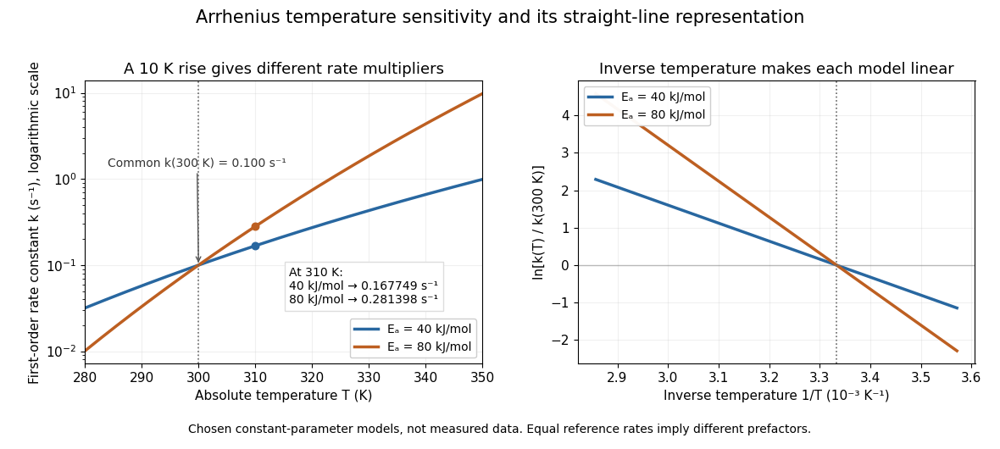

**[Figure 2](#image-temperature-sensitivity-and-straight-line-arrhenius-plots-for-two-illustrative-activation-energies). Temperature sensitivity and straight-line Arrhenius plots for two illustrative activation energies**. Both models are anchored at $k(300\,\mathrm K)=0.100\,\mathrm{s^{-1}}$, so they have different [pre-exponential factors](#pre-exponential-factor). Left: the higher [activation energy](#activation-energy) produces a larger relative change with [temperature](temperature.md). Right: the [natural logarithm](calculus.md#natural-logarithm) of the dimensionless ratio $k(T)/k(300\,\mathrm K)$ is linear in inverse [temperature](temperature.md). These exact model curves are not experimental data.

The useful simplification is that a strong change in [reaction rate](#reaction-rate) becomes a straight-line relation after changing variables. Measurements at several [temperatures](temperature.md) can estimate the slope and test whether one pair of constants describes the chosen range. Curvature can indicate a failure of that approximation; fitting a line does not uniquely establish a microscopic [reaction mechanism](#reaction-mechanism).

Svante Arrhenius's 1889 paper on [sucrose](chemical-substance.md#sucrose) conversion through [catalysis](#catalysis) by a [chemical acid](acid-base-chemistry.md#acid-chemistry) compared the strong observed [temperature](temperature.md) dependence with the much smaller increase in collision frequency. He discussed van't Hoff's earlier [temperature](temperature.md) relations and proposed a small population of hypothetical active [sucrose](chemical-substance.md#sucrose), replenished from ordinary [sucrose](chemical-substance.md#sucrose), to interpret the dependence. The inspected translated excerpt derives an inverse-[temperature](temperature.md) relation in its equations (6)–(7) and then applies it to the [reaction rate](#reaction-rate). That historical hypothesis is distinct from a modern [transition state](#transition-state) description. See the [On the Reaction Velocity of the Inversion of Cane Sugar by Acids](chemistry-bibliography.md#on-the-reaction-velocity-of-the-inversion-of-cane-sugar-by-acids). The excerpt omits parts of the original paper; it does not provide a complete original apparatus description or dataset.

The [pre-exponential factor](#pre-exponential-factor) must have the same units as the [rate constant](#rate-constant), since the [exponential function](calculus.md#exponential-function) supplies a [dimensionless quantity](physics.md#dimensionless-quantity). For a [rate law](#rate-law) $v=k[\mathrm A]^m$, both $A$ and $k$ have units $(\mathrm{mol\,L^{-1}})^{1-m}\,\mathrm{s^{-1}}$. Thus a [first-order reaction](#first-order-reaction) uses $\mathrm{s^{-1}}$, whereas a [second-order reaction](#second-order-reaction) uses $\mathrm{L\,mol^{-1}\,s^{-1}}$. Calling $A$ a frequency factor does not give it frequency units for every [order of reaction](#order-of-reaction). Its value includes the physical and geometrical factors allowed by the chosen [reaction mechanism](#reaction-mechanism); equal [activation energies](#activation-energy) need not mean equal [reaction rates](#reaction-rate).

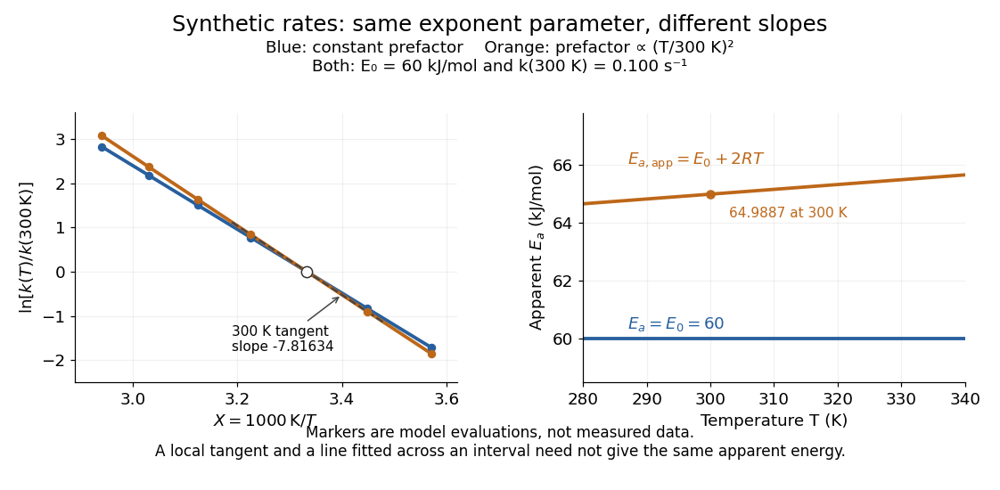

**[Figure 3](#image-arrhenius-apparent-energy-and-prefactor). Synthetic Arrhenius plots: a constant pre-exponential factor and a temperature-dependent pre-exponential factor**. Both chosen [first-order reaction](#first-order-reaction) models have $k(300\,\mathrm K)=0.100\,\mathrm{s^{-1}}$ and the same exponent parameter $E_0=60\,\mathrm{kJ\,mol^{-1}}$. Blue uses a constant [pre-exponential factor](#pre-exponential-factor); orange multiplies it by $(T/300\,\mathrm K)^2$. All markers are synthetic evaluations, not observations. Left: [natural logarithm](calculus.md#natural-logarithm) of $k/k(300\,\mathrm K)$ against $1000\,\mathrm K/T$. Right: the corresponding [apparent activation energies](#apparent-activation-energy), $60$ and $60+2RT/1000$ in $\mathrm{kJ\,mol^{-1}}$. The dashed orange tangent at $300\,\mathrm K$ has numerical slope $-7.81634$ on the displayed horizontal scale.

To read the blue [Arrhenius plot](#arrhenius-plot), define the [dimensionless quantity](physics.md#dimensionless-quantity) $X=1000\,\mathrm K/T$ and $y=\ln[k/k(300\,\mathrm K)]$. Its numerical slope is $m_X=-60\,000/(1000R)\approx-7.21634$, giving $E_a=-(1000\,\mathrm K)Rm_X=60\,\mathrm{kJ\,mol^{-1}}$. The slope against $1/T$, by contrast, is $-7216.34\,\mathrm K$. The orange tangent at $300\,\mathrm K$ gives $E_{a,\mathrm{app}}\approx64.9887\,\mathrm{kJ\,mol^{-1}}$; its finite-interval slope between $280$ and $340\,\mathrm K$ gives about $65.1227\,\mathrm{kJ\,mol^{-1}}$. The distinction between a local [derivative](calculus.md#derivative) and a fitted interval matters even with perfectly noise-free synthetic evaluations.

Two measured positive [rate constants](#rate-constant) give a two-point estimate

$$
E_{a,\mathrm{fit}}=R\frac{\ln[k(T_2)/k(T_1)]}{1/T_1-1/T_2}.
$$

Several [temperatures](temperature.md) let [linear regression](linear-regression.md) test the constant-parameter approximation: inspect the [regression residuals](probability-and-statistics.md#regression-residual), keep the same [rate law](#rate-law) and composition convention, and account for uncertainty in both $k$ and $T$. A straight line over a short range supports a useful local approximation; it does not uniquely identify a [reaction mechanism](#reaction-mechanism). A fixed change of units or of $k_{\mathrm{ref}}$ shifts the intercept without changing the inferred [activation energy](#activation-energy).[§12.5, Example 12.13 and alternate two-point approach: estimating activation energy from a slope](chemistry-bibliography.md#chemistry-2e-by-paul-flowers-and-others/12-5-collision-theory)

#### Two-temperature Arrhenius extrapolation

↑ **Parent:** [Arrhenius equation](#arrhenius-equation)

For a constant-parameter [Arrhenius equation](#arrhenius-equation) $R(T)=Ae^{-\beta/T}$ at positive absolute [temperatures](temperature.md), subtracting logarithms eliminates the [Arrhenius prefactor](#pre-exponential-factor). The ratio of the two resulting equations gives the displayed prediction. It applies to a [reaction rate](#reaction-rate) only when composition and other factors relating rate to the [rate constant](#rate-constant) are held fixed. Equal increments of [temperature](temperature.md) do not give equal multiplicative rate changes, since the linear variable is $1/T$.

#### Pre-exponential factor

↑ **Parent:** [Arrhenius equation](#arrhenius-equation)  
ⓦ [Wiki](https://en.wikipedia.org/wiki/Pre-exponential_factor)

The [pre-exponential factor](#pre-exponential-factor) multiplies the [exponential function](calculus.md#exponential-function) in the [Arrhenius equation](#arrhenius-equation). It has the same units as the [rate constant](#rate-constant), so for a [first-order reaction](#first-order-reaction) both have units $\mathrm{s^{-1}}$. Its physical interpretation depends on the [reaction mechanism](#reaction-mechanism); an assumed constant $A$ should not be identified with a universal collision frequency. Comparing [activation energies](#activation-energy) alone does not rank absolute [rate constants](#rate-constant) when the [pre-exponential factors](#pre-exponential-factor) differ. See the [pre-exponential factor](chemistry-bibliography.md#iupac-compendium-of-chemical-terminology-gold-book-by-international-union-of-pure-and-applied-chemistry/pre-exponential-factor).

#### Arrhenius plot

↑ **Parent:** [Arrhenius equation](#arrhenius-equation)  
ⓦ [Wiki](https://en.wikipedia.org/wiki/Arrhenius_plot)

An [Arrhenius plot](#arrhenius-plot) places $\ln(k/k_{\mathrm{ref}})$ against $1/T$, using a fixed reference [rate constant](#rate-constant) with the same units as $k$. Under the constant-parameter [Arrhenius equation](#arrhenius-equation),

$$
\ln\frac{k(T)}{k_{\mathrm{ref}}}
=\ln\frac{A}{k_{\mathrm{ref}}}-\frac{E_a}{R}\frac1T.
$$

The slope is $-E_a/R$ and the intercept is $\ln(A/k_{\mathrm{ref}})$. Changing the reference units shifts the intercept but leaves the slope unchanged. If the horizontal coordinate is displayed in $10^{-3}\,\mathrm{K^{-1}}$, its numerical slope must be rescaled before multiplying by $-R$. A temperature-dependent [pre-exponential factor](#pre-exponential-factor) or [activation energy](#activation-energy) can make the plot curved.

#### Modified Arrhenius equation

↑ **Parent:** [Arrhenius equation](#arrhenius-equation)

The [Modified Arrhenius equation](#modified-arrhenius-equation) allows a power of [thermodynamic temperature](second-law-of-thermodynamics.md#thermodynamic-temperature) in the [pre-exponential factor](#pre-exponential-factor):

$$
k(T)=A_*\left(\frac{T}{T_*}\right)^n\exp\left(-\frac{E_0}{RT}\right),
\qquad T_*>0.
$$

Here $A_*$, $E_0$, $n$, and $T_*$ are constant model parameters. Using the [dimensionless quantity](physics.md#dimensionless-quantity) $T/T_*$ leaves $A_*$ with the same units as $k$; in the equivalent convention $BT^n\exp[-E_0/(RT)]$, $B$ instead has units of $k$ multiplied by $\mathrm K^{-n}$. The power exponent $n$ here is not an [order of reaction](#order-of-reaction). The IUPAC definition uses that equivalent $BT^n$ convention.[modified Arrhenius equation](chemistry-bibliography.md#iupac-compendium-of-chemical-terminology-gold-book-by-international-union-of-pure-and-applied-chemistry/modified-arrhenius-equation)

Applying the [apparent activation energy](#apparent-activation-energy) definition yields the original short calculation

$$
\frac{d\ln(k/k_{\mathrm{ref}})}{dT}=\frac nT+\frac{E_0}{RT^2},
\qquad E_{a,\mathrm{app}}(T)=E_0+nRT.
$$

For the orange synthetic [Arrhenius plot](#arrhenius-plot), $n=2$, $T_*=300\,\mathrm K$, and $E_0=60\,\mathrm{kJ\,mol^{-1}}$. Its [pre-exponential factor](#pre-exponential-factor) changes by $(310/300)^2\approx1.06778$ from $300$ to $310\,\mathrm K$; combined with the [exponential function](calculus.md#exponential-function), $k(310\,\mathrm K)\approx0.231991\,\mathrm{s^{-1}}$, compared with $0.217266\,\mathrm{s^{-1}}$ for the constant-[pre-exponential factor](#pre-exponential-factor) model. The diagram uses those models only to reveal the difference between an exponent parameter and a slope-derived [activation energy](#activation-energy).

#### Conductometric determination of activation energy

↑ **Parent:** [Arrhenius equation](#arrhenius-equation)

A concrete laboratory route to an [Arrhenius plot](#arrhenius-plot) is to infer a [rate constant](#rate-constant) at each controlled [temperature](temperature.md) from a changing [electrical conductivity](electric-charge.md#electrical-conductivity). The Technical University of Munich's [Activation Energy of a First-Order Reaction](chemistry-bibliography.md#laboratory-course-in-physical-chemistry-for-fundamental-studies-experiments-manual/activation-energy-of-a-first-order-reaction) supplies a teaching protocol, rather than a published set of measured [rate constants](#rate-constant).

The manual follows [tertiary amylbromide](chemical-substance.md#tert-amyl-bromide) conversion, which produces conducting [ions](chemistry.md#ion). A measuring cell connects to a thermostat; an immersed [electrical conductivity](electric-charge.md#electrical-conductivity) probe also measures solution [temperature](temperature.md), and a magnetic stirrer mixes it. Use $80\,\mathrm{mL}$ of $80\%$ by volume [ethanol](biology.md#ethanol) in [water](chemical-substance.md#water), equilibrate, then add $0.5\,\mathrm{mL}$ of [tertiary amylbromide](chemical-substance.md#tert-amyl-bromide). Record the baseline before addition and set time zero at addition. Repeat with fresh mixtures at $25$, $30$, and $35\,{}^\circ\mathrm C$, each within $\pm0.5\,{}^\circ\mathrm C$; record for $30$ minutes at the first two [temperatures](temperature.md) and until completion at the last. Clean the cell between runs and keep the added volume fixed. The completed $35\,{}^\circ\mathrm C$ mixture supplies endpoint [electrical conductivity](electric-charge.md#electrical-conductivity) measurements at the other [temperatures](temperature.md): one endpoint reading cannot be used unchanged at every [temperature](temperature.md).[pp. 82–84, §§8.2.5–8.3.2, and p. 85, §8.5.1: reaction, apparatus, temperatures, endpoint and baseline](chemistry-bibliography.md#laboratory-course-in-physical-chemistry-for-fundamental-studies-experiments-manual/activation-energy-of-a-first-order-reaction)

To see what is inferred from the readout, let $\sigma_0$, $\sigma(t)$, and $\sigma_\infty$ be the baseline, current, and completed-mixture [electrical conductivities](electric-charge.md#electrical-conductivity) at the same [temperature](temperature.md). Assume their baseline-subtracted changes are proportional to converted [concentration](mathematical-physics.md#concentration). Combining that measurement model with a [first-order reaction](#first-order-reaction) gives

$$
f(t)=\frac{\sigma_\infty-\sigma(t)}{\sigma_\infty-\sigma_0}
=\frac{c(t)}{c_0}=e^{-kt},
\qquad -\ln f(t)=kt.
$$

Thus the [electrical conductivity](electric-charge.md#electrical-conductivity) increases toward an endpoint, while the remaining [reactant](chemical-reaction.md#reactant) fraction decreases. Fit $-\ln f$ against time to obtain $k$; then fit $\ln(k/k_{\mathrm{ref}})$ against $1/T$ in [kelvin](temperature.md#kelvin) to estimate an [apparent activation energy](#apparent-activation-energy). This baseline-aware derivation states the measurement assumptions explicitly; it does not infer a [rate constant](#rate-constant) from the steepness of a raw conductivity trace alone.

The controls distinguish a faster [chemical reaction](chemical-reaction.md) from a larger instrumental response. Measure the actual solution [temperature](temperature.md), retain the same [solvent](mixture.md#solvent) composition and initial [reactant](chemical-reaction.md#reactant) [concentration](mathematical-physics.md#concentration), and compare endpoint and baseline at that [temperature](temperature.md). As further diagnostic checks, repeat runs and inspect [regression residuals](probability-and-statistics.md#regression-residual) for departure from a [first-order reaction](#first-order-reaction). These checks follow from the model: [electrical conductivity](electric-charge.md#electrical-conductivity) also depends on how [ions](chemistry.md#ion) move, a baseline drift can mimic conversion, and a mixing delay can distort early points. Near completion, a small endpoint error produces a large relative error in $f$ and its [natural logarithm](calculus.md#natural-logarithm). A successful fit supports an apparent rate model for this [solvent](mixture.md#solvent) and interval; it does not directly image a [transition state](#transition-state) or identify a unique [reaction mechanism](#reaction-mechanism). No measured $k$ or $E_a$ is supplied here.

## Reaction mechanism

↑ **Parent:** [Chemical kinetics](chemical-kinetics.md)  
ⓦ [Wiki](https://en.wikipedia.org/wiki/Reaction_mechanism)

A [reaction mechanism](#reaction-mechanism) describes how [reactants](chemical-reaction.md#reactant) become [reaction products](chemical-reaction.md#product-chemistry) through specified [elementary reactions](#elementary-reaction). Adding the steps must recover the overall [chemical equation](chemical-reaction.md#chemical-equation); intermediate [chemical species](mathematical-biology.md#chemical-species) cancel. That accounting is necessary, but the proposed steps must also predict a [rate law](#rate-law) compatible with experiment. Several [reaction mechanisms](#reaction-mechanism) can pass the same test.[Chemistry 2e by Paul Flowers and others; §12.6, opening discussion and Relating Reaction Mechanisms to Rate Laws: net equations, elementary steps, and experimental constraints](chemistry-bibliography.md#chemistry-2e-by-paul-flowers-and-others/12-6-reaction-mechanisms)

For example, the stipulated steps $\mathrm A+\mathrm B\longrightarrow\mathrm I$ and $\mathrm I\longrightarrow\mathrm P$ sum to $\mathrm A+\mathrm B\longrightarrow\mathrm P$. I is a [reaction intermediate](#reaction-intermediate): it is formed and then consumed. The [catalyst](#catalyst) C in the existing [catalytic cycle](#catalytic-cycle) instead starts available, participates, and is regenerated; its bound form can be a [reaction intermediate](#reaction-intermediate). Both can disappear from the summed [chemical equation](chemical-reaction.md#chemical-equation), so cancellation alone does not distinguish their roles. Cancellation is algebraic bookkeeping, not an assertion that every step finishes instantaneously.

The net [chemical equation](chemical-reaction.md#chemical-equation) supplies consumption ratios, not a clock. For the stipulated two-step example, directional [reaction rates](#reaction-rate) $r_1=k_1[\mathrm A][\mathrm B]$ and $r_2=k_2[\mathrm I]$ give $d[\mathrm I]/dt=r_1-r_2$ and $d[\mathrm P]/dt=r_2$. Initially $[\mathrm I]=0$ can mean zero [reaction product](chemical-reaction.md#product-chemistry) formation while A already disappears. In particular, $-d[\mathrm A]/dt=d[\mathrm P]/dt$ requires negligible intermediate accumulation here. A single [elementary reaction](#elementary-reaction) with the same net [chemical equation](chemical-reaction.md#chemical-equation) would instead predict immediate formation at $k[\mathrm A][\mathrm B]$. Measuring both sides can reveal a distinction hidden by the net equation.

This makes [reaction mechanisms](#reaction-mechanism) useful for designing observations: follow a candidate [reaction intermediate](#reaction-intermediate), measure individual [reaction products](chemical-reaction.md#product-chemistry), or vary one starting [concentration](mathematical-physics.md#concentration) at a time. The [consecutive first-order reaction mechanism](#consecutive-first-order-reaction-mechanism) quantifies an intermediate's rise and fall; the [parallel first-order reaction mechanism](#parallel-first-order-reaction-mechanism) shows how identical [reactant](chemical-reaction.md#reactant) traces can conceal different [reaction products](chemical-reaction.md#product-chemistry). The [acetone iodination rate-law experiment](#acetone-iodination-rate-law-experiment) connects such reasoning to a real laboratory protocol. The existing [reaction coordinate](#reaction-coordinate), [potential energy surface](#potential-energy-surface), and [energy profile](#energy-profile-chemistry) describe configurations and barriers along a route; a [concentration](mathematical-physics.md#concentration) plotted against time describes a different observable.

### Electron-pair arrow

↑ **Parent:** [Reaction mechanism](#reaction-mechanism)

A curved arrow whose tail marks an electron pair and whose head marks its destination in a proposed reaction step. The pair may start as a [lone pair](covalent-bond.md#lone-pair) or a bond pair; a full arrowhead represents two electrons.

### Consecutive first-order reaction mechanism

↑ **Parent:** [Reaction mechanism](#reaction-mechanism)

A [consecutive first-order reaction mechanism](#consecutive-first-order-reaction-mechanism) passes material through a [reaction intermediate](#reaction-intermediate). Consider a stipulated [chemical reaction network](mathematical-biology.md#chemical-reaction-network) $\mathrm A\xrightarrow{k_1}\mathrm I\xrightarrow{k_2}\mathrm P$, with constant positive [rate constants](#rate-constant), fixed [temperature](temperature.md) and [volume](geometry-and-topology.md#volume), uniform mixing, and no reverse or competing [chemical reactions](chemical-reaction.md). All three labels carry one conserved unit of material. Set $[\mathrm A](0)=A_0>0$ and $[\mathrm I](0)=[\mathrm P](0)=0$. The [law of mass action](mathematical-biology.md#law-of-mass-action) gives

$$
\frac{d[\mathrm A]}{dt}=-k_1[\mathrm A],\qquad
\frac{d[\mathrm I]}{dt}=k_1[\mathrm A]-k_2[\mathrm I],\qquad
\frac{d[\mathrm P]}{dt}=k_2[\mathrm I].
$$

Adding the three [rate equations](mathematical-biology.md#rate-equation) proves $[\mathrm A]+[\mathrm I]+[\mathrm P]=A_0$. Each step has a [first-order reaction](#first-order-reaction) [rate law](#rate-law); this does not make all three [concentrations](mathematical-physics.md#concentration) simple [exponential decays](analysis.md#exponential-decay).

For $k_1\ne k_2$, the exact solution is

$$
[\mathrm A]=A_0e^{-k_1t},\qquad
[\mathrm I]=A_0\frac{k_1}{k_2-k_1}\left(e^{-k_1t}-e^{-k_2t}\right),\qquad
[\mathrm P]=A_0-[\mathrm A]-[\mathrm I].
$$

To derive the middle expression, substitute the first into the [first-order linear differential equation](linear-ordinary-differential-equation.md#first-order-linear-differential-equation) for I and multiply by the [integrating factor](linear-ordinary-differential-equation.md#integrating-factor) $e^{k_2t}$. Then $d(e^{k_2t}[\mathrm I])/dt=k_1A_0e^{(k_2-k_1)t}$, which can be integrated directly with the stated [initial condition](differential-equation.md#initial-condition). The material balance supplies P without another integration.

The apparent division by zero at equal [rate constants](#rate-constant) is removable. For $k_1=k_2=k$, the same [integrating factor](linear-ordinary-differential-equation.md#integrating-factor) gives

$$
[\mathrm I]=A_0kte^{-kt},\qquad
[\mathrm P]=A_0\bigl[1-(1+kt)e^{-kt}\bigr].
$$

This is also the [limit](calculus.md#limit-of-a-function) of the unequal-[rate constant](#rate-constant) expression. Initially $[\mathrm P]/A_0=(kt)^2/2+O((kt)^3)$, so [reaction product](chemical-reaction.md#product-chemistry) formation begins with zero slope despite immediate [reactant](chemical-reaction.md#reactant) loss. By contrast, a direct $\mathrm A\longrightarrow\mathrm P$ [first-order reaction](#first-order-reaction) with the same $k$ has $[\mathrm P]/A_0=1-e^{-kt}$ and nonzero initial slope. Their A traces agree exactly; their P traces do not.

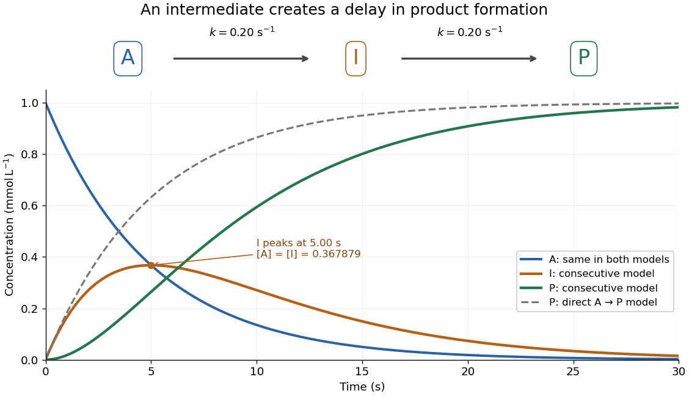

**[Figure 4](#image-consecutive-reaction-intermediate-time-profiles). An accumulating reaction intermediate delays reaction product formation in a consecutive first-order reaction mechanism**. Original chosen model with $k_1=k_2=0.20\,\mathrm{s^{-1}}$ and $A_0=1.00\,\mathrm{mmol\,L^{-1}}$. Solid curves follow the exact three-species [rate equations](mathematical-biology.md#rate-equation); the dashed P curve is a separate direct A-to-P model with the same A trace. These are model predictions, not measurements or an identified molecular [reaction mechanism](#reaction-mechanism).

For the chosen equal-[rate constant](#rate-constant) example, I peaks at $t=1/k=5.00\,\mathrm s$, because $d[\mathrm I]/dt=A_0ke^{-kt}(1-kt)$. At that time $[\mathrm A]=[\mathrm I]=A_0/e\approx0.367879\,\mathrm{mmol\,L^{-1}}$ and $[\mathrm P]\approx0.264241\,\mathrm{mmol\,L^{-1}}$; the direct model would already have $[\mathrm P]\approx0.632121\,\mathrm{mmol\,L^{-1}}$. The peak means formation and consumption of I are momentarily equal, not that the whole system has reached [chemical equilibrium](chemical-potential.md#chemical-equilibrium).

More generally the peak is at $t_*=\ln(k_2/k_1)/(k_2-k_1)$, which is positive for either ordering of the two positive [rate constants](#rate-constant) and tends to $1/k$ as they coincide. When $k_2\gg k_1$, a brief initial adjustment can be followed by $[\mathrm I]\approx(k_1/k_2)[\mathrm A]$ and approximately equal formation and consumption [reaction rates](#reaction-rate). The exact solution states when this small-intermediate approximation can be reasonable. It is inappropriate for the illustrated equal-[rate constant](#rate-constant) case: at the peak, over one third of the conserved material is I. Such timing matters if the goal is to collect a useful [reaction intermediate](#reaction-intermediate) before it becomes the final [reaction product](chemical-reaction.md#product-chemistry).

### Parallel first-order reaction mechanism

↑ **Parent:** [Reaction mechanism](#reaction-mechanism)

A [parallel first-order reaction mechanism](#parallel-first-order-reaction-mechanism) consumes the same [reactant](chemical-reaction.md#reactant) through competing routes. Extend the product-split idea in [catalytic selectivity](#catalytic-selectivity) by following both [reaction products](chemical-reaction.md#product-chemistry) over time. Stipulate irreversible [first-order reactions](#first-order-reaction) $\mathrm A\xrightarrow{k_P}\mathrm P$ and $\mathrm A\xrightarrow{k_Q}\mathrm Q$ in a uniformly mixed [closed system](thermodynamics.md#closed-system) of fixed [volume](geometry-and-topology.md#volume) and [temperature](temperature.md). Initially only A is present, with [concentration](mathematical-physics.md#concentration) $A_0$. With $K=k_P+k_Q$,

$$
[\mathrm A]=A_0e^{-Kt},\qquad
[\mathrm P]=A_0\frac{k_P}{K}(1-e^{-Kt}),\qquad
[\mathrm Q]=A_0\frac{k_Q}{K}(1-e^{-Kt}).
$$

Here $K$ abbreviates a sum of [rate constants](#rate-constant), not an [equilibrium constant](chemical-potential.md#equilibrium-constant). The [rate equations](mathematical-biology.md#rate-equation) are $-d[\mathrm A]/dt=K[\mathrm A]$, $d[\mathrm P]/dt=k_P[\mathrm A]$, and $d[\mathrm Q]/dt=k_Q[\mathrm A]$. Integrating the last two after solving the first proves the expressions and their conserved total $[\mathrm A]+[\mathrm P]+[\mathrm Q]=A_0$.

Choose two alternative models: model U has $(k_P,k_Q)=(0.30,0.10)\,\mathrm{s^{-1}}$; model V has $(0.10,0.30)\,\mathrm{s^{-1}}$. Both have $K=0.40\,\mathrm{s^{-1}}$, so every measurement of A alone is identical, even with no [measurement error](probability-and-statistics.md#measurement-error). Yet their P-to-Q [concentration](mathematical-physics.md#concentration) ratios at any $t>0$ are $3$ and $1/3$, respectively. This is a precise failure of [identifiability](statistical-model.md#identifiability) from that one observable. A calibrated measurement distinguishing P from Q resolves it within the stipulated two-route model.

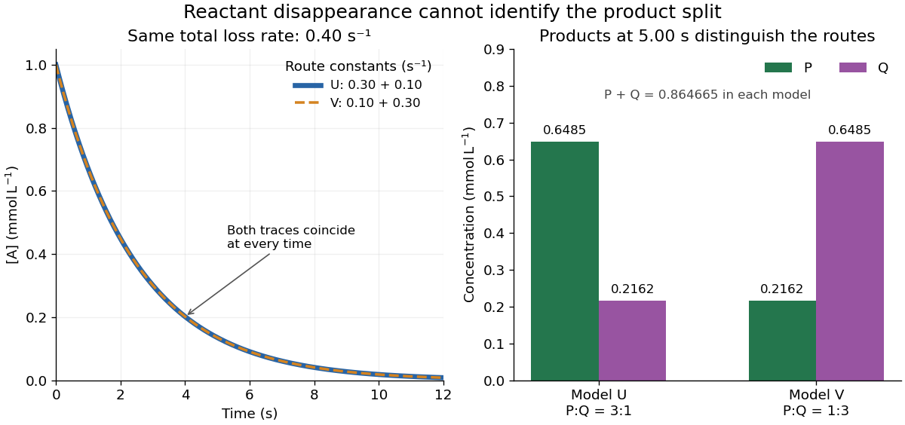

**[Figure 5](#image-parallel-reaction-hidden-product-split). Identical reactant disappearance can hide opposite product splits in a parallel first-order reaction mechanism**. Original chosen models U and V share $k_P+k_Q=0.40\,\mathrm{s^{-1}}$ and $A_0=1.00\,\mathrm{mmol\,L^{-1}}$, but exchange the two route [rate constants](#rate-constant). Left: indistinguishable A traces. Right: different predicted P and Q [concentrations](mathematical-physics.md#concentration) at $t=5.00\,\mathrm s$; each pair sums to the same total converted A. No curves or bars are experimental measurements.

At $t=5.00\,\mathrm s$, both models give $[\mathrm A]=e^{-2}A_0\approx0.135335\,\mathrm{mmol\,L^{-1}}$. Model U gives $([\mathrm P],[\mathrm Q])\approx(0.648499,0.216166)\,\mathrm{mmol\,L^{-1}}$; model V exchanges these. Measuring only the summed [reaction product](chemical-reaction.md#product-chemistry) [concentration](mathematical-physics.md#concentration) would also fail to distinguish them. Product-specific observations therefore answer a question that total conversion cannot. As with any [reaction mechanism](#reaction-mechanism), fitting these observables still does not rule out a more elaborate untested route.

### Acetone iodination rate-law experiment

↑ **Parent:** [Reaction mechanism](#reaction-mechanism)

[Acetone](chemical-substance.md#acetone) reacts with [iodine](chemical-substance.md#iodine) to form [iodoacetone](chemical-substance.md#iodoacetone), [iodide](chemical-substance.md#iodide), and a [hydrogen ion](chemistry.md#hydrogen-ion):

$$
\mathrm{CH_3COCH_3}+\mathrm I_2\longrightarrow
\mathrm{CH_3COCH_2I}+\mathrm H^++\mathrm I^-.
$$

In [water](chemical-substance.md#water), $\mathrm H^+$ denotes a solvated [hydrogen ion](chemistry.md#hydrogen-ion); added [hydrochloric acid](acid-base-chemistry.md#hydrochloric-acid) provides acidic conditions.

Moorpark College's protocol mixes [acetone](chemical-substance.md#acetone), [hydrochloric acid](acid-base-chemistry.md#hydrochloric-acid) and [water](chemical-substance.md#water) from burets in matched test tubes; pipet in [iodine](chemical-substance.md#iodine), swirl and time colour loss against white paper. Use [water](chemical-substance.md#water), then reacted solution, as references. Duplicate each mixture; keep total [volume](geometry-and-topology.md#volume) $5.00\,\mathrm{mL}$ and run [temperatures](temperature.md) within $2\,{}^\circ\mathrm C$.[Chemistry M01B Laboratory Manual, version 4.0 by Moorpark College Department of Chemistry; Version 4.0, Experiment 4, printed pp. 17–18: Procedure and Table 1](chemistry-bibliography.md#chemistry-m01b-laboratory-manual-version-4-0-by-moorpark-college-department-of-chemistry/experiment-4-chemical-kinetics-the-iodination-of-acetone)

The stock dilutions give $[\mathrm{acetone}]_0=0.800$, $[\mathrm H^+]_0=0.200$, and $[\mathrm I_2]_0=0.00100\,\mathrm{mol\,L^{-1}}$. B and C separately double [acetone](chemical-substance.md#acetone) and acid; D halves [iodine](chemical-substance.md#iodine). The manual supplies no measured times; it states zero partial [order of reaction](#order-of-reaction) in [iodine](chemical-substance.md#iodine) and asks students to determine the other exponents.[Chemistry M01B Laboratory Manual, version 4.0 by Moorpark College Department of Chemistry; Printed pp. 15–16, iodine independence and equations (3)–(7); p. 18, Table 1, mixtures A–D](chemistry-bibliography.md#chemistry-m01b-laboratory-manual-version-4-0-by-moorpark-college-department-of-chemistry/experiment-4-chemical-kinetics-the-iodination-of-acetone)

The endpoint measurement is a time $\tau$ to an operational colour threshold, not direct observation of a [reaction intermediate](#reaction-intermediate). If the [iodine](chemical-substance.md#iodine) [disappearance rate](#disappearance-rate) $r$ is approximately constant until that endpoint, $r\approx[\mathrm I_2]_0/\tau$. Halving $[\mathrm I_2]_0$ at fixed other [concentrations](mathematical-physics.md#concentration) then approximately halves $\tau$ without changing $r$. A longer or shorter endpoint time alone is not a comparison of [reaction rates](#reaction-rate) unless the starting [concentration](mathematical-physics.md#concentration) is included. For an observed power-form [rate law](#rate-law), doubling only [acetone](chemical-substance.md#acetone) gives a rate ratio $2^m$ and hence $m=\ln(r_B/r_A)/\ln2$; doubling only acid similarly estimates its own partial [order of reaction](#order-of-reaction). Those are inference formulas, not asserted experimental results.

A useful proposed [reaction mechanism](#reaction-mechanism) would explain how [iodine](chemical-substance.md#iodine) is consumed after an earlier transformation sets the throughput, making the observed [reaction rate](#reaction-rate) insensitive to [iodine](chemical-substance.md#iodine) over a tested range. The observed zero exponent would contradict treating this net [chemical equation](chemical-reaction.md#chemical-equation) as a single [elementary reaction](#elementary-reaction) with directional [rate law](#rate-law) $k[\mathrm{acetone}][\mathrm I_2]$. It would not uniquely prove which [reaction intermediate](#reaction-intermediate) or earlier step is involved. Independently detecting a candidate [reaction intermediate](#reaction-intermediate) would provide another kind of evidence.

The excess-[reactant](chemical-reaction.md#reactant) approximation has an explicit scale: the baseline iodine inventory is only $0.00100/0.800=0.125\%$ of the initial [acetone](chemical-substance.md#acetone) inventory, and its net [hydrogen ion](chemistry.md#hydrogen-ion) production is $0.00100/0.200=0.5\%$ of the initial acid inventory, assuming only the stated one-to-one [chemical reaction](chemical-reaction.md). These are calculated bounds on composition change, not measured reaction orders. Mixing delay, a subjective colour threshold, and [temperature](temperature.md) drift limit the inference. Repeats and a fixed viewing geometry help; a calibrated [absorbance](physical-chemistry.md#absorbance) trace could test linearity during conversion instead of relying on an endpoint alone. That extension would require a [reference blank](physical-chemistry.md#reference-blank) and a justified [Beer-Lambert law](physical-chemistry.md#beer-lambert-law) calibration, rather than treating visible colour as an exact [concentration](mathematical-physics.md#concentration). A [zero-order reaction](#zero-order-reaction) approximation in [iodine](chemical-substance.md#iodine) must fail at depletion; it cannot imply consumption after no [iodine](chemical-substance.md#iodine) remains.

### Reaction intermediate

↑ **Parent:** [Reaction mechanism](#reaction-mechanism)  
ⓦ [Wiki](https://en.wikipedia.org/wiki/Reaction_intermediate)

A [reaction intermediate](#reaction-intermediate) is formed during a [reaction mechanism](#reaction-mechanism) and consumed in a subsequent step, cancelling from the net [chemical equation](chemical-reaction.md#chemical-equation). It can accumulate, as I does in the [consecutive first-order reaction mechanism](#consecutive-first-order-reaction-mechanism). A [reaction intermediate](#reaction-intermediate) can also connect transformations in [energy coupling](chemical-reaction.md#energy-coupling). Unlike a [catalyst](#catalyst), it need not be present before conversion begins.[Chemistry 2e by Paul Flowers and others; §12.6, opening ozone example: intermediate formation, consumption, and cancellation](chemistry-bibliography.md#chemistry-2e-by-paul-flowers-and-others/12-6-reaction-mechanisms)

A [reaction intermediate](#reaction-intermediate) is distinct from a [transition state](#transition-state): the former can persist between steps, whereas the latter describes passage through a barrier. The existing [potential energy surface](#potential-energy-surface) and [energy profile](#energy-profile-chemistry) provide the configuration-space picture; the time-dependent [concentration](mathematical-physics.md#concentration) of an intermediate instead measures an ensemble of reacting entities. Low [concentration](mathematical-physics.md#concentration) or short lifetime can make detection difficult, so failure to detect a proposed [reaction intermediate](#reaction-intermediate) is not by itself proof of absence. Conversely, detecting a [chemical species](mathematical-biology.md#chemical-species) does not establish that it carries the proposed route to the final [reaction products](chemical-reaction.md#product-chemistry); it could belong to a competing route.

#### Tetrahedral intermediate

↑ **Parent:** [Reaction intermediate](#reaction-intermediate)

A tetrahedral intermediate has a formerly trigonal [carbonyl group](chemical-bond.md#carbonyl-group) carbon bonded to four groups after [nucleophilic addition](chemical-reaction.md#nucleophilic-addition). Its subsequent elimination can restore a [carbonyl group](chemical-bond.md#carbonyl-group).

### Reaction coordinate

↑ **Parent:** [Reaction mechanism](#reaction-mechanism)  
ⓦ [Wiki](https://en.wikipedia.org/wiki/Reaction_coordinate)

A [reaction coordinate](#reaction-coordinate) parametrizes changes in molecular configuration along a [chemical reaction](chemical-reaction.md) path. It can involve a [bond length](chemical-bond.md#bond-length), a [bond angle](molecule.md#bond-angle), or a combination of geometric changes. It is not elapsed time and is not the bulk [extent of reaction](chemical-reaction.md#extent-of-reaction): one describes configurations, while the other accounts for how much material has converted. The precise choice matters when interpreting an [energy profile](#energy-profile-chemistry). See the [IUPAC Gold Book: reaction coordinate](https://goldbook.iupac.org/terms/view/R05168).

#### Dividing surface

↑ **Parent:** [Reaction coordinate](#reaction-coordinate)

A hypersurface $s(q)=0$ separating selected reactant and product regions. A rate derived from signed flux and a suitable long-time commitment is independent of its location when the dynamics and normalization are treated consistently.

#### Potential energy surface

↑ **Parent:** [Reaction coordinate](#reaction-coordinate)  
ⓦ [Wiki](https://en.wikipedia.org/wiki/Potential_energy_surface)

A [potential energy surface](#potential-energy-surface) assigns [potential energy](energy.md#potential-energy) to the configurations of the reacting [chemical atoms](physics.md#atom-physics), for a specified electronic description. A [reaction coordinate](#reaction-coordinate) selects a path through this many-dimensional configuration space; a [potential-energy profile](#potential-energy-profile) then records the [potential energy](energy.md#potential-energy) along that path. Different paths can share endpoints but cross different barriers. See the [IUPAC Gold Book: potential-energy reaction surface](https://goldbook.iupac.org/terms/view/P04780).

##### Electronic state correlation diagram

↑ **Parent:** [Potential energy surface](#potential-energy-surface)

A correlation between many-electron states classified by total spin and spatial [symmetry](physics.md#symmetry-physics) along a nuclear path. Orbital occupations, spin adaptation and [configuration interaction](chemistry.md#configuration-interaction) are needed; one-electron energy curves alone are not a state diagram.

##### Conical intersection

↑ **Parent:** [Potential energy surface](#potential-energy-surface)

A degeneracy between adiabatic electronic states with characteristic splitting in suitable nuclear-coordinate directions. It can connect to Jahn-Teller dynamics in open-shell triangular [molecules](molecule.md).

#### Energy profile (chemistry)

↑ **Parent:** [Reaction coordinate](#reaction-coordinate)  
ⓦ [Wiki](https://en.wikipedia.org/wiki/Energy_profile_(chemistry))

An [energy profile](#energy-profile-chemistry) plots an explicitly specified [energy](energy.md) against a [reaction coordinate](#reaction-coordinate). Identify whether the vertical axis is [potential energy](energy.md#potential-energy), [enthalpy](enthalpy.md), or [Gibbs free energy](thermodynamic-potential.md#gibbs-free-energy); these descriptions are related but not interchangeable. A [potential-energy profile](#potential-energy-profile) describes a path through configurations, while a free-energy description also accounts for the relevant thermodynamic conditions.

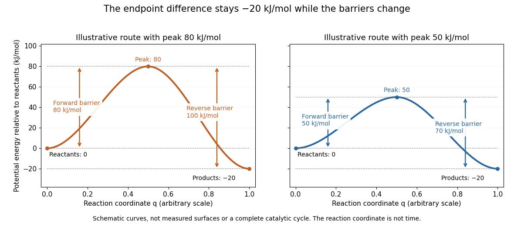

**[Figure 6](#image-two-schematic-potential-energy-profiles-share-endpoints-but-have-different-barriers). Two schematic potential-energy profiles share endpoints but have different barriers**. The reactant level is $0$, the product level is $-20\,\mathrm{kJ\,mol^{-1}}$, and the two maxima are $80$ and $50\,\mathrm{kJ\,mol^{-1}}$. These chosen curves illustrate endpoint differences and barrier heights; they are not measured surfaces, trajectories in time, or a complete catalytic cycle.

For the two chosen profiles, the [reaction energy barriers](#reaction-energy-barrier) from the [reactants](chemical-reaction.md#reactant) are $80$ and $50\,\mathrm{kJ\,mol^{-1}}$. From the [reaction products](chemical-reaction.md#product-chemistry), the same maxima are $100$ and $70\,\mathrm{kJ\,mol^{-1}}$ higher. Both paths have endpoint difference $-20\,\mathrm{kJ\,mol^{-1}}$. The barrier is measured from the relevant starting endpoint, not from an arbitrary zero of [potential energy](energy.md#potential-energy).

The appeal of the diagram is that it separates two useful questions: which endpoint is lower, and which path is easier to traverse? [Catalysis](#catalysis) changes the route through [transition states](#transition-state) while retaining the endpoint thermodynamics of the same overall [chemical reaction](chemical-reaction.md). A real catalytic route may have several steps and [reaction intermediates](#reaction-intermediate); the two simple curves do not specify such a [reaction mechanism](#reaction-mechanism). The plotted potential-energy difference alone is not an [equilibrium constant](chemical-potential.md#equilibrium-constant) or a calculated [rate constant](#rate-constant). See [Chemistry 2e, 12.7: alternative reaction routes and catalysis](https://openstax.org/books/chemistry-2e/pages/12-7-catalysis).

##### Free-energy profile

↑ **Parent:** [Energy profile (chemistry)](#energy-profile-chemistry)

A plot of Gibbs free energy along a specified reaction coordinate under stated conditions. A barrier must be measured from the appropriate starting minimum.

##### Potential-energy profile

↑ **Parent:** [Energy profile (chemistry)](#energy-profile-chemistry)

A [potential-energy profile](#potential-energy-profile) plots the [potential energy](energy.md#potential-energy) of the reacting system along a specified path from [reactants](chemical-reaction.md#reactant) through a [transition state](#transition-state) to [reaction products](chemical-reaction.md#product-chemistry). It is a particular kind of [energy profile](#energy-profile-chemistry). For an [elementary reaction](#elementary-reaction), a suitable [reaction coordinate](#reaction-coordinate) parametrizes the path; a multi-step [reaction mechanism](#reaction-mechanism) needs the coordinates of its successive steps. See the [IUPAC Gold Book: potential-energy profile](https://goldbook.iupac.org/terms/view/P04779).

##### Reaction energy barrier

↑ **Parent:** [Energy profile (chemistry)](#energy-profile-chemistry)

A [reaction energy barrier](#reaction-energy-barrier) is the height of a specified peak relative to the starting state in an [energy profile](#energy-profile-chemistry). State which [energy](energy.md) is used and which direction is being considered. A schematic barrier is not automatically the empirical [activation energy](#activation-energy) obtained from the temperature dependence of a [rate constant](#rate-constant).

### Elementary reaction

↑ **Parent:** [Reaction mechanism](#reaction-mechanism)  
ⓦ [Wiki](https://en.wikipedia.org/wiki/Elementary_reaction)

An [elementary reaction](#elementary-reaction) is one microscopic step in a [reaction mechanism](#reaction-mechanism), with no intervening [reaction intermediate](#reaction-intermediate) needed within that step. Its [molecularity](#molecularity) counts the participating reacting entities. In an ideal dilute, uniformly mixed model, the [law of mass action](mathematical-biology.md#law-of-mass-action) gives the directional [reaction rate](#reaction-rate) from the step's [reactant](chemical-reaction.md#reactant) [concentrations](mathematical-physics.md#concentration): $\mathrm A\longrightarrow\mathrm P$ has $r=k[\mathrm A]$, while $\mathrm A+\mathrm B\longrightarrow\mathrm P$ has $r=k[\mathrm A][\mathrm B]$. Applying those powers to a net [chemical equation](chemical-reaction.md#chemical-equation) requires separate evidence that it is elementary.[Chemistry 2e by Paul Flowers and others; §12.6, Unimolecular Elementary Reactions and Bimolecular Elementary Reactions: step equations and directional rate laws](chemistry-bibliography.md#chemistry-2e-by-paul-flowers-and-others/12-6-reaction-mechanisms)

For a reversible step $\mathrm A+\mathrm B\rightleftharpoons\mathrm I$, apply that rule separately: $r_f=k_f[\mathrm A][\mathrm B]$ and $r_r=k_r[\mathrm I]$, giving net production of I as $r_f-r_r$. Their difference can vanish at [chemical equilibrium](chemical-potential.md#chemical-equilibrium) while both directional [reaction rates](#reaction-rate) remain nonzero. For $2\mathrm A\longrightarrow\mathrm P$, the elementary normalized [reaction rate](#reaction-rate) is $r=k[\mathrm A]^2$, whereas A's [disappearance rate](#disappearance-rate) is $2r$; see [second-order reaction](#second-order-reaction) for the complete factor-of-two example.

Calling a step slow does not remove the need for its actual [reactant](chemical-reaction.md#reactant) [concentrations](mathematical-physics.md#concentration). If a [reaction intermediate](#reaction-intermediate) enters its [rate law](#rate-law), determine that [concentration](mathematical-physics.md#concentration) from the other [rate equations](mathematical-biology.md#rate-equation) or a justified approximation. In the [consecutive first-order reaction mechanism](#consecutive-first-order-reaction-mechanism), an intermediate maximum is only one instant at which its production and consumption match. Replacing its entire evolution by that one balance would lose the initial buildup and delayed [reaction product](chemical-reaction.md#product-chemistry) formation. A successful overall [first-order reaction](#first-order-reaction) fit likewise does not establish an elementary event: both worked [reaction mechanisms](#reaction-mechanism) above provide ways for microscopic detail to remain hidden in one [reactant](chemical-reaction.md#reactant) trace.

#### Molecularity

↑ **Parent:** [Elementary reaction](#elementary-reaction)  
ⓦ [Wiki](https://en.wikipedia.org/wiki/Molecularity)

[Molecularity](#molecularity) counts the reacting entities in one [elementary reaction](#elementary-reaction): one for a unimolecular step, two for a bimolecular step. An entity can be a [molecule](molecule.md), [ion](chemistry.md#ion), or [chemical atom](physics.md#atom-physics). [Solvent](mixture.md#solvent) entities involved only through [solvation](ionic-bonding.md#solvation) are excluded. [Molecularity](#molecularity) describes a microscopic event; [order of reaction](#order-of-reaction) describes the [concentration](mathematical-physics.md#concentration) dependence of a [rate law](#rate-law). Assigning [molecularity](#molecularity) to a net multi-step [chemical equation](chemical-reaction.md#chemical-equation) is therefore inappropriate.[Glossary of Terms Used in Physical Organic Chemistry, IUPAC Recommendations 1994, entry “molecularity”: elementary event and exclusion of solvation medium](chemistry-bibliography.md#glossary-of-terms-used-in-physical-organic-chemistry-iupac-recommendations-1994-m-entries-by-international-union-of-pure-and-applied-chemistry)

## Catalysis

↑ **Parent:** [Chemical kinetics](chemical-kinetics.md)  
ⓦ [Wiki](https://en.wikipedia.org/wiki/Catalysis)

[Catalysis](#catalysis) accelerates a [chemical reaction](chemical-reaction.md) by providing an alternative [reaction mechanism](#reaction-mechanism) with a more accessible barrier through its [transition states](#transition-state). A [catalyst](#catalyst) participates in the route and is regenerated. At fixed [temperature](temperature.md), [catalysis](#catalysis) changes how quickly [chemical equilibrium](chemical-potential.md#chemical-equilibrium) is reached without changing the [equilibrium constant](chemical-potential.md#equilibrium-constant); it does not make an unfavourable overall change in [Gibbs free energy](thermodynamic-potential.md#gibbs-free-energy) favourable. [§12.7, opening definition and Figure 12.19: alternative mechanisms and regeneration](chemistry-bibliography.md#chemistry-2e-by-paul-flowers-and-others)[§13.3, Effect of a Catalyst: equilibrium composition is unchanged](chemistry-bibliography.md#chemistry-2e-by-paul-flowers-and-others/13-3-shifting-equilibria-le-chatelier’s-principle)

In his 1909 lecture, [Wilhelm Ostwald](chemistry.md#wilhelm-ostwald) recalled the introduction of the term [catalysis](#catalysis) by [Jöns Jacob Berzelius](chemistry.md#jons-jacob-berzelius) and emphasized measurable acceleration rather than merely naming an unexplained force. He also discussed [reaction intermediates](#reaction-intermediate) and participation of the [catalyst](#catalyst) in the steps whose sum gives the net [chemical reaction](chemical-reaction.md). This is a participant's retrospective account, not evidence that every catalytic [reaction mechanism](#reaction-mechanism) is the same.[On Catalysis, lecture dated 12 December 1909; paragraphs beginning “The factor which Berzelius regarded” and “It is appropriate here”; editorial footnote says the lecture was reconstructed from notes](chemistry-bibliography.md#nobel-lectures-chemistry-1901-1921/on-catalysis)

### Hydrogen-bond catalysis

↑ **Parent:** [Catalysis](#catalysis)

[Hydrogen-bond catalysis](#hydrogen-bond-catalysis) preferentially stabilizes a reactive configuration through [hydrogen bonds](chemical-bond.md#hydrogen-bond). A [hydrogen bond](chemical-bond.md#hydrogen-bond) to an intermediate or bound [substrate](enzyme.md#substrate-biochemistry) is evidence of an interaction, but its catalytic contribution depends on differential stabilization relative to the starting state.

### Metal ion catalysis

↑ **Parent:** [Catalysis](#catalysis)

[Metal ion catalysis](#metal-ion-catalysis) uses a coordinated [metal](chemical-substance.md#metal) ion to activate a reagent, orient reactants or stabilize charge. Zinc can lower the acidity constant of coordinated [water](chemical-substance.md#water) and support attack by the resulting [oxygen](chemical-substance.md#oxygen) [nucleophile](chemical-reaction.md#nucleophile) without a [metal](chemical-substance.md#metal) [redox](chemical-reaction.md#redox) step.

### Proximity and orientation catalysis

↑ **Parent:** [Catalysis](#catalysis)

[Proximity and orientation catalysis](#proximity-and-orientation-catalysis) favors reaction by bringing partners together in a productive geometry. A binding interaction is catalytic only insofar as it improves access to the reactive configuration relative to the starting state.

### Electrostatic catalysis

↑ **Parent:** [Catalysis](#catalysis)

[Electrostatic catalysis](#electrostatic-catalysis) preferentially stabilizes developing charge along the reaction pathway. The comparison must be with the bound reactant: equally stabilizing ground and [transition states](#transition-state) does not lower their activation free-energy difference.

### Covalent catalysis

↑ **Parent:** [Catalysis](#catalysis)

[Covalent catalysis](#covalent-catalysis) creates a temporary covalent bond between catalyst and [substrate](enzyme.md#substrate-biochemistry), then breaks that bond while regenerating the catalyst. Merely forming a [substrate](enzyme.md#substrate-biochemistry)–[water](chemical-substance.md#water) bond does not constitute [covalent catalysis](#covalent-catalysis) by an [enzyme](enzyme.md) residue.

### Acid catalysis

↑ **Parent:** [Catalysis](#catalysis)

### General base catalysis

↑ **Parent:** [Catalysis](#catalysis)

[General base catalysis](#general-base-catalysis) uses a base to accept a [proton](physics.md#proton) during the reacting pathway, for example activating [water](chemical-substance.md#water) while it forms a bond. It need not involve an equilibrium pool of free hydroxide.

### General acid catalysis

↑ **Parent:** [Catalysis](#catalysis)

[General acid catalysis](#general-acid-catalysis) uses [proton](physics.md#proton) donation from an acid participating in the rate-influencing reaction pathway. It can activate an electrophile or assist protonation of a departing or newly formed group.

### Transition state stabilization

↑ **Parent:** [Catalysis](#catalysis)

[Transition state stabilization](#transition-state-stabilization) lowers an activation barrier when a catalytic environment stabilizes the reacting configuration more than the starting bound state. Stronger ground-state binding alone does not demonstrate [catalysis](#catalysis).

### General base

↑ **Parent:** [Catalysis](#catalysis)

A catalytic group that accepts a [proton](physics.md#proton) during a reaction step, increasing the reactivity of another group such as a hydroxyl nucleophile.

### Catalytic cycle

↑ **Parent:** [Catalysis](#catalysis)  
ⓦ [Wiki](https://en.wikipedia.org/wiki/Catalytic_cycle)

A [catalytic cycle](#catalytic-cycle) follows the changing forms of a [catalyst](#catalyst) through a [reaction mechanism](#reaction-mechanism) until its starting form is regenerated. The schematic binding cycle in [catalyst](#catalyst) illustrates the bookkeeping: C is consumed and recovered, whereas AC is a [reaction intermediate](#reaction-intermediate) formed and consumed. Cancelling both gives the net A-to-B [chemical equation](chemical-reaction.md#chemical-equation). Regeneration concerns the completed cycle; it does not imply that C avoids forming [chemical bonds](chemical-bond.md) or exchanging [electrons](physics.md#electron). An alternative [reaction mechanism](#reaction-mechanism) may have more [elementary reactions](#elementary-reaction) than the uncatalysed route and still be faster.[§12.7, Figure 12.19 and Homogeneous Catalysts: alternative steps, intermediate formation and catalyst regeneration](chemistry-bibliography.md#chemistry-2e-by-paul-flowers-and-others)

For that reversible binding cycle, ideal [thermodynamic activities](chemical-potential.md#thermodynamic-activity) give step [equilibrium constants](chemical-potential.md#equilibrium-constant) $K_1=a_{\mathrm{AC}}/(a_{\mathrm A}a_{\mathrm C})$ and $K_2=a_{\mathrm B}a_{\mathrm C}/a_{\mathrm{AC}}$. Their [product](arithmetic.md#product-of-numbers) is $K_1K_2=a_{\mathrm B}/a_{\mathrm A}=K$: the same cancellations occur in the equilibrium bookkeeping. Choose consistent [standard states](chemical-potential.md#standard-state) for the species. A proposed cycle with $K_1K_2\ne K$ for the same net conversion at the same [temperature](temperature.md) would contradict its specified [thermodynamics](thermodynamics.md). This statement concerns free-species [thermodynamic activities](chemical-potential.md#thermodynamic-activity). Appreciable binding in AC can change how the conserved total amount is partitioned among free A, free B and bound AC. An assay counting bound and free material together therefore needs that additional balance; unchanged $a_{\mathrm B}/a_{\mathrm A}$ does not by itself guarantee identical analytical totals when the amount of C changes.

### Catalytic barriers and reaction free energy

↑ **Parent:** [Catalysis](#catalysis)

A directional [Gibbs energy of activation](#gibbs-energy-of-activation) measures the climb from a starting state to a [transition state](#transition-state). The net standard reaction change in [Gibbs free energy](thermodynamic-potential.md#gibbs-free-energy) measures the difference between endpoints. Changing the climb can strongly change a [rate constant](#rate-constant) while leaving that endpoint difference intact. For two illustrative single-barrier routes with common endpoint levels $G_{\mathrm A}^\circ$ and $G_{\mathrm B}^\circ$,

$$
\Delta G_f^{\ddagger\circ}=G_{\mathrm{TS}}^\circ-G_{\mathrm A}^\circ,
\qquad
\Delta G_r^{\ddagger\circ}=G_{\mathrm{TS}}^\circ-G_{\mathrm B}^\circ,
\qquad
\Delta G_f^{\ddagger\circ}-\Delta G_r^{\ddagger\circ}=\Delta_rG^\circ.
$$

Lowering the common [transition state](#transition-state) level lowers both directional [Gibbs energies of activation](#gibbs-energy-of-activation); it does not lower just the forward climb. The usual statement that a [catalyst](#catalyst) lowers an [activation energy](#activation-energy) describes a kinetic route, not a change in the net [Gibbs free energy](thermodynamic-potential.md#gibbs-free-energy). An [activation energy](#activation-energy) inferred from an [Arrhenius plot](#arrhenius-plot) is also distinct from a [Gibbs energy of activation](#gibbs-energy-of-activation) at one [temperature](temperature.md).

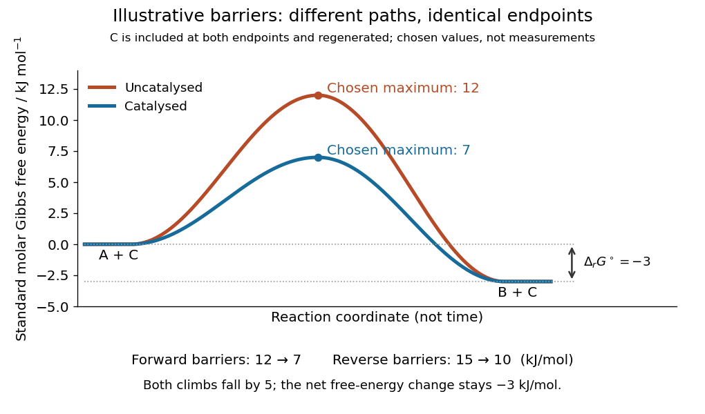

**[Figure 7](#image-catalysis-barriers-and-net-free-energy). Illustrative catalysis schematic: different barriers, identical endpoint Gibbs free energy difference**. Chosen levels in $\mathrm{kJ\,mol^{-1}}$: A plus regenerated C at $0$, B plus regenerated C at $-3$, and schematic maxima at $12$ and $7$. Forward barriers are $12$ and $7$; reverse barriers are $15$ and $10$. Neither curve is a measured molecular path. The [reaction coordinate](#reaction-coordinate) is not time. These values illustrate the barrier bookkeeping and do not parametrize the separate [reversible catalytic relaxation](#reversible-catalytic-relaxation) example.

With a common prefactor in [transition state theory](#transition-state-theory), subtracting the directional barriers yields

$$
\frac{k_f}{k_r}=\exp\!\left(-\frac{\Delta_rG^\circ}{RT}\right)=K,
$$

where $R$ is the [molar gas constant](ideal-gas.md#molar-gas-constant) and $T$ is the absolute [temperature](temperature.md). This particular [rate constant](#rate-constant) ratio requires the simple compatible directional [rate laws](#rate-law) and consistent [standard states](chemical-potential.md#standard-state); a general multistep [reaction mechanism](#reaction-mechanism) does not supply two arbitrary measured [rate constants](#rate-constant) whose ratio must equal $K$. At fixed [temperature](temperature.md) a [catalyst](#catalyst) preserves $K$ for the same net conversion. The actual reaction change in [Gibbs free energy](thermodynamic-potential.md#gibbs-free-energy), $\Delta_rG=\Delta_rG^\circ+RT\ln Q$, is likewise unchanged at the same [reaction quotient](chemical-potential.md#reaction-quotient) $Q$. Composition changes during the faster approach to [chemical equilibrium](chemical-potential.md#chemical-equilibrium), so comparing mixtures at the same elapsed time need not compare the same $Q$.[§13.3, Effect of a Catalyst: both directional rates accelerate while equilibrium composition is unchanged](chemistry-bibliography.md#chemistry-2e-by-paul-flowers-and-others/13-3-shifting-equilibria-le-chatelier’s-principle)

### Reversible catalytic relaxation

↑ **Parent:** [Catalysis](#catalysis)

Here is an explicitly stipulated elementary kinetic model, not experimental data. A well-mixed ideal [closed system](thermodynamics.md#closed-system) has constant [temperature](temperature.md) and [volume](geometry-and-topology.md#volume). Alongside an uncatalysed [elementary reaction](#elementary-reaction), allow an illustrative catalytic encounter that returns C immediately:

$$
\begin{aligned}
\mathrm A&\rightleftharpoons\mathrm B,
& k_f^u&=0.030\,\mathrm{s^{-1}},
& k_r^u&=0.010\,\mathrm{s^{-1}},\\
\mathrm A+\mathrm C&\rightleftharpoons\mathrm B+\mathrm C,
& \alpha_f&=270\,\mathrm{L\,mol^{-1}\,s^{-1}},
& \alpha_r&=90\,\mathrm{L\,mol^{-1}\,s^{-1}}.
\end{aligned}
$$

Both channels obey the [law of mass action](mathematical-biology.md#law-of-mass-action). In the second, the forward [reaction rate](#reaction-rate) is $\alpha_f[\mathrm A][\mathrm C]$ and the reverse [reaction rate](#reaction-rate) is $\alpha_r[\mathrm B][\mathrm C]$. C cancels in each encounter, so its free [concentration](mathematical-physics.md#concentration) $c_C$ stays constant without an external supply. This toy [elementary reaction](#elementary-reaction) encodes regeneration without binding; it is not a claim that real [catalytic cycles](#catalytic-cycle) universally consist of one encounter. A binding cycle can accumulate a [reaction intermediate](#reaction-intermediate), in which case constant total C does not imply constant free $c_C$.

Adding the parallel [reaction rates](#reaction-rate) gives effective [first-order reaction](#first-order-reaction) [rate constants](#rate-constant)

$$
k_f=k_f^u+\alpha_f c_C,
\qquad k_r=k_r^u+\alpha_r c_C.
$$

Because $k_f^u/k_r^u=\alpha_f/\alpha_r=3$, each channel balances at the same $[\mathrm B]/[\mathrm A]=3$, and so does their sum. At $c_C=0$ the pair is $(0.030,0.010)\,\mathrm{s^{-1}}$; at $c_C=0.001\,\mathrm{mol\,L^{-1}}$ it is $(0.300,0.100)\,\mathrm{s^{-1}}$. Both give $K=3$ with ideal [thermodynamic activities](chemical-potential.md#thermodynamic-activity) and a common concentration [standard state](chemical-potential.md#standard-state). At $T=300\,\mathrm K$ their compatible standard reaction change in [Gibbs free energy](thermodynamic-potential.md#gibbs-free-energy) is $\Delta_rG^\circ=-RT\ln3\approx-2.7403\,\mathrm{kJ\,mol^{-1}}$. Choosing an unrelated reverse [rate constant](#rate-constant) would break this consistency.

Let $S=[\mathrm A]+[\mathrm B]$ be the conserved [concentration](mathematical-physics.md#concentration), and define the [dimensionless quantity](physics.md#dimensionless-quantity) $x=[\mathrm B]/S$. Then

$$
\frac{dx}{dt}=k_f(1-x)-k_rx
=-(k_f+k_r)(x-x_{\mathrm{eq}}),
\qquad
x_{\mathrm{eq}}=\frac{k_f}{k_f+k_r}=\frac34.
$$

Solving this [first-order linear differential equation](linear-ordinary-differential-equation.md#first-order-linear-differential-equation) gives

$$
x(t)=\frac34+\left(x_0-\frac34\right)e^{-(k_f+k_r)t},
\qquad
\tau=\frac{1}{k_f+k_r}.
$$

The [chemical relaxation time](chemical-potential.md#chemical-relaxation-time) is $25\,\mathrm s$ without C and $2.5\,\mathrm s$ with the chosen C. From either $x_0=0$ or $x_0=1$, the [exponential decay](analysis.md#exponential-decay) of the deviation leads to the same [chemical equilibrium](chemical-potential.md#chemical-equilibrium) $x=3/4$. Reducing that deviation to one percent takes $\ln(100)\tau$: about $115.13\,\mathrm s$ versus $11.51\,\mathrm s$.

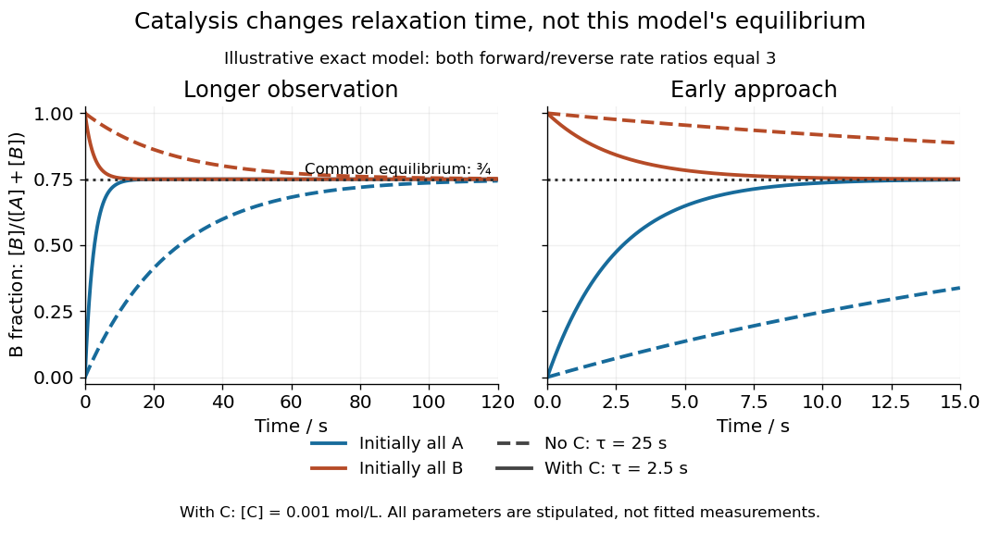

**[Figure 8](#image-catalysis-reversible-equilibrium-relaxation). Two initial compositions and two kinetic speeds approach the same chemical equilibrium**. Exact curves from the stipulated [reversible catalytic relaxation](#reversible-catalytic-relaxation) model. Solid curves include $0.001\,\mathrm{mol\,L^{-1}}$ of C; dashed curves omit C. Blue starts entirely as A and orange entirely as B. Both panels use the same equations; the right panel resolves the first $15\,\mathrm s$. The common dotted line is $[\mathrm B]/([\mathrm A]+[\mathrm B])=3/4$, not a fitted plateau or an experimental measurement.

At this [chemical equilibrium](chemical-potential.md#chemical-equilibrium), conversion continues in both directions. For $S=1\,\mathrm{mol\,L^{-1}}$, the uncatalysed channel has equal forward and reverse [reaction rates](#reaction-rate) $0.0075\,\mathrm{mol\,L^{-1}\,s^{-1}}$. Adding C gives total directional [reaction rates](#reaction-rate) $0.075\,\mathrm{mol\,L^{-1}\,s^{-1}}$ each, yet zero net [reaction rate](#reaction-rate). Faster molecular exchange and unchanged composition coexist. This exact calculation explains how [catalysis](#catalysis) can matter enormously within an observation window while leaving the final [equilibrium constant](chemical-potential.md#equilibrium-constant) intact.

### Catalytic selectivity

↑ **Parent:** [Catalysis](#catalysis)

[Catalytic selectivity](#catalytic-selectivity) concerns which [reaction products](chemical-reaction.md#product-chemistry) form when competing [reaction mechanisms](#reaction-mechanism) are available. Faster conversion is valuable when a process would otherwise be impractically slow; a suitable [catalyst](#catalyst) can also favour a useful product within the available time. In an illustrative pair of irreversible [first-order reactions](#first-order-reaction) A to B and A to D, the initial fraction of converted A going to B is $k_B/(k_B+k_D)$. Multiplying both [rate constants](#rate-constant) by the same factor changes speed but leaves this fraction unchanged; changing their relative values changes the kinetic product split. This is a finite-time kinetic illustration, not a new [equilibrium constant](chemical-potential.md#equilibrium-constant).

A [catalyst](#catalyst) need not accelerate every competing [chemical reaction](chemical-reaction.md) equally. [Enzymes](enzyme.md), for example, can distinguish [substrates](enzyme.md#substrate-biochemistry) through their [active sites](enzyme.md#active-site).[§12.7, Enzyme Structure and Function, Figure 12.25: substrate binding and specificity](chemistry-bibliography.md#chemistry-2e-by-paul-flowers-and-others) If every relevant reversible channel eventually equilibrates in a [closed system](thermodynamics.md#closed-system), its final [chemical equilibrium](chemical-potential.md#chemical-equilibrium) still obeys the endpoint [thermodynamics](thermodynamics.md). Selective acceleration, product removal, or external driving can make an observed product distribution depend on time and operating conditions. A claim of improved yield must specify those conditions.

### Catalyst deactivation

↑ **Parent:** [Catalysis](#catalysis)

[Catalyst deactivation](#catalyst-deactivation) is loss of catalytic activity during use. Regeneration in an ideal [catalytic cycle](#catalytic-cycle) does not rule out a separate damaging [chemical reaction](chemical-reaction.md), blocking of a surface, or physical loss of [catalyst](#catalyst) from the apparatus. A route can also be slowed by [diffusion](thermodynamics.md#diffusion) to the surface or by accumulation of a [reaction intermediate](#reaction-intermediate). Such effects limit the usefulness of a low schematic [reaction energy barrier](#reaction-energy-barrier): measured throughput depends on the whole [reaction mechanism](#reaction-mechanism) and on transport. Demonstrating regeneration requires more evidence than observing a faster first run. For a recovered solid [catalyst](#catalyst), a useful further comparison is a second run with fresh [reactants](chemical-reaction.md#reactant), matched recovered amount, and the same mixing and [temperature](temperature.md), alongside a fresh-solid run and a blank. Loss during recovery or residual [reactants](chemical-reaction.md#reactant) can otherwise imitate [catalyst deactivation](#catalyst-deactivation) or apparent reuse. This is a proposed control, not an observation reported for the [catalysed peroxide comparison](#catalysed-peroxide-comparison).

### Homogeneous catalysis

↑ **Parent:** [Catalysis](#catalysis)  
ⓦ [Wiki](https://en.wikipedia.org/wiki/Homogeneous_catalysis)

In [homogeneous catalysis](#homogeneous-catalysis), the [catalyst](#catalyst) and [reactants](chemical-reaction.md#reactant) occupy the same [thermodynamic phase](thermodynamics.md#thermodynamic-phase).

For a liquid example, specify [hydrogen peroxide](chemical-substance.md#hydrogen-peroxide) as the [reactant](chemical-reaction.md#reactant), dissolved [iodide](chemical-substance.md#iodide) as the [catalyst](#catalyst), and [water](chemical-substance.md#water) as the [solvent](mixture.md#solvent). If both reacting [chemical species](mathematical-biology.md#chemical-species) remain dissolved in that one liquid [thermodynamic phase](thermodynamics.md#thermodynamic-phase), this is [homogeneous catalysis](#homogeneous-catalysis). The University of Wisconsin–Madison's [The Rate of a Reaction](https://www2.chem.wisc.edu/deptfiles/genchem/sstutorial/Text13/Tx133/tx133.html) identifies [iodide](chemical-substance.md#iodide)-catalysed [hydrogen peroxide](chemical-substance.md#hydrogen-peroxide) decomposition in its final example; the aqueous setting here makes the phase roles explicit.[The Rate of a Reaction, final Example: iodide-catalysed decomposition of hydrogen peroxide](chemistry-bibliography.md#the-rate-of-a-reaction-by-university-of-wisconsin-madison-department-of-chemistry) Its net [chemical equation](chemical-reaction.md#chemical-equation) is

$$
2\mathrm{H_2O_2}(aq)\longrightarrow2\mathrm{H_2O}(l)+\mathrm{O_2}(g).
$$

The [molecular oxygen](chemical-substance.md#molecular-oxygen) is a [reaction product](chemical-reaction.md#product-chemistry): its bubbles do not make the dissolved catalytic route [heterogeneous catalysis](#heterogeneous-catalysis). The classification compares the participating [catalyst](#catalyst) and [reactants](chemical-reaction.md#reactant), rather than demanding that everything in the vessel share a phase.[Chemistry 2e by Paul Flowers and others; §12.7, Homogeneous Catalysts: catalyst in the same phase as the reactants](chemistry-bibliography.md#chemistry-2e-by-paul-flowers-and-others/12-7-catalysis)

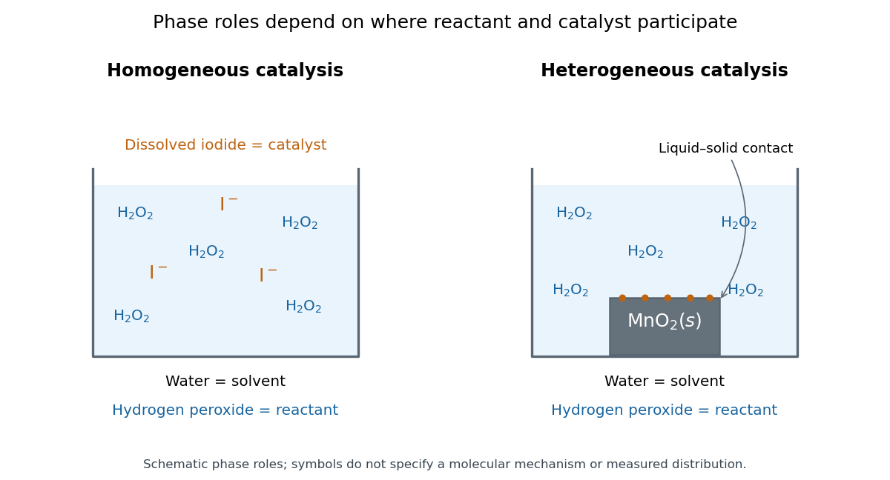

**[Figure 9](#image-catalyst-phase-and-contact). The same hydrogen peroxide reactant can meet a dissolved catalyst or a separate solid catalyst**. Original schematic phase comparison with [water](chemical-substance.md#water) as the [solvent](mixture.md#solvent). Left: dissolved [iodide](chemical-substance.md#iodide) and [hydrogen peroxide](chemical-substance.md#hydrogen-peroxide) share a liquid [thermodynamic phase](thermodynamics.md#thermodynamic-phase). Right: [manganese dioxide](chemical-substance.md#manganese-dioxide) remains a separate [solid](thermodynamics.md#solid) in contact with the liquid [chemical solution](mixture.md#solution-chemistry). Symbols indicate phase roles, not molecular structure, a measured distribution, or a common microscopic [reaction mechanism](#reaction-mechanism). The [molecular oxygen](chemical-substance.md#molecular-oxygen) product is omitted to keep the comparison focused on [reactants](chemical-reaction.md#reactant) and [catalysts](#catalyst).

Being in the same [thermodynamic phase](thermodynamics.md#thermodynamic-phase) describes where the [chemical species](mathematical-biology.md#chemical-species) are; it does not specify their [reaction mechanism](#reaction-mechanism). A uniform-looking liquid can contain unresolved [solid](thermodynamics.md#solid) particles, so appearance alone is insufficient. Conversely, suspended [solid](thermodynamics.md#solid) particles do not establish that their surfaces supply the observed [catalysis](#catalysis): dissolved material released from them could contribute. Phase identification and catalytic participation need separate evidence.

The bookkeeping of a [catalyst](#catalyst) in [homogeneous catalysis](#homogeneous-catalysis) is particularly transparent in the schematic [catalytic cycle](#catalytic-cycle) A plus C forming AC, followed by AC releasing B plus C. This is the generic model in [catalyst](#catalyst), not an asserted [iodide](chemical-substance.md#iodide) [reaction mechanism](#reaction-mechanism). Suppose a fixed [volume](thermodynamics.md#volume-thermodynamics) initially contains $1.00\,\mathrm{mmol}$ of A and $0.20\,\mathrm{mmol}$ of C. At a chosen snapshot, let $0.60\,\mathrm{mmol}$ of B and $0.12\,\mathrm{mmol}$ of AC be present, with no other [chemical reactions](chemical-reaction.md). Each AC contains one A unit and one C unit, so

$$
n_{\mathrm A}+n_{\mathrm{AC}}+n_{\mathrm B}=1.00\,\mathrm{mmol},\qquad
n_{\mathrm C}+n_{\mathrm{AC}}=0.20\,\mathrm{mmol}.
$$

Thus free A is $0.28\,\mathrm{mmol}$ and free C is $0.08\,\mathrm{mmol}$. B formation already exceeds the initial [amount of substance](physics.md#amount-of-substance) of C by a factor of three, while the total C inventory remains $0.20\,\mathrm{mmol}$. Adding the two steps cancels C and AC, giving the net A-to-B [chemical reaction](chemical-reaction.md); counting their constituents proves these balances. Conserved total [catalyst](#catalyst) does not mean constant free [catalyst](#catalyst) [concentration](mathematical-physics.md#concentration).

Dissolved contact is useful because [reactants](chemical-reaction.md#reactant) can encounter the catalytic [chemical species](mathematical-biology.md#chemical-species) throughout the mixed liquid, without first reaching a macroscopic [solid](thermodynamics.md#solid) surface. Recovering a dissolved [catalyst](#catalyst) from the same [chemical solution](mixture.md#solution-chemistry) can instead require a separation. Neither ease of contact nor phase classification determines an [activation energy](#activation-energy) or an [equilibrium constant](chemical-potential.md#equilibrium-constant); those depend on the relevant [chemical kinetics](chemical-kinetics.md) and endpoint [thermodynamics](thermodynamics.md).

### Heterogeneous catalysis

↑ **Parent:** [Catalysis](#catalysis)  
ⓦ [Wiki](https://en.wikipedia.org/wiki/Heterogeneous_catalysis)

In [heterogeneous catalysis](#heterogeneous-catalysis), the [catalyst](#catalyst) and [reactants](chemical-reaction.md#reactant) occupy different [thermodynamic phases](thermodynamics.md#thermodynamic-phase); a solid surface can furnish the catalytic route.

For example, specify dissolved [hydrogen peroxide](chemical-substance.md#hydrogen-peroxide) as the [reactant](chemical-reaction.md#reactant), [water](chemical-substance.md#water) as the [solvent](mixture.md#solvent), and [solid](thermodynamics.md#solid) [manganese dioxide](chemical-substance.md#manganese-dioxide) as the [catalyst](#catalyst). The [solid](thermodynamics.md#solid) and liquid [chemical solution](mixture.md#solution-chemistry) are separate [thermodynamic phases](thermodynamics.md#thermodynamic-phase). A dispersion that looks thoroughly mixed still contains those separate phases; mixing distributes contact, rather than making the [solid](thermodynamics.md#solid) molecularly dissolved. The [manganese dioxide peroxide contact demonstration](#manganese-dioxide-peroxide-contact-demonstration) makes the arrival of the liquid at the [solid](thermodynamics.md#solid) tangible.

A useful surface-route picture is approach from the liquid, [adsorption](physical-chemistry.md#adsorption) at a [catalytic surface site](#catalytic-surface-site), conversion through surface-bound [reaction intermediates](#reaction-intermediate), and release of [reaction products](chemical-reaction.md#product-chemistry). [Chemistry 2e by Paul Flowers and others; §12.7, Heterogeneous Catalysts, steps 1–4: adsorption, activation, reaction and product desorption](chemistry-bibliography.md#chemistry-2e-by-paul-flowers-and-others/12-7-catalysis) This sequence organizes possible roles; it is not a verified sequence of [elementary reactions](#elementary-reaction) for every [catalyst](#catalyst), or for the particular [manganese dioxide](chemical-substance.md#manganese-dioxide) demonstration. The net [chemical equation](chemical-reaction.md#chemical-equation) supplies neither the binding geometry nor the identity of the working [catalytic surface site](#catalytic-surface-site).

This contact requirement makes [surface area](differential-geometry.md#surface-area) and [diffusion](thermodynamics.md#diffusion) practically important. More exposed [solid](thermodynamics.md#solid) can provide more [catalytic surface sites](#catalytic-surface-site), whereas [diffusion](thermodynamics.md#diffusion) through the surrounding liquid can limit their supply of [reactants](chemical-reaction.md#reactant). Changing stirring or particle size can therefore change the observed [reaction rate](#reaction-rate) without identifying the microscopic [rate constant](#rate-constant). A recoverable [solid](thermodynamics.md#solid) is attractive for reuse, but separation alone does not establish retained activity: compare with [catalyst deactivation](#catalyst-deactivation).

#### Catalytic surface site

↑ **Parent:** [Heterogeneous catalysis](#heterogeneous-catalysis)

A [catalytic surface site](#catalytic-surface-site) is a location on a [solid](thermodynamics.md#solid) surface capable of participating in a catalytic route. The schematic notation $\ast$ denotes a vacant site; $\mathrm A\ast$ denotes A bound there. A minimal illustrative [catalytic cycle](#catalytic-cycle) is

$$
\mathrm A+\ast\rightleftharpoons\mathrm A\ast,
\qquad
\mathrm A\ast\rightleftharpoons\mathrm B+\ast.
$$

The first step represents [adsorption](physical-chemistry.md#adsorption); the second combines conversion and release. Cancelling $\ast$ and $\mathrm A\ast$ gives $\mathrm A\rightleftharpoons\mathrm B$. The site is regenerated even though its occupancy changes during the cycle. This is an original bookkeeping model, not a measured [reaction mechanism](#reaction-mechanism) for [manganese dioxide](chemical-substance.md#manganese-dioxide).

If the only site states are vacant and occupied by A, the site inventory obeys $n_\ast+n_{\mathrm A\ast}=n_{\mathrm{sites}}$. A blocked or inaccessible part of a particle does not contribute available [catalytic surface sites](#catalytic-surface-site) merely because it contributes [mass](classical-mechanics.md#mass). Different surface structures can have different abilities to bind and convert [reactants](chemical-reaction.md#reactant); equal geometric [surface area](differential-geometry.md#surface-area) need not mean equal catalytic activity.

#### Catalyst particle size and accessible area

↑ **Parent:** [Heterogeneous catalysis](#heterogeneous-catalysis)

Consider an original geometric model of $N$ separate nonporous [solid](thermodynamics.md#solid) [spheres](euclidean-geometry.md#sphere), each with [radius](topology.md#radius) $r$. Hold their total [volume](thermodynamics.md#volume-thermodynamics) $V_s$ fixed. The [sphere](euclidean-geometry.md#sphere) formulas give

$$
V_s=N\frac{4\pi r^3}{3},\qquad S=N4\pi r^2=\frac{3V_s}{r}.
$$

At fixed [mass density](fluid-mechanics.md#density), fixed $V_s$ also means fixed total [mass](classical-mechanics.md#mass). Halving $r$ requires eight times as many particles and doubles their total external [surface area](differential-geometry.md#surface-area) $S$; this follows by eliminating $N$, without any assumption about [chemical kinetics](chemical-kinetics.md).

For example, take one [sphere](euclidean-geometry.md#sphere) of [radius](topology.md#radius) $1.00\,\mathrm{mm}$, so $V_s=4\pi/3\,\mathrm{mm^3}$. Eight [spheres](euclidean-geometry.md#sphere) of [radius](topology.md#radius) $0.50\,\mathrm{mm}$ have the same $V_s$. Their total [surface areas](differential-geometry.md#surface-area) are respectively $4\pi\,\mathrm{mm^2}$ and $8\pi\,\mathrm{mm^2}$, approximately $12.57$ and $25.13\,\mathrm{mm^2}$. Sixty-four particles of [radius](topology.md#radius) $0.25\,\mathrm{mm}$ would instead give $16\pi\,\mathrm{mm^2}$, four times the original area.

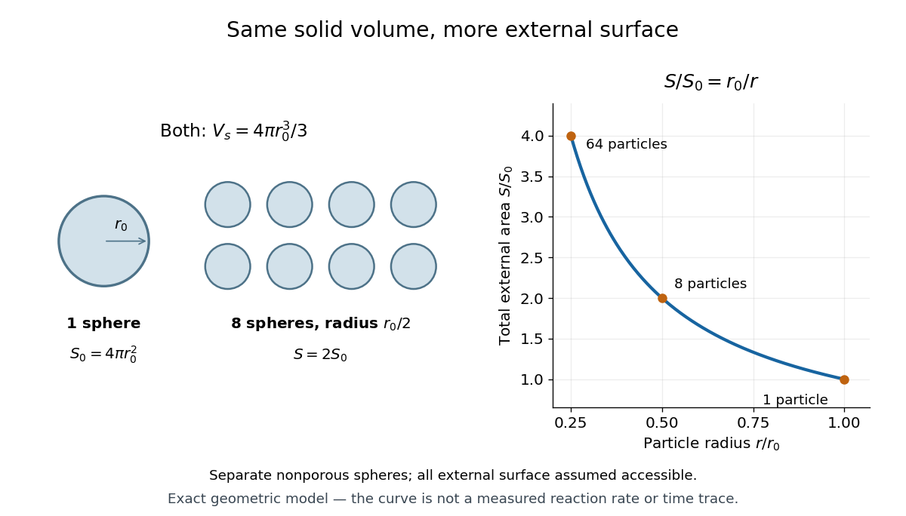

**[Figure 10](#image-catalyst-particle-size-and-area). Smaller separate catalyst particles expose more surface area at fixed total solid volume**. Original exact [sphere](euclidean-geometry.md#sphere) model. The circles are particle silhouettes: one of [radius](topology.md#radius) $r_0$ and eight of [radius](topology.md#radius) $r_0/2$ represent equal three-dimensional [solid](thermodynamics.md#solid) [volumes](geometry-and-topology.md#volume), with twice the external [surface area](differential-geometry.md#surface-area) in the second case. The right-hand curve is $S/S_0=r_0/r$, with the quarter-radius example marked too. It is a geometric prediction, not a measured [reaction rate](#reaction-rate), a peroxide experiment, or a time series.

To obtain a kinetic prediction, add assumptions explicitly. Let $f$ be the accessible fraction of external [surface area](differential-geometry.md#surface-area), $\sigma$ the [amount of substance](physics.md#amount-of-substance) of [catalytic surface sites](#catalytic-surface-site) per unit accessible area, and $\nu$ the mean number of completed conversions per site per unit time under the chosen conditions. Then the model's [reaction product](chemical-reaction.md#product-chemistry) formation rate is

$$
\frac{dn_{\mathrm B}}{dt}=\nu\sigma fS=\frac{3\nu\sigma fV_s}{r}.
$$

Here $\nu$ has units $\mathrm{s^{-1}}$ and $\sigma$ has units $\mathrm{mol\,m^{-2}}$, giving $\mathrm{mol\,s^{-1}}$ overall. Halving $r$ doubles this predicted rate only if $f$, $\sigma$ and $\nu$ remain unchanged. Particle contact can hide area; pores can add area; [diffusion](thermodynamics.md#diffusion), altered surface structure and [catalyst deactivation](#catalyst-deactivation) can change the other factors. Consequently, twice the calculated external area is not a universal promise of twice the measured [reaction rate](#reaction-rate). The geometric argument changes contact, not the net [Gibbs free energy](thermodynamic-potential.md#gibbs-free-energy) or the [equilibrium constant](chemical-potential.md#equilibrium-constant) of the same overall [chemical reaction](chemical-reaction.md).

#### Manganese dioxide peroxide contact demonstration

↑ **Parent:** [Heterogeneous catalysis](#heterogeneous-catalysis)

The University of Washington's [Decomposition of H₂O₂ with MnO₂](https://chem.washington.edu/lecture-demos/decomposition-h2o2-mno2) describes a supervised demonstration using [solid](thermodynamics.md#solid) [manganese dioxide](chemical-substance.md#manganese-dioxide) and [hydrogen peroxide](chemical-substance.md#hydrogen-peroxide) listed as 30%. Its cylinder version uses a spatula to introduce the [solid](thermodynamics.md#solid); the stated readout is immediate [molecular oxygen](chemical-substance.md#molecular-oxygen) bubbles and [heat](heat.md) production. An alternate bottle version replaces the contents of a tea bag with the [solid](thermodynamics.md#solid) and suspends it above the liquid. Releasing the bag brings it into contact with the liquid. The bag-above-liquid stage supplies a before-contact comparison; the page gives no timed gas collection, replicated blank trials or quantitative [reaction rates](#reaction-rate).[Chemicals and Solutions; Materials; Procedure; Alternate Procedure: Genie in a bottle, apparatus and steps 3–6](chemistry-bibliography.md#decomposition-of-h₂o₂-with-mno₂-by-university-of-washington-department-of-chemistry)

The balanced net [chemical equation](chemical-reaction.md#chemical-equation) is $2\mathrm{H_2O_2}\longrightarrow2\mathrm{H_2O}+\mathrm{O_2}$. Appearance of gas after contact supports a contact-dependent acceleration of decomposition under these conditions. It does not distinguish surface conversion from a contribution of dissolved material, establish regeneration, or measure an [activation energy](#activation-energy). The simultaneous [heat](heat.md) release also means that [temperature](temperature.md) can change after contact. A matched no-[solid](thermodynamics.md#solid) comparison and an empty-bag comparison would test background decomposition and the bag's contribution; these are proposed controls, not reported trials. The [catalysed peroxide comparison](#catalysed-peroxide-comparison) supplies a complementary inspected teaching experiment with separate single-addition and paired-addition comparisons.

#### Catalysed peroxide comparison

↑ **Parent:** [Heterogeneous catalysis](#heterogeneous-catalysis)

A simple motivating comparison is visible gas evolution from [hydrogen peroxide](chemical-substance.md#hydrogen-peroxide), whose net [chemical equation](chemical-reaction.md#chemical-equation) is

$$
2\mathrm{H_2O_2}\longrightarrow2\mathrm{H_2O}+\mathrm{O_2}.
$$

The products are [water](chemical-substance.md#water) and [oxygen](chemical-substance.md#oxygen). The Royal Society of Chemistry's teaching resource uses small test tubes and droppers, [hydrogen peroxide](chemical-substance.md#hydrogen-peroxide) labelled 5–10 volumes, solutions of metal salts including [copper(II) sulfate](chemical-substance.md#copper-ii-sulfate), and approximately $1\,\mathrm{mol\,L^{-1}}$ [sodium hydroxide](chemical-substance.md#sodium-hydroxide). Its qualitative procedure tests additions singly and in pairs to tubes containing about $1\,\mathrm{cm}$ depth of [hydrogen peroxide](chemical-substance.md#hydrogen-peroxide). It reports the expected classroom result that the additions individually are not effective under those conditions, whereas the solids produced by mixing metal-salt solution with [sodium hydroxide](chemical-substance.md#sodium-hydroxide) give effective [heterogeneous catalysis](#heterogeneous-catalysis). This is the resource's expected observation, not a newly measured ranking.[Resources and Results: small test tubes, droppers, peroxide strength, single versus paired additions, visual readout and expected precipitate effect](chemistry-bibliography.md#the-best-catalyst-to-decompose-hydrogen-peroxide-by-royal-society-of-chemistry)

A focused adaptation compares four matched tubes: no addition, [copper(II) sulfate](chemical-substance.md#copper-ii-sulfate) alone, [sodium hydroxide](chemical-substance.md#sodium-hydroxide) alone, and the pair. Use equal initial [hydrogen peroxide](chemical-substance.md#hydrogen-peroxide) amounts, identical tubes and the same starting [temperature](temperature.md). Record stock [concentrations](mathematical-physics.md#concentration) and added volumes; add [water](chemical-substance.md#water) to the other tubes to match the total added liquid. Additions can first be checked without [hydrogen peroxide](chemical-substance.md#hydrogen-peroxide) to distinguish [precipitation](chemical-reaction.md#precipitation-chemistry) from gas evolution. Start a timer at contact, mix consistently, and observe gas evolution over the same interval. These matching controls are proposed improvements to the qualitative resource, not claimed details of its original trials. Follow its supervised chemical-handling requirements; the stated strengths describe its teaching protocol rather than an unrestricted recipe.

The immediate readout is relative bubbling, together with whether a solid appears. More vigorous bubbling in the paired tube supports faster conversion under the comparison conditions; it does not identify the solid's exact composition or establish a unique [reaction mechanism](#reaction-mechanism). Bubble counts are not a calibrated [reaction rate](#reaction-rate): bubble sizes, gas retention and warming can differ. For a quantitative extension, use a freely moving [gas syringe](second-law-of-thermodynamics.md#gas-syringe) to record collected [volume](geometry-and-topology.md#volume) $V(t)$ and compare early slopes $dV/dt$ at matched [temperature](temperature.md) and [pressure](pressure.md); check for leaks and repeat runs. This extension is a measurement proposal, not source-reported gas traces.

The paired treatment also changes [pH](acid-base-chemistry.md#ph) and produces a surface, so the four tubes alone cannot assign the whole effect to one microscopic catalytic step. A filtered-liquid comparison and a separated, washed-solid comparison would help distinguish dissolved and solid contributions, although washing itself can change the active material. More gas at one time establishes neither a changed [equilibrium constant](chemical-potential.md#equilibrium-constant) nor indefinite [catalyst](#catalyst) reuse. The open gas-evolution experiment is especially unsuitable as a demonstration that two closed mixtures reach the same [chemical equilibrium](chemical-potential.md#chemical-equilibrium): the escaping [oxygen](chemical-substance.md#oxygen) changes the constraints. The reversible model above supplies that separate explanation. No numerical experimental [rate constants](#rate-constant), barrier heights or gas volumes are asserted here.

### Catalyst

↑ **Parent:** [Catalysis](#catalysis)

A [catalyst](#catalyst) makes a [chemical reaction](chemical-reaction.md) proceed faster by participating in an alternative [reaction mechanism](#reaction-mechanism) and being regenerated. This makes repeated conversion possible: the same [catalyst](#catalyst) can help many successive [reactants](chemical-reaction.md#reactant) become [reaction products](chemical-reaction.md#product-chemistry). An [enzyme](enzyme.md) is a biological [catalyst](#catalyst). The overall standard change in [Gibbs free energy](thermodynamic-potential.md#gibbs-free-energy) is unchanged; see the [IUPAC Gold Book: catalyst](https://goldbook.iupac.org/terms/view/C00876).

Regeneration does not mean that the [catalyst](#catalyst) sits unchanged throughout every step. For example, a schematic [reaction mechanism](#reaction-mechanism) can temporarily bind A to a [catalyst](#catalyst) C in a [reaction intermediate](#reaction-intermediate) AC:

$$
\begin{aligned}
\mathrm A+\mathrm C&\rightleftharpoons\mathrm{AC},\\
\mathrm{AC}&\rightleftharpoons\mathrm B+\mathrm C,\\
\text{net:}\qquad\mathrm A&\rightleftharpoons\mathrm B.
\end{aligned}
$$

Adding the steps cancels both the [reaction intermediate](#reaction-intermediate) AC and the [catalyst](#catalyst) C from the net [chemical equation](chemical-reaction.md#chemical-equation). AC is produced and later consumed; C is used and later recovered. These letters describe possible roles, not a measured [reaction mechanism](#reaction-mechanism). The alternative route is useful only if its [chemical kinetics](chemical-kinetics.md) permits faster conversion. See [Flowers et al., Chemistry 2e, §12.7: catalysts and alternative mechanisms](https://openstax.org/books/chemistry-2e/pages/12-7-catalysis).

For a worked barrier example, consider an idealized reversible A-to-B conversion at fixed [temperature](temperature.md) $T=300\,\mathrm K$. Stipulate standard molar [Gibbs free energy](thermodynamic-potential.md#gibbs-free-energy) levels $G_{\mathrm A}^\circ=0$ and $G_{\mathrm B}^\circ=-20\,\mathrm{kJ\,mol^{-1}}$, with effective [transition state](#transition-state) levels $80$ without a [catalyst](#catalyst) and $50\,\mathrm{kJ\,mol^{-1}}$ with a [catalyst](#catalyst). Use the same [standard states](chemical-potential.md#standard-state) and the same zero for both routes; the catalytic route includes the regenerated C at both endpoints. Unlike the separate [potential-energy profile](#potential-energy-profile) example, this illustration uses [Gibbs free energy](thermodynamic-potential.md#gibbs-free-energy) at one specified [temperature](temperature.md).

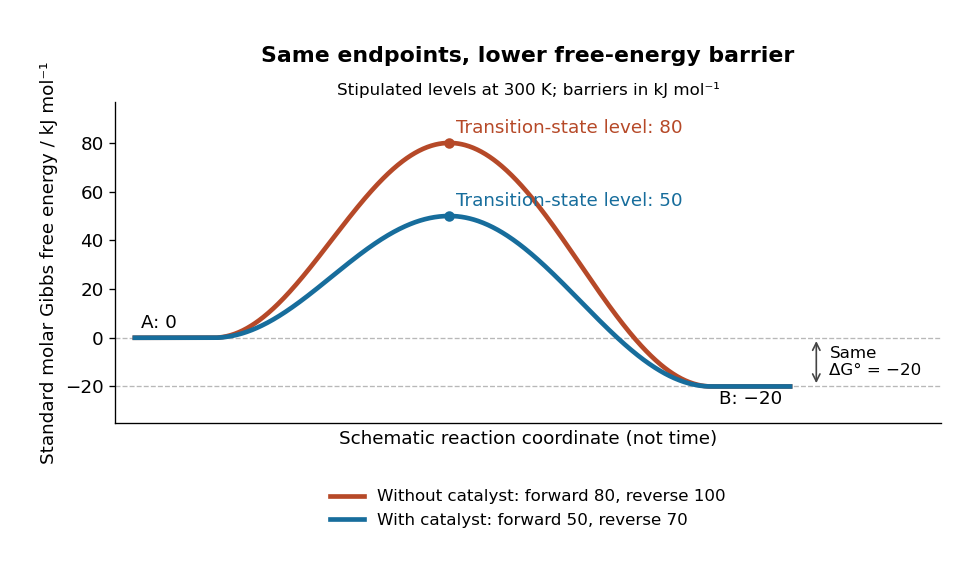

**[Figure 11](#image-a-catalyst-lowers-the-stipulated-gibbs-energy-of-activation-in-both-directions-while-retaining-the-same-endpoints). A catalyst lowers the stipulated Gibbs energy of activation in both directions while retaining the same endpoints**. Original smooth schematic [Gibbs free energy](thermodynamic-potential.md#gibbs-free-energy) profiles at $300\,\mathrm K$, with levels in $\mathrm{kJ\,mol^{-1}}$. The horizontal [reaction coordinate](#reaction-coordinate) describes progress along each schematic route, not time. These are chosen effective barriers, not measured [potential energy surfaces](#potential-energy-surface), actual molecular paths, or the two-step [reaction mechanism](#reaction-mechanism) above. A real catalytic route can have several [transition states](#transition-state) and [reaction intermediates](#reaction-intermediate).

The [Gibbs energy of activation](#gibbs-energy-of-activation) is measured from the starting endpoint in the chosen direction. Thus the four barriers are

$$
\begin{aligned}
\Delta G_{f,\mathrm{uncat}}^{\ddagger\circ}&=80-0=80,&
\Delta G_{f,\mathrm{cat}}^{\ddagger\circ}&=50-0=50,\\
\Delta G_{r,\mathrm{uncat}}^{\ddagger\circ}&=80-(-20)=100,&
\Delta G_{r,\mathrm{cat}}^{\ddagger\circ}&=50-(-20)=70,
\end{aligned}
\qquad\text{all in }\mathrm{kJ\,mol^{-1}}.
$$

Both directional barriers fall by $30\,\mathrm{kJ\,mol^{-1}}$. The endpoint difference stays $\Delta_rG^\circ=-20\,\mathrm{kJ\,mol^{-1}}$.

To turn those barriers into [rate constants](#rate-constant), use the Eyring form of [transition state theory](#transition-state-theory) for this effective [first-order reaction](#first-order-reaction) pair, with a common prefactor and unit probability of successful passage:

$$
k=\nu\exp\left(-\frac{\Delta G^{\ddagger\circ}}{RT}\right),
\qquad \nu=\frac{k_{\mathrm B}T}{h}.
$$

Here $k_{\mathrm B}$ is the [Boltzmann constant](thermodynamics.md#boltzmann-constant), $h$ is the [Planck constant](quantum-mechanics.md#planck-constant), and $R$ is the [molar gas constant](ideal-gas.md#molar-gas-constant). The common prefactor cancels from the comparisons. These [Gibbs energies of activation](#gibbs-energy-of-activation) are not the empirical [activation energy](#activation-energy) $E_a$ of the [Arrhenius equation](#arrhenius-equation). With the stipulated value $R=8.314462618\,\mathrm{J\,mol^{-1}\,K^{-1}}$, the speedup is

$$
\frac{k_{f,\mathrm{cat}}}{k_{f,\mathrm{uncat}}}
=\frac{k_{r,\mathrm{cat}}}{k_{r,\mathrm{uncat}}}
=\exp\left(\frac{30000}{8.314462618\times300}\right)
\approx1.67248\times10^5.
$$

The exponent is a [dimensionless quantity](physics.md#dimensionless-quantity): convert $30\,\mathrm{kJ\,mol^{-1}}$ to $30000\,\mathrm{J\,mol^{-1}}$ before dividing by $RT$. The [exponential function](calculus.md#exponential-function) explains why a modest barrier reduction can have a dramatic kinetic effect. This number follows from the chosen free-energy barriers and common prefactor; it is not a universal catalytic multiplier or a prediction across [temperatures](temperature.md).

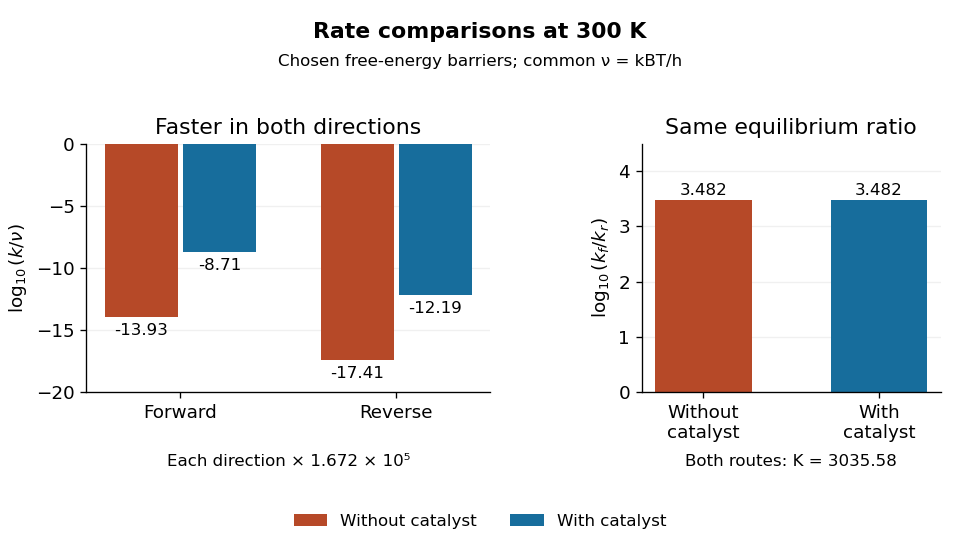

**[Figure 12](#image-both-directional-rate-constants-increase-by-about-1-67-times10-5-while-their-forward-to-reverse-ratio-stays-about-3036). Both directional rate constants increase by about $1.67\times10^5$, while their forward-to-reverse ratio stays about $3036$**. Original bar plots at $300\,\mathrm K$. Left: base-ten [logarithms](calculus.md#logarithm) of the [dimensionless](physics.md#dimensionless-quantity) normalized [rate constants](#rate-constant) $k/\nu$ for the four stipulated barriers. A less negative value means faster conversion. Right: the [logarithm](calculus.md#logarithm) of $k_f/k_r$ is identical for the two routes. Absolute units factor out through the common $\nu=k_{\mathrm B}T/h$; no temperature dependence outside this one model point is asserted.

Assume ideal [thermodynamic activities](chemical-potential.md#thermodynamic-activity) with a common concentration [standard state](chemical-potential.md#standard-state), and directional [rate laws](#rate-law) $J_f=k_f[\mathrm A]$ and $J_r=k_r[\mathrm B]$. At [chemical equilibrium](chemical-potential.md#chemical-equilibrium), equal [reaction rates](#reaction-rate) give $K=[\mathrm B]/[\mathrm A]=k_f/k_r$ for this model. The barriers give

$$
K_{\mathrm{uncat}}=\frac{e^{-80000/(RT)}}{e^{-100000/(RT)}}
=e^{20000/(RT)}
=\frac{e^{-50000/(RT)}}{e^{-70000/(RT)}}=K_{\mathrm{cat}}
\approx3035.58.
$$

The [catalyst](#catalyst) speeds up both directions, so it changes how quickly [chemical equilibrium](chemical-potential.md#chemical-equilibrium) is approached without changing this [equilibrium constant](chemical-potential.md#equilibrium-constant). For a general [chemical reaction](chemical-reaction.md), the thermodynamic relation is $K=\exp[-\Delta_rG^\circ/(RT)]$ with consistent [standard states](chemical-potential.md#standard-state); an arbitrary multistep [reaction mechanism](#reaction-mechanism) need not permit $K=k_f/k_r$ for two measured [rate constants](#rate-constant). At the same [temperature](temperature.md), [pressure](pressure.md), and [thermodynamic activities](chemical-potential.md#thermodynamic-activity), a [catalyst](#catalyst) also leaves the actual overall reaction change in [Gibbs free energy](thermodynamic-potential.md#gibbs-free-energy) unchanged. See [13.3 Shifting Equilibria: Le Châtelier’s Principle](chemistry-bibliography.md#chemistry-2e-by-paul-flowers-and-others/13-3-shifting-equilibria-le-chatelier’s-principle) (§13.3: a catalyst does not shift equilibrium). To drive an unfavourable overall conversion, a process such as [energy coupling](chemical-reaction.md#energy-coupling) must change the combined transformation.

#### Precatalyst

↑ **Parent:** [Catalyst](#catalyst)

A supplied precursor that must be chemically converted into the catalytically active form. Activation stoichiometry need not equal the reagent consumption of each subsequent catalytic turnover.

#### Transition state theory

↑ **Parent:** [Catalyst](#catalyst)  
ⓦ [Wiki](https://en.wikipedia.org/wiki/Transition_state_theory)

[Transition state theory](#transition-state-theory) relates an [elementary reaction](#elementary-reaction)'s [rate constant](#rate-constant) to a [Gibbs energy of activation](#gibbs-energy-of-activation). The Eyring expression used in the [catalyst](#catalyst) example assumes every passage counted at the [transition state](#transition-state) succeeds. More generally, a factor accounting for unsuccessful passage multiplies it. Comparing barriers alone gives the quoted speedup only when the remaining prefactors agree. Free-energy profiles can depend on [temperature](temperature.md), so the example's values at $300\,\mathrm K$ do not determine a temperature curve. See the [IUPAC Gold Book: transition state theory](https://goldbook.iupac.org/terms/view/T06470).

##### Force-tilted activation barrier

↑ **Parent:** [Transition state theory](#transition-state-theory)

A constant tensile [force](force.md) changes a one-coordinate [free-energy landscape](statistical-physics.md#free-energy-landscape) from $G_0(x)$ to $G_0(x)-Fx$. To first order, an escape barrier decreases by $F\Delta x$, where $\Delta x$ is the saddle-to-initial-minimum displacement at zero [force](force.md). An approximately fixed attempt prefactor gives the displayed rate law. Its characteristic [force](force.md) is $F_0=k_BT/\Delta x$. Large changes in saddle location or competing pathways invalidate a constant activation distance. The barrier is measured relative to the initial state; an absolute saddle [energy](energy.md) is not enough to determine an escape rate.

##### Activation volume

↑ **Parent:** [Transition state theory](#transition-state-theory)

The pressure derivative of the standard Gibbs energy of activation: $\Delta V^{\ddagger\circ}=(\partial\Delta G^{\ddagger\circ}/\partial p)_T$. In the corresponding rate convention, $\Delta V^{\ddagger\circ}=-RT(\partial\ln k/\partial p)_T$. A negative value makes increasing pressure accelerate the reaction. Solvent reorganization can contribute as well as the intrinsic reacting geometry.

##### Activation entropy

↑ **Parent:** [Transition state theory](#transition-state-theory)

The standard entropy difference between the activated-complex reference state and the reactants. Its numerical value depends on standard-state conventions; association, molecular reorientation, internal motions and solvent reorganization can all contribute.

##### Activation enthalpy

↑ **Parent:** [Transition state theory](#transition-state-theory)

The standard enthalpy difference between the activated-complex reference state and the reactants at the same temperature and pressure. Under the usual Eyring assumptions it controls the slope of $\ln(k/T)$ against $1/T$.

##### Eyring equation

↑ **Parent:** [Transition state theory](#transition-state-theory)

A [transition state theory](#transition-state-theory) expression relating a [rate constant](#rate-constant) to the standard free energy of activation. For a bimolecular reaction expressed in concentration units, $k_2=(k_{\mathrm B}T/h)(c^\circ)^{-1}\exp[-\Delta G^{\ddagger\circ}/(RT)]$ in the unit-transmission approximation.

##### Gibbs energy of activation

↑ **Parent:** [Transition state theory](#transition-state-theory)

The [Gibbs energy of activation](#gibbs-energy-of-activation) is the standard molar [Gibbs free energy](thermodynamic-potential.md#gibbs-free-energy) change associated with going from the starting [reactants](chemical-reaction.md#reactant) to the [transition state](#transition-state) in [transition state theory](#transition-state-theory). It specifies the directional barrier, rather than the overall endpoint change in [Gibbs free energy](thermodynamic-potential.md#gibbs-free-energy). Use consistent [standard states](chemical-potential.md#standard-state) when comparing [Gibbs energies of activation](#gibbs-energy-of-activation) and [rate constants](#rate-constant). See the [IUPAC Gold Book: Gibbs energy of activation](https://goldbook.iupac.org/terms/view/G02631).

###### Enthalpy of activation

↑ **Parent:** [Gibbs energy of activation](#gibbs-energy-of-activation)

The standard molar [enthalpy](enthalpy.md) difference between the [transition state](#transition-state) and the starting [reactants](chemical-reaction.md#reactant), at the same [temperature](temperature.md) and [pressure](pressure.md), in [transition state theory](#transition-state-theory).[Glossary of Terms Used in Physical Organic Chemistry (IUPAC Recommendations 1994): E entries](chemistry-bibliography.md#glossary-of-terms-used-in-physical-organic-chemistry-iupac-recommendations-1994-e-entries)

###### Entropy of activation

↑ **Parent:** [Gibbs energy of activation](#gibbs-energy-of-activation)

The standard molar [entropy](entropy.md) difference between the [transition state](#transition-state) and the starting [reactants](chemical-reaction.md#reactant), at the same [temperature](temperature.md) and [pressure](pressure.md), with specified [standard states](chemical-potential.md#standard-state), in [transition state theory](#transition-state-theory).[Glossary of Terms Used in Physical Organic Chemistry (IUPAC Recommendations 1994): E entries](chemistry-bibliography.md#glossary-of-terms-used-in-physical-organic-chemistry-iupac-recommendations-1994-e-entries)

## Transition state

↑ **Parent:** [Chemical kinetics](chemical-kinetics.md)  
ⓦ [Wiki](https://en.wikipedia.org/wiki/Transition_state)

A [transition state](#transition-state) describes configurations at the barrier between [reactants](chemical-reaction.md#reactant) and [reaction products](chemical-reaction.md#product-chemistry) in an [elementary reaction](#elementary-reaction). It is a crossing region, rather than a stable substance that accumulates in a bottle. The IUPAC definition characterizes these configurations by equal probabilities of proceeding toward [reactants](chemical-reaction.md#reactant) or [reaction products](chemical-reaction.md#product-chemistry): [IUPAC Gold Book: transition state](https://goldbook.iupac.org/terms/view/T06468). Lowering the barrier relative to the starting configuration can increase a [reaction rate](#reaction-rate), even when the overall change in [Gibbs free energy](thermodynamic-potential.md#gibbs-free-energy) is unchanged.

## Reaction rate

↑ **Parent:** [Chemical kinetics](chemical-kinetics.md)  
ⓦ [Wiki](https://en.wikipedia.org/wiki/Reaction_rate)

For one [chemical reaction](chemical-reaction.md) in a [closed system](thermodynamics.md#closed-system) of fixed [volume](geometry-and-topology.md#volume) $V$, with uniform [concentrations](mathematical-physics.md#concentration) and no competing reactions or appreciable accumulation of unlisted species, choose the [chemical equation](chemical-reaction.md#chemical-equation)

$$
a\mathrm A+b\mathrm B\longrightarrow c\mathrm C,\qquad a,b,c>0.
$$

Brackets denote [amount of substance](physics.md#amount-of-substance) per [volume](geometry-and-topology.md#volume), for example $[\mathrm A]=n_{\mathrm A}/V$. The [stoichiometry](chemical-reaction.md#stoichiometry) gives one instantaneous [reaction rate](#reaction-rate)

$$
v=-\frac1a\frac{d[\mathrm A]}{dt}
=-\frac1b\frac{d[\mathrm B]}{dt}
=\frac1c\frac{d[\mathrm C]}{dt}
=\frac1V\frac{d\xi}{dt},
$$

where $\xi$ is the existing [extent of reaction](chemical-reaction.md#extent-of-reaction). The minus signs make forward consumption positive; dividing by the coefficients makes measurements of different [chemical species](mathematical-biology.md#chemical-species) agree. Units can be $\mathrm{mol\,L^{-1}\,s^{-1}}$. See [IUPAC Gold Book: rate of reaction](https://goldbook.iupac.org/terms/view/R05156) and [Flowers et al., Chemistry 2e, §12.1: chemical reaction rates](https://openstax.org/books/chemistry-2e/pages/12-1-chemical-reaction-rates).

For the illustrative [chemical equation](chemical-reaction.md#chemical-equation) $2\mathrm A+\mathrm B\longrightarrow3\mathrm C$, a measured $d[\mathrm C]/dt=0.060\,\mathrm{mol\,L^{-1}\,s^{-1}}$ implies $v=0.020\,\mathrm{mol\,L^{-1}\,s^{-1}}$, $d[\mathrm A]/dt=-0.040\,\mathrm{mol\,L^{-1}\,s^{-1}}$, and $d[\mathrm B]/dt=-0.020\,\mathrm{mol\,L^{-1}\,s^{-1}}$. These numbers express [stoichiometry](chemical-reaction.md#stoichiometry), without supplying a [rate law](#rate-law).

Each [derivative](calculus.md#derivative) is the slope of a [concentration](mathematical-physics.md#concentration) curve at one instant. Over a finite interval, $-\Delta[\mathrm A]/(a\Delta t)$ instead gives an average [reaction rate](#reaction-rate). For A converting reversibly to B, the net [reaction rate](#reaction-rate) is $v=d[\mathrm B]/dt=J_f-J_r$; both directional [reaction rates](#reaction-rate) can remain positive when $v=0$ at [chemical equilibrium](chemical-potential.md#chemical-equilibrium).

### Disappearance rate

↑ **Parent:** [Reaction rate](#reaction-rate)

The [disappearance rate](#disappearance-rate) of a [reactant](chemical-reaction.md#reactant) A is its positive net loss of [concentration](mathematical-physics.md#concentration) per unit time, $v_{\mathrm A}=-d[\mathrm A]/dt$. For the fixed-[volume](geometry-and-topology.md#volume), single-[chemical reaction](chemical-reaction.md) setting of [reaction rate](#reaction-rate), consuming $a$ units of A per conversion gives $v_{\mathrm A}=av$. The factor belongs to the [stoichiometry](chemical-reaction.md#stoichiometry); stating it is essential when quoting a [rate constant](#rate-constant). A negative net [disappearance rate](#disappearance-rate) means that A is accumulating.

### Rate law

↑ **Parent:** [Reaction rate](#reaction-rate)

A [rate law](#rate-law) specifies how a [reaction rate](#reaction-rate) depends on [concentrations](mathematical-physics.md#concentration) under stated conditions. A common form is

$$
v=k[\mathrm A]^\alpha[\mathrm B]^\beta,
$$

where $k$ is a [rate constant](#rate-constant) and the exponents are partial [orders of reaction](#order-of-reaction). Determine them experimentally, or derive them from a justified [reaction mechanism](#reaction-mechanism). Do not infer $\alpha=a$ and $\beta=b$ from the net [chemical equation](chemical-reaction.md#chemical-equation): its coefficients describe consumption ratios, whereas the exponents describe sensitivity to [concentration](mathematical-physics.md#concentration). See [IUPAC Gold Book: rate law](https://goldbook.iupac.org/terms/view/R05141) and [Flowers et al., Chemistry 2e, §12.3: rate laws](https://openstax.org/books/chemistry-2e/pages/12-3-rate-laws).

A [rate law](#rate-law) becomes a prediction of time evolution when combined with [stoichiometry](chemical-reaction.md#stoichiometry) in a [rate equation](mathematical-biology.md#rate-equation), for example $d[\mathrm A]/dt=-av$. Agreement with a measured [rate law](#rate-law) is useful evidence for a [reaction mechanism](#reaction-mechanism), but several routes can give the same dependence.

#### Integrated rate law

↑ **Parent:** [Rate law](#rate-law)

An [integrated rate law](#integrated-rate-law) relates [concentration](mathematical-physics.md#concentration) to elapsed time after solving a [rate equation](mathematical-biology.md#rate-equation) with an [initial condition](differential-equation.md#initial-condition). Its validity retains the assumptions of the underlying [rate law](#rate-law), including fixed [rate constants](#rate-constant) and appropriate [stoichiometry](chemical-reaction.md#stoichiometry). The [second-order reaction](#second-order-reaction) reciprocal-[concentration](mathematical-physics.md#concentration) relation is one example; a different [rate equation](mathematical-biology.md#rate-equation) generally requires a different [integrated rate law](#integrated-rate-law).[§12.4, opening paragraph and “Second-Order Reactions”: concentration as a function of elapsed time](chemistry-bibliography.md#chemistry-2e-by-paul-flowers-and-others)

#### Order of reaction

↑ **Parent:** [Rate law](#rate-law)

In a power-form [rate law](#rate-law) $v=k[\mathrm A]^\alpha[\mathrm B]^\beta$, the partial [orders of reaction](#order-of-reaction) are $\alpha$ and $\beta$, and the overall [order of reaction](#order-of-reaction) is $n=\alpha+\beta$. For example, doubling $[\mathrm A]$ at fixed $[\mathrm B]$ multiplies $v$ by $2^\alpha$: factors of one, two, and four correspond to partial [orders of reaction](#order-of-reaction) zero, one, and two. These exponents can also be fractional or negative. A single constant [order of reaction](#order-of-reaction) need not describe a [rate law](#rate-law) that is not a power form. See [IUPAC Gold Book: order of reaction](https://goldbook.iupac.org/terms/view/O04322).

For a simple irreversible conversion $\mathrm A\longrightarrow\mathrm B$ with [rate equation](mathematical-biology.md#rate-equation) $-d[\mathrm A]/dt=k[\mathrm A]^n$, initial [concentration](mathematical-physics.md#concentration) $A_0>0$, and fixed $k>0$, compare [zero-order reactions](#zero-order-reaction), [first-order reactions](#first-order-reaction), and [second-order reactions](#second-order-reaction) using the [dimensionless quantities](physics.md#dimensionless-quantity)

$$
X=\frac{[\mathrm A]}{A_0},\qquad \tau=kA_0^{n-1}t,\qquad \frac{dX}{d\tau}=-X^n.
$$

Their integrated curves, starting at $X(0)=1$, are

$$
\begin{aligned}
n=0:&\quad X=1-\tau\quad(0\leq\tau<1),\\
n=1:&\quad X=e^{-\tau},\\
n=2:&\quad X=\frac1{1+\tau}.
\end{aligned}
$$

For the [zero-order reaction](#zero-order-reaction), the plotted extension $X=\max(1-\tau,0)$ stops conversion at depletion. It does not continue to obey $dX/d\tau=-1$ once $X=0$. A negative [concentration](mathematical-physics.md#concentration) would be unphysical. The [first-order reaction](#first-order-reaction) and [second-order reaction](#second-order-reaction) approach zero without reaching it at finite time in these models.

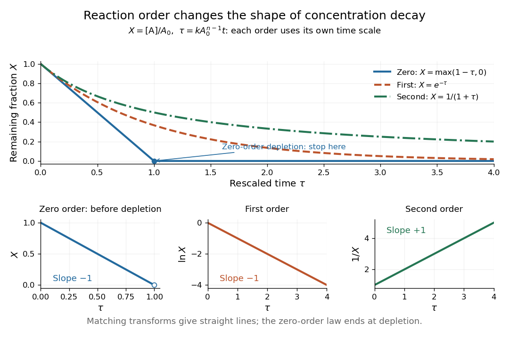

**[Figure 13](#image-dimensionless-concentration-decays-for-three-orders-of-reaction-with-zero-order-reaction-depletion-and-the-corresponding-linearizing-plots). Dimensionless concentration decays for three orders of reaction, with zero-order reaction depletion and the corresponding linearizing plots**.

The common $\tau$ axis compares curve shapes after each model's own time rescaling, rather than equal laboratory times for an identical numerical $k$. In the lower panels, $X$, $\ln X$, and $1/X$ respectively give straight lines with slopes $-1$, $-1$, and $+1$ for the matching [order of reaction](#order-of-reaction). The [natural logarithm](calculus.md#natural-logarithm) uses a [dimensionless quantity](physics.md#dimensionless-quantity). These transformed plots help test a proposed [rate law](#rate-law); the [zero-order reaction](#zero-order-reaction) line applies only before depletion. See [Flowers et al., Chemistry 2e, §12.4: integrated rate laws](https://openstax.org/books/chemistry-2e/pages/12-4-integrated-rate-laws).

##### First-order reaction

↑ **Parent:** [Order of reaction](#order-of-reaction)

A [first-order reaction](#first-order-reaction) has a [reaction rate](#reaction-rate) proportional to one [reactant](chemical-reaction.md#reactant) [concentration](mathematical-physics.md#concentration) in the simple single-species case. For an irreversible $\mathrm A\longrightarrow\mathrm B$ in a [closed system](thermodynamics.md#closed-system) at fixed [volume](geometry-and-topology.md#volume), take $[\mathrm A](0)=A_0$, $[\mathrm B](0)=0$, and constant [rate constant](#rate-constant) $k>0$. Its [rate equation](mathematical-biology.md#rate-equation) and solution are

$$
\frac{d[\mathrm A]}{dt}=-k[\mathrm A],\qquad
[\mathrm A](t)=A_0e^{-kt},\qquad
[\mathrm B](t)=A_0(1-e^{-kt}),\qquad
v(t)=kA_0e^{-kt}.
$$

A short check is enough: differentiating $A_0e^{-kt}$ gives $-kA_0e^{-kt}$, and the two [concentrations](mathematical-physics.md#concentration) sum to $A_0$, as required by the one-to-one [stoichiometry](chemical-reaction.md#stoichiometry). Thus the same [exponential decay](analysis.md#exponential-decay) describes both remaining [reactant](chemical-reaction.md#reactant) and decreasing [reaction rate](#reaction-rate). Fixed $k$ means a fixed fractional loss per unit time, not a fixed absolute consumption rate.

Choose illustrative values $A_0=1\,\mathrm{mol\,L^{-1}}$ and $k=0.2\,\mathrm{s^{-1}}$, with $t$ measured in seconds. Then $[\mathrm A]=e^{-0.2t}\,\mathrm{mol\,L^{-1}}$, $[\mathrm B]=(1-e^{-0.2t})\,\mathrm{mol\,L^{-1}}$, and $v=0.2e^{-0.2t}\,\mathrm{mol\,L^{-1}\,s^{-1}}$. The [half-life](analysis.md#half-life) is

$$
t_{1/2}=\frac{\ln2}{k}=\frac{\ln2}{0.2}\,\mathrm s\approx3.4657\,\mathrm s.
$$

At each successive [half-life](analysis.md#half-life), half the remaining [reactant](chemical-reaction.md#reactant) is consumed; $t_{1/2}$ is independent of $A_0$ for this [first-order reaction](#first-order-reaction). At $t=10\,\mathrm s$, the calculated values are $[\mathrm A]\approx0.135335\,\mathrm{mol\,L^{-1}}$, $[\mathrm B]\approx0.864665\,\mathrm{mol\,L^{-1}}$, and $v\approx0.027067\,\mathrm{mol\,L^{-1}\,s^{-1}}$. These are model predictions for chosen parameters, rather than experimental measurements.

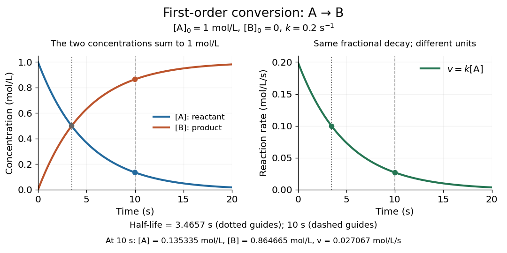

**[Figure 14](#image-illustrative-first-order-reaction-reactant-loss-reaction-product-formation-and-declining-reaction-rate-for-k-0-2-mathrm-s-1). Illustrative first-order reaction: reactant loss, reaction product formation, and declining reaction rate for $k=0.2\,\mathrm{s^{-1}}$**.

The left panel tracks the two [concentrations](mathematical-physics.md#concentration); the right tracks their instantaneous conversion [reaction rate](#reaction-rate). Their different vertical units matter: $v=k[\mathrm A]$, so the numerical curves need not have the same height. This gives a practical way to translate a measured [concentration](mathematical-physics.md#concentration) into a forecast of both conversion and waiting time.

###### First-order rate constant

↑ **Parent:** [First-order reaction](#first-order-reaction)

The coefficient $k$ of a first-order [concentration](mathematical-physics.md#concentration) term in a [rate law](#rate-law). Its units are inverse [time](classical-mechanics.md#time-in-physics); two reversible first-order directions contribute additively to the relaxation rate.

##### Zero-order reaction

↑ **Parent:** [Order of reaction](#order-of-reaction)

A [zero-order reaction](#zero-order-reaction) has a [reaction rate](#reaction-rate) independent of the relevant [reactant](chemical-reaction.md#reactant) [concentration](mathematical-physics.md#concentration) over the range where its [rate law](#rate-law) applies. For $\mathrm A\longrightarrow\mathrm B$, $[\mathrm A]=A_0-kt$ is valid only before depletion at $t=A_0/k$. The constant-consumption model must stop or change there.

##### Second-order reaction

↑ **Parent:** [Order of reaction](#order-of-reaction)

A [second-order reaction](#second-order-reaction) has overall [order of reaction](#order-of-reaction) two: a [rate law](#rate-law) may depend on $[\mathrm A]^2$, or on $[\mathrm A][\mathrm B]$ with partial [orders of reaction](#order-of-reaction) one and one. Doubling all relevant [reactant](chemical-reaction.md#reactant) [concentrations](mathematical-physics.md#concentration) multiplies the [reaction rate](#reaction-rate) by four at fixed conditions. This experimentally determined dependence does not establish [molecularity](#molecularity) or a unique [reaction mechanism](#reaction-mechanism). For an [elementary reaction](#elementary-reaction) obeying the [law of mass action](mathematical-biology.md#law-of-mass-action), [molecularity](#molecularity) and overall [order of reaction](#order-of-reaction) agree; a net [chemical equation](chemical-reaction.md#chemical-equation) alone cannot establish that the conversion is elementary.[Glossary of Terms Used in Physical Organic Chemistry, IUPAC Recommendations 1994, entry “order of reaction”, final paragraphs: elementary versus stepwise reactions](chemistry-bibliography.md#glossary-of-terms-used-in-physical-organic-chemistry-iupac-recommendations-1994-n-and-o-entries-by-international-union-of-pure-and-applied-chemistry)

For the single-[concentration](mathematical-physics.md#concentration) model, explicitly choose the [disappearance rate](#disappearance-rate) convention

$$
-\frac{d[\mathrm A]}{dt}=k_{\mathrm{obs}}[\mathrm A]^2,\qquad [\mathrm A](0)=[\mathrm A]_0>0,\qquad k_{\mathrm{obs}}>0.
$$

Here $k_{\mathrm{obs}}$ is the coefficient for loss of A, held fixed at the specified [temperature](temperature.md) and other conditions. Its subscript labels the chosen observed [disappearance rate](#disappearance-rate); it does not imply a [pseudo-first-order reaction](#pseudo-first-order-reaction). Assume a uniformly mixed [closed system](thermodynamics.md#closed-system), fixed [volume](geometry-and-topology.md#volume), and no appreciable reverse or competing [chemical reactions](chemical-reaction.md). The [integrated rate law](#integrated-rate-law) is

$$
\boxed{\frac1{[\mathrm A](t)}=\frac1{[\mathrm A]_0}+k_{\mathrm{obs}}t},\qquad
[\mathrm A](t)=\frac{[\mathrm A]_0}{1+k_{\mathrm{obs}}[\mathrm A]_0t}.
$$

The reciprocal-[concentration](mathematical-physics.md#concentration) plot is a straight line with slope $k_{\mathrm{obs}}$ and intercept $1/[\mathrm A]_0$. A brief derivation uses the [chain rule](calculus.md#chain-rule): $d(1/[\mathrm A])/dt=-[\mathrm A]^{-2}d[\mathrm A]/dt=k_{\mathrm{obs}}$, then applies the [initial condition](differential-equation.md#initial-condition). This is a hyperbolic decay, rather than the [exponential decay](analysis.md#exponential-decay) of a [first-order reaction](#first-order-reaction).[§12.4, “Second-Order Reactions”, integrated equation and straight-line form; Table 12.2](chemistry-bibliography.md#chemistry-2e-by-paul-flowers-and-others)

As an original prescribed example, choose $[\mathrm A]_0=0.020\,\mathrm{mol\,L^{-1}}$ and $k_{\mathrm{obs}}=0.50\,\mathrm{L\,mol^{-1}\,s^{-1}}$. At $t=100\,\mathrm s$, the reciprocal-[concentration](mathematical-physics.md#concentration) calculation is $50+50=100\,\mathrm{L\,mol^{-1}}$, giving $[\mathrm A]=0.010\,\mathrm{mol\,L^{-1}}$. The initial [disappearance rate](#disappearance-rate) is $0.50(0.020)^2=2.0\times10^{-4}\,\mathrm{mol\,L^{-1}\,s^{-1}}$; after $100\,\mathrm s$ it is $5.0\times10^{-5}\,\mathrm{mol\,L^{-1}\,s^{-1}}$. Halving the [concentration](mathematical-physics.md#concentration) quarters the [disappearance rate](#disappearance-rate).

[Dimensional analysis](mathematical-physics.md#dimensional-analysis) checks every formula: $k_{\mathrm{obs}}[\mathrm A]^2$ has units $\mathrm{mol\,L^{-1}\,s^{-1}}$, $k_{\mathrm{obs}}t$ has units $\mathrm{L\,mol^{-1}}$, and $k_{\mathrm{obs}}[\mathrm A]_0t$ is a [dimensionless quantity](physics.md#dimensionless-quantity). Changing [concentration](mathematical-physics.md#concentration) units changes the numerical [rate constant](#rate-constant): the same example is $[\mathrm A]_0=20\,\mathrm{mol\,m^{-3}}$, $k_{\mathrm{obs}}=5.0\times10^{-4}\,\mathrm{m^3\,mol^{-1}\,s^{-1}}$, giving $[\mathrm A](100\,\mathrm s)=10\,\mathrm{mol\,m^{-3}}$.

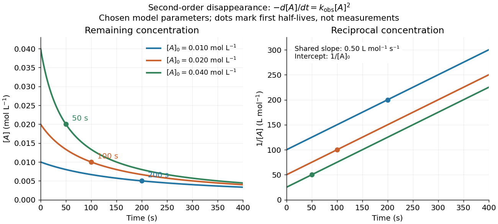

**[Figure 15](#image-second-order-concentration-and-reciprocal-time). Second-order reaction concentration decay and reciprocal-concentration lines for three prescribed starting concentrations**. Original model curves, not measured data. All use the [disappearance rate](#disappearance-rate) coefficient $k_{\mathrm{obs}}=0.50\,\mathrm{L\,mol^{-1}\,s^{-1}}$. The reciprocal lines share a slope while their intercepts differ; marked points give each run's first [half-life](analysis.md#half-life).

For an [elementary reaction](#elementary-reaction) $2\mathrm A\longrightarrow\mathrm P$, instead define the stoichiometrically normalized [reaction rate](#reaction-rate) $r=k[\mathrm A]^2$. Two A entities disappear per P formed, so

$$
r=-\frac12\frac{d[\mathrm A]}{dt}=\frac{d[\mathrm P]}{dt}=k[\mathrm A]^2,\qquad
-\frac{d[\mathrm A]}{dt}=2k[\mathrm A]^2,\qquad k_{\mathrm{obs}}=2k.
$$

Consequently the reciprocal-[concentration](mathematical-physics.md#concentration) slope is $2k$, not $k$. In the prescribed example, the normalized [rate constant](#rate-constant) would be $k=0.25\,\mathrm{L\,mol^{-1}\,s^{-1}}$; initially $r=1.0\times10^{-4}\,\mathrm{mol\,L^{-1}\,s^{-1}}$ while the [disappearance rate](#disappearance-rate) is twice that. With $[\mathrm P](0)=0$, [stoichiometry](chemical-reaction.md#stoichiometry) gives $[\mathrm P](100\,\mathrm s)=([\mathrm A]_0-[\mathrm A])/2=0.0050\,\mathrm{mol\,L^{-1}}$. Both [rate constants](#rate-constant) have the same dimensions, so a units check alone cannot catch their factor-of-two difference. The symbol $r$ denotes the same normalization as $v$ in [reaction rate](#reaction-rate).

The [half-life](analysis.md#half-life), meaning the time to reach half a specified starting [concentration](mathematical-physics.md#concentration), follows by setting $[\mathrm A]=[\mathrm A]_0/2$:

$$
\boxed{t_{1/2}=\frac1{k_{\mathrm{obs}}[\mathrm A]_0}}.
$$

For $r=k[\mathrm A]^2$ in $2\mathrm A\longrightarrow\mathrm P$, this becomes $t_{1/2}=1/(2k[\mathrm A]_0)$. Its units are seconds because $k_{\mathrm{obs}}[\mathrm A]_0$ has units $\mathrm{s^{-1}}$. Doubling the starting [concentration](mathematical-physics.md#concentration) halves the first [half-life](analysis.md#half-life); a quoted [half-life](analysis.md#half-life) needs its starting [concentration](mathematical-physics.md#concentration). This differs from a [first-order reaction](#first-order-reaction), whose [half-life](analysis.md#half-life) is independent of starting [concentration](mathematical-physics.md#concentration).[§12.4, “Half-Life of a Reaction”, second-order derivation and Table 12.2](chemistry-bibliography.md#chemistry-2e-by-paul-flowers-and-others)

Within the prescribed run, $[\mathrm A]$ reaches $0.010$, $0.0050$, and $0.0025\,\mathrm{mol\,L^{-1}}$ at $100$, $300$, and $700\,\mathrm s$. The successive halving intervals are $100$, $200$, and $400\,\mathrm s$: each begins at a smaller [concentration](mathematical-physics.md#concentration). More generally, reaching fraction $f$ of the initial [concentration](mathematical-physics.md#concentration), with $0<f<1$, requires $t=(f^{-1}-1)/(k_{\mathrm{obs}}[\mathrm A]_0)$, so $90\%$ consumption takes nine initial [half-lives](analysis.md#half-life), rather than a fixed sequence of equal waiting times.

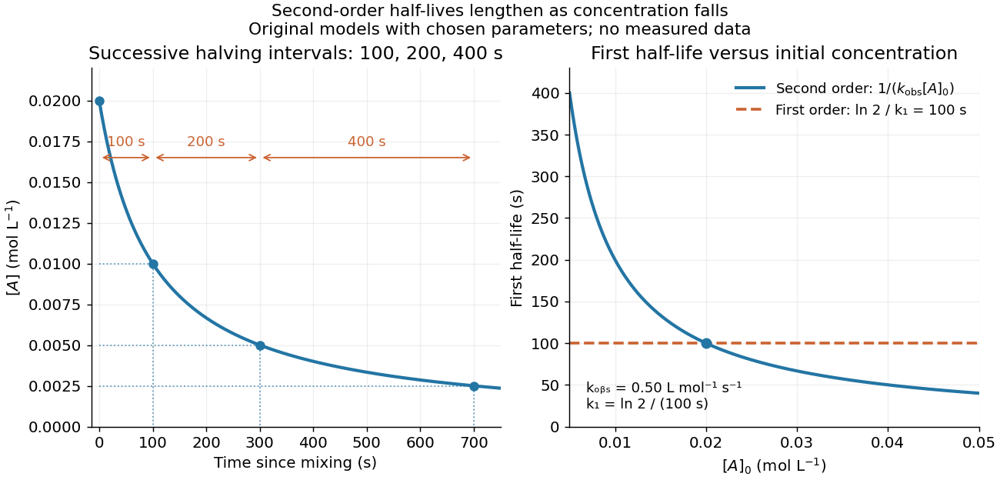

**[Figure 16](#image-second-order-halving-intervals-and-initial-concentration). Lengthening second-order reaction halving intervals and the dependence of the first half-life on initial concentration**. Original model predictions, not measurements. Left: the prescribed $0.020\,\mathrm{mol\,L^{-1}}$ run. Right: $t_{1/2}=1/(k_{\mathrm{obs}}[\mathrm A]_0)$ at fixed $k_{\mathrm{obs}}=0.50\,\mathrm{L\,mol^{-1}\,s^{-1}}$, compared with a [first-order reaction](#first-order-reaction) chosen to have $t_{1/2}=100\,\mathrm s$. That comparison uses $k_1=\ln2/(100\,\mathrm s)$, with different units from $k_{\mathrm{obs}}$.

A straight reciprocal-[concentration](mathematical-physics.md#concentration) plot tests this particular single-[concentration](mathematical-physics.md#concentration) [rate equation](mathematical-biology.md#rate-equation). It does not uniquely identify a [reaction mechanism](#reaction-mechanism), nor does curvature rule out every [second-order reaction](#second-order-reaction): two independently changing [reactant](chemical-reaction.md#reactant) [concentrations](mathematical-physics.md#concentration) require their own [integrated rate law](#integrated-rate-law). At low [concentration](mathematical-physics.md#concentration), a small [measurement error](probability-and-statistics.md#measurement-error) $\delta[\mathrm A]$ becomes approximately $-\delta[\mathrm A]/[\mathrm A]^2$ in the reciprocal, magnifying late-time errors. Use the line as a diagnostic; a [nonlinear regression](statistical-modelling.md#nonlinear-regression) of the original [concentrations](mathematical-physics.md#concentration) can retain their measurement scale and explicit error model.

###### Unequal-concentration second-order integration

↑ **Parent:** [Second-order reaction](#second-order-reaction)

For a one-to-one [elementary reaction](#elementary-reaction) with [concentrations](mathematical-physics.md#concentration) x and h, the difference $\Delta=h_0-x_0$ remains constant. Integration gives $\ln(hx_0/(xh_0))=k\Delta t$ when $\Delta\ne0$; the equal-initial-concentration limit is $1/x-1/x_0=kt$.

###### Conductometric saponification assay

↑ **Parent:** [Second-order reaction](#second-order-reaction)

How can an invisible change in [concentration](mathematical-physics.md#concentration) produce a readable signal? The [saponification](chemical-reaction.md#saponification) of [ethyl acetate](chemical-substance.md#ethyl-acetate) by [hydroxide](chemistry.md#hydroxide) in [water](chemical-substance.md#water) gives [ethanol](biology.md#ethanol) and an [acetate ion](chemical-substance.md#acetate-ion):

$$
\mathrm{CH_3COOC_2H_5}+\mathrm{OH^-}\longrightarrow\mathrm{CH_3COO^-}+\mathrm{C_2H_5OH}.
$$

The [rate law](#rate-law) used for this assay is $r=k_2[\mathrm{ethyl\ acetate}][\mathrm{OH^-}]$. Each [reactant](chemical-reaction.md#reactant) has coefficient one, so $r$ equals either [disappearance rate](#disappearance-rate). If the two initial [concentrations](mathematical-physics.md#concentration) are equal, they remain equal under this [stoichiometry](chemical-reaction.md#stoichiometry), giving $-dc/dt=k_2c^2$ and $k_{\mathrm{obs}}=k_2$, without a factor of two.

[Manual for Advanced Physical Chemistry Laboratory-II by Nasima Arshad](chemistry-bibliography.md#manual-for-advanced-physical-chemistry-laboratory-ii-by-nasima-arshad) (Unit 7, Experiment 2, printed pp. 66–67) specifies a conductivity cell holding about $60\,\mathrm{mL}$ in constant-[temperature](temperature.md) baths, with $0.040\,\mathrm{mol\,L^{-1}}$ [ethyl acetate](chemical-substance.md#ethyl-acetate) and [sodium hydroxide](chemical-substance.md#sodium-hydroxide) stocks equilibrated separately. Mixing $30\,\mathrm{mL}$ of each initiates the run. The readout is [electrical resistance](electric-charge.md#electrical-resistance): every minute for ten minutes, every two minutes for ten more, then every five minutes for twenty-five. The cell is rinsed with distilled [water](chemical-substance.md#water). A matched [sodium hydroxide](chemical-substance.md#sodium-hydroxide)–[water](chemical-substance.md#water) dilution estimates the initial resistance; a [potassium chloride](ionic-bonding.md#potassium-chloride) standard determines the cell constant. The manual asks for comparison with the extrapolated initial signal.[Unit 7, Experiment 2, printed pp. 66–67: Procedure and Calculations; title page credits Nasima Arshad as manual author](chemistry-bibliography.md#manual-for-advanced-physical-chemistry-laboratory-ii-by-nasima-arshad)

The post-mixing initial [concentration](mathematical-physics.md#concentration) is $c_0=0.040(30/60)=0.020\,\mathrm{mol\,L^{-1}}$ for each [reactant](chemical-reaction.md#reactant), assuming additive [volumes](geometry-and-topology.md#volume). This matches our illustrative starting [concentration](mathematical-physics.md#concentration), but the prescribed $k_{\mathrm{obs}}=0.50$ is not a measured value from the manual. As [hydroxide](chemistry.md#hydroxide) is replaced by the less mobile [acetate ion](chemical-substance.md#acetate-ion), [electrical conductance](electric-charge.md#electrical-conductance) decreases. The preceding experiment describes two [platinum](chemical-substance.md#platinum) [electrodes](electrochemistry.md#electrode) and an alternating-voltage [Wheatstone bridge](electrical-engineering.md#wheatstone-bridge) to limit polarization at the [electrodes](electrochemistry.md#electrode). For measured [electrical resistance](electric-charge.md#electrical-resistance) $R(t)$, [electrical conductance](electric-charge.md#electrical-conductance) is $G(t)=1/R(t)$; [electrical conductivity](electric-charge.md#electrical-conductivity) is $\kappa(t)=K_{\mathrm{cell}}G(t)$. Keep the probe geometry fixed and use one signal convention throughout.[Unit 7, Experiment 1, printed pp. 62–63: reaction, ionic conductances, inverse resistance, platinum electrodes and alternating-voltage bridge; Experiment 2, p. 66: hydroxide replaced by acetate](chemistry-bibliography.md#manual-for-advanced-physical-chemistry-laboratory-ii-by-nasima-arshad)

For the equal-starting-[concentration](mathematical-physics.md#concentration) model, assume an affine calibration between [electrical conductance](electric-charge.md#electrical-conductance) and remaining [hydroxide](chemistry.md#hydroxide) [concentration](mathematical-physics.md#concentration), with endpoints $G_0$ and $G_\infty$ at the same [temperature](temperature.md). This gives

$$
\frac{c(t)}{c_0}=\frac{G(t)-G_\infty}{G_0-G_\infty},\qquad
\frac{G_0-G(t)}{G(t)-G_\infty}=\frac{c_0-c(t)}{c(t)}=k_2c_0t.
$$

The last plot has slope $k_2c_0$, with units $\mathrm{s^{-1}}$, whereas plotting $1/c$ against time has slope $k_2$, with units $\mathrm{L\,mol^{-1}\,s^{-1}}$. These are different slopes. This endpoint transformation also shows why raw resistance must not be substituted for conductance.

Useful additional controls are repeat runs, fixed immersion depth, an independently checked final signal, and comparisons of several starting [concentrations](mathematical-physics.md#concentration). Mixing delay obscures early conversion; [temperature](temperature.md) drift changes both the [rate constant](#rate-constant) and the signal; contamination adds mobile [ions](chemistry.md#ion). The affine calibration can fail when ionic mobilities change with composition. Near completion, $G-G_\infty$ becomes small, so endpoint error is strongly amplified. Those are methodological limits and proposed checks, not new experimental observations. A conductivity trace supports a calibrated [rate law](#rate-law) over its tested range; it does not independently reveal the full [reaction mechanism](#reaction-mechanism).

For unequal starting [concentrations](mathematical-physics.md#concentration) $a=[\mathrm A]_0$ and $b=[\mathrm B]_0$ in a one-to-one [chemical reaction](chemical-reaction.md), let $x$ be the consumed [concentration](mathematical-physics.md#concentration). Then $[\mathrm A]=a-x$, $[\mathrm B]=b-x$, and

$$
\frac{dx}{dt}=k_2(a-x)(b-x),\qquad
\frac1{b-a}\ln\!\left(\frac{a(b-x)}{b(a-x)}\right)=k_2t\quad(a\ne b).
$$

The [natural logarithm](calculus.md#natural-logarithm) acts on a [dimensionless quantity](physics.md#dimensionless-quantity); differentiating the left side with respect to $x$ gives $1/((a-x)(b-x))$, verifying the relation. Mixing $20\,\mathrm{mL}$ of the stated [ethyl acetate](chemical-substance.md#ethyl-acetate) stock with $40\,\mathrm{mL}$ of the [sodium hydroxide](chemical-substance.md#sodium-hydroxide) stock would give $a=0.01333\ldots$ and $b=0.02666\ldots\,\mathrm{mol\,L^{-1}}$. The difference $[\mathrm B]-[\mathrm A]=b-a$ stays constant, rather than their ratio. Neither the equal-[concentration](mathematical-physics.md#concentration) reciprocal formula nor a [pseudo-first-order reaction](#pseudo-first-order-reaction) approximation is justified solely by that twofold excess.

##### Pseudo-first-order reaction

↑ **Parent:** [Order of reaction](#order-of-reaction)

In a [second-order reaction](#second-order-reaction) $\mathrm A+\mathrm B\longrightarrow\mathrm P$ with [rate law](#rate-law) $-d[\mathrm A]/dt=k_2[\mathrm A][\mathrm B]$, a large excess of B can keep $[\mathrm B]\approx[\mathrm B]_0$ during the observation window. Then

$$
-\frac{d[\mathrm A]}{dt}\approx k_1[\mathrm A],\qquad k_1=k_2[\mathrm B]_0,\qquad
[\mathrm A](t)\approx[\mathrm A]_0e^{-k_1t}.
$$

This is a [pseudo-first-order reaction](#pseudo-first-order-reaction): the approximate [first-order reaction](#first-order-reaction) describes that window, while changing the excess B [concentration](mathematical-physics.md#concentration) changes $k_1$. Its units are $\mathrm{s^{-1}}$, distinct from the [second-order reaction](#second-order-reaction) [rate constant](#rate-constant) $k_2$. For one-to-one [stoichiometry](chemical-reaction.md#stoichiometry), the maximum fractional depletion of B is $[\mathrm A]_0/[\mathrm B]_0$; an original $100:1$ initial excess bounds its change by $1\%$. A twofold excess permits $50\%$ depletion and does not provide the same control.[Glossary of Terms Used in Physical Organic Chemistry, IUPAC Recommendations 1994, entry “order of reaction”: constant B, observed coefficient and pseudo-first-order coefficient](chemistry-bibliography.md#glossary-of-terms-used-in-physical-organic-chemistry-iupac-recommendations-1994-n-and-o-entries-by-international-union-of-pure-and-applied-chemistry)

## Rate constant

↑ **Parent:** [Chemical kinetics](chemical-kinetics.md)

A [rate constant](#rate-constant) is the coefficient in a specified [rate law](#rate-law), held fixed under specified conditions. It can describe an empirical overall [chemical reaction](chemical-reaction.md), as well as an [elementary reaction](#elementary-reaction). Fixed [temperature](temperature.md) matters: changing [temperature](temperature.md) can change $k$, even for the same [chemical reaction](chemical-reaction.md). See [IUPAC Gold Book: order of reaction and rate constants](https://goldbook.iupac.org/terms/view/O04322) and [IUPAC Gold Book: rate coefficient](https://old.goldbook.iupac.org/html/R/R05137.html).

For $v=k[\mathrm A]^n$, dimensional consistency requires

$$
\operatorname{units}(k)=(\mathrm{mol\,L^{-1}})^{1-n}\,\mathrm{s^{-1}}.
$$

A [zero-order reaction](#zero-order-reaction) therefore uses $\mathrm{mol\,L^{-1}\,s^{-1}}$; a [first-order reaction](#first-order-reaction) uses $\mathrm{s^{-1}}$; a [second-order reaction](#second-order-reaction) uses $\mathrm{L\,mol^{-1}\,s^{-1}}$. Comparing bare numerical values of $k$ across different [orders of reaction](#order-of-reaction) is meaningless without their units and [concentrations](mathematical-physics.md#concentration). Even for the same [order of reaction](#order-of-reaction), state whether $k$ multiplies the normalized [reaction rate](#reaction-rate) $v$ or a particular [reactant](chemical-reaction.md#reactant) disappearance rate: a stoichiometric coefficient can change that convention.

## ↑ Ancestors (3)

1. [Chemical reaction](chemical-reaction.md)
2. [Chemistry](chemistry.md)
3. [Codex Wiki](README.md)

## ← Incoming links (16)

- [Acid dissociation constant](acid-base-chemistry.md#acid-dissociation-constant)
- [Biochemistry](biochemistry.md)
- [Catalyst](#catalyst)
- [Catalyst particle size and accessible area](#catalyst-particle-size-and-accessible-area)
- [Chain-growth propagation](polymer.md#chain-growth-propagation)
- [Chemical equilibrium](chemical-potential.md#chemical-equilibrium)
- [Chemical kinetics](chemical-kinetics.md)
- [Electrolysis](electrochemistry.md#electrolysis)
- [Enzyme](enzyme.md)
- [Homogeneous catalysis](#homogeneous-catalysis)
- [Metabolism](biology.md#metabolism)
- [Net ionic equation](chemical-reaction.md#net-ionic-equation)
- [Solution](past-exam-of-the-biochemistry-course-of-the-university-of-cambridge/2024/paper-1.md#section-ii/6/solution)
- [Solution](past-exam-of-the-systems-biology-course-of-the-university-of-cambridge/2024/paper-1.md#section-i/1-1/solution)
- [Ribozyme](enzyme.md#ribozyme)
- [Stable radical](chemistry.md#stable-radical)
