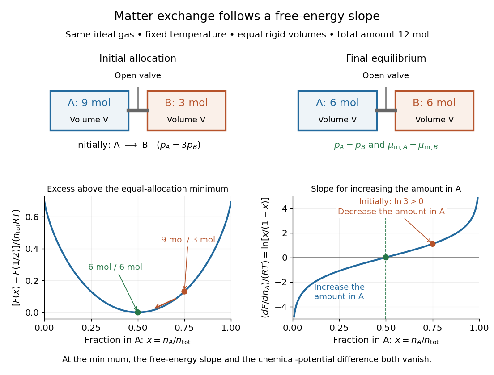

# Chemical potential and Helmholtz free energy

↑ **Parent:** [Chemical potential equality for particle exchange](chemical-potential-equality-for-particle-exchange.md)

Rigid compartments impose a different constraint: fixed [volume](volume-thermodynamics.md) rather than fixed [pressure](pressure-split.md). With [Helmholtz free energy](helmholtz-free-energy.md) $F=U-TS$,

$$
dF=-S\,dT-p\,dV+\sum_i\mu_{{\rm m},i}\,dn_i,
\qquad
\mu_{{\rm m},i}=\left(\frac{\partial F}{\partial n_i}\right)_{T,V,n_{j\ne i}}.
$$

This follows immediately by differentiating $F=U-TS$ in the [chemical potential](chemical-potential-split.md) differential above. It expresses the same [chemical potential](chemical-potential-split.md) through the [thermodynamic potential](thermodynamic-potential-split.md) appropriate to fixed [temperature](temperature-split.md) and [volume](volume-thermodynamics.md).

Consider a [closed system](closed-system.md) consisting of two rigid compartments of equal [volume](volume-thermodynamics.md) $V$, maintained at a common fixed [temperature](temperature-split.md) $T$. A valve permits exchange of the same [ideal gas](ideal-gas-split.md); the partition stays in place. Initially $n_A=9\,\mathrm{mol}$ and $n_B=3\,\mathrm{mol}$, with conserved total [amount of substance](amount-of-substance.md) $n_{\rm tot}=12\,\mathrm{mol}$. These are macroscopic [moles](mole-unit.md), modeled continuously, not twelve individual particles. By the [ideal gas law](ideal-gas-law.md), $p_B/p_A=n_B/n_A=1/3$, so initially

$$
\mu_{{\rm m},B}-\mu_{{\rm m},A}=-RT\ln3.
$$

At $300\,\mathrm K$ with the stipulated $R$, this is approximately $-2740.311\,\mathrm{J\,mol^{-1}}$, favoring transfer from A to B.

At fixed $T$ and equal $V$, integrating the ideal-gas [chemical potential](chemical-potential-split.md) gives the total [Helmholtz free energy](helmholtz-free-energy.md), up to a term independent of the allocation,

$$
F_{\rm total}
=RT\left[n_A\ln\frac{n_A}{n_{\rm ref}}+n_B\ln\frac{n_B}{n_{\rm ref}}-n_{\rm tot}\right]+C.
$$

Here $n_{\rm ref}$ is a positive reference [amount of substance](amount-of-substance.md); any omitted common term linear in $n_A+n_B$ is constant along this exchange. Let $x=n_A/n_{\rm tot}$ be the [dimensionless](dimensionless-quantity.md) fraction in A. The relative [Helmholtz free energy](helmholtz-free-energy.md) then takes the particularly simple form

$$
\frac{F_{\rm total}(x)-F_{\rm total}(1/2)}{n_{\rm tot}RT}
=x\ln x+(1-x)\ln(1-x)+\ln2.
$$

Its [derivative](derivative.md) along the allowed transfer and its second [derivative](derivative.md) are

$$
\frac{dF_{\rm total}}{dn_A}
=\mu_{{\rm m},A}-\mu_{{\rm m},B}
=RT\ln\frac{x}{1-x},
\qquad
\frac{d^2F_{\rm total}}{dn_A^2}
=RT\left(\frac{1}{n_A}+\frac{1}{n_B}\right)>0.
$$

Thus the [Helmholtz free energy](helmholtz-free-energy.md) is a strictly [convex function](convex-function.md) of the allocation for positive amounts. Its unique minimum has $x=1/2$, or $n_A=n_B=6\,\mathrm{mol}$, and equal [chemical potentials](chemical-potential-split.md). Initially its excess above this minimum is $n_{\rm tot}RT[\tfrac34\ln(3/2)+\tfrac14\ln(1/2)]\simeq3915.474\,\mathrm J$ at $300\,\mathrm K$. Relaxation decreases the total [Helmholtz free energy](helmholtz-free-energy.md) by this amount in the model; the final [pressures](pressure-split.md) are also equal because both compartments have the same [volume](volume-thermodynamics.md).

**[Figure 1](#image-chemical-potential-differences-are-slopes-of-the-total-helmholtz-free-energy). Chemical potential differences are slopes of the total Helmholtz free energy**. Two equal rigid compartments at fixed [temperature](temperature-split.md) start with $9\,\mathrm{mol}$ and $3\,\mathrm{mol}$ of the same [ideal gas](ideal-gas-split.md), and reach $6\,\mathrm{mol}$ each after exchange. Lower left: the [dimensionless](dimensionless-quantity.md) excess [Helmholtz free energy](helmholtz-free-energy.md). Lower right: its [derivative](derivative.md) with respect to the allocation, divided by $RT$, equals the [chemical potential](chemical-potential-split.md) difference divided by $RT$. The horizontal variable is $x=n_A/n_{\rm tot}$.

The beautiful connection is that the direction of matter exchange and the slope of a [free energy](thermodynamic-free-energy.md) curve are the same calculation. The [entropy](entropy-split.md) gained by redistributing the [ideal gas](ideal-gas-split.md) makes equal allocation favorable here. As with [chemical equilibrium](chemical-equilibrium.md), a [free energy](thermodynamic-free-energy.md) minimum identifies the favored state, while transport properties determine how quickly it is reached. The fixed-[temperature](temperature-split.md), fixed-[pressure](pressure-split.md) [Gibbs free energy](gibbs-free-energy.md) criterion is summarized in [16.4 Free Energy](chemistry-2e-by-paul-flowers-and-others/16-4-free-energy.md); the rigid experiment instead uses [Helmholtz free energy](helmholtz-free-energy.md).

## ↑ Ancestors (7)

1. [Chemical potential equality for particle exchange](chemical-potential-equality-for-particle-exchange.md)
2. [Chemical potential](chemical-potential-split.md)
3. [Thermodynamics](thermodynamics-split.md)
4. [Statistical physics](statistical-physics-split.md)
5. [Branches of physics](branches-of-physics.md)
6. [Physics](physics-split.md)
7. [Codex Wiki](split.md)

## ← Incoming links (1)

- [Chemical potential of an ideal gas](chemical-potential-of-an-ideal-gas.md)
