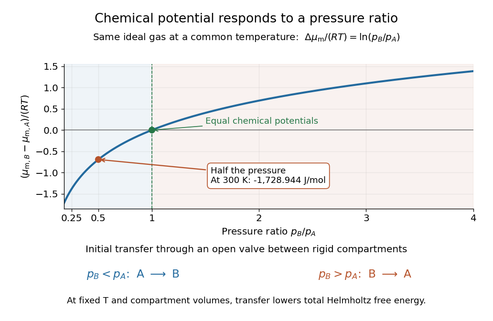

# Chemical potential of an ideal gas

↑ **Parent:** [Chemical potential](chemical-potential-split.md)

For a pure [ideal gas](ideal-gas-split.md) at [temperature](temperature-split.md) $T$ and [pressure](pressure-split.md) $p$,

$$
\mu_{\rm m}(T,p)=\mu_{\rm m}^\circ(T)+RT\ln\frac{p}{p^\circ},
$$

where $R$ is the [molar gas constant](molar-gas-constant.md) and $p^\circ$ specifies the reference [pressure](pressure-split.md) of the [standard state](standard-state.md). The ratio inside the [natural logarithm](natural-logarithm.md) is [dimensionless](dimensionless-quantity.md). The [chemical potential](chemical-potential-split.md) difference therefore depends on a ratio of [pressures](pressure-split.md), not an absolute difference. See [MIT 5.60, Lecture 14, page 4](https://ocw.mit.edu/courses/5-60-thermodynamics-kinetics-spring-2008/e763a06aa3b5de09cd6bfea6280f219c_5_60_lecture14.pdf).

For a [chemical species](chemical-species.md) in an ideal [gas](gas.md) [mixture](mixture-split.md), replace $p$ by its [partial pressure](partial-pressure.md). More generally write $\mu_{{\rm m},i}=\mu_{{\rm m},i}^\circ+RT\ln a_i$ using its [thermodynamic activity](thermodynamic-activity.md) $a_i$ and a consistent [standard state](standard-state.md). For an ideal dilute [chemical solution](solution-chemistry.md), $a_i=c_i/c^\circ$ with reference [concentration](concentration.md) $c^\circ$; the [thermodynamic activity](thermodynamic-activity.md) section describes departures from this idealization.

As a computed comparison, take identical [chemical species](chemical-species.md) at $T=300\,\mathrm K$, with $p_A=2p^\circ$ and $p_B=p^\circ$. Stipulate $R=8.314462618\,\mathrm{J\,mol^{-1}\,K^{-1}}$. Then

$$
\mu_{{\rm m},B}-\mu_{{\rm m},A}
=RT\ln\frac{p_B}{p_A}
=-RT\ln2
\simeq-1728.944\,\mathrm{J\,mol^{-1}}.
$$

Halving the [pressure](pressure-split.md) gives the same decrement whether starting from $2p^\circ$ or $20p^\circ$, provided the [ideal gas](ideal-gas-split.md) approximation remains valid. This comparison uses different [pressures](pressure-split.md); it is not the common-[pressure](pressure-split.md) reservoir setup of [chemical potential equality for particle exchange](chemical-potential-equality-for-particle-exchange.md). The fixed-[volume](volume-thermodynamics.md) example in [chemical potential and Helmholtz free energy](chemical-potential-and-helmholtz-free-energy.md) supplies an exchange experiment with unequal initial [pressures](pressure-split.md).

**[Figure 2](#image-ideal-gas-chemical-potential-difference-versus-pressure-ratio). Ideal gas chemical potential difference versus pressure ratio**. At a common [temperature](temperature-split.md), the [chemical potential](chemical-potential-split.md) difference is $RT\ln(p_B/p_A)$. The arrows give the initial transfer direction through an open route between rigid compartments; the decreasing [thermodynamic potential](thermodynamic-potential-split.md) there is [Helmholtz free energy](helmholtz-free-energy.md). The marked comparison uses $300\,\mathrm K$ and the stipulated [molar gas constant](molar-gas-constant.md).

## ↑ Ancestors (6)

1. [Chemical potential](chemical-potential-split.md)
2. [Thermodynamics](thermodynamics-split.md)
3. [Statistical physics](statistical-physics-split.md)
4. [Branches of physics](branches-of-physics.md)
5. [Physics](physics-split.md)
6. [Codex Wiki](split.md)

## ← Incoming links (2)

- [Partial pressure](partial-pressure.md)
- [Raoult's law](raoult-s-law.md)
