# Chemical reaction

↑ **Parent:** [Chemistry](chemistry.md)  
ⓦ [Wiki](https://en.wikipedia.org/wiki/Chemical_reaction)

A [chemical reaction](chemical-reaction.md) interconverts [chemical species](mathematical-biology.md#chemical-species), as defined by the [IUPAC Gold Book, chemical reaction](https://goldbook.iupac.org/terms/view/C01033). The consumed species are [reactants](#reactant); the formed species are [reaction products](#product-chemistry). In ordinary [chemical reactions](chemical-reaction.md), [chemical atoms](physics.md#atom-physics) are rearranged while each [chemical element](chemical-substance.md#chemical-element)'s total atom count is conserved. For a complete [chemical equation](#chemical-equation), net [electric charge](electric-charge.md) is conserved too.

For example, the balanced [chemical equation](#chemical-equation)

$$
2\mathrm{H}_2+\mathrm{O}_2\longrightarrow2\mathrm{H}_2\mathrm{O}
$$

describes conversion of [molecular hydrogen](chemical-substance.md#molecular-hydrogen) and [molecular oxygen](chemical-substance.md#molecular-oxygen) into [water](chemical-substance.md#water). Both sides contain four [hydrogen](chemical-substance.md#hydrogen) [chemical atoms](physics.md#atom-physics) and two [oxygen](chemical-substance.md#oxygen) [chemical atoms](physics.md#atom-physics). Three [reactant](#reactant) [molecules](molecule.md) become two [reaction product](#product-chemistry) [molecules](molecule.md): atom counts are conserved, but molecule counts need not be. See [Flowers et al., Chemistry 2e, balancing chemical equations](https://openstax.org/books/chemistry-2e/pages/4-1-writing-and-balancing-chemical-equations).

The coefficients describe net consumption and formation, without asserting that three [molecules](molecule.md) collide in one step. A balanced [chemical equation](#chemical-equation) supplies quantitative constraints; it does not determine how quickly the [chemical reaction](chemical-reaction.md) occurs, or whether [chemical equilibrium](chemical-potential.md#chemical-equilibrium) prevents complete conversion. Those questions need further information. Keeping these roles distinct makes [stoichiometry](#stoichiometry) useful even when the microscopic details are complicated.

**Table of contents**

- [Hydration reaction](#hydration-reaction)
- [Salt metathesis](#salt-metathesis)
- [Pericyclic reaction](#pericyclic-reaction)
  - [Suprafacial reaction](#suprafacial-reaction)
  - [Sigmatropic rearrangement](#sigmatropic-rearrangement)
  - [Cycloreversion](#cycloreversion)
    - [Retro hetero-Diels-Alder reaction](#retro-hetero-diels-alder-reaction)
  - [Woodward-Hoffmann rules](#woodward-hoffmann-rules)
  - [Electrocyclic reaction](#electrocyclic-reaction)
    - [Electrocyclic ring closure](#electrocyclic-ring-closure)
    - [Anionic eight-pi electrocyclization](#anionic-eight-pi-electrocyclization)
    - [Electrocyclic selection rule](#electrocyclic-selection-rule)
    - [Disrotatory motion](#disrotatory-motion)
    - [Conrotatory motion](#conrotatory-motion)
- [Cyclopropanation](#cyclopropanation)
  - [Intramolecular cyclopropanation](#intramolecular-cyclopropanation)
- [Rearrangement reaction](#rearrangement-reaction)
  - [Dienone-phenol rearrangement](#dienone-phenol-rearrangement)
    - [Dearomatizing spirocyclization of a phenoxide](#dearomatizing-spirocyclization-of-a-phenoxide)
- [Hydrosilylation](#hydrosilylation)
  - [Chalk-Harrod mechanism](#chalk-harrod-mechanism)
- [Isomerization](#isomerization)
- [Tautomerization](#tautomerization)
- [Selectivity](#selectivity)
  - [Chemoselectivity](#chemoselectivity)
- [Decarboxylation](#decarboxylation)
  - [Malonic acid decarboxylation](#malonic-acid-decarboxylation)
- [Cycloaddition](#cycloaddition)
  - [Diels-Alder reaction](#diels-alder-reaction)
    - [Diels-Alder endo preference](#diels-alder-endo-preference)
    - [Ethylene equivalent](#ethylene-equivalent)
    - [Endo selectivity](#endo-selectivity)
    - [Dienophile](#dienophile)
- [Mesylation](#mesylation)
- [Hydroalumination](#hydroalumination)
  - [Directed trans-hydroalumination](#directed-trans-hydroalumination)
- [Dihydroxylation](#dihydroxylation)
  - [Cyclic osmate ester](#cyclic-osmate-ester)
- [Transacetalization](#transacetalization)
- [Syn addition](#syn-addition)
- [Anti addition](#anti-addition)
- [Desilylation](#desilylation)
- [Oxidative addition](#oxidative-addition)
  - [Oxidative hydrogen migration](#oxidative-hydrogen-migration)
- [Beta-hydride elimination](#beta-hydride-elimination)
- [Migratory insertion](#migratory-insertion)
  - [Carbopalladation](#carbopalladation)
- [Methyl abstraction](#methyl-abstraction)
- [Hydroboration](#hydroboration)
- [Condensation reaction](#condensation-reaction)
- [Hydride transfer](#hydride-transfer)
- [Conjugate addition](#conjugate-addition)
  - [Nucleophile-catalyzed alpha functionalization of an enone](#nucleophile-catalyzed-alpha-functionalization-of-an-enone)
  - [1,6-Conjugate addition](#1-6-conjugate-addition)
- [Conjugate reduction](#conjugate-reduction)
- [Keto-enol tautomerism](#keto-enol-tautomerism)
- [Reductive elimination](#reductive-elimination)
- [Dissociative substitution](#dissociative-substitution)
  - [Cis effect](#cis-effect)
- [Electrophilicity](#electrophilicity)
- [Electrophile](#electrophile)
- [Organic reaction](#organic-reaction)
  - [Arbuzov reaction](#arbuzov-reaction)
  - [Baeyer-Villiger oxidation](#baeyer-villiger-oxidation)
  - [C-glycosylation](#c-glycosylation)
  - [Bromoetherification](#bromoetherification)
  - [Selenoxide elimination](#selenoxide-elimination)
  - [1,3-dipolar cycloaddition](#1-3-dipolar-cycloaddition)
  - [Mitsunobu reaction](#mitsunobu-reaction)
  - [Manganese(III)-mediated radical cyclization](#manganese-iii-mediated-radical-cyclization)
  - [Radical-polar crossover](#radical-polar-crossover)
  - [Iodoetherification](#iodoetherification)
  - [Alpha-ketol rearrangement](#alpha-ketol-rearrangement)
  - [Kornblum oxidation](#kornblum-oxidation)
  - [Nitrone cycloaddition](#nitrone-cycloaddition)
  - [Aziridinium-mediated ring expansion](#aziridinium-mediated-ring-expansion)
  - [Hydroacylation](#hydroacylation)
  - [Palladium-catalysed hydrodehalogenation](#palladium-catalysed-hydrodehalogenation)
  - [Hydrozirconation](#hydrozirconation)
  - [Dearomatization](#dearomatization)
  - [Wacker oxidation](#wacker-oxidation)
  - [Cross-coupling reaction](#cross-coupling-reaction)
    - [Kumada coupling](#kumada-coupling)
  - [Cyclodehydration](#cyclodehydration)
  - [1,3-dipole](#1-3-dipole)
  - [Nef reaction](#nef-reaction)
  - [Olefination](#olefination)
    - [Wittig reaction](#wittig-reaction)
      - [Wittig methylenation](#wittig-methylenation)
      - [Z-selective Wittig olefination](#z-selective-wittig-olefination)
  - [Reductive amination](#reductive-amination)
  - [Alpha-methylenation](#alpha-methylenation)
  - [Dehydration](#dehydration)
  - [Demercuration](#demercuration)
  - [Oxymercuration](#oxymercuration)
  - [Henry reaction](#henry-reaction)
  - [Neighboring group participation](#neighboring-group-participation)
  - [Semipinacol rearrangement](#semipinacol-rearrangement)
  - [Benzannulation](#benzannulation)
    - [Nitroalkane benzannulation](#nitroalkane-benzannulation)
  - [Claisen condensation](#claisen-condensation)
  - [Ozonolysis](#ozonolysis)
  - [Beckmann rearrangement](#beckmann-rearrangement)
    - [Beckmann fragmentation](#beckmann-fragmentation)
    - [Antiperiplanar migration in the Beckmann rearrangement](#antiperiplanar-migration-in-the-beckmann-rearrangement)
  - [Protodehalogenation](#protodehalogenation)
    - [Protodebromination](#protodebromination)
  - [Malonic ester synthesis](#malonic-ester-synthesis)
  - [Regioselectivity](#regioselectivity)
    - [Markovnikov addition](#markovnikov-addition)
    - [Anti-Markovnikov addition](#anti-markovnikov-addition)
  - [Electrophilic substitution](#electrophilic-substitution)
  - [Weitz-Scheffer reaction](#weitz-scheffer-reaction)
  - [Robinson annulation](#robinson-annulation)
  - [Elimination reaction](#elimination-reaction)
    - [Dehydrohalogenation](#dehydrohalogenation)
    - [E2 elimination](#e2-elimination)
      - [Trans-diaxial elimination](#trans-diaxial-elimination)
    - [E1 elimination](#e1-elimination)
    - [E1cb elimination](#e1cb-elimination)
  - [Aldol reaction](#aldol-reaction)
    - [Aldol addition](#aldol-addition)
    - [Vinylogous aldol reaction](#vinylogous-aldol-reaction)
    - [Tandem conjugate addition and aldol reaction](#tandem-conjugate-addition-and-aldol-reaction)
    - [Intramolecular aldol reaction](#intramolecular-aldol-reaction)
    - [Boron-directed aldol reaction](#boron-directed-aldol-reaction)
    - [Zimmerman–Traxler transition state](#zimmerman-traxler-transition-state)
    - [Zimmerman-Traxler model](#zimmerman-traxler-model)
    - [Proline-catalysed aldol reaction](#proline-catalysed-aldol-reaction)
    - [Aldol condensation](#aldol-condensation)
  - [Michael addition](#michael-addition)
    - [Michael-Claisen annulation](#michael-claisen-annulation)
    - [Thiol Michael addition](#thiol-michael-addition)
    - [Tandem Michael addition](#tandem-michael-addition)
    - [Nitro-Michael reaction](#nitro-michael-reaction)
  - [Nucleophilic addition](#nucleophilic-addition)
    - [Grignard reaction](#grignard-reaction)
      - [Double Grignard addition to an ester](#double-grignard-addition-to-an-ester)
      - [Grignard carboxylation](#grignard-carboxylation)
    - [Bürgi-Dunitz angle](#burgi-dunitz-angle)
      - [Bürgi-Dunitz trajectory](#burgi-dunitz-trajectory)
  - [Nucleophilic substitution](#nucleophilic-substitution)
    - [Leaving group](#leaving-group)
    - [Non-geminal substitution](#non-geminal-substitution)
    - [Geminal substitution](#geminal-substitution)
    - [Nucleophilic acyl substitution](#nucleophilic-acyl-substitution)
      - [Esterification](#esterification)
      - [BAC2 mechanism](#bac2-mechanism)
      - [Lactonization](#lactonization)
      - [Fischer esterification](#fischer-esterification)
      - [Ester cleavage](#ester-cleavage)
        - [Acyl–oxygen ester cleavage](#acyl-oxygen-ester-cleavage)
        - [Alkyl–oxygen ester cleavage](#alkyl-oxygen-ester-cleavage)
      - [Transesterification](#transesterification)
        - [Transesterification with excess alcohol](#transesterification-with-excess-alcohol)
    - [SN1 reaction](#sn1-reaction)
    - [Nucleophilic aromatic substitution](#nucleophilic-aromatic-substitution)
      - [Smiles rearrangement](#smiles-rearrangement)
      - [Truce-Smiles rearrangement](#truce-smiles-rearrangement)
      - [Vicarious nucleophilic substitution](#vicarious-nucleophilic-substitution)
        - [Sigma-H adduct](#sigma-h-adduct)
      - [Meisenheimer complex](#meisenheimer-complex)
        - [Spirocyclic Meisenheimer intermediate](#spirocyclic-meisenheimer-intermediate)
    - [SN2 reaction](#sn2-reaction)
      - [Backside attack](#backside-attack)
      - [Sultone ring opening](#sultone-ring-opening)
  - [Stork enamine reaction](#stork-enamine-reaction)
    - [Enamine alpha,alpha-prime annulation](#enamine-alpha-alpha-prime-annulation)
  - [Electrophilic aromatic substitution](#electrophilic-aromatic-substitution)
    - [Electrophilic sulfenylation](#electrophilic-sulfenylation)
    - [Electrophilic ipso substitution](#electrophilic-ipso-substitution)
    - [Aromatic nitration](#aromatic-nitration)
    - [Aromatic oxazolination](#aromatic-oxazolination)
    - [Friedel-Crafts reaction](#friedel-crafts-reaction)
      - [Friedel-Crafts alkylation](#friedel-crafts-alkylation)
      - [Friedel-Crafts acylation](#friedel-crafts-acylation)
        - [Acylium ion](#acylium-ion)
    - [Arenium ion](#arenium-ion)
- [Nucleophile](#nucleophile)
  - [Ambident nucleophile](#ambident-nucleophile)
  - [Nucleophilicity](#nucleophilicity)
- [Kemp elimination](#kemp-elimination)
- [Chemical reactivity](#chemical-reactivity)
  - [Chemical inertness](#chemical-inertness)
- [Precipitation (chemistry)](#precipitation-chemistry)
  - [Coprecipitation](#coprecipitation)
  - [Precipitate](#precipitate)
  - [Net ionic equation](#net-ionic-equation)
    - [Spectator ion](#spectator-ion)
  - [Solubility product](#solubility-product)
    - [Molar solubility](#molar-solubility)
    - [Solubility product and material balance](#solubility-product-and-material-balance)
    - [Common-ion effect](#common-ion-effect)
    - [Solubility product measurement by titration](#solubility-product-measurement-by-titration)
    - [Ion product](#ion-product)
    - [Saturation criterion for precipitation](#saturation-criterion-for-precipitation)
      - [Supersaturated solution](#supersaturated-solution)
    - [Precipitation after equal-volume mixing](#precipitation-after-equal-volume-mixing)
  - [Calcium carbonate precipitation experiment](#calcium-carbonate-precipitation-experiment)
- [Redox](#redox)
  - [Redox equilibrium](#redox-equilibrium)
  - [Single-electron transfer](#single-electron-transfer)
  - [Radiolytic autoreduction](#radiolytic-autoreduction)
  - [Redox electron balance](#redox-electron-balance)
  - [Zinc-copper displacement experiment](#zinc-copper-displacement-experiment)
  - [Oxidizing agent](#oxidizing-agent)
  - [Reducing agent](#reducing-agent)
  - [Oxidation](#oxidation)
    - [Zirconium-steam oxidation](#zirconium-steam-oxidation)
    - [Alcohol oxidation](#alcohol-oxidation)
      - [Dess-Martin oxidation](#dess-martin-oxidation)
    - [Epoxidation](#epoxidation)
      - [Electrophilic oxygen transfer](#electrophilic-oxygen-transfer)
      - [Sharpless asymmetric epoxidation](#sharpless-asymmetric-epoxidation)
      - [Hydroxyl-directed epoxidation](#hydroxyl-directed-epoxidation)
    - [Oxidation state](#oxidation-state)
      - [Ionic approximation of bonds](#ionic-approximation-of-bonds)
      - [Oxidation state sum rule](#oxidation-state-sum-rule)
      - [Acidic permanganate-iron balance](#acidic-permanganate-iron-balance)
  - [Redox titration](#redox-titration)
    - [Permanganate-iron titration](#permanganate-iron-titration)
      - [Permanganate-iron endpoint and blank model](#permanganate-iron-endpoint-and-blank-model)
  - [Reduction (chemistry)](#reduction-chemistry)
    - [Reductive desulfonylation](#reductive-desulfonylation)
    - [Carbonyl reduction](#carbonyl-reduction)
      - [Wolff-Kishner reduction](#wolff-kishner-reduction)
      - [Luche reduction](#luche-reduction)
    - [Hydrogenation](#hydrogenation)
      - [Raney nickel](#raney-nickel)
      - [Catalytic hydrogenation](#catalytic-hydrogenation)
  - [Electron acceptor](#electron-acceptor)
  - [Electron donor](#electron-donor)
- [Hydrolysis](#hydrolysis)
  - [Hydrolytic deamination](#hydrolytic-deamination)
  - [Ester hydrolysis](#ester-hydrolysis)
  - [Acetal hydrolysis](#acetal-hydrolysis)
    - [Methanolysis of an anhydro acetal](#methanolysis-of-an-anhydro-acetal)
    - [Stereoelectronic control of acetal hydrolysis](#stereoelectronic-control-of-acetal-hydrolysis)
    - [Acid-catalysed acetal hydrolysis](#acid-catalysed-acetal-hydrolysis)
  - [GTP hydrolysis](#gtp-hydrolysis)
  - [ATP hydrolysis](#atp-hydrolysis)
  - [Saponification](#saponification)
    - [Saponification with limiting hydroxide](#saponification-with-limiting-hydroxide)
    - [Saponification of triglycerides](#saponification-of-triglycerides)
- [Energy coupling](#energy-coupling)
- [Exergonic reaction](#exergonic-reaction)
- [Endergonic reaction](#endergonic-reaction)
- [Phosphorylation](#phosphorylation)
- [Chemical kinetics](chemical-kinetics.md)
  - [Thermal reaction probability integral](chemical-kinetics.md#thermal-reaction-probability-integral)
  - [Flux-side correlation function](chemical-kinetics.md#flux-side-correlation-function)
  - [Chemical branching fraction](chemical-kinetics.md#chemical-branching-fraction)
  - [Steady-state approximation](chemical-kinetics.md#steady-state-approximation)
    - [Reservoir relaxation test for a chemical steady state](chemical-kinetics.md#reservoir-relaxation-test-for-a-chemical-steady-state)
  - [Chemical family](chemical-kinetics.md#chemical-family)
    - [HOx family](chemical-kinetics.md#hox-family)
    - [Fast family partition and slow family balance](chemical-kinetics.md#fast-family-partition-and-slow-family-balance)
  - [Kinetic stability](chemical-kinetics.md#kinetic-stability)
  - [Thermodynamic control](chemical-kinetics.md#thermodynamic-control)
  - [Steady-state approximation in chemical kinetics](chemical-kinetics.md#steady-state-approximation-in-chemical-kinetics)
  - [Thermal runaway](chemical-kinetics.md#thermal-runaway)
  - [Third-body recombination](chemical-kinetics.md#third-body-recombination)
  - [Isotope effect](chemical-kinetics.md#isotope-effect)
  - [Temperature jump](chemical-kinetics.md#temperature-jump)
  - [Dissociation rate constant](chemical-kinetics.md#dissociation-rate-constant)
  - [Association rate constant](chemical-kinetics.md#association-rate-constant)
  - [Kinetic isotope effect](chemical-kinetics.md#kinetic-isotope-effect)
    - [Beta-secondary kinetic isotope effect](chemical-kinetics.md#beta-secondary-kinetic-isotope-effect)
    - [Alpha-secondary kinetic isotope effect](chemical-kinetics.md#alpha-secondary-kinetic-isotope-effect)
  - [Kinetic control](chemical-kinetics.md#kinetic-control)
  - [Collision theory](chemical-kinetics.md#collision-theory)
  - [Activation energy](chemical-kinetics.md#activation-energy)
    - [Apparent activation energy](chemical-kinetics.md#apparent-activation-energy)
    - [Arrhenius equation](chemical-kinetics.md#arrhenius-equation)
      - [Two-temperature Arrhenius extrapolation](chemical-kinetics.md#two-temperature-arrhenius-extrapolation)
      - [Pre-exponential factor](chemical-kinetics.md#pre-exponential-factor)
      - [Arrhenius plot](chemical-kinetics.md#arrhenius-plot)
      - [Modified Arrhenius equation](chemical-kinetics.md#modified-arrhenius-equation)
      - [Conductometric determination of activation energy](chemical-kinetics.md#conductometric-determination-of-activation-energy)
  - [Reaction mechanism](chemical-kinetics.md#reaction-mechanism)
    - [Electron-pair arrow](chemical-kinetics.md#electron-pair-arrow)
    - [Consecutive first-order reaction mechanism](chemical-kinetics.md#consecutive-first-order-reaction-mechanism)
    - [Parallel first-order reaction mechanism](chemical-kinetics.md#parallel-first-order-reaction-mechanism)
    - [Acetone iodination rate-law experiment](chemical-kinetics.md#acetone-iodination-rate-law-experiment)
    - [Reaction intermediate](chemical-kinetics.md#reaction-intermediate)
      - [Tetrahedral intermediate](chemical-kinetics.md#tetrahedral-intermediate)
    - [Reaction coordinate](chemical-kinetics.md#reaction-coordinate)
      - [Dividing surface](chemical-kinetics.md#dividing-surface)
      - [Potential energy surface](chemical-kinetics.md#potential-energy-surface)
        - [Electronic state correlation diagram](chemical-kinetics.md#electronic-state-correlation-diagram)
        - [Conical intersection](chemical-kinetics.md#conical-intersection)
      - [Energy profile (chemistry)](chemical-kinetics.md#energy-profile-chemistry)
        - [Free-energy profile](chemical-kinetics.md#free-energy-profile)
        - [Potential-energy profile](chemical-kinetics.md#potential-energy-profile)
        - [Reaction energy barrier](chemical-kinetics.md#reaction-energy-barrier)
    - [Elementary reaction](chemical-kinetics.md#elementary-reaction)
      - [Molecularity](chemical-kinetics.md#molecularity)
  - [Catalysis](chemical-kinetics.md#catalysis)
    - [Hydrogen-bond catalysis](chemical-kinetics.md#hydrogen-bond-catalysis)
    - [Metal ion catalysis](chemical-kinetics.md#metal-ion-catalysis)
    - [Proximity and orientation catalysis](chemical-kinetics.md#proximity-and-orientation-catalysis)
    - [Electrostatic catalysis](chemical-kinetics.md#electrostatic-catalysis)
    - [Covalent catalysis](chemical-kinetics.md#covalent-catalysis)
    - [Acid catalysis](chemical-kinetics.md#acid-catalysis)
    - [General base catalysis](chemical-kinetics.md#general-base-catalysis)
    - [General acid catalysis](chemical-kinetics.md#general-acid-catalysis)
    - [Transition state stabilization](chemical-kinetics.md#transition-state-stabilization)
    - [General base](chemical-kinetics.md#general-base)
    - [Catalytic cycle](chemical-kinetics.md#catalytic-cycle)
    - [Catalytic barriers and reaction free energy](chemical-kinetics.md#catalytic-barriers-and-reaction-free-energy)
    - [Reversible catalytic relaxation](chemical-kinetics.md#reversible-catalytic-relaxation)
    - [Catalytic selectivity](chemical-kinetics.md#catalytic-selectivity)
    - [Catalyst deactivation](chemical-kinetics.md#catalyst-deactivation)
    - [Homogeneous catalysis](chemical-kinetics.md#homogeneous-catalysis)
    - [Heterogeneous catalysis](chemical-kinetics.md#heterogeneous-catalysis)
      - [Catalytic surface site](chemical-kinetics.md#catalytic-surface-site)
      - [Catalyst particle size and accessible area](chemical-kinetics.md#catalyst-particle-size-and-accessible-area)
      - [Manganese dioxide peroxide contact demonstration](chemical-kinetics.md#manganese-dioxide-peroxide-contact-demonstration)
      - [Catalysed peroxide comparison](chemical-kinetics.md#catalysed-peroxide-comparison)
    - [Catalyst](chemical-kinetics.md#catalyst)
      - [Precatalyst](chemical-kinetics.md#precatalyst)
      - [Transition state theory](chemical-kinetics.md#transition-state-theory)
        - [Force-tilted activation barrier](chemical-kinetics.md#force-tilted-activation-barrier)
        - [Activation volume](chemical-kinetics.md#activation-volume)
        - [Activation entropy](chemical-kinetics.md#activation-entropy)
        - [Activation enthalpy](chemical-kinetics.md#activation-enthalpy)
        - [Eyring equation](chemical-kinetics.md#eyring-equation)
        - [Gibbs energy of activation](chemical-kinetics.md#gibbs-energy-of-activation)
          - [Enthalpy of activation](chemical-kinetics.md#enthalpy-of-activation)
          - [Entropy of activation](chemical-kinetics.md#entropy-of-activation)
  - [Transition state](chemical-kinetics.md#transition-state)
  - [Reaction rate](chemical-kinetics.md#reaction-rate)
    - [Disappearance rate](chemical-kinetics.md#disappearance-rate)
    - [Rate law](chemical-kinetics.md#rate-law)
      - [Integrated rate law](chemical-kinetics.md#integrated-rate-law)
      - [Order of reaction](chemical-kinetics.md#order-of-reaction)
        - [First-order reaction](chemical-kinetics.md#first-order-reaction)
          - [First-order rate constant](chemical-kinetics.md#first-order-rate-constant)
        - [Zero-order reaction](chemical-kinetics.md#zero-order-reaction)
        - [Second-order reaction](chemical-kinetics.md#second-order-reaction)
          - [Unequal-concentration second-order integration](chemical-kinetics.md#unequal-concentration-second-order-integration)
          - [Conductometric saponification assay](chemical-kinetics.md#conductometric-saponification-assay)
        - [Pseudo-first-order reaction](chemical-kinetics.md#pseudo-first-order-reaction)
  - [Rate constant](chemical-kinetics.md#rate-constant)
- [Protonation](#protonation)
- [Chemical equation](#chemical-equation)
- [Reactant](#reactant)
- [Reagent](#reagent)
- [Product (chemistry)](#product-chemistry)
- [Substrate (chemistry)](#substrate-chemistry)
- [Thermal dissociation](#thermal-dissociation)
- [Stoichiometry](#stoichiometry)
  - [Molecular count and amount of substance](#molecular-count-and-amount-of-substance)
  - [Extent of reaction](#extent-of-reaction)
  - [Limiting reagent](#limiting-reagent)
- [Alkylation](#alkylation)
- [Mutarotation](#mutarotation)

## Hydration reaction

↑ **Parent:** [Chemical reaction](chemical-reaction.md)

Addition of water to a molecular species. A carbonyl compound can form a geminal diol by hydration, distinct from a solvent hydration shell.

## Salt metathesis

↑ **Parent:** [Chemical reaction](chemical-reaction.md)

Exchange of ionic partners, often used to replace a [metal](chemical-substance.md#metal) halide by an [anionic ligand](chemistry.md#anionic-ligand) while an alkali-metal halide forms. Atom and charge balance distinguish it from an oxidative-addition reaction.

## Pericyclic reaction

↑ **Parent:** [Chemical reaction](chemical-reaction.md)

A concerted reorganization of bonding through a cyclic orbital interaction, including electrocyclic reactions. The participating orbitals and their electronic occupation determine the relevant symmetry selection rule.

### Suprafacial reaction

↑ **Parent:** [Pericyclic reaction](#pericyclic-reaction)

A reaction using the same face of a participating orbital array at both reacting termini.

### Sigmatropic rearrangement

↑ **Parent:** [Pericyclic reaction](#pericyclic-reaction)

A [pericyclic reaction](#pericyclic-reaction) that relocates a sigma bond while reorganizing an adjacent pi system.

### Cycloreversion

↑ **Parent:** [Pericyclic reaction](#pericyclic-reaction)

The reverse of a [cycloaddition](#cycloaddition), splitting a ring into unsaturated fragments.

#### Retro hetero-Diels-Alder reaction

↑ **Parent:** [Cycloreversion](#cycloreversion)

A [retro hetero-Diels-Alder reaction](#retro-hetero-diels-alder-reaction) is the reverse of a [Diels-Alder reaction](#diels-alder-reaction) involving a heteroatom-containing partner. For a six-membered ring with sequence $O-A-B=C-D-E$, cleavage of $O-A$ and $D-E$ can give $A=B-C=D$ and $E=O$. Whether the [cycloreversion](#cycloreversion) is concerted or proceeds through ionic intermediates depends on the substrate and conditions.

### Woodward-Hoffmann rules

↑ **Parent:** [Pericyclic reaction](#pericyclic-reaction)

Orbital-symmetry rules associated with [Robert Burns Woodward](chemistry.md#robert-burns-woodward) and [Roald Hoffmann](chemistry.md#roald-hoffmann) for concerted reactions. Ground-state and photochemically excited occupations can have different allowed stereochemical modes; an allowed mode does not determine every kinetic detail or guarantee a large reaction rate.

### Electrocyclic reaction

↑ **Parent:** [Pericyclic reaction](#pericyclic-reaction)

Interconversion of a conjugated pi system and a ring by formation or cleavage of one sigma bond at the pi-system termini, accompanied by pi-bond redistribution. Terminal rotation connects starting geometry with product stereochemistry.

#### Electrocyclic ring closure

↑ **Parent:** [Electrocyclic reaction](#electrocyclic-reaction)

Formation of a ring by concerted conversion of terminal pi-system overlap into a new sigma bond. Thermal four-pi closure is conrotatory, subject to the appropriate electronic-state assumptions.

#### Anionic eight-pi electrocyclization

↑ **Parent:** [Electrocyclic reaction](#electrocyclic-reaction)

Ring closure of a seven-carbon conjugated anion with eight pi [electrons](physics.md#electron); thermal orbital-symmetry selection favors disrotatory motion.

#### Electrocyclic selection rule

↑ **Parent:** [Electrocyclic reaction](#electrocyclic-reaction)

For ordinary closed-shell systems, a thermal $4n$-electron electrocyclic process is conrotatory and a thermal $4n+2$-electron process is disrotatory. The corresponding simple photochemical rules are reversed. These rules relate terminal orbital phases and occupation to allowed concerted bond formation or cleavage.

#### Disrotatory motion

↑ **Parent:** [Electrocyclic reaction](#electrocyclic-reaction)

Terminal rotation in opposite senses under a common viewing convention during an [electrocyclic reaction](#electrocyclic-reaction).

#### Conrotatory motion

↑ **Parent:** [Electrocyclic reaction](#electrocyclic-reaction)

Terminal rotation in the same rotational sense under a common viewing convention during an [electrocyclic reaction](#electrocyclic-reaction). It is distinguished from [disrotatory motion](#disrotatory-motion); looking from opposite ends without changing conventions can reverse an apparent clockwise label.

## Cyclopropanation

↑ **Parent:** [Chemical reaction](chemical-reaction.md)

Formation of a three-membered carbon ring, for example by transferring a carbene-like carbon across an alkene.

### Intramolecular cyclopropanation

↑ **Parent:** [Cyclopropanation](#cyclopropanation)

Cyclopropanation between reactive groups tethered within one molecular framework. The tether constrains approach geometry, can form an additional ring simultaneously, and can influence which alkene face reacts.

## Rearrangement reaction

↑ **Parent:** [Chemical reaction](chemical-reaction.md)

### Dienone-phenol rearrangement

↑ **Parent:** [Rearrangement reaction](#rearrangement-reaction)

An acid-promoted skeletal migration of a cyclohexadienone followed by rearomatization to a phenol. Carbonyl protonation activates the conjugated system; migration from a suitably placed quaternary carbon and subsequent proton loss can change ring connectivity while restoring aromaticity.

#### Dearomatizing spirocyclization of a phenoxide

↑ **Parent:** [Dienone-phenol rearrangement](#dienone-phenol-rearrangement)

A para-tethered [phenoxide](chemistry.md#phenoxide) can react through its carbon-nucleophilic resonance contributor. Intramolecular displacement of a tether leaving group at the para carbon creates a spiro ring and a cyclohexadienone. Subsequent acid-induced bond migration to a neighbouring carbon can expand the attached ring and restore the phenol. The two-stage sequence can therefore give a final substitution position different from the initial carbon attack.

## Hydrosilylation

↑ **Parent:** [Chemical reaction](chemical-reaction.md)

Addition of Si–H across an unsaturated bond. For an [alkene](chemical-substance.md#alkene), the net products acquire one C–H and one C–Si bond. Alternative catalytic mechanisms can insert the [alkene](chemical-substance.md#alkene) into either a [metal](chemical-substance.md#metal)–[hydride](chemical-substance.md#hydride) or a [metal](chemical-substance.md#metal)–silyl bond; these alternatives should not be conflated.

### Chalk-Harrod mechanism

↑ **Parent:** [Hydrosilylation](#hydrosilylation)

A [hydrosilylation](#hydrosilylation) cycle involving Si–H [oxidative addition](#oxidative-addition), [alkene](chemical-substance.md#alkene) insertion into the [metal](chemical-substance.md#metal)–[hydride](chemical-substance.md#hydride) bond, and C–Si [reductive elimination](#reductive-elimination). This defines the conventional version; insertion into a [metal](chemical-substance.md#metal)–silyl bond describes a modified alternative.

## Isomerization

↑ **Parent:** [Chemical reaction](chemical-reaction.md)

Interconversion of [isomers](chemistry.md#isomer) without changing the overall molecular formula. Conformational interconversion can be kinetically slow when rotation is hindered.

## Tautomerization

↑ **Parent:** [Chemical reaction](chemical-reaction.md)

Interconversion of constitutional forms by [proton transfer](acid-base-chemistry.md#proton-transfer) accompanied by redistribution of pi bonds. Keto–[enol](chemical-substance.md#enol) interconversion is a familiar example.

## Selectivity

↑ **Parent:** [Chemical reaction](chemical-reaction.md)

Preferential formation of one product or reaction at one site. [chemoselectivity](#chemoselectivity), [regioselectivity](#regioselectivity) and stereoselectivity describe different comparisons.

### Chemoselectivity

↑ **Parent:** [Selectivity](#selectivity)

Preferential reaction of one functional group or bond type in a [molecule](molecule.md) containing alternatives. It depends on reagents, conditions and reaction time rather than being an absolute property of a functional group.

## Decarboxylation

↑ **Parent:** [Chemical reaction](chemical-reaction.md)

Loss of carbon dioxide from a compound. Malonic-acid derivatives can decarboxylate through cyclic proton-transfer/bond-cleavage arrangements that generate a carbonyl-stabilized product.

### Malonic acid decarboxylation

↑ **Parent:** [Decarboxylation](#decarboxylation)

Heating a substituted malonic acid can release carbon dioxide through a six-membered cyclic transition arrangement. The initial enol-like carboxylic-acid product tautomerizes to a substituted acetic acid.

## Cycloaddition

↑ **Parent:** [Chemical reaction](chemical-reaction.md)

A reaction that joins unsaturated components while forming a ring and new sigma bonds. Its transition-state entropy and activation volume depend on both molecular reorganization and the surrounding medium.

### Diels-Alder reaction

↑ **Parent:** [Cycloaddition](#cycloaddition)

A concerted cycloaddition of a conjugated [diene](chemical-substance.md#diene) and a [dienophile](#dienophile) that makes a six-membered ring with two new [sigma bonds](covalent-bond.md#sigma-bond) and one retained alkene. The internal [diene](chemical-substance.md#diene) atoms become the residual alkene atoms.

#### Diels-Alder endo preference

↑ **Parent:** [Diels-Alder reaction](#diels-alder-reaction)

A common kinetic preference for an orientation with dienophile substituents directed beneath the diene pi system. Steric and orbital interactions compete, so endo preference is not an absolute rule.

#### Ethylene equivalent

↑ **Parent:** [Diels-Alder reaction](#diels-alder-reaction)

A reagent combination that installs the two saturated carbons of an ethylene cycloaddition while allowing more favourable reactivity. A removable electron-withdrawing substituent can activate the [dienophile](#dienophile) and be removed later.

#### Endo selectivity

↑ **Parent:** [Diels-Alder reaction](#diels-alder-reaction)

A preference for the cycloaddition orientation in which relevant [dienophile](#dienophile) substituents lie under the [diene](chemical-substance.md#diene) framework in the transition geometry. It is distinct from regiochemistry and is not an unconditional guarantee of one product.

#### Dienophile

↑ **Parent:** [Diels-Alder reaction](#diels-alder-reaction)

The unsaturated partner that combines with a conjugated [diene](chemical-substance.md#diene) in a Diels–Alder reaction. Electron-withdrawing substituents often enhance reactivity in a normal-electron-demand process.

## Mesylation

↑ **Parent:** [Chemical reaction](chemical-reaction.md)

[Mesylation](#mesylation) installs a methanesulfonyl group on a heteroatom, often alcohol [oxygen](chemical-substance.md#oxygen). An alcohol attacks electrophilic [sulfur](chemical-substance.md#sulfur) of a sulfonylating reagent, and base removes the O–H [proton](physics.md#proton).

## Hydroalumination

↑ **Parent:** [Chemical reaction](chemical-reaction.md)

[Hydroalumination](#hydroalumination) adds an Al–H equivalent across an unsaturated bond. Syn and directed trans pathways give different alkenyl-aluminium geometries; protonolysis can preserve that stereochemical information.

### Directed trans-hydroalumination

↑ **Parent:** [Hydroalumination](#hydroalumination)

Oxygen-directed anti addition of [aluminium](chemical-substance.md#aluminium) and [hydrogen](chemical-substance.md#hydrogen) across an [alkyne](chemical-substance.md#alkyne), giving a stereodefined vinylaluminium species.

## Dihydroxylation

↑ **Parent:** [Chemical reaction](chemical-reaction.md)

[Dihydroxylation](#dihydroxylation) installs hydroxyl groups on adjacent [alkene](chemical-substance.md#alkene) carbons. [osmium tetroxide](chemical-substance.md#osmium-tetroxide) gives a [syn addition](#syn-addition) pathway through a [cyclic osmate ester](#cyclic-osmate-ester).

### Cyclic osmate ester

↑ **Parent:** [Dihydroxylation](#dihydroxylation)

A [cyclic osmate ester](#cyclic-osmate-ester) contains the newly formed [carbon](chemical-substance.md#carbon)–[oxygen](chemical-substance.md#oxygen) bonds of an osmium-mediated [alkene](chemical-substance.md#alkene) [dihydroxylation](#dihydroxylation). Both [oxygen](chemical-substance.md#oxygen) atoms attach on the same face; hydrolytic cleavage of metal–[oxygen](chemical-substance.md#oxygen) bonds releases the diol.

## Transacetalization

↑ **Parent:** [Chemical reaction](chemical-reaction.md)

[Transacetalization](#transacetalization) exchanges acetal alkoxy groups through acid-catalyzed cleavage and reformation. Protonated alkoxy departure gives an oxocarbenium species that a new alcohol can capture.

## Syn addition

↑ **Parent:** [Chemical reaction](chemical-reaction.md)

A [syn addition](#syn-addition) attaches both new groups from the same face of an unsaturated unit. Formation of a [cyclic osmate ester](#cyclic-osmate-ester) explains syn [dihydroxylation](#dihydroxylation).

## Anti addition

↑ **Parent:** [Chemical reaction](chemical-reaction.md)

An [anti addition](#anti-addition) places the two newly attached groups on opposite faces of an unsaturated unit. Backside opening of a cyclic [bromonium ion](chemistry.md#bromonium-ion) is a standard example.

## Desilylation

↑ **Parent:** [Chemical reaction](chemical-reaction.md)

[Desilylation](#desilylation) removes a silyl group. Attack by a [nucleophile](#nucleophile) at [silicon](chemical-substance.md#silicon) can pass through a pentacoordinate [silicon](chemical-substance.md#silicon) arrangement before Si–O cleavage; the liberated [oxygen](chemical-substance.md#oxygen) may be trapped by a new [electrophile](#electrophile).

## Oxidative addition

↑ **Parent:** [Chemical reaction](chemical-reaction.md)

In a standard [oxidative addition](#oxidative-addition), a bond X–Y is cleaved and both fragments become [metal](chemical-substance.md#metal) ligands, increasing formal [metal](chemical-substance.md#metal) [oxidation state](#oxidation-state) by two. A B–Br bond can give a [metal](chemical-substance.md#metal)–boryl bond and a [bromide ligand](chemistry.md#bromide-ligand) without cleaving a [borazine](chemical-substance.md#borazine) ring.

### Oxidative hydrogen migration

↑ **Parent:** [Oxidative addition](#oxidative-addition)

A metal-assisted pathway in which cleavage of a substrate C-H bond transfers H to an electrophilic ligand while new metal-carbon bonding forms. In directed Fischer-carbene insertion, it can precede carbon-carbon [reductive elimination](#reductive-elimination).

## Beta-hydride elimination

↑ **Parent:** [Chemical reaction](chemical-reaction.md)

[Beta-hydride elimination](#beta-hydride-elimination) transfers hydrogen from the beta [carbon](chemical-substance.md#carbon) of a [metal](chemical-substance.md#metal)-bound alkyl to the [metal](chemical-substance.md#metal) while forming an [alkene](chemical-substance.md#alkene). It can release a growing [polymer](polymer.md) chain and compete with [migratory insertion](#migratory-insertion). Its accessibility depends on geometry, available sites and bond energetics.

## Migratory insertion

↑ **Parent:** [Chemical reaction](chemical-reaction.md)

In [migratory insertion](#migratory-insertion), adjacent ligands combine while remaining attached to the [metal](chemical-substance.md#metal) in the product. In [alkene](chemical-substance.md#alkene) insertion into M–R, R forms a bond to one [alkene](chemical-substance.md#alkene) [carbon](chemical-substance.md#carbon) while the other [carbon](chemical-substance.md#carbon) acquires the M–C bond. [metal](chemical-substance.md#metal) [oxidation state](#oxidation-state) need not change.

### Carbopalladation

↑ **Parent:** [Migratory insertion](#migratory-insertion)

Addition of a carbon–palladium bond across an unsaturated bond.

## Methyl abstraction

↑ **Parent:** [Chemical reaction](chemical-reaction.md)

[Methyl abstraction](#methyl-abstraction) transfers a [metal](chemical-substance.md#metal)-bound methyl group to an [electrophile](#electrophile). A trityl cation can convert a neutral metallocene dimethyl into a cationic monomethyl, forming $\mathrm{Ph_3CMe}$ and opening a site for an [alkene ligand](chemistry.md#alkene-ligand).

## Hydroboration

↑ **Parent:** [Chemical reaction](chemical-reaction.md)

Addition of a B–H bond across an unsaturated bond. For many ordinary alkenes, concerted syn addition places boron mainly on the less substituted carbon; subsequent oxidation can replace C–B by C–O with retention.

## Condensation reaction

↑ **Parent:** [Chemical reaction](chemical-reaction.md)

## Hydride transfer

↑ **Parent:** [Chemical reaction](chemical-reaction.md)

A [hydride transfer](#hydride-transfer) moves hydrogen with its bonding [electron](physics.md#electron) pair from donor to acceptor. Reduced nicotinamide cofactors transfer hydride from their ring C4; this is not transfer of a hydrogen radical.

## Conjugate addition

↑ **Parent:** [Chemical reaction](chemical-reaction.md)

[Conjugate addition](#conjugate-addition) attacks a beta position in a conjugated electrophile and redistributes pi bonding, often generating an [enolate](chemical-substance.md#enolate). [proton](physics.md#proton) transfer then supplies a saturated carbonyl product.

### Nucleophile-catalyzed alpha functionalization of an enone

↑ **Parent:** [Conjugate addition](#conjugate-addition)

A [nucleophile](#nucleophile) adds reversibly at the beta [carbon](chemical-substance.md#carbon) to form an [enolate](chemical-substance.md#enolate), which is functionalized before elimination restores the [alkene](chemical-substance.md#alkene).

<h3 id="1-6-conjugate-addition">1,6-Conjugate addition</h3>

↑ **Parent:** [Conjugate addition](#conjugate-addition)

A [1,6-Conjugate addition](#1-6-conjugate-addition) attacks the delta [carbon](chemical-substance.md#carbon) of an extended conjugated [electrophile](#electrophile). The resulting extended [enolate](chemical-substance.md#enolate) can be protonated at different sites; [proton](physics.md#proton) transfer or equilibration can favor a product retaining [carbonyl](chemical-bond.md#carbonyl-group)–[alkene](chemical-substance.md#alkene) conjugation.

## Conjugate reduction

↑ **Parent:** [Chemical reaction](chemical-reaction.md)

A [conjugate reduction](#conjugate-reduction) adds a reducing equivalent at the beta position of a conjugated carbonyl system. Hydride delivery followed by protonation can reduce C=C while retaining C=O, unlike direct carbonyl-to-alcohol reduction.

## Keto-enol tautomerism

↑ **Parent:** [Chemical reaction](chemical-reaction.md)

[Keto-enol tautomerism](#keto-enol-tautomerism) interconverts carbonyl and [enol](chemical-substance.md#enol) forms by [proton](physics.md#proton) transfer and pi-bond redistribution. Solvent-mediated relays avoid an unrealistic isolated intramolecular [proton](physics.md#proton) jump.

## Reductive elimination

↑ **Parent:** [Chemical reaction](chemical-reaction.md)

In a standard two-ligand [reductive elimination](#reductive-elimination), two metal-bound anionic fragments couple to form a bond while metal [oxidation state](#oxidation-state) decreases by two. The reacting ligands commonly need adjacent positions; favorable bond formation and metal reduction energetics determine whether the formal step actually occurs.

## Dissociative substitution

↑ **Parent:** [Chemical reaction](chemical-reaction.md)

A [dissociative substitution](#dissociative-substitution) loses a ligand before binding the incoming replacement. A saturated 18-electron carbonyl can first form a 16-electron intermediate; the dissociation barrier and intermediate rearrangement influence rates and product geometry.

### Cis effect

↑ **Parent:** [Dissociative substitution](#dissociative-substitution)

The carbonyl [cis effect](#cis-effect) is preferential labilization of a ligand cis to another ligand in many six-coordinate metal carbonyls. Site preference in five-coordinate intermediates and transition states matters. Isotopic exchange can distinguish departure sites more directly than substitution-product geometry alone.

## Electrophilicity

↑ **Parent:** [Chemical reaction](chemical-reaction.md)

The susceptibility of a species or atomic site to accepting an electron pair from a [nucleophile](#nucleophile). It depends on structure, charge and reaction conditions.

## Electrophile

↑ **Parent:** [Chemical reaction](chemical-reaction.md)  
ⓦ [Wiki](https://en.wikipedia.org/wiki/Electrophile)

An [electrophile](#electrophile) accepts an electron pair in forming a bond. Reaction selectivity depends on both the electrophile and its interacting [nucleophile](#nucleophile).

## Organic reaction

↑ **Parent:** [Chemical reaction](chemical-reaction.md)

### Arbuzov reaction

↑ **Parent:** [Organic reaction](#organic-reaction)

Reaction of a trialkyl phosphite with an alkyl halide to give a phosphonate and an alkyl halide byproduct. With a haloacetate it prepares a phosphonoacetate used in the [Horner-Wadsworth-Emmons reaction](chemistry.md#horner-wadsworth-emmons-reaction).

### Baeyer-Villiger oxidation

↑ **Parent:** [Organic reaction](#organic-reaction)

Insertion of [oxygen](chemical-substance.md#oxygen) beside an [aldehyde](chemical-substance.md#aldehyde) or [ketone](chemical-substance.md#ketone) [carbonyl](chemical-bond.md#carbonyl-group), commonly with a [peroxy acid](chemical-substance.md#peroxy-acid). Cyclic [ketones](chemical-substance.md#ketone) give ring-expanded [lactones](chemical-substance.md#lactone). The migrating group retains its configuration, but competing migrations can give different constitutional products.

### C-glycosylation

↑ **Parent:** [Organic reaction](#organic-reaction)

Formation of a [carbon](chemical-substance.md#carbon)–[carbon](chemical-substance.md#carbon) bond at an [anomeric carbon](stereochemistry.md#anomeric-carbon). In [electrophilic aromatic substitution](#electrophilic-aromatic-substitution) on a suitable heteroarene, [carbon](chemical-substance.md#carbon) attack on an activated glycosyl donor is followed by [deprotonation](acid-base-chemistry.md#deprotonation) to restore [aromaticity](molecule.md#aromaticity).

### Bromoetherification

↑ **Parent:** [Organic reaction](#organic-reaction)

Addition of bromine and an [oxygen](chemical-substance.md#oxygen) [nucleophile](#nucleophile) across an [alkene](chemical-substance.md#alkene) to form a bromoether. Intramolecular attack on a [bromonium ion](chemistry.md#bromonium-ion) can close a ring; tether length, charge distribution and anti opening determine the resulting connectivity.

### Selenoxide elimination

↑ **Parent:** [Organic reaction](#organic-reaction)

A syn elimination in which [oxidation](#oxidation) of an organoselenide permits intramolecular beta-hydrogen removal and C–Se cleavage, producing an [alkene](chemical-substance.md#alkene).

<h3 id="1-3-dipolar-cycloaddition">1,3-dipolar cycloaddition</h3>

↑ **Parent:** [Organic reaction](#organic-reaction)

A [cycloaddition](#cycloaddition) joining a three-atom 1,3-dipole to a two-atom unsaturated unit and forming a five-membered ring. The atom order of the dipole fixes which heteroatoms become adjacent.

### Mitsunobu reaction

↑ **Parent:** [Organic reaction](#organic-reaction)

Substitution of an [alcohol](chemical-substance.md#alcohol) using a phosphine and an azodicarboxylate reagent with a suitable acidic [nucleophile](#nucleophile). Carboxylate displacement normally inverts a stereogenic [alcohol](chemical-substance.md#alcohol) [carbon](chemical-substance.md#carbon); subsequent [ester](chemical-substance.md#ester) [hydrolysis](#hydrolysis) can unveil the inverted [alcohol](chemical-substance.md#alcohol).

<h3 id="manganese-iii-mediated-radical-cyclization">Manganese(III)-mediated radical cyclization</h3>

↑ **Parent:** [Organic reaction](#organic-reaction)

[oxidation](#oxidation) of an [enol](chemical-substance.md#enol) or [enolate](chemical-substance.md#enolate) can generate a carbon-centred [radical](chemistry.md#radical-chemistry) that adds intramolecularly to an [alkene](chemical-substance.md#alkene). Further [oxidation](#oxidation) or [oxygen](chemical-substance.md#oxygen) capture determines the final functional group.

### Radical-polar crossover

↑ **Parent:** [Organic reaction](#organic-reaction)

A sequence in which [electron](physics.md#electron) transfer converts a [radical](chemistry.md#radical-chemistry) intermediate into a cationic or anionic intermediate, enabling subsequent polar chemistry.

### Iodoetherification

↑ **Parent:** [Organic reaction](#organic-reaction)

Intramolecular capture of an alkene-derived iodonium [ion](chemistry.md#ion) by an [alcohol](chemical-substance.md#alcohol) produces a cyclic [ether](chemical-substance.md#ether) and a [carbon](chemical-substance.md#carbon)–iodine bond. Backside opening gives an anti relationship between the new C–O and C–I bonds.

### Alpha-ketol rearrangement

↑ **Parent:** [Organic reaction](#organic-reaction)

A 1,2-carbon migration interconverts adjacent tertiary alpha-hydroxy [carbonyl compounds](chemical-substance.md#carbonyl-compound). Formation of a new [carbonyl](chemical-bond.md#carbonyl-group) at the original carbinol [carbon](chemical-substance.md#carbon) accompanies conversion of the original [carbonyl](chemical-bond.md#carbonyl-group) into an [alcohol](chemical-substance.md#alcohol). Unlike dehydration, the net process preserves both [oxygens](chemical-substance.md#oxygen).

### Kornblum oxidation

↑ **Parent:** [Organic reaction](#organic-reaction)

[oxidation](#oxidation) of an alkyl halide or a related electrophile by [dimethyl sulfoxide](chemical-substance.md#dimethyl-sulfoxide). An alkoxysulfonium intermediate undergoes base-promoted elimination to a [carbonyl compound](chemical-substance.md#carbonyl-compound) and dimethyl sulfide.

### Nitrone cycloaddition

↑ **Parent:** [Organic reaction](#organic-reaction)

A [1,3-dipolar cycloaddition](#1-3-dipolar-cycloaddition) joining a [nitrone](chemical-substance.md#nitrone) to an [alkene](chemical-substance.md#alkene). Intramolecular tethering controls regioselectivity and relative approach; the [nitrone](chemical-substance.md#nitrone) [nitrogen](chemical-substance.md#nitrogen)–[oxygen](chemical-substance.md#oxygen) bond can later be cleaved reductively.

### Aziridinium-mediated ring expansion

↑ **Parent:** [Organic reaction](#organic-reaction)

A neighbouring [tertiary amine](chemical-substance.md#tertiary-amine) displaces a leaving group to form a three-membered ammonium ring; attack at the original ring [carbon](chemical-substance.md#carbon) cleaves its old C–N bond and incorporates the side-chain [carbon](chemical-substance.md#carbon) into an expanded [nitrogen](chemical-substance.md#nitrogen) ring.

### Hydroacylation

↑ **Parent:** [Organic reaction](#organic-reaction)

Addition of an aldehydic C–H bond across an unsaturated bond, creating a [ketone](chemical-substance.md#ketone). Intramolecular [alkene](chemical-substance.md#alkene) [hydroacylation](#hydroacylation) commonly constructs a five-membered ring via an acyl–metal [hydride](chemical-substance.md#hydride), [alkene](chemical-substance.md#alkene) insertion and [reductive elimination](#reductive-elimination).

### Palladium-catalysed hydrodehalogenation

↑ **Parent:** [Organic reaction](#organic-reaction)

Replacement of an organic halide by [hydrogen](chemical-substance.md#hydrogen) through a [palladium](chemical-substance.md#palladium) catalytic cycle. [oxidative addition](#oxidative-addition), [hydride](chemical-substance.md#hydride) delivery and [reductive elimination](#reductive-elimination) can preserve the [stereochemistry](stereochemistry.md) of an alkenyl fragment.

### Hydrozirconation

↑ **Parent:** [Organic reaction](#organic-reaction)

Addition of a [zirconium](chemical-substance.md#zirconium)–[hydrogen bond](chemical-bond.md#hydrogen-bond) across an [alkene](chemical-substance.md#alkene) or [alkyne](chemical-substance.md#alkyne). [Schwartz reagent](chemical-substance.md#schwartz-reagent) commonly gives a syn addition and places [zirconium](chemical-substance.md#zirconium) at the less substituted terminus; reversible insertion can influence regioselectivity.

### Dearomatization

↑ **Parent:** [Organic reaction](#organic-reaction)

A [chemical reaction](chemical-reaction.md) that converts an aromatic ring into a nonaromatic product.

### Wacker oxidation

↑ **Parent:** [Organic reaction](#organic-reaction)

Palladium-catalyzed oxidation of an alkene to a [carbonyl](chemical-bond.md#carbonyl-group) compound using water as the oxygen source in the usual catalytic cycle.

### Cross-coupling reaction

↑ **Parent:** [Organic reaction](#organic-reaction)

A carbon–carbon or carbon–heteroatom coupling between constitutionally different organic partners.

#### Kumada coupling

↑ **Parent:** [Cross-coupling reaction](#cross-coupling-reaction)

A transition-metal-catalyzed carbon–carbon coupling of an [Grignard reagent](chemical-substance.md#grignard-reagent) with an organic halide.

### Cyclodehydration

↑ **Parent:** [Organic reaction](#organic-reaction)

Ring formation accompanied by elimination of water.

<h3 id="1-3-dipole">1,3-dipole</h3>

↑ **Parent:** [Organic reaction](#organic-reaction)

A three-atom dipolar electronic system participating in a \[3+2\]-[cycloaddition](#cycloaddition).

### Nef reaction

↑ **Parent:** [Organic reaction](#organic-reaction)

Conversion of a primary or secondary nitro-derived [nitronate](chemistry.md#nitronate) into a [carbonyl](chemical-bond.md#carbonyl-group) compound by suitable hydrolytic conditions. The nitro-bearing [carbon](chemical-substance.md#carbon) becomes an aldehyde [carbon](chemical-substance.md#carbon) for a primary nitroalkane or a [ketone](chemical-substance.md#ketone) [carbon](chemical-substance.md#carbon) for a secondary one.

### Olefination

↑ **Parent:** [Organic reaction](#organic-reaction)

Conversion of a [carbonyl](chemical-bond.md#carbonyl-group) or related precursor into an alkene. Atom mapping and E/Z selectivity depend on the chosen reagent class.

#### Wittig reaction

↑ **Parent:** [Olefination](#olefination)

Reaction of a [phosphorus ylide](chemistry.md#phosphorus-ylide) with a [carbonyl](chemical-bond.md#carbonyl-group) compound to form an alkene. The [carbonyl](chemical-bond.md#carbonyl-group) [carbon](chemical-substance.md#carbon) and ylidic [carbon](chemical-substance.md#carbon) become the two alkene atoms; the [oxygen](chemical-substance.md#oxygen) is transferred to phosphorus.

##### Wittig methylenation

↑ **Parent:** [Wittig reaction](#wittig-reaction)

A [Wittig reaction](#wittig-reaction) with $\mathrm{Ph_3P{=}CH_2}$ that replaces a [carbonyl](chemical-bond.md#carbonyl-group) [oxygen](chemical-substance.md#oxygen) by $\mathrm{{=}CH_2}$. On a cyclic [ketone](chemical-substance.md#ketone) it installs an exocyclic methylene without inserting a new ring atom.

##### Z-selective Wittig olefination

↑ **Parent:** [Wittig reaction](#wittig-reaction)

Conditions favouring a Z alkene in a [Wittig reaction](#wittig-reaction), often using a nonstabilized [ylide](chemistry.md#ylide) under kinetic, salt-controlled conditions. Isolation or verification is still required when complete stereoselectivity is not established.

### Reductive amination

↑ **Parent:** [Organic reaction](#organic-reaction)

Formation of a [carbon](chemical-substance.md#carbon)–[nitrogen](chemical-substance.md#nitrogen) bond by [carbonyl](chemical-bond.md#carbonyl-group) condensation followed by imine/iminium reduction. Conditions and amine identity determine the substitution pattern at [nitrogen](chemical-substance.md#nitrogen).

### Alpha-methylenation

↑ **Parent:** [Organic reaction](#organic-reaction)

Installation of an exocyclic or terminal methylene at the alpha position of a [carbonyl](chemical-bond.md#carbonyl-group) compound. Hydroxymethylation/dehydration or Mannich-base elimination can provide examples.

### Dehydration

↑ **Parent:** [Organic reaction](#organic-reaction)

Net loss of [water](chemical-substance.md#water). A [nitroaldol reaction](#henry-reaction) can first give an [alcohol](chemical-substance.md#alcohol); eliminating water from that product is a separate reaction rather than an automatic part of the addition mechanism.

### Demercuration

↑ **Parent:** [Organic reaction](#organic-reaction)

Replacement of a [carbon](chemical-substance.md#carbon)–[mercury](chemical-substance.md#mercury-element) bond by a [carbon](chemical-substance.md#carbon)–[hydrogen bond](chemical-bond.md#hydrogen-bond) in a synthetic sequence. Its detailed mechanism need not be identical to that of the preceding [oxymercuration](#oxymercuration).

### Oxymercuration

↑ **Parent:** [Organic reaction](#organic-reaction)

[electrophilic](#electrophilicity) activation of an [alkene](chemical-substance.md#alkene) by [mercury](chemical-substance.md#mercury-element)(II), followed by nucleophilic opening of a bridged [mercurinium ion](chemistry.md#mercurinium-ion). [water](chemical-substance.md#water) usually attacks the more substituted [carbon](chemical-substance.md#carbon); subsequent [demercuration](#demercuration) replaces C–Hg with C–H.

### Henry reaction

↑ **Parent:** [Organic reaction](#organic-reaction)

Addition of a nitroalkane-derived [nitronate](chemistry.md#nitronate) to an [aldehyde](chemical-substance.md#aldehyde) or [ketone](chemical-substance.md#ketone) gives a beta-nitro [alcohol](chemical-substance.md#alcohol) after [protonation](#protonation). Subsequent [dehydration](#dehydration) is possible under some conditions but is a separate step.

### Neighboring group participation

↑ **Parent:** [Organic reaction](#organic-reaction)

Intramolecular assistance by a group near a reacting centre. Temporary bridging can alter rate, connectivity, [stereochemistry](stereochemistry.md) or apparent retention; an intermediate with equivalent paths can erase an original [stereochemical](stereochemistry.md) distinction.

### Semipinacol rearrangement

↑ **Parent:** [Organic reaction](#organic-reaction)

Formation of a [carbonyl](chemical-bond.md#carbonyl-group) accompanies migration of an adjacent C–H or C–C bond and departure of a [leaving group](#leaving-group). An [alkoxide](mathematical-biology.md#alkoxide)-assisted [hydride](chemical-substance.md#hydride) migration can convert a suitably aligned [halohydrin](chemical-substance.md#halohydrin) into a [ketone](chemical-substance.md#ketone).

### Benzannulation

↑ **Parent:** [Organic reaction](#organic-reaction)

Formation of a new [benzene](chemical-substance.md#benzene) ring by joining [carbon](chemical-substance.md#carbon) fragments, often followed by elimination and [tautomerization](#tautomerization) that establish [aromaticity](molecule.md#aromaticity).

#### Nitroalkane benzannulation

↑ **Parent:** [Benzannulation](#benzannulation)

A nitroalkane [carbon](chemical-substance.md#carbon) can join the two ends of a five-[carbon](chemical-substance.md#carbon) conjugated [ketone](chemical-substance.md#ketone) framework. [carbon](chemical-substance.md#carbon)–[carbon](chemical-substance.md#carbon) bond formation, [thiolate](chemistry.md#thiolate) displacement and [nitrite](chemical-substance.md#nitrite) elimination can build a substituted [phenol](chemical-substance.md#phenol). The nitro-bearing [carbon](chemical-substance.md#carbon), rather than the nitro [nitrogen](chemical-substance.md#nitrogen), enters the [aromatic ring](molecule.md#aromatic-ring).

### Claisen condensation

↑ **Parent:** [Organic reaction](#organic-reaction)

[carbon](chemical-substance.md#carbon) acylation of an [ester](chemical-substance.md#ester) [enolate](chemical-substance.md#enolate) followed by [deprotonation](acid-base-chemistry.md#deprotonation) of the beta-dicarbonyl product. [ketone](chemical-substance.md#ketone)-[enolate acylation](chemical-substance.md#enolate-acylation) by an [acid](acid-base-chemistry.md#acid-chemistry) [chloride](chemistry.md#chloride) is a closely related acyl-substitution strategy, although it is not the classical [ester](chemical-substance.md#ester) self-condensation.

### Ozonolysis

↑ **Parent:** [Organic reaction](#organic-reaction)

Oxidative cleavage of an alkene by ozone, followed by workup. A reductive workup can yield carbonyl compounds; sodium borohydride can reduce the resulting aldehydes and ketones to alcohols.

### Beckmann rearrangement

↑ **Parent:** [Organic reaction](#organic-reaction)

Activated oximes rearrange to amides, with migration of the carbon substituent anti to the leaving group. A cyclic ketoxime can therefore expand a ring to a lactam.

#### Beckmann fragmentation

↑ **Parent:** [Beckmann rearrangement](#beckmann-rearrangement)

Fragmentation of an activated [oxime](chemical-substance.md#oxime) by cleavage of a carbon–carbon bond anti to its N–O leaving group, yielding a nitrile and a carbon electrophile or a product derived from it. Stabilization of a developing carbocation can favour fragmentation over migration. It differs from the usual [Beckmann rearrangement](#beckmann-rearrangement), which inserts nitrogen into the migrating carbon–carbon bond and yields an amide after hydrolysis.

#### Antiperiplanar migration in the Beckmann rearrangement

↑ **Parent:** [Beckmann rearrangement](#beckmann-rearrangement)

A [carbon](chemical-substance.md#carbon) [substituent](stereochemistry.md#substituent) opposite the activated N–O leaving group migrates onto [nitrogen](chemical-substance.md#nitrogen) as the N–O bond cleaves. The [oxime](chemical-substance.md#oxime) geometry therefore determines which bond is replaced by a [carbon](chemical-substance.md#carbon)–[nitrogen](chemical-substance.md#nitrogen) bond.

### Protodehalogenation

↑ **Parent:** [Organic reaction](#organic-reaction)

Replacement of a carbon-bound halogen by hydrogen. The mechanism and selectivity depend on the reducing agent, substrate and medium; ordinary aryl nucleophilic substitution need not be involved.

#### Protodebromination

↑ **Parent:** [Protodehalogenation](#protodehalogenation)

Replacement of a carbon-bound bromine by hydrogen. In suitable bromophenols, acid-promoted ipso protonation and reductive trapping of departing bromine provide a plausible polar mechanism.

### Malonic ester synthesis

↑ **Parent:** [Organic reaction](#organic-reaction)

Alkylation of a malonate ester enolate, followed by ester hydrolysis and decarboxylation, produces a substituted carboxylic acid. Two sequential alkylations replace the two original active-methylene hydrogens.

### Regioselectivity

↑ **Parent:** [Organic reaction](#organic-reaction)

#### Markovnikov addition

↑ **Parent:** [Regioselectivity](#regioselectivity)

The conventional addition orientation in which the incoming [hydrogen](chemical-substance.md#hydrogen) goes to the [alkene](chemical-substance.md#alkene) [carbon](chemical-substance.md#carbon) already bearing more hydrogens, in the ordinary applicable unsymmetrical-alkene setting.

#### Anti-Markovnikov addition

↑ **Parent:** [Regioselectivity](#regioselectivity)

An addition whose regiochemical outcome is opposite to the conventional Markovnikov orientation. [hydroboration](#hydroboration) followed by [oxidation](#oxidation) places OH at the less substituted [alkene](chemical-substance.md#alkene) [carbon](chemical-substance.md#carbon).

### Electrophilic substitution

↑ **Parent:** [Organic reaction](#organic-reaction)

### Weitz-Scheffer reaction

↑ **Parent:** [Organic reaction](#organic-reaction)

The [Weitz-Scheffer epoxidation](#weitz-scheffer-reaction) of an electron-poor alkene uses hydroperoxide addition followed by intramolecular closure and O–O bond cleavage. A planar achiral enone in an achiral environment can give a racemic epoxide pair.

### Robinson annulation

↑ **Parent:** [Organic reaction](#organic-reaction)  
ⓦ [Wiki](https://en.wikipedia.org/wiki/Robinson_annulation)

A [Robinson annulation](#robinson-annulation) combines a [Michael addition](#michael-addition) with an intramolecular [aldol reaction](#aldol-reaction) and dehydration. Tracking the atoms shows which carbonyl survives and which new bond closes the six-membered ring.

### Elimination reaction

↑ **Parent:** [Organic reaction](#organic-reaction)  
ⓦ [Wiki](https://en.wikipedia.org/wiki/Elimination_reaction)

#### Dehydrohalogenation

↑ **Parent:** [Elimination reaction](#elimination-reaction)

Loss of a hydrogen halide to form a carbon–carbon multiple bond. Along a chlorinated polymer backbone, repeated elimination can create unsaturated or conjugated segments rather than exclusively changing ester side groups.

#### E2 elimination

↑ **Parent:** [Elimination reaction](#elimination-reaction)

A concerted elimination in which a base removes a beta hydrogen as a leaving group departs and a pi bond forms. Orbital alignment and substrate structure affect the allowed pathway.

##### Trans-diaxial elimination

↑ **Parent:** [E2 elimination](#e2-elimination)

[antiperiplanar conformation](stereochemistry.md#antiperiplanar-conformation) elimination in a [cyclohexane](chemical-substance.md#cyclohexane) chair with axial [leaving group](#leaving-group) and axial beta [hydrogen](chemical-substance.md#hydrogen).

#### E1 elimination

↑ **Parent:** [Elimination reaction](#elimination-reaction)

An elimination mechanism involving ionization to a [carbocation](chemical-substance.md#carbocation) before beta deprotonation forms the alkene. Its limiting unimolecular rate law assumes ionization controls the rate.

#### E1cb elimination

↑ **Parent:** [Elimination reaction](#elimination-reaction)

In an [E1cb elimination](#e1cb-elimination), deprotonation first produces a conjugate-base intermediate, followed by leaving-group loss. Dehydration of an appropriate aldol product can form a conjugated enone.

### Aldol reaction

↑ **Parent:** [Organic reaction](#organic-reaction)  
ⓦ [Wiki](https://en.wikipedia.org/wiki/Aldol_reaction)

#### Aldol addition

↑ **Parent:** [Aldol reaction](#aldol-reaction)

Addition of an [enolate](chemical-substance.md#enolate) or [enol](chemical-substance.md#enol) to an [aldehyde](chemical-substance.md#aldehyde) or [ketone](chemical-substance.md#ketone), giving a beta-hydroxy [carbonyl compound](chemical-substance.md#carbonyl-compound). Subsequent [dehydration](#dehydration) is a distinct step and gives an [aldol condensation](#aldol-condensation).

#### Vinylogous aldol reaction

↑ **Parent:** [Aldol reaction](#aldol-reaction)

Aldol-type [carbonyl](chemical-bond.md#carbonyl-group) addition at a more remote [carbon](chemical-substance.md#carbon) of a conjugated [enolate](chemical-substance.md#enolate).

#### Tandem conjugate addition and aldol reaction

↑ **Parent:** [Aldol reaction](#aldol-reaction)

[conjugate addition](#conjugate-addition) generates an [enolate](chemical-substance.md#enolate) that is intercepted by an [aldehyde](chemical-substance.md#aldehyde) or [ketone](chemical-substance.md#ketone).

#### Intramolecular aldol reaction

↑ **Parent:** [Aldol reaction](#aldol-reaction)

An [aldol reaction](#aldol-reaction) between two reactive sites of the same [molecule](molecule.md). A tethered [enol](chemical-substance.md#enol) or [enolate](chemical-substance.md#enolate) attacks a [carbonyl](chemical-bond.md#carbonyl-group) group to close a ring; the tether, [conformation](stereochemistry.md#conformation) and competing [chemical reactions](chemical-reaction.md) influence the product.

#### Boron-directed aldol reaction

↑ **Parent:** [Aldol reaction](#aldol-reaction)

An aldol addition organized through a boron [enolate](chemical-substance.md#enolate) and a coordinated carbonyl partner. [Enolate](chemical-substance.md#enolate) geometry and auxiliary-controlled facial selection jointly determine product [stereochemistry](stereochemistry.md).

<h4 id="zimmerman-traxler-transition-state">Zimmerman–Traxler transition state</h4>

↑ **Parent:** [Aldol reaction](#aldol-reaction)

A six-membered chair-like organization of a metal [enolate](chemical-substance.md#enolate) and carbonyl compound used to rationalize aldol stereoselectivity.

#### Zimmerman-Traxler model

↑ **Parent:** [Aldol reaction](#aldol-reaction)

A six-membered chair-like transition-state model for an aldol-type bond-forming step. It predicts relative [stereochemistry](stereochemistry.md) by comparing substituent placement and nonbonded interactions, but must be adapted to the actual [enamine](chemical-substance.md#enamine) or metal-enolate catalyst.

#### Proline-catalysed aldol reaction

↑ **Parent:** [Aldol reaction](#aldol-reaction)

An [enamine](chemical-substance.md#enamine) formed reversibly between [proline](chemical-substance.md#proline) and an enolizable [carbonyl compound](chemical-substance.md#carbonyl-compound) attacks an electrophilic [carbonyl](chemical-bond.md#carbonyl-group). The carboxylic acid group can orient and activate the electrophile; [hydrolysis](#hydrolysis) releases the aldol product and regenerates [proline](chemical-substance.md#proline).

#### Aldol condensation

↑ **Parent:** [Aldol reaction](#aldol-reaction)

An aldol addition followed by water elimination, commonly producing a conjugated [carbonyl](chemical-bond.md#carbonyl-group) compound. Identifying which [carbonyl](chemical-bond.md#carbonyl-group) supplies the [enolate](chemical-substance.md#enolate) distinguishes constitutional products.

### Michael addition

↑ **Parent:** [Organic reaction](#organic-reaction)  
ⓦ [Wiki](https://en.wikipedia.org/wiki/Michael_addition)

A [Michael addition](#michael-addition) makes a bond at the beta carbon of a conjugated electrophile through conjugate addition. An [enamine](chemical-substance.md#enamine) can supply a carbon nucleophile; subsequent hydrolysis restores its original carbonyl group.

#### Michael-Claisen annulation

↑ **Parent:** [Michael addition](#michael-addition)

A [conjugate addition](#conjugate-addition) followed by intramolecular [enolate acylation](chemical-substance.md#enolate-acylation) that closes a ring.

#### Thiol Michael addition

↑ **Parent:** [Michael addition](#michael-addition)

Conjugate addition of a thiol-derived [sulfur](chemical-substance.md#sulfur) [nucleophile](#nucleophile) to an activated alkene. The [sulfur](chemical-substance.md#sulfur) substituent is installed at the beta [carbon](chemical-substance.md#carbon) of an enone, not at its [carbonyl](chemical-bond.md#carbonyl-group) [carbon](chemical-substance.md#carbon).

#### Tandem Michael addition

↑ **Parent:** [Michael addition](#michael-addition)

A sequence in which one conjugate addition generates or exposes a nucleophile for another conjugate addition. Atom mapping distinguishes successive bond-forming steps from a concerted cycloaddition.

#### Nitro-Michael reaction

↑ **Parent:** [Michael addition](#michael-addition)

Conjugate addition involving a nitroalkene electrophile or a nitronate nucleophile. Identifying which partner supplies the carbon nucleophile is essential for following a tandem reaction.

### Nucleophilic addition

↑ **Parent:** [Organic reaction](#organic-reaction)

#### Grignard reaction

↑ **Parent:** [Nucleophilic addition](#nucleophilic-addition)

##### Double Grignard addition to an ester

↑ **Parent:** [Grignard reaction](#grignard-reaction)

Two organomagnesium additions to a suitable ester give a tertiary alcohol after work-up. The first addition–elimination produces a ketone, which accepts the second carbon substituent.

##### Grignard carboxylation

↑ **Parent:** [Grignard reaction](#grignard-reaction)

Addition of an organomagnesium reagent to carbon dioxide followed by protonation gives a carboxylic acid with one additional carbon. A free acid cannot remain present during a subsequent Grignard addition without consuming reagent.

<h4 id="burgi-dunitz-angle">Bürgi-Dunitz angle</h4>

↑ **Parent:** [Nucleophilic addition](#nucleophilic-addition)

The [Bürgi-Dunitz angle](#burgi-dunitz-angle) describes the oblique approach of a nucleophile toward a carbonyl carbon, conventionally measured relative to C=O. A typical trajectory is near $107^\circ$, with the optimum depending on the system.

<h5 id="burgi-dunitz-trajectory">Bürgi-Dunitz trajectory</h5>

↑ **Parent:** [Bürgi-Dunitz angle](#burgi-dunitz-angle)

### Nucleophilic substitution

↑ **Parent:** [Organic reaction](#organic-reaction)  
ⓦ [Wiki](https://en.wikipedia.org/wiki/Nucleophilic_substitution)

#### Leaving group

↑ **Parent:** [Nucleophilic substitution](#nucleophilic-substitution)

An atom or group departing with the bonding electron pair in a heterolytic substitution. Its stability, basicity and environment affect reactivity; the substrate geometry also controls access to the substitution pathway.

#### Non-geminal substitution

↑ **Parent:** [Nucleophilic substitution](#nucleophilic-substitution)

[Non-geminal substitution](#non-geminal-substitution) puts incoming groups on different central atoms. On a [phosphazene](chemical-substance.md#phosphazene) ring, it still permits cis/trans relative configurations and does not by itself specify one stereoisomer.

#### Geminal substitution

↑ **Parent:** [Nucleophilic substitution](#nucleophilic-substitution)

In [geminal substitution](#geminal-substitution), two incoming groups replace substituents on the same central atom. In cyclotriphosphazenes, $\mathrm{PCl_2\to PR_2}$ gives a geminal pair. Primary amino groups can enable a base-catalyzed proton-abstraction/chloride-elimination route that is unavailable after substitution by a secondary amine.

#### Nucleophilic acyl substitution

↑ **Parent:** [Nucleophilic substitution](#nucleophilic-substitution)

[Nucleophile](#nucleophile) addition to an acyl carbonyl followed by leaving-group elimination, often through a tetrahedral [reaction intermediate](chemical-kinetics.md#reaction-intermediate).

##### Esterification

↑ **Parent:** [Nucleophilic acyl substitution](#nucleophilic-acyl-substitution)

Formation of an [ester](chemical-substance.md#ester) from an acyl component and an [alcohol](chemical-substance.md#alcohol). Intramolecular [esterification](#esterification) of a hydroxy acid makes a [lactone](chemical-substance.md#lactone). [Fischer esterification](#fischer-esterification) is the acid-catalysed carboxylic-acid/[alcohol](chemical-substance.md#alcohol) case.

##### BAC2 mechanism

↑ **Parent:** [Nucleophilic acyl substitution](#nucleophilic-acyl-substitution)

Base-promoted bimolecular acyl substitution: [nucleophile](#nucleophile) addition gives a [tetrahedral intermediate](chemical-kinetics.md#tetrahedral-intermediate), then a leaving group departs from the acyl carbon.

##### Lactonization

↑ **Parent:** [Nucleophilic acyl substitution](#nucleophilic-acyl-substitution)

Formation of a [lactone](chemical-substance.md#lactone) by intramolecular esterification or acyl substitution. Favourable ring sizes can help trap an intermediate, but do not make the product universally unreactive.

##### Fischer esterification

↑ **Parent:** [Nucleophilic acyl substitution](#nucleophilic-acyl-substitution)

Acid-catalysed [ester](chemical-substance.md#ester) formation from a [carboxylic acid](chemical-substance.md#carboxylic-acid) and an [alcohol](chemical-substance.md#alcohol), proceeding through [carbonyl](chemical-bond.md#carbonyl-group) addition and elimination with net water formation.

##### Ester cleavage

↑ **Parent:** [Nucleophilic acyl substitution](#nucleophilic-acyl-substitution)

Breaking an ester linkage can proceed by different bonds and mechanisms. Acyl–oxygen and alkyl–oxygen cleavage should be distinguished when explaining protecting-group selectivity.

<h6 id="acyl-oxygen-ester-cleavage">Acyl–oxygen ester cleavage</h6>

↑ **Parent:** [Ester cleavage](#ester-cleavage)

Breaking the bond between an acyl carbon and the ester alkoxy oxygen. Ordinary hydroxide-promoted ester saponification follows addition–elimination through a tetrahedral intermediate.

<h6 id="alkyl-oxygen-ester-cleavage">Alkyl–oxygen ester cleavage</h6>

↑ **Parent:** [Ester cleavage](#ester-cleavage)

Breaking the bond between an ester oxygen and its alkyl substituent. Acid removal of a tert-butyl group can follow this route without requiring water or a tetrahedral acyl-addition intermediate.

##### Transesterification

↑ **Parent:** [Nucleophilic acyl substitution](#nucleophilic-acyl-substitution)

Exchange of an [ester](chemical-substance.md#ester) alkoxy group through reaction with an [alcohol](chemical-substance.md#alcohol), commonly using acid or base catalysis. Excess exchanging alcohol can shift the [chemical equilibrium](chemical-potential.md#chemical-equilibrium).

###### Transesterification with excess alcohol

↑ **Parent:** [Transesterification](#transesterification)

For exchange of closely related ester and alcohol groups, an excess alcohol reservoir and dilution of the outgoing alcohol can favour conversion through mixture chemical potentials. Equal molecular stoichiometry does not itself imply a positive standard entropy change; a reaction quotient is needed.

#### SN1 reaction

↑ **Parent:** [Nucleophilic substitution](#nucleophilic-substitution)

A limiting unimolecular [nucleophilic substitution](#nucleophilic-substitution) mechanism with rate-determining ionization, commonly producing a [carbocation](chemical-substance.md#carbocation), followed by nucleophile capture. Its ideal rate law is first order in substrate.

#### Nucleophilic aromatic substitution

↑ **Parent:** [Nucleophilic substitution](#nucleophilic-substitution)  
ⓦ [Wiki](https://en.wikipedia.org/wiki/Nucleophilic_aromatic_substitution)

In an addition–elimination pathway, a [nucleophile](#nucleophile) attacks an aromatic carbon and forms a [Meisenheimer complex](#meisenheimer-complex); leaving-group loss restores [aromaticity](molecule.md#aromaticity). Electron-withdrawing groups ortho or para to the attacked site can stabilize the addition intermediate.

##### Smiles rearrangement

↑ **Parent:** [Nucleophilic aromatic substitution](#nucleophilic-aromatic-substitution)

An intramolecular nucleophilic aromatic substitution that transfers an aryl group between sites in one molecule.

##### Truce-Smiles rearrangement

↑ **Parent:** [Nucleophilic aromatic substitution](#nucleophilic-aromatic-substitution)

An intramolecular aryl transfer to a carbon nucleophile. A tethered carbon anion attacks an aromatic ipso carbon and displaces the original oxygen-, nitrogen- or sulfur-based attachment.

##### Vicarious nucleophilic substitution

↑ **Parent:** [Nucleophilic aromatic substitution](#nucleophilic-aromatic-substitution)

[Vicarious nucleophilic substitution](#vicarious-nucleophilic-substitution) replaces aromatic [hydrogen](chemical-substance.md#hydrogen) using a [nucleophile](#nucleophile) that carries its own leaving group. In nitroarenes, reversible carbanion addition gives a [sigma-H adduct](#sigma-h-adduct); base-induced elimination of the [hydrogen](chemical-substance.md#hydrogen) and the [nucleophile](#nucleophile)-borne leaving group, followed by [protonation](#protonation), gives substitution without expelling hydride.

###### Sigma-H adduct

↑ **Parent:** [Vicarious nucleophilic substitution](#vicarious-nucleophilic-substitution)

A [sigma-H adduct](#sigma-h-adduct) forms by nucleophilic addition at an aromatic [carbon](chemical-substance.md#carbon) that initially bears [hydrogen](chemical-substance.md#hydrogen). Both the original [hydrogen](chemical-substance.md#hydrogen) and the incoming [nucleophile](#nucleophile) remain attached at that [carbon](chemical-substance.md#carbon) before the rearomatization steps.

##### Meisenheimer complex

↑ **Parent:** [Nucleophilic aromatic substitution](#nucleophilic-aromatic-substitution)  
ⓦ [Wiki](https://en.wikipedia.org/wiki/Meisenheimer_complex)

A [Meisenheimer complex](#meisenheimer-complex) is a sigma-bonded anionic addition species associated with suitable [nucleophilic aromatic substitution](#nucleophilic-aromatic-substitution) reactions. Delocalization into ortho or para nitro groups can stabilize its negative charge.

###### Spirocyclic Meisenheimer intermediate

↑ **Parent:** [Meisenheimer complex](#meisenheimer-complex)

A tethered nucleophile attacking the ipso carbon of an activated aromatic ring can form a cyclic sigma-adduct sharing one atom with that ring. Rearomatization then cleaves the original aryl–heteroatom bond.

#### SN2 reaction

↑ **Parent:** [Nucleophilic substitution](#nucleophilic-substitution)  
ⓦ [Wiki](https://en.wikipedia.org/wiki/SN2_reaction)

An [SN2 reaction](#sn2-reaction) couples backside nucleophilic bond formation to leaving-group departure in one elementary substitution step. At a suitable stereogenic reaction centre, the geometry produces inversion.

##### Backside attack

↑ **Parent:** [SN2 reaction](#sn2-reaction)

Approach of a [nucleophile](#nucleophile) opposite the leaving-group bond permits bond formation with inversion at the attacked tetrahedral [carbon](chemical-substance.md#carbon) in an SN2 pathway.

##### Sultone ring opening

↑ **Parent:** [SN2 reaction](#sn2-reaction)

Carbon-centred substitution in a cyclic sulfonate ester. The incoming nucleophile bonds to the oxygen-bound ring carbon and the resulting product retains the carbon–sulfur bond.

### Stork enamine reaction

↑ **Parent:** [Organic reaction](#organic-reaction)

A [Stork enamine reaction](#stork-enamine-reaction) uses a carbonyl compound's [enamine](chemical-substance.md#enamine) as a carbon nucleophile, then hydrolyses the resulting [iminium ion](chemical-substance.md#iminium) to restore the carbonyl. It enables alkylation or conjugate addition without retaining the amine in the product.

<h4 id="enamine-alpha-alpha-prime-annulation">Enamine alpha,alpha-prime annulation</h4>

↑ **Parent:** [Stork enamine reaction](#stork-enamine-reaction)

Sequential reaction at the two alpha positions of a cyclic [enamine](chemical-substance.md#enamine), often making a bridged ring.

### Electrophilic aromatic substitution

↑ **Parent:** [Organic reaction](#organic-reaction)  
ⓦ [Wiki](https://en.wikipedia.org/wiki/Electrophilic_aromatic_substitution)

An [electrophile](#electrophile) replaces a substituent, commonly hydrogen, on an aromatic system. Initial bond formation can make an [arenium ion](#arenium-ion); loss of a proton then restores [aromaticity](molecule.md#aromaticity).

#### Electrophilic sulfenylation

↑ **Parent:** [Electrophilic aromatic substitution](#electrophilic-aromatic-substitution)

Formation of a carbon–sulfur bond by reaction of an electron-rich carbon centre with electrophilic sulfur, followed where needed by deprotonation.

#### Electrophilic ipso substitution

↑ **Parent:** [Electrophilic aromatic substitution](#electrophilic-aromatic-substitution)

An electrophile adds at an aromatic carbon already bearing a substituent; rearomatization can expel that substituent instead of the newly added proton.

#### Aromatic nitration

↑ **Parent:** [Electrophilic aromatic substitution](#electrophilic-aromatic-substitution)

[Aromatic nitration](#aromatic-nitration) replaces an aromatic [hydrogen](chemical-substance.md#hydrogen) with a [nitro group](chemistry.md#nitro-group). In a common pathway, aromatic attack on a [nitronium ion](chemistry.md#nitronium-ion) forms a [Wheland intermediate](#arenium-ion) and [deprotonation](acid-base-chemistry.md#deprotonation) restores [aromaticity](molecule.md#aromaticity).

#### Aromatic oxazolination

↑ **Parent:** [Electrophilic aromatic substitution](#electrophilic-aromatic-substitution)

[Aromatic oxazolination](#aromatic-oxazolination) introduces an oxazolinyl group at an aromatic C–H position. Activating [2-Oxazolidinone](chemical-substance.md#2-oxazolidinone) with [triflic anhydride](chemical-substance.md#triflic-anhydride) supplies an electrophilic [carbon](chemical-substance.md#carbon) that an [electron](physics.md#electron)-rich arene can attack.

#### Friedel-Crafts reaction

↑ **Parent:** [Electrophilic aromatic substitution](#electrophilic-aromatic-substitution)  
ⓦ [Wiki](https://en.wikipedia.org/wiki/Friedel–Crafts_reaction)

##### Friedel-Crafts alkylation

↑ **Parent:** [Friedel-Crafts reaction](#friedel-crafts-reaction)

[electrophilic aromatic substitution](#electrophilic-aromatic-substitution) that installs an alkyl group on an [aromatic ring](molecule.md#aromatic-ring).

##### Friedel-Crafts acylation

↑ **Parent:** [Friedel-Crafts reaction](#friedel-crafts-reaction)

[Friedel-Crafts acylation](#friedel-crafts-acylation) attaches an acyl group to an aromatic carbon through electrophilic substitution. Lewis-acid activation of an acyl chloride is often represented by an acylium ion or strongly polarized contact pair.

###### Acylium ion

↑ **Parent:** [Friedel-Crafts acylation](#friedel-crafts-acylation)

#### Arenium ion

↑ **Parent:** [Electrophilic aromatic substitution](#electrophilic-aromatic-substitution)  
ⓦ [Wiki](https://en.wikipedia.org/wiki/Arenium_ion)

An [arenium ion](#arenium-ion) is a positively charged intermediate in which electrophilic addition has interrupted the original aromatic delocalization. Lone-pair donors can stabilize contributors that place positive charge at adjacent positions.

## Nucleophile

↑ **Parent:** [Chemical reaction](chemical-reaction.md)

A chemical species or reactive group that donates an electron pair to form a new [covalent bond](covalent-bond.md). In serine-dependent [hydrolysis](#hydrolysis), an activated oxygen can attack a carbonyl carbon.

### Ambident nucleophile

↑ **Parent:** [Nucleophile](#nucleophile)

An [ambident nucleophile](#ambident-nucleophile) can form a bond through more than one atom. An [enolate](chemical-substance.md#enolate) can attack through [carbon](chemical-substance.md#carbon) or [oxygen](chemical-substance.md#oxygen); these give distinct products, although its resonance contributors describe the same ion.

### Nucleophilicity

↑ **Parent:** [Nucleophile](#nucleophile)

## Kemp elimination

↑ **Parent:** [Chemical reaction](chemical-reaction.md)

[Kemp elimination](#kemp-elimination) is a model base-promoted reaction involving proton abstraction and ring opening of a benzisoxazole substrate. Designed catalysts for it test whether a proposed protein environment supports the intended chemical step.

## Chemical reactivity

↑ **Parent:** [Chemical reaction](chemical-reaction.md)

### Chemical inertness

↑ **Parent:** [Chemical reactivity](#chemical-reactivity)

A [chemical substance](chemical-substance.md) is chemically inert relative to specified conditions when it does not readily undergo the relevant [chemical reactions](chemical-reaction.md). The conditions and possible reaction partners matter; the term does not assert the impossibility of every [chemical reaction](chemical-reaction.md).

## Precipitation (chemistry)

↑ **Parent:** [Chemical reaction](chemical-reaction.md)  
ⓦ [Wiki](https://en.wikipedia.org/wiki/Precipitation_(chemistry))

[Precipitation](#precipitation-chemistry) is formation of a [solid](thermodynamics.md#solid) from a [chemical solution](mixture.md#solution-chemistry); the formed [solid](thermodynamics.md#solid) is a [precipitate](#precipitate). Dissolved [chemical species](mathematical-biology.md#chemical-species) enter a separate [thermodynamic phase](thermodynamics.md#thermodynamic-phase). A newly formed [solid](thermodynamics.md#solid) can create a surface for [heterogeneous catalysis](chemical-kinetics.md#heterogeneous-catalysis); observing it does not establish the composition or catalytic role of that surface.

For example, mixing suitable [chemical solutions](mixture.md#solution-chemistry) of [calcium chloride](ionic-bonding.md#calcium-chloride) and [sodium carbonate](ionic-bonding.md#sodium-carbonate) can form [calcium carbonate](ionic-bonding.md#calcium-carbonate):

$$
\mathrm{Ca}^{2+}(aq)+\mathrm{CO}_3^{2-}(aq)\longrightarrow\mathrm{CaCO}_3(s).
$$

Here $aq$ means dissolved in [water](chemical-substance.md#water), and $s$ marks the [solid](thermodynamics.md#solid). Both sides contain one [calcium](chemical-substance.md#calcium) [chemical atom](physics.md#atom-physics), one [carbon](chemical-substance.md#carbon) [chemical atom](physics.md#atom-physics), and three [oxygen](chemical-substance.md#oxygen) [chemical atoms](physics.md#atom-physics); net [electric charge](electric-charge.md) is $+2-2=0$ on the left and zero on the right. The arrow describes the net change when [precipitation](#precipitation-chemistry) occurs, rather than promising complete removal of either [ion](chemistry.md#ion). The [calcium carbonate precipitation experiment](#calcium-carbonate-precipitation-experiment) makes this phase separation visible.[Carbon Captured Chalk, Summary and Background for Teachers: sodium carbonate and calcium chloride form calcium carbonate](chemistry-bibliography.md#carbon-captured-chalk-by-tony-butterfield)

The attraction is that an invisible dissolved inventory becomes a recoverable [solid](thermodynamics.md#solid). [Net ionic equations](#net-ionic-equation) track that transfer; the [saturation criterion for precipitation](#saturation-criterion-for-precipitation) determines whether it is favored under specified conditions. This combination supports separations and chemical analysis.[Chemistry 2e, §4.2, Precipitation Reactions and Solubility Rules: separations and analytical uses](chemistry-bibliography.md#chemistry-2e-by-paul-flowers-and-others)

### Coprecipitation

↑ **Parent:** [Precipitation (chemistry)](#precipitation-chemistry)

Incorporation or removal of an otherwise soluble component during [precipitation](#precipitation-chemistry) of another material. Surface adsorption, occlusion of solution and incorporation in the growing solid can make [precipitation](#precipitation-chemistry) less selective than a solubility-product calculation alone suggests.

### Precipitate

↑ **Parent:** [Precipitation (chemistry)](#precipitation-chemistry)

A [precipitate](#precipitate) is the [solid](thermodynamics.md#solid) formed by [precipitation](#precipitation-chemistry). Fine particles can initially remain dispersed as a [particle suspension](suspension-chemistry.md), rather than immediately settling to the vessel bottom.

### Net ionic equation

↑ **Parent:** [Precipitation (chemistry)](#precipitation-chemistry)

A [net ionic equation](#net-ionic-equation) retains the [chemical species](mathematical-biology.md#chemical-species) changed by a [chemical reaction](chemical-reaction.md) and cancels [spectator ions](#spectator-ion) present unchanged on both sides. Dissolved [strong electrolytes](electrochemistry.md#strong-electrolyte) are represented by their separated [ions](chemistry.md#ion), while a [solid](thermodynamics.md#solid) product retains its [chemical formula](chemical-substance.md#chemical-formula). Cancellation preserves both elemental inventories and [electric charge conservation](electric-charge.md#charge-conservation).[Chemistry 2e, §4.2, Precipitation Reactions and Solubility Rules: molecular and net ionic equations for silver chloride](chemistry-bibliography.md#chemistry-2e-by-paul-flowers-and-others)

For the [calcium carbonate](ionic-bonding.md#calcium-carbonate) example, the complete ionic account is

$$
\begin{aligned}
&\mathrm{Ca}^{2+}(aq)+2\mathrm{Cl}^-(aq)+2\mathrm{Na}^+(aq)+\mathrm{CO}_3^{2-}(aq)\\
&\qquad\longrightarrow\mathrm{CaCO}_3(s)+2\mathrm{Na}^+(aq)+2\mathrm{Cl}^-(aq).
\end{aligned}
$$

Canceling the [sodium](chemical-substance.md#sodium) [cations](chemistry.md#cation) and [chloride](chemistry.md#chloride) [anions](chemistry.md#anion) yields the [net ionic equation](#net-ionic-equation) above. Neither cancellation nor the conventional [sodium chloride](chemical-substance.md#sodium-chloride) formula implies that the remaining dissolved [ions](chemistry.md#ion) have become paired [molecules](molecule.md).

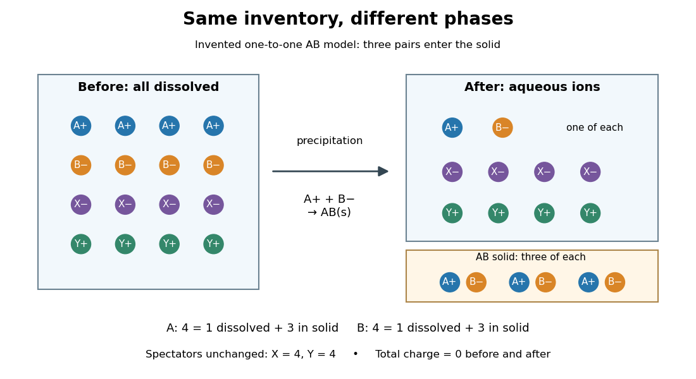

**[Figure 1](#image-precipitation-species-and-phase-balance). Precipitation transfers selected ions into a solid while conserving inventories**. Original one-to-one model: four A [cations](chemistry.md#cation) and four B [anions](chemistry.md#anion) initially dissolved; three of each enter AB [solid](thermodynamics.md#solid), leaving one of each dissolved. Four X [anions](chemistry.md#anion) and four Y [cations](chemistry.md#cation) are [spectator ions](#spectator-ion) throughout. Counts are illustrative, not measured, and do not represent the [calcium carbonate](ionic-bonding.md#calcium-carbonate) experiment or determine a [solubility product](#solubility-product).

For this schematic, let $\xi$ be the [amount of substance](physics.md#amount-of-substance) of AB formed. With no competing [chemical reactions](chemical-reaction.md) or losses,

$$
n_{\mathrm A,aq}=n_{\mathrm A,0}-\xi,\qquad n_{\mathrm B,aq}=n_{\mathrm B,0}-\xi,\qquad n_{\mathrm{AB},s}=\xi,
\qquad 0\le\xi\le\min(n_{\mathrm A,0},n_{\mathrm B,0}).
$$

Adding each dissolved inventory to its contribution in the [solid](thermodynamics.md#solid) recovers its initial total. Each dissolved pair has net [electric charge](electric-charge.md) zero, so transferring a pair into neutral AB also preserves [electric charge conservation](electric-charge.md#charge-conservation). This is a short [stoichiometry](#stoichiometry) argument; choosing the actual $\xi$ additionally needs [chemical equilibrium](chemical-potential.md#chemical-equilibrium) or [chemical kinetics](chemical-kinetics.md) information.

#### Spectator ion

↑ **Parent:** [Net ionic equation](#net-ionic-equation)

A [spectator ion](#spectator-ion) cancels from the chosen [net ionic equation](#net-ionic-equation) because its net inventory is unchanged. This label does not make it physically irrelevant: dissolved [spectator ions](#spectator-ion) contribute to [ionic strength](mixture.md#ionic-strength), which affects [activity coefficients](chemical-potential.md#activity-coefficient). Their [concentrations](mathematical-physics.md#concentration) can also change during dilution even though their [amount of substance](physics.md#amount-of-substance) remains fixed.

### Solubility product

↑ **Parent:** [Precipitation (chemistry)](#precipitation-chemistry)

The [solubility product](#solubility-product) is the [equilibrium constant](chemical-potential.md#equilibrium-constant) for dissolution of a specified [solid](thermodynamics.md#solid) into its dissolved [ions](chemistry.md#ion). For a pure bulk AB [solid](thermodynamics.md#solid) at the chosen [temperature](temperature.md), [pressure](pressure.md) and [standard states](chemical-potential.md#standard-state),

$$
\mathrm{AB}(s)\rightleftharpoons\mathrm A^+(aq)+\mathrm B^-(aq),\qquad K_{\mathrm{sp}}=a_{\mathrm A}a_{\mathrm B}.
$$

The pure bulk [solid](thermodynamics.md#solid)'s [thermodynamic activity](chemical-potential.md#thermodynamic-activity) is one in this convention. Coexisting [solid](thermodynamics.md#solid) and [chemical solution](mixture.md#solution-chemistry) at [chemical equilibrium](chemical-potential.md#chemical-equilibrium) give this equality. If all available [solid](thermodynamics.md#solid) dissolves, the final [chemical solution](mixture.md#solution-chemistry) may instead be undersaturated; do not impose equality merely because a salt was initially added.[Chemistry 2e, §15.1, The Solubility Product: saturated solution with excess solid and dissolution equilibrium](chemistry-bibliography.md#chemistry-2e-by-paul-flowers-and-others/15-1-precipitation-and-dissolution)

Using the [thermodynamic activity](chemical-potential.md#thermodynamic-activity) definition $a_i=\gamma_i c_i/c^\circ$, with [activity coefficients](chemical-potential.md#activity-coefficient) $\gamma_i$ and reference [molar concentration](mathematical-physics.md#molar-concentration) $c^\circ$, gives the independent conversion

$$
K_{\mathrm{sp}}=\gamma_{\mathrm A}\gamma_{\mathrm B}\frac{c_{\mathrm A}c_{\mathrm B}}{(c^\circ)^2},\qquad K_{\mathrm{sp},c}=\frac{K_{\mathrm{sp}}(c^\circ)^2}{\gamma_{\mathrm A}\gamma_{\mathrm B}}.
$$

Thus $K_{\mathrm{sp}}$ is [dimensionless](physics.md#dimensionless-quantity), while the conditional concentration form $K_{\mathrm{sp},c}$ has units $\mathrm M^2$ for this one-to-one model. Treating $K_{\mathrm{sp},c}$ as constant requires a justified fixed or approximately fixed [activity coefficient](chemical-potential.md#activity-coefficient) product. Changing [ionic strength](mixture.md#ionic-strength) can change that product even at fixed [temperature](temperature.md); changing [temperature](temperature.md) can change the [equilibrium constant](chemical-potential.md#equilibrium-constant) itself. Specify the [solid](thermodynamics.md#solid) [thermodynamic phase](thermodynamics.md#thermodynamic-phase) too: different [crystal polymorphs](thermodynamics.md#crystal-polymorph) need not have the same [solubility product](#solubility-product).

#### Molar solubility

↑ **Parent:** [Solubility product](#solubility-product)

The [molar solubility](#molar-solubility) $s$ is the [amount of substance](physics.md#amount-of-substance) of a specified [solid](thermodynamics.md#solid) dissolved per [volume](thermodynamics.md#volume-thermodynamics) of saturated [chemical solution](mixture.md#solution-chemistry), under stated conditions. It counts dissolved formula units, not the sum of all dissolved [ion](chemistry.md#ion) [concentrations](mathematical-physics.md#concentration). For AB with no initial A or B and no competing [chemical reactions](chemical-reaction.md), one-to-one [stoichiometry](#stoichiometry) gives $c_{\mathrm A}=c_{\mathrm B}=s$. For an AB$_2$ [solid](thermodynamics.md#solid), the corresponding [concentrations](mathematical-physics.md#concentration) are $s$ and $2s$.[Chemistry 2e by Paul Flowers and others; §15.1, Ksp and Solubility: dissolution coefficients relate molar solubility to individual ion concentrations](chemistry-bibliography.md#chemistry-2e-by-paul-flowers-and-others/15-1-precipitation-and-dissolution)

#### Solubility product and material balance

↑ **Parent:** [Solubility product](#solubility-product)

A [solubility product](#solubility-product) constrains a product of [thermodynamic activities](chemical-potential.md#thermodynamic-activity); the available inventories determine which combinations of [concentrations](mathematical-physics.md#concentration) are possible. Their intersection determines the [molar solubility](#molar-solubility). Consider an original, abstract AB [solid](thermodynamics.md#solid), with the preceding one-to-one dissolution [chemical equation](#chemical-equation). Stipulate $c^\circ=1\,\mathrm M$, $\gamma_{\mathrm A}=\gamma_{\mathrm B}=1$ and $K_{\mathrm{sp},c}=10^{-4}\,\mathrm M^2$ at fixed [temperature](temperature.md) and [pressure](pressure.md). Thus $K_{\mathrm{sp}}=10^{-4}$ is [dimensionless](physics.md#dimensionless-quantity). These are chosen model parameters, not data for an identified material.

Initially, a completely dissociated soluble XB [salt](ionic-bonding.md#salt-chemistry) supplies B [anions](chemistry.md#anion) at [molar concentration](mathematical-physics.md#molar-concentration) $c_0\geq0$ and X [cations](chemistry.md#cation) at the same [molar concentration](mathematical-physics.md#molar-concentration); A is absent. All three [ions](chemistry.md#ion) have unit [electric charge](electric-charge.md) magnitude. X remains a [spectator ion](#spectator-ion), and only AB can form a [solid](thermodynamics.md#solid). Assume constant [volume](thermodynamics.md#volume-thermodynamics), no additional [chemical reactions](chemical-reaction.md), and negligible contributions from [self-ionization of water](chemical-substance.md#self-ionization-of-water). Dissolving AB raises both reacting-ion [concentrations](mathematical-physics.md#concentration) by the same $s$:

$$
c_{\mathrm A}=s,\qquad c_{\mathrm B}=c_0+s,\qquad c_{\mathrm X}=c_0.
$$

[Charge neutrality](electric-charge.md#charge-neutrality) is satisfied: $c_{\mathrm A}+c_{\mathrm X}-c_{\mathrm B}=s+c_0-(s+c_0)=0$. Adding B alone without its accompanying [cation](chemistry.md#cation) would omit the initial [electric charge](electric-charge.md) balance.

In the plane of the two reacting-ion [concentrations](mathematical-physics.md#concentration), this inventory constraint is the [line](euclidean-geometry.md#straight-line) $c_{\mathrm B}=c_{\mathrm A}+c_0$. Saturation supplies the [hyperbola](euclidean-geometry.md#hyperbola) $c_{\mathrm B}=K_{\mathrm{sp},c}/c_{\mathrm A}$ for $c_{\mathrm A}>0$. Their positive intersection solves a [quadratic equation](polynomial.md#quadratic-equation):

$$
s(s+c_0)=K_{\mathrm{sp},c},\qquad
s_* =\frac{\sqrt{c_0^2+4K_{\mathrm{sp},c}}-c_0}{2}
=\frac{2K_{\mathrm{sp},c}}{\sqrt{c_0^2+4K_{\mathrm{sp},c}}+c_0}.
$$

The [quadratic formula](polynomial.md#quadratic-formula) supplies two [roots of a polynomial](polynomial.md#root-of-a-polynomial); only the positive one is a physical [concentration](mathematical-physics.md#concentration). Uniqueness also follows because $s(s+c_0)$ strictly increases for $s\geq0$, starting at zero and growing without bound. The second expression, obtained by multiplying by the conjugate, avoids subtraction of nearly equal numbers at large $c_0$.

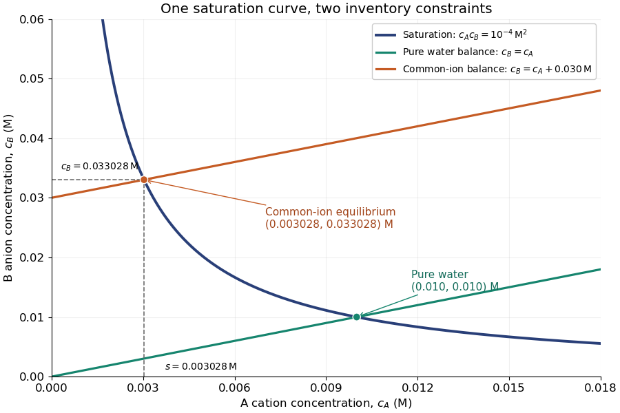

**[Figure 2](#image-solubility-product-and-material-balance-and-the-conditional-solubility-product-select-the-dissolved-concentrations). Solubility product and material balance and the conditional solubility product select the dissolved concentrations**. Original stipulated AB model with $K_{\mathrm{sp},c}=10^{-4}\,\mathrm M^2$ and unit [activity coefficients](chemical-potential.md#activity-coefficient). Intersections of the saturation [hyperbola](euclidean-geometry.md#hyperbola) with inventory [lines](euclidean-geometry.md#straight-line) give the pure-[water](chemical-substance.md#water) and common-ion [chemical equilibrium](chemical-potential.md#chemical-equilibrium) compositions. The dashed projections read the $c_0=0.03\,\mathrm M$ intersection; these curves are calculated constraints, not measured data or a time evolution.

For pure [water](chemical-substance.md#water), $c_0=0$ gives $s_*=\sqrt{K_{\mathrm{sp},c}}=0.010\,\mathrm M$. For $c_0=0.030\,\mathrm M$,

$$
s_*\approx0.003027756\,\mathrm M,\qquad
c_{\mathrm B}\approx0.033027756\,\mathrm M.
$$

Their product is $10^{-4}\,\mathrm M^2$, although neither [concentration](mathematical-physics.md#concentration) equals the pure-[water](chemical-substance.md#water) value. This is the useful geometrical distinction: an inventory [line](euclidean-geometry.md#straight-line) and an [equilibrium constant](chemical-potential.md#equilibrium-constant) specify different constraints.

Check the [solid](thermodynamics.md#solid) inventory before imposing saturation. If the initially added AB has [amount of substance](physics.md#amount-of-substance) $n_0$ in [volume](thermodynamics.md#volume-thermodynamics) $V$, the saturated branch requires $n_0>Vs_*$ for excess [solid](thermodynamics.md#solid) to remain. For example, choose $n_0=0.0020\,\mathrm{mol}$ and $V=0.100\,\mathrm L$. In pure [water](chemical-substance.md#water), $0.0010\,\mathrm{mol}$ dissolves and the same [amount of substance](physics.md#amount-of-substance) remains as [solid](thermodynamics.md#solid). At $c_0=0.030\,\mathrm M$, approximately $0.0003027756\,\mathrm{mol}$ dissolves, leaving $0.0016972244\,\mathrm{mol}$ as [solid](thermodynamics.md#solid). In this model, an insufficient supply instead gives

$$
s=\min\{n_0/V,s_*\}.
$$

If $n_0/V<s_*$, all AB dissolves and the [ion product](#ion-product) is below the [solubility product](#solubility-product). At $n_0/V=s_*$, the last [solid](thermodynamics.md#solid) disappears exactly at saturation.

#### Common-ion effect

↑ **Parent:** [Solubility product](#solubility-product)

The [common-ion effect](#common-ion-effect) is the change in a [chemical equilibrium](chemical-potential.md#chemical-equilibrium) caused by adding an [ion](chemistry.md#ion) already participating in it. In the fixed-[activity coefficient](chemical-potential.md#activity-coefficient) AB model, adding the common B [anion](chemistry.md#anion) lowers the [molar solubility](#molar-solubility). The shared [ion](chemistry.md#ion) participates regardless of which [salt](ionic-bonding.md#salt-chemistry) supplied it.[Chemistry 2e by Paul Flowers and others; §15.1, Common Ion Effect: adding an ion also produced by dissolution shifts the solubility equilibrium](chemistry-bibliography.md#chemistry-2e-by-paul-flowers-and-others/15-1-precipitation-and-dissolution)

The preceding [solubility product and material balance](#solubility-product-and-material-balance) give a short proof without a qualitative slogan. Taking a [derivative](calculus.md#derivative) of $s_*^2+c_0s_*=K_{\mathrm{sp},c}$ at fixed $K_{\mathrm{sp},c}$ gives

$$
(2s_*+c_0)\frac{ds_*}{dc_0}+s_*=0,\qquad
\frac{ds_*}{dc_0}=-\frac{s_*}{2s_*+c_0}<0.
$$

Thus the [molar solubility](#molar-solubility) decreases continuously as $c_0$ increases. At $c_0=0$, the [derivative](calculus.md#derivative) is $-1/2$; for a very large common-ion background, the rationalized expression approaches $K_{\mathrm{sp},c}/c_0$. The [solubility product](#solubility-product) is fixed within this model even while the [molar solubility](#molar-solubility) changes.

Neglecting $s_*$ beside $c_0$ replaces $s_*(c_0+s_*)=K_{\mathrm{sp},c}$ by $c_0s_{\mathrm{app}}=K_{\mathrm{sp},c}$. This approximation always overestimates the exact [molar solubility](#molar-solubility), since it neglects the B [anions](chemistry.md#anion) supplied by AB itself. For $c_0>0$, its [relative error](numerical-analysis.md#relative-error) has an exact simple form:

$$
s_{\mathrm{app}}=\frac{K_{\mathrm{sp},c}}{c_0}
=s_*+\frac{s_*^2}{c_0},\qquad
\frac{s_{\mathrm{app}}-s_*}{s_*}=\frac{s_*}{c_0}.
$$

At $c_0=0.030\,\mathrm M$, $s_{\mathrm{app}}=0.003333333\,\mathrm M$, approximately $10.1\%$ too high. At $c_0=0.100\,\mathrm M$, $s_*=0.000990195\,\mathrm M$ and $s_{\mathrm{app}}=0.001000000\,\mathrm M$, approximately $0.990\%$ too high. A small [solubility product](#solubility-product) by itself does not justify the approximation: the common-ion background must be large compared with the resulting [molar solubility](#molar-solubility).

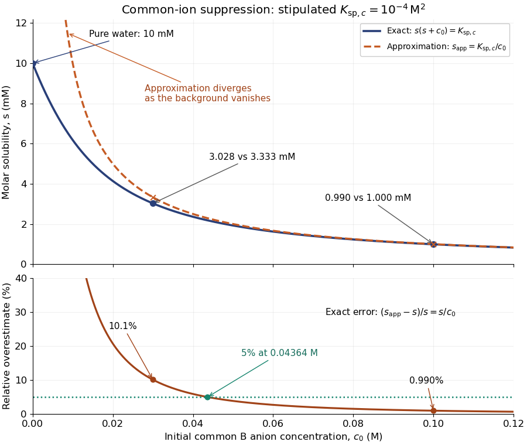

**[Figure 3](#image-common-ion-suppression-and-the-error-from-neglecting-the-solid-s-own-b-anions). Common-ion suppression and the error from neglecting the solid's own B anions**. Original curves for the same stipulated AB model, with exact [molar solubility](#molar-solubility) and $K_{\mathrm{sp},c}/c_0$ approximation. The exact curve reaches $0.010\,\mathrm M$ at $c_0=0$; the approximation diverges there. The lower panel shows its exact [relative error](numerical-analysis.md#relative-error), with markers at $0.030$ and $0.100\,\mathrm M$. No curve represents experimental measurements of a named substance.

For a desired fractional [relative error](numerical-analysis.md#relative-error) at most $\varepsilon>0$, substituting $s_*/c_0\leq\varepsilon$ into the exact balance gives the equivalent criterion

$$
c_0\geq\sqrt{\frac{K_{\mathrm{sp},c}}{\varepsilon(1+\varepsilon)}}.
$$

For this model, a $5\%$ tolerance requires $c_0\geq0.0436436\,\mathrm M$. This bound concerns only the algebraic approximation. In a real [chemical solution](mixture.md#solution-chemistry), changes in [ionic strength](mixture.md#ionic-strength) and [activity coefficients](chemical-potential.md#activity-coefficient), or competing [chemical reactions](chemical-reaction.md), can invalidate a constant $K_{\mathrm{sp},c}$ even when this bound is met.

#### Solubility product measurement by titration

↑ **Parent:** [Solubility product](#solubility-product)

How can an invisible dissolved inventory be measured? The unsigned laboratory handout [Solubility Product Constant, Ksp, for Calcium Hydroxide by Acid-Base Titration](https://www.webassign.net/question_assets/ucscgencheml1/updated_labs2020/lab-10-procedure-2020.pdf), Procedure, starts with saturated [calcium hydroxide](chemical-substance.md#calcium-hydroxide), supplied by the teacher or prepared from [calcium](chemical-substance.md#calcium) and [water](chemical-substance.md#water). Its apparatus includes filter paper, a funnel, stoppered flasks, a [volumetric pipette](acid-base-chemistry.md#volumetric-pipette), a volumetric flask and a [burette](acid-base-chemistry.md#burette). Two successive rounds of [filtration](mixture.md#filtration-chemistry) remove particles. The filtrate is stoppered to reduce [carbon dioxide](chemical-substance.md#carbon-dioxide) exposure. A $10.00\,\mathrm{mL}$ [aliquot](acid-base-chemistry.md#aliquot) is diluted with deionized [water](chemical-substance.md#water) and titrated with standardized [hydrochloric acid](acid-base-chemistry.md#hydrochloric-acid); [bromothymol blue](acid-base-chemistry.md#bromothymol-blue) gives a pale-green [titration endpoint](acid-base-chemistry.md#titration-endpoint). The readout is the difference between final and initial [burette](acid-base-chemistry.md#burette) readings; four consistent trials are required.[pp. 3–7, Procedure: gravity filtration steps 2–7, HCl preparation steps 8–14, and titrations steps 15–19](chemistry-bibliography.md#solubility-product-constant-ksp-for-calcium-hydroxide-by-acid-base-titration-university-of-california-santa-cruz)

Unlike AB, [calcium hydroxide](chemical-substance.md#calcium-hydroxide) has one-to-two dissolution [stoichiometry](#stoichiometry):

$$
\mathrm{Ca(OH)_2}(s)\rightleftharpoons\mathrm{Ca}^{2+}(aq)+2\mathrm{OH}^-(aq),\qquad
K_{\mathrm{sp},c}=[\mathrm{Ca}^{2+}][\mathrm{OH}^-]^2.
$$

For [molar solubility](#molar-solubility) $s$ in the ideal model with no background [calcium](chemical-substance.md#calcium) or [hydroxide](chemistry.md#hydroxide), no additional [chemical reactions](chemical-reaction.md), and negligible [self-ionization of water](chemical-substance.md#self-ionization-of-water), $[\mathrm{Ca}^{2+}]=s$ and $[\mathrm{OH}^-]=2s$. Hence $K_{\mathrm{sp},c}=4s^3$, with units $\mathrm M^3$; it is not the AB constant used in the figures. The [neutralization](acid-base-chemistry.md#neutralization) [chemical equation](#chemical-equation) is $\mathrm H^++\mathrm{OH}^-\longrightarrow\mathrm H_2\mathrm O$. Let $C_H$ be the known [titrant](acid-base-chemistry.md#titrant) [molar concentration](mathematical-physics.md#molar-concentration), $v$ its delivered [volume](thermodynamics.md#volume-thermodynamics) at the [equivalence point](acid-base-chemistry.md#equivalence-point), and $V_a$ the original [aliquot](acid-base-chemistry.md#aliquot) [volume](thermodynamics.md#volume-thermodynamics). Then the inventory calculation is

$$
h=[\mathrm{OH}^-]=\frac{C_Hv}{V_a},\qquad
s=\frac h2,\qquad K_{\mathrm{sp},c}=\frac{h^3}{2}.
$$

Dilution of the [aliquot](acid-base-chemistry.md#aliquot) changes its [concentration](mathematical-physics.md#concentration) during the [acid-base titration](acid-base-chemistry.md#acid-base-titration), but preserves its initial [amount of substance](physics.md#amount-of-substance) of [hydroxide](chemistry.md#hydroxide). Therefore $V_a$, rather than the diluted flask [volume](thermodynamics.md#volume-thermodynamics), belongs in the denominator.

The handout identifies two biases: carried-over [calcium hydroxide](chemical-substance.md#calcium-hydroxide) [solid](thermodynamics.md#solid) dissolves during [acid-base titration](acid-base-chemistry.md#acid-base-titration), consuming extra [titrant](acid-base-chemistry.md#titrant); [carbon dioxide](chemical-substance.md#carbon-dioxide) consumes [hydroxide](chemistry.md#hydroxide) and forms [calcium carbonate](ionic-bonding.md#calcium-carbonate). Filtration and stoppering address these effects, while repeat trials test consistency. Its review questions also ask about dissolved ion pairs, which filtration cannot remove.[pp. 2–4, filtration and CO2 discussion; p. 9, Discussion Questions and Review Topics, ion pairs and dissolved CO2](chemistry-bibliography.md#solubility-product-constant-ksp-for-calcium-hydroxide-by-acid-base-titration-university-of-california-santa-cruz)

Further controls would compare a [water](chemical-substance.md#water) blank, independently verify [titrant standardization](acid-base-chemistry.md#titrant-standardization), and record the saturation [temperature](temperature.md); these are proposed checks, not reported measurements. A [titration endpoint](acid-base-chemistry.md#titration-endpoint) estimates the [equivalence point](acid-base-chemistry.md#equivalence-point) and may introduce a systematic offset. Even perfect inventory measurement does not determine [activity coefficients](chemical-potential.md#activity-coefficient). Recovering the [dimensionless](physics.md#dimensionless-quantity) thermodynamic [solubility product](#solubility-product) additionally requires

$$
K_{\mathrm{sp}}=\gamma_{\mathrm{Ca}}\gamma_{\mathrm{OH}}^2\frac{K_{\mathrm{sp},c}}{(c^\circ)^3}.
$$

This explains both the power and the limit of the experiment: [acid-base titration](acid-base-chemistry.md#acid-base-titration) measures a dissolved inventory, while the link from that inventory to a thermodynamic [equilibrium constant](chemical-potential.md#equilibrium-constant) still depends on a chemical model.

#### Ion product

↑ **Parent:** [Solubility product](#solubility-product)

The [ion product](#ion-product) evaluates the same dissolved-ion [thermodynamic activity](chemical-potential.md#thermodynamic-activity) product as the [solubility product](#solubility-product), but at the current composition rather than necessarily at [chemical equilibrium](chemical-potential.md#chemical-equilibrium). For AB, $Q_{\mathrm{sp}}=a_{\mathrm A}a_{\mathrm B}$; its concentration counterpart is $Q_c=c_{\mathrm A}c_{\mathrm B}$. Compare $Q_c$ with $K_{\mathrm{sp},c}$ only under compatible [activity coefficient](chemical-potential.md#activity-coefficient) assumptions.[Chemistry 2e, §15.1, Predicting Precipitation: comparison of reaction quotient and solubility product](chemistry-bibliography.md#chemistry-2e-by-paul-flowers-and-others/15-1-precipitation-and-dissolution)

For other [stoichiometries](#stoichiometry), use the dissolution coefficients as powers: $\mathrm{AB}_2(s)\rightleftharpoons\mathrm A^{2+}(aq)+2\mathrm B^-(aq)$ gives $Q_{\mathrm{sp}}=a_{\mathrm A}a_{\mathrm B}^2$. A [solubility product](#solubility-product) is not itself the [molar concentration](mathematical-physics.md#molar-concentration) dissolved; even in the ideal AB model in pure [water](chemical-substance.md#water), that [concentration](mathematical-physics.md#concentration) is $\sqrt{K_{\mathrm{sp},c}}$.

#### Saturation criterion for precipitation

↑ **Parent:** [Solubility product](#solubility-product)

Relative to the specified [solid](thermodynamics.md#solid), $Q_{\mathrm{sp}}<K_{\mathrm{sp}}$ favors [dissolution](ionic-bonding.md#dissolution) if that [solid](thermodynamics.md#solid) is available; $Q_{\mathrm{sp}}>K_{\mathrm{sp}}$ favors [precipitation](#precipitation-chemistry); equality marks saturation. These comparisons identify a driving direction favored by [thermodynamics](thermodynamics.md), not a [reaction rate](chemical-kinetics.md#reaction-rate).[Chemistry 2e, §15.1, Predicting Precipitation: unsaturated, saturated and supersaturated cases](chemistry-bibliography.md#chemistry-2e-by-paul-flowers-and-others/15-1-precipitation-and-dissolution)

A proof outline comes from the reaction [Gibbs free energy](thermodynamic-potential.md#gibbs-free-energy) for dissolution:

$$
\Delta_rG=RT\ln\!\left(\frac{Q_{\mathrm{sp}}}{K_{\mathrm{sp}}}\right).
$$

Here $R$ is the [molar gas constant](ideal-gas.md#molar-gas-constant) and $T>0$ the absolute [temperature](temperature.md). If $Q_{\mathrm{sp}}>K_{\mathrm{sp}}$, the [logarithm](calculus.md#logarithm) is positive, making the reverse transfer into [solid](thermodynamics.md#solid) favorable. At equality the bulk driving difference vanishes. Equality can also occur at the boundary where the last [solid](thermodynamics.md#solid) disappears, but it is not a universal constraint on every solid-free [chemical solution](mixture.md#solution-chemistry).

##### Supersaturated solution

↑ **Parent:** [Saturation criterion for precipitation](#saturation-criterion-for-precipitation)

A [supersaturated solution](#supersaturated-solution) has an [ion product](#ion-product) above the relevant [solubility product](#solubility-product). It can persist through [metastability](critical-phenomenon.md#metastability): [nucleation](critical-phenomenon.md#nucleation) must first create a sufficiently large new [solid](thermodynamics.md#solid) region. Added surfaces, impurities and mixing history can affect that barrier. Therefore a clear sample during a finite observation does not prove undersaturation, and visible cloudiness does not measure the [ion product](#ion-product).

#### Precipitation after equal-volume mixing

↑ **Parent:** [Solubility product](#solubility-product)

Consider an original toy AB [salt](ionic-bonding.md#salt-chemistry) model with $K_{\mathrm{sp},c}=10^{-8}\,\mathrm M^2$ stipulated at fixed [temperature](temperature.md) and fixed [activity coefficient](chemical-potential.md#activity-coefficient) product. This is a conditional concentration constant, not measured data for [calcium carbonate](ionic-bonding.md#calcium-carbonate) or any identified material. A stock contains A [cations](chemistry.md#cation) and X [anions](chemistry.md#anion); another contains Y [cations](chemistry.md#cation) and B [anions](chemistry.md#anion). All four [ions](chemistry.md#ion) have unit [electric charge](electric-charge.md) magnitude. Only AB can form a [solid](thermodynamics.md#solid); X and Y remain [spectator ions](#spectator-ion). Assume full dissociation, no other [chemical reactions](chemical-reaction.md), and a mixed [volume](thermodynamics.md#volume-thermodynamics) equal to the sum of the initial [volumes](geometry-and-topology.md#volume).

Mix two stocks, each of [volume](thermodynamics.md#volume-thermodynamics) $V$,, each at [molar concentration](mathematical-physics.md#molar-concentration) $C$ of its indicated [salt](ionic-bonding.md#salt-chemistry). Before any [precipitation](#precipitation-chemistry), the mixed [volume](thermodynamics.md#volume-thermodynamics) is $2V$, so

$$
c_{\mathrm A,0}=c_{\mathrm B,0}=\frac{CV}{2V}=\frac C2,\qquad Q_{c,0}=\frac{C^2}{4}.
$$

Multiplying the two stock [concentrations](mathematical-physics.md#concentration) would overestimate the mixed [ion product](#ion-product) by a factor of four. The saturation threshold is $C=2\sqrt{K_{\mathrm{sp},c}}=2\times10^{-4}\,\mathrm M$.

If $C=10^{-4}\,\mathrm M$, mixing gives $Q_{c,0}=2.5\times10^{-9}\,\mathrm M^2<K_{\mathrm{sp},c}$: no AB [precipitate](#precipitate) is favored. If $C=4\times10^{-4}\,\mathrm M$, mixing gives $Q_{c,0}=4\times10^{-8}\,\mathrm M^2>K_{\mathrm{sp},c}$. Suppose [nucleation](critical-phenomenon.md#nucleation) occurs and bulk AB [solid](thermodynamics.md#solid) remains at [chemical equilibrium](chemical-potential.md#chemical-equilibrium). Equal starting inventories and one-to-one [stoichiometry](#stoichiometry) require equal remaining [concentrations](mathematical-physics.md#concentration), hence

$$
c_{\mathrm A,eq}=c_{\mathrm B,eq}=\sqrt{K_{\mathrm{sp},c}}=10^{-4}\,\mathrm M,\qquad
\frac{n_{\mathrm{AB},s}}{2V}=\frac C2-10^{-4}\,\mathrm M=10^{-4}\,\mathrm M.
$$

For two $10\,\mathrm{mL}$ portions in the second case, each reacting [ion](chemistry.md#ion) starts with $4\,\mathrm{\mu mol}$; the final $20\,\mathrm{mL}$ [chemical solution](mixture.md#solution-chemistry) retains $2\,\mathrm{\mu mol}$ of each, and $2\,\mathrm{\mu mol}$ of AB enters the [solid](thermodynamics.md#solid). The respective X and Y inventories stay at $4\,\mathrm{\mu mol}$. Exactly half of each reacting inventory precipitates in this toy model.

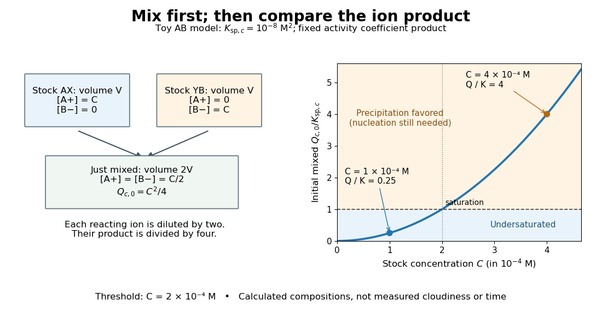

**[Figure 4](#image-precipitation-mixing-saturation-threshold). Equal-volume dilution changes the ion product before precipitation**. Original conditional AB model with $K_{\mathrm{sp},c}=10^{-8}\,\mathrm M^2$. Left: the two reacting-ion [concentrations](mathematical-physics.md#concentration) occupy different stocks and each halves on mixing. Right: the initial mixed [ion product](#ion-product) relative to $K_{\mathrm{sp},c}$, with the two worked examples and saturation threshold. The curve is a model calculation, not measured cloudiness or a time trace.

The [chemical equilibrium](chemical-potential.md#chemical-equilibrium) calculation adds a phase constraint to the inventory balance. Write $x=n_{\mathrm{AB},s}/(2V)$ and $c=C/2-x$. In the equilibrated bulk model,

$$
x\ge0,\qquad c\ge0,\qquad c^2\le K_{\mathrm{sp},c},\qquad x\bigl(K_{\mathrm{sp},c}-c^2\bigr)=0.
$$

When $x>0$, the last condition requires saturation; when $x=0$, the inventory can leave an undersaturated [chemical solution](mixture.md#solution-chemistry). Together these give $x=\max\{0,C/2-\sqrt{K_{\mathrm{sp},c}}\}$. This excludes a persistent [supersaturated solution](#supersaturated-solution) by its explicit [chemical equilibrium](chemical-potential.md#chemical-equilibrium) assumption; it does not model a [nucleation](critical-phenomenon.md#nucleation) delay.

### Calcium carbonate precipitation experiment

↑ **Parent:** [Precipitation (chemistry)](#precipitation-chemistry)

The University of Utah's teaching module [Carbon Captured Chalk by Tony Butterfield](chemistry-bibliography.md#carbon-captured-chalk-by-tony-butterfield) describes a supervised demonstration. Its Materials and Methods uses a balance, weighing boats, spatula, separate centrifuge tubes, a volume-measuring vessel and filter paper. [Sodium carbonate](ionic-bonding.md#sodium-carbonate) and [calcium chloride](ionic-bonding.md#calcium-chloride) are dissolved separately in [water](chemical-substance.md#water) before mixing. The reported readout is an initially opaque mixture followed by a milky dispersion of fine [solid](thermodynamics.md#solid) particles; filtration retains the chalk-like product, which is then dried. The module also proposes observing drops together on a slide using an [optical microscope](optical-instrument.md#optical-microscope).[Carbon Captured Chalk, Materials and Methods, steps 1–13; Optional Activities and Extensions, microscope slide](chemistry-bibliography.md#carbon-captured-chalk-by-tony-butterfield)

The handout does not report blank trials. Useful additional controls would retain each starting [chemical solution](mixture.md#solution-chemistry) separately, mix each with [water](chemical-substance.md#water), and pass [water](chemical-substance.md#water) alone through the same filter. A new [solid](thermodynamics.md#solid) only in the combined sample would support a mixing-dependent [chemical reaction](chemical-reaction.md); these are proposed comparisons, not reported results. Residue from a filter blank would instead flag contamination.

Cloudiness plus a retained [solid](thermodynamics.md#solid) supports phase separation; appearance alone cannot establish composition, a particular [crystal polymorph](thermodynamics.md#crystal-polymorph), quantitative yield or the [solubility product](#solubility-product). Fine [solid](thermodynamics.md#solid) particles may pass through a filter, and retained liquid can leave dissolved [salts](ionic-bonding.md#salt-chemistry) on drying. Identifying [calcium carbonate](ionic-bonding.md#calcium-carbonate) needs additional chemical or structural evidence. The teaching source supplies no measured [ion products](#ion-product), instrument-calibrated cloudiness series or equilibration test. Its concentrated demonstration therefore illustrates [precipitation](#precipitation-chemistry) without validating the toy model's conditional constant or proving complete removal of dissolved [calcium](chemical-substance.md#calcium).

## Redox

↑ **Parent:** [Chemical reaction](chemical-reaction.md)  
ⓦ [Wiki](https://en.wikipedia.org/wiki/Redox)

A [redox](#redox) [chemical reaction](chemical-reaction.md) couples [oxidation](#oxidation) and [reduction](#reduction-chemistry). In the [electrode](electrochemistry.md#electrode) examples here, [oxidation](#oxidation) releases [electrons](physics.md#electron) and [reduction](#reduction-chemistry) accepts them. [§4.2, “Oxidation-Reduction Reactions”: paired electron loss and gain](chemistry-bibliography.md#chemistry-2e-by-paul-flowers-and-others)

[Redox](#redox) can be recognized by changes in [oxidation state](#oxidation-state): an increase records [oxidation](#oxidation), a decrease [reduction](#reduction-chemistry). These are formal [electron](physics.md#electron) assignments, distinct from measured [partial atomic charges](chemical-bond.md#partial-atomic-charge). [Half-reactions](electrochemistry.md#half-reaction) expose the matching loss and gain, making [electric charge conservation](electric-charge.md#charge-conservation) visible.[§4.2, “Oxidation-Reduction Reactions”: oxidation-number definition and complementary processes](chemistry-bibliography.md#chemistry-2e-by-paul-flowers-and-others)

The [electron](physics.md#electron) accounting need not describe free [electrons](physics.md#electron) travelling between spatially separated [chemical species](mathematical-biology.md#chemical-species). For example, in $2\mathrm H_2+\mathrm O_2\longrightarrow2\mathrm H_2\mathrm O$, [hydrogen](chemical-substance.md#hydrogen) changes from [oxidation state](#oxidation-state) $0$ to $+1$ and [oxygen](chemical-substance.md#oxygen) from $0$ to $-2$. Four [hydrogen](chemical-substance.md#hydrogen) [chemical atoms](physics.md#atom-physics) lose four formally assigned [electrons](physics.md#electron) in total; two [oxygen](chemical-substance.md#oxygen) [chemical atoms](physics.md#atom-physics) gain four. The [water](chemical-substance.md#water) product has [covalent bonds](covalent-bond.md), and these assignments do not turn it into separated [ions](chemistry.md#ion). See [ionic approximation of bonds](#ionic-approximation-of-bonds) and [electron transfer and ionic character](ionic-bonding.md#electron-transfer-and-ionic-character).

By contrast, [neutralization](acid-base-chemistry.md#neutralization) can rearrange [chemical bonds](chemical-bond.md) without changing [oxidation states](#oxidation-state):

$$
\mathrm H^+(aq)+\mathrm{OH}^-(aq)\longrightarrow\mathrm H_2\mathrm O(l).
$$

[Hydrogen](chemical-substance.md#hydrogen) remains $+1$ and [oxygen](chemical-substance.md#oxygen) remains $-2$. The aqueous [proton](physics.md#proton) notation abbreviates its interaction with [water](chemical-substance.md#water). This [acid-base chemistry](acid-base-chemistry.md) example conserves [electric charge](electric-charge.md) but has no matching increase and decrease of [oxidation state](#oxidation-state); movement of [ions](chemistry.md#ion) or a change of [chemical bonds](chemical-bond.md) alone does not establish [redox](#redox).

### Redox equilibrium

↑ **Parent:** [Redox](#redox)

A [chemical equilibrium](chemical-potential.md#chemical-equilibrium) involving coupled oxidation and reduction. Its position depends on activities and can be shifted by [complexation](chemistry.md#complexation), [hydrolysis](#hydrolysis) or [precipitation](#precipitation-chemistry), because these change the relative free energies of [oxidation states](#oxidation-state).

### Single-electron transfer

↑ **Parent:** [Redox](#redox)

Transfer of one [electron](physics.md#electron) between species, often converting an [enol](chemical-substance.md#enol) or [enolate](chemical-substance.md#enolate) into a [radical](chemistry.md#radical-chemistry). It must be distinguished from transfer of a two-electron [hydride](chemical-substance.md#hydride).

### Radiolytic autoreduction

↑ **Parent:** [Redox](#redox)

Reduction driven by products formed as radiation from a radioactive solute deposits energy in the solvent. A chemical oxidation-state change in surviving atoms is distinct from transmutation of the emitting nuclei.

### Redox electron balance

↑ **Parent:** [Redox](#redox)

Consider the reacting [zinc](chemical-substance.md#zinc) and [copper](chemical-substance.md#copper) species in the [zinc-copper displacement experiment](#zinc-copper-displacement-experiment). Split the net [chemical equation](#chemical-equation) into two [half-reactions](electrochemistry.md#half-reaction):

$$
\begin{aligned}
\text{oxidation:}\quad&\mathrm{Zn}(s)\longrightarrow\mathrm{Zn}^{2+}(aq)+2e^-,\\
\text{reduction:}\quad&\mathrm{Cu}^{2+}(aq)+2e^-\longrightarrow\mathrm{Cu}(s).
\end{aligned}
$$

The [zinc](chemical-substance.md#zinc) [oxidation state](#oxidation-state) rises from $0$ to $+2$; the [copper](chemical-substance.md#copper) [oxidation state](#oxidation-state) falls from $+2$ to $0$. Add the [half-reactions](electrochemistry.md#half-reaction): two released [electrons](physics.md#electron) match two accepted [electrons](physics.md#electron). Cancelling $2e^-$ from both sides gives[§4.2, “Balancing Redox Reactions via the Half-Reaction Method”, steps 6–7: matching and cancelling exchanged electrons](chemistry-bibliography.md#chemistry-2e-by-paul-flowers-and-others)

$$
\boxed{\mathrm{Zn}(s)+\mathrm{Cu}^{2+}(aq)\longrightarrow\mathrm{Zn}^{2+}(aq)+\mathrm{Cu}(s).}
$$

Thus the closed net [chemical reaction](chemical-reaction.md) has zero net production of free [electrons](physics.md#electron). Cancellation does not destroy [electrons](physics.md#electron): it removes a matched internal exchange from the written [chemical equation](#chemical-equation). The [half-reactions](electrochemistry.md#half-reaction) alone are incomplete descriptions of the whole reacting system. In a [galvanic cell](electrochemistry.md#galvanic-cell), the exchange can pass through a wire; in the [zinc-copper displacement experiment](#zinc-copper-displacement-experiment), the reacting materials meet at the same metal surface. The equations do not require a reservoir of free [electrons](physics.md#electron) in the bulk [chemical solution](mixture.md#solution-chemistry).

**[Figure 5](#image-redox-coupled-half-reaction-ledger). Electron bookkeeping with coupled half-reactions for zinc and copper**. Original algebraic diagram: both [half-reactions](electrochemistry.md#half-reaction) exchange two [electrons](physics.md#electron), so their sum has matching $2e^-$ terms. The cancellation indicates internal accounting, not an [electron](physics.md#electron) trajectory or an [elementary reaction](chemical-kinetics.md#elementary-reaction). No cell geometry or terminal polarity is implied.

Check both kinds of balance. The [oxidation](#oxidation) line has net [electric charge](electric-charge.md) $0$ on the left and $(+2-2)e=0$ on the right; the [reduction](#reduction-chemistry) line has $(+2-2)e=0$ on the left and $0$ on the right. The net [chemical equation](#chemical-equation) contains one [zinc](chemical-substance.md#zinc) and one [copper](chemical-substance.md#copper) [chemical atom](physics.md#atom-physics) on each side and has net [electric charge](electric-charge.md) $+2e$ on each side, where $e$ is the positive [elementary charge](electric-charge.md#elementary-charge). The written reacting species need not be electrically neutral as a group: the bulk [chemical solution](mixture.md#solution-chemistry) also contains compensating [anions](chemistry.md#anion).

There is an even more literal check. [Zinc](chemical-substance.md#zinc) has [atomic number](chemical-substance.md#atomic-number) $30$ and [copper](chemical-substance.md#copper) $29$, so the initial pair contains $30+(29-2)=57$ [electrons](physics.md#electron). The final pair contains $(30-2)+29=57$ [electrons](physics.md#electron). Only their distribution has changed. Conserved [chemical element](chemical-substance.md#chemical-element) counts give the usual chemical [mass conservation](continuum-mechanics.md#mass-conservation) inventory; changing the counts of neutral and charged species does not create or remove their [atomic nuclei](atomic-nucleus.md).

**[Figure 6](#image-redox-zinc-copper-conserved-counts). Conserved chemical atom, electric charge and total electron counts in zinc/copper redox**. Original exact count table for one net [chemical reaction](chemical-reaction.md) as written. The [electron](physics.md#electron) row counts all [electrons](physics.md#electron) assigned to the reacting species, not only [valence electrons](chemical-bond.md#valence-electron). The charge row is in units of the positive [elementary charge](electric-charge.md#elementary-charge). Omitted [anions](chemistry.md#anion) would make the bulk [chemical solution](mixture.md#solution-chemistry) neutral. These are counts, not measured amounts or a drawing of localized [electrons](physics.md#electron).

Matching [electrons](physics.md#electron) is necessary but does not replace balancing every [chemical element](chemical-substance.md#chemical-element). The [acidic permanganate-iron balance](#acidic-permanganate-iron-balance) illustrates unequal one- and five-[electron](physics.md#electron) exchanges, with [water](chemical-substance.md#water) and [protons](physics.md#proton) also needed. Conversely, a balanced [chemical equation](#chemical-equation) alone establishes neither a [reaction rate](chemical-kinetics.md#reaction-rate) nor a detailed mechanism. Its usefulness is that it fixes the [stoichiometry](#stoichiometry) even when those additional questions remain open.

### Zinc-copper displacement experiment

↑ **Parent:** [Redox](#redox)

An inspected university demonstration makes the paired changes visible. The 2021 Chemical Demonstrations Booklet hosted by Edith Cowan University describes two cut square [zinc](chemical-substance.md#zinc) strips, each immersed in a separate glass [beaker](chemistry.md#beaker-laboratory-equipment). One contains blue [copper(II) sulfate](chemical-substance.md#copper-ii-sulfate) [chemical solution](mixture.md#solution-chemistry), the other colourless [zinc sulfate](ionic-bonding.md#zinc-sulfate) [chemical solution](mixture.md#solution-chemistry). The published readouts are the appearance of a brown [copper](chemical-substance.md#copper) deposit on the first strip and fading of its blue [chemical solution](mixture.md#solution-chemistry); after thirty minutes more deposit is reported. The comparison strip in [zinc sulfate](ionic-bonding.md#zinc-sulfate) shows no visible change. The documented preparation is cutting the strips; surface polishing is not specified.[Chemical Demonstrations Booklet (2021), demonstration 16, printed p. 32, “Equipment”, “Preparation”, “Observations” and Figures 1–3; p. 33, Figure 4](chemistry-bibliography.md#chemical-demonstrations-booklet-by-magdalena-wajrak-and-tim-harrison)

The reported interpretation is conversion of dissolved $\mathrm{Cu}^{2+}$ to metallic [copper](chemical-substance.md#copper), accompanied by conversion of metallic [zinc](chemical-substance.md#zinc) to dissolved $\mathrm{Zn}^{2+}$. The [sulfate](chemistry.md#sulfate) [anions](chemistry.md#anion) balance bulk [electric charge](electric-charge.md) and cancel from the net [chemical equation](#chemical-equation). The comparison shows that merely immersing a [zinc](chemical-substance.md#zinc) strip in a [sulfate](chemistry.md#sulfate) [chemical solution](mixture.md#solution-chemistry) does not reproduce the visible coating.[Demonstration 16, printed pp. 32–33: zinc-sulfate comparison and zinc/copper-sulfate equation](chemistry-bibliography.md#chemical-demonstrations-booklet-by-magdalena-wajrak-and-tim-harrison)

Appearance is evidence for the proposed conversion, rather than a quantitative measurement of the two-[electron](physics.md#electron) ratio. Fading alone could also reflect dilution; deposit colour alone does not independently establish its composition. A stronger follow-up would compare the [copper](chemical-substance.md#copper) content of the [chemical solution](mixture.md#solution-chemistry) before and after, identify the solid, and check dissolved [zinc](chemical-substance.md#zinc). These are proposed analytical checks, not results reported in the booklet. Comparable starting [chemical solutions](mixture.md#solution-chemistry), surface condition, immersion and observation [time](classical-mechanics.md#time-in-physics) help interpret a comparison; an unchanged-looking strip does not rule out slow or invisible [chemical reactions](chemical-reaction.md).

The two-[electron](physics.md#electron) interpretation comes from the species identities and [electric charge](electric-charge.md) balance, supported by the paired observations. It does not imply that the coating's [mass](classical-mechanics.md#mass) equals the [mass](classical-mechanics.md#mass) of [zinc](chemical-substance.md#zinc) consumed: the same [amount of substance](physics.md#amount-of-substance) of different [chemical elements](chemical-substance.md#chemical-element) generally have different [molar masses](chemistry.md#molar-mass). Nor does it resolve microscopic surface sites or reaction pathways. The same net [redox](#redox) can be organized into separated compartments in a [Daniell cell](electrochemistry.md#daniell-cell) to obtain electrical [work](energy.md#work).

### Oxidizing agent

↑ **Parent:** [Redox](#redox)  
ⓦ [Wiki](https://en.wikipedia.org/wiki/Oxidizing_agent)

An [oxidizing agent](#oxidizing-agent) undergoes [reduction](#reduction-chemistry) by accepting the formal [electron](physics.md#electron) inventory. In the [zinc-copper displacement experiment](#zinc-copper-displacement-experiment), $\mathrm{Cu}^{2+}$ plays this role.[§4.2, “Oxidation-Reduction Reactions”: oxidizing agent is the species reduced](chemistry-bibliography.md#chemistry-2e-by-paul-flowers-and-others)

### Reducing agent

↑ **Parent:** [Redox](#redox)  
ⓦ [Wiki](https://en.wikipedia.org/wiki/Reducing_agent)

A [reducing agent](#reducing-agent) undergoes [oxidation](#oxidation) by supplying the formal [electron](physics.md#electron) inventory. In the [zinc-copper displacement experiment](#zinc-copper-displacement-experiment), metallic [zinc](chemical-substance.md#zinc) plays this role.[§4.2, “Oxidation-Reduction Reactions”: reducing agent is the species oxidized](chemistry-bibliography.md#chemistry-2e-by-paul-flowers-and-others)

### Oxidation

↑ **Parent:** [Redox](#redox)

An [oxidation](#oxidation) increases an [oxidation state](#oxidation-state), recording loss from the formal [electron](physics.md#electron) assignment. For $\mathrm{Zn}\to\mathrm{Zn}^{2+}+2e^-$, the increase is $0\to+2$. [Oxidation](#oxidation) need not involve [oxygen](chemical-substance.md#oxygen).[§4.2, “Oxidation-Reduction Reactions”: oxidation as increasing oxidation number](chemistry-bibliography.md#chemistry-2e-by-paul-flowers-and-others)

In the [electrochemistry](electrochemistry.md) examples here, [oxidation](#oxidation) is loss of [electrons](physics.md#electron) by a [chemical species](mathematical-biology.md#chemical-species); it occurs at the [anode](electrochemistry.md#anode). That [electrode](electrochemistry.md#electrode) definition holds in both a [galvanic cell](electrochemistry.md#galvanic-cell) and an [electrolytic cell](electrochemistry.md#electrolytic-cell); it does not fix terminal polarity. The oxidized [chemical species](mathematical-biology.md#chemical-species) serves as the [reducing agent](#reducing-agent) in the coupled [redox](#redox).

#### Zirconium-steam oxidation

↑ **Parent:** [Oxidation](#oxidation)

Reaction of [zirconium](chemical-substance.md#zirconium) with steam to form zirconium oxide and hydrogen. Its rate increases strongly with temperature; oxide formation and oxygen uptake alter heat transfer and mechanical behavior.

#### Alcohol oxidation

↑ **Parent:** [Oxidation](#oxidation)

Oxidation of an [alcohol](chemical-substance.md#alcohol) functional group. Primary and secondary alcohols have different accessible oxidation products, and overoxidation must be controlled.

##### Dess-Martin oxidation

↑ **Parent:** [Alcohol oxidation](#alcohol-oxidation)

Oxidation with a Dess–Martin periodinane reagent, commonly converting primary alcohols to aldehydes and secondary alcohols to ketones under mild conditions.

#### Epoxidation

↑ **Parent:** [Oxidation](#oxidation)

Conversion of an alkene to an [epoxide](chemical-substance.md#epoxide). Concerted oxygen transfer from a peracid preserves the relative stereochemical information of the alkene.

##### Electrophilic oxygen transfer

↑ **Parent:** [Epoxidation](#epoxidation)

Transfer of an oxidant [oxygen](chemical-substance.md#oxygen) atom to an unsaturated substrate, including controlled formation of an [epoxide](chemical-substance.md#epoxide).

##### Sharpless asymmetric epoxidation

↑ **Parent:** [Epoxidation](#epoxidation)

Enantioselective [oxygen](chemical-substance.md#oxygen) transfer to an allylic [alcohol](chemical-substance.md#alcohol) using a [titanium](chemical-substance.md#titanium)–tartrate complex and a [hydroperoxide](chemical-substance.md#hydroperoxide). With the [alkene](chemical-substance.md#alkene) horizontal and its hydroxymethyl substituent at lower right, L-(+)-tartrate directs delivery from the back face and D-(−)-tartrate from the front face. Rotate a structure in its plane to apply the mnemonic; reflecting it changes its [stereochemistry](stereochemistry.md).

##### Hydroxyl-directed epoxidation

↑ **Parent:** [Epoxidation](#epoxidation)

In [hydroxyl-directed epoxidation](#hydroxyl-directed-epoxidation), [hydrogen bonding](chemical-bond.md#hydrogen-bond) between an allylic hydroxyl and the oxidant favors [oxygen](chemical-substance.md#oxygen) delivery from a particular [alkene](chemical-substance.md#alkene) face. This influences [diastereoselectivity](stereochemistry.md#diastereoselectivity) without requiring an unchanged preference under every solvent or protecting-group condition.

#### Oxidation state

↑ **Parent:** [Oxidation](#oxidation)  
ⓦ [Wiki](https://en.wikipedia.org/wiki/Oxidation_state)

An [oxidation state](#oxidation-state) is an [electron](physics.md#electron)-bookkeeping assignment to a [chemical atom](physics.md#atom-physics): its [electric charge](electric-charge.md) number after the [ionic approximation of bonds](#ionic-approximation-of-bonds). It helps identify [oxidation](#oxidation) and [reduction](#reduction-chemistry) and determine [stoichiometry](#stoichiometry), even for [covalent bonds](covalent-bond.md) without separate charged [ions](chemistry.md#ion). In [water](chemical-substance.md#water), each [hydrogen](chemical-substance.md#hydrogen) has [oxidation state](#oxidation-state) $+1$ and [oxygen](chemical-substance.md#oxygen) has $-2$; this does not assert that a [water](chemical-substance.md#water) [molecule](molecule.md) contains two free [protons](physics.md#proton) and a free oxide [ion](chemistry.md#ion).[Karen, McArdle and Takats, Comprehensive definition of oxidation state (IUPAC Recommendations 2016), §2, pp. 832–833: definition and equal splitting of same-element bonds](chemistry-bibliography.md#comprehensive-definition-of-oxidation-state-iupac-recommendations-2016-by-pavel-karen-and-others)

Three conventions answer different questions. [Formal charge](covalent-bond.md#formal-charge) divides each bonding [electron pair](chemical-bond.md#electron-pair) equally in a chosen [Lewis structure](covalent-bond.md#lewis-structure). [Oxidation state](#oxidation-state) uses the [ionic approximation of bonds](#ionic-approximation-of-bonds). [Partial atomic charge](chemical-bond.md#partial-atomic-charge) instead partitions the actual [electron density](chemistry.md#electron-density) and depends on that partition. In the ordinary [water](chemical-substance.md#water) [Lewis structure](covalent-bond.md#lewis-structure), every [formal charge](covalent-bond.md#formal-charge) is zero although the [oxidation states](#oxidation-state) are not. Neither bookkeeping convention supplies numerical [partial atomic charges](chemical-bond.md#partial-atomic-charge).

##### Ionic approximation of bonds

↑ **Parent:** [Oxidation state](#oxidation-state)

For the routine examples here, assign all bonding [electrons](physics.md#electron) between different [chemical elements](chemical-substance.md#chemical-element) to the more [electronegative](electronegativity.md) partner; divide bonding [electrons](physics.md#electron) between identical [chemical elements](chemical-substance.md#chemical-element) equally. Retain each [lone pair](covalent-bond.md#lone-pair) on its original [chemical atom](physics.md#atom-physics). Subtract the assigned [valence electron](chemical-bond.md#valence-electron) count $N_i^{\mathrm{assigned}}$ from the neutral [chemical atom](physics.md#atom-physics)'s [valence electron](chemical-bond.md#valence-electron) count $v_i$. The IUPAC convention uses Allen [electronegativity](electronegativity.md), based on free-[chemical atom](physics.md#atom-physics) [valence electron](chemical-bond.md#valence-electron) [energies](energy.md). Close [electronegativity](electronegativity.md) comparisons and some reversibly bound [chemical compounds](chemical-substance.md#chemical-compound) require care beyond this simple rule.[§3 and §4.1, pp. 833–834: Allen electronegativity, electron allegiance and the reversible Lewis-acid-ligand caveat; §5.5, pp. 836–837: ambiguous assignments](chemistry-bibliography.md#comprehensive-definition-of-oxidation-state-iupac-recommendations-2016-by-pavel-karen-and-others)

**[Figure 7](#image-oxidation-state-electron-bookkeeping). Oxidation state assignments for water, hydrogen peroxide, molecular oxygen and sodium hydride**. Original bookkeeping diagrams, not [electron density](chemistry.md#electron-density) maps or measured [partial atomic charges](chemical-bond.md#partial-atomic-charge). Arrows indicate allocation of bonding [electrons](physics.md#electron); an equal split is used for O–O. The [sodium hydride](chemical-substance.md#sodium-hydride) panel represents a [formula unit](chemical-substance.md#formula-unit) of an [ionic compound](ionic-bonding.md#salt-chemistry), not an isolated gas-phase [molecule](molecule.md).

The examples explain exceptions to memorized rules:

- [Water](chemical-substance.md#water), $\mathrm{H{-}O{-}H}$: [oxygen](chemical-substance.md#oxygen) receives both O–H [bond pairs](covalent-bond.md#bond-pair) plus its two [lone pairs](covalent-bond.md#lone-pair), giving eight assigned [valence electrons](chemical-bond.md#valence-electron) and $6-8=-2$. Each [hydrogen](chemical-substance.md#hydrogen) receives none, giving $1-0=+1$.
- [Hydrogen peroxide](chemical-substance.md#hydrogen-peroxide), $\mathrm{H{-}O{-}O{-}H}$: each [oxygen](chemical-substance.md#oxygen) receives its O–H [bond pair](covalent-bond.md#bond-pair), one [electron](physics.md#electron) from O–O, and four [electrons](physics.md#electron) in [lone pairs](covalent-bond.md#lone-pair). Thus each has $6-7=-1$, while each [hydrogen](chemical-substance.md#hydrogen) remains $+1$. The O–O connection is why the usual $-2$ [oxygen](chemical-substance.md#oxygen) shortcut fails.
- [Molecular oxygen](chemical-substance.md#molecular-oxygen), $\mathrm{O}_2$: equal splitting of the O–O bonding [electrons](physics.md#electron) leaves each [oxygen](chemical-substance.md#oxygen) assigned six [valence electrons](chemical-bond.md#valence-electron), so each has [oxidation state](#oxidation-state) zero.
- [Sodium hydride](chemical-substance.md#sodium-hydride), $\mathrm{NaH}$: [hydrogen](chemical-substance.md#hydrogen) is more [electronegative](electronegativity.md) than [sodium](chemical-substance.md#sodium). The [formula unit](chemical-substance.md#formula-unit) is assigned [sodium](chemical-substance.md#sodium) $+1$ and [hydrogen](chemical-substance.md#hydrogen) $-1$, consistent with the [hydrogen anion](chemical-substance.md#hydrogen-anion). The usual $+1$ [hydrogen](chemical-substance.md#hydrogen) shortcut fails here.

These drawings record allocations, not [molecular geometry](molecule.md#molecular-geometry) or a physical process of breaking the [chemical bonds](chemical-bond.md). In particular, the O–O line in the [molecular oxygen](chemical-substance.md#molecular-oxygen) panel only marks the connection; it does not assert a complete [Lewis structure](covalent-bond.md#lewis-structure) or [spin](angular-momentum-operator.md#spin) state.

##### Oxidation state sum rule

↑ **Parent:** [Oxidation state](#oxidation-state)

Sum [oxidation states](#oxidation-state) over all [chemical atoms](physics.md#atom-physics) of the specified [molecule](molecule.md), [ion](chemistry.md#ion) or [formula unit](chemical-substance.md#formula-unit), including multiplicities:

$$
\sum_i\mathrm{OS}_i=z,\qquad q=ze.
$$

Here $q$ is the net [electric charge](electric-charge.md) and $e$ the positive [elementary charge](electric-charge.md#elementary-charge). For a neutral entity the sum is zero; for an [ion](chemistry.md#ion) it equals its signed [electric charge](electric-charge.md) number $z$. The reason is simple: the allocation assigns every [valence electron](chemical-bond.md#valence-electron) exactly once, so the sum is the neutral [electron](physics.md#electron) budget minus the actual [electron](physics.md#electron) count.

For [water](chemical-substance.md#water), $2(+1)+(-2)=0$; for [hydrogen peroxide](chemical-substance.md#hydrogen-peroxide), $2(+1)+2(-1)=0$. In [permanganate](chemistry.md#permanganate), $\mathrm{MnO}_4^-$, assigning each [oxygen](chemical-substance.md#oxygen) $-2$ gives $x+4(-2)=-1$, so [manganese](chemical-substance.md#manganese) has [oxidation state](#oxidation-state) $+7$. This is not a free $\mathrm{Mn}^{7+}$ [ion](chemistry.md#ion): the entire [permanganate](chemistry.md#permanganate) [anion](chemistry.md#anion) has net [electric charge](electric-charge.md) $-e$. The sum rule supplies a constraint; without additional assignments it cannot determine every individual [oxidation state](#oxidation-state).

##### Acidic permanganate-iron balance

↑ **Parent:** [Oxidation state](#oxidation-state)

An increase in [oxidation state](#oxidation-state) records [oxidation](#oxidation); a decrease records [reduction](#reduction-chemistry). Thus $\mathrm{Fe}^{2+}\to\mathrm{Fe}^{3+}$ raises the [iron](chemical-substance.md#iron) [oxidation state](#oxidation-state) by one, while $\mathrm{MnO}_4^-\to\mathrm{Mn}^{2+}$ lowers the [manganese](chemical-substance.md#manganese) [oxidation state](#oxidation-state) from $+7$ to $+2$. Five [iron](chemical-substance.md#iron) [ions](chemistry.md#ion) supply the five-[electron](physics.md#electron) inventory required per [permanganate](chemistry.md#permanganate) [ion](chemistry.md#ion).

In an acidic [chemical solution](mixture.md#solution-chemistry), the complete [half-reactions](electrochemistry.md#half-reaction) are

$$
\begin{aligned}
\mathrm{Fe}^{2+}&\longrightarrow\mathrm{Fe}^{3+}+e^-,\\
\mathrm{MnO}_4^-+8\mathrm H^++5e^-&\longrightarrow\mathrm{Mn}^{2+}+4\mathrm H_2\mathrm O.
\end{aligned}
$$

First balance [oxygen](chemical-substance.md#oxygen) with four [water](chemical-substance.md#water) [molecules](molecule.md), then [hydrogen](chemical-substance.md#hydrogen) with eight [protons](physics.md#proton), and finally [electric charge](electric-charge.md) with five [electrons](physics.md#electron). Multiply the [iron](chemical-substance.md#iron) [half-reaction](electrochemistry.md#half-reaction) by five and add; the exchanged [electrons](physics.md#electron) cancel:

$$
\boxed{\mathrm{MnO}_4^-+8\mathrm H^++5\mathrm{Fe}^{2+}\longrightarrow\mathrm{Mn}^{2+}+4\mathrm H_2\mathrm O+5\mathrm{Fe}^{3+}.}
$$

Both sides contain one [manganese](chemical-substance.md#manganese), four [oxygen](chemical-substance.md#oxygen), eight [hydrogen](chemical-substance.md#hydrogen) and five [iron](chemical-substance.md#iron) [chemical atoms](physics.md#atom-physics), with net [electric charge](electric-charge.md) $+17e$. The $\mathrm H^+$ notation represents the acidic aqueous [proton](physics.md#proton) inventory; it does not imply bare [protons](physics.md#proton) moving independently of [water](chemical-substance.md#water). These [half-reactions](electrochemistry.md#half-reaction) and their sum are the acidic balance used in the documented [permanganate-iron titration](#permanganate-iron-titration).[Iron Tablet Determination Analytical Competition, “Setting the Scene”: both half-reactions and the overall equation](chemistry-bibliography.md#iron-tablet-determination-analytical-competition-royal-society-of-chemistry-resource)

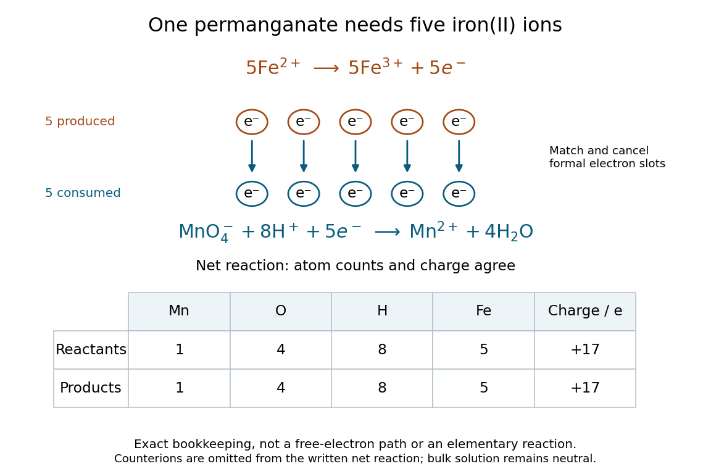

**[Figure 8](#image-permanganate-iron-electron-balanced-inventory). Acidic permanganate-iron balance: five exchanged electrons and conserved chemical atom and electric charge inventories**. Original exact [stoichiometry](#stoichiometry) diagram. Matching five formal [electron](physics.md#electron) slots is a bookkeeping operation, not a picture of free [electrons](physics.md#electron) in the [chemical solution](mixture.md#solution-chemistry). The lower table verifies the net [chemical equation](#chemical-equation); its $+17$ is the net [electric charge](electric-charge.md) number of the written reacting species, not the bulk [chemical solution](mixture.md#solution-chemistry).

The coefficients predict amounts consumed, not a collision of five [ions](chemistry.md#ion) or an [elementary reaction](chemical-kinetics.md#elementary-reaction). Bulk [chemical solution](mixture.md#solution-chemistry) also contains compensating [counterions](chemistry.md#counterion), which are omitted from this net [chemical equation](#chemical-equation). The [hydrogen](chemical-substance.md#hydrogen) and [oxygen](chemical-substance.md#oxygen) [oxidation states](#oxidation-state) are unchanged; balancing their inventories remains essential even though they do not account for the exchanged [electrons](physics.md#electron).

### Redox titration

↑ **Parent:** [Redox](#redox)

A [redox titration](#redox-titration) adds a measured [amount of substance](physics.md#amount-of-substance) of one [reactant](#reactant) to determine another through a known [redox](#redox) [chemical equation](#chemical-equation). The [burette](acid-base-chemistry.md#burette) reading becomes an amount through [concentration](mathematical-physics.md#concentration); the balanced [chemical equation](#chemical-equation) supplies the amount ratio. A colour endpoint additionally needs a chemical explanation, as in the [permanganate-iron titration](#permanganate-iron-titration).

The useful bridge is an [electron](physics.md#electron) inventory. If each sample entity supplies $z_A$ [electrons](physics.md#electron) and each [titrant](acid-base-chemistry.md#titrant) entity accepts $z_T$, matching the formal exchanged [amount of substance](physics.md#amount-of-substance) of [electrons](physics.md#electron) gives

$$
z_A n_A=z_T n_T,\qquad n_A=\frac{z_T}{z_A}c_TV_{\mathrm{eq}}.
$$

Here $c_T$ is the [titrant](acid-base-chemistry.md#titrant) [molar concentration](mathematical-physics.md#molar-concentration) and $V_{\mathrm{eq}}$ the [volume](thermodynamics.md#volume-thermodynamics) attributable to the sample at the [equivalence point](acid-base-chemistry.md#equivalence-point). These are net [half-reaction](electrochemistry.md#half-reaction) counts, not a claim that free [electrons](physics.md#electron) accumulate in the flask. The [redox](#redox) conversion must be sufficiently complete and selective for the stated [stoichiometry](#stoichiometry) to identify $n_A$.

This is why a small visible signal can reveal a much larger invisible inventory: the signal locates a stopping point, while [titrant standardization](acid-base-chemistry.md#titrant-standardization) and [stoichiometry](#stoichiometry) turn delivery into [amount of substance](physics.md#amount-of-substance). The [titration endpoint](acid-base-chemistry.md#titration-endpoint) estimates the [equivalence point](acid-base-chemistry.md#equivalence-point); repeatable colour alone establishes neither correct [titrant](acid-base-chemistry.md#titrant) [concentration](mathematical-physics.md#concentration) nor chemical selectivity. The [permanganate-iron endpoint and blank model](#permanganate-iron-endpoint-and-blank-model) separates these assumptions.

#### Permanganate-iron titration

↑ **Parent:** [Redox titration](#redox-titration)

A proposed modern teaching measurement puts a [pipette](acid-base-chemistry.md#pipette)-measured portion of an [iron](chemical-substance.md#iron) $\mathrm{Fe}^{2+}$ [chemical solution](mixture.md#solution-chemistry) in a [conical flask](chemistry.md#erlenmeyer-flask), acidifies with excess dilute [sulfuric acid](chemical-substance.md#sulfuric-acid), and adds standardized [potassium permanganate](ionic-bonding.md#potassium-permanganate) from a clamped [burette](acid-base-chemistry.md#burette) while swirling. The documented endpoint principle is that added purple [permanganate](chemistry.md#permanganate) is consumed until the first small excess leaves a pale purple colour; no separate colour indicator is required. Insufficient acidity can produce brown [manganese dioxide](chemical-substance.md#manganese-dioxide), invalidating the assumed five-[electron](physics.md#electron) [half-reaction](electrochemistry.md#half-reaction).[“Setting the Scene”, final two paragraphs: burette, conical flask, decolourisation, endpoint and excess sulfuric acid](chemistry-bibliography.md#iron-tablet-determination-analytical-competition-royal-society-of-chemistry-resource)

Record initial and final [burette](acid-base-chemistry.md#burette) readings; their difference is the delivered [volume](thermodynamics.md#volume-thermodynamics) $V$. The following controls are proposed additions to test the inference. Run a reagent blank with the same [water](chemical-substance.md#water), [sulfuric acid](chemical-substance.md#sulfuric-acid) and endpoint criterion but no sample, obtaining $V_b$. Use a separately established [potassium permanganate](ionic-bonding.md#potassium-permanganate) [concentration](mathematical-physics.md#concentration) $c$, clear the [burette](acid-base-chemistry.md#burette) tip of air, and repeat sample portions. A known added [amount of substance](physics.md#amount-of-substance) of $\mathrm{Fe}^{2+}$ should increase consumption by one fifth of that amount. A blank estimates reagent demand and the small endpoint excess; it cannot remove an interfering sample [reactant](#reactant).

Assuming complete, selective reaction according to the [acidic permanganate-iron balance](#acidic-permanganate-iron-balance), the corrected inference is

$$
n(\mathrm{Fe}^{2+})=5c(V-V_b).
$$

With $c$ in $\mathrm{mol\,L^{-1}}$, use $V$ and $V_b$ in litres. As an original stipulated calculation, not an experimental result, take $c=0.02000\,\mathrm{mol\,L^{-1}}$, $V=12.60\,\mathrm{mL}$ and $V_b=0.10\,\mathrm{mL}$. Then the [permanganate](chemistry.md#permanganate) consumption is $0.2500\,\mathrm{mmol}$ and the inferred $\mathrm{Fe}^{2+}$ amount is $1.250\,\mathrm{mmol}$. In a $25.00\,\mathrm{mL}$ sample portion this corresponds to $0.05000\,\mathrm{mol\,L^{-1}}$.

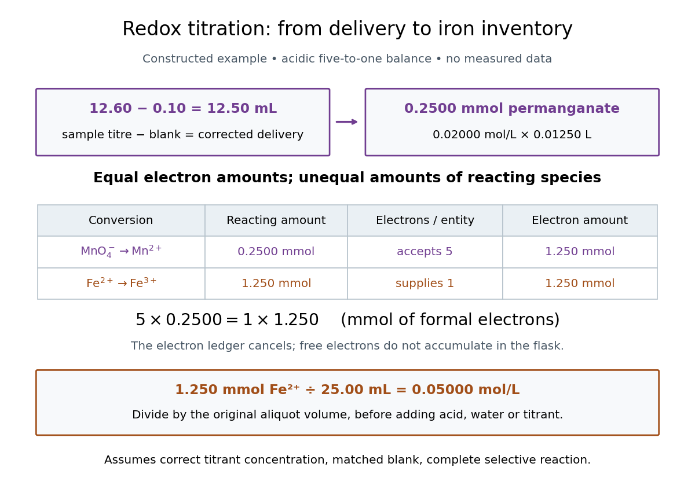

**[Figure 9](#image-permanganate-iron-titration-corrected-delivery-becomes-an-electron-and-amount-of-substance-ledger). Permanganate-iron titration: corrected delivery becomes an electron and amount of substance ledger**. Original calculation using the stipulated $0.02000\,\mathrm{mol\,L^{-1}}$ [titrant](acid-base-chemistry.md#titrant), $12.60\,\mathrm{mL}$ [titre](acid-base-chemistry.md#titre), $0.10\,\mathrm{mL}$ [titration blank](acid-base-chemistry.md#titration-blank) and $25.00\,\mathrm{mL}$ [aliquot](acid-base-chemistry.md#aliquot). The two [half-reactions](electrochemistry.md#half-reaction) exchange $1.250\,\mathrm{mmol}$ of formal [electrons](physics.md#electron); this is not a free-[electron](physics.md#electron) inventory in the [chemical solution](mixture.md#solution-chemistry). Values are constructed, not experimental data.

In this example the corrected [volume](thermodynamics.md#volume-thermodynamics) is $12.50\,\mathrm{mL}=0.01250\,\mathrm L$. The [acidic permanganate-iron balance](#acidic-permanganate-iron-balance) gives $z_A=1$ for $\mathrm{Fe}^{2+}$ and $z_T=5$ for [permanganate](chemistry.md#permanganate). Thus $0.2500\,\mathrm{mmol}$ of [permanganate](chemistry.md#permanganate) accepts $1.250\,\mathrm{mmol}$ of formal [electrons](physics.md#electron), exactly what $1.250\,\mathrm{mmol}$ of $\mathrm{Fe}^{2+}$ supplies. The [amount of substance](physics.md#amount-of-substance) ratio is five to one, despite equality of the exchanged [electron](physics.md#electron) amounts.

The denominator is the original $25.00\,\mathrm{mL}$ [aliquot](acid-base-chemistry.md#aliquot), not its final [volume](thermodynamics.md#volume-thermodynamics) after adding [sulfuric acid](chemical-substance.md#sulfuric-acid), [water](chemical-substance.md#water) and [titrant](acid-base-chemistry.md#titrant). Such [dilution](mixture.md#dilution) changes [concentrations](mathematical-physics.md#concentration) in the flask without changing the initial sampled [amount of substance](physics.md#amount-of-substance) of $\mathrm{Fe}^{2+}$. Omitting the $0.10\,\mathrm{mL}$ [titration blank](acid-base-chemistry.md#titration-blank) would instead give $1.260\,\mathrm{mmol}$ and $0.05040\,\mathrm{mol\,L^{-1}}$, an overestimate of $0.80\%$ relative to the corrected constructed value. The displayed digits express the stipulated calculation, rather than establish its [measurement uncertainty](physics.md#measurement-uncertainty).

The endpoint detects residual [permanganate](chemistry.md#permanganate), not the [iron](chemical-substance.md#iron) identity directly. Other sample [reactants](#reactant) that consume [permanganate](chemistry.md#permanganate) raise the apparent $\mathrm{Fe}^{2+}$ amount; prior [oxidation](#oxidation) of sample $\mathrm{Fe}^{2+}$ to $\mathrm{Fe}^{3+}$ lowers it. A recovery check probes response to the added [iron](chemical-substance.md#iron) but does not prove absence of every interference. The readout determines the reacting $\mathrm{Fe}^{2+}$ inventory under the stated conditions, rather than total [iron](chemical-substance.md#iron) in an arbitrary mixture. No measured titres are asserted here.

##### Permanganate-iron endpoint and blank model

↑ **Parent:** [Permanganate-iron titration](#permanganate-iron-titration)

The apparatus and motivating measurement are described in [permanganate-iron titration](#permanganate-iron-titration); the following is an original account of its possible errors. Assume correct [titrant standardization](acid-base-chemistry.md#titrant-standardization), the [acidic permanganate-iron balance](#acidic-permanganate-iron-balance), quantitative conversion of the sampled $\mathrm{Fe}^{2+}$, and additive contributions expressed as equivalent [titrant](acid-base-chemistry.md#titrant) [volumes](geometry-and-topology.md#volume). Write

$$
V=V_{\mathrm{Fe}}+B_s+D_s+A+I,\qquad
V_b=B_b+D_b,\qquad
V_{\mathrm{Fe}}=\frac{n_{\mathrm{Fe}}}{5c}.
$$

Here $V$ is the sample [titre](acid-base-chemistry.md#titre), $V_b$ the [titration blank](acid-base-chemistry.md#titration-blank), $B_s,B_b$ background reagent consumption, and $D_s,D_b$ signed offsets of the observed [titration endpoints](acid-base-chemistry.md#titration-endpoint) from the respective [stoichiometry](#stoichiometry) conditions after background consumption. The subscripts distinguish sample and blank. $I$ is additional sample-specific [permanganate](chemistry.md#permanganate) demand, absent from the blank; $A$ is apparent delivery used to fill an initially air-containing [burette](acid-base-chemistry.md#burette) tip rather than enter the flask. Assume the blank's tip is already filled; the sample should also have $A=0$ after proper preparation. These terms are a diagnostic model, not measured components of the stipulated $0.10\,\mathrm{mL}$ blank.

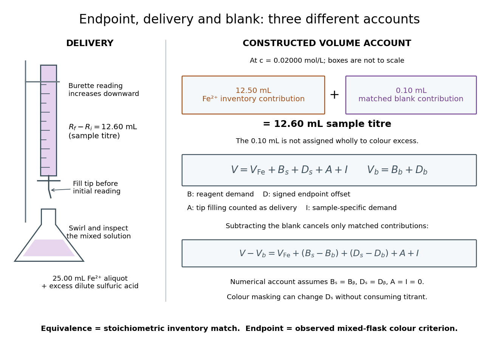

**[Figure 10](#image-burette-delivery-titration-endpoint-and-titration-blank-describe-different-parts-of-the-inference). Burette delivery, titration endpoint and titration blank describe different parts of the inference**. Original schematic and additive [volume](thermodynamics.md#volume-thermodynamics) model, not a photograph or measured [titration curve](acid-base-chemistry.md#titration-curve). The numerical decomposition $12.60=12.50+0.10\,\mathrm{mL}$ assumes matched background and endpoint contributions and no tip-air or sample-specific demand. Boxes are not to scale; the blank's reagent consumption and endpoint offset are not separately specified. The exact [equivalence point](acid-base-chemistry.md#equivalence-point) has no guaranteed visible colour flag.

Subtracting the two accounts proves the error relation

$$
\widehat n_{\mathrm{Fe}}=5c(V-V_b)=n_{\mathrm{Fe}}+5c\Delta V,\qquad
\Delta V=(B_s-B_b)+(D_s-D_b)+A+I.
$$

The simple inference is valid when this residual is negligible. Matching [water](chemical-substance.md#water) and [sulfuric acid](chemical-substance.md#sulfuric-acid) tests the background terms, but does not by itself establish $D_s=D_b$: flask composition and viewing conditions can differ. A coloured sample can mask residual [permanganate](chemistry.md#permanganate), changing the assigned [titration endpoint](acid-base-chemistry.md#titration-endpoint) without a corresponding [redox](#redox) consumption. A sample-specific [reducing agent](#reducing-agent) instead contributes positive $I$ by consuming [permanganate](chemistry.md#permanganate). A reagent [titration blank](acid-base-chemistry.md#titration-blank) cannot measure either effect just by omitting the sample.

A transient purple streak before mixing is not the mixed-flask [titration endpoint](acid-base-chemistry.md#titration-endpoint). Conversely, the [equivalence point](acid-base-chemistry.md#equivalence-point) is the five-to-one inventory match, without a promised visible flag. In the ideal selective model, a persistent excess colour requires some [permanganate](chemistry.md#permanganate) beyond that match. No particular drop size, waiting time or endpoint offset is stipulated here; the same stated colour criterion must be applied to sample and blank, and its transferability checked.

The model also predicts error direction. If a tip bubble disappears during sample delivery, $A>0$ makes the inferred [amount of substance](physics.md#amount-of-substance) too high because final minus initial [burette](acid-base-chemistry.md#burette) reading includes liquid that stayed in the tip. Conditioning the tip before the first reading prevents this particular discrepancy; subtracting a separate [titration blank](acid-base-chemistry.md#titration-blank) is not an instrument repair. Repeated [aliquots](acid-base-chemistry.md#aliquot) test scatter, a known added $\mathrm{Fe}^{2+}$ inventory tests the five-to-one response, and an independent [titrant standardization](acid-base-chemistry.md#titrant-standardization) tests $c$. These are the proposed controls from [permanganate-iron titration](#permanganate-iron-titration), with distinct diagnostic roles; none alone proves absence of all sample interference.

### Reduction (chemistry)

↑ **Parent:** [Redox](#redox)

A [reduction](#reduction-chemistry) decreases an [oxidation state](#oxidation-state), recording gain in the formal [electron](physics.md#electron) assignment. For $\mathrm{Cu}^{2+}+2e^-\to\mathrm{Cu}$, the decrease is $+2\to0$. The reduced [chemical species](mathematical-biology.md#chemical-species) serves as the [oxidizing agent](#oxidizing-agent) in the coupled [redox](#redox).[§4.2, “Oxidation-Reduction Reactions”: reduction as decreasing oxidation number](chemistry-bibliography.md#chemistry-2e-by-paul-flowers-and-others)

In the [electrochemistry](electrochemistry.md) examples here, [reduction](#reduction-chemistry) is gain of [electrons](physics.md#electron) by a [chemical species](mathematical-biology.md#chemical-species); it occurs at the [cathode](electrochemistry.md#cathode). That [electrode](electrochemistry.md#electrode) definition holds in both a [galvanic cell](electrochemistry.md#galvanic-cell) and an [electrolytic cell](electrochemistry.md#electrolytic-cell); it does not fix terminal polarity.

#### Reductive desulfonylation

↑ **Parent:** [Reduction (chemistry)](#reduction-chemistry)

Removal of a sulfone substituent by a reducing process, replacing its [carbon](chemical-substance.md#carbon)–[sulfur](chemical-substance.md#sulfur) connection with a [carbon](chemical-substance.md#carbon)–[hydrogen](chemical-substance.md#hydrogen) connection under an appropriate work-up. Compatibility with other reducible groups must be considered.

#### Carbonyl reduction

↑ **Parent:** [Reduction (chemistry)](#reduction-chemistry)

Reduction at a [carbonyl](chemical-bond.md#carbonyl-group) group, for example conversion of a [ketone](chemical-substance.md#ketone) to an [alcohol](chemical-substance.md#alcohol). In an enone, 1,2- and 1,4-reduction produce different functional-group patterns.

##### Wolff-Kishner reduction

↑ **Parent:** [Carbonyl reduction](#carbonyl-reduction)

Conversion of an [aldehyde](chemical-substance.md#aldehyde) or [ketone](chemical-substance.md#ketone) [carbonyl](chemical-bond.md#carbonyl-group) into a methylene through hydrazone formation and base-promoted [nitrogen](chemical-substance.md#nitrogen) extrusion. The strongly basic, often heated conditions must be compatible with the other functional groups.

##### Luche reduction

↑ **Parent:** [Carbonyl reduction](#carbonyl-reduction)

A cerium(III)-assisted borohydride reduction often used to favour 1,2-reduction of an enone to an allylic [alcohol](chemical-substance.md#alcohol). Actual selectivity remains substrate- and condition-dependent.

#### Hydrogenation

↑ **Parent:** [Reduction (chemistry)](#reduction-chemistry)

Addition of [hydrogen](chemical-substance.md#hydrogen) to an unsaturated substrate. Catalyst and conditions determine which unsaturated groups are reduced; the mere presence of H2 does not guarantee [chemoselectivity](#chemoselectivity).

##### Raney nickel

↑ **Parent:** [Hydrogenation](#hydrogenation)

A porous nickel catalyst prepared by selective removal of aluminium from a nickel–aluminium alloy. It can catalyse [hydrogenations](#hydrogenation); its use does not guarantee that every other reducible functional group will remain unchanged.

##### Catalytic hydrogenation

↑ **Parent:** [Hydrogenation](#hydrogenation)

Reduction using [hydrogen](chemical-substance.md#hydrogen) and a catalyst. Selectivity depends on the catalyst, pressure, solvent and functional groups: reducing an [alkene](chemical-substance.md#alkene) while retaining a [ketone](chemical-substance.md#ketone) is a distinct requirement from reducing a [nitrile](chemical-substance.md#nitrile) while retaining an [ester](chemical-substance.md#ester).

### Electron acceptor

↑ **Parent:** [Redox](#redox)  
ⓦ [Wiki](https://en.wikipedia.org/wiki/Electron_acceptor)

### Electron donor

↑ **Parent:** [Redox](#redox)

An [electron donor](#electron-donor) supplies [electrons](physics.md#electron) to an [electron acceptor](#electron-acceptor) in a [redox](#redox) conversion.

## Hydrolysis

↑ **Parent:** [Chemical reaction](chemical-reaction.md)  
ⓦ [Wiki](https://en.wikipedia.org/wiki/Hydrolysis)

[Hydrolysis](#hydrolysis) is a [chemical reaction](chemical-reaction.md) involving [water](chemical-substance.md#water) that breaks a [chemical bond](chemical-bond.md). The [free energy](thermodynamic-potential.md#thermodynamic-free-energy) released by suitably coupled [ATP](molecule.md#adenosine-triphosphate) [hydrolysis](#hydrolysis) can drive [active transport](cell-membrane.md#active-transport); the available [free energy](thermodynamic-potential.md#thermodynamic-free-energy) depends on the actual composition and conditions.

### Hydrolytic deamination

↑ **Parent:** [Hydrolysis](#hydrolysis)

[Hydrolytic deamination](#hydrolytic-deamination) replaces an amino group using [water](chemical-substance.md#water), releasing [ammonia](chemical-substance.md#ammonia) or [ammonium](chemistry.md#ammonium) according to pH. [Adenosine deaminase](enzyme.md#adenosine-deaminase) introduces solvent [oxygen](chemical-substance.md#oxygen) at the C6 position of [adenosine](molecule.md#adenosine).

### Ester hydrolysis

↑ **Parent:** [Hydrolysis](#hydrolysis)

Cleavage of an [ester](chemical-substance.md#ester) using [water](chemical-substance.md#water), yielding a carboxylic acid or carboxylate and an [alcohol](chemical-substance.md#alcohol), depending on conditions.

### Acetal hydrolysis

↑ **Parent:** [Hydrolysis](#hydrolysis)

Conversion of an [acetal](chemical-substance.md#acetal) and [water](chemical-substance.md#water) to its corresponding carbonyl compound and [alcohols](chemical-substance.md#alcohol).

#### Methanolysis of an anhydro acetal

↑ **Parent:** [Acetal hydrolysis](#acetal-hydrolysis)

[acid](acid-base-chemistry.md#acid-chemistry) activation can cleave an anomeric [acetal](chemical-substance.md#acetal) bridge, producing an [oxocarbenium](chemical-substance.md#oxocarbenium-ion)-like [electrophile](#electrophile) and a free [alcohol](chemical-substance.md#alcohol) on the former tether. [methanol](chemical-substance.md#methanol) capture produces a methyl [acetal](chemical-substance.md#acetal); anomeric [stereochemistry](stereochemistry.md) and chair preference must be distinguished.

#### Stereoelectronic control of acetal hydrolysis

↑ **Parent:** [Acetal hydrolysis](#acetal-hydrolysis)

Acetal cleavage can depend on alignment of an endocyclic oxygen lone pair with the exocyclic C–O leaving bond. Conformational restriction can therefore give different hydrolysis rates for anomers without changing the leaving group.

#### Acid-catalysed acetal hydrolysis

↑ **Parent:** [Acetal hydrolysis](#acetal-hydrolysis)

Protonation enables alcohol departure, water capture and carbonyl regeneration, often through [oxocarbenium](chemical-substance.md#oxocarbenium-ion) and [hemiacetal](chemical-substance.md#hemiacetal) intermediates.

### GTP hydrolysis

↑ **Parent:** [Hydrolysis](#hydrolysis)

[GTP hydrolysis](#gtp-hydrolysis) converts [GTP](molecule.md#guanosine-triphosphate) with [water](chemical-substance.md#water) to [GDP](molecule.md#guanosine-diphosphate) and inorganic [phosphate](chemical-substance.md#phosphate). In many signaling [G proteins](protein.md#g-protein), it favors a switch toward an inactive effector-binding state.

### ATP hydrolysis

↑ **Parent:** [Hydrolysis](#hydrolysis)

[ATP hydrolysis](#atp-hydrolysis) converts [ATP](molecule.md#adenosine-triphosphate) with [water](chemical-substance.md#water) to products commonly including [ADP](molecule.md#adenosine-diphosphate) and inorganic [phosphate](chemical-substance.md#phosphate). Its available [Gibbs free energy](thermodynamic-potential.md#gibbs-free-energy) depends on chemical conditions and can drive a coupled process; ATP binding and hydrolysis can have distinct structural roles.

### Saponification

↑ **Parent:** [Hydrolysis](#hydrolysis)  
ⓦ [Wiki](https://en.wikipedia.org/wiki/Saponification)

[Saponification](#saponification) is [hydrolysis](#hydrolysis) of an [ester](chemical-substance.md#ester) under basic conditions. The [conductometric saponification assay](chemical-kinetics.md#conductometric-saponification-assay) follows [ethyl acetate](chemical-substance.md#ethyl-acetate) consumption by [hydroxide](chemistry.md#hydroxide), producing [ethanol](biology.md#ethanol) and an [acetate ion](chemical-substance.md#acetate-ion); its equal-starting-[concentration](mathematical-physics.md#concentration) case provides a practical [second-order reaction](chemical-kinetics.md#second-order-reaction) example.

[Saponification](#saponification) is [ester](chemical-substance.md#ester) [hydrolysis](#hydrolysis) promoted by a [chemical base](acid-base-chemistry.md#base-chemistry), with net consumption of [hydroxide](chemistry.md#hydroxide) to form a [carboxylate](chemical-substance.md#carboxylate) and an [alcohol](chemical-substance.md#alcohol). For a [carboxylic acid](chemical-substance.md#carboxylic-acid)-derived [ester](chemical-substance.md#ester), the net [chemical equation](#chemical-equation) is

$$
\mathrm{RCOOR'}+\mathrm{OH^-}\longrightarrow\mathrm{RCOO^-}+\mathrm{R'OH}.
$$

The [hydroxide](chemistry.md#hydroxide) is a [reactant](#reactant), rather than merely a regenerated [catalyst](chemical-kinetics.md#catalyst).[Organic Chemistry by John McMurry; §21.6, Conversion of Esters into Carboxylic Acids: Hydrolysis; Figure 21.8 discussion of carboxylate formation](chemistry-bibliography.md#organic-chemistry-by-john-mcmurry/21-6-chemistry-of-esters)

For [ethyl acetate](chemical-substance.md#ethyl-acetate), the balanced [chemical equation](#chemical-equation) becomes

$$
\mathrm{CH_3COOC_2H_5}+\mathrm{OH^-}\longrightarrow\mathrm{CH_3COO^-}+\mathrm{C_2H_5OH}.
$$

Both sides contain four [carbon](chemical-substance.md#carbon) [chemical atoms](physics.md#atom-physics), nine [hydrogen](chemical-substance.md#hydrogen) [chemical atoms](physics.md#atom-physics), three [oxygen](chemical-substance.md#oxygen) [chemical atoms](physics.md#atom-physics), and net [electric charge](electric-charge.md) $-1$. A [sodium](chemical-substance.md#sodium) [ion](chemistry.md#ion) supplied by [sodium hydroxide](chemical-substance.md#sodium-hydroxide) is a [spectator ion](#spectator-ion); the [net ionic equation](#net-ionic-equation) omits it without losing [electric charge conservation](electric-charge.md#charge-conservation).

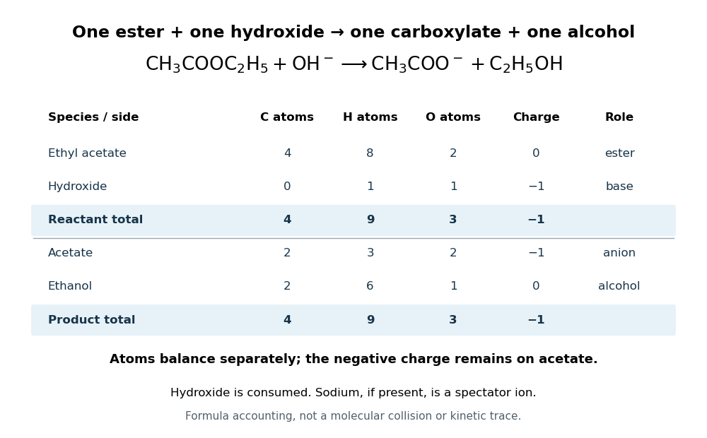

**[Figure 11](#image-ethyl-acetate-saponification-conserves-atoms-and-charge). Ethyl acetate saponification conserves atoms and charge**. Original [chemical formula](chemical-substance.md#chemical-formula) ledger for one [ethyl acetate](chemical-substance.md#ethyl-acetate) and one [hydroxide](chemistry.md#hydroxide) forming one [acetate ion](chemical-substance.md#acetate-ion) and one [ethanol](biology.md#ethanol). Each column separately checks [chemical atom](physics.md#atom-physics) counts or net [electric charge](electric-charge.md); the arrow states [stoichiometry](#stoichiometry), rather than a single-step [reaction mechanism](chemical-kinetics.md#reaction-mechanism).

In the usual [reaction mechanism](chemical-kinetics.md#reaction-mechanism), [hydroxide](chemistry.md#hydroxide) adds to the [carbonyl group](chemical-bond.md#carbonyl-group), making a [reaction intermediate](chemical-kinetics.md#reaction-intermediate). Departure of the [alcohol](chemical-substance.md#alcohol)'s [conjugate base](acid-base-chemistry.md#conjugate-base) gives a [carboxylic acid](chemical-substance.md#carboxylic-acid); transfer of a [proton](physics.md#proton) then gives the [carboxylate](chemical-substance.md#carboxylate) and the [alcohol](chemical-substance.md#alcohol). Subsequent addition of a [chemical acid](acid-base-chemistry.md#acid-chemistry) gives the [carboxylic acid](chemical-substance.md#carboxylic-acid) by [protonation](#protonation):

$$
\mathrm{RCOO^-}+\mathrm{H_3O^+}\longrightarrow\mathrm{RCOOH}+\mathrm{H_2O}.
$$

This separate acidification changes the [reaction product](#product-chemistry)'s [protonation](#protonation) state.[Organic Chemistry by John McMurry; §21.6, Figure 21.8 discussion: addition, elimination, deprotonation and subsequent aqueous HCl treatment](chemistry-bibliography.md#organic-chemistry-by-john-mcmurry/21-6-chemistry-of-esters)

The [conductometric saponification assay](chemical-kinetics.md#conductometric-saponification-assay) makes [hydroxide](chemistry.md#hydroxide) consumption observable. A university procedure equilibrates separate [ethyl acetate](chemical-substance.md#ethyl-acetate) and [sodium hydroxide](chemical-substance.md#sodium-hydroxide) stocks in constant-[temperature](temperature.md) baths, then mixes them in a rinsed conductivity cell. Two [platinum](chemical-substance.md#platinum) [electrodes](electrochemistry.md#electrode) and an alternating-voltage [Wheatstone bridge](electrical-engineering.md#wheatstone-bridge) supply an [electrical resistance](electric-charge.md#electrical-resistance) readout. A matched [sodium hydroxide](chemical-substance.md#sodium-hydroxide)–[water](chemical-substance.md#water) dilution checks the initial signal; [potassium chloride](ionic-bonding.md#potassium-chloride) calibrates the cell constant. Replacing [hydroxide](chemistry.md#hydroxide) with less mobile [acetate ions](chemical-substance.md#acetate-ion) lowers [electrical conductance](electric-charge.md#electrical-conductance), supporting an inference about changing [concentration](mathematical-physics.md#concentration). The manual supplies a procedure rather than measured outcomes. [Temperature](temperature.md) drift or additional [ions](chemistry.md#ion) can change the signal; it cannot alone identify the full [reaction mechanism](chemical-kinetics.md#reaction-mechanism).[Unit 7, Experiment 1, printed p. 63: electrodes, bridge and ionic conductance; Experiment 2, printed pp. 66–67: preparation, resistance readout and controls](chemistry-bibliography.md#manual-for-advanced-physical-chemistry-laboratory-ii-by-nasima-arshad)

#### Saponification with limiting hydroxide

↑ **Parent:** [Saponification](#saponification)

Consider a hypothetical closed, well mixed [chemical solution](mixture.md#solution-chemistry) initially containing $20\,\mathrm{mmol}$ of [ethyl acetate](chemical-substance.md#ethyl-acetate), $12\,\mathrm{mmol}$ of [hydroxide](chemistry.md#hydroxide), and no [acetate ions](chemical-substance.md#acetate-ion) or [ethanol](biology.md#ethanol). One millimole is $10^{-3}$ [mole](physics.md#mole-unit). Assume complete conversion as far as the one-to-one [chemical equation](#chemical-equation) allows, with no competing [chemical reactions](chemical-reaction.md). This is an ideal [stoichiometry](#stoichiometry) calculation, not a measured yield.

Let the [extent of reaction](#extent-of-reaction) be $\xi$, expressed in millimoles. The four values of [amount of substance](physics.md#amount-of-substance), in the order [ethyl acetate](chemical-substance.md#ethyl-acetate), [hydroxide](chemistry.md#hydroxide), [acetate ion](chemical-substance.md#acetate-ion), [ethanol](biology.md#ethanol), are

$$
\bigl(20-\xi,\;12-\xi,\;\xi,\;\xi\bigr)\,\mathrm{mmol},\qquad 0\leq\xi\leq12.
$$

The upper bound follows because both [reactant](#reactant) quantities must be nonnegative. Thus [hydroxide](chemistry.md#hydroxide) is the [limiting reagent](#limiting-reagent), and the ideal endpoint $\xi=12$ leaves

$$
8\,\mathrm{mmol}\ \text{ethyl acetate},\quad
0\,\mathrm{mmol}\ \text{hydroxide},\quad
12\,\mathrm{mmol}\ \text{acetate},\quad
12\,\mathrm{mmol}\ \text{ethanol}.
$$

The [carboxylate](chemical-substance.md#carboxylate) formed equals the [hydroxide](chemistry.md#hydroxide) consumed, while unreacted [ester](chemical-substance.md#ester) remains. Adding more [hydroxide](chemistry.md#hydroxide) raises the [stoichiometry](#stoichiometry) bound; merely waiting longer does not change that bound. To convert these values of [amount of substance](physics.md#amount-of-substance) into [concentrations](mathematical-physics.md#concentration), a [volume](geometry-and-topology.md#volume) is also required. The endpoint does not specify the [reaction rate](chemical-kinetics.md#reaction-rate) or time needed to approach it.

#### Saponification of triglycerides

↑ **Parent:** [Saponification](#saponification)

A [triglyceride](chemical-substance.md#triglyceride) contains three [ester](chemical-substance.md#ester) linkages joining [glycerol](chemical-substance.md#glycerol) to [fatty acid](chemical-substance.md#fatty-acid)-derived [acyl groups](chemical-substance.md#acyl-group). Complete [saponification](#saponification) therefore consumes three [hydroxide](chemistry.md#hydroxide) equivalents per [triglyceride](chemical-substance.md#triglyceride), yielding one [glycerol](chemical-substance.md#glycerol) and three [fatty acid](chemical-substance.md#fatty-acid) [carboxylates](chemical-substance.md#carboxylate).[Organic Chemistry by John McMurry; §27.2, opening chemical definition and fat hydrolysis equation](chemistry-bibliography.md#organic-chemistry-by-john-mcmurry/27-2-soap)

Writing the three [hydrocarbon](chemical-substance.md#hydrocarbon) groups separately allows their compositions to differ:

$$
\begin{aligned}
&\mathrm{C_3H_5[OC(=O)R_1][OC(=O)R_2][OC(=O)R_3]}+3\mathrm{OH^-}\\
&\qquad\longrightarrow\mathrm{C_3H_5(OH)_3}
+\mathrm{R_1COO^-}+\mathrm{R_2COO^-}+\mathrm{R_3COO^-}.
\end{aligned}
$$

This is the preceding [ester](chemical-substance.md#ester) [chemical equation](#chemical-equation) applied three times: each linkage supplies one [carboxylate](chemical-substance.md#carboxylate), and each formerly esterified [oxygen](chemical-substance.md#oxygen) on the [glycerol](chemical-substance.md#glycerol) scaffold gains one [hydrogen](chemical-substance.md#hydrogen). The two sides retain the same three $\mathrm R_i$ groups and have net [electric charge](electric-charge.md) $-3$.

[Soap](surface-tension.md#soap) consists of [sodium](chemical-substance.md#sodium) or [potassium](chemical-substance.md#potassium) salts of long-chain [fatty acids](chemical-substance.md#fatty-acid). Its [carboxylate](chemical-substance.md#carboxylate) head is [hydrophilic](physical-chemistry.md#hydrophilicity), while its long [hydrocarbon](chemical-substance.md#hydrocarbon) tail is [hydrophobic](physical-chemistry.md#hydrophobicity). This makes it an [amphiphile](physical-chemistry.md#amphiphile) and a [surfactant](surface-tension.md#surfactant): the tails can associate with grease while the heads remain exposed to [water](chemical-substance.md#water), helping disperse grease for rinsing. An [acetate ion](chemical-substance.md#acetate-ion) is also a [carboxylate](chemical-substance.md#carboxylate), but lacks the long [hydrophobic](physical-chemistry.md#hydrophobicity) tail that gives [soap](surface-tension.md#soap) this cleaning role.[Organic Chemistry by John McMurry; §27.2, chemical definition and paragraphs on the ionic head, hydrocarbon tail and removal of grease](chemistry-bibliography.md#organic-chemistry-by-john-mcmurry/27-2-soap)

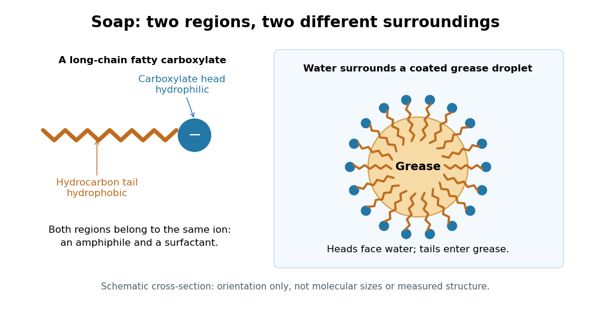

**[Figure 12](#image-soap-links-a-hydrophobic-grease-region-to-surrounding-water). Soap links a hydrophobic grease region to surrounding water**. Original schematic cross-section of a [soap](surface-tension.md#soap)-coated grease droplet in [water](chemical-substance.md#water). Circles denote [hydrophilic](physical-chemistry.md#hydrophilicity) [carboxylate](chemical-substance.md#carboxylate) heads; orange lines denote [hydrophobic](physical-chemistry.md#hydrophobicity) [hydrocarbon](chemical-substance.md#hydrocarbon) tails. The layout explains [amphiphile](physical-chemistry.md#amphiphile) orientation rather than depicting measured dimensions or individual [chemical bonds](chemical-bond.md).

## Energy coupling

↑ **Parent:** [Chemical reaction](chemical-reaction.md)

[Energy coupling](#energy-coupling) links an [endergonic reaction](#endergonic-reaction) to an [exergonic reaction](#exergonic-reaction) through a [reaction mechanism](chemical-kinetics.md#reaction-mechanism), so that the combined transformation has a favourable change in [Gibbs free energy](thermodynamic-potential.md#gibbs-free-energy). [ATP](molecule.md#adenosine-triphosphate) [hydrolysis](#hydrolysis) is a common driving [chemical reaction](chemical-reaction.md). A shared [reaction intermediate](chemical-kinetics.md#reaction-intermediate), produced in one step and consumed in another, can physically connect the transformations; merely placing two independent [chemical reactions](chemical-reaction.md) in the same [chemical solution](mixture.md#solution-chemistry) does not establish [energy coupling](#energy-coupling). See [Alberts et al., Molecular Biology of the Cell: coupled reactions and activated intermediates](https://www.ncbi.nlm.nih.gov/books/NBK26838/).

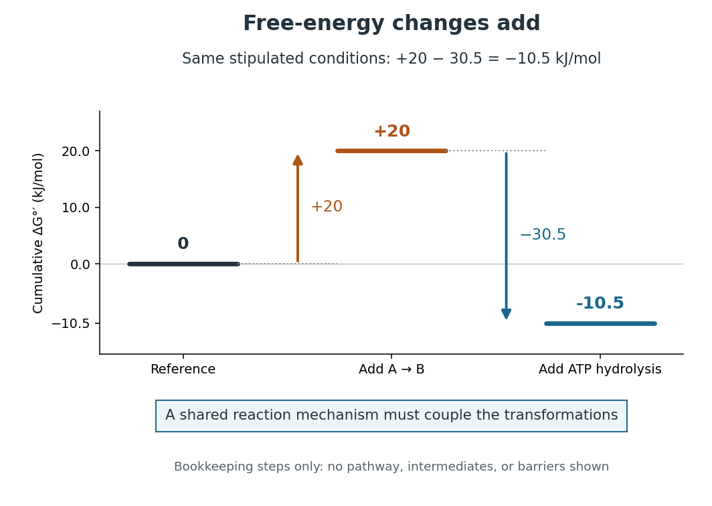

**[Figure 13](#image-energy-coupling-plus-20-30-5-10-5-mathrm-kj-mol-1-under-the-same-stipulated-conditions). Energy coupling: $+20-30.5=-10.5\,\mathrm{kJ\,mol^{-1}}$ under the same stipulated conditions**. Original diagram of cumulative changes in [Gibbs free energy](thermodynamic-potential.md#gibbs-free-energy) as two contributions are added. The levels are bookkeeping steps, not a [reaction mechanism](chemical-kinetics.md#reaction-mechanism), actual [reaction intermediates](chemical-kinetics.md#reaction-intermediate), elapsed time, or [activation energy](chemical-kinetics.md#activation-energy) barriers. A [reaction mechanism](chemical-kinetics.md#reaction-mechanism) must enforce the joint transformation for the net favourable value to drive the desired conversion.

For a computed example, stipulate an [endergonic reaction](#endergonic-reaction) $\mathrm A\longrightarrow\mathrm B$ with $\Delta G_1^{\circ\prime}=+20\,\mathrm{kJ\,mol^{-1}}$ under precisely the same biochemical [standard state](chemical-potential.md#standard-state) conditions as the quoted [ATP](molecule.md#adenosine-triphosphate) [hydrolysis](#hydrolysis) value. Assume a [reaction mechanism](chemical-kinetics.md#reaction-mechanism) couples one [ATP](molecule.md#adenosine-triphosphate) [hydrolysis](#hydrolysis) to each A-to-B conversion. The formal sum is

$$
\begin{aligned}
\mathrm A&\longrightarrow\mathrm B,
&\Delta G_1^{\circ\prime}&=+20\,\mathrm{kJ\,mol^{-1}},\\
\mathrm{ATP}+\mathrm{H_2O}&\longrightarrow\mathrm{ADP}+\mathrm P_i,
&\Delta G_2^{\circ\prime}&=-30.5\,\mathrm{kJ\,mol^{-1}},\\
\mathrm A+\mathrm{ATP}+\mathrm{H_2O}&\longrightarrow\mathrm B+\mathrm{ADP}+\mathrm P_i,
&\Delta G_{\mathrm{net}}^{\circ\prime}&=-10.5\,\mathrm{kJ\,mol^{-1}}.
\end{aligned}
$$

The sum $+20+(-30.5)=-10.5$ gives an [exergonic reaction](#exergonic-reaction). The $+20$ is a chosen teaching value, not a measured property of an identified substance. Outside these reference conditions, add the actual $\Delta G_1$ and $\Delta G_2$, each evaluated using consistent [thermodynamic activities](chemical-potential.md#thermodynamic-activity); mixing a standard value for one [chemical reaction](chemical-reaction.md) with an unrelated cellular value for the other gives no justified prediction.

Why do the changes in [Gibbs free energy](thermodynamic-potential.md#gibbs-free-energy) add? [Gibbs free energy](thermodynamic-potential.md#gibbs-free-energy) is a [state function](thermodynamics.md#state-function). Adding consistent reaction changes cancels any shared [reaction intermediate](chemical-kinetics.md#reaction-intermediate) and leaves the difference between the combined [reactants](#reactant) and combined [reaction products](#product-chemistry). This explains the thermodynamic accounting; it does not construct the [reaction mechanism](chemical-kinetics.md#reaction-mechanism). In many [ATP](molecule.md#adenosine-triphosphate)-dependent routes, [phosphorylation](#phosphorylation) transfers a [phosphate](chemical-substance.md#phosphate) group to a [substrate](enzyme.md#substrate-biochemistry) or an [enzyme](enzyme.md), and subsequent transformation consumes that modified material. The shared material is what connects the steps. Other [reaction mechanisms](chemical-kinetics.md#reaction-mechanism) use [ATP](molecule.md#adenosine-triphosphate) differently. See [Alberts et al., Molecular Biology of the Cell: ATP-driven biosynthesis](https://www.ncbi.nlm.nih.gov/books/NBK26838/).

The useful achievement is that a common regenerated [nucleotide](molecule.md#nucleotide) can connect many different processes in [metabolism](biology.md#metabolism). The net negative change in [Gibbs free energy](thermodynamic-potential.md#gibbs-free-energy) permits the coupled conversion, but supplies no [reaction rate](chemical-kinetics.md#reaction-rate): [enzymes](enzyme.md) can lower [activation energy](chemical-kinetics.md#activation-energy) barriers without changing the endpoint difference. [Energy coupling](#energy-coupling) changes which overall [chemical reaction](chemical-reaction.md) is being considered; [catalysis](chemical-kinetics.md#catalysis) accelerates an available route. See [OpenStax Biology 2e, 6.2: free-energy changes and reaction barriers](https://openstax.org/books/biology-2e/pages/6-2-potential-kinetic-free-and-activation-energy).

A historical landmark is Fritz Lipmann's [1941 essay, Metabolic Generation and Utilization of Phosphate Bond Energy](https://doi.org/10.1002/9780470122464.ch4). Its sections on the [phosphate](chemical-substance.md#phosphate) cycle, generation and utilization of phosphate-bond [energy](energy.md), and group transfer organized these processes around a reusable chemical carrier. The historical terminology should be read with the modern distinction between net [hydrolysis](#hydrolysis) and the cost of breaking a [chemical bond](chemical-bond.md).

## Exergonic reaction

↑ **Parent:** [Chemical reaction](chemical-reaction.md)  
ⓦ [Wiki](https://en.wikipedia.org/wiki/Exergonic_reaction)

An [exergonic reaction](#exergonic-reaction) has negative molar reaction change in [Gibbs free energy](thermodynamic-potential.md#gibbs-free-energy) under the specified conditions. At fixed [temperature](temperature.md) and [pressure](pressure.md), its forward direction is thermodynamically favourable; its [reaction rate](chemical-kinetics.md#reaction-rate) remains a separate question. See [OpenStax Biology 2e, 6.2: exergonic reactions](https://openstax.org/books/biology-2e/pages/6-2-potential-kinetic-free-and-activation-energy).

## Endergonic reaction

↑ **Parent:** [Chemical reaction](chemical-reaction.md)  
ⓦ [Wiki](https://en.wikipedia.org/wiki/Endergonic_reaction)

An [endergonic reaction](#endergonic-reaction) has positive molar reaction change in [Gibbs free energy](thermodynamic-potential.md#gibbs-free-energy) under the specified conditions. Sustained net forward conversion needs a driving process, such as [energy coupling](#energy-coupling). See [OpenStax Biology 2e, 6.2: endergonic reactions](https://openstax.org/books/biology-2e/pages/6-2-potential-kinetic-free-and-activation-energy).

## Phosphorylation

↑ **Parent:** [Chemical reaction](chemical-reaction.md)  
ⓦ [Wiki](https://en.wikipedia.org/wiki/Phosphorylation)

[Phosphorylation](#phosphorylation) attaches a [phosphate](chemical-substance.md#phosphate) group to a [molecule](molecule.md). Transfer from [ATP](molecule.md#adenosine-triphosphate) to a [substrate](enzyme.md#substrate-biochemistry) or [enzyme](enzyme.md) can participate in [energy coupling](#energy-coupling); the name alone does not specify the complete [reaction mechanism](chemical-kinetics.md#reaction-mechanism). See [OpenStax Biology 2e, 6.4: phosphorylation](https://openstax.org/books/biology-2e/pages/6-4-atp-adenosine-triphosphate).

## Chemical kinetics

↑ **Parent:** [Chemical reaction](chemical-reaction.md)

[This section is present in another page, follow this link to view it.](chemical-kinetics.md)

## Protonation

↑ **Parent:** [Chemical reaction](chemical-reaction.md)  
ⓦ [Wiki](https://en.wikipedia.org/wiki/Protonation)

## Chemical equation

↑ **Parent:** [Chemical reaction](chemical-reaction.md)  
ⓦ [Wiki](https://en.wikipedia.org/wiki/Chemical_equation)

A [chemical equation](#chemical-equation) represents a [chemical reaction](chemical-reaction.md) using [chemical formulas](chemical-substance.md#chemical-formula), with [reactants](#reactant) on the left and [reaction products](#product-chemistry) on the right. A balanced [chemical equation](#chemical-equation) has the same number of [chemical atoms](physics.md#atom-physics) of each [chemical element](chemical-substance.md#chemical-element) on both sides. For [molecular hydrogen](chemical-substance.md#molecular-hydrogen) and [molecular oxygen](chemical-substance.md#molecular-oxygen) forming [water](chemical-substance.md#water),

$$
2\mathrm{H}_2+\mathrm{O}_2\longrightarrow2\mathrm{H}_2\mathrm{O}.
$$

The coefficients $2,1,2$ give the relative numbers of [molecules](molecule.md); the coefficient $1$ is normally omitted. Count [hydrogen](chemical-substance.md#hydrogen) as $2\times2=4$ on the left and $2\times2=4$ on the right, and [oxygen](chemical-substance.md#oxygen) as $1\times2=2$ on the left and $2\times1=2$ on the right. See [Flowers et al., Chemistry 2e, §4.1: writing and balancing chemical equations](https://openstax.org/books/chemistry-2e/pages/4-1-writing-and-balancing-chemical-equations).

**[Figure 14](#image-two-molecular-hydrogen-molecules-and-one-molecular-oxygen-molecule-account-for-two-water-molecules). Two molecular hydrogen molecules and one molecular oxygen molecule account for two water molecules**. Exactly four [hydrogen](chemical-substance.md#hydrogen) and two [oxygen](chemical-substance.md#oxygen) [chemical atoms](physics.md#atom-physics) occur on each side. The circles and connecting lines are an invented schematic: they indicate grouping and [chemical bonds](chemical-bond.md), without representing actual [bond lengths](chemical-bond.md#bond-length), [bond angles](molecule.md#bond-angle) or a [reaction mechanism](chemical-kinetics.md#reaction-mechanism).

To balance the initial expression $\mathrm H_2+\mathrm O_2\longrightarrow\mathrm H_2\mathrm O$, first put $2$ before [water](chemical-substance.md#water) to match the two [oxygen](chemical-substance.md#oxygen) [chemical atoms](physics.md#atom-physics). This creates four [hydrogen](chemical-substance.md#hydrogen) [chemical atoms](physics.md#atom-physics) on the right, so put $2$ before [molecular hydrogen](chemical-substance.md#molecular-hydrogen). Changing a coefficient multiplies the entire [chemical formula](chemical-substance.md#chemical-formula). Changing a subscript changes composition and usually the [chemical substance](chemical-substance.md): $2\mathrm H_2\mathrm O$ is two [water](chemical-substance.md#water) [molecules](molecule.md), whereas $\mathrm H_2\mathrm O_2$ is one [hydrogen peroxide](chemical-substance.md#hydrogen-peroxide) [molecule](molecule.md). Never balance a [chemical equation](#chemical-equation) by changing its subscripts.

The bookkeeping follows from conservation of the [atomic nuclei](atomic-nucleus.md) in ordinary, non-nuclear [chemical reactions](chemical-reaction.md); [chemical bonds](chemical-bond.md) and the distribution of [electrons](physics.md#electron) can change. For a [chemical equation](#chemical-equation) involving [ions](chemistry.md#ion), total [electric charge](electric-charge.md) must also match. For example, the existing [self-ionization of water](chemical-substance.md#self-ionization-of-water) equation has zero total [electric charge](electric-charge.md) on each side, since the $+1$ of [hydronium](chemistry.md#hydronium) cancels the $-1$ of [hydroxide](chemistry.md#hydroxide). See [2.6 Ionic and Molecular Compounds](chemistry-bibliography.md#chemistry-2e-by-paul-flowers-and-others/2-6-ionic-and-molecular-compounds) (§2.6: nuclei and ions).

The same $2:1:2$ ratio relates changes in [amount of substance](physics.md#amount-of-substance): two [moles](physics.md#mole-unit) of [molecular hydrogen](chemical-substance.md#molecular-hydrogen) consumed per [mole](physics.md#mole-unit) of [molecular oxygen](chemical-substance.md#molecular-oxygen) correspond to two [moles](physics.md#mole-unit) of [water](chemical-substance.md#water) formed. A [mole](physics.md#mole-unit) is a defined unit, not one [molecule](molecule.md); the little whole-number picture is an abstract counting model, not a claim that a macroscopic sample contains just five [molecules](molecule.md). See [molecular count and amount of substance](#molecular-count-and-amount-of-substance) for the exact conversion and [SI base unit: mole by Bureau International des Poids et Mesures](chemistry-bibliography.md#si-base-unit-mole-by-bureau-international-des-poids-et-mesures) for the definition.

This is why a balanced [chemical equation](#chemical-equation) is useful: [stoichiometry](#stoichiometry) turns the same atom accounting into relations between measurable quantities. It does not determine [reaction rate](chemical-kinetics.md#reaction-rate), the final conversion set by [chemical equilibrium](chemical-potential.md#chemical-equilibrium), or the actual yield of recovered [reaction products](#product-chemistry). The [limiting reagent](#limiting-reagent) gives an upper bound under the specified [chemical reaction](chemical-reaction.md).

## Reactant

↑ **Parent:** [Chemical reaction](chemical-reaction.md)

A [chemical species](mathematical-biology.md#chemical-species) consumed in a [chemical reaction](chemical-reaction.md).

## Reagent

↑ **Parent:** [Chemical reaction](chemical-reaction.md)  
ⓦ [Wiki](https://en.wikipedia.org/wiki/Reagent)

## Product (chemistry)

↑ **Parent:** [Chemical reaction](chemical-reaction.md)  
ⓦ [Wiki](https://en.wikipedia.org/wiki/Product_(chemistry))

## Substrate (chemistry)

↑ **Parent:** [Chemical reaction](chemical-reaction.md)  
ⓦ [Wiki](https://en.wikipedia.org/wiki/Substrate_(chemistry))

A chemical species on which a reagent or catalyst acts in a [chemical reaction](chemical-reaction.md). An [enzyme](enzyme.md) acts on a biochemical [substrate](enzyme.md#substrate-biochemistry), a particular instance of this broader reaction role.

## Thermal dissociation

↑ **Parent:** [Chemical reaction](chemical-reaction.md)

Thermal dissociation is temperature-driven breaking of a molecule into simpler fragments. The [chemical equilibrium](chemical-potential.md#chemical-equilibrium) abundance depends on pressure as well as temperature: reactions increasing particle number are generally favored at low pressure. In an [exoplanet atmosphere](exoplanet.md#exoplanet-atmosphere), reduced [water](chemical-substance.md#water) on a very hot dayside does not by itself establish a low planetary oxygen abundance.

## Stoichiometry

↑ **Parent:** [Chemical reaction](chemical-reaction.md)  
ⓦ [Wiki](https://en.wikipedia.org/wiki/Stoichiometry)

[Stoichiometry](#stoichiometry) relates the quantities consumed and formed in a [chemical reaction](chemical-reaction.md). Its coefficients are ratios of entity counts, or equivalently of [amount of substance](physics.md#amount-of-substance), rather than ratios of [masses](classical-mechanics.md#mass). For the [water](chemical-substance.md#water) [chemical equation](#chemical-equation), consuming two [molecular hydrogen](chemical-substance.md#molecular-hydrogen) [molecules](molecule.md) per [molecular oxygen](chemical-substance.md#molecular-oxygen) [molecule](molecule.md) gives the same $2:1$ ratio as consuming two [moles](physics.md#mole-unit) of [molecular hydrogen](chemical-substance.md#molecular-hydrogen) per [mole](physics.md#mole-unit) of [molecular oxygen](chemical-substance.md#molecular-oxygen). Multiplying every entity count by the same factor preserves the ratio. See [Flowers et al., Chemistry 2e, reaction stoichiometry](https://openstax.org/books/chemistry-2e/pages/4-3-reaction-stoichiometry).

Coefficients and subscripts do different jobs. The coefficient in $2\mathrm{H}_2\mathrm{O}$ counts two [water](chemical-substance.md#water) [molecules](molecule.md); the subscript says that each contains two [hydrogen](chemical-substance.md#hydrogen) [chemical atoms](physics.md#atom-physics). Changing coefficients scales quantities. Changing a subscript changes the specified [chemical substance](chemical-substance.md).

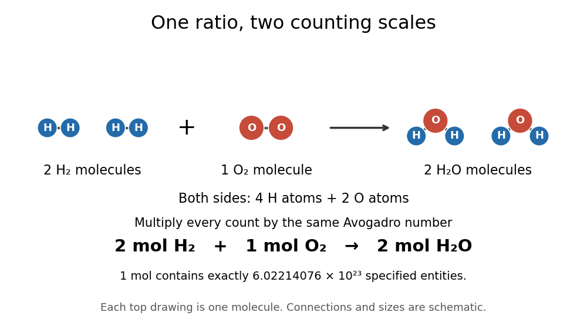

**[Figure 15](#image-the-same-stoichiometric-ratio-at-molecular-and-molar-scales). The same stoichiometric ratio at molecular and molar scales**. The upper schematic counts individual [molecules](molecule.md); the lower line multiplies each count by the [Avogadro constant](physics.md#avogadro-constant) times one [mole](physics.md#mole-unit). Circle sizes and positions are illustrative.

This distinction catches a common counting error: one [mole](physics.md#mole-unit) of [water](chemical-substance.md#water) [molecules](molecule.md) contains two [moles](physics.md#mole-unit) of [hydrogen](chemical-substance.md#hydrogen) [chemical atoms](physics.md#atom-physics) and one [mole](physics.md#mole-unit) of [oxygen](chemical-substance.md#oxygen) [chemical atoms](physics.md#atom-physics). Always specify what is counted.

[Stoichiometry](#stoichiometry) records reactant and product multiplicities in a [chemical reaction](chemical-reaction.md) or a [chemical reaction network](mathematical-biology.md#chemical-reaction-network). The change caused by one reaction is its [stoichiometric vector](mathematical-biology.md#stoichiometric-vector); multiplying by the reaction rate gives its contribution to the concentration equations. For two identical reactants the rate-constant convention absorbs any combinatorial factor.

### Molecular count and amount of substance

↑ **Parent:** [Stoichiometry](#stoichiometry)

The molecular count $N$ is a dimensionless integer; the [amount of substance](physics.md#amount-of-substance) $n$ has unit [mole](physics.md#mole-unit), symbol $\mathrm{mol}$. They satisfy

$$
N=nN_{\mathrm A},\qquad N_{\mathrm A}=6.02214076\times10^{23}\,\mathrm{mol}^{-1}.
$$

The [Avogadro constant](physics.md#avogadro-constant) is exact by the modern definition of the [mole](physics.md#mole-unit): see [SI base unit: mole by Bureau International des Poids et Mesures](chemistry-bibliography.md#si-base-unit-mole-by-bureau-international-des-poids-et-mesures). Thus two [water](chemical-substance.md#water) [molecules](molecule.md) correspond to $2/N_{\mathrm A}$ [moles](physics.md#mole-unit), whereas two [moles](physics.md#mole-unit) of [water](chemical-substance.md#water) contain $1.204428152\times10^{24}$ [molecules](molecule.md). A [mole](physics.md#mole-unit) is a unit for counting specified entities, which may also be [chemical atoms](physics.md#atom-physics), [ions](chemistry.md#ion) or [electrons](physics.md#electron).

### Extent of reaction

↑ **Parent:** [Stoichiometry](#stoichiometry)  
ⓦ [Wiki](https://en.wikipedia.org/wiki/Extent_of_reaction)

For a closed system with one specified [chemical reaction](chemical-reaction.md), the [extent of reaction](#extent-of-reaction) $\xi$ records progress from $\xi=0$ through $n_i=n_{i,0}+\nu_i\xi$. Here $n_i$ is the [amount of substance](physics.md#amount-of-substance) of species $i$, and the signed [stoichiometric vector](mathematical-biology.md#stoichiometric-vector) has negative entries for [reactants](#reactant) and positive entries for [reaction products](#product-chemistry). For the [water](chemical-substance.md#water) [chemical equation](#chemical-equation) in the order $\mathrm{H}_2,\mathrm{O}_2,\mathrm{H}_2\mathrm{O}$, it is $(-2,-1,2)$. The normalization of $\xi$ depends on the chosen coefficients. See [IUPAC Gold Book, extent of reaction](https://goldbook.iupac.org/terms/view/E02283).

With particle numbers instead of molar amounts, a molecular extent $\xi_N$ obeys $dN_i=\nu_i\,d\xi_N$, and the [chemical potentials](chemical-potential.md) are measured per particle. At fixed [temperature](temperature.md) and [volume](geometry-and-topology.md#volume), the [Helmholtz free energy](thermodynamic-potential.md#helmholtz-free-energy) then satisfies $dF=(\sum_i\nu_i\mu_i)\,d\xi_N$. An interior [chemical equilibrium](chemical-potential.md#chemical-equilibrium) requires $\sum_i\nu_i\mu_i=0$; the molar convention gives the same relation with chemical potentials per mole.

### Limiting reagent

↑ **Parent:** [Stoichiometry](#stoichiometry)  
ⓦ [Wiki](https://en.wikipedia.org/wiki/Limiting_reagent)

The [limiting reagent](#limiting-reagent) is the [reactant](#reactant) exhausted first if the specified [chemical reaction](chemical-reaction.md) proceeds to the maximum conversion permitted by [stoichiometry](#stoichiometry). With initial values of [amount of substance](physics.md#amount-of-substance) $n_{i,0}$ for the [reactants](#reactant) and positive consumption coefficients $a_i$, the largest forward [extent of reaction](#extent-of-reaction) is $\xi_{\max}=\min_i(n_{i,0}/a_i)$. Compare these quotients, rather than simply choosing the smallest initial quantity. This calculation predicts the maximum [reaction product](#product-chemistry) quantity and identifies which [reactant](#reactant) supply must increase to raise it. See [Flowers et al., Chemistry 2e, limiting reactants](https://openstax.org/books/chemistry-2e/pages/4-4-reaction-yields).

Start with $3\,\mathrm{mol}$ of [molecular hydrogen](chemical-substance.md#molecular-hydrogen), $1\,\mathrm{mol}$ of [molecular oxygen](chemical-substance.md#molecular-oxygen) and no [water](chemical-substance.md#water). Assume complete conversion by the displayed [chemical reaction](chemical-reaction.md), without competing reactions. Then

$$
\xi_{\max}=\min\left(\frac{3\,\mathrm{mol}}2,\frac{1\,\mathrm{mol}}1\right)=1\,\mathrm{mol}.
$$

The [molecular oxygen](chemical-substance.md#molecular-oxygen) is the [limiting reagent](#limiting-reagent). Consumption of $2\,\mathrm{mol}$ of [molecular hydrogen](chemical-substance.md#molecular-hydrogen) and $1\,\mathrm{mol}$ of [molecular oxygen](chemical-substance.md#molecular-oxygen) forms $2\,\mathrm{mol}$ of [water](chemical-substance.md#water), leaving $1\,\mathrm{mol}$ of [molecular hydrogen](chemical-substance.md#molecular-hydrogen). Initially there are $1.806642228\times10^{24}$ [molecular hydrogen](chemical-substance.md#molecular-hydrogen) [molecules](molecule.md) and $6.02214076\times10^{23}$ [molecular oxygen](chemical-substance.md#molecular-oxygen) [molecules](molecule.md); after conversion there are $1.204428152\times10^{24}$ [water](chemical-substance.md#water) [molecules](molecule.md) and $6.02214076\times10^{23}$ leftover [molecular hydrogen](chemical-substance.md#molecular-hydrogen) [molecules](molecule.md).

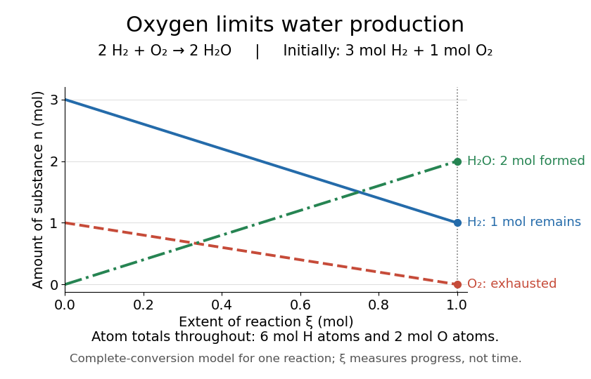

**[Figure 16](#image-oxygen-runs-out-while-one-mole-of-molecular-hydrogen-remains). Oxygen runs out while one mole of molecular hydrogen remains**. The horizontal axis is [extent of reaction](#extent-of-reaction), rather than time. The endpoint assumes complete conversion by one [chemical reaction](chemical-reaction.md); the curves express [stoichiometry](#stoichiometry).

As a check, the initial inventory has $6\,\mathrm{mol}$ of [hydrogen](chemical-substance.md#hydrogen) [chemical atoms](physics.md#atom-physics) and $2\,\mathrm{mol}$ of [oxygen](chemical-substance.md#oxygen) [chemical atoms](physics.md#atom-physics). The final [water](chemical-substance.md#water) contains $4\,\mathrm{mol}$ of [hydrogen](chemical-substance.md#hydrogen) [chemical atoms](physics.md#atom-physics), and leftover [molecular hydrogen](chemical-substance.md#molecular-hydrogen) supplies the remaining $2\,\mathrm{mol}$. The atom totals balance even though the total [amount of substance](physics.md#amount-of-substance) of [molecules](molecule.md) falls from four to three [moles](physics.md#mole-unit).

## Alkylation

↑ **Parent:** [Chemical reaction](chemical-reaction.md)  
ⓦ [Wiki](https://en.wikipedia.org/wiki/Alkylation)

## Mutarotation

↑ **Parent:** [Chemical reaction](chemical-reaction.md)  
ⓦ [Wiki](https://en.wikipedia.org/wiki/Mutarotation)

[Mutarotation](#mutarotation) is a change in [optical rotation](stereochemistry.md#optical-rotation) as [anomers](stereochemistry.md#anomer) interconvert in a [chemical solution](mixture.md#solution-chemistry). The [glucose mutarotation experiment](chemical-substance.md#glucose-mutarotation-experiment) detects redistribution between cyclic forms through [monosaccharide ring-chain interconversion](chemical-substance.md#monosaccharide-ring-chain-interconversion).

## ↑ Ancestors (2)

1. [Chemistry](chemistry.md)
2. [Codex Wiki](README.md)

## ← Incoming links (140)

- [Acetone iodination rate-law experiment](chemical-kinetics.md#acetone-iodination-rate-law-experiment)
- [Acid-base chemistry](acid-base-chemistry.md)
- [Acid-base titration measurement](acid-base-chemistry.md#acid-base-titration-measurement)
- [Activation energy](chemical-kinetics.md#activation-energy)
- [Active site](enzyme.md#active-site)
- [Adenosine diphosphate](molecule.md#adenosine-diphosphate)
- [Adenosine triphosphate](molecule.md#adenosine-triphosphate)
- [Anode](electrochemistry.md#anode)
- [ATP-driven sugar phosphorylation](biochemistry.md#atp-driven-sugar-phosphorylation)
- [Bicinchoninic acid assay](chemistry.md#bicinchoninic-acid-assay)
- [Biochemistry](biochemistry.md)
- [Biological cell](biological-cell.md)
- [Bond-dissociation energy](chemical-bond.md#bond-dissociation-energy)
- [Born-Haber cycle](ionic-bonding.md#born-haber-cycle)
- [Buffer capacity of a monoprotic acid](acid-base-chemistry.md#buffer-capacity-of-a-monoprotic-acid)
- [Buffer solution](acid-base-chemistry.md#buffer-solution)
- [Calcium carbonate precipitation experiment](#calcium-carbonate-precipitation-experiment)
- [Calorimetry](calorimetry.md)
- [Calvin cycle](biology.md#calvin-cycle)
- [Catalysis](chemical-kinetics.md#catalysis)
- [Catalyst](chemical-kinetics.md#catalyst)
- [Catalyst deactivation](chemical-kinetics.md#catalyst-deactivation)
- [Catalyst particle size and accessible area](chemical-kinetics.md#catalyst-particle-size-and-accessible-area)
- [Catalytic selectivity](chemical-kinetics.md#catalytic-selectivity)
- [Cathode](electrochemistry.md#cathode)
- [Chain-growth polymerization](polymer.md#chain-growth-polymerization)
- [Chemical bond](chemical-bond.md)
- [Chemical element](chemical-substance.md#chemical-element)
- [Chemical equation](#chemical-equation)
- [Chemical equilibrium](chemical-potential.md#chemical-equilibrium)
- [Chemical inertness](#chemical-inertness)
- [Chemical kinetics](chemical-kinetics.md)
- [Chemical potential equality for particle exchange](chemical-potential.md#chemical-potential-equality-for-particle-exchange)
- [Chemical reaction](chemical-reaction.md)
- [Chemistry](chemistry.md)
- [Chloroplast](biological-cell.md#chloroplast)
- [Chromatographic partition coefficient](chromatography.md#chromatographic-partition-coefficient)
- [Coenzyme](enzyme.md#coenzyme)
- [Common-ion effect](#common-ion-effect)
- [Conductometric determination of activation energy](chemical-kinetics.md#conductometric-determination-of-activation-energy)
- [Conductometric saponification assay](chemical-kinetics.md#conductometric-saponification-assay)
- [Consecutive first-order reaction mechanism](chemical-kinetics.md#consecutive-first-order-reaction-mechanism)
- [Coupled-enzyme readout of glycolytic ATP formation](biochemistry.md#coupled-enzyme-readout-of-glycolytic-atp-formation)
- [Daniell cell voltage and load experiment](electrochemistry.md#daniell-cell-voltage-and-load-experiment)
- [Dearomatization](#dearomatization)
- [Deoxyribose](chemical-substance.md#deoxyribose)
- [Diffusion](thermodynamics.md#diffusion)
- [Disappearance rate](chemical-kinetics.md#disappearance-rate)
- [Dissolution](ionic-bonding.md#dissolution)
- [Disulfide bond](covalent-bond.md#disulfide-bond)
- [Electric battery](electrical-circuit.md#electric-battery)
- [Electrochemistry](electrochemistry.md)
- [Electrode](electrochemistry.md#electrode)
- [Electrolysis](electrochemistry.md#electrolysis)
- [Electrolytic cell](electrochemistry.md#electrolytic-cell)
- [Electron transport chain](biochemistry.md#electron-transport-chain)
- [Energy coupling](#energy-coupling)
- [Energy flow (ecology)](ecology.md#energy-flow-ecology)
- [Energy profile (chemistry)](chemical-kinetics.md#energy-profile-chemistry)
- [Enzyme](enzyme.md)
- [Epimerization](stereochemistry.md#epimerization)
- [Equilibrium constant](chemical-potential.md#equilibrium-constant)
- [Equivalence point](acid-base-chemistry.md#equivalence-point)
- [Extent of reaction](#extent-of-reaction)
- [Finite battery charge reservoir](electrical-circuit.md#finite-battery-charge-reservoir)
- [Functional group](chemistry.md#functional-group)
- [Functionality in polymerization](polymer.md#functionality-in-polymerization)
- [Galvanic cell](electrochemistry.md#galvanic-cell)
- [Germain Henri Hess](chemistry.md#germain-henri-hess)
- [Glycolysis cofactor recycling](biochemistry.md#glycolysis-cofactor-recycling)
- [Golgi cargo processing](biological-cell.md#golgi-cargo-processing)
- [Group (periodic table)](chemical-substance.md#group-periodic-table)
- [Half-reaction](electrochemistry.md#half-reaction)
- [Helmholtz free energy](thermodynamic-potential.md#helmholtz-free-energy)
- [Hemiketal](chemical-substance.md#hemiketal)
- [Hess's law](chemistry.md#hess-s-law)
- [Homogeneous catalysis](chemical-kinetics.md#homogeneous-catalysis)
- [Hydrolysis](#hydrolysis)
- [Internal energy](internal-energy.md)
- [Intramolecular aldol reaction](#intramolecular-aldol-reaction)
- [Lattice energy](ionic-bonding.md#lattice-energy)
- [Lewis structure](covalent-bond.md#lewis-structure)
- [Limiting reagent](#limiting-reagent)
- [Metabolic pathway](biochemistry.md#metabolic-pathway)
- [Metabolism](biology.md#metabolism)
- [Mitochondrial matrix](biological-cell.md#mitochondrial-matrix)
- [Mixing calorimetry](calorimetry.md#mixing-calorimetry)
- [Molar solubility](#molar-solubility)
- [Molecular diffusion](thermodynamics.md#molecular-diffusion)
- [Molecule bookkeeping](molecule.md#molecule-bookkeeping)
- [Monitoring chain polymerization in a sealed tube](polymer.md#monitoring-chain-polymerization-in-a-sealed-tube)
- [Net ionic equation](#net-ionic-equation)
- [Neutralization](acid-base-chemistry.md#neutralization)
- [Nicotinamide adenine dinucleotide phosphate](chemical-substance.md#nicotinamide-adenine-dinucleotide-phosphate)
- [NMR monitoring of chain polymerization](polymer.md#nmr-monitoring-of-chain-polymerization)
- [Periodic table](chemical-substance.md#periodic-table)
- [Phase rule](thermodynamic-potential.md#phase-rule)
- [Photographic processing](photography.md#photographic-processing)
- [Photosynthesis](biology.md#photosynthesis)
- [Polymerization](polymer.md#polymerization)
- [Precipitation after equal-volume mixing](#precipitation-after-equal-volume-mixing)
- [Primary standard](acid-base-chemistry.md#primary-standard)
- [Protein](protein.md)
- [Protein binding site](protein.md#protein-binding-site)
- [Radical chain reaction](chemistry.md#radical-chain-reaction)
- [Radical (chemistry)](chemistry.md#radical-chemistry)
- [Rate constant](chemical-kinetics.md#rate-constant)
- [Reactant](#reactant)
- [Reaction coordinate](chemical-kinetics.md#reaction-coordinate)
- [Reaction quotient](chemical-potential.md#reaction-quotient)
- [Reaction rate](chemical-kinetics.md#reaction-rate)
- [Redox](#redox)
- [Redox electron balance](#redox-electron-balance)
- [Repeated-bath dialysis model](biochemistry.md#repeated-bath-dialysis-model)
- [Residual-group monitoring of polyurethane formation](polymer.md#residual-group-monitoring-of-polyurethane-formation)
- [Resonance in chemistry](chemical-bond.md#resonance-in-chemistry)
- [Ribozyme](enzyme.md#ribozyme)
- [Saccharomyces cerevisiae](organism.md#saccharomyces-cerevisiae)
- [Saponification with limiting hydroxide](#saponification-with-limiting-hydroxide)
- [Second-order reaction](chemical-kinetics.md#second-order-reaction)
- [Selective biochemical reaction pathways](biochemistry.md#selective-biochemical-reaction-pathways)
- [Signal amplification](signal-transduction.md#signal-amplification)
- [Solubility product and material balance](#solubility-product-and-material-balance)
- [Solubility product measurement by titration](#solubility-product-measurement-by-titration)
- [Solute](mixture.md#solute)
- [Solution (chemistry)](mixture.md#solution-chemistry)
- [Solution mass and volume bookkeeping](mixture.md#solution-mass-and-volume-bookkeeping)
- [Solvent-specific stabilization](ionic-bonding.md#solvent-specific-stabilization)
- [Stable radical](chemistry.md#stable-radical)
- [Stoichiometry](#stoichiometry)
- [Substrate (biochemistry)](enzyme.md#substrate-biochemistry)
- [Substrate (chemistry)](#substrate-chemistry)
- [Substrate-level phosphorylation](biochemistry.md#substrate-level-phosphorylation)
- [Thermodynamic equilibrium](thermodynamics.md#thermodynamic-equilibrium)
- [Thermodynamic free energy](thermodynamic-potential.md#thermodynamic-free-energy)
- [Ultraviolet](optics.md#ultraviolet)
- [Valence electron](chemical-bond.md#valence-electron)
- [Weak acid dissociation fraction](acid-base-chemistry.md#weak-acid-dissociation-fraction)
- [Yeast](organism.md#yeast)
- [Zinc-copper displacement experiment](#zinc-copper-displacement-experiment)
