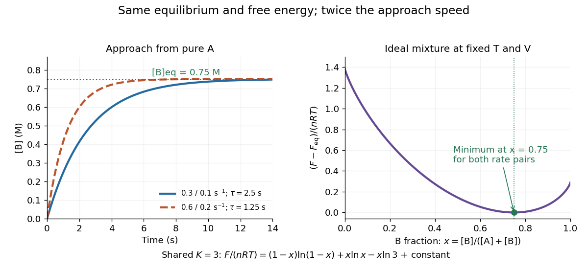

# Chemical relaxation time

↑ **Parent:** [Chemical equilibrium](chemical-equilibrium.md)

The chemical relaxation time estimates how rapidly a perturbed abundance returns toward [chemical equilibrium](chemical-equilibrium.md). Comparing it with the [eddy mixing time](eddy-mixing-time.md) identifies a [chemical quench level](chemical-quench-level.md).

For the A-to-B model in [chemical equilibrium](chemical-equilibrium.md), deviations decay by [exponential decay](exponential-decay.md) with $\tau_{\rm chem}=1/(k_f+k_r)=2.5\,\mathrm s$. After one such interval, $1/e$ of the initial deviation remains; reaching one percent takes $\ln(100)\tau_{\rm chem}\simeq11.51\,\mathrm s$. Multiplying both [rate constants](rate-constant.md) by two preserves their ratio and the equilibrium composition, but halves $\tau_{\rm chem}$ to $1.25\,\mathrm s$. The equilibrium exchange rates double to $0.15\,\mathrm{M/s}$. Faster exchange therefore coexists with the same final composition and the same [free energy](thermodynamic-free-energy.md) minimum.

**[Figure 52](#image-doubling-both-rates-changes-the-approach-time-but-preserves-equilibrium). Doubling both rates changes the approach time but preserves equilibrium**. Left: B [concentration](concentration.md) for two pairs of [rate constants](rate-constant.md) with the same ratio. Right: the shared ideal-mixture [Helmholtz free energy](helmholtz-free-energy.md), shifted to zero at its constrained minimum.

## ↑ Ancestors (7)

1. [Chemical equilibrium](chemical-equilibrium.md)
2. [Chemical potential](chemical-potential.md)
3. [Thermodynamics](thermodynamics-split.md)
4. [Statistical physics](statistical-physics-split.md)
5. [Branches of physics](branches-of-physics.md)
6. [Physics](physics-split.md)
7. [Codex Wiki](split.md)

## ← Incoming links (11)

- [Chemical disequilibrium](chemical-disequilibrium.md)
- [Dependence of a quench diffusivity on mixing length](dependence-of-a-quench-diffusivity-on-mixing-length.md)
- [Horizontal chemical quenching](horizontal-chemical-quenching.md)
- [Solution](past-exam-of-the-mathematics-course-of-the-university-of-cambridge/2015/iii/paper-59/4/b/solution.md)
- [Solution](past-exam-of-the-mathematics-course-of-the-university-of-cambridge/2016/iii/paper-315/2/a/solution.md)
- [Solution](past-exam-of-the-mathematics-course-of-the-university-of-cambridge/2017/iii/paper-315/2/c/iii/solution.md)
- [Solution](past-exam-of-the-mathematics-course-of-the-university-of-cambridge/2017/iii/paper-315/4/f/solution.md)
- [Solution](past-exam-of-the-mathematics-course-of-the-university-of-cambridge/2018/iii/paper-315/3/a/solution.md)
- [Solution](past-exam-of-the-mathematics-course-of-the-university-of-cambridge/2018/iii/paper-315/3/b/i/solution.md)
- [Solution](past-exam-of-the-mathematics-course-of-the-university-of-cambridge/2018/iii/paper-315/3/c/solution.md)
- [Reversible catalytic relaxation](reversible-catalytic-relaxation.md)
