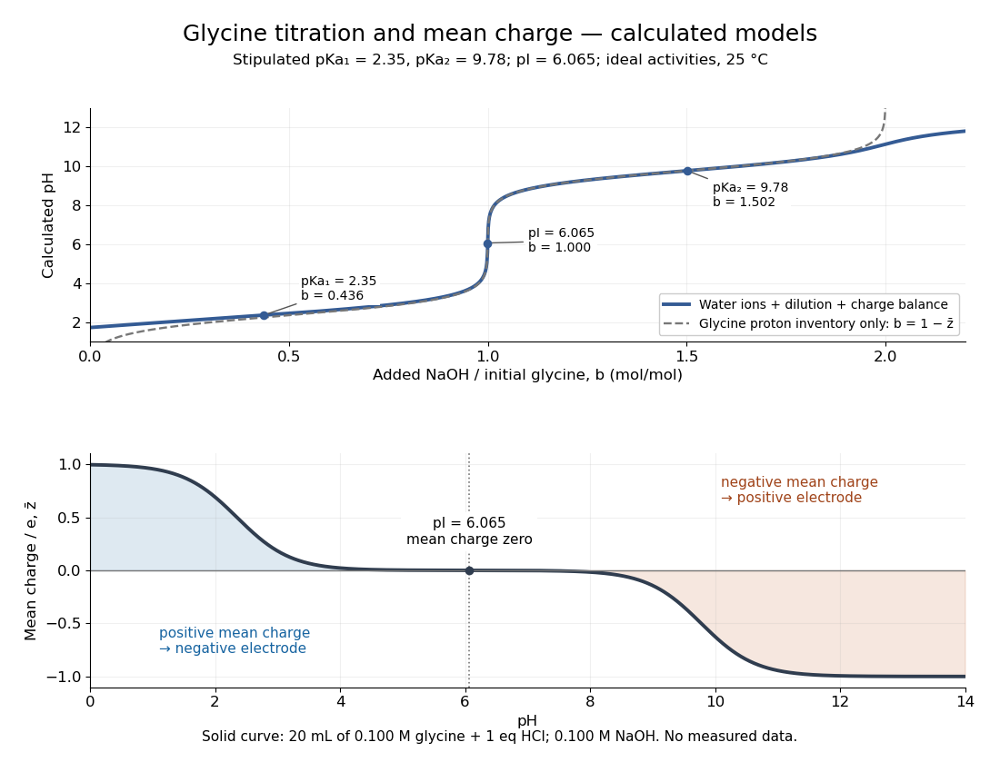
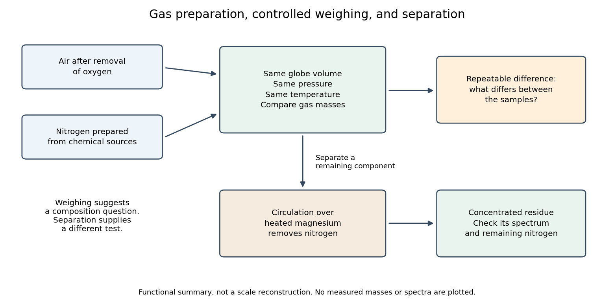

# Chemical substance

↑ **Parent:** [Chemistry](chemistry.md)  
ⓦ [Wiki](https://en.wikipedia.org/wiki/Chemical_substance)

**Table of contents**

- [Hydrofluoric acid](#hydrofluoric-acid)
- [Diisobutylaluminium hydride](#diisobutylaluminium-hydride)
- [Tributyl phosphate](#tributyl-phosphate)
- [Zinc chloride](#zinc-chloride)
- [Titanium tetrachloride](#titanium-tetrachloride)
- [Zinc borohydride](#zinc-borohydride)
- [Lithium fluoride](#lithium-fluoride)
- [Zinc oxide](#zinc-oxide)
- [Lead zirconate titanate](#lead-zirconate-titanate)
- [Naphthalene](#naphthalene)
- [Ureidopyrimidinone](#ureidopyrimidinone)
- [Calixarene](#calixarene)
- [Tert-butyldimethylsilyl chloride](#tert-butyldimethylsilyl-chloride)
- [Hydroperoxide](#hydroperoxide)
- [Methyl fluorosulfonate](#methyl-fluorosulfonate)
- [Trimethyloxonium tetrafluoroborate](#trimethyloxonium-tetrafluoroborate)
- [Sodium cyanoborohydride](#sodium-cyanoborohydride)
- [Tributyltin hydride](#tributyltin-hydride)
- [Carbanion](#carbanion)
- [Macrocycle](#macrocycle)
  - [Anion-templated macrocyclization](#anion-templated-macrocyclization)
- [Aziridinium ion](#aziridinium-ion)
- [Hypochlorous acid](#hypochlorous-acid)
- [Nitrone](#nitrone)
- [Potassium hexamethyldisilazide](#potassium-hexamethyldisilazide)
- [Trimethylsilyl triflate](#trimethylsilyl-triflate)
- [Trimethylsilyl chloride](#trimethylsilyl-chloride)
- [Lithium hexamethyldisilazide](#lithium-hexamethyldisilazide)
- [Acid anhydride](#acid-anhydride)
  - [Cyclic anhydride](#cyclic-anhydride)
    - [Maleic anhydride](#maleic-anhydride)
- [Organic azide](#organic-azide)
- [TMEDA](#tmeda)
- [Cyclobutadienyl dianion](#cyclobutadienyl-dianion)
- [Hexagonal boron nitride](#hexagonal-boron-nitride)
- [Molybdenum disulfide](#molybdenum-disulfide)
- [Norbornane](#norbornane)
- [Nitromethane](#nitromethane)
- [Nitroethane](#nitroethane)
- [Sodium amide](#sodium-amide)
- [Silicon nitride](#silicon-nitride)
- [Borate](#borate)
  - [Cyclic triborate](#cyclic-triborate)
- [Thiocyanate](#thiocyanate)
  - [Thiocyanate coordination mode](#thiocyanate-coordination-mode)
    - [Triply bridging thiocyanate](#triply-bridging-thiocyanate)
- [Pyridine-2,5-dicarboxylate](#pyridine-2-5-dicarboxylate)
- [Biphenyl](#biphenyl)
- [Methyl iodide](#methyl-iodide)
- [Allyl bromide](#allyl-bromide)
- [Hydrogen halide](#hydrogen-halide)
  - [Hydrogen iodide](#hydrogen-iodide)
  - [Hydrogen bromide](#hydrogen-bromide)
  - [Hydroiodic acid](#hydroiodic-acid)
- [Ozonide](#ozonide)
- [Carbonyl oxide](#carbonyl-oxide)
- [Molozonide](#molozonide)
- [Tosyl chloride](#tosyl-chloride)
- [Hydroxylamine](#hydroxylamine)
- [Oxime](#oxime)
  - [Oxime O-tosylation](#oxime-o-tosylation)
  - [Ketoxime](#ketoxime)
- [Pyrazine](#pyrazine)
- [Tetracyanonickelate(II)](#tetracyanonickelate-ii)
- [Boron trifluoride](#boron-trifluoride)
- [Phenazine](#phenazine)
  - [Pyocyanin](#pyocyanin)
- [Acyl-CoA](#acyl-coa)
- [Dhurrin](#dhurrin)
- [Acyl chloride](#acyl-chloride)
  - [Benzoyl chloride](#benzoyl-chloride)
  - [Acetyl chloride](#acetyl-chloride)
  - [2-Methylpropanoyl chloride](#2-methylpropanoyl-chloride)
- [Methanesulfonic anhydride](#methanesulfonic-anhydride)
- [Mesylate](#mesylate)
- [Alkenyl aluminate](#alkenyl-aluminate)
- [Red-Al](#red-al)
- [Osmium tetroxide](#osmium-tetroxide)
- [Metachloroperbenzoic acid](#metachloroperbenzoic-acid)
- [Decalin](#decalin)
- [Allenyl phosphine oxide](#allenyl-phosphine-oxide)
- [Nitrobenzene](#nitrobenzene)
- [Triflic anhydride](#triflic-anhydride)
- [Carbamate](#carbamate)
  - [Ammonium carbamate chain](#ammonium-carbamate-chain)
  - [2-Oxazolidinone](#2-oxazolidinone)
- [Chloroformate](#chloroformate)
  - [Allyl chloroformate](#allyl-chloroformate)
- [Dimethyl sulfoxide](#dimethyl-sulfoxide)
- [Hexamethylphosphoramide](#hexamethylphosphoramide)
- [Organolithium reagent](#organolithium-reagent)
  - [Lithiated enamide](#lithiated-enamide)
  - [n-Butyllithium](#n-butyllithium)
  - [Organolithium aggregation](#organolithium-aggregation)
- [Tetrahydrofuran](#tetrahydrofuran)
- [Lithium diisopropylamide](#lithium-diisopropylamide)
- [Porphyrin](#porphyrin)
- [2,4-Diazadiboretidine](#2-4-diazadiboretidine)
- [Borazine](#borazine)
  - [Borazine dearomatization](#borazine-dearomatization)
  - [B-Tribromoborazine](#b-tribromoborazine)
  - [Hexamethylborazine](#hexamethylborazine)
- [Triphenyl phosphite](#triphenyl-phosphite)
- [Trifluorophosphine](#trifluorophosphine)
- [Methyllithium](#methyllithium)
- [Grignard reagent](#grignard-reagent)
  - [Vinylmagnesium halide](#vinylmagnesium-halide)
  - [Cyclohexylmagnesium bromide](#cyclohexylmagnesium-bromide)
  - [Butylmagnesium bromide](#butylmagnesium-bromide)
  - [Methylmagnesium bromide](#methylmagnesium-bromide)
  - [Phenylmagnesium bromide](#phenylmagnesium-bromide)
  - [Methylmagnesium iodide](#methylmagnesium-iodide)
- [Carbonic acid](#carbonic-acid)
- [Alkyne](#alkyne)
  - [Acetylide](#acetylide)
  - [Hexa-1,5-diyne](#hexa-1-5-diyne)
  - [Benzyne](#benzyne)
  - [Propyne](#propyne)
- [Lactose](#lactose)
- [Imatinib](#imatinib)
- [Haem](#haem)
- [Allolactose](#allolactose)
- [Peroxide](#peroxide)
  - [Benzoyl peroxide](#benzoyl-peroxide)
- [Cyclopentane](#cyclopentane)
- [Sulfonamide](#sulfonamide)
- [Carbinolamine](#carbinolamine)
- [Vitamin A](#vitamin-a)
- [Retinoid](#retinoid)
- [4-nitroquinoline 1-oxide](#4-nitroquinoline-1-oxide)
- [Nitric acid](#nitric-acid)
- [Deuterated chloroform](#deuterated-chloroform)
- [Acetal](#acetal)
  - [1,3,5-Trioxane](#1-3-5-trioxane)
  - [Ketal](#ketal)
  - [Benzylidene acetal](#benzylidene-acetal)
  - [Thioglycoside](#thioglycoside)
  - [2,2-Dimethoxypropane](#2-2-dimethoxypropane)
  - [Acetonide](#acetonide)
  - [Spiroacetal](#spiroacetal)
- [Lithium aluminium hydride](#lithium-aluminium-hydride)
- [Sodium borohydride](#sodium-borohydride)
  - [Evans–Saksena reduction](#evans-saksena-reduction)
- [Hydride](#hydride)
  - [Bridging hydride](#bridging-hydride)
- [Pyridine](#pyridine)
- [Ether](#ether)
  - [Enol ether](#enol-ether)
    - [Enol ether hydrolysis](#enol-ether-hydrolysis)
  - [Tetrahydropyranyl ether](#tetrahydropyranyl-ether)
  - [Vinyl ether](#vinyl-ether)
    - [2-Chloroethyl vinyl ether](#2-chloroethyl-vinyl-ether)
  - [Silyl ether](#silyl-ether)
  - [Epoxide](#epoxide)
    - [Ethylene oxide](#ethylene-oxide)
    - [Epoxide ring opening](#epoxide-ring-opening)
    - [Peracid epoxidation](#peracid-epoxidation)
    - [Cyclohexene oxide](#cyclohexene-oxide)
    - [2,2-Dimethyloxirane](#2-2-dimethyloxirane)
    - [Glycal epoxide](#glycal-epoxide)
  - [Ethyl triphenylmethyl ether](#ethyl-triphenylmethyl-ether)
- [Hexanenitrile](#hexanenitrile)
- [Cyanide](#cyanide)
- [Methyldiazonium](#methyldiazonium)
- [Diazomethane](#diazomethane)
- [Alkene](#alkene)
  - [Nitroethylene](#nitroethylene)
  - [Norbornene](#norbornene)
  - [Diene](#diene)
    - [Cyclopentadiene](#cyclopentadiene)
    - [Buta-1,3-diene](#buta-1-3-diene)
  - [Ketene dithioacetal](#ketene-dithioacetal)
  - [Cyclohexene](#cyclohexene)
    - [Cyclohexene half-chair](#cyclohexene-half-chair)
  - [Terminal alkene](#terminal-alkene)
  - [Styrene](#styrene)
  - [Nitroalkene](#nitroalkene)
- [Carbocation](#carbocation)
  - [Tertiary carbocation](#tertiary-carbocation)
  - [Secondary carbocation](#secondary-carbocation)
  - [1,2-hydride shift](#1-2-hydride-shift)
  - [Oxocarbenium ion](#oxocarbenium-ion)
    - [Glycosyloxocarbenium ion](#glycosyloxocarbenium-ion)
- [Enolate](#enolate)
  - [Vinylogous enolate](#vinylogous-enolate)
  - [Ester enolate](#ester-enolate)
  - [Thermodynamic enolate](#thermodynamic-enolate)
  - [Kinetic enolate](#kinetic-enolate)
  - [Enolate regioselectivity](#enolate-regioselectivity)
  - [Enolate acylation](#enolate-acylation)
  - [Carboxylic acid dianion](#carboxylic-acid-dianion)
  - [Enolate alkylation](#enolate-alkylation)
    - [Reductive alpha-alkylation of an enone](#reductive-alpha-alkylation-of-an-enone)
  - [O-acylation of an enolate](#o-acylation-of-an-enolate)
- [Iminium](#iminium)
- [Enamine](#enamine)
  - [Enamine regioisomerization](#enamine-regioisomerization)
- [Gallium trichloride](#gallium-trichloride)
- [Chloroacetyl chloride](#chloroacetyl-chloride)
- [Imidazole](#imidazole)
- [Beta-lactam](#beta-lactam)
- [Acetate](#acetate)
- [Phosphocreatine](#phosphocreatine)
- [Fructose-1-phosphate](#fructose-1-phosphate)
- [Fructose-6-phosphate](#fructose-6-phosphate)
- [Glucose-6-phosphate](#glucose-6-phosphate)
- [Dimethylformamide](#dimethylformamide)
- [Biotin](#biotin)
- [Samarium hexaboride](#samarium-hexaboride)
- [Gallium nitride](#gallium-nitride)
- [Indium gallium nitride](#indium-gallium-nitride)
- [Aluminium nitride](#aluminium-nitride)
- [Aluminium gallium nitride](#aluminium-gallium-nitride)
- [Manganese(II) oxide](#manganese-ii-oxide)
- [Corundum](#corundum)
  - [Sapphire](#sapphire)
  - [Ruby](#ruby)
- [Cerium magnesium nitrate](#cerium-magnesium-nitrate)
- [Anthracene](#anthracene)
- [Diethyl ether](#diethyl-ether)
- [Gelatin](#gelatin)
- [Resin](#resin)
  - [Gamboge](#gamboge)
- [Metal](#metal)
  - [Tantalum](#tantalum)
  - [Palladium](#palladium)
  - [Transition metal](#transition-metal)
    - [Rhenium](#rhenium)
  - [Alloy](#alloy)
    - [Superalloy](#superalloy)
      - [Nickel-based superalloy](#nickel-based-superalloy)
        - [Single-crystal turbine blade](#single-crystal-turbine-blade)
        - [Gamma prime phase](#gamma-prime-phase)
    - [Zirconium alloy](#zirconium-alloy)
      - [Zircaloy](#zircaloy)
    - [Surface segregation](#surface-segregation)
    - [Chemical ordering in alloys](#chemical-ordering-in-alloys)
    - [Precipitation hardening](#precipitation-hardening)
      - [Precipitate diameter from fraction and spacing](#precipitate-diameter-from-fraction-and-spacing)
      - [Orowan bypass](#orowan-bypass)
        - [Tensile conversion of an obstacle shear stress](#tensile-conversion-of-an-obstacle-shear-stress)
      - [Order strengthening](#order-strengthening)
      - [Solid-state precipitate](#solid-state-precipitate)
        - [Precipitate coarsening](#precipitate-coarsening)
        - [Precipitate morphology](#precipitate-morphology)
    - [Aluminium scandium alloy](#aluminium-scandium-alloy)
    - [Bronze](#bronze)
    - [Manganin](#manganin)
    - [Steel](#steel)
      - [Austenitic steel](#austenitic-steel)
        - [Austenitic stainless steel](#austenitic-stainless-steel)
          - [AISI 316 stainless steel](#aisi-316-stainless-steel)
      - [Stainless steel](#stainless-steel)
      - [Steel microstructure](#steel-microstructure)
        - [Nital](#nital)
        - [Tempering (metallurgy)](#tempering-metallurgy)
          - [Tempered martensite](#tempered-martensite)
        - [Isothermal transformation diagram](#isothermal-transformation-diagram)
        - [Martensite](#martensite)
        - [Pearlite](#pearlite)
          - [Pearlite phase fraction](#pearlite-phase-fraction)
        - [Cementite](#cementite)
        - [Austenite](#austenite)
        - [Ferrite](#ferrite)
    - [Invar](#invar)
- [Paraffin wax](#paraffin-wax)
- [Copper(II) sulfate](#copper-ii-sulfate)
- [Amine](#amine)
  - [Cyclohexylamine](#cyclohexylamine)
  - [Tertiary amine](#tertiary-amine)
    - [Trimethylamine](#trimethylamine)
  - [Secondary amine](#secondary-amine)
  - [Primary amine](#primary-amine)
    - [Methylamine](#methylamine)
    - [Isopropylamine](#isopropylamine)
  - [Diisopropylethylamine](#diisopropylethylamine)
  - [2-Picolylamine](#2-picolylamine)
  - [Amino group](#amino-group)
  - [Ammonium group](#ammonium-group)
  - [Aniline](#aniline)
    - [Dimethylaniline](#dimethylaniline)
  - [Pyrrolidine](#pyrrolidine)
  - [Triethylamine](#triethylamine)
  - [4-Nitroaniline](#4-nitroaniline)
  - [Triethanolamine](#triethanolamine)
- [Amide](#amide)
  - [Weinreb amide](#weinreb-amide)
  - [Enamide](#enamide)
  - [Amide bond rotation](#amide-bond-rotation)
  - [Amide resonance](#amide-resonance)
  - [Acetamide](#acetamide)
  - [Lactam](#lactam)
  - [BAPNA](#bapna)
- [Hydrogen peroxide](#hydrogen-peroxide)
- [Acyl group](#acyl-group)
  - [Acetyl group](#acetyl-group)
- [Sphingosine](#sphingosine)
- [Zwitterion](#zwitterion)
- [Lipid](#lipid)
  - [Plant cuticular wax](#plant-cuticular-wax)
  - [Suberin](#suberin)
  - [Cutin](#cutin)
  - [Sterol](#sterol)
  - [Galactolipid](#galactolipid)
    - [Digalactosyldiacylglycerol](#digalactosyldiacylglycerol)
    - [Monogalactosyldiacylglycerol](#monogalactosyldiacylglycerol)
  - [Sphingolipid](#sphingolipid)
    - [Ceramide](#ceramide)
  - [Acylcarnitine](#acylcarnitine)
  - [Lipid peroxidation](#lipid-peroxidation)
  - [Acyl editing](#acyl-editing)
  - [Substrate dichotomy](#substrate-dichotomy)
  - [Dolichol phosphate](#dolichol-phosphate)
  - [Dolichol](#dolichol)
  - [Diacylglycerol](#diacylglycerol)
  - [Triglyceride](#triglyceride)
  - [Cholesterol](#cholesterol)
  - [Phospholipid](#phospholipid)
    - [Phosphatidylinositol](#phosphatidylinositol)
    - [Phosphoinositide](#phosphoinositide)
      - [Phosphatidylinositol 4-phosphate](#phosphatidylinositol-4-phosphate)
      - [Phosphatidylinositol 3,5-bisphosphate](#phosphatidylinositol-3-5-bisphosphate)
      - [Phosphatidylinositol 3-phosphate](#phosphatidylinositol-3-phosphate)
      - [Phosphatidylinositol 3,4-bisphosphate](#phosphatidylinositol-3-4-bisphosphate)
    - [Lysophospholipid](#lysophospholipid)
    - [Phosphatidylinositol 4,5-bisphosphate](#phosphatidylinositol-4-5-bisphosphate)
    - [Glycerophospholipid](#glycerophospholipid)
      - [Phosphatidylserine](#phosphatidylserine)
      - [Phosphatidylethanolamine](#phosphatidylethanolamine)
      - [Phosphatidylcholine](#phosphatidylcholine)
    - [Sphingomyelin](#sphingomyelin)
- [Aldehyde](#aldehyde)
  - [Benzaldehyde](#benzaldehyde)
  - [Acrolein](#acrolein)
  - [Formaldehyde](#formaldehyde)
- [Carbohydrate](#carbohydrate)
  - [Sucrose](#sucrose)
  - [Sugar](#sugar)
    - [Ribose](#ribose)
    - [Deoxyribose](#deoxyribose)
    - [Glucose](#glucose)
    - [Monosaccharide](#monosaccharide)
      - [Aldopentose](#aldopentose)
      - [Aldohexose](#aldohexose)
      - [Monosaccharide ring-chain interconversion](#monosaccharide-ring-chain-interconversion)
        - [Glucose mutarotation experiment](#glucose-mutarotation-experiment)
      - [Aldose](#aldose)
      - [Ketose](#ketose)
    - [Disaccharide](#disaccharide)
      - [Cellobiose](#cellobiose)
    - [Fructose](#fructose)
  - [Polysaccharide](#polysaccharide)
    - [Hemicellulose](#hemicellulose)
    - [Starch](#starch)
    - [Polysaccharide biosynthesis](#polysaccharide-biosynthesis)
    - [Cellulose](#cellulose)
      - [Cellulose microfibril](#cellulose-microfibril)
    - [Agar](#agar)
    - [Agarose](#agarose)
  - [Triose phosphate](#triose-phosphate)
    - [Glyceraldehyde 3-phosphate](#glyceraldehyde-3-phosphate)
  - [Oligosaccharide](#oligosaccharide)
- [Phosphate](#phosphate)
  - [Trimetaphosphate](#trimetaphosphate)
  - [Calcium phosphate](#calcium-phosphate)
  - [Inorganic phosphate](#inorganic-phosphate)
- [Chemical formula](#chemical-formula)
  - [Degree of unsaturation](#degree-of-unsaturation)
  - [Molecular formula](#molecular-formula)
    - [Empirical formula](#empirical-formula)
  - [Formula unit](#formula-unit)
- [Organic acid](#organic-acid)
  - [Carboxylic acid](#carboxylic-acid)
    - [Hexanoic acid](#hexanoic-acid)
    - [Carboxylic acid dimer](#carboxylic-acid-dimer)
    - [Trifluoroacetic acid](#trifluoroacetic-acid)
    - [Short-chain fatty acid](#short-chain-fatty-acid)
    - [Oxalic acid](#oxalic-acid)
      - [Oxalate](#oxalate)
    - [Pyruvic acid](#pyruvic-acid)
      - [Pyruvate](#pyruvate)
    - [Tartaric acid](#tartaric-acid)
    - [Acetic acid](#acetic-acid)
      - [Acetate ion](#acetate-ion)
    - [Fatty acid](#fatty-acid)
      - [Docosahexaenoic acid](#docosahexaenoic-acid)
      - [Eicosapentaenoic acid](#eicosapentaenoic-acid)
      - [Alpha-linolenic acid](#alpha-linolenic-acid)
    - [Amino acid](#amino-acid)
      - [Asparagine](#asparagine)
      - [Histidine](#histidine)
      - [Methionine](#methionine)
      - [Alanine](#alanine)
      - [Alpha-amino acid](#alpha-amino-acid)
        - [Proteinogenic amino acid](#proteinogenic-amino-acid)
          - [Tyrosine](#tyrosine)
          - [Glutamine](#glutamine)
          - [Proline](#proline)
          - [Lysine](#lysine)
          - [Arginine](#arginine)
        - [Glycine protonation](#glycine-protonation)
          - [Glycine speciation model](#glycine-speciation-model)
          - [Glycine titration](#glycine-titration)
            - [Glycine titration experiment](#glycine-titration-experiment)
      - [Leucine](#leucine)
      - [Serine](#serine)
      - [Glutamic acid](#glutamic-acid)
        - [Glutamate](#glutamate)
    - [Citric acid](#citric-acid)
      - [Citrate](#citrate)
    - [Phosphoenolpyruvic acid](#phosphoenolpyruvic-acid)
      - [Phosphoenolpyruvate](#phosphoenolpyruvate)
    - [Lactic acid](#lactic-acid)
      - [Lactate](#lactate)
    - [Trichloroacetic acid](#trichloroacetic-acid)
    - [Carboxylate](#carboxylate)
    - [Malic acid](#malic-acid)
      - [Malate](#malate)
- [Hydrogen deuteride](#hydrogen-deuteride)
- [Chemical composition](#chemical-composition)
- [Chemical element](#chemical-element)
  - [Xenon](#xenon)
  - [Strontium](#strontium)
  - [Allotropy](#allotropy)
  - [Americium](#americium)
    - [Americyl ion](#americyl-ion)
  - [Bromine](#bromine)
  - [Titanium](#titanium)
  - [Hafnium](#hafnium)
  - [Zirconium](#zirconium)
  - [Arsenic](#arsenic)
  - [Antimony](#antimony)
  - [Neptunium](#neptunium)
    - [Neptunium-239](#neptunium-239)
  - [Gadolinium](#gadolinium)
    - [Gadolinium-157](#gadolinium-157)
  - [Thorium](#thorium)
  - [Lanthanum](#lanthanum)
  - [Vanadium](#vanadium)
  - [Erbium](#erbium)
  - [Curium](#curium)
  - [Plutonium](#plutonium)
    - [Plutonium-239](#plutonium-239)
  - [Chromium](#chromium)
  - [Radium](#radium)
  - [Niobium](#niobium)
  - [Germanium](#germanium)
  - [Indium](#indium)
  - [Gallium](#gallium)
  - [Alkaline earth metal](#alkaline-earth-metal)
  - [Alkali metal](#alkali-metal)
    - [Alkali atom](#alkali-atom)
  - [Bismuth](#bismuth)
  - [Caesium](#caesium)
  - [Polonium](#polonium)
  - [Rubidium](#rubidium)
    - [Rubidium-87](#rubidium-87)
      - [Rubidium-87 ground-state hyperfine structure](#rubidium-87-ground-state-hyperfine-structure)
  - [Tin](#tin)
    - [Tin pest](#tin-pest)
    - [Grey tin](#grey-tin)
    - [White tin](#white-tin)
    - [Closo pentastannide dianion](#closo-pentastannide-dianion)
  - [Tungsten](#tungsten)
  - [Mercury (element)](#mercury-element)
  - [Iridium](#iridium)
  - [Platinum](#platinum)
  - [Zinc](#zinc)
  - [Copper](#copper)
  - [Periodic table](#periodic-table)
    - [Actinide](#actinide)
    - [Lanthanide](#lanthanide)
      - [Ytterbium](#ytterbium)
      - [Europium](#europium)
    - [Periodic trend](#periodic-trend)
      - [Atomic radius](#atomic-radius)
      - [Inert-pair effect](#inert-pair-effect)
    - [Lanthanide contraction](#lanthanide-contraction)
    - [Group (periodic table)](#group-periodic-table)
    - [Period (periodic table)](#period-periodic-table)
  - [Boron](#boron)
    - [Boron-10](#boron-10)
  - [Fluorine](#fluorine)
  - [Aluminium](#aluminium)
    - [Aluminium oxide](#aluminium-oxide)
  - [Phosphorus](#phosphorus)
    - [White phosphorus](#white-phosphorus)
  - [Sulfur](#sulfur)
    - [Tetrasulfur dication](#tetrasulfur-dication)
  - [Chlorine](#chlorine)
  - [Noble gas](#noble-gas)
    - [Krypton](#krypton)
    - [Radon](#radon)
    - [Argon](#argon)
      - [Argon-40](#argon-40)
      - [Rayleigh-Ramsay argon density experiment](#rayleigh-ramsay-argon-density-experiment)
      - [Argon detection in a binary gas mixture](#argon-detection-in-a-binary-gas-mixture)
  - [Sodium](#sodium)
  - [Calcium](#calcium)
    - [Calcium ion](#calcium-ion)
    - [Calcium-40](#calcium-40)
    - [Calcium hydroxide](#calcium-hydroxide)
  - [Potassium](#potassium)
    - [Potassium-40](#potassium-40)
  - [Atomic number](#atomic-number)
  - [Beryllium](#beryllium)
    - [Beryllium-10](#beryllium-10)
    - [Beryllium-8](#beryllium-8)
    - [Beryllium-7](#beryllium-7)
  - [Lithium](#lithium)
    - [Trilithium](#trilithium)
    - [Dilithium](#dilithium)
    - [Lithium-7](#lithium-7)
  - [Nuclide](#nuclide)
  - [Isotope](#isotope)
    - [Carbon-11](#carbon-11)
    - [Oxygen-18](#oxygen-18)
    - [Stable isotope analysis](#stable-isotope-analysis)
    - [Isotopologue](#isotopologue)
    - [Stable isotope labeling](#stable-isotope-labeling)
    - [Isotopic composition](#isotopic-composition)
    - [Mass number](#mass-number)
      - [Neutron number](#neutron-number)
    - [Atomic mass](#atomic-mass)
      - [Dalton (unit)](#dalton-unit)
      - [Nuclear mass defect](#nuclear-mass-defect)
      - [Relative atomic mass](#relative-atomic-mass)
        - [Standard atomic weight](#standard-atomic-weight)
    - [Isotopic abundance](#isotopic-abundance)
  - [Uranium](#uranium)
    - [Alpha uranium](#alpha-uranium)
    - [Depleted uranium](#depleted-uranium)
    - [Uranium-239](#uranium-239)
    - [Uranium-238](#uranium-238)
    - [Uranium-236](#uranium-236)
    - [Uranium-235](#uranium-235)
  - [Lead](#lead)
  - [Barium](#barium)
  - [Californium](#californium)
    - [Californium-252](#californium-252)
  - [Silicon](#silicon)
    - [Polysilicon](#polysilicon)
  - [Magnesium](#magnesium)
  - [Neon](#neon)
    - [Neon-20](#neon-20)
    - [Neon-21](#neon-21)
    - [Neon-22](#neon-22)
  - [Cobalt](#cobalt)
    - [Cobalt-60](#cobalt-60)
  - [Nickel](#nickel)
    - [Nickel-56 decay chain](#nickel-56-decay-chain)
  - [Manganese](#manganese)
  - [Iron](#iron)
  - [Oxygen](#oxygen)
    - [Oxygen-17](#oxygen-17)
    - [Oxygen singlet D atom](#oxygen-singlet-d-atom)
    - [Atomic oxygen](#atomic-oxygen)
      - [Electronically excited oxygen atom](#electronically-excited-oxygen-atom)
    - [Anoxia](#anoxia)
    - [Singlet oxygen](#singlet-oxygen)
    - [Oxygen-16](#oxygen-16)
    - [Molecular oxygen](#molecular-oxygen)
  - [Nitrogen](#nitrogen)
    - [Nitrogen-15](#nitrogen-15)
    - [Nitrogen-14](#nitrogen-14)
  - [Carbon](#carbon)
    - [Carbon-14](#carbon-14)
    - [Diamond](#diamond)
    - [Graphite](#graphite)
      - [Graphite intercalation compound](#graphite-intercalation-compound)
        - [Potassium graphite](#potassium-graphite)
    - [Graphene](#graphene)
      - [Graphene zone-boundary band separation](#graphene-zone-boundary-band-separation)
      - [Liquid-phase exfoliation](#liquid-phase-exfoliation)
      - [Reduced graphene oxide](#reduced-graphene-oxide)
      - [Bilayer graphene](#bilayer-graphene)
        - [Twisted bilayer graphene](#twisted-bilayer-graphene)
      - [Nearest-neighbour model of graphene](#nearest-neighbour-model-of-graphene)
        - [Dirac valleys in graphene](#dirac-valleys-in-graphene)
          - [Sublattice pseudospin in graphene](#sublattice-pseudospin-in-graphene)
          - [Carrier density in a graphene cone](#carrier-density-in-a-graphene-cone)
          - [Cyclotron mass in a graphene cone](#cyclotron-mass-in-a-graphene-cone)
      - [Graphene exfoliation and field-effect experiments](#graphene-exfoliation-and-field-effect-experiments)
      - [Gate control of graphene carrier density](#gate-control-of-graphene-carrier-density)
        - [Quantum capacitance of a graphene cone](#quantum-capacitance-of-a-graphene-cone)
    - [Carbon nanotube](#carbon-nanotube)
      - [Ideal carbon nanotube tenacity](#ideal-carbon-nanotube-tenacity)
      - [Carbon nanotube forest](#carbon-nanotube-forest)
      - [Kataura plot](#kataura-plot)
      - [Multi-walled carbon nanotube](#multi-walled-carbon-nanotube)
        - [Nanotube atom-count estimate](#nanotube-atom-count-estimate)
      - [Single-walled carbon nanotube](#single-walled-carbon-nanotube)
        - [Chirality-sorted carbon nanotube](#chirality-sorted-carbon-nanotube)
        - [Nanotube optical transition](#nanotube-optical-transition)
        - [Nanotube zone folding](#nanotube-zone-folding)
          - [Carbon-nanotube Dirac mass](#carbon-nanotube-dirac-mass)
        - [Carbon nanotube chiral vector](#carbon-nanotube-chiral-vector)
          - [Carbon nanotube chiral angle](#carbon-nanotube-chiral-angle)
        - [Semiconducting carbon nanotube](#semiconducting-carbon-nanotube)
    - [Carbon-12](#carbon-12)
    - [Carbon-13](#carbon-13)
  - [Helium](#helium)
    - [Helium atom](#helium-atom)
      - [Helium metastability](#helium-metastability)
      - [Singlet-triplet exchange splitting in helium](#singlet-triplet-exchange-splitting-in-helium)
      - [Triplet helium state](#triplet-helium-state)
      - [Singlet helium state](#singlet-helium-state)
      - [Singly excited helium state](#singly-excited-helium-state)
    - [Helium-3](#helium-3)
    - [Helium-4](#helium-4)
  - [Hydrogen](#hydrogen)
    - [Metallic hydrogen](#metallic-hydrogen)
    - [Deuterium](#deuterium)
    - [Hydrogen anion](#hydrogen-anion)
  - [Halogen](#halogen)
    - [Iodine](#iodine)
  - [Molybdenum](#molybdenum)
  - [Gold](#gold)
  - [Cadmium](#cadmium)
  - [Silver](#silver)
- [Molecular nitrogen](#molecular-nitrogen)
- [Molecular hydrogen](#molecular-hydrogen)
- [Solid solution](#solid-solution)
  - [Solid-solution strengthening](#solid-solution-strengthening)
  - [Vegard's law](#vegard-s-law)
  - [Solid-solution limit](#solid-solution-limit)
  - [Charge compensation in a crystal](#charge-compensation-in-a-crystal)
  - [Isovalent substitution](#isovalent-substitution)
  - [Terminal solid solution](#terminal-solid-solution)
  - [Aluminium gallium arsenide](#aluminium-gallium-arsenide)
- [Chemical compound](#chemical-compound)
  - [Lithium sulfide](#lithium-sulfide)
  - [Iron disulfide](#iron-disulfide)
  - [Lead sulfate](#lead-sulfate)
  - [Nickel aluminide](#nickel-aluminide)
  - [Barium fluoride](#barium-fluoride)
  - [Calcium fluoride](#calcium-fluoride)
  - [Boron carbide](#boron-carbide)
  - [Barium titanate](#barium-titanate)
  - [Sulfur dioxide](#sulfur-dioxide)
  - [Zirconium hydride](#zirconium-hydride)
  - [Ammonia borane](#ammonia-borane)
  - [Carbon monosulfide](#carbon-monosulfide)
  - [Phosphonium salt](#phosphonium-salt)
  - [Phosphonate ester](#phosphonate-ester)
    - [Phosphonoacetate](#phosphonoacetate)
  - [Cyclic compound](#cyclic-compound)
  - [Sodium triacetoxyborohydride](#sodium-triacetoxyborohydride)
  - [5-Aminohexanoic acid](#5-aminohexanoic-acid)
  - [Molybdenum(III) chloride](#molybdenum-iii-chloride)
  - [Molybdenum(II) chloride](#molybdenum-ii-chloride)
  - [Borane](#borane)
    - [Dodecaborate dianion](#dodecaborate-dianion)
    - [Carborane](#carborane)
      - [Metallacarborane](#metallacarborane)
        - [Cobaltacarborane](#cobaltacarborane)
      - [Dicarbollide ligand](#dicarbollide-ligand)
      - [Closo carborane](#closo-carborane)
      - [Nido carborane](#nido-carborane)
    - [Hexaborane(12)](#hexaborane-12)
    - [Undecahydrohexaborate anion](#undecahydrohexaborate-anion)
    - [Octahydropentaborate anion](#octahydropentaborate-anion)
    - [Pentaborane(9)](#pentaborane-9)
  - [Phosphorus pentafluoride](#phosphorus-pentafluoride)
  - [Dioxetane](#dioxetane)
  - [Isoprene](#isoprene)
  - [Dinitrogen pentoxide](#dinitrogen-pentoxide)
  - [Peroxyacetyl nitrate](#peroxyacetyl-nitrate)
  - [Trimethylaluminium](#trimethylaluminium)
  - [Boron trichloride](#boron-trichloride)
  - [Peroxy acid](#peroxy-acid)
    - [Meta-chloroperoxybenzoic acid](#meta-chloroperoxybenzoic-acid)
  - [Nitrile](#nitrile)
    - [Maleonitrile](#maleonitrile)
    - [Benzonitrile](#benzonitrile)
  - [Carboxylic anhydride](#carboxylic-anhydride)
    - [Acetic anhydride](#acetic-anhydride)
  - [Diazo compound](#diazo-compound)
  - [Carbonyl compound](#carbonyl-compound)
  - [Trimethyl phosphate](#trimethyl-phosphate)
  - [Phosphine oxide](#phosphine-oxide)
    - [Trimethylphosphine oxide](#trimethylphosphine-oxide)
  - [Pyrrole](#pyrrole)
  - [Pyridine-2,5-dicarboxylic acid](#pyridine-2-5-dicarboxylic-acid)
  - [Catechol](#catechol)
  - [Cyclooctatetraene](#cyclooctatetraene)
  - [Zirconia](#zirconia)
  - [Titanium dioxide](#titanium-dioxide)
  - [Cerium dioxide](#cerium-dioxide)
  - [Graphite fluoride](#graphite-fluoride)
  - [Organohalide](#organohalide)
    - [Aryl halide](#aryl-halide)
      - [Bromobenzene](#bromobenzene)
    - [Bromocyclohexane](#bromocyclohexane)
  - [Phosphorus tribromide](#phosphorus-tribromide)
  - [Organic compound](#organic-compound)
    - [Organoboron compound](#organoboron-compound)
      - [Boroxine](#boroxine)
    - [Organohalogen compound](#organohalogen-compound)
      - [Allylic halide](#allylic-halide)
      - [Vinylic halide](#vinylic-halide)
        - [Vinyl chloride](#vinyl-chloride)
  - [Organometallic compound](#organometallic-compound)
    - [Vinylaluminate](#vinylaluminate)
    - [Organoaluminium compound](#organoaluminium-compound)
      - [Aluminoxane](#aluminoxane)
    - [Arene chromium tricarbonyl complex](#arene-chromium-tricarbonyl-complex)
    - [Gilman cuprate](#gilman-cuprate)
    - [Alkylidene](#alkylidene)
    - [Organocuprate](#organocuprate)
    - [Allyltitanium reagent](#allyltitanium-reagent)
    - [Oxatitanacyclobutane](#oxatitanacyclobutane)
    - [Titanacyclobutane](#titanacyclobutane)
    - [Titanocene methylidene](#titanocene-methylidene)
    - [Schwartz reagent](#schwartz-reagent)
    - [Methylaluminoxane](#methylaluminoxane)
    - [Metallacyclopropane](#metallacyclopropane)
    - [Metallacyclopropene](#metallacyclopropene)
  - [Ammonium chloride](#ammonium-chloride)
  - [Organosilicon compound](#organosilicon-compound)
    - [Silsesquioxane](#silsesquioxane)
      - [T7 trisilanol cage](#t7-trisilanol-cage)
      - [T10 silsesquioxane cage](#t10-silsesquioxane-cage)
      - [T8 silsesquioxane cage](#t8-silsesquioxane-cage)
    - [Silanone](#silanone)
    - [Siloxane](#siloxane)
    - [Trimethylsilyl group](#trimethylsilyl-group)
    - [Silanol](#silanol)
      - [Silanolate ligand](#silanolate-ligand)
    - [Chlorosilane](#chlorosilane)
  - [Phosphorus pentachloride](#phosphorus-pentachloride)
  - [Buckminsterfullerene](#buckminsterfullerene)
  - [Phosphazene](#phosphazene)
    - [Polyphosphazene](#polyphosphazene)
      - [Poly\[bis(ethoxy)phosphazene\]](#poly-bis-ethoxy-phosphazene)
      - [Polydichlorophosphazene](#polydichlorophosphazene)
    - [Cyclotriphosphazene](#cyclotriphosphazene)
      - [Hexachlorocyclotriphosphazene](#hexachlorocyclotriphosphazene)
  - [Enone](#enone)
  - [Finasteride](#finasteride)
  - [Testosterone](#testosterone)
  - [Dihydrotestosterone](#dihydrotestosterone)
  - [Enol](#enol)
    - [Enolization](#enolization)
    - [Chelated enol](#chelated-enol)
    - [Silyl enol ether](#silyl-enol-ether)
      - [Silyl ketene acetal](#silyl-ketene-acetal)
    - [Enol carbonate](#enol-carbonate)
  - [Tetramethylammonium](#tetramethylammonium)
  - [Propene](#propene)
  - [Acetonitrile](#acetonitrile)
  - [Tert-butyl group](#tert-butyl-group)
  - [Phenyl group](#phenyl-group)
  - [Di-tert-butylphenylphosphine](#di-tert-butylphenylphosphine)
  - [Trimethylphosphine](#trimethylphosphine)
  - [Triphenylphosphine](#triphenylphosphine)
  - [Nitrite](#nitrite)
  - [KDPG](#kdpg)
  - [Glyoxylate](#glyoxylate)
  - [Isopentenyl diphosphate](#isopentenyl-diphosphate)
  - [Quinone](#quinone)
  - [Ferricyanide](#ferricyanide)
  - [Inorganic pyrophosphate](#inorganic-pyrophosphate)
  - [TTF-TCNQ](#ttf-tcnq)
  - [Intermetallic](#intermetallic)
    - [CeAl3](#ceal3)
  - [1,4-dioxane](#1-4-dioxane)
  - [Ethylbenzene](#ethylbenzene)
  - [Clathrate compound](#clathrate-compound)
    - [Ba4Na2Ge25](#ba4na2ge25)
  - [Aluminium chloride](#aluminium-chloride)
  - [Gadolinium antimonide](#gadolinium-antimonide)
  - [Gadolinium sulfate octahydrate](#gadolinium-sulfate-octahydrate)
  - [Gallium arsenide](#gallium-arsenide)
    - [GaAs four-band model](#gaas-four-band-model)
  - [Tetrachloroethylene](#tetrachloroethylene)
  - [Cadmium chloride](#cadmium-chloride)
  - [Oxide](#oxide)
    - [Lead(IV) oxide](#lead-iv-oxide)
    - [Lead(II) oxide](#lead-ii-oxide)
    - [Magnetite](#magnetite)
  - [Silver halide](#silver-halide)
    - [Silver bromide](#silver-bromide)
  - [Carbonyl sulfide](#carbonyl-sulfide)
  - [Silicon dioxide](#silicon-dioxide)
    - [Coesite](#coesite)
    - [Stishovite](#stishovite)
    - [Quartz](#quartz)
    - [Silica gel](#silica-gel)
  - [Zinc sulfide](#zinc-sulfide)
    - [Sphalerite](#sphalerite)
  - [Sodium thiosulfate](#sodium-thiosulfate)
  - [Sodium hydride](#sodium-hydride)
  - [Sulfuric acid](#sulfuric-acid)
  - [Manganese dioxide](#manganese-dioxide)
  - [Fluorescein](#fluorescein)
  - [Tetradecyltrimethylammonium bromide](#tetradecyltrimethylammonium-bromide)
  - [Sodium hydroxide](#sodium-hydroxide)
  - [Potassium hydroxide](#potassium-hydroxide)
  - [Tert-amyl bromide](#tert-amyl-bromide)
  - [Benzene](#benzene)
    - [Benzylic carbon](#benzylic-carbon)
  - [Phenol](#phenol)
  - [Sodium chloride](#sodium-chloride)
  - [Glycerol](#glycerol)
  - [Allene](#allene)
  - [Hydrocarbon](#hydrocarbon)
    - [Pentalene](#pentalene)
      - [Syn and anti pentalene coordination](#syn-and-anti-pentalene-coordination)
      - [Dihydropentalene](#dihydropentalene)
      - [Hydropentalenyl ligand](#hydropentalenyl-ligand)
      - [Pentalenide](#pentalenide)
    - [Benzvalene](#benzvalene)
    - [Three-radialene](#three-radialene)
    - [Fulvene](#fulvene)
    - [Alternant hydrocarbon](#alternant-hydrocarbon)
    - [Alkane](#alkane)
      - [Tert-amyl group](#tert-amyl-group)
      - [Heptane](#heptane)
      - [Isobutane](#isobutane)
    - [Pentacene](#pentacene)
    - [Para-terphenyl](#para-terphenyl)
    - [Toluene](#toluene)
    - [Ethane](#ethane)
    - [Hexane](#hexane)
  - [Ester](#ester)
    - [Ethyl methacrylate](#ethyl-methacrylate)
    - [Beta-ketoester](#beta-ketoester)
    - [Cinnamate ester](#cinnamate-ester)
    - [Ethyl pentanoate](#ethyl-pentanoate)
    - [Methyl acrylate](#methyl-acrylate)
    - [Vinyl pentanoate](#vinyl-pentanoate)
    - [Vinyl acetate](#vinyl-acetate)
    - [Nitrate ester](#nitrate-ester)
    - [Lactone](#lactone)
      - [3,3-Dimethylphthalide](#3-3-dimethylphthalide)
    - [Conjugated ester](#conjugated-ester)
    - [Methyl acetate](#methyl-acetate)
    - [Methyl ester](#methyl-ester)
      - [Methyl butanoate](#methyl-butanoate)
      - [Dimethyl phthalate](#dimethyl-phthalate)
    - [tert-Butyl ester](#tert-butyl-ester)
    - [Sulfonate ester](#sulfonate-ester)
      - [Sultone](#sultone)
    - [Allyl acetate](#allyl-acetate)
    - [Methyl crotonate](#methyl-crotonate)
    - [Diethyl malonate](#diethyl-malonate)
    - [Ethyl acetoacetate](#ethyl-acetoacetate)
    - [Ethyl acetate](#ethyl-acetate)
  - [Methanol](#methanol)
  - [Choline](#choline)
  - [Disulfide](#disulfide)
  - [Thiol](#thiol)
    - [Thiophenol](#thiophenol)
  - [Ellman's reagent](#ellman-s-reagent)
  - [Diol](#diol)
  - [Isocyanate](#isocyanate)
  - [Urea](#urea)
  - [2-Mercaptoethanol](#2-mercaptoethanol)
  - [Nicotinamide adenine dinucleotide](#nicotinamide-adenine-dinucleotide)
    - [NADH](#nadh)
    - [NAD+](#nad-plus)
  - [Nicotinamide adenine dinucleotide phosphate](#nicotinamide-adenine-dinucleotide-phosphate)
    - [NADP+](#nadp-plus)
    - [NADPH](#nadph)
  - [Chloromethane](#chloromethane)
  - [Dimethyl sulfide](#dimethyl-sulfide)
  - [Ozone](#ozone)
    - [Tropospheric ozone](#tropospheric-ozone)
      - [Ozone titration](#ozone-titration)
      - [Photochemical ozone production](#photochemical-ozone-production)
        - [VOC-limited ozone production](#voc-limited-ozone-production)
        - [NOx-limited ozone production](#nox-limited-ozone-production)
        - [Ozone isopleth diagram](#ozone-isopleth-diagram)
        - [VOC-limited ozone-production regime](#voc-limited-ozone-production-regime)
        - [NOx-limited ozone-production regime](#nox-limited-ozone-production-regime)
  - [Nitrous oxide](#nitrous-oxide)
  - [Phosphine](#phosphine)
  - [Vanadium(II) oxide](#vanadium-ii-oxide)
  - [Titanium monoxide](#titanium-monoxide)
  - [Acetylene](#acetylene)
  - [Hydrogen cyanide](#hydrogen-cyanide)
  - [Carbon dioxide](#carbon-dioxide)
    - [Polymeric carbon dioxide](#polymeric-carbon-dioxide)
      - [Amorphous carbonia](#amorphous-carbonia)
  - [Carbon monoxide](#carbon-monoxide)
  - [Ammonia](#ammonia)
  - [Methane](#methane)
    - [Methanogenesis](#methanogenesis)
  - [Water](#water)
    - [Water vapor](#water-vapor)
    - [Self-ionization of water](#self-ionization-of-water)
    - [Ice](#ice)
      - [Snowflake](#snowflake)
        - [Dendritic growth of a snowflake](#dendritic-growth-of-a-snowflake)
  - [Propidium iodide](#propidium-iodide)
  - [Ubiquinone](#ubiquinone)
  - [Succinate](#succinate)
  - [Alcohol](#alcohol)
    - [Ethylene glycol](#ethylene-glycol)
    - [Secondary alcohol](#secondary-alcohol)
    - [Primary alcohol](#primary-alcohol)
    - [Tertiary alcohol](#tertiary-alcohol)
    - [4-Bromobutan-1-ol](#4-bromobutan-1-ol)
    - [Halohydrin](#halohydrin)
      - [Bromohydrin](#bromohydrin)
    - [2-Phenylethanol](#2-phenylethanol)
    - [1-Propanol](#1-propanol)
    - [Propargylic alcohol](#propargylic-alcohol)
  - [Cyclohexane](#cyclohexane)
  - [p-xylene](#p-xylene)
  - [Coenzyme A](#coenzyme-a)
  - [Acetyl-CoA](#acetyl-coa)
  - [Oxaloacetate](#oxaloacetate)
  - [Isocitrate](#isocitrate)
  - [Alpha-ketoglutarate](#alpha-ketoglutarate)
  - [Succinyl-CoA](#succinyl-coa)
  - [Fumarate](#fumarate)
  - [Flavin adenine dinucleotide](#flavin-adenine-dinucleotide)
    - [FADH2](#fadh2)
  - [Ubiquinol](#ubiquinol)
  - [Malonate](#malonate)
- [Potassium hydrogen phthalate](#potassium-hydrogen-phthalate)
- [Phenolphthalein](#phenolphthalein)
- [Phosphoric acid](#phosphoric-acid)
- [Acetone](#acetone)
- [Chloroform](#chloroform)
- [Iodide](#iodide)
- [Trypan blue](#trypan-blue)
- [Calcite](#calcite)
- [Pigment](#pigment)
- [Mica](#mica)
- [Glass](#glass)
  - [Glass phase separation](#glass-phase-separation)
  - [Devitrification](#devitrification)
  - [Glass network modifier](#glass-network-modifier)
  - [Glass network former](#glass-network-former)
  - [Borosilicate glass](#borosilicate-glass)
  - [Glass transition](#glass-transition)
    - [Glass transition temperature](#glass-transition-temperature)
      - [Fox equation](#fox-equation)
- [Brass](#brass)
- [Liquid air](#liquid-air)
- [Dichlorophenolindophenol](#dichlorophenolindophenol)
- [Ketone](#ketone)
  - [Butan-2-one](#butan-2-one)
  - [Acetophenone](#acetophenone)
  - [Cyclopentanone](#cyclopentanone)
  - [1,3-diketone](#1-3-diketone)
  - [Pinacolone](#pinacolone)
  - [Xanthone](#xanthone)
  - [3-Chlorobutan-2-one](#3-chlorobutan-2-one)
  - [Adjacent diketone](#adjacent-diketone)
  - [Pentane-2,3-dione](#pentane-2-3-dione)
  - [Indenone](#indenone)
  - [Cyclohexanone](#cyclohexanone)
  - [Methyl vinyl ketone](#methyl-vinyl-ketone)
  - [1,4-Benzoquinone](#1-4-benzoquinone)
- [Hemiacetal](#hemiacetal)
  - [Hemiketal](#hemiketal)
  - [Lactol](#lactol)
- [Oligomycin](#oligomycin)
- [FCCP](#fccp)
- [Antimycin A](#antimycin-a)
- [Glycerophosphate](#glycerophosphate)
- [Iodoacetone](#iodoacetone)
- [Barium platinocyanide](#barium-platinocyanide)

## Hydrofluoric acid

↑ **Parent:** [Chemical substance](chemical-substance.md)

An aqueous solution of [hydrogen](#hydrogen) fluoride. In silicon-processing mixtures it can dissolve oxidized silicon-containing surface material; its role should not be confused with an oxidant's role in creating that material.

## Diisobutylaluminium hydride

↑ **Parent:** [Chemical substance](chemical-substance.md)

$\mathrm{(iBu)_2AlH}$, a hydride reducing reagent. Low-temperature, controlled-stoichiometry reduction can convert an [ester](#ester) into an [aldehyde](#aldehyde) or a [lactone](#lactone) into a [lactol](#lactol); conditions must prevent further reduction.

## Tributyl phosphate

↑ **Parent:** [Chemical substance](chemical-substance.md)

A neutral oxygen-donor extractant, $\mathrm{OP(OBu)_3}$, often abbreviated TBP. It can solvate metal nitrate species in [solvent extraction](engineering.md#solvent-extraction). Selectivity depends on acidity, metal [oxidation state](chemical-reaction.md#oxidation-state), diluent and subsequent stripping conditions.

## Zinc chloride

↑ **Parent:** [Chemical substance](chemical-substance.md)

A [zinc](#zinc) salt used as a [Lewis acid](acid-base-chemistry.md#lewis-acid) and coordination reagent.

## Titanium tetrachloride

↑ **Parent:** [Chemical substance](chemical-substance.md)

A molecular titanium(IV) [chloride](chemistry.md#chloride) used as a [Lewis acid](acid-base-chemistry.md#lewis-acid).

## Zinc borohydride

↑ **Parent:** [Chemical substance](chemical-substance.md)

A [hydride](#hydride) reagent that can coordinate nearby [oxygen](#oxygen) donors while reducing a [carbonyl](chemical-bond.md#carbonyl-group).

## Lithium fluoride

↑ **Parent:** [Chemical substance](chemical-substance.md)

The ionic compound LiF, a discharge product of a [lithium–carbon monofluoride battery](electrical-circuit.md#lithium-carbon-monofluoride-battery).

## Zinc oxide

↑ **Parent:** [Chemical substance](chemical-substance.md)

An [oxide](#oxide) [semiconductor](semiconductor.md) whose common wurtzite phase is piezoelectric.

## Lead zirconate titanate

↑ **Parent:** [Chemical substance](chemical-substance.md)

A ferroelectric solid solution widely used for piezoelectric transduction.

## Naphthalene

↑ **Parent:** [Chemical substance](chemical-substance.md)

A fused two-ring aromatic hydrocarbon.

## Ureidopyrimidinone

↑ **Parent:** [Chemical substance](chemical-substance.md)

A hydrogen-bonding unit capable of forming a strongly associated, self-complementary [dimer](molecule.md#dimer) through a four-hydrogen-bond array.

## Calixarene

↑ **Parent:** [Chemical substance](chemical-substance.md)

A macrocyclic scaffold constructed from phenolic rings and connecting methylene groups.

## Tert-butyldimethylsilyl chloride

↑ **Parent:** [Chemical substance](chemical-substance.md)

The silylating reagent $\mathrm{tBuMe_2SiCl}$, commonly abbreviated [TBSCl](#tert-butyldimethylsilyl-chloride). [nucleophilic substitution](chemical-reaction.md#nucleophilic-substitution) at silicon converts an [alcohol](#alcohol) into a [silyl ether](#silyl-ether).

## Hydroperoxide

↑ **Parent:** [Chemical substance](chemical-substance.md)

A compound containing $\mathrm{R-O-O-H}$. Its [oxygen](#oxygen)–[oxygen](#oxygen) bond distinguishes it from the corresponding [alcohol](#alcohol).

## Methyl fluorosulfonate

↑ **Parent:** [Chemical substance](chemical-substance.md)

The methylating reagent $\mathrm{FSO_2OMe}$. Nucleophilic attack at methyl displaces fluorosulfonate.

## Trimethyloxonium tetrafluoroborate

↑ **Parent:** [Chemical substance](chemical-substance.md)

The oxonium salt $\mathrm{Me_3O^+BF_4^-}$, a strong methylating reagent. [carbonyl](chemical-bond.md#carbonyl-group) O-methylation followed by alpha-deprotonation can form an [enol ether](#enol-ether).

## Sodium cyanoborohydride

↑ **Parent:** [Chemical substance](chemical-substance.md)

The [hydride](#hydride) reagent $\mathrm{NaBH_3CN}$. Its comparatively mild reactivity permits selected [imine](chemistry.md#imine) and iminium [reductions](chemical-reaction.md#reduction-chemistry).

## Tributyltin hydride

↑ **Parent:** [Chemical substance](chemical-substance.md)

The organotin [hydride](#hydride) $\mathrm{Bu_3SnH}$, a hydrogen-atom or [hydride](#hydride) source depending on the reaction system.

## Carbanion

↑ **Parent:** [Chemical substance](chemical-substance.md)

An anionic species with a negatively charged [carbon](#carbon) centre. Resonance stabilization and substituents control its basicity and nucleophilicity.

## Macrocycle

↑ **Parent:** [Chemical substance](chemical-substance.md)

A molecule containing a large ring. Multiple inward-facing donor groups can preorganize it for metal-ion binding.

### Anion-templated macrocyclization

↑ **Parent:** [Macrocycle](#macrocycle)

Ring formation favored by binding an anionic template that organizes the reactive precursors.

## Aziridinium ion

↑ **Parent:** [Chemical substance](chemical-substance.md)

A positively charged three-membered [nitrogen](#nitrogen) heterocycle. Intramolecular formation from a tertiary amino [alcohol](#alcohol) with an activated hydroxyl can be followed by regioselective nucleophilic ring opening and net ring expansion.

## Hypochlorous acid

↑ **Parent:** [Chemical substance](chemical-substance.md)

The [chlorine](#chlorine) oxyacid $\mathrm{HOCl}$. In polar heterogeneous chemistry it can react with [hydrogen chloride](electronegativity.md#hydrogen-chloride) to release molecular [chlorine](#chlorine) and [water](#water), helping convert reservoir [chlorine](#chlorine) into photolabile forms.

## Nitrone

↑ **Parent:** [Chemical substance](chemical-substance.md)

An imine N-oxide with a three-atom C–N–O dipolar electronic system.

## Potassium hexamethyldisilazide

↑ **Parent:** [Chemical substance](chemical-substance.md)

A strong potassium [amide](#amide) base.

## Trimethylsilyl triflate

↑ **Parent:** [Chemical substance](chemical-substance.md)

A strongly electrophilic silylating reagent.

## Trimethylsilyl chloride

↑ **Parent:** [Chemical substance](chemical-substance.md)

A chlorosilane used to trap oxygen nucleophiles as trimethylsilyl ethers.

## Lithium hexamethyldisilazide

↑ **Parent:** [Chemical substance](chemical-substance.md)

A strong lithium [amide](#amide) base used for [enolate](#enolate) formation.

## Acid anhydride

↑ **Parent:** [Chemical substance](chemical-substance.md)

A compound containing two acyl groups joined through oxygen.

### Cyclic anhydride

↑ **Parent:** [Acid anhydride](#acid-anhydride)

An [acid anhydride](#acid-anhydride) whose two acyl groups belong to the same ring.

#### Maleic anhydride

↑ **Parent:** [Cyclic anhydride](#cyclic-anhydride)

The five-membered cyclic anhydride of cis-butenedioic acid.

## Organic azide

↑ **Parent:** [Chemical substance](chemical-substance.md)

An organic compound bearing a covalently attached N3 group.

## TMEDA

↑ **Parent:** [Chemical substance](chemical-substance.md)

Tetramethylethylenediamine, a bidentate nitrogen-donor [Ligand in coordination chemistry](chemistry.md#ligand-in-coordination-chemistry).

## Cyclobutadienyl dianion

↑ **Parent:** [Chemical substance](chemical-substance.md)

The six-pi-electron ion $\mathrm{C_4H_4^{2-}}$. In an ideal equal-coupling four-site Hückel ring, one bonding and two nonbonding pi orbitals are filled, leaving the highest antibonding orbital empty.

## Hexagonal boron nitride

↑ **Parent:** [Chemical substance](chemical-substance.md)

A layered insulating boron–nitrogen material used as a substrate or encapsulation layer for two-dimensional materials. Assembly defects and exposed edges can compromise an otherwise effective cap.

## Molybdenum disulfide

↑ **Parent:** [Chemical substance](chemical-substance.md)

A layered compound $\mathrm{MoS_2}$. Atomically thin films are used in electronic and optical devices; crystal phase, defects, thickness and the local environment affect their response.

## Norbornane

↑ **Parent:** [Chemical substance](chemical-substance.md)

A seven-[carbon](#carbon) bicyclic framework with three paths between its bridgeheads containing two, two and one internal atoms. Mapping these paths is useful when checking a tandem Michael cyclization product.

## Nitromethane

↑ **Parent:** [Chemical substance](chemical-substance.md)

The nitroalkane $\mathrm{CH_3NO_2}$. Its [nitronate](chemistry.md#nitronate) can add to a [carbonyl](chemical-bond.md#carbonyl-group) in a [Henry reaction](chemical-reaction.md#henry-reaction).

## Nitroethane

↑ **Parent:** [Chemical substance](chemical-substance.md)

The nitroalkane $\mathrm{CH_3CH_2NO_2}$. Alpha [deprotonation](acid-base-chemistry.md#deprotonation) gives a [nitronate](chemistry.md#nitronate) that can form [carbon](#carbon)–[carbon](#carbon) bonds.

## Sodium amide

↑ **Parent:** [Chemical substance](chemical-substance.md)

The ionic compound $\mathrm{NaNH_2}$, commonly used as a [strong base](acid-base-chemistry.md#strong-base). [ketone](#ketone) [deprotonation](acid-base-chemistry.md#deprotonation) produces an [enolate](#enolate) and [ammonia](#ammonia).

## Silicon nitride

↑ **Parent:** [Chemical substance](chemical-substance.md)

A silicon–nitrogen material used as an insulating, protective and optical coating. Device films may be nonstoichiometric and hydrogenated; bulk $\mathrm{Si_3N_4}$ is not a complete description of every deposited film.

## Borate

↑ **Parent:** [Chemical substance](chemical-substance.md)

An oxygen-containing [anion](chemistry.md#anion) of [boron](#boron). [borates](#borate) can contain trigonal $\mathrm{BO_3}$ and tetrahedral $\mathrm{BO_4}$ units joined by bridging [oxygen](#oxygen).

### Cyclic triborate

↑ **Parent:** [Borate](#borate)

The [anion](chemistry.md#anion) $\mathrm{[B_3O_6]^{3-}}$ formed from three trigonal $\mathrm{BO_3}$ units sharing corners in an alternating six-membered B–O ring. Each [boron](#boron) also has one terminal [oxygen](#oxygen).

## Thiocyanate

↑ **Parent:** [Chemical substance](chemical-substance.md)

The [anion](chemistry.md#anion) $\mathrm{SCN^-}$, which can coordinate through [nitrogen](#nitrogen) or [sulfur](#sulfur). Linkage changes donor identity without changing its formal charge.

### Thiocyanate coordination mode

↑ **Parent:** [Thiocyanate](#thiocyanate)

[thiocyanate](#thiocyanate) can coordinate through [nitrogen](#nitrogen), [sulfur](#sulfur), or both ends, and can bridge several [metal](#metal) centres. A linkage label specifies donor atoms, whereas the bridging index $\mu_n$ specifies the number of connected [metals](#metal). A short C–N bond and long C–S bond favour an $\mathrm{N\equiv C-S^-}$ description; greater C–S and smaller C–N [bond orders](chemistry.md#bond-order) give more $\mathrm{^-N=C=S}$ character. Internal distances alone need not determine how many [metals](#metal) are attached.

#### Triply bridging thiocyanate

↑ **Parent:** [Thiocyanate coordination mode](#thiocyanate-coordination-mode)

A $\mu_3$ [thiocyanate](#thiocyanate) connecting three [metal](#metal) centres. In layered first-row divalent [metal](#metal) [thiocyanates](#thiocyanate), its [nitrogen](#nitrogen) coordinates one [metal](#metal) and its [sulfur](#sulfur) coordinates two others, giving an $\mathrm{MN_2S_4}$ octahedral coordination environment.

<h2 id="pyridine-2-5-dicarboxylate">Pyridine-2,5-dicarboxylate</h2>

↑ **Parent:** [Chemical substance](chemical-substance.md)

The dianion of [pyridine-2,5-dicarboxylic acid](#pyridine-2-5-dicarboxylic-acid), useful as a [bridging ligand](chemistry.md#bridging-ligand) because its N,O donor pair and its more remote [carboxylate](#carboxylate) can bind different [metal](#metal) centres.

## Biphenyl

↑ **Parent:** [Chemical substance](chemical-substance.md)

Two phenyl rings joined directly by a [carbon](#carbon)–[carbon](#carbon) bond. Restricted rotation and appropriate [substituents](stereochemistry.md#substituent) can produce [axial chirality](stereochemistry.md#axial-chirality).

## Methyl iodide

↑ **Parent:** [Chemical substance](chemical-substance.md)

The compound $\mathrm{CH_3I}$, an [electrophile](chemical-reaction.md#electrophile) for SN2 [alkylation](chemical-reaction.md#alkylation). The [carbon](#carbon) is attacked as [iodide](#iodide) leaves.

## Allyl bromide

↑ **Parent:** [Chemical substance](chemical-substance.md)

The compound $\mathrm{CH_2{=}CHCH_2Br}$. [nucleophilic substitution](chemical-reaction.md#nucleophilic-substitution) at its bromomethylene [carbon](#carbon) introduces an [allyl group](chemistry.md#allyl-group) without consuming the [alkene](#alkene).

## Hydrogen halide

↑ **Parent:** [Chemical substance](chemical-substance.md)

### Hydrogen iodide

↑ **Parent:** [Hydrogen halide](#hydrogen-halide)

The [diatomic molecule](molecule.md#diatomic-molecule) containing one [hydrogen](#hydrogen) atom and one [iodine](#iodine) atom. Its measured [spectroscopic wavenumbers](wave-equation.md#spectroscopic-wavenumber) include anharmonic corrections beyond the two-term [Morse oscillator](quantum-system.md#morse-oscillator) model.[Ground-state diatomic constants and higher anharmonic coefficients](chemistry-bibliography.md#hydrogen-iodide-constants-of-diatomic-molecules-by-klaus-p-huber-and-others)

### Hydrogen bromide

↑ **Parent:** [Hydrogen halide](#hydrogen-halide)

The gaseous [hydrogen halide](#hydrogen-halide) consisting of one [hydrogen](#hydrogen) atom and one [bromine](#bromine) atom. Its [molecular vibration](molecule.md#molecular-vibration) can be studied through its [vibrational fundamental](molecule.md#vibrational-fundamental) and weak [vibrational overtones](molecule.md#vibrational-overtone). The aqueous acid and the isolated [diatomic molecule](molecule.md#diatomic-molecule) should be distinguished when specifying a dissociation process.[Ground-state diatomic constants](chemistry-bibliography.md#hydrogen-bromide-constants-of-diatomic-molecules-by-klaus-p-huber-and-others)

### Hydroiodic acid

↑ **Parent:** [Hydrogen halide](#hydrogen-halide)

Aqueous hydrogen iodide is strongly acidic, and iodide can also participate in reductive transformations. These roles must be separated when explaining a reaction.

## Ozonide

↑ **Parent:** [Chemical substance](chemical-substance.md)

A peroxide-containing product of ozone chemistry. In classical alkene ozonolysis, a secondary ozonide is converted to carbonyl products during a suitable workup.

## Carbonyl oxide

↑ **Parent:** [Chemical substance](chemical-substance.md)

A three-atom dipolar species formed in the classical Criegee account of ozonolysis. Recombination with a carbonyl compound can form a secondary ozonide.

## Molozonide

↑ **Parent:** [Chemical substance](chemical-substance.md)

A short-lived primary ozonide formed by ozone cycloaddition to an alkene. Fragmentation generates a carbonyl compound and a carbonyl oxide.

## Tosyl chloride

↑ **Parent:** [Chemical substance](chemical-substance.md)

An organic sulfonyl chloride used to activate alcohol or oxime oxygen as a leaving group.

## Hydroxylamine

↑ **Parent:** [Chemical substance](chemical-substance.md)

The compound $\mathrm{NH_2OH}$. Its nitrogen can add to carbonyl compounds, followed by dehydration to an oxime.

## Oxime

↑ **Parent:** [Chemical substance](chemical-substance.md)

An oxime contains a $\mathrm{C=N{-}OH}$ group, commonly formed from a carbonyl compound and hydroxylamine. Unsymmetrical ketoximes can have distinct geometrical isomers.

### Oxime O-tosylation

↑ **Parent:** [Oxime](#oxime)

Formation of an oxime O-sulfonate increases leaving-group ability at oxygen. Subsequent anti migration can proceed with N–O bond cleavage.

### Ketoxime

↑ **Parent:** [Oxime](#oxime)

An oxime derived from a ketone. The two carbon substituents and the N–OH orientation determine which group can migrate in a stereospecific Beckmann rearrangement.

## Pyrazine

↑ **Parent:** [Chemical substance](chemical-substance.md)

A planar six-membered [aromatic ring](molecule.md#aromatic-ring) with nitrogen at opposite ring sites. Its molecular [point group](euclidean-geometry.md#point-group) is the [D2h point group](euclidean-geometry.md#d2h-point-group). The six ring $p_z$ [atomic orbitals](chemistry.md#atomic-orbital) form a six-[electron](physics.md#electron) [conjugated system](chemical-bond.md#conjugated-system); the in-plane nitrogen lone pairs are outside this $\pi$ basis.

<h2 id="tetracyanonickelate-ii">Tetracyanonickelate(II)</h2>

↑ **Parent:** [Chemical substance](chemical-substance.md)

A [coordination complex](chemistry.md#coordination-complex) with four carbon-bound [cyanide](#cyanide) ligands and a formal nickel(II), $d^8$, centre. [Square planar molecular geometry](molecule.md#square-planar-molecular-geometry) permits a [low-spin complex](chemistry.md#low-spin-complex) with no [unpaired electrons](chemistry.md#unpaired-electron).

## Boron trifluoride

↑ **Parent:** [Chemical substance](chemical-substance.md)

An isolated [boron trifluoride](#boron-trifluoride) [molecule](molecule.md) has [trigonal planar molecular geometry](molecule.md#trigonal-planar-molecular-geometry) and the [D3h molecular point group](euclidean-geometry.md#d3h-molecular-point-group). Its three equal fluorine contributions give $I_\parallel=3m_{\rm F}R^2$ and $I_\perp=3m_{\rm F}R^2/2$ in the [rigid rotor](molecule.md#rigid-rotor) approximation.

## Phenazine

↑ **Parent:** [Chemical substance](chemical-substance.md)

A nitrogen-containing aromatic scaffold; redox-active derivatives produced by bacteria can affect ecological interactions and electron transfer.

### Pyocyanin

↑ **Parent:** [Phenazine](#phenazine)

A blue, redox-active phenazine produced by Pseudomonas aeruginosa. Its biological effects depend on redox conditions, concentration and local electron acceptors.

## Acyl-CoA

↑ **Parent:** [Chemical substance](chemical-substance.md)

A coenzyme-A thioester carrying an acyl group, used in lipid metabolism and many other pathways.

## Dhurrin

↑ **Parent:** [Chemical substance](chemical-substance.md)

A cyanogenic glucoside from sorghum whose pathway includes two P450 enzymes and a glucosyltransferase.

## Acyl chloride

↑ **Parent:** [Chemical substance](chemical-substance.md)

An [acyl chloride](#acyl-chloride) contains $\mathrm{R{-}C(O)Cl}$. Addition of a [nucleophile](chemical-reaction.md#nucleophile) and [chloride](chemistry.md#chloride) elimination is a common substitution pathway.

### Benzoyl chloride

↑ **Parent:** [Acyl chloride](#acyl-chloride)

$\mathrm{PhCOCl}$.

### Acetyl chloride

↑ **Parent:** [Acyl chloride](#acyl-chloride)

$\mathrm{CH_3COCl}$, an acylating reagent that converts an [alcohol](#alcohol) into an acetate [ester](#ester) when HCl is suitably removed.

### 2-Methylpropanoyl chloride

↑ **Parent:** [Acyl chloride](#acyl-chloride)

The [acyl chloride](#acyl-chloride) $\mathrm{(CH_3)_2CHCOCl}$, with equivalent [methyl groups](chemistry.md#methyl-group) in an achiral environment.

## Methanesulfonic anhydride

↑ **Parent:** [Chemical substance](chemical-substance.md)

[Methanesulfonic anhydride](#methanesulfonic-anhydride) is $\mathrm{(MeSO_2)_2O}$, a reagent for making mesylates from alcohols.

## Mesylate

↑ **Parent:** [Chemical substance](chemical-substance.md)

A [mesylate](#mesylate) is a methanesulfonate, $\mathrm{ROSO_2Me}$. Converting an alcohol to its [mesylate](#mesylate) improves leaving-group ability without initially cleaving the original [carbon](#carbon)–[oxygen](#oxygen) bond.

## Alkenyl aluminate

↑ **Parent:** [Chemical substance](chemical-substance.md)

An [alkenyl aluminate](#alkenyl-aluminate) has an anionic aluminium-containing unit attached to an [alkene](#alkene) [carbon](#carbon). Intramolecular [oxygen](#oxygen) coordination can close a five-membered ring in directed [propargylic alcohol](#propargylic-alcohol) reductions.

## Red-Al

↑ **Parent:** [Chemical substance](chemical-substance.md)

[Red-Al](#red-al) is sodium bis(2-methoxyethoxy)aluminium hydride. Suitable [propargylic alcohols](#propargylic-alcohol) undergo [oxygen](#oxygen)-directed trans [hydroalumination](chemical-reaction.md#hydroalumination) to cyclic [alkenyl aluminate](#alkenyl-aluminate) species; aqueous workup gives E allylic alcohols.

## Osmium tetroxide

↑ **Parent:** [Chemical substance](chemical-substance.md)

[Osmium tetroxide](#osmium-tetroxide) adds to an [alkene](#alkene) to form a [cyclic osmate ester](chemical-reaction.md#cyclic-osmate-ester). Hydrolysis releases a vicinal diol; regeneration of Os(VIII) requires a reoxidant in a catalytic cycle.

## Metachloroperbenzoic acid

↑ **Parent:** [Chemical substance](chemical-substance.md)

[Metachloroperbenzoic acid](#metachloroperbenzoic-acid) is a peroxycarboxylic acid used for concerted [oxygen](#oxygen) transfer to [alkenes](#alkene). A neighboring allylic hydroxyl can direct its approach through [hydrogen bonding](chemical-bond.md#hydrogen-bond).

## Decalin

↑ **Parent:** [Chemical substance](chemical-substance.md)

[Decalin](#decalin) contains two fused six-membered [carbon](#carbon) rings. Trans fusion permits a relatively rigid double-chair geometry, while cis fusion admits interconverting double-chair conformers.

## Allenyl phosphine oxide

↑ **Parent:** [Chemical substance](chemical-substance.md)

An [allenyl phosphine oxide](#allenyl-phosphine-oxide) contains an [allene](#allene) attached to a phosphine-oxide group. Attack at the central [allene](#allene) [carbon](#carbon) can generate a carbanion on the adjacent [phosphorus](#phosphorus)-bearing [carbon](#carbon), which is stabilized by the phosphoryl substituent.

## Nitrobenzene

↑ **Parent:** [Chemical substance](chemical-substance.md)

[Nitrobenzene](#nitrobenzene) is benzene bearing a [nitro group](chemistry.md#nitro-group). The [nitro group](chemistry.md#nitro-group) withdraws [electron](physics.md#electron) density and stabilizes certain anionic aromatic addition intermediates.

## Triflic anhydride

↑ **Parent:** [Chemical substance](chemical-substance.md)

[Triflic anhydride](#triflic-anhydride) is $\mathrm{(CF_3SO_2)_2O}$, an electrophilic sulfonylating reagent. [carbonyl](chemical-bond.md#carbonyl-group) [oxygen](#oxygen) attack can form an O-triflylated intermediate; adjacent [nitrogen](#nitrogen) donation gives an imidoyl-[triflate](chemistry.md#triflate) description.

## Carbamate

↑ **Parent:** [Chemical substance](chemical-substance.md)

A [carbamate](#carbamate) contains the unit $\mathrm{O{-}C(O){-}N}$. The [nitrogen](#nitrogen) [lone pair](covalent-bond.md#lone-pair) conjugates with the [carbonyl](chemical-bond.md#carbonyl-group); cyclic carbamates include [2-Oxazolidinone](#2-oxazolidinone).

### Ammonium carbamate chain

↑ **Parent:** [Carbamate](#carbamate)

A chain arrangement implicated in cooperative carbon-dioxide capture in appropriate diamine-appended metal–organic frameworks. Framework spacing and proton transfer determine the actual adsorption mechanism.[Adsorption mechanism](chemistry-bibliography.md#cooperative-insertion-of-co2-in-diamine-appended-metal-organic-frameworks-by-thomas-m-mcdonald-and-others)

### 2-Oxazolidinone

↑ **Parent:** [Carbamate](#carbamate)

[2-Oxazolidinone](#2-oxazolidinone) is the five-membered cyclic [carbamate](#carbamate) with ring path $\mathrm{O{-}C(O){-}NH{-}CH_2{-}CH_2}$. Electrophilic activation of its [carbonyl](chemical-bond.md#carbonyl-group) [oxygen](#oxygen) can generate an imidoyl-type [electrophile](chemical-reaction.md#electrophile).

## Chloroformate

↑ **Parent:** [Chemical substance](chemical-substance.md)

A [chloroformate](#chloroformate) has the connectivity $\mathrm{ClC(O)OR}$. Nucleophilic addition at its [carbonyl](chemical-bond.md#carbonyl-group) followed by [chloride](chemistry.md#chloride) elimination makes a carbonate or [carbamate](#carbamate).

### Allyl chloroformate

↑ **Parent:** [Chloroformate](#chloroformate)

[Allyl chloroformate](#allyl-chloroformate) is $\mathrm{ClC(O)OCH_2CH{=}CH_2}$. [oxygen](#oxygen) acylation of an [enolate](#enolate) makes an allyl [enol carbonate](#enol-carbonate).

## Dimethyl sulfoxide

↑ **Parent:** [Chemical substance](chemical-substance.md)

[Dimethyl sulfoxide](#dimethyl-sulfoxide) is a polar aprotic solvent. It supports reactions of anions with many organic [electrophiles](chemical-reaction.md#electrophile) without providing an O–H [proton](physics.md#proton).

## Hexamethylphosphoramide

↑ **Parent:** [Chemical substance](chemical-substance.md)

[Hexamethylphosphoramide](#hexamethylphosphoramide) has a strongly donating phosphoryl [oxygen](#oxygen) that coordinates [lithium](#lithium). It changes [ion pairing](ionic-bonding.md#ion-pair) and aggregate structures, often increasing the reactivity of anionic [oxygen](#oxygen) donors. It does not universally produce free monomeric anions.

## Organolithium reagent

↑ **Parent:** [Chemical substance](chemical-substance.md)

An [organolithium reagent](#organolithium-reagent) contains a [carbon](#carbon)–[lithium](#lithium) interaction with substantial carbanionic [carbon](#carbon) reactivity. Such reagents can act as bases or [nucleophiles](chemical-reaction.md#nucleophile), and their solution aggregation affects both roles.

### Lithiated enamide

↑ **Parent:** [Organolithium reagent](#organolithium-reagent)

The lithium salt of an N-deprotonated [enamine](#enamine), stabilized by conjugation and often by aggregation.

### n-Butyllithium

↑ **Parent:** [Organolithium reagent](#organolithium-reagent)

An organolithium reagent used as a strong base and carbon nucleophile.

### Organolithium aggregation

↑ **Parent:** [Organolithium reagent](#organolithium-reagent)

[Organolithium aggregation](#organolithium-aggregation) associates multiple organolithium or related [lithium](#lithium)-anion units, often through bridging donor atoms. Strong donor solvents can change aggregate structure without necessarily making only monomers.

## Tetrahydrofuran

↑ **Parent:** [Chemical substance](chemical-substance.md)

[Tetrahydrofuran](#tetrahydrofuran) is a cyclic [ether](#ether) solvent. Its [oxygen](#oxygen) can coordinate [lithium](#lithium) ions and alter the aggregation of [organolithium reagents](#organolithium-reagent).

## Lithium diisopropylamide

↑ **Parent:** [Chemical substance](chemical-substance.md)

[Lithium diisopropylamide](#lithium-diisopropylamide) is a strong, sterically hindered base used to generate [enolates](#enolate). Its low [nucleophilicity](chemical-reaction.md#nucleophilicity) toward many [carbonyl](chemical-bond.md#carbonyl-group) substrates helps separate [deprotonation](acid-base-chemistry.md#deprotonation) from [carbonyl](chemical-bond.md#carbonyl-group) addition.

## Porphyrin

↑ **Parent:** [Chemical substance](chemical-substance.md)

<h2 id="2-4-diazadiboretidine">2,4-Diazadiboretidine</h2>

↑ **Parent:** [Chemical substance](chemical-substance.md)

A [2,4-Diazadiboretidine](#2-4-diazadiboretidine) contains an alternating four-membered B–N–B–N ring. [nitrogen](#nitrogen) [lone pairs](covalent-bond.md#lone-pair) provide sigma-donor sites, while the ring can bind an [electron](physics.md#electron)-rich [metal](#metal) through a pi interaction involving both B and N.

## Borazine

↑ **Parent:** [Chemical substance](chemical-substance.md)

[Borazine](#borazine) is the alternating six-membered $\mathrm{B_3N_3H_6}$ ring. Planar boron and [nitrogen](#nitrogen) centers permit N-to-B pi donation, but unequal orbital energies strongly polarize the bonding. It undergoes addition and [hydrolysis](chemical-reaction.md#hydrolysis) much more readily than [benzene](#benzene); the structural analogy does not give [benzene](#benzene)-like chemical inertness.

### Borazine dearomatization

↑ **Parent:** [Borazine](#borazine)

[Borazine dearomatization](#borazine-dearomatization) interrupts the planar pi system, for example when a [nucleophile](chemical-reaction.md#nucleophile) makes one boron tetrahedral. In a [metal](#metal) pi complex, this can change ring [hapticity](chemistry.md#hapticity) and produce a charged ligand with a different donor count.

### B-Tribromoborazine

↑ **Parent:** [Borazine](#borazine)

[B-Tribromoborazine](#b-tribromoborazine) is $\mathrm{B_3Br_3N_3H_3}$, retaining all three N–H groups. Ring-retaining bromination replaces B–H groups, whereas simple hydrogen-halide addition also changes ring saturation.

### Hexamethylborazine

↑ **Parent:** [Borazine](#borazine)

[Hexamethylborazine](#hexamethylborazine) is $\mathrm{B_3N_3Me_6}$, with one methyl on every ring atom. Its [nitrogen](#nitrogen) atoms can form [Lewis acid-base adducts](acid-base-chemistry.md#lewis-acid-base-adduct), while [nucleophiles](chemical-reaction.md#nucleophile) can attack its boron atoms.

## Triphenyl phosphite

↑ **Parent:** [Chemical substance](chemical-substance.md)

[Triphenyl phosphite](#triphenyl-phosphite) is $\mathrm{P(OPh)_3}$, a neutral [phosphorus](#phosphorus) donor used as a [phosphite ligand](chemistry.md#phosphite-ligand).

## Trifluorophosphine

↑ **Parent:** [Chemical substance](chemical-substance.md)

[Trifluorophosphine](#trifluorophosphine), $\mathrm{PF_3}$, binds through [phosphorus](#phosphorus) as a neutral two-[electron](physics.md#electron) donor and is an effective [pi-acceptor ligand](chemistry.md#pi-acceptor-ligand).

## Methyllithium

↑ **Parent:** [Chemical substance](chemical-substance.md)

$\mathrm{CH_3Li}$, an organolithium reagent supplying a strongly nucleophilic/basic methyl equivalent.

## Grignard reagent

↑ **Parent:** [Chemical substance](chemical-substance.md)

An organomagnesium reagent commonly written $\mathrm{RMgX}$, with organic group R and halide X. Its carbon group can act as a [nucleophile](chemical-reaction.md#nucleophile); actual solution structures depend on solvent and aggregation.

### Vinylmagnesium halide

↑ **Parent:** [Grignard reagent](#grignard-reagent)

A [grignard reagent](#grignard-reagent) in which [magnesium](#magnesium) is attached directly to an alkenyl [carbon](#carbon), $\mathrm{RCH{=}CHMgX}$. Addition to a [carbonyl compound](#carbonyl-compound) can form an allylic [alcohol](#alcohol) while retaining the geometry of the pre-existing [alkene](#alkene).

### Cyclohexylmagnesium bromide

↑ **Parent:** [Grignard reagent](#grignard-reagent)

$\mathrm{C_6H_{11}MgBr}$, a cyclohexyl-transfer [grignard reagent](#grignard-reagent).

### Butylmagnesium bromide

↑ **Parent:** [Grignard reagent](#grignard-reagent)

The straight-chain four-carbon [grignard reagent](#grignard-reagent) $\mathrm{CH_3(CH_2)_3MgBr}$ when the n-butyl form is specified.

### Methylmagnesium bromide

↑ **Parent:** [Grignard reagent](#grignard-reagent)

$\mathrm{CH_3MgBr}$, a methyl-transfer [grignard reagent](#grignard-reagent) in the usual organometallic accounting.

### Phenylmagnesium bromide

↑ **Parent:** [Grignard reagent](#grignard-reagent)

$\mathrm{C_6H_5MgBr}$, a phenyl-transfer reagent that can open an [epoxide](#epoxide) by attack at carbon.

### Methylmagnesium iodide

↑ **Parent:** [Grignard reagent](#grignard-reagent)

$\mathrm{CH_3MgI}$, a methyl-transfer reagent in carbonyl addition.

## Carbonic acid

↑ **Parent:** [Chemical substance](chemical-substance.md)

$\mathrm{HO-C(=O)-OH}$, formed by hydration of [carbon dioxide](#carbon-dioxide). Molecular acid and dissolved carbon dioxide are distinct species in aqueous equilibrium.

## Alkyne

↑ **Parent:** [Chemical substance](chemical-substance.md)

A compound containing a carbon–carbon triple bond. A terminal alkyne has a hydrogen directly attached to one of its sp carbons.

### Acetylide

↑ **Parent:** [Alkyne](#alkyne)

An anion formed by removing the terminal proton of an [alkyne](#alkyne), $\mathrm{RC{\equiv}C^-}$. It can act as a [carbon](#carbon) [nucleophile](chemical-reaction.md#nucleophile), for example in addition to a [ketone](#ketone).

<h3 id="hexa-1-5-diyne">Hexa-1,5-diyne</h3>

↑ **Parent:** [Alkyne](#alkyne)

The [hydrocarbon](#hydrocarbon) $\mathrm{HC\equiv C-CH_2-CH_2-C\equiv CH}$. Its triple-bond fragments are linear, but the entire [carbon](#carbon) skeleton need not be. The extended anti conformation has an [inversion centre](physics.md#inversion-centre) at the central bond midpoint and belongs to the [C2h molecular point group](euclidean-geometry.md#c2h-molecular-point-group).

### Benzyne

↑ **Parent:** [Alkyne](#alkyne)

The simplest aryne, $\mathrm{C_6H_4}$. Its extra in-plane bonding interaction is distinct from the out-of-plane aromatic pi system.

### Propyne

↑ **Parent:** [Alkyne](#alkyne)

$\mathrm{CH_3-C\equiv CH}$, a terminal [alkyne](#alkyne).

## Lactose

↑ **Parent:** [Chemical substance](chemical-substance.md)

A disaccharide composed of glucose and galactose. Its uptake and conversion to [allolactose](#allolactose) connect substrate availability to [lac operon](molecular-genetics.md#lac-operon) regulation.

## Imatinib

↑ **Parent:** [Chemical substance](chemical-substance.md)

A small-molecule inhibitor of ABL-family and certain other tyrosine kinases. Its inhibition of BCR-ABL signalling illustrates treatment targeted to a deregulated cancer driver, with resistance and off-target effects requiring consideration.

## Haem

↑ **Parent:** [Chemical substance](chemical-substance.md)

An iron-containing porphyrin prosthetic group. Protein ligands and the surrounding pocket tune its ligand-binding and redox properties.

## Allolactose

↑ **Parent:** [Chemical substance](chemical-substance.md)

A lactose-derived disaccharide that induces the [lac operon](molecular-genetics.md#lac-operon) by binding [LacI](molecular-genetics.md#laci). It links uptake and metabolism of the substrate to transcriptional control.

## Peroxide

↑ **Parent:** [Chemical substance](chemical-substance.md)

### Benzoyl peroxide

↑ **Parent:** [Peroxide](#peroxide)

An organic peroxide that can initiate [radical polymerization](polymer.md#radical-polymerization) by O–O bond homolysis. Benzoyloxy radicals, and radicals formed by their further reaction, can initiate monomer addition.

## Cyclopentane

↑ **Parent:** [Chemical substance](chemical-substance.md)

## Sulfonamide

↑ **Parent:** [Chemical substance](chemical-substance.md)

## Carbinolamine

↑ **Parent:** [Chemical substance](chemical-substance.md)

A carbinolamine has an [amino group](#amino-group) and a [hydroxy group](chemistry.md#hydroxy-group) on the same [carbon](#carbon). It can occur between [carbonyl group](chemical-bond.md#carbonyl-group) addition and [iminium ion](#iminium) formation.

## Vitamin A

↑ **Parent:** [Chemical substance](chemical-substance.md)

A group of nutritionally important retinol-related compounds with developmental and physiological roles. Its experimental effects depend on chemical form, dose and tissue context.

## Retinoid

↑ **Parent:** [Chemical substance](chemical-substance.md)

A member of the vitamin-A-related compound class. Experimental retinoid treatment can alter developmental identity, but that does not by itself establish the complete endogenous patterning mechanism.

## 4-nitroquinoline 1-oxide

↑ **Parent:** [Chemical substance](chemical-substance.md)

A chemical carcinogen used in experimental models of oesophageal carcinogenesis. Differences in detoxification and DNA damage can influence which epithelial populations persist during exposure.

## Nitric acid

↑ **Parent:** [Chemical substance](chemical-substance.md)

$\mathrm{HNO_3}$, treated as a strongly dissociated acid in dilute aqueous solution.

## Deuterated chloroform

↑ **Parent:** [Chemical substance](chemical-substance.md)

$\mathrm{CDCl_3}$, a common [NMR](nuclear-magnetic-resonance.md) [solvent](mixture.md#solvent). Its carbon resonance is near $77$ ppm under ordinary conditions.

## Acetal

↑ **Parent:** [Chemical substance](chemical-substance.md)

A structure with two alkoxy groups attached to the same saturated carbon. [Acetal hydrolysis](chemical-reaction.md#acetal-hydrolysis) restores a carbonyl compound.

<h3 id="1-3-5-trioxane">1,3,5-Trioxane</h3>

↑ **Parent:** [Acetal](#acetal)

The cyclic trimer of [formaldehyde](#formaldehyde), $\mathrm{(CH_2O)_3}$. Acid-catalysed acetal cleavage can regenerate [formaldehyde](#formaldehyde), which is strongly hydrated in water.

### Ketal

↑ **Parent:** [Acetal](#acetal)

An [acetal](#acetal) derived formally from a [ketone](#ketone), with two [carbon](#carbon) substituents and two [oxygen](#oxygen) substituents at its [acetal](#acetal) [carbon](#carbon).

### Benzylidene acetal

↑ **Parent:** [Acetal](#acetal)

An [acetal](#acetal) formed with [benzaldehyde](#benzaldehyde), containing a Ph–CH unit attached to two oxygens. It can protect a diol and is acid-labile.

### Thioglycoside

↑ **Parent:** [Acetal](#acetal)

A cyclic sugar-derived acetal analogue with an anomeric carbon–sulfur bond. Its anomeric configuration and conformational preference must be distinguished from one another.

<h3 id="2-2-dimethoxypropane">2,2-Dimethoxypropane</h3>

↑ **Parent:** [Acetal](#acetal)

[2,2-Dimethoxypropane](#2-2-dimethoxypropane) is the dimethyl acetal of [acetone](#acetone). Reaction with a diol under acid catalysis can form an [acetonide](#acetonide) and two [methanol](#methanol) molecules.

### Acetonide

↑ **Parent:** [Acetal](#acetal)

An [acetonide](#acetonide) is an isopropylidene acetal formed from a diol and [acetone](#acetone) or an [acetone](#acetone) equivalent. Formation of its O–CMe2 bonds leaves the original stereogenic [carbon](#carbon)–[oxygen](#oxygen) bonds intact.

### Spiroacetal

↑ **Parent:** [Acetal](#acetal)

## Lithium aluminium hydride

↑ **Parent:** [Chemical substance](chemical-substance.md)

$\mathrm{LiAlH_4}$, a strong [hydride](#hydride) donor capable of reducing [ketones](#ketone) to [alcohols](#alcohol) and [amides](#amide) to [amines](#amine), with oxygen removal in the latter transformation.

## Sodium borohydride

↑ **Parent:** [Chemical substance](chemical-substance.md)

$\mathrm{NaBH_4}$, a [hydride](#hydride) donor that commonly reduces [aldehydes](#aldehyde) and [ketones](#ketone) while leaving ordinary [amides](#amide) unchanged under mild conditions.

<h3 id="evans-saksena-reduction">Evans–Saksena reduction</h3>

↑ **Parent:** [Sodium borohydride](#sodium-borohydride)

A hydroxyl-directed reduction of a β-hydroxy [ketone](#ketone) with an acetoxyborohydride reagent, favouring an anti-1,3-diol through intramolecular hydride delivery.

## Hydride

↑ **Parent:** [Chemical substance](chemical-substance.md)

The hydrogen anion $\mathrm H^-$, or a hydride equivalent transferred from a reagent with its bonding electron pair. Bonded hydride transfer does not imply freely solvated $\mathrm H^-$ is present.

### Bridging hydride

↑ **Parent:** [Hydride](#hydride)

A [hydrogen](#hydrogen) ligand bonded to more than one skeletal centre. A B–H–B bridge in a [borane](#borane) is commonly represented as a [three-centre two-electron bond](chemical-bond.md#three-centre-two-electron-bond); it is not two independent ordinary B–H single bonds.

## Pyridine

↑ **Parent:** [Chemical substance](chemical-substance.md)

$\mathrm{C_5H_5N}$, an aromatic nitrogen heterocycle whose nitrogen [lone pair](covalent-bond.md#lone-pair) can accept a proton.

## Ether

↑ **Parent:** [Chemical substance](chemical-substance.md)

A compound containing an $\mathrm{R-O-R^\prime}$ linkage between two carbon groups.

### Enol ether

↑ **Parent:** [Ether](#ether)

An [ether](#ether) with [oxygen](#oxygen) directly attached to an [alkene](#alkene) [carbon](#carbon). Electrophilic activation and [hydrolysis](chemical-reaction.md#hydrolysis) can convert an appropriate [enol ether](#enol-ether) back to a [carbonyl compound](#carbonyl-compound).

#### Enol ether hydrolysis

↑ **Parent:** [Enol ether](#enol-ether)

Acid-catalyzed conversion of an [enol ether](#enol-ether) into a [carbonyl](chemical-bond.md#carbonyl-group) compound and an [alcohol](#alcohol).

### Tetrahydropyranyl ether

↑ **Parent:** [Ether](#ether)

An [alcohol](#alcohol) protecting group that is often stable to strong bases and organometallic reagents but can be removed under mild acid conditions.

### Vinyl ether

↑ **Parent:** [Ether](#ether)

An [ether](#ether) with [oxygen](#oxygen) directly attached to a vinylic [carbon](#carbon), $\mathrm{R-O-CH=CH_2}$ in the simplest terminal example. [oxygen](#oxygen) [resonance donation](covalent-bond.md#resonance-donation) strongly differentiates the two alkene [carbon](#carbon) shifts.

#### 2-Chloroethyl vinyl ether

↑ **Parent:** [Vinyl ether](#vinyl-ether)

The [vinyl ether](#vinyl-ether) $\mathrm{CH_2=CH-O-CH_2-CH_2Cl}$. Its terminal alkene hydrogens are [diastereotopic](stereochemistry.md#diastereotopic).

### Silyl ether

↑ **Parent:** [Ether](#ether)

A [silyl ether](#silyl-ether) contains an O–Si bond, commonly protecting an alcohol or [phenol](#phenol). Cleavage at electrophilic [silicon](#silicon) releases an [oxygen](#oxygen)-centered anion under suitable conditions.

### Epoxide

↑ **Parent:** [Ether](#ether)

#### Ethylene oxide

↑ **Parent:** [Epoxide](#epoxide)

The simplest [epoxide](#epoxide), a three-membered $\mathrm{C_2H_4O}$ ring. Opening by a [carbon](#carbon) nucleophile, followed by protonation, adds a two-carbon primary-alcohol unit.

#### Epoxide ring opening

↑ **Parent:** [Epoxide](#epoxide)

Nucleophilic cleavage of one [epoxide](#epoxide) C–O bond, with inversion at the attacked [carbon](#carbon) under an SN2-like mechanism.

#### Peracid epoxidation

↑ **Parent:** [Epoxide](#epoxide)

Concerted oxygen transfer from a peroxycarboxylic acid to an [alkene](#alkene). [Hydrogen bonding](chemical-bond.md#hydrogen-bonding) to a nearby [alcohol](#alcohol) can influence reaction site and facial selectivity.

#### Cyclohexene oxide

↑ **Parent:** [Epoxide](#epoxide)

The [epoxide](#epoxide) across adjacent carbons of a cyclohexane ring. Backside nucleophilic opening produces an anti relationship between the introduced group and retained [oxygen](#oxygen).

<h4 id="2-2-dimethyloxirane">2,2-Dimethyloxirane</h4>

↑ **Parent:** [Epoxide](#epoxide)

An unsymmetrical [epoxide](#epoxide) with two methyl substituents at one ring [carbon](#carbon). Acidic opening can favour nucleophile attachment to that more substituted [carbon](#carbon).

#### Glycal epoxide

↑ **Parent:** [Epoxide](#epoxide)

A 1,2-anhydro sugar derivative obtained by epoxidizing a glycal. Its anomeric carbon can undergo direct nucleophilic opening or ionization assisted by the ring oxygen.

### Ethyl triphenylmethyl ether

↑ **Parent:** [Ether](#ether)

$\mathrm{Ph_3C-O-CH_2CH_3}$, an [ether](#ether) formed by trapping a triphenylmethyl [carbocation](#carbocation) with [ethanol](biology.md#ethanol), followed by deprotonation.

## Hexanenitrile

↑ **Parent:** [Chemical substance](chemical-substance.md)

$\mathrm{CH_3(CH_2)_4C\equiv N}$. The nitrile carbon is included in the six-carbon count.

## Cyanide

↑ **Parent:** [Chemical substance](chemical-substance.md)

$\mathrm{CN^-}$. Its carbon end can act as a [nucleophile](chemical-reaction.md#nucleophile) toward an alkyl leaving group to form a nitrile with one additional carbon.

## Methyldiazonium

↑ **Parent:** [Chemical substance](chemical-substance.md)

$\mathrm{CH_3N_2^+}$, the carbon-protonated [conjugate acid](acid-base-chemistry.md#conjugate-acid) of [diazomethane](#diazomethane), commonly represented as $\mathrm{H_3C-N^+\equiv N}$.

## Diazomethane

↑ **Parent:** [Chemical substance](chemical-substance.md)

$\mathrm{CH_2N_2}$, with a linear C–N–N skeleton and a planar carbon environment. Important [resonance contributors](covalent-bond.md#resonance-structure) are $\mathrm{H_2C=N^+=N^-}$ and $\mathrm{H_2C^--N^+\equiv N}$.

## Alkene

↑ **Parent:** [Chemical substance](chemical-substance.md)

A compound containing a carbon–carbon [double bond](covalent-bond.md#double-bond).

### Nitroethylene

↑ **Parent:** [Alkene](#alkene)

$\mathrm{CH_2{=}CHNO_2}$, an electron-poor [alkene](#alkene) that can serve as a dienophile. Conversion of a resulting secondary nitro group to a [ketone](#ketone) can connect a Diels–Alder reaction to a [Nef reaction](chemical-reaction.md#nef-reaction).

### Norbornene

↑ **Parent:** [Alkene](#alkene)

Bicyclo\[2.2.1\]hept-2-ene, a strained bicyclic alkene.

### Diene

↑ **Parent:** [Alkene](#alkene)

A compound containing two [carbon](#carbon)–[carbon](#carbon) double bonds; conjugation is a separate structural qualification.

#### Cyclopentadiene

↑ **Parent:** [Diene](#diene)

A five-carbon cyclic conjugated diene. Cycloaddition across its two [double bonds](covalent-bond.md#double-bond) produces a norbornene framework while retaining the original five-membered [carbon](#carbon) ring.

<h4 id="buta-1-3-diene">Buta-1,3-diene</h4>

↑ **Parent:** [Diene](#diene)

$\mathrm{CH_2=CHCH=CH_2}$.

### Ketene dithioacetal

↑ **Parent:** [Alkene](#alkene)

An [alkene](#alkene) bearing two thioalkoxy groups on one [carbon](#carbon), $\mathrm{R_2C=C(SR\prime)_2}$. [pi conjugation](chemical-bond.md#pi-conjugation) to a [carbonyl](chemical-bond.md#carbonyl-group) can allow addition–elimination at that beta [carbon](#carbon) with [thiolate](chemistry.md#thiolate) departure.

### Cyclohexene

↑ **Parent:** [Alkene](#alkene)

A six-membered carbocycle with one [carbon](#carbon)–[carbon](#carbon) [double bond](covalent-bond.md#double-bond).

#### Cyclohexene half-chair

↑ **Parent:** [Cyclohexene](#cyclohexene)

A puckered [conformation](stereochemistry.md#conformation) with an approximately planar [alkene](#alkene) end and a nonplanar saturated part. Bulky substituents commonly favor pseudoequatorial positions.

### Terminal alkene

↑ **Parent:** [Alkene](#alkene)

### Styrene

↑ **Parent:** [Alkene](#alkene)

### Nitroalkene

↑ **Parent:** [Alkene](#alkene)

An alkene bearing a nitro group can undergo conjugate addition. Addition at its beta carbon generates a nitronate that can subsequently react at carbon.

## Carbocation

↑ **Parent:** [Chemical substance](chemical-substance.md)  
ⓦ [Wiki](https://en.wikipedia.org/wiki/Carbocation)

### Tertiary carbocation

↑ **Parent:** [Carbocation](#carbocation)

A [carbocation](#carbocation) whose positively charged [carbon](#carbon) is bonded to three [carbon](#carbon) substituents.

### Secondary carbocation

↑ **Parent:** [Carbocation](#carbocation)

A [carbocation](#carbocation) whose positively charged [carbon](#carbon) is bonded to two [carbon](#carbon) substituents.

<h3 id="1-2-hydride-shift">1,2-hydride shift</h3>

↑ **Parent:** [Carbocation](#carbocation)

Migration of a neighboring C–H bonding pair onto an electron-deficient [carbon](#carbon), moving the [carbocation](#carbocation) site.

### Oxocarbenium ion

↑ **Parent:** [Carbocation](#carbocation)  
ⓦ [Wiki](https://en.wikipedia.org/wiki/Oxocarbenium_ion)

An [oxocarbenium ion](#oxocarbenium-ion) is a cationic species stabilized by adjacent oxygen donation, commonly represented by carbon-cation and oxonium resonance contributors. Reversible acetal opening can expose a locally planar carbon for attack from either face.

#### Glycosyloxocarbenium ion

↑ **Parent:** [Oxocarbenium ion](#oxocarbenium-ion)

An [oxocarbenium ion](#oxocarbenium-ion) at the [anomeric carbon](stereochemistry.md#anomeric-carbon) of a cyclic glycosyl fragment. Positive charge is delocalized between that [carbon](#carbon) and the ring [oxygen](#oxygen). A counterion can remain nearby and influence which face a [nucleophile](chemical-reaction.md#nucleophile) approaches.

## Enolate

↑ **Parent:** [Chemical substance](chemical-substance.md)  
ⓦ [Wiki](https://en.wikipedia.org/wiki/Enolate)

An [enolate](#enolate) is the conjugate base formed by removing an alpha proton from a suitable carbonyl compound. Oxygen-centred and carbon-centred resonance contributors help explain its ability to react at either site.

### Vinylogous enolate

↑ **Parent:** [Enolate](#enolate)

An [enolate](#enolate) whose nucleophilic [carbon](#carbon) is conjugated to a [carbonyl](chemical-bond.md#carbonyl-group) through an additional unsaturated unit.

### Ester enolate

↑ **Parent:** [Enolate](#enolate)

An [enolate](#enolate) derived by deprotonation alpha to an [ester](#ester) [carbonyl](chemical-bond.md#carbonyl-group).

### Thermodynamic enolate

↑ **Parent:** [Enolate](#enolate)

An [enolate](#enolate) favoured after equilibration under the stated conditions. It is often more substituted, but aggregation, solvent and counterion can change the preference.

### Kinetic enolate

↑ **Parent:** [Enolate](#enolate)

An [enolate](#enolate) preferentially formed under conditions where deprotonation site selection is not equilibrated, often at a less hindered alpha [carbon](#carbon) with a bulky strong base.

### Enolate regioselectivity

↑ **Parent:** [Enolate](#enolate)

Preference for forming or reacting one [enolate](#enolate) of a [carbonyl](chemical-bond.md#carbonyl-group) compound with more than one alpha site. A less substituted [kinetic enolate](#kinetic-enolate) and an equilibrated more substituted [enolate](#enolate) can give different [carbon](#carbon) skeletons.

### Enolate acylation

↑ **Parent:** [Enolate](#enolate)

Reaction of an [enolate](#enolate) with an acyl [electrophile](chemical-reaction.md#electrophile). [carbon](#carbon) acylation of a [ketone](#ketone) [enolate](#enolate) gives a [1,3-diketone](#1-3-diketone); O-acylation gives a different connectivity.

### Carboxylic acid dianion

↑ **Parent:** [Enolate](#enolate)

A carboxylic acid treated with sufficient strong base can lose both its acidic O–H proton and an alpha C–H proton. Carbon alkylation of the resulting dianion followed by protonation yields an alpha-substituted acid.

### Enolate alkylation

↑ **Parent:** [Enolate](#enolate)

[Enolate alkylation](#enolate-alkylation) forms a [carbon](#carbon)–[carbon](#carbon) bond by attack of an [enolate](#enolate) [carbon](#carbon) on an alkyl [electrophile](chemical-reaction.md#electrophile), commonly through an [SN2 reaction](chemical-reaction.md#sn2-reaction). Solvent, [counterion](chemistry.md#counterion), aggregation and [electrophile](chemical-reaction.md#electrophile) identity affect competition with [oxygen](#oxygen) alkylation.

#### Reductive alpha-alkylation of an enone

↑ **Parent:** [Enolate alkylation](#enolate-alkylation)

Conjugate reduction followed by carbon-electrophile trapping of the resulting [enolate](#enolate). The original enone alpha position determines the alkylation site before any later equilibration.

### O-acylation of an enolate

↑ **Parent:** [Enolate](#enolate)

Oxygen-centred attack of an [enolate](#enolate) on an acylating reagent forms an enol ester or carbonate. Carbon acylation gives a different connectivity, so the ambident nucleophile's two resonance representations should not be confused with two equivalent products.

## Iminium

↑ **Parent:** [Chemical substance](chemical-substance.md)  
ⓦ [Wiki](https://en.wikipedia.org/wiki/Iminium)

## Enamine

↑ **Parent:** [Chemical substance](chemical-substance.md)  
ⓦ [Wiki](https://en.wikipedia.org/wiki/Enamine)

An [enamine](#enamine) contains an amino nitrogen bonded to an alkene carbon. Delocalization between the nitrogen lone pair and the alkene makes its carbon nucleophilic; carbon alkylation can give an [iminium ion](#iminium) that hydrolyses to a carbonyl compound.

### Enamine regioisomerization

↑ **Parent:** [Enamine](#enamine)

An iminium intermediate can lose a proton at either adjacent carbon, generating different enamine double-bond positions. Reaction selectivity can depend on which regioisomer is populated.

## Gallium trichloride

↑ **Parent:** [Chemical substance](chemical-substance.md)

## Chloroacetyl chloride

↑ **Parent:** [Chemical substance](chemical-substance.md)  
ⓦ [Wiki](https://en.wikipedia.org/wiki/Chloroacetyl_chloride)

## Imidazole

↑ **Parent:** [Chemical substance](chemical-substance.md)

A nitrogen-containing heterocyclic compound. It competes with histidine side-chain contacts for metal binding in [immobilized metal affinity chromatography](chromatography.md#immobilized-metal-affinity-chromatography).

## Beta-lactam

↑ **Parent:** [Chemical substance](chemical-substance.md)

A four-membered cyclic [amide](#amide). Hydrolytic opening of this ring is a major mechanism by which [beta-lactamases](enzyme.md#beta-lactamase) inactivate susceptible antibiotics.

## Acetate

↑ **Parent:** [Chemical substance](chemical-substance.md)

The conjugate base of [acetic acid](#acetic-acid).

## Phosphocreatine

↑ **Parent:** [Chemical substance](chemical-substance.md)

[Phosphocreatine](#phosphocreatine) buffers ATP supply through reversible phosphate transfer catalysed by creatine kinase. Its depletion and recovery during muscle exercise can be followed using phosphorus NMR spectroscopy.

## Fructose-1-phosphate

↑ **Parent:** [Chemical substance](chemical-substance.md)

[Fructose-1-phosphate](#fructose-1-phosphate) is a product of fructose phosphorylation. It can antagonize the inhibitory glucokinase–regulatory-protein interaction, linking hepatic glucose handling to fructose metabolism.

## Fructose-6-phosphate

↑ **Parent:** [Chemical substance](chemical-substance.md)

[Fructose-6-phosphate](#fructose-6-phosphate) is a phosphorylated sugar involved in glycolysis and metabolic regulation. In liver glucose sensing it favours the inhibitory glucokinase–regulatory-protein interaction.

## Glucose-6-phosphate

↑ **Parent:** [Chemical substance](chemical-substance.md)

[Glucose-6-phosphate](#glucose-6-phosphate) is glucose phosphorylated at carbon 6. It links glucose trapping to pathways including glycolysis and glycogen synthesis; accumulation of this product and the incoming phosphorylation flux are different quantities.

## Dimethylformamide

↑ **Parent:** [Chemical substance](chemical-substance.md)

[Dimethylformamide](#dimethylformamide) is a polar organic solvent, abbreviated DMF. Enzyme performance in concentrated DMF can depend on folding, stability and catalytic chemistry, making it useful for separating several goals in protein engineering.

## Biotin

↑ **Parent:** [Chemical substance](chemical-substance.md)

[biotin](#biotin) is a small biological [molecule](molecule.md) used as a covalent tag in several [protein](protein.md) labeling methods. Strong capture of biotinylated material enables enrichment before [mass spectrometry](chemistry.md#mass-spectrometry).

## Samarium hexaboride

↑ **Parent:** [Chemical substance](chemical-substance.md)  
ⓦ [Wiki](https://en.wikipedia.org/wiki/Samarium_hexaboride)

[Samarium hexaboride](#samarium-hexaboride) is a [Kondo insulator](bloch-s-theorem.md#kondo-insulator) whose narrow samarium $4f$-derived states mix with more dispersive conduction states. It motivates effective models of [band hybridization](bloch-s-theorem.md#band-hybridization) between a nearly [flat band](bloch-s-theorem.md#flat-band) and a light dispersive band.

## Gallium nitride

↑ **Parent:** [Chemical substance](chemical-substance.md)  
ⓦ [Wiki](https://en.wikipedia.org/wiki/Gallium_nitride)

## Indium gallium nitride

↑ **Parent:** [Chemical substance](chemical-substance.md)  
ⓦ [Wiki](https://en.wikipedia.org/wiki/Indium_gallium_nitride)

## Aluminium nitride

↑ **Parent:** [Chemical substance](chemical-substance.md)  
ⓦ [Wiki](https://en.wikipedia.org/wiki/Aluminium_nitride)

## Aluminium gallium nitride

↑ **Parent:** [Chemical substance](chemical-substance.md)  
ⓦ [Wiki](https://en.wikipedia.org/wiki/Aluminium_gallium_nitride)

<h2 id="manganese-ii-oxide">Manganese(II) oxide</h2>

↑ **Parent:** [Chemical substance](chemical-substance.md)

## Corundum

↑ **Parent:** [Chemical substance](chemical-substance.md)  
ⓦ [Wiki](https://en.wikipedia.org/wiki/Corundum)

### Sapphire

↑ **Parent:** [Corundum](#corundum)  
ⓦ [Wiki](https://en.wikipedia.org/wiki/Sapphire)

### Ruby

↑ **Parent:** [Corundum](#corundum)  
ⓦ [Wiki](https://en.wikipedia.org/wiki/Ruby)

## Cerium magnesium nitrate

↑ **Parent:** [Chemical substance](chemical-substance.md)

## Anthracene

↑ **Parent:** [Chemical substance](chemical-substance.md)  
ⓦ [Wiki](https://en.wikipedia.org/wiki/Anthracene)

## Diethyl ether

↑ **Parent:** [Chemical substance](chemical-substance.md)  
ⓦ [Wiki](https://en.wikipedia.org/wiki/Diethyl_ether)

## Gelatin

↑ **Parent:** [Chemical substance](chemical-substance.md)  
ⓦ [Wiki](https://en.wikipedia.org/wiki/Gelatin)

## Resin

↑ **Parent:** [Chemical substance](chemical-substance.md)  
ⓦ [Wiki](https://en.wikipedia.org/wiki/Resin)

### Gamboge

↑ **Parent:** [Resin](#resin)  
ⓦ [Wiki](https://en.wikipedia.org/wiki/Gamboge)

## Metal

↑ **Parent:** [Chemical substance](chemical-substance.md)  
ⓦ [Wiki](https://en.wikipedia.org/wiki/Metal)

### Tantalum

↑ **Parent:** [Metal](#metal)

### Palladium

↑ **Parent:** [Metal](#metal)

### Transition metal

↑ **Parent:** [Metal](#metal)

A [transition metal](#transition-metal) has an incompletely filled d subshell in its atom or a relevant cation. Its [metal](#metal)–ligand orbital interactions support varied [oxidation states](chemical-reaction.md#oxidation-state), magnetic states and coordination geometries.

#### Rhenium

↑ **Parent:** [Transition metal](#transition-metal)

The group-7 [transition metal](#transition-metal) with atomic number 75.

### Alloy

↑ **Parent:** [Metal](#metal)  
ⓦ [Wiki](https://en.wikipedia.org/wiki/Alloy)

A material combining a [metal](#metal) with one or more other [chemical elements](#chemical-element), while retaining metallic properties.

#### Superalloy

↑ **Parent:** [Alloy](#alloy)

An alloy developed to sustain mechanical load at high [temperatures](temperature.md) while resisting [creep](engineering.md#creep-deformation) and environmental attack.

##### Nickel-based superalloy

↑ **Parent:** [Superalloy](#superalloy)

A high-temperature alloy based on a nickel-rich disordered $\gamma$ matrix, commonly strengthened by ordered $\gamma^{\prime}$ precipitates and substitutional solutes.

###### Single-crystal turbine blade

↑ **Parent:** [Nickel-based superalloy](#nickel-based-superalloy)

A turbine blade cast as one crystal to remove high-temperature [grain boundary](physical-chemistry.md#grain-boundary) sliding and [grain-boundary cavitation](engineering.md#grain-boundary-cavitation) pathways. This does not eliminate [dislocations](physical-chemistry.md#dislocation) or all sources of [creep](engineering.md#creep-deformation).

###### Gamma prime phase

↑ **Parent:** [Nickel-based superalloy](#nickel-based-superalloy)

The ordered $L1_2$ phase based on $\mathrm{Ni_3Al}$ in many [nickel-based superalloys](#nickel-based-superalloy). A matrix [translation](geometry-and-topology.md#translation-geometry) $a\langle110\rangle/2$ disrupts its order and can create an [antiphase boundary](physical-chemistry.md#antiphase-boundary).

#### Zirconium alloy

↑ **Parent:** [Alloy](#alloy)

An alloy based on [zirconium](#zirconium). Low [neutron](neutron.md) absorption and [corrosion](engineering.md#corrosion) behaviour motivate [nuclear fuel cladding](engineering.md#nuclear-fuel-cladding) applications; [irradiation growth](engineering.md#irradiation-growth), [creep](engineering.md#creep-deformation) and hydrogen uptake remain constraints.

##### Zircaloy

↑ **Parent:** [Zirconium alloy](#zirconium-alloy)

A family of zirconium-based alloys developed for nuclear applications. Specific alloy and heat treatment determine [corrosion](engineering.md#corrosion), hydrogen uptake and irradiation response.

#### Surface segregation

↑ **Parent:** [Alloy](#alloy)

Enrichment of one component at a material surface relative to its bulk composition. Surface free energies, adsorbates, elastic [strain](continuum-mechanics.md#strain) and the energetic cost of changing bulk bonding jointly determine equilibrium enrichment.

#### Chemical ordering in alloys

↑ **Parent:** [Alloy](#alloy)

Preferential occupation of distinct crystal sublattices by different chemical elements. Favourable unlike-neighbour bonding can stabilize a periodic [alloy](#alloy) arrangement despite its lower [configurational entropy](entropy.md#configurational-entropy) than a random [alloy](#alloy).

#### Precipitation hardening

↑ **Parent:** [Alloy](#alloy)

Heat treatment that develops a fine dispersion of a new [solid](thermodynamics.md#solid) phase in an [alloy](#alloy), impeding [dislocation](physical-chemistry.md#dislocation) motion. It is distinct from precipitation from a liquid [chemical solution](mixture.md#solution-chemistry). A [solid solution](#solid-solution) may first be formed at high temperature, quenched to retain supersaturation, and then aged to promote solid-state precipitation.

##### Precipitate diameter from fraction and spacing

↑ **Parent:** [Precipitation hardening](#precipitation-hardening)

For one spherical particle per representative volume $L^3$, a [volume fraction](continuum-mechanics.md#volume-fraction) $f$ implies $d=L(6f/\pi)^{1/3}$. A mean nearest-neighbor distance in a random population does not determine this [number density](statistical-physics.md#number-density) exactly, and an atomic [thermodynamic phase](thermodynamics.md#thermodynamic-phase) fraction requires a molar-volume conversion before it is used as $f$.

##### Orowan bypass

↑ **Parent:** [Precipitation hardening](#precipitation-hardening)

A [dislocation](physical-chemistry.md#dislocation) unable to shear an obstacle can bow around it and leave a loop. Balancing the Peach-Koehler force against the tension of a curved [dislocation](physical-chemistry.md#dislocation) gives the critical scale $\Delta\tau\simeq2T_\ell/(b\ell)$, where $\ell$ is the free obstacle span on the slip plane. Centre pitch and free span are not interchangeable when particle size is appreciable.

###### Tensile conversion of an obstacle shear stress

↑ **Parent:** [Orowan bypass](#orowan-bypass)

An obstacle calculation produces a resolved shear-stress increment. A single crystal needs its [Schmid factor](physical-chemistry.md#schmid-factor), while a polycrystal needs a deformation-geometry or [Taylor factor](physical-chemistry.md#taylor-factor). The relation $\Delta\sigma=M\Delta\tau$ therefore requires an explicit orientation assumption rather than a universal tensile prefactor.

##### Order strengthening

↑ **Parent:** [Precipitation hardening](#precipitation-hardening)

Resistance to [dislocation](physical-chemistry.md#dislocation) motion caused by the energetic cost of disrupting chemical order, for example creating an [antiphase boundary](physical-chemistry.md#antiphase-boundary) in a [gamma prime phase](#gamma-prime-phase) precipitate.

##### Solid-state precipitate

↑ **Parent:** [Precipitation hardening](#precipitation-hardening)

A new solid phase formed within an existing solid matrix. Its morphology reflects [anisotropic](continuum-mechanics.md#anisotropy) [interfacial energy](physical-chemistry.md#interfacial-energy), [coherency strain](physical-chemistry.md#coherency-strain) and growth kinetics.

###### Precipitate coarsening

↑ **Parent:** [Solid-state precipitate](#solid-state-precipitate)

Evolution toward larger characteristic precipitate sizes, often by diffusional growth of larger particles at the expense of smaller ones. The associated changes of spacing and shape can alter strengthening.

###### Precipitate morphology

↑ **Parent:** [Solid-state precipitate](#solid-state-precipitate)

The shape of a [solid-state precipitate](#solid-state-precipitate). Thin plates can result when broad faces have much lower [interfacial energy](physical-chemistry.md#interfacial-energy) than edge regions.

#### Aluminium scandium alloy

↑ **Parent:** [Alloy](#alloy)

#### Bronze

↑ **Parent:** [Alloy](#alloy)  
ⓦ [Wiki](https://en.wikipedia.org/wiki/Bronze)

#### Manganin

↑ **Parent:** [Alloy](#alloy)  
ⓦ [Wiki](https://en.wikipedia.org/wiki/Manganin)

#### Steel

↑ **Parent:** [Alloy](#alloy)  
ⓦ [Wiki](https://en.wikipedia.org/wiki/Steel)

##### Austenitic steel

↑ **Parent:** [Steel](#steel)

A [steel](#steel) with an austenitic, [face-centered cubic](thermodynamics.md#face-centered-cubic) matrix in the specified condition. Alloying and [temperature](temperature.md) determine its stability.

###### Austenitic stainless steel

↑ **Parent:** [Austenitic steel](#austenitic-steel)

A [stainless steel](#stainless-steel) with an austenitic matrix. Some grades are used in nuclear components, where [void swelling](engineering.md#void-swelling) and [helium embrittlement](engineering.md#helium-embrittlement) can limit performance.

###### AISI 316 stainless steel

↑ **Parent:** [Austenitic stainless steel](#austenitic-stainless-steel)

A chromium–nickel–molybdenum stainless-steel grade. Annealed and cold-worked conditions can have different irradiation [microstructures](engineering.md#microstructure).

##### Stainless steel

↑ **Parent:** [Steel](#steel)

A chromium-bearing [steel](#steel) whose protective surface film can confer [corrosion](engineering.md#corrosion) resistance. Composition, [microstructure](engineering.md#microstructure) and environment determine whether that protection persists.

##### Steel microstructure

↑ **Parent:** [Steel](#steel)

###### Nital

↑ **Parent:** [Steel microstructure](#steel-microstructure)

A nitric-acid/alcohol metallographic etchant. In pearlitic steel it can preferentially remove [ferrite](#ferrite), leaving [cementite](#cementite) standing higher. In an [atomic force microscopy](engineering.md#atomic-force-microscopy) height image, darker then means lower surface height, not an optical reflectivity or atomic-number contrast.

###### Tempering (metallurgy)

↑ **Parent:** [Steel microstructure](#steel-microstructure)

Heating quenched steel below the austenitizing range to adjust its microstructure and relieve stresses. Carbon redistribution and carbide formation can improve [toughness](engineering.md#toughness) at a cost in [hardness](engineering.md#hardness).

###### Tempered martensite

↑ **Parent:** [Tempering (metallurgy)](#tempering-metallurgy)

A microstructure in which [carbon](#carbon) redistribution and carbide formation reduce the [supersaturation](extremal-graph-theory.md#supersaturation) of a martensitic matrix. Plate or lath morphology can remain while local [strain](continuum-mechanics.md#strain) and [thermodynamic phase](thermodynamics.md#thermodynamic-phase) composition evolve. The term describes a material state, not a universal guarantee of a particular toughness.

###### Isothermal transformation diagram

↑ **Parent:** [Steel microstructure](#steel-microstructure)

A chart of the time needed to reach specified transformation fractions after cooling to, and holding at, a fixed temperature. Its curves are not themselves continuous-cooling histories; estimating a critical cooling rate from their nose is an approximation.

###### Martensite

↑ **Parent:** [Steel microstructure](#steel-microstructure)  
ⓦ [Wiki](https://en.wikipedia.org/wiki/Martensite)

A product of a [displacive transformation](critical-phenomenon.md#displacive-transformation). In carbon steel, rapid cooling can trap [carbon](#carbon) in a distorted iron lattice, producing high [hardness](engineering.md#hardness) and low as-quenched [toughness](engineering.md#toughness).

###### Pearlite

↑ **Parent:** [Steel microstructure](#steel-microstructure)  
ⓦ [Wiki](https://en.wikipedia.org/wiki/Pearlite)

A lamellar two-phase microconstituent of [ferrite](#ferrite) and [cementite](#cementite), rather than a single thermodynamic phase. Shorter diffusion distances at greater undercooling generally produce finer lamellae before diffusional transformation is bypassed.

###### Pearlite phase fraction

↑ **Parent:** [Pearlite](#pearlite)

The proportions of [ferrite](#ferrite) and [cementite](#cementite) within the two-phase [pearlite](#pearlite) microstructure. A [lever rule](thermodynamic-potential.md#lever-rule) on a weight-percent-carbon diagram gives mass fractions; converting those to volume fractions requires the phase densities. Proeutectoid phases outside [pearlite](#pearlite) must be treated separately.

###### Cementite

↑ **Parent:** [Steel microstructure](#steel-microstructure)

###### Austenite

↑ **Parent:** [Steel microstructure](#steel-microstructure)

The face-centred cubic iron-rich solid phase of steel. Its transformation products depend on composition and cooling history.

###### Ferrite

↑ **Parent:** [Steel microstructure](#steel-microstructure)

The body-centred cubic iron-rich solid phase of ordinary low-temperature steel, with low equilibrium [carbon](#carbon) solubility.

#### Invar

↑ **Parent:** [Alloy](#alloy)  
ⓦ [Wiki](https://en.wikipedia.org/wiki/Invar)

A nickel–iron [alloy](#alloy) with unusually small [thermal expansion](thermodynamics.md#thermal-expansion) over a limited [temperature](temperature.md) range. Composition and treatment matter; its name does not mean every specimen has zero expansion. The [Guillaume thermal expansion experiment](physics.md#guillaume-thermal-expansion-experiment) explains how the effect was measured.[Nobel Lectures, Physics 1901–1921; Invar and elinvar, lecture 11 December 1920, pp. 451–453: expansion minimum and dependence on composition and treatment](physics-bibliography.md#nobel-lectures-physics-1901-1921/invar-and-elinvar-by-charles-edouard-guillaume)

## Paraffin wax

↑ **Parent:** [Chemical substance](chemical-substance.md)  
ⓦ [Wiki](https://en.wikipedia.org/wiki/Paraffin_wax)

<h2 id="copper-ii-sulfate">Copper(II) sulfate</h2>

↑ **Parent:** [Chemical substance](chemical-substance.md)  
ⓦ [Wiki](https://en.wikipedia.org/wiki/Copper(II)_sulfate)

In the [catalysed peroxide comparison](chemical-kinetics.md#catalysed-peroxide-comparison), [copper(II) sulfate](#copper-ii-sulfate) supplies dissolved [ions](chemistry.md#ion) before addition of [sodium hydroxide](#sodium-hydroxide) forms a solid by [precipitation](chemical-reaction.md#precipitation-chemistry). The comparison tests that solid-forming treatment rather than assuming the dissolved salt is itself an effective [catalyst](chemical-kinetics.md#catalyst).

## Amine

↑ **Parent:** [Chemical substance](chemical-substance.md)

A simple neutral [amine](#amine) has [nitrogen](#nitrogen) bonded to one, two, or three groups attached through [carbon](#carbon), with [hydrogen](#hydrogen) filling the remaining positions in the neutral three-bond form. These are the primary, secondary, and tertiary forms respectively. An [amide](#amide) has different connectivity to a [carbonyl group](chemical-bond.md#carbonyl-group). [McMurry: classification of amines](https://openstax.org/books/organic-chemistry/pages/24-1-naming-amines)

### Cyclohexylamine

↑ **Parent:** [Amine](#amine)

A primary alkylamine, $\mathrm{C_6H_{11}NH_2}$, that binds through the nitrogen lone pair as a neutral sigma donor.

### Tertiary amine

↑ **Parent:** [Amine](#amine)

An [amine](#amine) with three organic substituents on its nitrogen atom in the ordinary neutral amine classification.

#### Trimethylamine

↑ **Parent:** [Tertiary amine](#tertiary-amine)

A tertiary amine with three methyl groups. Its nitrogen accepts hydrogen bonds but the molecule has no N–H donor.

### Secondary amine

↑ **Parent:** [Amine](#amine)

An [amine](#amine) with two organic substituents on its nitrogen atom in the ordinary neutral amine classification.

### Primary amine

↑ **Parent:** [Amine](#amine)

An [amine](#amine) with one organic substituent on its nitrogen atom in the ordinary neutral amine classification.

#### Methylamine

↑ **Parent:** [Primary amine](#primary-amine)

$\mathrm{CH_3NH_2}$. [reductive amination](chemical-reaction.md#reductive-amination) with an [aldehyde](#aldehyde) can make an N-methyl secondary amine.

#### Isopropylamine

↑ **Parent:** [Primary amine](#primary-amine)

A primary amine with both nitrogen lone-pair acceptor ability and N–H donor groups. Self-association differs from that of its constitutional isomer trimethylamine.

### Diisopropylethylamine

↑ **Parent:** [Amine](#amine)

[Diisopropylethylamine](#diisopropylethylamine) is a sterically hindered tertiary [amine](#amine) base. It can remove [protons](physics.md#proton) and trap acid while competing relatively weakly as a [nucleophile](chemical-reaction.md#nucleophile).

### 2-Picolylamine

↑ **Parent:** [Amine](#amine)

[2-Picolylamine](#2-picolylamine) is pyridin-2-ylmethanamine, with a [pyridine](#pyridine) [nitrogen](#nitrogen) and an aminomethyl [nitrogen](#nitrogen) adjacent on the ring. It binds as an unsymmetrical neutral bidentate ligand, forming a five-membered [chelate ring](chemistry.md#chelate-ring).

### Amino group

↑ **Parent:** [Amine](#amine)

### Ammonium group

↑ **Parent:** [Amine](#amine)

### Aniline

↑ **Parent:** [Amine](#amine)

#### Dimethylaniline

↑ **Parent:** [Aniline](#aniline)

[Dimethylaniline](#dimethylaniline) here denotes N,N-[dimethylaniline](#dimethylaniline), $\mathrm{PhNMe_2}$. Its neutral amino group donates into the ring, but strong acid protonates [nitrogen](#nitrogen) and changes the directing behavior.

### Pyrrolidine

↑ **Parent:** [Amine](#amine)

### Triethylamine

↑ **Parent:** [Amine](#amine)

[Triethylamine](#triethylamine) is a tertiary [amine](#amine), $\mathrm{NEt_3}$, often used to capture acid generated during substitution. Protonation gives triethylammonium.

### 4-Nitroaniline

↑ **Parent:** [Amine](#amine)  
ⓦ [Wiki](https://en.wikipedia.org/wiki/4-Nitroaniline)

### Triethanolamine

↑ **Parent:** [Amine](#amine)  
ⓦ [Wiki](https://en.wikipedia.org/wiki/Triethanolamine)

## Amide

↑ **Parent:** [Chemical substance](chemical-substance.md)

Here an [amide](#amide) means a [carbonyl group](chemical-bond.md#carbonyl-group) whose [carbon](#carbon) is bonded directly to [nitrogen](#nitrogen); each of $R$, $R'$ and $R''$ may be [hydrogen](#hydrogen) or a group attached through [carbon](#carbon). A [peptide bond](protein.md#peptide-bond) contains this linkage. [Chemical resonance](covalent-bond.md#resonance-chemistry) distinguishes its [nitrogen](#nitrogen) from that of an [amine](#amine). [McMurry: amide resonance](https://openstax.org/books/organic-chemistry/pages/24-3-basicity-of-amines) and [Flowers et al., Chemistry 2e, 20.4: amide and peptide connectivity](https://openstax.org/books/chemistry-2e/pages/20-4-amines-and-amides)

### Weinreb amide

↑ **Parent:** [Amide](#amide)

An N-methoxy-N-methyl [amide](#amide) that can form a chelated tetrahedral intermediate on organometallic addition. Controlled [hydrolysis](chemical-reaction.md#hydrolysis) gives a [ketone](#ketone) rather than immediate repeated addition.

### Enamide

↑ **Parent:** [Amide](#amide)

An N-acyl-substituted [enamine](#enamine). Metalated [enamines](#enamine) are also called enamides in organometallic usage; a [lithiated enamide](#lithiated-enamide) denotes that distinct anionic form.

### Amide bond rotation

↑ **Parent:** [Amide](#amide)

Interconversion of amide rotamers requiring loss of favourable nitrogen–carbonyl overlap near a twisted transition region. Solvation can change the barrier relative to the starting planar amide.

### Amide resonance

↑ **Parent:** [Amide](#amide)

Delocalization of a nitrogen lone pair into a carbonyl group, represented by neutral and charge-separated resonance contributions. It gives the C–N linkage partial double-bond character.

### Acetamide

↑ **Parent:** [Amide](#amide)

### Lactam

↑ **Parent:** [Amide](#amide)

A cyclic [amide](#amide). Its nitrogen–carbonyl connectivity distinguishes it from an ordinary cyclic [ketone](#ketone).

### BAPNA

↑ **Parent:** [Amide](#amide)

Nα-benzoyl-DL-arginine-p-nitroanilide, a synthetic [substrate](enzyme.md#substrate-biochemistry) releasing [p-Nitroaniline](#4-nitroaniline) in the [trypsin colorimetric assay](enzyme.md#trypsin-colorimetric-assay).[Enzymatic Assay of APROTININ, p. 1: Principle and abbreviation](biology-bibliography.md#enzymatic-assay-of-aprotinin-sigma-quality-control-test-procedure)

## Hydrogen peroxide

↑ **Parent:** [Chemical substance](chemical-substance.md)  
ⓦ [Wiki](https://en.wikipedia.org/wiki/Hydrogen_peroxide)

## Acyl group

↑ **Parent:** [Chemical substance](chemical-substance.md)

For the [carboxylic acid](#carboxylic-acid)-derived examples here, an [acyl group](#acyl-group) is the group remaining after formal removal of $\mathrm{OH}$ from $\mathrm{R{-}C(=O){-}OH}$. It includes the [oxygen](#oxygen) at the end of the [fatty acid](#fatty-acid)-derived chain, so it is more than just a [hydrocarbon](#hydrocarbon) region. See [IUPAC class names: carboxylic acids and derivatives](https://iupac.qmul.ac.uk/class/carba.html).

### Acetyl group

↑ **Parent:** [Acyl group](#acyl-group)

## Sphingosine

↑ **Parent:** [Chemical substance](chemical-substance.md)

## Zwitterion

↑ **Parent:** [Chemical substance](chemical-substance.md)  
ⓦ [Wiki](https://en.wikipedia.org/wiki/Zwitterion)

A [zwitterion](#zwitterion) has opposite formal [electric charges](electric-charge.md) in different regions of a [molecule](molecule.md), with zero net [electric charge](electric-charge.md). [Phosphatidylcholine](#phosphatidylcholine) provides a membrane-related example. This is stronger than merely having [chemical polarity](physical-chemistry.md#chemical-polarity) through fractional [partial atomic charges](chemical-bond.md#partial-atomic-charge). See [IUPAC Gold Book: zwitterions](https://goldbook.iupac.org/terms/view/Z06752).

## Lipid

↑ **Parent:** [Chemical substance](chemical-substance.md)  
ⓦ [Wiki](https://en.wikipedia.org/wiki/Lipid)

[Lipids](#lipid) are a chemically diverse family of [chemical substances](chemical-substance.md), conventionally associated with biological origin and solubility in [nonpolar](physical-chemistry.md#nonpolar-molecule) [solvents](mixture.md#solvent). They include [triglycerides](#triglyceride), [phospholipids](#phospholipid), and [cholesterol](#cholesterol). The name does not specify one [molecular formula](#molecular-formula), one repeating [monomer](polymer.md#monomer), or one kind of [polymer](polymer.md). Some [lipids](#lipid) have both [hydrophilic](physical-chemistry.md#hydrophilicity) and [hydrophobic](physical-chemistry.md#hydrophobicity) regions rather than being uniformly [nonpolar](physical-chemistry.md#nonpolar-molecule). See [IUPAC Gold Book: lipids](https://goldbook.iupac.org/terms/view/L03571).

Structure explains the different jobs. A [triglyceride](#triglyceride) has three [fatty acid](#fatty-acid)-derived [acyl groups](#acyl-group) attached to [glycerol](#glycerol) and serves as an [energy](energy.md) store. A typical [glycerophospholipid](#glycerophospholipid) instead combines two such chains with a [phosphate](#phosphate)-containing head, making it an [amphiphile](physical-chemistry.md#amphiphile) suited to a [lipid bilayer](mathematical-biology.md#lipid-bilayer). [Cholesterol](#cholesterol) has a different structure and also contributes to [cell membrane](cell-membrane.md) properties. Thus a [lipid](#lipid) is a chemical building material, while a [lipid bilayer](mathematical-biology.md#lipid-bilayer) is an organization of many [molecules](molecule.md). See [Clark, Douglas and Choi, Biology 2e, 3.3: lipid structures and functions](https://openstax.org/books/biology-2e/pages/3-3-lipids).

### Plant cuticular wax

↑ **Parent:** [Lipid](#lipid)

The mixture of hydrophobic surface lipids, often including very-long-chain fatty-acid derivatives, that contributes to plant surface barriers.

### Suberin

↑ **Parent:** [Lipid](#lipid)

A chemically heterogeneous plant barrier polymer with aliphatic and aromatic components, important in tissues such as roots and cork.

### Cutin

↑ **Parent:** [Lipid](#lipid)

A plant extracellular polyester formed largely from oxygenated fatty-acid derivatives, contributing to the cuticular barrier.

### Sterol

↑ **Parent:** [Lipid](#lipid)

A lipid class based on a steroid skeleton with a hydroxyl group; plant sterols contribute to membrane properties and biosynthetic regulation.

### Galactolipid

↑ **Parent:** [Lipid](#lipid)

A lipid with a galactose-containing headgroup; galactoglycerolipids are major components of plant photosynthetic membranes.

#### Digalactosyldiacylglycerol

↑ **Parent:** [Galactolipid](#galactolipid)

A diacylglycerol with a digalactosyl headgroup, often abbreviated DGDG. Phosphate deprivation can increase its abundance in extraplastidial membranes.

#### Monogalactosyldiacylglycerol

↑ **Parent:** [Galactolipid](#galactolipid)

A diacylglycerol with one galactose headgroup, often abbreviated MGDG.

### Sphingolipid

↑ **Parent:** [Lipid](#lipid)

#### Ceramide

↑ **Parent:** [Sphingolipid](#sphingolipid)

### Acylcarnitine

↑ **Parent:** [Lipid](#lipid)

### Lipid peroxidation

↑ **Parent:** [Lipid](#lipid)

[lipid peroxidation](#lipid-peroxidation) oxidatively damages lipids, particularly susceptible unsaturated chains. Oxidation products can alter membrane properties and chemical stability; higher unsaturation therefore creates potential tradeoffs as well as functional opportunities.

### Acyl editing

↑ **Parent:** [Lipid](#lipid)

[acyl editing](#acyl-editing) exchanges acyl groups between membrane-lipid and acyl-CoA pathways. Its substrate selectivity can affect flux into engineered long-chain polyunsaturated lipids.

### Substrate dichotomy

↑ **Parent:** [Lipid](#lipid)

[substrate dichotomy](#substrate-dichotomy) in fatty-acid engineering describes incompatible carrier preferences of sequential reactions, especially lipid-linked desaturation followed by acyl-CoA-dependent elongation. Limited transfer between pools can block flux even when both catalysts are active.

### Dolichol phosphate

↑ **Parent:** [Lipid](#lipid)

[dolichol phosphate](#dolichol-phosphate) is a phosphorylated lipid carrier used in glycan assembly. Lipid-linked sugar intermediates permit some lumenal transfer steps that do not directly use free [nucleotide](molecule.md#nucleotide) sugars.

### Dolichol

↑ **Parent:** [Lipid](#lipid)

[dolichol](#dolichol) is a long-chain isoprenoid lipid whose phosphorylated derivatives carry sugars or oligosaccharides during glycan assembly.

### Diacylglycerol

↑ **Parent:** [Lipid](#lipid)  
ⓦ [Wiki](https://en.wikipedia.org/wiki/Diacylglycerol)

### Triglyceride

↑ **Parent:** [Lipid](#lipid)

A [triglyceride](#triglyceride) contains [glycerol](#glycerol) joined to three [fatty acid](#fatty-acid)-derived [acyl groups](#acyl-group) through [ester](#ester) linkages. Compare the three chains with the two-chain, [phosphate](#phosphate)-headed [glycerophospholipid](#glycerophospholipid) illustrated below. See [Biology 2e: fats and oils](https://openstax.org/books/biology-2e/pages/3-3-lipids).

### Cholesterol

↑ **Parent:** [Lipid](#lipid)

[Cholesterol](#cholesterol) is a [lipid](#lipid) with four fused rings and a small [hydrophilic](physical-chemistry.md#hydrophilicity) region. It helps regulate the fluidity of animal [cell membranes](cell-membrane.md); it is structurally distinct from a [phospholipid](#phospholipid). See [Biology 2e: cholesterol](https://openstax.org/books/biology-2e/pages/3-3-lipids).

### Phospholipid

↑ **Parent:** [Lipid](#lipid)  
ⓦ [Wiki](https://en.wikipedia.org/wiki/Phospholipid)

[Phospholipids](#phospholipid) are [lipids](#lipid) containing a [phosphate](#phosphate) group as part of their structure linked by [covalent bonds](covalent-bond.md). The familiar membrane-forming [phospholipids](#phospholipid) are [amphiphilic](physical-chemistry.md#amphiphile): a [hydrophilic](physical-chemistry.md#hydrophilicity) head region with [chemical polarity](physical-chemistry.md#chemical-polarity) coexists with a [hydrophobic](physical-chemistry.md#hydrophobicity), largely [nonpolar](physical-chemistry.md#nonpolar-molecule) [hydrocarbon](#hydrocarbon) region. These descriptions refer to different parts of the same [molecule](molecule.md), not to two separate substances. See [IUPAC Gold Book: phospholipids](https://goldbook.iupac.org/terms/view/P04559) and [IUPAC Gold Book: amphiphilic](https://goldbook.iupac.org/terms/view/A00303).

A typical two-chain [glycerophospholipid](#glycerophospholipid) provides a useful example: a [glycerol](#glycerol) scaffold carries two [fatty acid](#fatty-acid)-derived [acyl groups](#acyl-group) through [ester](#ester) linkages, plus a [phosphate](#phosphate)-containing head region. [Phosphatidylcholine](#phosphatidylcholine) is one example. This scaffold describes an important subclass, rather than all [phospholipids](#phospholipid): [sphingomyelin](#sphingomyelin) has a different backbone, and even [glycerophospholipids](#glycerophospholipid) need not all have two [acyl groups](#acyl-group). See [IUPAC–IUB, Nomenclature of Lipids (1976), Lip-1.5 and Lip-2.1–2.6](https://iupac.qmul.ac.uk/lipid/lip1n2.html).

**[Figure 1](#image-polar-head-and-hydrophobic-chains-of-an-illustrative-glycerophospholipid). Polar head and hydrophobic chains of an illustrative glycerophospholipid**. Colored regions represent a [phosphate](#phosphate)-containing head, a [glycerol](#glycerol) scaffold, and two [fatty acid](#fatty-acid)-derived chains. The small paired-chain symbol is shorthand for this illustrative subclass. Shapes and connectors show organization, not [chemical atoms](physics.md#atom-physics), exact [chemical bonds](chemical-bond.md), chain lengths, or a measured [molecular geometry](molecule.md#molecular-geometry). The head is not assigned a universal [electric charge](electric-charge.md).

Polar does not mean negatively charged overall. At near-neutral [pH](acid-base-chemistry.md#ph), [phosphatidylcholine](#phosphatidylcholine) is [zwitterionic](#zwitterion): its [phosphate](#phosphate) region carries negative [electric charge](electric-charge.md) and its [choline](#choline) region positive [electric charge](electric-charge.md), with zero net [electric charge](electric-charge.md) for the [molecule](molecule.md). Counting those opposite charges gives $(-1)+(+1)=0$; it does not remove their local interactions with [water](#water). See [Lodish et al., Molecular Cell Biology: membrane lipids](https://www.ncbi.nlm.nih.gov/books/NBK21726/).

In a [lipid bilayer](mathematical-biology.md#lipid-bilayer), two [membrane leaflets](mathematical-biology.md#membrane-leaflet) orient their [hydrophilic](physical-chemistry.md#hydrophilicity) heads toward the [water](#water) on either side and their [hydrophobic](physical-chemistry.md#hydrophobicity) chains toward the shared interior. The [hydrophobic effect](physical-chemistry.md#hydrophobic-effect) helps explain this organization through the [free energy](thermodynamic-potential.md#thermodynamic-free-energy) of the [water](#water) and [lipids](#lipid) together. It is not a special repulsive [chemical bond](chemical-bond.md) between chains and [water](#water). Which organization is favored also depends on [molecular geometry](molecule.md#molecular-geometry), [temperature](temperature.md), [concentration](mathematical-physics.md#concentration), and the surrounding [chemical solution](mixture.md#solution-chemistry); a [phospholipid](#phospholipid) label alone does not guarantee a [lipid bilayer](mathematical-biology.md#lipid-bilayer). See [Alberts et al., Molecular Biology of the Cell: the lipid bilayer](https://www.ncbi.nlm.nih.gov/books/NBK26871/).

**[Figure 2](#image-two-membrane-leaflets-shelter-a-hydrophobic-interior-between-water-facing-heads). Two membrane leaflets shelter a hydrophobic interior between water-facing heads**. An illustrative [phospholipid](#phospholipid)-based [lipid bilayer](mathematical-biology.md#lipid-bilayer) has [water](#water) on both sides. Individual [phospholipids](#phospholipid) can undergo [diffusion](thermodynamics.md#diffusion) within a fluid [membrane leaflet](mathematical-biology.md#membrane-leaflet). The heads and chains are schematic regions; spacing, arrows, and chain shapes are unscaled. This is a local cross-section, without assigning either side to a particular [biological cell](biological-cell.md) compartment.

This organization supplies a flexible barrier for compartments. A fluid [lipid bilayer](mathematical-biology.md#lipid-bilayer) allows [lipids](#lipid) to undergo [diffusion](thermodynamics.md#diffusion) within each [membrane leaflet](mathematical-biology.md#membrane-leaflet); barrier function therefore coexists with motion of [molecules](molecule.md), as in the [fluid mosaic model](cell-membrane.md#fluid-mosaic-model). It is not completely impermeable: small [nonpolar](physical-chemistry.md#nonpolar-molecule) [molecules](molecule.md) such as [molecular oxygen](#molecular-oxygen) and [carbon dioxide](#carbon-dioxide) cross much more readily than [ions](chemistry.md#ion). In a [cell membrane](cell-membrane.md), [ion channels](cell-membrane.md#ion-channel) and other [membrane transport proteins](cell-membrane.md#membrane-transport-protein) provide selective routes; the existing [membrane transport](cell-membrane.md#membrane-transport) article explains their driving forces. See [Alberts et al.: principles of membrane transport](https://www.ncbi.nlm.nih.gov/books/NBK26815/).

In 1925, E. Gorter and F. Grendel extracted [lipids](#lipid) from [red blood cells](biological-cell.md#red-blood-cell) and compared the [surface area](differential-geometry.md#surface-area) of a one-[molecule](molecule.md)-thick film on [water](#water) with the estimated total [surface area](differential-geometry.md#surface-area) of the [red blood cells](biological-cell.md#red-blood-cell). Their table gave ratios near two, supporting a two-layer covering; they also proposed heads facing the aqueous surroundings on both sides. The inference depends on recovering the relevant [lipids](#lipid), estimating the [red blood cell](biological-cell.md#red-blood-cell) [surface area](differential-geometry.md#surface-area) correctly, and comparing compatible packing in the film and the [cell membrane](cell-membrane.md). It was indirect evidence, not an image of the [lipid bilayer](mathematical-biology.md#lipid-bilayer). The paper itself notes possible losses during evaporation. See [Gorter and Grendel, On Bimolecular Layers of Lipoids on the Chromocytes of the Blood, Journal of Experimental Medicine 41 (1925), 439–443](https://doi.org/10.1084/jem.41.4.439).

#### Phosphatidylinositol

↑ **Parent:** [Phospholipid](#phospholipid)

[phosphatidylinositol](#phosphatidylinositol) is a [glycerophospholipid](#glycerophospholipid) with an inositol headgroup. [phosphorylation](chemical-reaction.md#phosphorylation) of that headgroup produces distinct [phosphoinositides](#phosphoinositide).

#### Phosphoinositide

↑ **Parent:** [Phospholipid](#phospholipid)

A [phosphoinositide](#phosphoinositide) is a phosphorylated derivative of [phosphatidylinositol](#phosphatidylinositol). Phosphate position changes the recognition surface of the headgroup, allowing distinct species to recruit different membrane-associated [proteins](protein.md).

##### Phosphatidylinositol 4-phosphate

↑ **Parent:** [Phosphoinositide](#phosphoinositide)

A phosphoinositide enriched in particular membrane domains, including Golgi-associated compartments.

<h5 id="phosphatidylinositol-3-5-bisphosphate">Phosphatidylinositol 3,5-bisphosphate</h5>

↑ **Parent:** [Phosphoinositide](#phosphoinositide)

[phosphatidylinositol 3,5-bisphosphate](#phosphatidylinositol-3-5-bisphosphate) is a doubly phosphorylated [phosphoinositide](#phosphoinositide) involved in later endolysosomal organization and function. Perturbing it need not imply that initial surface uptake is defective.

##### Phosphatidylinositol 3-phosphate

↑ **Parent:** [Phosphoinositide](#phosphoinositide)

[phosphatidylinositol 3-phosphate](#phosphatidylinositol-3-phosphate) is a [phosphoinositide](#phosphoinositide) associated with endosomal membrane identity and recruitment of specific effectors.

<h5 id="phosphatidylinositol-3-4-bisphosphate">Phosphatidylinositol 3,4-bisphosphate</h5>

↑ **Parent:** [Phosphoinositide](#phosphoinositide)

[phosphatidylinositol 3,4-bisphosphate](#phosphatidylinositol-3-4-bisphosphate) has phosphates at positions 3 and 4 of the inositol ring. Local production can contribute to timed recruitment of endocytic membrane-remodeling factors.

#### Lysophospholipid

↑ **Parent:** [Phospholipid](#phospholipid)

A [lysophospholipid](#lysophospholipid) is a phospholipid derivative missing an acyl chain relative to its corresponding diacyl form. The changed headgroup-to-tail geometry can alter curvature preference and bilayer stability.

<h4 id="phosphatidylinositol-4-5-bisphosphate">Phosphatidylinositol 4,5-bisphosphate</h4>

↑ **Parent:** [Phospholipid](#phospholipid)  
ⓦ [Wiki](https://en.wikipedia.org/wiki/Phosphatidylinositol_4,5-bisphosphate)

#### Glycerophospholipid

↑ **Parent:** [Phospholipid](#phospholipid)  
ⓦ [Wiki](https://en.wikipedia.org/wiki/Glycerophospholipid)

[Glycerophospholipids](#glycerophospholipid) are [phospholipids](#phospholipid) built on a [glycerol](#glycerol)-[phosphate](#phosphate) scaffold. The illustrated two-[acyl group](#acyl-group) form is common, but the subclass also includes other substitutions and one-chain derivatives. See [IUPAC–IUB lipid nomenclature, Lip-2.2 and Lip-2.6](https://iupac.qmul.ac.uk/lipid/lip1n2.html).

##### Phosphatidylserine

↑ **Parent:** [Glycerophospholipid](#glycerophospholipid)

[phosphatidylserine](#phosphatidylserine) is a [glycerophospholipid](#glycerophospholipid) with a serine-containing headgroup that is normally net negatively charged near physiological [pH](acid-base-chemistry.md#ph). Its leaflet distribution contributes to membrane surface properties and protein recruitment.

##### Phosphatidylethanolamine

↑ **Parent:** [Glycerophospholipid](#glycerophospholipid)

[phosphatidylethanolamine](#phosphatidylethanolamine) is a [glycerophospholipid](#glycerophospholipid) with an ethanolamine headgroup. Its relatively small headgroup can favor negative monolayer [spontaneous curvature](mathematical-biology.md#spontaneous-curvature), depending on chain composition and conditions.

##### Phosphatidylcholine

↑ **Parent:** [Glycerophospholipid](#glycerophospholipid)  
ⓦ [Wiki](https://en.wikipedia.org/wiki/Phosphatidylcholine)

[Phosphatidylcholine](#phosphatidylcholine), abbreviated [PC](#phosphatidylcholine), is a [glycerophospholipid](#glycerophospholipid) with a [phosphate](#phosphate)-[choline](#choline) head. Its [zwitterionic](#zwitterion) head illustrates why a [hydrophilic](physical-chemistry.md#hydrophilicity) region need not have a nonzero net [electric charge](electric-charge.md). See [Lodish et al.: membrane lipids](https://www.ncbi.nlm.nih.gov/books/NBK21726/).

#### Sphingomyelin

↑ **Parent:** [Phospholipid](#phospholipid)  
ⓦ [Wiki](https://en.wikipedia.org/wiki/Sphingomyelin)

[Sphingomyelin](#sphingomyelin) is a [phospholipid](#phospholipid) whose backbone is based on [sphingosine](#sphingosine), rather than [glycerol](#glycerol). One long [hydrocarbon](#hydrocarbon) region belongs to that backbone and another comes from an attached [fatty acid](#fatty-acid). It is a counterexample to defining every [phospholipid](#phospholipid) by the illustrated [glycerol](#glycerol) scaffold. See [Cooper, The Cell: the molecular composition of cells](https://www.ncbi.nlm.nih.gov/books/NBK9879/).

## Aldehyde

↑ **Parent:** [Chemical substance](chemical-substance.md)  
ⓦ [Wiki](https://en.wikipedia.org/wiki/Aldehyde)

An [aldehyde](#aldehyde) has a group $\mathrm R\mathrm C(=\mathrm O)\mathrm H$, written $\mathrm{CHO}$ at the top of the illustrated open-chain [Fischer projections](stereochemistry.md#fischer-projection); $R$ denotes the attached remainder of the [molecule](molecule.md).

### Benzaldehyde

↑ **Parent:** [Aldehyde](#aldehyde)

$\mathrm{PhCHO}$.

### Acrolein

↑ **Parent:** [Aldehyde](#aldehyde)

The conjugated [aldehyde](#aldehyde) $\mathrm{CH_2{=}CHCHO}$. A [carbon](#carbon) [nucleophile](chemical-reaction.md#nucleophile) can add at its [carbonyl](chemical-bond.md#carbonyl-group) [carbon](#carbon) or, in a [conjugate addition](chemical-reaction.md#conjugate-addition), at the terminal beta [carbon](#carbon). Atom mapping distinguishes the two [product](chemical-reaction.md#product-chemistry)s.

### Formaldehyde

↑ **Parent:** [Aldehyde](#aldehyde)  
ⓦ [Wiki](https://en.wikipedia.org/wiki/Formaldehyde)

The planar molecule $\mathrm{H_2CO}$. With the C=O bond along $z$ and the molecule in the $xz$ plane, its $C_{2v}$ vibrational representation is $3A_1+2B_1+B_2$. Interchanging the $x$ and $y$ axes interchanges the $B_1$ and $B_2$ labels; physical activity is unchanged.

## Carbohydrate

↑ **Parent:** [Chemical substance](chemical-substance.md)  
ⓦ [Wiki](https://en.wikipedia.org/wiki/Carbohydrate)

[Carbohydrates](#carbohydrate) are a family of [chemical substances](chemical-substance.md) encompassing [monosaccharides](#monosaccharide), combinations of [monosaccharides](#monosaccharide), and their derivatives. [Glucose](#glucose) is a small [carbohydrate](#carbohydrate); [cellulose](#cellulose) is a long-chain [polysaccharide](#polysaccharide). [Deoxyribose](#deoxyribose) illustrates why composition alone does not define the family: replacing a [hydroxy group](chemistry.md#hydroxy-group) in [ribose](#ribose) by [hydrogen](#hydrogen) still leaves a [carbohydrate](#carbohydrate). See [IUPAC Gold Book: carbohydrates](https://goldbook.iupac.org/terms/view/C00820).

Many familiar [monosaccharides](#monosaccharide) have a [molecular formula](#molecular-formula) of the form $\mathrm C_n\mathrm H_{2n}\mathrm O_n$, equivalently $\mathrm C_n(\mathrm H_2\mathrm O)_n$. This explains the historical name, “hydrate of [carbon](#carbon)”, but does not mean the [molecule](molecule.md) consists of [carbon](#carbon) mixed with intact [water](#water) [molecules](molecule.md). Nor is it a universal formula: [deoxyribose](#deoxyribose) has $\mathrm C_5\mathrm H_{10}\mathrm O_4$. The family is defined through chemical structure and relationships, not that ratio. See [IUPAC's definition and origin of the name carbohydrate](https://goldbook.iupac.org/terms/view/C00820).

The useful surprise is the variety of roles obtainable from related building blocks. [Glucose](#glucose) participates in [metabolism](biology.md#metabolism), [ribose](#ribose) forms part of [RNA](polymer.md#ribonucleic-acid), and linked [glucose](#glucose) units make structural [cellulose](#cellulose) in a plant [cell wall](biological-cell.md#cell-wall). Understanding [carbohydrates](#carbohydrate) therefore connects cellular [energy](energy.md), molecular information, and material structure. See [Alberts et al., Molecular Biology of the Cell: the chemical components of a cell](https://www.ncbi.nlm.nih.gov/books/NBK26883/).

### Sucrose

↑ **Parent:** [Carbohydrate](#carbohydrate)  
ⓦ [Wiki](https://en.wikipedia.org/wiki/Sucrose)

[Sucrose](#sucrose) dissolves in [water](#water) as neutral [molecules](molecule.md); it is a [nonelectrolyte](electrochemistry.md#nonelectrolyte) in this [solvent](mixture.md#solvent).

### Sugar

↑ **Parent:** [Carbohydrate](#carbohydrate)  
ⓦ [Wiki](https://en.wikipedia.org/wiki/Sugar)

In chemical usage, [sugars](#sugar) commonly means small [carbohydrates](#carbohydrate), including single-unit [monosaccharides](#monosaccharide) and two-unit [disaccharides](#disaccharide). [Glucose](#glucose), [ribose](#ribose), and [deoxyribose](#deoxyribose) are [monosaccharides](#monosaccharide). [Cellulose](#cellulose) is instead a [polysaccharide](#polysaccharide) assembled from many [glucose](#glucose) units. The distinction counts chemically linked units; it does not classify every [carbohydrate](#carbohydrate) by sweetness or biological role. See [Clark, Douglas and Choi, Biology 2e, 3.2: carbohydrates](https://openstax.org/books/biology-2e/pages/3-2-carbohydrates).

A useful first description of a [monosaccharide](#monosaccharide) asks how many [carbon](#carbon) [chemical atoms](physics.md#atom-physics) it contains and what its open-chain structure is. [Ribose](#ribose) is an [aldopentose](#aldopentose), a five-[carbon](#carbon) [aldehyde](#aldehyde) [sugar](#sugar); [glucose](#glucose) is an [aldohexose](#aldohexose), with six [carbon](#carbon) [chemical atoms](physics.md#atom-physics). A [Fischer projection](stereochemistry.md#fischer-projection) then records the [stereochemistry](stereochemistry.md), information missing from the [molecular formula](#molecular-formula). See [McMurry, Organic Chemistry, 25.1: carbohydrate classification](https://openstax.org/books/organic-chemistry/pages/25-1-classification-of-carbohydrates).

#### Ribose

↑ **Parent:** [Sugar](#sugar)  
ⓦ [Wiki](https://en.wikipedia.org/wiki/Ribose)

[Ribose](#ribose) is a [monosaccharide](#monosaccharide) with [molecular formula](#molecular-formula) $\mathrm C_5\mathrm H_{10}\mathrm O_5$. Its biologically familiar form is D-ribose, an [aldopentose](#aldopentose) whose open-chain [Fischer projection](stereochemistry.md#fischer-projection) has $\mathrm{CHO}$ at the top, $\mathrm{CH}_2\mathrm{OH}$ at the bottom, and [hydroxy groups](chemistry.md#hydroxy-group) on the right at C2, C3, and C4. The opposite horizontal substituents are [hydrogen](#hydrogen). See [McMurry, Organic Chemistry, 25.3: D-ribose and D-glucose configurations](https://openstax.org/books/organic-chemistry/pages/25-3-d-l-sugars).

**[Figure 3](#image-open-chain-fischer-projections-of-d-ribose-and-2-deoxy-d-ribose). Open-chain Fischer projections of D-ribose and 2-deoxy-D-ribose**. At each cross, horizontal [chemical bonds](chemical-bond.md) point toward the viewer and vertical [chemical bonds](chemical-bond.md) point away. Both drawings number the free [sugar](#sugar) from its [aldehyde](#aldehyde) carbon, C1. In [deoxyribose](#deoxyribose), C2 has two [hydrogen](#hydrogen) substituents and is not a [stereocenter](stereochemistry.md#stereocenter). These are open-chain reference structures, not a depiction of the predominant [chemical species](mathematical-biology.md#chemical-species) in [water](#water).

Read the drawing by counting groups: $\mathrm{CHO}$ contributes $\mathrm C\mathrm H\mathrm O$, three $\mathrm{CHOH}$ groups contribute $\mathrm C_3\mathrm H_6\mathrm O_3$, and $\mathrm{CH}_2\mathrm{OH}$ contributes $\mathrm C\mathrm H_3\mathrm O$. Their sum is $\mathrm C_5\mathrm H_{10}\mathrm O_5$. The count checks composition; the right/right/right pattern additionally specifies the [stereochemistry](stereochemistry.md) of D-[ribose](#ribose).

In [RNA](polymer.md#ribonucleic-acid), [ribose](#ribose) occurs as a ring within each [nucleotide](molecule.md#nucleotide), joining a [nucleobase](molecule.md#nucleotide-base) to the [phosphate](#phosphate)-linked backbone. Its C2 position retains a [hydroxy group](chemistry.md#hydroxy-group), unlike [deoxyribose](#deoxyribose) in [DNA](polymer.md#deoxyribonucleic-acid). In a [nucleotide](molecule.md#nucleotide), the [sugar](#sugar) positions carry primes, so this is C2′. See [Alberts et al.: nucleotide sugars in RNA and DNA](https://www.ncbi.nlm.nih.gov/books/NBK26883/). Free [ribose](#ribose) in [water](#water) is also predominantly cyclic, with several ring forms in [chemical equilibrium](chemical-potential.md#chemical-equilibrium) and very little open-chain form; the [Fischer projection](stereochemistry.md#fischer-projection) is valuable for comparing configurations, not for estimating their abundances. See [Mason et al., The Conformation of a Ribose Derivative in Aqueous Solution: A Neutron Scattering and Molecular Dynamics Study (2013), introduction](https://pmc.ncbi.nlm.nih.gov/articles/PMC3819725/).

#### Deoxyribose

↑ **Parent:** [Sugar](#sugar)  
ⓦ [Wiki](https://en.wikipedia.org/wiki/Deoxyribose)

In the usual [DNA](polymer.md#deoxyribonucleic-acid) context, [deoxyribose](#deoxyribose) means 2-deoxy-D-[ribose](#ribose), a five-[carbon](#carbon) [monosaccharide](#monosaccharide) with [molecular formula](#molecular-formula) $\mathrm C_5\mathrm H_{10}\mathrm O_4$. Relative to D-[ribose](#ribose), the [hydroxy group](chemistry.md#hydroxy-group) at C2 is replaced by [hydrogen](#hydrogen). The locant 2 matters: it identifies which position loses its [oxygen](#oxygen). See [Favre and Powell, IUPAC Blue Book, P-102.5.3: deoxy sugars](https://iupac.qmul.ac.uk/BlueBook/P10.html#P-102.5.3) and [IUPAC: nucleic acids and their component sugars](https://iupac.qmul.ac.uk/class/nucle.html).

The paired [Fischer projections](stereochemistry.md#fischer-projection) in [ribose](#ribose) make the change concrete. C2 has [hydrogen](#hydrogen) on both sides, while C3 and C4 retain their [hydroxy groups](chemistry.md#hydroxy-group) on the right. C2 is therefore not a [stereocenter](stereochemistry.md#stereocenter): exchanging its two identical [hydrogen](#hydrogen) substituents cannot produce a distinct configuration. The unchanged C3 and C4 still carry [stereochemical](stereochemistry.md) information.

Replacing $\mathrm{OH}$ by $\mathrm H$ removes one [oxygen](#oxygen) but leaves the total [hydrogen](#hydrogen) count unchanged: the [hydrogen](#hydrogen) belonging to the removed [hydroxy group](chemistry.md#hydroxy-group) is replaced by a [hydrogen](#hydrogen) bonded directly to [carbon](#carbon). Thus $\mathrm C_5\mathrm H_{10}\mathrm O_5$ becomes $\mathrm C_5\mathrm H_{10}\mathrm O_4$. This comparison describes structures, rather than a complete [chemical reaction](chemical-reaction.md) or its mechanism.

In [DNA](polymer.md#deoxyribonucleic-acid), [deoxyribose](#deoxyribose) is incorporated as a ring in each [nucleotide](molecule.md#nucleotide), with [phosphate](#phosphate) connections building the backbone. Its C2′ bears [hydrogen](#hydrogen) where [RNA](polymer.md#ribonucleic-acid)'s [ribose](#ribose) bears a [hydroxy group](chemistry.md#hydroxy-group). This small local difference lets the [sugar](#sugar) structure identify the two kinds of [nucleic acid](polymer.md#nucleic-acid); the [nucleobases](molecule.md#nucleotide-base) supply their sequence information. See [Alberts et al.: nucleotides as the subunits of DNA and RNA](https://www.ncbi.nlm.nih.gov/books/NBK26883/).

#### Glucose

↑ **Parent:** [Sugar](#sugar)  
ⓦ [Wiki](https://en.wikipedia.org/wiki/Glucose)

[Glucose](#glucose) is a [monosaccharide](#monosaccharide) with [molecular formula](#molecular-formula) $\mathrm C_6\mathrm H_{12}\mathrm O_6$. Its familiar biological form, D-glucose, is an [aldohexose](#aldohexose). In the open-chain [Fischer projection](stereochemistry.md#fischer-projection), $\mathrm{CHO}$ is at the top and $\mathrm{CH}_2\mathrm{OH}$ at the bottom; the [hydroxy groups](chemistry.md#hydroxy-group) at C2, C3, C4, and C5 point right, left, right, right. This full pattern distinguishes D-[glucose](#glucose) from other six-[carbon](#carbon) [aldehyde](#aldehyde) [sugars](#sugar). See [McMurry, Organic Chemistry, 25.4: configurations of the aldoses](https://openstax.org/books/organic-chemistry/pages/25-4-configurations-of-the-aldoses).

**[Figure 4](#image-d-glucose-six-carbon-positions-and-four-open-chain-stereocenters). D-glucose: six carbon positions and four open-chain stereocenters**. Horizontal [chemical bonds](chemical-bond.md) point toward the viewer; vertical [chemical bonds](chemical-bond.md) point away. The [hydroxy group](chemistry.md#hydroxy-group) pattern from C2 through C5 is right/left/right/right. $\mathrm{CHO}$ and $\mathrm{CH}_2\mathrm{OH}$ are condensed end groups. The diagram records an open-chain reference structure, not the predominant form in an aqueous [chemical solution](mixture.md#solution-chemistry).

The [molecular formula](#molecular-formula) can be checked directly: one $\mathrm{CHO}$ group, four $\mathrm{CHOH}$ groups, and one $\mathrm{CH}_2\mathrm{OH}$ group give six [carbon](#carbon), twelve [hydrogen](#hydrogen), and six [oxygen](#oxygen) [chemical atoms](physics.md#atom-physics). All four interior [carbon](#carbon) positions are [stereocenters](stereochemistry.md#stereocenter) in this open-chain structure. Neither their orientations nor the arrangement of [chemical bonds](chemical-bond.md) can be recovered from the [molecular formula](#molecular-formula) alone.

In [water](#water), [glucose](#glucose) exists mainly in six-membered rings in [chemical equilibrium](chemical-potential.md#chemical-equilibrium) with a small amount of open-chain [glucose](#glucose). Ring closure connects the [hydroxy group](chemistry.md#hydroxy-group) at C5 to the [aldehyde](#aldehyde) carbon at C1; the ring contains five [carbon](#carbon) [chemical atoms](physics.md#atom-physics) and one [oxygen](#oxygen), with C6 outside it. No [chemical atoms](physics.md#atom-physics) are lost, so the [molecular formula](#molecular-formula) remains $\mathrm C_6\mathrm H_{12}\mathrm O_6$. See [McMurry, Organic Chemistry, 25.5: cyclic structures of monosaccharides](https://openstax.org/books/organic-chemistry/pages/25-5-cyclic-structures-of-monosaccharides-anomers).

[Glucose](#glucose) is useful both as a substrate in cellular [metabolism](biology.md#metabolism) and as a building block of [polysaccharides](#polysaccharide). [Cellulose](#cellulose) chains assembled from [glucose](#glucose) units help support plant [cell walls](biological-cell.md#cell-wall). The same small [sugar](#sugar) thus connects chemical fuel to a structural material; its role depends on how it is transformed or linked. See [Cooper, The Cell: A Molecular Approach, the molecular composition of cells](https://www.ncbi.nlm.nih.gov/books/NBK9879/).

#### Monosaccharide

↑ **Parent:** [Sugar](#sugar)  
ⓦ [Wiki](https://en.wikipedia.org/wiki/Monosaccharide)

A [monosaccharide](#monosaccharide) is a single-unit [carbohydrate](#carbohydrate) that cannot be split into smaller [sugars](#sugar) by [hydrolysis](chemical-reaction.md#hydrolysis). [Ribose](#ribose), [deoxyribose](#deoxyribose), and [glucose](#glucose) are examples. The unit is a whole [molecule](molecule.md) containing many [chemical atoms](physics.md#atom-physics); a [disaccharide](#disaccharide) instead contains two linked [monosaccharide](#monosaccharide) units.[McMurry, Organic Chemistry, §25.1: simple and complex carbohydrates](chemistry-bibliography.md#organic-chemistry-by-john-mcmurry/25-1-classification-of-carbohydrates)

Classification combines [carbon](#carbon) count with open-chain connectivity. An [aldose](#aldose) has an [aldehyde](#aldehyde) group; a [ketose](#ketose) has a [ketone](#ketone) group. Thus [glucose](#glucose) is an [aldohexose](#aldohexose), while [fructose](#fructose) is a six-[carbon](#carbon) [ketose](#ketose). These names describe the open-chain reference forms even when cyclic forms predominate in [water](#water).[McMurry, Organic Chemistry, §25.1: aldoses, ketoses and carbon-count classification](chemistry-bibliography.md#organic-chemistry-by-john-mcmurry/25-1-classification-of-carbohydrates)

**[Figure 5](#image-open-chain-d-glucose-and-d-fructose-the-same-molecular-formula-different-carbonyl-group-connectivity). Open-chain D-glucose and D-fructose: the same molecular formula, different carbonyl group connectivity**. Original numbered [Fischer projections](stereochemistry.md#fischer-projection). At tetrahedral [stereocenters](stereochemistry.md#stereocenter), horizontal [chemical bonds](chemical-bond.md) point toward the viewer and vertical [chemical bonds](chemical-bond.md) away. The [carbonyl group](chemical-bond.md#carbonyl-group) [carbon](#carbon) is not a tetrahedral [stereocenter](stereochemistry.md#stereocenter). The C5 [hydroxy group](chemistry.md#hydroxy-group) on the right specifies D here; D does not specify the sign of [optical rotation](stereochemistry.md#optical-rotation). These reference structures do not show relative abundances in [water](#water).

Check the distinction by counting the groups in the drawings. Open-chain [glucose](#glucose) contains one $\mathrm{CHO}$, four $\mathrm{CHOH}$ and one $\mathrm{CH_2OH}$ group. Open-chain [fructose](#fructose) contains two $\mathrm{CH_2OH}$, three $\mathrm{CHOH}$ and one $\mathrm{C{=}O}$ group. The respective [hydrogen](#hydrogen) totals are $1+4(2)+3=12$ and $2(3)+3(2)=12$; each structure also has six [carbon](#carbon) and six [oxygen](#oxygen) [chemical atoms](physics.md#atom-physics). Their shared [molecular formula](#molecular-formula) $\mathrm C_6\mathrm H_{12}\mathrm O_6$ therefore cannot identify the [carbonyl group](chemical-bond.md#carbonyl-group) position or the [stereochemistry](stereochemistry.md).

The beauty is that a familiar [sugar](#sugar) name can embrace an interconverting family of forms. [Monosaccharide ring-chain interconversion](#monosaccharide-ring-chain-interconversion) connects those drawings to [mutarotation](chemical-reaction.md#mutarotation), a change visible with [polarimetry](stereochemistry.md#polarimetry). Spatial arrangement also matters to biology: an [enzyme](enzyme.md)'s [active site](enzyme.md#active-site) encounters a particular arrangement of [hydroxy groups](chemistry.md#hydroxy-group), rather than merely an inventory of [chemical atoms](physics.md#atom-physics). The existing [enzyme](enzyme.md) and [chirality](stereochemistry.md#chirality-chemistry) articles explain that recognition principle.

##### Aldopentose

↑ **Parent:** [Monosaccharide](#monosaccharide)

An [aldopentose](#aldopentose) is a five-[carbon](#carbon) [aldose](#aldose): its open-chain reference form has an [aldehyde](#aldehyde) group at C1. [Ribose](#ribose) is an example; [deoxyribose](#deoxyribose) is its 2-deoxy derivative.[McMurry, Organic Chemistry, §25.1: aldose and pentose classification](chemistry-bibliography.md#organic-chemistry-by-john-mcmurry/25-1-classification-of-carbohydrates)

For the unmodified open-chain [aldopentose](#aldopentose) skeleton, count one $\mathrm{CHO}$, three $\mathrm{CHOH}$ and one $\mathrm{CH_2OH}$ group: $\mathrm C_5\mathrm H_{10}\mathrm O_5$. The three interior [carbon](#carbon) positions, C2–C4, are [stereocenters](stereochemistry.md#stereocenter). Each allows two configurations, giving $2^3=8$ [stereoisomers](stereochemistry.md#stereoisomer), grouped into four [enantiomer](stereochemistry.md#enantiomer) pairs. The unlike chain ends prevent a [meso compound](stereochemistry.md#meso-compound) identification. D-[ribose](#ribose) selects the right/right/right [hydroxy group](chemistry.md#hydroxy-group) pattern in the [Fischer projection](stereochemistry.md#fischer-projection); the word [aldopentose](#aldopentose) alone does not select that pattern. Compare the existing [ribose](#ribose) and [deoxyribose](#deoxyribose) diagrams for the separate question of which [oxygen](#oxygen) is present.

##### Aldohexose

↑ **Parent:** [Monosaccharide](#monosaccharide)

An [aldohexose](#aldohexose) is a six-[carbon](#carbon) [aldose](#aldose): its open-chain reference form has an [aldehyde](#aldehyde) group at C1. [Glucose](#glucose) is an example.[McMurry, Organic Chemistry, §25.1: aldose and hexose classification](chemistry-bibliography.md#organic-chemistry-by-john-mcmurry/25-1-classification-of-carbohydrates)

The unmodified open-chain skeleton has four [stereocenters](stereochemistry.md#stereocenter), C2–C5, giving $2^4=16$ [stereoisomers](stereochemistry.md#stereoisomer), or eight [enantiomer](stereochemistry.md#enantiomer) pairs. Fixing the C5 [hydroxy group](chemistry.md#hydroxy-group) on the right leaves $2^3=8$ D forms; D-[glucose](#glucose)'s right/left/right/right pattern selects one. An [aldohexose](#aldohexose) label therefore specifies less than a particular [sugar](#sugar) name, and a [molecular formula](#molecular-formula) specifies less still. The existing [glucose](#glucose) article checks its [chemical atom](physics.md#atom-physics) inventory; [monosaccharide ring-chain interconversion](#monosaccharide-ring-chain-interconversion) follows those same numbered [carbon](#carbon) positions into a ring.

##### Monosaccharide ring-chain interconversion

↑ **Parent:** [Monosaccharide](#monosaccharide)

In [water](#water), D-[glucose](#glucose) mainly occupies cyclic forms. The C5 [hydroxy group](chemistry.md#hydroxy-group) adds to the C1 [aldehyde](#aldehyde), forming a cyclic [hemiacetal](#hemiacetal); reversible opening restores the [aldehyde](#aldehyde). Reclosure can give either [anomer](stereochemistry.md#anomer). Their changing proportions cause [mutarotation](chemical-reaction.md#mutarotation), the approach of [optical rotation](stereochemistry.md#optical-rotation) to an equilibrium value. This pathway involves changing [chemical bonds](chemical-bond.md), rather than simply rotating a [hydroxy group](chemistry.md#hydroxy-group) about a single [chemical bond](chemical-bond.md).[McMurry, Organic Chemistry, §25.5: intramolecular hemiacetal formation and final mutarotation discussion](chemistry-bibliography.md#organic-chemistry-by-john-mcmurry/25-5-cyclic-structures-of-monosaccharides-anomers)

**[Figure 6](#image-two-d-glucose-anomers-connect-through-the-same-open-chain-aldose). Two D-glucose anomers connect through the same open-chain aldose**. Original [Haworth projections](stereochemistry.md#haworth-projection) share an open-chain [Fischer projection](stereochemistry.md#fischer-projection). Both rings have the C5 $\mathrm{CH_2OH}$ group up and C2/C3/C4 [hydroxy groups](chemistry.md#hydroxy-group) down/up/down. The C1 [hydroxy group](chemistry.md#hydroxy-group) is down in alpha-D-glucopyranose and up in beta-D-glucopyranose. Ring [carbon](#carbon)-[hydrogen](#hydrogen) [chemical bonds](chemical-bond.md) are omitted. Arrows indicate reversible connectivity, not measured [reaction rates](chemical-kinetics.md#reaction-rate) or relative populations. The [Haworth projection](stereochemistry.md#haworth-projection) is symbolic; actual rings are puckered.

In this conventional [Haworth projection](stereochemistry.md#haworth-projection), C5's $\mathrm{CH_2OH}$ group points up. The alpha [anomer](stereochemistry.md#anomer)'s C1 [hydroxy group](chemistry.md#hydroxy-group) points down, on the opposite face; the beta [anomer](stereochemistry.md#anomer)'s points up, on the same face. C2/C3/C4 retain down/up/down [hydroxy groups](chemistry.md#hydroxy-group). These are above/below relationships to a reference ring plane, not a claim that the ring is physically flat.[Nomenclature of Carbohydrates (Recommendations 1996) by Alan D. McNaught; IUPAC–IUBMB, Nomenclature of Carbohydrates (1996), 2-Carb-5.4 and 5.7: Haworth representation and nonplanar conformations](chemistry-bibliography.md#nomenclature-of-carbohydrates-recommendations-1996-by-alan-d-mcnaught/2-carb-5-cyclic-forms-and-their-representation)

The [anomeric carbon](stereochemistry.md#anomeric-carbon) is C1, the existing [carbonyl group](chemical-bond.md#carbonyl-group) [carbon](#carbon) that becomes a new [stereocenter](stereochemistry.md#stereocenter); no extra [carbon](#carbon) [chemical atom](physics.md#atom-physics) appears. The two [anomers](stereochemistry.md#anomer) differ at that centre while retaining the other configurations.[Nomenclature of Carbohydrates (Recommendations 1996) by Alan D. McNaught; IUPAC–IUBMB, Nomenclature of Carbohydrates (1996), 2-Carb-6.1–6.2: anomeric centre and configurational relationship](chemistry-bibliography.md#nomenclature-of-carbohydrates-recommendations-1996-by-alan-d-mcnaught/2-carb-6-anomeric-forms-use-of-alpha-and-beta)

Trace the ring as C1–C2–C3–C4–C5–O5–C1, where O5 denotes the [oxygen](#oxygen) originally in the C5 [hydroxy group](chemistry.md#hydroxy-group). It contains five [carbon](#carbon) [chemical atoms](physics.md#atom-physics) and one [oxygen](#oxygen); C6 remains attached outside the ring. The C1 [carbonyl group](chemical-bond.md#carbonyl-group) [oxygen](#oxygen) becomes the C1 [hydroxy group](chemistry.md#hydroxy-group) [oxygen](#oxygen). This accounts for every [oxygen](#oxygen): O5 in the ring and five [hydroxy groups](chemistry.md#hydroxy-group) at C1, C2, C3, C4 and C6. Ring closure preserves $\mathrm C_6\mathrm H_{12}\mathrm O_6$. A six-membered ring and a six-[carbon](#carbon) [sugar](#sugar) are thus different counts.

###### Glucose mutarotation experiment

↑ **Parent:** [Monosaccharide ring-chain interconversion](#monosaccharide-ring-chain-interconversion)

An endpoint experiment uses a [polarimeter](stereochemistry.md#polarimeter) with a $1.0\,\mathrm{dm}$ sample cell and supplied $4\%$, $6\%$ and $8\%$ D-[glucose](#glucose) [chemical solutions](mixture.md#solution-chemistry). Collect about $15\,\mathrm{mL}$ of each. Fill the cell first with distilled [water](#water), dry its windows, move bubbles to the air trap, and retain its orientation. Scan [light intensity](wave.md#light-intensity) against [polarimeter analyzer](stereochemistry.md#polarimeter-analyzer) [angle](geometry-and-topology.md#angle) through $360^\circ$. The protocol fits a [Gaussian function](calculus.md#gaussian-function) to the upper third of a symmetric peak to locate its maximum. Rinse with the next sample, repeat for each [glucose](#glucose) [chemical solution](mixture.md#solution-chemistry), and subtract the [water](#water) maximum's [angle](geometry-and-topology.md#angle) from each sample maximum. This is an operational peak-location method; the [Gaussian function](calculus.md#gaussian-function) is not the physical transmission law.[PASCO, Equilibrium of Sugar Mutarotation, p. 1 path length; pp. 2–4 Materials and Equipment and Procedure 1–18](chemistry-bibliography.md#equilibrium-of-sugar-mutarotation-by-pasco)

The existing [optical activity](stereochemistry.md#optical-activity) and [polarimetry](stereochemistry.md#polarimetry) articles explain the apparatus, [Malus's law](wave.md#malus-s-law) and instrument limitations. For an extension that observes [mutarotation](chemical-reaction.md#mutarotation) in time, freshly dissolve a specified crystalline [anomer](stereochemistry.md#anomer), record the mixing time, and repeat the [optical rotation](stereochemistry.md#optical-rotation) readout at fixed [concentration](mathematical-physics.md#concentration), path length, [wavelength](wave-equation.md#wavelength) and recorded [temperature](temperature.md). Keep [pH](acid-base-chemistry.md#ph) consistent and record the delay before the first reading. These are proposed additions to the endpoint protocol, not its published steps or a claim of measured results. Recheck the [water](#water) blank, repeat the preparation, and compare with a separately equilibrated portion under the same conditions. A stable endpoint alone does not show the time evolution.

Interpret each [concentration](mathematical-physics.md#concentration) separately. If $\theta$ is blank-corrected [optical rotation](stereochemistry.md#optical-rotation), $l$ is path length and $c$ is total [glucose](#glucose) [mass](classical-mechanics.md#mass) [concentration](mathematical-physics.md#concentration), first calculate [specific rotation](stereochemistry.md#specific-rotation) $r=\theta/(lc)$. In an additive two-[anomer](stereochemistry.md#anomer) approximation, let $r_\alpha,r_\beta$ be reference [specific rotations](stereochemistry.md#specific-rotation) under the same conditions and $x_\alpha$ the [mole fraction](mathematical-biology.md#mole-fraction) of alpha within that pair. Equal [molar masses](chemistry.md#molar-mass) make its [mass](classical-mechanics.md#mass) fraction equal to $x_\alpha$, so

$$
r=x_\alpha r_\alpha+(1-x_\alpha)r_\beta,\qquad x_\alpha=\frac{r-r_\beta}{r_\alpha-r_\beta}.
$$

This is a population estimate from an assumed response model, not direct imaging of an [anomer](stereochemistry.md#anomer). For a simple consistency check, doubling $c$ at fixed $l$ and unchanged composition doubles $\theta$ in this model while leaving $r$ unchanged. Averaging raw [optical rotations](stereochemistry.md#optical-rotation) at different [concentrations](mathematical-physics.md#concentration) would fail this test; normalize first.

Changing [temperature](temperature.md), [pH](acid-base-chemistry.md#ph), contamination, incomplete dissolution, window stress, bubbles or instrumental drift can imitate or obscure a changing signal. Reference [specific rotations](stereochemistry.md#specific-rotation) must match the sample conditions. Minor open-chain and other ring forms limit the two-[anomer](stereochemistry.md#anomer) approximation; a single [optical rotation](stereochemistry.md#optical-rotation) cannot separately determine every population. Also, these [anomers](stereochemistry.md#anomer) are [diastereomers](stereochemistry.md#diastereomer), not an [enantiomer](stereochemistry.md#enantiomer) pair: the equal-and-opposite cancellation formula for [enantiomeric excess](stereochemistry.md#enantiomeric-excess) does not apply.

##### Aldose

↑ **Parent:** [Monosaccharide](#monosaccharide)  
ⓦ [Wiki](https://en.wikipedia.org/wiki/Aldose)

##### Ketose

↑ **Parent:** [Monosaccharide](#monosaccharide)  
ⓦ [Wiki](https://en.wikipedia.org/wiki/Ketose)

#### Disaccharide

↑ **Parent:** [Sugar](#sugar)  
ⓦ [Wiki](https://en.wikipedia.org/wiki/Disaccharide)

A [disaccharide](#disaccharide) contains two linked [monosaccharide](#monosaccharide) units. See [Biology 2e: disaccharides](https://openstax.org/books/biology-2e/pages/3-2-carbohydrates).

##### Cellobiose

↑ **Parent:** [Disaccharide](#disaccharide)

[cellobiose](#cellobiose) consists of two [glucose](#glucose) units joined by a beta-1,4 linkage. It is a characteristic soluble product in [cellulose](#cellulose) degradation.

#### Fructose

↑ **Parent:** [Sugar](#sugar)  
ⓦ [Wiki](https://en.wikipedia.org/wiki/Fructose)

### Polysaccharide

↑ **Parent:** [Carbohydrate](#carbohydrate)  
ⓦ [Wiki](https://en.wikipedia.org/wiki/Polysaccharide)

A [polysaccharide](#polysaccharide) is a [polymer](polymer.md) built from many linked [monosaccharide](#monosaccharide) units. [Cellulose](#cellulose) provides a structural example. See [Biology 2e: polysaccharides](https://openstax.org/books/biology-2e/pages/3-2-carbohydrates).

#### Hemicellulose

↑ **Parent:** [Polysaccharide](#polysaccharide)

[hemicellulose](#hemicellulose) denotes a group of plant-wall polysaccharides distinct from [cellulose](#cellulose). Their association with [cellulose](#cellulose) can limit access, and complementary degrading enzymes can improve deconstruction.

#### Starch

↑ **Parent:** [Polysaccharide](#polysaccharide)

[starch](#starch) is a plant storage glucan with characteristic branched and less-branched components. ADP-glucose supplies [glucose](#glucose) units to important starch-synthesis reactions.

#### Polysaccharide biosynthesis

↑ **Parent:** [Polysaccharide](#polysaccharide)

[polysaccharide biosynthesis](#polysaccharide-biosynthesis) assembles sugar units into a polymer. Activated donors supply units, while the transferases determine linkage, branching and the relation between synthesis and transport.

#### Cellulose

↑ **Parent:** [Polysaccharide](#polysaccharide)  
ⓦ [Wiki](https://en.wikipedia.org/wiki/Cellulose)

[Cellulose](#cellulose) is a [polysaccharide](#polysaccharide) of [glucose](#glucose) units whose chains form strong assemblies in plant [cell walls](biological-cell.md#cell-wall). It illustrates a structural role for [carbohydrates](#carbohydrate). See [Alberts et al., Molecular Biology of the Cell: the plant cell wall](https://www.ncbi.nlm.nih.gov/books/NBK26928/).

##### Cellulose microfibril

↑ **Parent:** [Cellulose](#cellulose)

A [cellulose microfibril](#cellulose-microfibril) is an organized assembly of [cellulose](#cellulose) chains. Surface accessibility and chain packing help determine which glycosidic bonds enzymes can attack.

#### Agar

↑ **Parent:** [Polysaccharide](#polysaccharide)

[Agar](#agar) is a [polysaccharide](#polysaccharide) mixture used to solidify many [cell culture medium](biological-cell.md#cell-culture-medium) formulations.

#### Agarose

↑ **Parent:** [Polysaccharide](#polysaccharide)

A [polysaccharide](#polysaccharide) that forms a porous gel on cooling from solution. In [agarose gel electrophoresis](biology.md#agarose-gel-electrophoresis), the [agarose](#agarose) network provides a size-dependent obstacle to [DNA](polymer.md#deoxyribonucleic-acid) migration in an [electric field](electric-field.md).

### Triose phosphate

↑ **Parent:** [Carbohydrate](#carbohydrate)

A [triose phosphate](#triose-phosphate) is a three-[carbon](#carbon) [sugar](#sugar) carrying a [phosphate](#phosphate) group. [Glyceraldehyde 3-phosphate](#glyceraldehyde-3-phosphate) is one example. The [Calvin cycle](biology.md#calvin-cycle) supplies a net [triose phosphate](#triose-phosphate) for further [carbohydrate](#carbohydrate) synthesis. [OpenStax Biology 2e, 8.3: the Calvin cycle's carbohydrate product](https://openstax.org/books/biology-2e/pages/8-3-using-light-energy-to-make-organic-molecules).

#### Glyceraldehyde 3-phosphate

↑ **Parent:** [Triose phosphate](#triose-phosphate)  
ⓦ [Wiki](https://en.wikipedia.org/wiki/Glyceraldehyde_3-phosphate)

### Oligosaccharide

↑ **Parent:** [Carbohydrate](#carbohydrate)  
ⓦ [Wiki](https://en.wikipedia.org/wiki/Oligosaccharide)

An [oligosaccharide](#oligosaccharide) is a short chain of linked [monosaccharides](#monosaccharide). Attached [oligosaccharides](#oligosaccharide) can undergo [Golgi cargo processing](biological-cell.md#golgi-cargo-processing).

## Phosphate

↑ **Parent:** [Chemical substance](chemical-substance.md)  
ⓦ [Wiki](https://en.wikipedia.org/wiki/Phosphate)

### Trimetaphosphate

↑ **Parent:** [Phosphate](#phosphate)

The cyclic [anion](chemistry.md#anion) $\mathrm{P_3O_9^{3-}}$ comprising three tetrahedral $\mathrm{PO_4}$ groups linked by three P–O–P bridges. Each [phosphorus](#phosphorus) has two terminal [oxygen](#oxygen) atoms. It can bind a [metal](#metal) through one terminal [oxygen](#oxygen) from each [phosphorus](#phosphorus).

### Calcium phosphate

↑ **Parent:** [Phosphate](#phosphate)

A family of calcium-containing [phosphate](#phosphate) compounds. [precipitation](chemical-reaction.md#precipitation-chemistry) of such minerals can replicate soft tissues during [phosphatization](biology.md#phosphatization).

### Inorganic phosphate

↑ **Parent:** [Phosphate](#phosphate)

[Inorganic phosphate](#inorganic-phosphate), abbreviated $\mathrm P_i$, denotes the free [phosphate](#phosphate) pool in biochemical [chemical equations](chemical-reaction.md#chemical-equation), including [ATP](molecule.md#adenosine-triphosphate) [hydrolysis](chemical-reaction.md#hydrolysis). Its constituent [chemical species](mathematical-biology.md#chemical-species) depend on [pH](acid-base-chemistry.md#ph) and [protonation](chemical-reaction.md#protonation); $\mathrm P_i$ does not specify a single [electric charge](electric-charge.md) or proton count. See the [IUBMB recommendations on biochemical reactant pools](https://iubmb.qmul.ac.uk/thermod2/).

## Chemical formula

↑ **Parent:** [Chemical substance](chemical-substance.md)  
ⓦ [Wiki](https://en.wikipedia.org/wiki/Chemical_formula)

A [chemical formula](#chemical-formula) uses symbols of [chemical elements](#chemical-element) and numerical subscripts to record composition. In the [molecular formula](#molecular-formula) $\mathrm H_2\mathrm O$ of [water](#water), the subscript $2$ counts two [hydrogen](#hydrogen) [chemical atoms](physics.md#atom-physics), and the omitted subscript after $\mathrm O$ means one [oxygen](#oxygen) [chemical atom](physics.md#atom-physics). A [molecular formula](#molecular-formula) describes one [molecule](molecule.md); a [chemical formula](#chemical-formula) need not describe a discrete [molecule](molecule.md).

Read a preceding coefficient separately from the subscripts. One $\mathrm H_2\mathrm O$ contains two [hydrogen](#hydrogen) and one [oxygen](#oxygen) [chemical atom](physics.md#atom-physics); $2\mathrm H_2\mathrm O$ contains four [hydrogen](#hydrogen) and two [oxygen](#oxygen) [chemical atoms](physics.md#atom-physics) distributed between two [water](#water) [molecules](molecule.md). In $\mathrm H_2\mathrm O_2$, the second subscript instead puts two [oxygen](#oxygen) [chemical atoms](physics.md#atom-physics) into each [hydrogen peroxide](#hydrogen-peroxide) [molecule](molecule.md). Thus $2\mathrm H_2\mathrm O\ne\mathrm H_2\mathrm O_2$: the coefficient scales the whole [chemical formula](#chemical-formula), while a subscript specifies its composition. See [Flowers et al., Chemistry 2e, §2.4: chemical formulas](https://openstax.org/books/chemistry-2e/pages/2-4-chemical-formulas).

**[Figure 7](#image-a-coefficient-counts-whole-molecules-a-subscript-counts-chemical-atoms-within-each-molecule). A coefficient counts whole molecules; a subscript counts chemical atoms within each molecule**. The three columns show one [water](#water) [molecule](molecule.md), two [water](#water) [molecules](molecule.md), and one [hydrogen peroxide](#hydrogen-peroxide) [molecule](molecule.md). Their [hydrogen](#hydrogen) counts are $2,4,2$ and their [oxygen](#oxygen) counts are $1,2,2$. Connections are schematic $\mathrm{H-O-H}$ and $\mathrm{H-O-O-H}$, not models of actual [bond angles](molecule.md#bond-angle) or [bond lengths](chemical-bond.md#bond-length).

For crystalline $\mathrm{NaCl}$, the [chemical formula](#chemical-formula) specifies a $1:1$ ratio of [sodium](#sodium) [ions](chemistry.md#ion) $\mathrm{Na}^+$ to [chlorine](#chlorine) [ions](chemistry.md#ion) $\mathrm{Cl}^-$. Its [formula unit](#formula-unit) is the accounting entity; the ordinary crystal is an extended arrangement of [ions](chemistry.md#ion), rather than a collection of discrete $\mathrm{NaCl}$ [molecules](molecule.md). Specifying the entity matters when assigning an [amount of substance](physics.md#amount-of-substance). See [formula unit](#formula-unit) and [2.6 Ionic and Molecular Compounds](chemistry-bibliography.md#chemistry-2e-by-paul-flowers-and-others/2-6-ionic-and-molecular-compounds) (§2.6: ionic and molecular compounds).

A [molecular formula](#molecular-formula) gives an atom inventory, not the full arrangement of [chemical bonds](chemical-bond.md) or the [molecular geometry](molecule.md#molecular-geometry). For example, $\mathrm C_6\mathrm H_{12}\mathrm O_6$ counts six [carbon](#carbon), twelve [hydrogen](#hydrogen), and six [oxygen](#oxygen) [chemical atoms](physics.md#atom-physics) in a [glucose](#glucose) [molecule](molecule.md), but does not specify the pattern shown by its [Fischer projection](stereochemistry.md#fischer-projection). Different structures can share a [molecular formula](#molecular-formula). This compact inventory is useful for [chemical equation](chemical-reaction.md#chemical-equation) accounting precisely because it leaves the structural detail to other representations.

The choice of letters has an early explanation in [Jöns Jacob Berzelius, Essay on the Cause of Chemical Proportions (1813–1814), §III, transcribed by Carmen Giunta](https://web2.lemoyne.edu/~giunta/berzelius.html): letters made chemical signs easier to write and print, and formulas compressed information about composition. His numerical notation differed from modern subscripts; the lasting idea was to make proportions readable in ordinary text.

### Degree of unsaturation

↑ **Parent:** [Chemical formula](#chemical-formula)

The number of rings and pi-bond equivalents needed by a conventional closed-shell formula. For a neutral formula containing C, H, N and halogens, it is $(2C+2+N-H-X)/2$; [oxygen](#oxygen) does not change the count. A [carbonyl](chemical-bond.md#carbonyl-group) contributes one and a triple bond two.

### Molecular formula

↑ **Parent:** [Chemical formula](#chemical-formula)

A molecular formula gives the number of [chemical atoms](physics.md#atom-physics) of each [chemical element](#chemical-element) in a [molecule](molecule.md). For [urea](#urea), $\mathrm{CH}_4\mathrm N_2\mathrm O$ counts one [carbon](#carbon), four [hydrogen](#hydrogen), two [nitrogen](#nitrogen) and one [oxygen](#oxygen) [chemical atom](physics.md#atom-physics). It records composition rather than the arrangement of [chemical bonds](chemical-bond.md).

#### Empirical formula

↑ **Parent:** [Molecular formula](#molecular-formula)

The simplest whole-number [chemical atom](physics.md#atom-physics) ratio of a substance.

### Formula unit

↑ **Parent:** [Chemical formula](#chemical-formula)  
ⓦ [Wiki](https://en.wikipedia.org/wiki/Formula_unit)

A [formula unit](#formula-unit) is a specified compositional accounting entity for a [chemical substance](chemical-substance.md) that need not consist of discrete [molecules](molecule.md). For ordinary crystalline $\mathrm{NaCl}$, one [formula unit](#formula-unit) counts one [sodium](#sodium) [ion](chemistry.md#ion) $\mathrm{Na}^+$ and one [chlorine](#chlorine) [ion](chemistry.md#ion) $\mathrm{Cl}^-$; it does not identify an isolated pair within the crystal. [Cohen et al., IUPAC Green Book, 3rd ed., §2.10.1(iii)(b), p. 51](https://iupac.org/wp-content/uploads/2019/05/IUPAC-GB3-2012-2ndPrinting-PDFsearchable.pdf#page=65) defines a [formula unit](#formula-unit) as a specified group of [chemical atoms](physics.md#atom-physics), rather than a unit of measurement. An [amount of substance](physics.md#amount-of-substance) of one [mole](physics.md#mole-unit) of $\mathrm{NaCl}$ [formula units](#formula-unit) therefore corresponds to one [mole](physics.md#mole-unit) of each kind of [ion](chemistry.md#ion).

## Organic acid

↑ **Parent:** [Chemical substance](chemical-substance.md)  
ⓦ [Wiki](https://en.wikipedia.org/wiki/Organic_acid)

### Carboxylic acid

↑ **Parent:** [Organic acid](#organic-acid)  
ⓦ [Wiki](https://en.wikipedia.org/wiki/Carboxylic_acid)

#### Hexanoic acid

↑ **Parent:** [Carboxylic acid](#carboxylic-acid)

The unbranched six-carbon acid $\mathrm{CH_3(CH_2)_4CO_2H}$. Its [carbonyl](chemical-bond.md#carbonyl-group) [carbon](#carbon) is included in the six-carbon total.

#### Carboxylic acid dimer

↑ **Parent:** [Carboxylic acid](#carboxylic-acid)

An association of two neutral acid molecules, commonly a cyclic pair joined by two reciprocal [hydrogen bonds](chemical-bond.md#hydrogen-bond). Its abundance depends on concentration and competing [solvation](ionic-bonding.md#solvation).

#### Trifluoroacetic acid

↑ **Parent:** [Carboxylic acid](#carboxylic-acid)

The acid CF3COOH. Its electron-withdrawing substituent makes it useful for acid-labile protecting-group removal; anhydrous tert-butyl [ester](#ester) cleavage need not follow water-assisted acyl hydrolysis.

#### Short-chain fatty acid

↑ **Parent:** [Carboxylic acid](#carboxylic-acid)

A short-chain [fatty acid](#fatty-acid), including major microbial fermentation products such as acetate, propionate and butyrate. Chain-length conventions vary with context.

#### Oxalic acid

↑ **Parent:** [Carboxylic acid](#carboxylic-acid)  
ⓦ [Wiki](https://en.wikipedia.org/wiki/Oxalic_acid)

##### Oxalate

↑ **Parent:** [Oxalic acid](#oxalic-acid)  
ⓦ [Wiki](https://en.wikipedia.org/wiki/Oxalate)

#### Pyruvic acid

↑ **Parent:** [Carboxylic acid](#carboxylic-acid)  
ⓦ [Wiki](https://en.wikipedia.org/wiki/Pyruvic_acid)

##### Pyruvate

↑ **Parent:** [Pyruvic acid](#pyruvic-acid)

[Pyruvate](#pyruvate) is the [conjugate base](acid-base-chemistry.md#conjugate-base) of [pyruvic acid](#pyruvic-acid).

#### Tartaric acid

↑ **Parent:** [Carboxylic acid](#carboxylic-acid)

[Tartaric acid](#tartaric-acid) has two [hydroxy groups](chemistry.md#hydroxy-group) and two [carboxylic acid](#carboxylic-acid) groups. Its [meso compound](stereochemistry.md#meso-compound) form illustrates why two [stereocenters](stereochemistry.md#stereocenter) need not make a [chiral molecule](stereochemistry.md#chiral-molecule).

#### Acetic acid

↑ **Parent:** [Carboxylic acid](#carboxylic-acid)  
ⓦ [Wiki](https://en.wikipedia.org/wiki/Acetic_acid)

[Acetic acid](#acetic-acid) is a [weak acid](acid-base-chemistry.md#weak-acid) that partly transfers [protons](physics.md#proton) to [water](#water), supplying [hydronium](chemistry.md#hydronium) and negative [ions](chemistry.md#ion). It is therefore a [weak electrolyte](electrochemistry.md#weak-electrolyte) in [water](#water).

##### Acetate ion

↑ **Parent:** [Acetic acid](#acetic-acid)

The [conjugate base](acid-base-chemistry.md#conjugate-base) of [acetic acid](#acetic-acid). It is a [reaction product](chemical-reaction.md#product-chemistry) in the [conductometric saponification assay](chemical-kinetics.md#conductometric-saponification-assay).

#### Fatty acid

↑ **Parent:** [Carboxylic acid](#carboxylic-acid)

A [fatty acid](#fatty-acid) is a [carboxylic acid](#carboxylic-acid) with a [hydrocarbon](#hydrocarbon) chain. Its chain supplies much of the [hydrophobic](physical-chemistry.md#hydrophobicity) region when incorporated into a [triglyceride](#triglyceride) or typical [glycerophospholipid](#glycerophospholipid). See [Biology 2e: fatty acids](https://openstax.org/books/biology-2e/pages/3-3-lipids).

##### Docosahexaenoic acid

↑ **Parent:** [Fatty acid](#fatty-acid)

[docosahexaenoic acid](#docosahexaenoic-acid) is a 22-carbon omega-3 fatty acid with six double bonds. Production and storage can require additional steps beyond an EPA-producing pathway.

##### Eicosapentaenoic acid

↑ **Parent:** [Fatty acid](#fatty-acid)

[eicosapentaenoic acid](#eicosapentaenoic-acid) is a 20-carbon omega-3 fatty acid with five double bonds. Engineering its production requires coordinated desaturation, elongation and lipid-carrier handling.

##### Alpha-linolenic acid

↑ **Parent:** [Fatty acid](#fatty-acid)

[alpha-linolenic acid](#alpha-linolenic-acid) is an 18-carbon omega-3 fatty acid with three double bonds. Its presence in conventional plant oils is distinct from substantial synthesis of EPA or DHA.

#### Amino acid

↑ **Parent:** [Carboxylic acid](#carboxylic-acid)  
ⓦ [Wiki](https://en.wikipedia.org/wiki/Amino_acid)

An [amino acid](#amino-acid) combines [carboxylic acid](#carboxylic-acid) and [amine](#amine) functionality in the same [molecule](molecule.md); the name alone does not specify their separation. An [alpha-amino acid](#alpha-amino-acid) has its amino [nitrogen](#nitrogen) attached to the [carbon](#carbon) immediately adjacent to the carboxyl [carbon](#carbon), the [amino acid alpha carbon](protein.md#amino-acid-alpha-carbon). For example, $\mathrm{H_2N{-}CH_2{-}COOH}$ is [glycine](protein.md#glycine), whereas $\mathrm{H_2N{-}CH_2{-}CH_2{-}COOH}$ has an extra intervening [carbon](#carbon) and is not an [alpha-amino acid](#alpha-amino-acid). These [chemical formulas](#chemical-formula) describe connectivity, not the predominant [protonation](chemical-reaction.md#protonation) state in [water](#water).

Most common [proteinogenic amino acids](#proteinogenic-amino-acid) share the skeleton $\mathrm{H_2N{-}CH}(R)\mathrm{{-}COOH}$, with $R$ the [amino acid side chain](protein.md#amino-acid-side-chain). In [glycine](protein.md#glycine), $R$ is [hydrogen](#hydrogen); in [alanine](#alanine), $R=\mathrm{CH_3}$. [Proline](#proline) is a useful exception to the displayed primary-[amine](#amine) skeleton: its amino [nitrogen](#nitrogen) is part of a ring and has a second [carbon](#carbon) substituent. The shared backbone permits assembly into [polypeptides](protein.md#polypeptide), while different [amino acid side chains](protein.md#amino-acid-side-chain) give the resulting [proteins](protein.md) diverse chemistry. [3AA-1, Table 1: glycine, alanine and proline structures; 3AA-2.2.5, backbone and side chain](chemistry-bibliography.md#nomenclature-and-symbolism-for-amino-acids-and-peptides-recommendations-1983-by-iupac-iub-joint-commission-on-biochemical-nomenclature)

In a [chemical solution](mixture.md#solution-chemistry), [protonation](chemical-reaction.md#protonation) changes the [electric charges](electric-charge.md) without changing this backbone. Free [glycine](protein.md#glycine) near neutral [pH](acid-base-chemistry.md#ph) is predominantly $\mathrm{H_3N^+{-}CH_2{-}COO^-}$, a [zwitterion](#zwitterion). Its positive and negative groups are joined within one [molecule](molecule.md); zero net [electric charge](electric-charge.md) does not mean absence of local [electric charges](electric-charge.md), nor does it mean the uncharged drawing $\mathrm{H_2N{-}CH_2{-}COOH}$ predominates. [Glycine protonation](#glycine-protonation) explains how lowering or raising [pH](acid-base-chemistry.md#ph) changes the balance. [§26.1, opening zwitterion and acid/base interconversion discussion](chemistry-bibliography.md#organic-chemistry-by-john-mcmurry)

Building a [protein](protein.md) joins the carboxyl [carbon](#carbon) of one [amino acid](#amino-acid) to the amino [nitrogen](#nitrogen) of another through a [peptide bond](protein.md#peptide-bond), an [amide](#amide) linkage. The formal net condensation loses the elements of [water](#water); cellular [translation](geometry-and-topology.md#translation-geometry) uses activated substrates at a [ribosome](biological-cell.md#ribosome), rather than simply mixing free [amino acids](#amino-acid) in [water](#water). Incorporated units are [amino acid residues](protein.md#amino-acid-residue). The interior [amide](#amide) groups no longer have the same acid/base behavior as the two free terminal groups of [glycine](protein.md#glycine), so its free-[molecule](molecule.md) [glycine titration](#glycine-titration) cannot be copied independently at every chain position. [§26.4, opening peptide formation and amide resonance discussion](chemistry-bibliography.md#organic-chemistry-by-john-mcmurry)

[Chirality](stereochemistry.md#chirality-chemistry) distinguishes most common [proteinogenic amino acids](#proteinogenic-amino-acid) from [glycine](protein.md#glycine). The other nineteen members of the conventional twenty have a [stereocenter](stereochemistry.md#stereocenter) at their [amino acid alpha carbon](protein.md#amino-acid-alpha-carbon); ordinary [translation](geometry-and-topology.md#translation-geometry) incorporates their L forms. [Glycine](protein.md#glycine)'s two identical [hydrogen](#hydrogen) substituents make it achiral. Thus being an [amino acid](#amino-acid), or even an [alpha-amino acid](#alpha-amino-acid), does not by itself imply [chirality](stereochemistry.md#chirality-chemistry). [3AA-3.2, note: glycine itself is achiral; 3AA-3.3 and 3AA-3.5, protein-source L configuration](chemistry-bibliography.md#nomenclature-and-symbolism-for-amino-acids-and-peptides-recommendations-1983-by-iupac-iub-joint-commission-on-biochemical-nomenclature)

##### Asparagine

↑ **Parent:** [Amino acid](#amino-acid)

[asparagine](#asparagine) is an amino acid with a side-chain amide. Its side-chain nitrogen is the usual attachment site in canonical N-linked [protein glycosylation](biochemistry.md#protein-glycosylation).

##### Histidine

↑ **Parent:** [Amino acid](#amino-acid)

An [amino acid](#amino-acid) with a side chain containing an imidazole ring. Its metal-coordination properties support purification through a [histidine tag](protein.md#histidine-tag).

##### Methionine

↑ **Parent:** [Amino acid](#amino-acid)  
ⓦ [Wiki](https://en.wikipedia.org/wiki/Methionine)

Methionine is an [amino acid](#amino-acid) represented by Met or M in [protein](protein.md) sequence notation. In the standard [genetic code](molecular-genetics.md#genetic-code), AUG encodes it, as in the worked [gene expression](molecular-genetics.md#gene-expression) example. [OpenStax Biology 2e, 15.1: the standard genetic code](biology-bibliography.md#biology-2e-by-mary-ann-clark-and-others)

##### Alanine

↑ **Parent:** [Amino acid](#amino-acid)  
ⓦ [Wiki](https://en.wikipedia.org/wiki/Alanine)

Alanine is an [amino acid](#amino-acid) represented by Ala or A in [protein](protein.md) sequence notation. GCU is one of its [codons](molecular-genetics.md#codon) in the standard [genetic code](molecular-genetics.md#genetic-code), and supplies the second residue in the worked [gene expression](molecular-genetics.md#gene-expression) example. [OpenStax Biology 2e, 15.1: alanine codons](biology-bibliography.md#biology-2e-by-mary-ann-clark-and-others)

##### Alpha-amino acid

↑ **Parent:** [Amino acid](#amino-acid)

An [alpha-amino acid](#alpha-amino-acid) has amino functionality on the [carbon](#carbon) next to its carboxyl [carbon](#carbon). The skeleton in [amino acid](#amino-acid) shows this adjacency explicitly. Numbering the carboxyl [carbon](#carbon) as C1 makes the adjacent position C2, also called the alpha position. [3AA-1, Table 1 and its note on hypothetical uncharged formulas; 3AA-2.2.1, acyclic-amino-acid numbering](chemistry-bibliography.md#nomenclature-and-symbolism-for-amino-acids-and-peptides-recommendations-1983-by-iupac-iub-joint-commission-on-biochemical-nomenclature)

###### Proteinogenic amino acid

↑ **Parent:** [Alpha-amino acid](#alpha-amino-acid)  
ⓦ [Wiki](https://en.wikipedia.org/wiki/Proteinogenic_amino_acid)

A [proteinogenic amino acid](#proteinogenic-amino-acid) is incorporated into [proteins](protein.md) during [translation](geometry-and-topology.md#translation-geometry). The conventional twenty include [glycine](protein.md#glycine), [alanine](#alanine), [methionine](#methionine) and [proline](#proline); they are a subset of [amino acids](#amino-acid), not a definition of the whole family. [3AA-1, Table 1: alpha-amino acids incorporated into protein under mRNA direction](chemistry-bibliography.md#nomenclature-and-symbolism-for-amino-acids-and-peptides-recommendations-1983-by-iupac-iub-joint-commission-on-biochemical-nomenclature)

###### Tyrosine

↑ **Parent:** [Proteinogenic amino acid](#proteinogenic-amino-acid)

[Tyrosine](#tyrosine) has a phenolic side chain. Its hydroxyl can participate in hydrogen bonding and, when the environment is suitable, acid/base chemistry.

###### Glutamine

↑ **Parent:** [Proteinogenic amino acid](#proteinogenic-amino-acid)

[Glutamine](#glutamine) has a neutral side-chain amide. Its N–H groups can donate [hydrogen bonds](chemical-bond.md#hydrogen-bond) and its carbonyl [oxygen](#oxygen) can accept them; its amide [nitrogen](#nitrogen) is not an ordinary amine base.

###### Proline

↑ **Parent:** [Proteinogenic amino acid](#proteinogenic-amino-acid)  
ⓦ [Wiki](https://en.wikipedia.org/wiki/Proline)

[Proline](#proline) is a cyclic [alpha-amino acid](#alpha-amino-acid) whose [amine](#amine) [nitrogen](#nitrogen) is joined to two [carbon](#carbon) positions within a five-membered ring. This explains the exception to $\mathrm{H_2N{-}CH}(R)\mathrm{{-}COOH}$ in [amino acid](#amino-acid). [§26.1, primary alpha-amino-acid and secondary proline structures](chemistry-bibliography.md#organic-chemistry-by-john-mcmurry)

###### Lysine

↑ **Parent:** [Proteinogenic amino acid](#proteinogenic-amino-acid)  
ⓦ [Wiki](https://en.wikipedia.org/wiki/Lysine)

A [proteinogenic amino acid](#proteinogenic-amino-acid) represented by K or Lys in [protein primary structure](protein.md#protein-primary-structure). Its [amino acid side chain](protein.md#amino-acid-side-chain) carries predominantly positive [electric charge](electric-charge.md) near neutral [pH](acid-base-chemistry.md#ph).[Organic Chemistry by John McMurry; Table 26.1, lysine and arginine rows; side-chain protonation at pH 7.3](chemistry-bibliography.md#organic-chemistry-by-john-mcmurry/26-1-structures-of-amino-acids)

[Trypsin](enzyme.md#trypsin) preferentially cleaves after its [amino acid residues](protein.md#amino-acid-residue).

###### Arginine

↑ **Parent:** [Proteinogenic amino acid](#proteinogenic-amino-acid)  
ⓦ [Wiki](https://en.wikipedia.org/wiki/Arginine)

A [proteinogenic amino acid](#proteinogenic-amino-acid) represented by R or Arg in [protein primary structure](protein.md#protein-primary-structure). Its [amino acid side chain](protein.md#amino-acid-side-chain) carries predominantly positive [electric charge](electric-charge.md) near neutral [pH](acid-base-chemistry.md#ph).[Organic Chemistry by John McMurry; Table 26.1, lysine and arginine rows; side-chain protonation at pH 7.3](chemistry-bibliography.md#organic-chemistry-by-john-mcmurry/26-1-structures-of-amino-acids)

[Trypsin](enzyme.md#trypsin) preferentially cleaves after its [amino acid residues](protein.md#amino-acid-residue).

###### Glycine protonation

↑ **Parent:** [Alpha-amino acid](#alpha-amino-acid)

The three principal aqueous [glycine](protein.md#glycine) forms differ by loss of one [proton](physics.md#proton) at each step:

$$
\begin{aligned}
\mathrm{H_3N^+{-}CH_2{-}COOH}+\mathrm H_2\mathrm O&\rightleftharpoons\mathrm{H_3N^+{-}CH_2{-}COO^-}+\mathrm H_3\mathrm O^+,\\
\mathrm{H_3N^+{-}CH_2{-}COO^-}+\mathrm H_2\mathrm O&\rightleftharpoons\mathrm{H_2N{-}CH_2{-}COO^-}+\mathrm H_3\mathrm O^+.
\end{aligned}
$$

Call these [glycine](protein.md#glycine) forms $G^+$, $G^0$ and $G^-$, respectively: a [cation](chemistry.md#cation), a [zwitterion](#zwitterion) and an [anion](chemistry.md#anion), with net [electric charges](electric-charge.md) $+e$, $0$ and $-e$, where $e$ is the [elementary charge](electric-charge.md#elementary-charge). $G^0$ specifically denotes the [zwitterion](#zwitterion), not an uncharged amino/carboxyl drawing. The first dissociation removes the carboxyl [proton](physics.md#proton); the second removes a [proton](physics.md#proton) from the positively charged [nitrogen](#nitrogen). The [chemical equilibrium](chemical-potential.md#chemical-equilibrium) changes are reversible, not three permanently separate kinds of [glycine](protein.md#glycine). [§26.1, aqueous zwitterion protonation/deprotonation; §26.2, two successive amino-acid dissociations](chemistry-bibliography.md#organic-chemistry-by-john-mcmurry)

For all calculations and both diagrams here, explicitly stipulate the [pKa](acid-base-chemistry.md#pka) values $\mathrm pK_{a1}=2.35$ and $\mathrm pK_{a2}=9.78$. These are illustrative model inputs, not measurements from the [glycine titration experiment](#glycine-titration-experiment) or a claim of universal constants. Actual [acid dissociation constants](acid-base-chemistry.md#acid-dissociation-constant) depend on [temperature](temperature.md) and on the convention used for [thermodynamic activity](chemical-potential.md#thermodynamic-activity); apparent [concentration](mathematical-physics.md#concentration)-based values also depend on [ionic strength](mixture.md#ionic-strength). For comparison, the inspected textbook tabulates $2.34$ and $9.60$ for [glycine](protein.md#glycine), which would give a different [isoelectric point](acid-base-chemistry.md#isoelectric-point). [§26.1, Table 26.1, glycine row: pKa 2.34, 9.60 and pI 5.97](chemistry-bibliography.md#organic-chemistry-by-john-mcmurry)

**[Figure 8](#image-glycine-protonation-and-calculated-chemical-species-fractions). Glycine protonation and calculated chemical species fractions**. Original three-state ideal [glycine speciation model](#glycine-speciation-model), with stipulated [pKa](acid-base-chemistry.md#pka) values $2.35$ and $9.78$. The structures show net [electric charges](electric-charge.md) $+1$, $0$ and $-1$ in units of the [elementary charge](electric-charge.md#elementary-charge). Curves are calculated fractions, not measured populations. The vertical markers locate the two [pKa](acid-base-chemistry.md#pka) values and the model [isoelectric point](acid-base-chemistry.md#isoelectric-point) $6.065$.

###### Glycine speciation model

↑ **Parent:** [Glycine protonation](#glycine-protonation)

In an ideal aqueous [chemical solution](mixture.md#solution-chemistry), set $h=[\mathrm H_3\mathrm O^+]/c^\circ=10^{-\mathrm{pH}}$, with $c^\circ=1\,\mathrm{mol\,L^{-1}}$, and approximate [activity coefficients](chemical-potential.md#activity-coefficient) by one. Put $K_1=10^{-2.35}$ and $K_2=10^{-9.78}$ for the stipulated [dimensionless](physics.md#dimensionless-quantity) [acid dissociation constants](acid-base-chemistry.md#acid-dissociation-constant). The [Henderson-Hasselbalch equation](acid-base-chemistry.md#henderson-hasselbalch-equation) gives the adjacent-state [ratios](arithmetic.md#ratio)

$$
\frac{[G^0]}{[G^+]}=\frac{K_1}{h},\qquad\frac{[G^-]}{[G^0]}=\frac{K_2}{h}.
$$

With [analytical concentration](acid-base-chemistry.md#analytical-concentration) $C_T=[G^+]+[G^0]+[G^-]$, normalization gives the three fractions and mean [electric charge](electric-charge.md) in units of the [elementary charge](electric-charge.md#elementary-charge):

$$
D=h^2+K_1h+K_1K_2,\qquad
\alpha_+=\frac{h^2}{D},\quad\alpha_0=\frac{K_1h}{D},\quad\alpha_-=\frac{K_1K_2}{D},\qquad
\bar z=\alpha_+-\alpha_-.
$$

All three fractions are nonnegative and sum to one. At [pH](acid-base-chemistry.md#ph) $7$, the model gives about $99.832\%$ [zwitterion](#zwitterion), $0.00224\%$ [cation](chemistry.md#cation) and $0.1657\%$ [anion](chemistry.md#anion); $\bar z\approx-0.00163$. Predominantly [zwitterionic](#zwitterion) therefore need not mean exactly at the [isoelectric point](acid-base-chemistry.md#isoelectric-point).

Setting $\bar z=0$ requires $h^2=K_1K_2$. Taking the [logarithm](calculus.md#logarithm) yields

$$
\mathrm{pI}=\frac{\mathrm pK_{a1}+\mathrm pK_{a2}}2=\frac{2.35+9.78}2=6.065.
$$

At this model [isoelectric point](acid-base-chemistry.md#isoelectric-point), $\alpha_+=\alpha_-\approx0.0001927$ and $\alpha_0\approx0.9996146$: about $0.0193\%$ of each charged form remains. At either [pKa](acid-base-chemistry.md#pka), the relevant adjacent fractions are equal, but the third fraction is not mathematically zero. This three-state model neglects the minor uncharged form $\mathrm{H_2N{-}CH_2{-}COOH}$; macroscopic [pKa](acid-base-chemistry.md#pka) values alone do not determine its fraction separately from the [zwitterion](#zwitterion).

###### Glycine titration

↑ **Parent:** [Glycine protonation](#glycine-protonation)

Adding [sodium hydroxide](#sodium-hydroxide) to acidified [glycine](protein.md#glycine) successively removes its two titratable [protons](physics.md#proton). Two broad [buffer solution](acid-base-chemistry.md#buffer-solution) regions appear around the two [pKa](acid-base-chemistry.md#pka) values, separated by a steep [pH](acid-base-chemistry.md#ph) rise near the [isoelectric point](acid-base-chemistry.md#isoelectric-point). This is useful evidence for two separated [acid-base chemistry](acid-base-chemistry.md) steps even though the changing [chemical species](mathematical-biology.md#chemical-species) are invisible. In the approximation that added [hydroxide](chemistry.md#hydroxide) only changes [glycine protonation](#glycine-protonation), $b=1-\bar z$ is the added base [amount of substance](physics.md#amount-of-substance) per initial [amount of substance](physics.md#amount-of-substance) of [glycine](protein.md#glycine). Then $b\approx0.5$, $1$ and $1.5$ correspond to $\mathrm pK_{a1}$, $\mathrm{pI}$ and $\mathrm pK_{a2}$; endpoints are not exactly pure [chemical species](mathematical-biology.md#chemical-species). [§26.2, Figure 26.2: calculated two-leg titration and half-equivalent interpretation](chemistry-bibliography.md#organic-chemistry-by-john-mcmurry)

**[Figure 9](#image-calculated-glycine-titration-and-mean-electric-charge-models). Calculated glycine titration and mean electric charge models**. Upper panel: solid curve includes [self-ionization of water](#self-ionization-of-water) and [dilution](mixture.md#dilution) for $20\,\mathrm{mL}$ of $0.100\,\mathrm{mol\,L^{-1}}$ [glycine](protein.md#glycine) with one equivalent of [hydrochloric acid](acid-base-chemistry.md#hydrochloric-acid), titrated with $0.100\,\mathrm{mol\,L^{-1}}$ [sodium hydroxide](#sodium-hydroxide). Dashed curve retains only the [glycine](protein.md#glycine) proton inventory. Lower panel: $\bar z$ against [pH](acid-base-chemistry.md#ph) from the [glycine speciation model](#glycine-speciation-model). Both are stipulated ideal models, not laboratory data.

For the solid-curve model, start with $n_G=0.00200\,\mathrm{mol}$ of [glycine](protein.md#glycine) in $V_0=0.0200\,\mathrm L$ and exactly $n_G$ of fully dissociated [hydrochloric acid](acid-base-chemistry.md#hydrochloric-acid); this fixes the [chloride](chemistry.md#chloride) inventory, but does not force every [glycine](protein.md#glycine) [molecule](molecule.md) to remain $G^+$. Let the [sodium hydroxide](#sodium-hydroxide) [concentration](mathematical-physics.md#concentration) be $C_B=0.100\,\mathrm{mol\,L^{-1}}$ and $b=n_{\mathrm{NaOH}}/n_G$. Assume [volume](thermodynamics.md#volume-thermodynamics) is additive and no other [ions](chemistry.md#ion) are present; stipulate $K_w=10^{-14}$ for [self-ionization of water](#self-ionization-of-water) at a [temperature](temperature.md) of $25\,\mathrm{{}^\circ C}$. Then

$$
V=V_0+\frac{bn_G}{C_B},\qquad C_T=\frac{n_G}{V},\qquad
[\mathrm{Na^+}]=bC_T,\qquad[\mathrm{Cl^-}]=C_T.
$$

Balancing all positive and negative [electric charges](electric-charge.md) requires

$$
c^\circ\left(h-\frac{K_w}{h}\right)+C_T\left(b+\bar z-1\right)=0.
$$

Solving this equation gives the solid curve. It remains finite at $b=0$ and beyond $b=2$, where ignoring free [hydronium](chemistry.md#hydronium) and [hydroxide](chemistry.md#hydroxide) would fail. At the first [pKa](acid-base-chemistry.md#pka), the full model gives $b\approx0.436$, rather than $0.5$: appreciable free [hydronium](chemistry.md#hydronium) makes that half-equivalent shortcut inaccurate. At the second [pKa](acid-base-chemistry.md#pka), $b\approx1.502$. Known acid inventory, [dilution](mixture.md#dilution), and [thermodynamic activity](chemical-potential.md#thermodynamic-activity) assumptions are therefore part of any quantitative interpretation, not optional corrections inferred from the curve's shape.

###### Glycine titration experiment

↑ **Parent:** [Glycine titration](#glycine-titration)

The Amrita Virtual Lab procedure uses $0.1\,\mathrm{mol\,L^{-1}}$ [glycine](protein.md#glycine), [hydrochloric acid](acid-base-chemistry.md#hydrochloric-acid) and [sodium hydroxide](#sodium-hydroxide), two [burettes](acid-base-chemistry.md#burette), a [pH](acid-base-chemistry.md#ph) meter, beaker and stirrer. A [pipette](acid-base-chemistry.md#pipette) transfers $20\,\mathrm{mL}$ of [glycine](protein.md#glycine) into a $100\,\mathrm{mL}$ beaker. Calibrate the meter with standard [buffer solutions](acid-base-chemistry.md#buffer-solution) at [pH](acid-base-chemistry.md#ph) $4$, $7$ and $10$, then record the starting [pH](acid-base-chemistry.md#ph). Add [hydrochloric acid](acid-base-chemistry.md#hydrochloric-acid) in $0.3\,\mathrm{mL}$ increments, recording [pH](acid-base-chemistry.md#ph) after each addition until $1.6$. Rinse the [electrode](electrochemistry.md#electrode) in distilled [water](#water), take a separate fresh $20\,\mathrm{mL}$ portion, and add [sodium hydroxide](#sodium-hydroxide) in $0.3\,\mathrm{mL}$ increments until [pH](acid-base-chemistry.md#ph) $12.5$. Its observed readout is paired added [volume](thermodynamics.md#volume-thermodynamics) and [pH](acid-base-chemistry.md#ph), plotted as an [acid-base titration](acid-base-chemistry.md#acid-base-titration) curve; it does not measure each [glycine](protein.md#glycine) form directly. [Materials Required, items 1–8; Working steps, items 1–9: separate acid and base titrations](chemistry-bibliography.md#titration-curves-of-aminoacids-amrita-virtual-lab/procedure)

These are two titrations from the starting [glycine](protein.md#glycine) [chemical solution](mixture.md#solution-chemistry), rather than the single acidified-sample protocol assumed by the solid curve in [glycine titration](#glycine-titration). Retain each portion's initial [volume](thermodynamics.md#volume-thermodynamics) and the signed added acid/base [amount of substance](physics.md#amount-of-substance); do not concatenate raw [burette](acid-base-chemistry.md#burette) readings and assume the result begins at $b=0$. For this procedure's $0.00200\,\mathrm{mol}$ of [glycine](protein.md#glycine), each $0.3\,\mathrm{mL}$ addition supplies $0.000030\,\mathrm{mol}$ of acid or base, a $0.015$ increment relative to the [glycine](protein.md#glycine) inventory. This calculated resolution is not a reported measurement.

Useful additional controls are a fresh repeat portion, independently checked acid/base [concentrations](mathematical-physics.md#concentration), a [water](#water) blank, and a calibration-check [buffer solution](acid-base-chemistry.md#buffer-solution) after the run. Stir without striking the [glass electrode](acid-base-chemistry.md#glass-electrode), keep its sensing region immersed and wait for stable readings; record [temperature](temperature.md) and background salts. Reduce addition size near a steep [pH](acid-base-chemistry.md#ph) change. These are suggested controls for testing the model, beyond the published steps. A [water](#water) blank can reveal contamination but must not be subtracted directly from [pH](acid-base-chemistry.md#ph), which is a [logarithm](calculus.md#logarithm).

The standards at [pH](acid-base-chemistry.md#ph) $4$, $7$ and $10$ do not bracket either endpoint of this protocol. Extreme readings therefore require independently checked instrument performance, and alkaline samples are sensitive to atmospheric [carbon dioxide](#carbon-dioxide) uptake. [Electrode](electrochemistry.md#electrode) drift, incomplete mixing, [volume](thermodynamics.md#volume-thermodynamics) error, [dilution](mixture.md#dilution) and changing [ionic strength](mixture.md#ionic-strength) can shift apparent [pKa](acid-base-chemistry.md#pka) values. A titration constrains the acid/base model; it cannot establish [chirality](stereochemistry.md#chirality-chemistry) or separate every microscopic [protonation](chemical-reaction.md#protonation) form. The two original diagrams show calculated predictions to compare with measured points, not reconstructed experimental data.

##### Leucine

↑ **Parent:** [Amino acid](#amino-acid)  
ⓦ [Wiki](https://en.wikipedia.org/wiki/Leucine)

##### Serine

↑ **Parent:** [Amino acid](#amino-acid)  
ⓦ [Wiki](https://en.wikipedia.org/wiki/Serine)

[Serine](#serine) is an [amino acid](#amino-acid); the [RNA](polymer.md#ribonucleic-acid) [codon](molecular-genetics.md#codon) UCU specifies it in the standard [genetic code](molecular-genetics.md#genetic-code).

##### Glutamic acid

↑ **Parent:** [Amino acid](#amino-acid)  
ⓦ [Wiki](https://en.wikipedia.org/wiki/Glutamic_acid)

###### Glutamate

↑ **Parent:** [Glutamic acid](#glutamic-acid)

[Glutamate](#glutamate) is an anionic form of [glutamic acid](#glutamic-acid), with one fewer [proton](physics.md#proton). The acid and anion are different [chemical species](mathematical-biology.md#chemical-species).

#### Citric acid

↑ **Parent:** [Carboxylic acid](#carboxylic-acid)  
ⓦ [Wiki](https://en.wikipedia.org/wiki/Citric_acid)

Its [chemical formula](#chemical-formula) and structure are recorded in [ChEBI, citric acid](https://www.ebi.ac.uk/chebi/CHEBI:30769).

##### Citrate

↑ **Parent:** [Citric acid](#citric-acid)

Citrate denotes an [ion](chemistry.md#ion) derived from [citric acid](#citric-acid). The commonly specified form has [electric charge](electric-charge.md) equal to that of three [electrons](physics.md#electron) and [chemical formula](#chemical-formula) $\mathrm C_6\mathrm H_5\mathrm O_7^{3-}$; it results from removing three [hydrogen](#hydrogen) [ions](chemistry.md#ion) from [citric acid](#citric-acid). Forms with additional [hydrogen](#hydrogen) [ions](chemistry.md#ion) attached through [protonation](chemical-reaction.md#protonation) also occur. [ChEBI, citrate(3−)](https://www.ebi.ac.uk/chebi/CHEBI:16947)

#### Phosphoenolpyruvic acid

↑ **Parent:** [Carboxylic acid](#carboxylic-acid)

##### Phosphoenolpyruvate

↑ **Parent:** [Phosphoenolpyruvic acid](#phosphoenolpyruvic-acid)

[Phosphoenolpyruvate](#phosphoenolpyruvate) supplies a [phosphate](#phosphate) group to [ADP](molecule.md#adenosine-diphosphate) in the final [glycolysis](biochemistry.md#glycolysis) step catalyzed by [pyruvate kinase](enzyme.md#pyruvate-kinase). The free ionic form used in the worked balance has charge $-3$.

#### Lactic acid

↑ **Parent:** [Carboxylic acid](#carboxylic-acid)

##### Lactate

↑ **Parent:** [Lactic acid](#lactic-acid)

[Lactate](#lactate) is the [conjugate base](acid-base-chemistry.md#conjugate-base) of [lactic acid](#lactic-acid). [Lactate dehydrogenase](enzyme.md#lactate-dehydrogenase) couples its interconversion with [pyruvate](#pyruvate) to the [NAD+](#nad-plus)/[NADH](#nadh) [redox](chemical-reaction.md#redox) pair.

#### Trichloroacetic acid

↑ **Parent:** [Carboxylic acid](#carboxylic-acid)

[Trichloroacetic acid](#trichloroacetic-acid) is a chlorinated [carboxylic acid](#carboxylic-acid), used for [protein](protein.md) [precipitation](chemical-reaction.md#precipitation-chemistry) in the [Nirenberg and Matthaei experiment](molecular-genetics.md#nirenberg-and-matthaei-experiment).

#### Carboxylate

↑ **Parent:** [Carboxylic acid](#carboxylic-acid)  
ⓦ [Wiki](https://en.wikipedia.org/wiki/Carboxylate)

A [carboxylate](#carboxylate) is the [conjugate base](acid-base-chemistry.md#conjugate-base) of a [carboxylic acid](#carboxylic-acid); an [acetate ion](#acetate-ion) is one example.

#### Malic acid

↑ **Parent:** [Carboxylic acid](#carboxylic-acid)  
ⓦ [Wiki](https://en.wikipedia.org/wiki/Malic_acid)

##### Malate

↑ **Parent:** [Malic acid](#malic-acid)

[Malate](#malate) is the [anion](chemistry.md#anion) obtained by removing both carboxyl [protons](physics.md#proton) from [malic acid](#malic-acid). Its [protonation](chemical-reaction.md#protonation) state distinguishes it from the acid.

## Hydrogen deuteride

↑ **Parent:** [Chemical substance](chemical-substance.md)

The diatomic molecule containing one ordinary hydrogen nucleus and one deuterium nucleus is an isotopic form of [molecular hydrogen](#molecular-hydrogen). It has a weak electric dipole and can supply low-temperature [molecular line cooling](heat.md#molecular-line-cooling) in primordial gas when its abundance is sufficient.

## Chemical composition

↑ **Parent:** [Chemical substance](chemical-substance.md)  
ⓦ [Wiki](https://en.wikipedia.org/wiki/Chemical_composition)

## Chemical element

↑ **Parent:** [Chemical substance](chemical-substance.md)  
ⓦ [Wiki](https://en.wikipedia.org/wiki/Chemical_element)

A [chemical element](#chemical-element) is an identity shared by all [chemical atoms](physics.md#atom-physics) whose [atomic nuclei](atomic-nucleus.md) contain the same number of [protons](physics.md#proton). That number is its [atomic number](#atomic-number), $Z$: six means [carbon](#carbon), eleven means [sodium](#sodium). The identity survives differences in [neutron](neutron.md) count, which distinguish [isotopes](#isotope), and differences in [electron](physics.md#electron) count, which distinguish neutral [chemical atoms](physics.md#atom-physics) from [ions](chemistry.md#ion). See the [IUPAC Gold Book, chemical element](https://goldbook.iupac.org/terms/view/C01022).

The same name can also denote a pure [chemical substance](chemical-substance.md) containing only that [chemical element](#chemical-element). These two uses answer different questions. [Molecular oxygen](#molecular-oxygen), $\mathrm O_2$, is a [chemical substance](chemical-substance.md) made entirely of [oxygen](#oxygen); [water](#water), $\mathrm H_2\mathrm O$, is a [chemical compound](#chemical-compound) containing both [hydrogen](#hydrogen) and [oxygen](#oxygen). A [water](#water) [molecule](molecule.md) contains three [chemical atoms](physics.md#atom-physics) but only two [chemical elements](#chemical-element). Joining [chemical atoms](physics.md#atom-physics) through [chemical bonds](chemical-bond.md) changes their arrangement without changing their [atomic numbers](#atomic-number).

This distinction makes [stoichiometry](chemical-reaction.md#stoichiometry) possible: ordinary [chemical reactions](chemical-reaction.md) rearrange [chemical atoms](physics.md#atom-physics), so one can count each [chemical element](#chemical-element) before and after a transformation. Changing the [proton](physics.md#proton) count instead changes the [chemical element](#chemical-element) and requires a [nuclear reaction](physics.md#nuclear-reaction). The [periodic table](#periodic-table) organizes these identities into a useful map, while [atomic number](#atomic-number) bookkeeping keeps identity, [isotope](#isotope), and [electric charge](electric-charge.md) separate.

### Xenon

↑ **Parent:** [Chemical element](#chemical-element)

### Strontium

↑ **Parent:** [Chemical element](#chemical-element)

An alkaline-earth element whose divalent [ions](chemistry.md#ion) can substitute for [calcium](#calcium) in suitable crystal hosts. Radioactive [strontium](#strontium) [isotopes](#isotope) are relevant fission-product constituents.

### Allotropy

↑ **Parent:** [Chemical element](#chemical-element)  
ⓦ [Wiki](https://en.wikipedia.org/wiki/Allotropy)

The existence of different structural forms of the same [chemical element](#chemical-element). [Diamond](#diamond) and [graphite](#graphite) are crystalline examples for [carbon](#carbon); molecular oxygen and ozone illustrate that [allotropy](#allotropy) need not consist only of different packing arrangements of identical molecules.

### Americium

↑ **Parent:** [Chemical element](#chemical-element)

#### Americyl ion

↑ **Parent:** [Americium](#americium)

The linear oxo species $\mathrm{AmO_2^+}$ and $\mathrm{AmO_2^{2+}}$ for Am(V) and Am(VI), respectively. The charge changes by one on a single-electron redox step.

### Bromine

↑ **Parent:** [Chemical element](#chemical-element)

### Titanium

↑ **Parent:** [Chemical element](#chemical-element)

### Hafnium

↑ **Parent:** [Chemical element](#chemical-element)

[Hafnium](#hafnium) is the heavier group-4 congener of [zirconium](#zirconium). Changes in alkyl-bond energetics can change both propagation and chain-transfer rates in metallocene [polymerization](polymer.md#polymerization).

### Zirconium

↑ **Parent:** [Chemical element](#chemical-element)

[Zirconium](#zirconium) is a group-4 [metal](#metal); Zr(IV) is formally $d^0$. Its cationic alkyl complexes can catalyze [polymerization](polymer.md#polymerization) through [alkene](#alkene) [migratory insertion](chemical-reaction.md#migratory-insertion).

### Arsenic

↑ **Parent:** [Chemical element](#chemical-element)  
ⓦ [Wiki](https://en.wikipedia.org/wiki/Arsenic)

### Antimony

↑ **Parent:** [Chemical element](#chemical-element)  
ⓦ [Wiki](https://en.wikipedia.org/wiki/Antimony)

### Neptunium

↑ **Parent:** [Chemical element](#chemical-element)  
ⓦ [Wiki](https://en.wikipedia.org/wiki/Neptunium)

[Neptunium](#neptunium) is the [chemical element](#chemical-element) with [atomic number](#atomic-number) 93. Its [isotope](#isotope) [neptunium-239](#neptunium-239) occurs between [uranium-239](#uranium-239) and [plutonium-239](#plutonium-239) in a neutron-capture and [beta decay](physics.md#beta-decay) production chain.

#### Neptunium-239

↑ **Parent:** [Neptunium](#neptunium)

### Gadolinium

↑ **Parent:** [Chemical element](#chemical-element)  
ⓦ [Wiki](https://en.wikipedia.org/wiki/Gadolinium)

#### Gadolinium-157

↑ **Parent:** [Gadolinium](#gadolinium)

A [gadolinium](#gadolinium) [isotope](#isotope) with a very large thermal-neutron absorption cross section. Its isotope-specific cross section is not the same as the isotope-averaged value for natural [gadolinium](#gadolinium).

### Thorium

↑ **Parent:** [Chemical element](#chemical-element)  
ⓦ [Wiki](https://en.wikipedia.org/wiki/Thorium)

### Lanthanum

↑ **Parent:** [Chemical element](#chemical-element)  
ⓦ [Wiki](https://en.wikipedia.org/wiki/Lanthanum)

### Vanadium

↑ **Parent:** [Chemical element](#chemical-element)  
ⓦ [Wiki](https://en.wikipedia.org/wiki/Vanadium)

### Erbium

↑ **Parent:** [Chemical element](#chemical-element)  
ⓦ [Wiki](https://en.wikipedia.org/wiki/Erbium)

### Curium

↑ **Parent:** [Chemical element](#chemical-element)  
ⓦ [Wiki](https://en.wikipedia.org/wiki/Curium)

### Plutonium

↑ **Parent:** [Chemical element](#chemical-element)  
ⓦ [Wiki](https://en.wikipedia.org/wiki/Plutonium)

#### Plutonium-239

↑ **Parent:** [Plutonium](#plutonium)

A [fissile material](physics.md#fissile-material) produced from [uranium-238](#uranium-238) by neutron capture followed by two [beta-minus decays](physics.md#beta-minus-decay).

### Chromium

↑ **Parent:** [Chemical element](#chemical-element)  
ⓦ [Wiki](https://en.wikipedia.org/wiki/Chromium)

### Radium

↑ **Parent:** [Chemical element](#chemical-element)  
ⓦ [Wiki](https://en.wikipedia.org/wiki/Radium)

### Niobium

↑ **Parent:** [Chemical element](#chemical-element)

### Germanium

↑ **Parent:** [Chemical element](#chemical-element)  
ⓦ [Wiki](https://en.wikipedia.org/wiki/Germanium)

### Indium

↑ **Parent:** [Chemical element](#chemical-element)  
ⓦ [Wiki](https://en.wikipedia.org/wiki/Indium)

### Gallium

↑ **Parent:** [Chemical element](#chemical-element)  
ⓦ [Wiki](https://en.wikipedia.org/wiki/Gallium)

### Alkaline earth metal

↑ **Parent:** [Chemical element](#chemical-element)  
ⓦ [Wiki](https://en.wikipedia.org/wiki/Alkaline_earth_metal)

### Alkali metal

↑ **Parent:** [Chemical element](#chemical-element)  
ⓦ [Wiki](https://en.wikipedia.org/wiki/Alkali_metal)

#### Alkali atom

↑ **Parent:** [Alkali metal](#alkali-metal)

A [chemical atom](physics.md#atom-physics) of an [alkali metal](#alkali-metal).

### Bismuth

↑ **Parent:** [Chemical element](#chemical-element)  
ⓦ [Wiki](https://en.wikipedia.org/wiki/Bismuth)

### Caesium

↑ **Parent:** [Chemical element](#chemical-element)  
ⓦ [Wiki](https://en.wikipedia.org/wiki/Caesium)

### Polonium

↑ **Parent:** [Chemical element](#chemical-element)  
ⓦ [Wiki](https://en.wikipedia.org/wiki/Polonium)

### Rubidium

↑ **Parent:** [Chemical element](#chemical-element)  
ⓦ [Wiki](https://en.wikipedia.org/wiki/Rubidium)

#### Rubidium-87

↑ **Parent:** [Rubidium](#rubidium)

##### Rubidium-87 ground-state hyperfine structure

↑ **Parent:** [Rubidium-87](#rubidium-87)

Ground-state electronic [angular momentum](momentum.md#angular-momentum) $J=1/2$ couples to nuclear [spin](angular-momentum-operator.md#spin) $I=3/2$, giving $F=1,2$. For contact [hyperfine interaction](quantum-mechanics.md#hyperfine-interaction) $A\mathbf I\cdot\mathbf J/\hbar^2$, their zero-field energies are $-5A/4$ and $3A/4$. The splitting is $2A$. Electronic weak-field contributions give $g_{F=1}\simeq-1/2$ and $g_{F=2}\simeq+1/2$; the small nuclear contribution refines these numbers.

### Tin

↑ **Parent:** [Chemical element](#chemical-element)

#### Tin pest

↑ **Parent:** [Tin](#tin)  
ⓦ [Wiki](https://en.wikipedia.org/wiki/Tin_pest)

Degradation associated with the slow transformation of [white tin](#white-tin) to lower-density [grey tin](#grey-tin). [Nucleation](critical-phenomenon.md#nucleation), impurities and thermal history strongly affect its kinetics.

#### Grey tin

↑ **Parent:** [Tin](#tin)

The diamond-cubic form of [tin](#tin) favoured below about $13\,{}^\circ\mathrm C$ at ambient pressure. Its lower density than [white tin](#white-tin) contributes to the damage associated with [tin pest](#tin-pest).

#### White tin

↑ **Parent:** [Tin](#tin)

The metallic tetragonal form of [tin](#tin) stable near ordinary room temperature at ambient pressure.

#### Closo pentastannide dianion

↑ **Parent:** [Tin](#tin)

$\mathrm{Sn_5^{2-}}$, a five-vertex trigonal-bipyramidal [Zintl cluster](molecule.md#zintl-cluster). Removing five mainly s-rich [lone pairs](covalent-bond.md#lone-pair) from its 22 [valence electrons](chemical-bond.md#valence-electron) leaves 12 skeletal electrons.

### Tungsten

↑ **Parent:** [Chemical element](#chemical-element)  
ⓦ [Wiki](https://en.wikipedia.org/wiki/Tungsten)

### Mercury (element)

↑ **Parent:** [Chemical element](#chemical-element)

### Iridium

↑ **Parent:** [Chemical element](#chemical-element)  
ⓦ [Wiki](https://en.wikipedia.org/wiki/Iridium)

### Platinum

↑ **Parent:** [Chemical element](#chemical-element)

### Zinc

↑ **Parent:** [Chemical element](#chemical-element)  
ⓦ [Wiki](https://en.wikipedia.org/wiki/Zinc)

### Copper

↑ **Parent:** [Chemical element](#chemical-element)  
ⓦ [Wiki](https://en.wikipedia.org/wiki/Copper)

### Periodic table

↑ **Parent:** [Chemical element](#chemical-element)  
ⓦ [Wiki](https://en.wikipedia.org/wiki/Periodic_table)

The [periodic table](#periodic-table) arranges [chemical elements](#chemical-element) in increasing [atomic number](#atomic-number), across successive [periodic table periods](#period-periodic-table). Its columns are [periodic groups](#group-periodic-table), numbered 1–18. The layout places recurring outer [electron configurations](chemistry.md#electron-configuration) above one another, making similarities in [chemical bonds](chemical-bond.md) and [chemical reactions](chemical-reaction.md) easier to recognize. Ordering is by [proton](physics.md#proton) count, not by [mass](classical-mechanics.md#mass); the [mass number](#mass-number) of a particular [isotope](#isotope) does not determine its box. See the [official IUPAC periodic table and numbering conventions](https://iupac.org/what-we-do/periodic-table-of-elements/).

For the first eighteen neutral [chemical atoms](physics.md#atom-physics) in their [ground states](quantum-mechanics.md#ground-state), a compact description counts [electrons](physics.md#electron) in successive [electron shells](chemistry.md#electron-shell). Thus [carbon](#carbon) has $(2,4)$, meaning two [electrons](physics.md#electron) in the first [electron shell](chemistry.md#electron-shell) and four in the second; the sum $2+4=6$ agrees with its [atomic number](#atomic-number). [Sodium](#sodium) has $(2,8,1)$, whose sum is $11$. These are occupancy counts, not circular trajectories of [electrons](physics.md#electron).

**[Figure 10](#image-the-first-three-periodic-table-periods-atomic-numbers-and-neutral-ground-state-electron-shell-occupancies). The first three periodic table periods: atomic numbers and neutral ground state electron shell occupancies**. Colours distinguish [periodic group](#group-periodic-table) columns only, without encoding numerical property trends. The spaces in columns 3–12 preserve the eighteen-column [periodic table](#periodic-table) layout: no [chemical elements](#chemical-element) occupy those positions in these three [periodic table periods](#period-periodic-table). Each cell gives a [chemical element](#chemical-element)'s symbol, [atomic number](#atomic-number), and [electron shell](chemistry.md#electron-shell) counts.

Reading each row from left to right gives:
- [Periodic table period](#period-periodic-table) 1: [hydrogen](#hydrogen) $(1)$ and [helium](#helium) $(2)$.
- [Periodic table period](#period-periodic-table) 2: [lithium](#lithium) $(2,1)$, [beryllium](#beryllium) $(2,2)$, [boron](#boron) $(2,3)$, [carbon](#carbon) $(2,4)$, [nitrogen](#nitrogen) $(2,5)$, [oxygen](#oxygen) $(2,6)$, [fluorine](#fluorine) $(2,7)$, and [neon](#neon) $(2,8)$.
- [Periodic table period](#period-periodic-table) 3: [sodium](#sodium) $(2,8,1)$, [magnesium](#magnesium) $(2,8,2)$, [aluminium](#aluminium) $(2,8,3)$, [silicon](#silicon) $(2,8,4)$, [phosphorus](#phosphorus) $(2,8,5)$, [sulfur](#sulfur) $(2,8,6)$, [chlorine](#chlorine) $(2,8,7)$, and [argon](#argon) $(2,8,8)$.

The counting outline is short: the occupied [electron subshells](chemistry.md#electron-subshell) in this range are $1s$, $2s$, $2p$, $3s$, and $3p$, filled in that order for these neutral [ground states](quantum-mechanics.md#ground-state). Each $s$ [electron subshell](chemistry.md#electron-subshell) holds up to two [electrons](physics.md#electron) and each $p$ [electron subshell](chemistry.md#electron-subshell) up to six, giving $2$, $2+6=8$, and $2+6=8$ along these three rows. This $2,8,8$ summary applies only through [argon](#argon); it is not a general rule that each [electron shell](chemistry.md#electron-shell) fills completely before the next begins, nor a claim that the third [electron shell](chemistry.md#electron-shell) can hold only eight [electrons](physics.md#electron). See [Flowers et al., Chemistry 2e, electronic structure and electron configurations](https://openstax.org/books/chemistry-2e/pages/6-4-electronic-structure-of-atoms-electron-configurations).

The recurring outer counts make the arrangement useful. [Lithium](#lithium) and [sodium](#sodium) each have one [valence electron](chemical-bond.md#valence-electron), whereas [fluorine](#fluorine) and [chlorine](#chlorine) each have seven [valence electrons](chemical-bond.md#valence-electron). Such similarities help anticipate [chemical reactions](chemical-reaction.md), without making all properties identical throughout a [periodic group](#group-periodic-table). [Helium](#helium) is an instructive exception to an eight-[electron](physics.md#electron) shortcut: its two [electrons](physics.md#electron) complete the first [electron shell](chemistry.md#electron-shell), so it belongs above [neon](#neon) and [argon](#argon) in [periodic group](#group-periodic-table) 18. [Hydrogen](#hydrogen) shares column 1 with [lithium](#lithium) and [sodium](#sodium) but has its own distinct chemistry. See [Flowers et al., Chemistry 2e, periodic-table organization](https://openstax.org/books/chemistry-2e/pages/2-5-the-periodic-table).

#### Actinide

↑ **Parent:** [Periodic table](#periodic-table)

A member of the [actinide](#actinide) series of chemical elements. Their [oxidation states](chemical-reaction.md#oxidation-state), ionic sizes and radioactive [isotopes](#isotope) matter in [nuclear fuel](engineering.md#nuclear-fuel) and waste chemistry.

#### Lanthanide

↑ **Parent:** [Periodic table](#periodic-table)

A member of the [lanthanide](#lanthanide) element series, whose ionic-size and redox trends reflect the filling and incomplete shielding of the 4f shell.

##### Ytterbium

↑ **Parent:** [Lanthanide](#lanthanide)

##### Europium

↑ **Parent:** [Lanthanide](#lanthanide)

#### Periodic trend

↑ **Parent:** [Periodic table](#periodic-table)

##### Atomic radius

↑ **Parent:** [Periodic trend](#periodic-trend)

A conventional measure of atomic extent. Covalent, metallic, ionic and van der Waals definitions differ, so one universal hard-sphere radius should not be assumed.

##### Inert-pair effect

↑ **Parent:** [Periodic trend](#periodic-trend)

Relative reluctance of a heavier main-group ns electron pair to participate in the higher oxidation state. Retained pairs can nevertheless influence structure through mixing and stereochemical activity.

#### Lanthanide contraction

↑ **Parent:** [Periodic table](#periodic-table)

The reduction in size across the lanthanide series associated with incomplete screening by $4f$ electrons; it contributes to size similarities and contractions in subsequent $5d$ elements.

#### Group (periodic table)

↑ **Parent:** [Periodic table](#periodic-table)  
ⓦ [Wiki](https://en.wikipedia.org/wiki/Group_(periodic_table))

A [periodic group](#group-periodic-table) is a vertical column of the [periodic table](#periodic-table). For example, [fluorine](#fluorine) and [chlorine](#chlorine) are in [periodic group](#group-periodic-table) 17, with seven [valence electrons](chemical-bond.md#valence-electron) in each neutral [ground state](quantum-mechanics.md#ground-state) [chemical atom](physics.md#atom-physics). A shared outer [electron configuration](chemistry.md#electron-configuration) supports similarities in [chemical reactions](chemical-reaction.md), rather than equality of every property.

#### Period (periodic table)

↑ **Parent:** [Periodic table](#periodic-table)  
ⓦ [Wiki](https://en.wikipedia.org/wiki/Period_(periodic_table))

A [periodic table period](#period-periodic-table) is a horizontal row of the [periodic table](#periodic-table), read in increasing [atomic number](#atomic-number). [Periodic table period](#period-periodic-table) 2 runs from [lithium](#lithium), $Z=3$, to [neon](#neon), $Z=10$: $10-3+1=8$ [chemical elements](#chemical-element). In these neutral [ground states](quantum-mechanics.md#ground-state), the second [electron shell](chemistry.md#electron-shell) gains [electrons](physics.md#electron) while the first retains two.

### Boron

↑ **Parent:** [Chemical element](#chemical-element)  
ⓦ [Wiki](https://en.wikipedia.org/wiki/Boron)

The [chemical element](#chemical-element) with [atomic number](#atomic-number) five.

#### Boron-10

↑ **Parent:** [Boron](#boron)

An [isotope](#isotope) of [boron](#boron) with 5 [protons](physics.md#proton) and 5 [neutrons](neutron.md). Its [nuclear spin](atomic-nucleus.md#nuclear-spin) concerns the coupled nuclear [quantum state](quantum-system.md#quantum-state), not the electronic configuration.

### Fluorine

↑ **Parent:** [Chemical element](#chemical-element)  
ⓦ [Wiki](https://en.wikipedia.org/wiki/Fluorine)

The [chemical element](#chemical-element) with [atomic number](#atomic-number) nine.

### Aluminium

↑ **Parent:** [Chemical element](#chemical-element)  
ⓦ [Wiki](https://en.wikipedia.org/wiki/Aluminium)

The [chemical element](#chemical-element) with [atomic number](#atomic-number) thirteen.

#### Aluminium oxide

↑ **Parent:** [Aluminium](#aluminium)

The oxide with formula $\mathrm{Al_2O_3}$. Crystal structure, porosity and surface chemistry distinguish its different material forms.

### Phosphorus

↑ **Parent:** [Chemical element](#chemical-element)  
ⓦ [Wiki](https://en.wikipedia.org/wiki/Phosphorus)

The [chemical element](#chemical-element) with [atomic number](#atomic-number) fifteen.

#### White phosphorus

↑ **Parent:** [Phosphorus](#phosphorus)

A molecular allotrope consisting of tetrahedral $\mathrm P_4$ molecules. Every vertex has three P–P bonds and one [lone pair](covalent-bond.md#lone-pair); its $60^\circ$ P–P–P angles produce substantial angle strain.

### Sulfur

↑ **Parent:** [Chemical element](#chemical-element)  
ⓦ [Wiki](https://en.wikipedia.org/wiki/Sulfur)

The [chemical element](#chemical-element) with [atomic number](#atomic-number) sixteen.

#### Tetrasulfur dication

↑ **Parent:** [Sulfur](#sulfur)

$\mathrm{S_4^{2+}}$, a square-planar [sulfur](#sulfur) ring with a useful six-pi-electron aromatic description. Its 22 [valence electrons](chemical-bond.md#valence-electron) are partitioned differently from a five-vertex [Zintl cluster](molecule.md#zintl-cluster).

### Chlorine

↑ **Parent:** [Chemical element](#chemical-element)  
ⓦ [Wiki](https://en.wikipedia.org/wiki/Chlorine)

The [chemical element](#chemical-element) with [atomic number](#atomic-number) seventeen.

### Noble gas

↑ **Parent:** [Chemical element](#chemical-element)  
ⓦ [Wiki](https://en.wikipedia.org/wiki/Noble_gas)

A [chemical element](#chemical-element) in group 18 of the [periodic table](#periodic-table). [Argon](#argon) is a familiar example: its [chemical inertness](chemical-reaction.md#chemical-inertness) under many ordinary conditions makes it useful when a process needs a gas that does not readily react with the material being processed. [Chemical inertness](chemical-reaction.md#chemical-inertness) is a statement about conditions, rather than an assertion that no compound can exist.

#### Krypton

↑ **Parent:** [Noble gas](#noble-gas)  
ⓦ [Wiki](https://en.wikipedia.org/wiki/Krypton)

#### Radon

↑ **Parent:** [Noble gas](#noble-gas)  
ⓦ [Wiki](https://en.wikipedia.org/wiki/Radon)

#### Argon

↑ **Parent:** [Noble gas](#noble-gas)  
ⓦ [Wiki](https://en.wikipedia.org/wiki/Argon)

The [chemical element](#chemical-element) with [atomic number](#atomic-number) eighteen. [Argon](#argon) is a colourless [noble gas](#noble-gas). It can provide a protective atmosphere around hot, reactive materials, for example in [welding](engineering.md#welding), where excluding [oxygen](#oxygen) limits [oxidation](chemical-reaction.md#oxidation). Commercial production separates it by [distillation](chemistry.md#distillation) of liquid air.[Periodic Table by Royal Society of Chemistry; Fact box, Uses and Natural abundance: atomic number, group, protective atmosphere and liquid-air distillation](chemistry-bibliography.md#periodic-table-by-royal-society-of-chemistry/argon-element-information-properties-and-uses)

Its discovery shows why a small disagreement can matter more than a reassuringly repeatable result. Two preparations can each give consistent measurements while producing different [mixtures](mixture.md). The [Rayleigh-Ramsay argon density experiment](#rayleigh-ramsay-argon-density-experiment) investigated just such a discrepancy. [Gas density](fluid-mechanics.md#gas-density) links the weighing to a mean [molar mass](chemistry.md#molar-mass); a separate [separation process](engineering.md#separation-process) tests which component accounts for it.

##### Argon-40

↑ **Parent:** [Argon](#argon)

[Argon-40](#argon-40) is a stable [isotope](#isotope) with 18 [protons](physics.md#proton) and 22 [neutrons](neutron.md). Radiogenic [argon-40](#argon-40) accumulated from [potassium-40](#potassium-40) is a daughter product used in [potassium-argon dating](physics.md#potassium-argon-dating).

##### Rayleigh-Ramsay argon density experiment

↑ **Parent:** [Argon](#argon)

In his 1895 lecture, [Lord Rayleigh](physicist.md#john-william-strutt-3rd-baron-rayleigh) compared [gas](thermodynamics.md#gas) masses in a globe under matched [pressure](pressure.md) and [temperature](temperature.md). Removing [oxygen](#oxygen) from air left gas about half a percent heavier than [nitrogen](#nitrogen) prepared entirely from chemical sources. Several preparation routes reproduced the difference; [hydrogen](#hydrogen) contamination was a concern. An eight-month storage test re-established the filling conditions: simply reweighing a sealed globe could not test a change in [molar mass](chemistry.md#molar-mass). [William Ramsay](chemistry.md#william-ramsay) concentrated the residual gas by circulating the mixture over hot [magnesium](#magnesium), which consumed [nitrogen](#nitrogen). A spectral test checked remaining [nitrogen](#nitrogen). Agreement of spectra from this route and the alternative spark-and-alkali separation supported a common residual gas.[Argon, Royal Institution Proceedings 14 (1895), 524–538: gas-weight table; storage test; magnesium circulation; nitrogen spectrum test and comparison of isolation routes](physics-bibliography.md#argon-by-lord-rayleigh)

**[Figure 11](#image-different-preparation-routes-a-controlled-gas-weighing-and-residual-gas-separation). Different preparation routes, a controlled gas weighing, and residual-gas separation**. Original functional diagram of the [Rayleigh-Ramsay argon density experiment](#rayleigh-ramsay-argon-density-experiment), not a scale reconstruction. The weighing comparison and subsequent chemical separation answer different questions. The [gas density](fluid-mechanics.md#gas-density) comparison requires common [pressure](pressure.md) and [temperature](temperature.md); the hot-[magnesium](#magnesium) treatment concentrates the unconsumed component. The diagram shows operations, not a laboratory construction plan.

The density difference alone identifies neither a unique [chemical element](#chemical-element) nor its concentration. A heavier contaminant, a lighter reference contaminant, or unmatched filling conditions can all shift a weighing. A [separation process](engineering.md#separation-process) and an [optical spectrum](optics.md#optical-spectrum) provide additional observations. This combination makes the experiment powerful: the anomaly motivates another operation whose result can be checked independently.

##### Argon detection in a binary gas mixture

↑ **Parent:** [Argon](#argon)

Consider an original simplified model containing only [nitrogen](#nitrogen) and [argon](#argon), with [argon](#argon) [mole fraction](mathematical-biology.md#mole-fraction) $x$. Let their [molar masses](chemistry.md#molar-mass) be $M_N$ and $M_A$. Adding the component [masses](classical-mechanics.md#mass) gives the mixture's mean [molar mass](chemistry.md#molar-mass)

$$
\overline M=(1-x)M_N+xM_A.
$$

For an [ideal gas](ideal-gas.md) mixture at the same [pressure](pressure.md) and [temperature](temperature.md) as a pure-[nitrogen](#nitrogen) reference, the [gas density](fluid-mechanics.md#gas-density) ratio is

$$
r=\frac{\rho}{\rho_N}=\frac{\overline M}{M_N}
=1+x\left(\frac{M_A}{M_N}-1\right),\qquad
\boxed{x=\frac{r-1}{M_A/M_N-1}.}
$$

The inversion requires known identities, the binary-mixture assumption and $M_A\ne M_N$. A density ratio cannot uniquely recover an arbitrary multicomponent [mixture](mixture.md). Nor should $x$ be interpreted as the [argon](#argon) fraction of untreated air: the model sample has only the two specified components.

Choose round model values $M_N=28\,\mathrm{g\,mol^{-1}}$ and $M_A=40\,\mathrm{g\,mol^{-1}}$. For $x=0.010$, the calculated relative density excess is

$$
\boxed{r-1=0.010\left(\frac{40}{28}-1\right)
=0.00428571\ldots\simeq0.429\%.}
$$

Thus a one-percent [mole fraction](mathematical-biology.md#mole-fraction) does not mean a one-percent [gas density](fluid-mechanics.md#gas-density) change. In a chosen $2.00\,\mathrm L$ globe at $100\,\mathrm{kPa}$ and $300\,\mathrm K$, the [ideal gas law](ideal-gas.md#ideal-gas-law) gives approximately $2.24508\,\mathrm g$ for pure [nitrogen](#nitrogen) and $2.25471\,\mathrm g$ for this mixture: only $9.62\,\mathrm{mg}$ separates the weighings. These are model calculations with rounded [molar masses](chemistry.md#molar-mass), not historical measurements.

**[Figure 12](#image-a-small-admixture-changes-gas-density-but-temperature-can-imitate-the-signal). A small admixture changes gas density, but temperature can imitate the signal**. Calculated binary-mixture model with stipulated [molar masses](chemistry.md#molar-mass) $28$ and $40\,\mathrm{g\,mol^{-1}}$. The left panel shows the linear [gas density](fluid-mechanics.md#gas-density) contrast. The right compares three hypothetical globe fillings: a reference, one-percent [argon](#argon) at the same [temperature](temperature.md), and pure [nitrogen](#nitrogen) cooled enough to give the identical [mass](classical-mechanics.md#mass). No historical data are plotted.

A direct control calculation explains why the filling conditions matter. At fixed [pressure](pressure.md), pure [nitrogen](#nitrogen) at

$$
T'=\frac{300\,\mathrm K}{1+0.00428571\ldots}
\simeq298.720\,\mathrm K
$$

has the same [gas density](fluid-mechanics.md#gas-density) as that mixture at $300\,\mathrm K$. A roughly $1.28\,\mathrm K$ mismatch can therefore imitate the entire stipulated composition signal. For small changes, the [ideal gas law](ideal-gas.md#ideal-gas-law) gives

$$
\frac{d\rho}{\rho}=\frac{dp}{p}+\frac{d\overline M}{\overline M}-\frac{dT}{T}.
$$

An independently measured [pressure](pressure.md) and [temperature](temperature.md), matched weighing procedure, and checks for residual vapour distinguish composition from these alternative causes. The model explains the need for controls; it does not supply the complete corrections for a real gas-weighing instrument.

### Sodium

↑ **Parent:** [Chemical element](#chemical-element)

Sodium is the [chemical element](#chemical-element) of [atomic number](#atomic-number) eleven. Carbon-fusion channels in [carbon burning](stellar-astrophysics.md#carbon-burning) include ${}^{12}\mathrm C+{}^{12}\mathrm C\longrightarrow{}^{23}\mathrm{Na}+p$, producing sodium-23 and a [proton](physics.md#proton). Its abundance in expelled stellar material depends on later reactions and mixing, rather than on this one production channel alone.

### Calcium

↑ **Parent:** [Chemical element](#chemical-element)  
ⓦ [Wiki](https://en.wikipedia.org/wiki/Calcium)

#### Calcium ion

↑ **Parent:** [Calcium](#calcium)

The divalent cation $\mathrm{Ca}^{2+}$. Changes in its free intracellular concentration participate in [calcium signaling](signal-transduction.md#calcium-signaling); total cellular calcium includes substantial bound and sequestered pools.

#### Calcium-40

↑ **Parent:** [Calcium](#calcium)

[Calcium-40](#calcium-40) is an even-even [nucleus](atomic-nucleus.md) with the closed-shell values $Z=N=20$. Its extra stability illustrates [nuclear shell](atomic-nucleus.md#nuclear-shell) corrections beyond a smooth [semi-empirical mass formula](atomic-nucleus.md#semi-empirical-mass-formula).

#### Calcium hydroxide

↑ **Parent:** [Calcium](#calcium)  
ⓦ [Wiki](https://en.wikipedia.org/wiki/Calcium_hydroxide)

[Calcium hydroxide](#calcium-hydroxide) supplies [calcium](#calcium) [cations](chemistry.md#cation) and [hydroxide](chemistry.md#hydroxide) [anions](chemistry.md#anion) on [dissolution](ionic-bonding.md#dissolution) in [water](#water). The ideal one-to-two [stoichiometry](chemical-reaction.md#stoichiometry) relates [molar solubility](chemical-reaction.md#molar-solubility) to the dissolved [concentrations](mathematical-physics.md#concentration); [solubility product measurement by titration](chemical-reaction.md#solubility-product-measurement-by-titration) explains how the [hydroxide](chemistry.md#hydroxide) inventory is measured.

### Potassium

↑ **Parent:** [Chemical element](#chemical-element)  
ⓦ [Wiki](https://en.wikipedia.org/wiki/Potassium)

#### Potassium-40

↑ **Parent:** [Potassium](#potassium)  
ⓦ [Wiki](https://en.wikipedia.org/wiki/Potassium-40)

[Potassium-40](#potassium-40) is a long-lived radioactive [isotope](#isotope) with 19 [protons](physics.md#proton) and 21 [neutrons](neutron.md). It can decay to [calcium-40](#calcium-40) through [beta-minus decay](physics.md#beta-minus-decay), or to [argon-40](#argon-40) through [electron capture](physics.md#electron-capture) and a rare [beta-plus decay](physics.md#beta-plus-decay). The argon-producing branch supports [potassium-argon dating](physics.md#potassium-argon-dating).

### Atomic number

↑ **Parent:** [Chemical element](#chemical-element)  
ⓦ [Wiki](https://en.wikipedia.org/wiki/Atomic_number)

The [atomic number](#atomic-number) $Z$ is the number of [protons](physics.md#proton) in an [atomic nucleus](atomic-nucleus.md), and fixes the [chemical element](#chemical-element). It is a count, with no units. An [atomic nucleus](atomic-nucleus.md) with six [protons](physics.md#proton) is always [carbon](#carbon), regardless of how many [neutrons](neutron.md) accompany them or how many [electrons](physics.md#electron) surround it. See the [IUPAC Gold Book, atomic number](https://goldbook.iupac.org/terms/view/A00499).

Three independent bookkeeping questions become easy once their symbols are kept separate. Let $N$ count [neutrons](neutron.md), $n_e$ count [electrons](physics.md#electron), $A$ be the [mass number](#mass-number), and $Q$ be the net [electric charge](electric-charge.md). A [proton](physics.md#proton) carries [electric charge](electric-charge.md) $+e$ and an [electron](physics.md#electron) carries $-e$, where $e$ is the positive [elementary charge](electric-charge.md#elementary-charge); a [neutron](neutron.md) carries zero net [electric charge](electric-charge.md). Hence

$$
A=Z+N,\qquad N=A-Z,\qquad Q=(Z-n_e)e,\qquad n_e=Z-Q/e.
$$

The reasoning is just counting: add [protons](physics.md#proton) and [neutrons](neutron.md) for $A$, and subtract negative [electron](physics.md#electron) contributions from positive [proton](physics.md#proton) contributions for $Q$. A neutral [chemical atom](physics.md#atom-physics) has $Q=0$, so $n_e=Z$. For a positively charged [ion](chemistry.md#ion), fewer [electrons](physics.md#electron) remain. Notation ${}^{A}_{Z}\mathrm X$ gives the [mass number](#mass-number) at upper left and [atomic number](#atomic-number) at lower left, with $\mathrm X$ standing for the [chemical element](#chemical-element); a right superscript such as $+$ specifies the [electric charge](electric-charge.md) in units of $e$. See [Flowers et al., Chemistry 2e, atomic structure and symbolism](https://openstax.org/books/chemistry-2e/pages/2-3-atomic-structure-and-symbolism).

For neutral [carbon-12](#carbon-12), ${}^{12}_{6}\mathrm C$, the [atomic number](#atomic-number) gives six [protons](physics.md#proton), the subtraction $N=12-6=6$ gives six [neutrons](neutron.md), and neutrality gives six [electrons](physics.md#electron). Neutral [carbon-13](#carbon-13), ${}^{13}_{6}\mathrm C$, instead has $N=13-6=7$ [neutrons](neutron.md), with the same six [protons](physics.md#proton) and six [electrons](physics.md#electron). Thus these two [isotopes](#isotope) occupy the same [carbon](#carbon) box in the [periodic table](#periodic-table).

For neutral [sodium](#sodium) of [mass number](#mass-number) $23$, ${}^{23}_{11}\mathrm{Na}$, the counts are eleven [protons](physics.md#proton), $23-11=12$ [neutrons](neutron.md), and eleven [electrons](physics.md#electron). Removing one [electron](physics.md#electron) gives the [ion](chemistry.md#ion) ${}^{23}_{11}\mathrm{Na}^{+}$: $Q/e=1$, so $n_e=11-1=10$. Both its [atomic number](#atomic-number) and its twelve [neutrons](neutron.md) stay unchanged. This is [ionization](atomic-physics.md#ionization), not conversion into the [chemical element](#chemical-element) [neon](#neon), even though a neutral [neon](#neon) [chemical atom](physics.md#atom-physics) also has ten [electrons](physics.md#electron).

**[Figure 13](#image-atomic-number-fixes-chemical-element-identity-changing-isotopes-changes-neutrons-while-forming-a-sodium-ion-changes-electrons). Atomic number fixes chemical element identity: changing isotopes changes neutrons, while forming a sodium ion changes electrons**. The dots are counting tokens, with [protons](physics.md#proton) and [neutrons](neutron.md) in an [atomic nucleus](atomic-nucleus.md) inventory and [electrons](physics.md#electron) in a separate inventory. Their layout does not depict physical positions, sizes, or orbits. Neutral [carbon-12](#carbon-12) and [carbon-13](#carbon-13) differ by one [neutron](neutron.md); neutral [sodium](#sodium) of [mass number](#mass-number) 23 and its singly positive [ion](chemistry.md#ion) differ by one [electron](physics.md#electron).

This bookkeeping is useful whenever a symbol must be translated into a physical inventory. [Mass number](#mass-number) answers how many [protons](physics.md#proton) plus [neutrons](neutron.md) there are; [electric charge](electric-charge.md) answers the imbalance between [protons](physics.md#proton) and [electrons](physics.md#electron); [atomic number](#atomic-number) alone answers which [chemical element](#chemical-element) it is. Keeping those questions distinct prevents an [isotope](#isotope) or an [ion](chemistry.md#ion) from being mistaken for a different [chemical element](#chemical-element).

### Beryllium

↑ **Parent:** [Chemical element](#chemical-element)  
ⓦ [Wiki](https://en.wikipedia.org/wiki/Beryllium)

Beryllium is the [chemical element](#chemical-element) with atomic number four. Its isotope [beryllium-7](#beryllium-7) provides an important route to primordial [lithium-7](#lithium-7).

#### Beryllium-10

↑ **Parent:** [Beryllium](#beryllium)

An [isotope](#isotope) of [beryllium](#beryllium) with 4 [protons](physics.md#proton) and 6 [neutrons](neutron.md). Its [nuclear spin](atomic-nucleus.md#nuclear-spin) concerns the coupled nuclear [quantum state](quantum-system.md#quantum-state), not the electronic configuration.

#### Beryllium-8

↑ **Parent:** [Beryllium](#beryllium)

#### Beryllium-7

↑ **Parent:** [Beryllium](#beryllium)

Beryllium-7 contains four [protons](physics.md#proton) and three [neutrons](neutron.md). It forms in reactions including $^3\mathrm{He}+{}^4\mathrm{He}\to{}^7\mathrm{Be}+\gamma$ and becomes [lithium-7](#lithium-7) through [electron capture](physics.md#electron-capture). In the early universe its ionization state affects when capture occurs, so the final primordial lithium inventory includes the earlier beryllium inventory rather than just lithium present when nuclear burning ends.

### Lithium

↑ **Parent:** [Chemical element](#chemical-element)  
ⓦ [Wiki](https://en.wikipedia.org/wiki/Lithium)

Lithium is the [chemical element](#chemical-element) with atomic number three. Its stable isotopes include lithium-6 and [lithium-7](#lithium-7). Lithium observed in old stellar atmospheres is an important but processing-sensitive test of [Big Bang nucleosynthesis](cosmology.md#big-bang-nucleosynthesis).

#### Trilithium

↑ **Parent:** [Lithium](#lithium)

The Li3 molecule, with three valence electrons and a bound distorted triangular structure. The equilateral open-shell arrangement is subject to Jahn-Teller coupling; electron counting alone does not establish dissociation energetics.

#### Dilithium

↑ **Parent:** [Lithium](#lithium)

The Li2 molecule. Its two valence electrons occupy a primarily 2s-derived bonding orbital; filled 1s-derived bonding and antibonding core levels do not give an additional net simple bond-order contribution.

#### Lithium-7

↑ **Parent:** [Lithium](#lithium)

Lithium-7 has three [protons](physics.md#proton) and four [neutrons](neutron.md). In [Big Bang nucleosynthesis](cosmology.md#big-bang-nucleosynthesis) it can form directly or through [beryllium-7](#beryllium-7), which later undergoes [electron capture](physics.md#electron-capture). Competition between direct lithium production, lithium destruction and beryllium production produces a valley in the primordial lithium abundance versus [baryon-to-photon ratio](cosmology.md#baryon-to-photon-ratio). Its measured stellar surface abundance need not equal its birth abundance because stellar transport and nuclear burning can remove lithium.

### Nuclide

↑ **Parent:** [Chemical element](#chemical-element)  
ⓦ [Wiki](https://en.wikipedia.org/wiki/Nuclide)

A nuclear species specified by [atomic number](#atomic-number), [mass number](#mass-number), and nuclear [energy](energy.md) state. [Isotopes](#isotope) compare [nuclides](#nuclide) with the same [atomic number](#atomic-number); changing only the nuclear [energy](energy.md) state does not create a different [isotope](#isotope).

### Isotope

↑ **Parent:** [Chemical element](#chemical-element)  
ⓦ [Wiki](https://en.wikipedia.org/wiki/Isotope)

[Isotopes](#isotope) of a [chemical element](#chemical-element) have the same [atomic number](#atomic-number) $Z$, hence the same number of [protons](physics.md#proton), but different [neutron numbers](#neutron-number) $N$ and therefore different [mass numbers](#mass-number) $A=Z+N$. For example, every [neon](#neon) [atomic nucleus](atomic-nucleus.md) contains ten [protons](physics.md#proton): [neon-20](#neon-20), [neon-21](#neon-21), and [neon-22](#neon-22) contain ten, eleven, and twelve [neutrons](neutron.md), respectively. They occupy one [chemical element](#chemical-element) box in the [periodic table](#periodic-table), rather than three boxes.

**[Figure 14](#image-neon-isotopes-the-same-ten-protons-with-different-neutron-numbers). Neon isotopes: the same ten protons with different neutron numbers**. Every dot counts one [nucleon](physics.md#nucleon). The arrays inventory [atomic nuclei](atomic-nucleus.md); they do not model the positions or sizes of [protons](physics.md#proton) and [neutrons](neutron.md). The [mass numbers](#mass-number) 20, 21, and 22 are exact counts.

Three labels answer different questions. The [chemical element](#chemical-element) fixes $Z$; the [isotope](#isotope) specifies which [neutron number](#neutron-number) accompanies that $Z$; the [ion](chemistry.md#ion) label specifies the net [electric charge](electric-charge.md). Neutral ${}^{22}_{10}\mathrm{Ne}$ and the [ion](chemistry.md#ion) ${}^{22}_{10}\mathrm{Ne}^{+}$ both contain ten [protons](physics.md#proton) and twelve [neutrons](neutron.md); they contain ten and nine [electrons](physics.md#electron), respectively. Ordinary [ionization](atomic-physics.md#ionization) changes the [electron](physics.md#electron) count, leaving the [isotope](#isotope) unchanged. Changing the [neutron number](#neutron-number) can change [nuclear binding energy](atomic-nucleus.md#nuclear-binding-energy) and the possibility of [radioactive decay](physics.md#radioactive-decay). [Isotopic abundances](#isotopic-abundance) can help distinguish material sources, while [radioactive decay](physics.md#radioactive-decay) can additionally supply chronological information.

A [mass spectrum](chemistry.md#mass-spectrum) makes the distinction experimentally visible: a single [chemical element](#chemical-element) can give separate [ion](chemistry.md#ion) peaks at different [mass-to-charge ratios](chemistry.md#mass-to-charge-ratio). Its bulk [atomic weight](#relative-atomic-mass) is a [weighted mean](arithmetic.md#weighted-arithmetic-mean) governed by [isotopic abundances](#isotopic-abundance), rather than the location of one compulsory peak. The historical [mass spectrograph](chemistry.md#mass-spectrograph) experiment and the synthetic [neon](#neon) [mass spectrum](chemistry.md#mass-spectrum) below illustrate these complementary observations.

#### Carbon-11

↑ **Parent:** [Isotope](#isotope)

A radioactive carbon [isotope](#isotope). Its short [half-life](analysis.md#half-life) makes [radioactive decay](physics.md#radioactive-decay) storage relevant to waste-gas management; no biological mechanism is needed for the retention calculation.

#### Oxygen-18

↑ **Parent:** [Isotope](#isotope)

[Oxygen-18](#oxygen-18) is the stable [oxygen](#oxygen) isotope with mass number 18. [oxygen](#oxygen) from enriched [water](#water) can trace the source of an [oxygen](#oxygen) atom in a reaction product, provided subsequent [oxygen](#oxygen) exchange is excluded.

#### Stable isotope analysis

↑ **Parent:** [Isotope](#isotope)

Measurement of isotopic composition using non-radioactive isotopes. Food-web and dietary interpretations require an appropriate baseline and allowance for tissue formation and physiological fractionation.

#### Isotopologue

↑ **Parent:** [Isotope](#isotope)  
ⓦ [Wiki](https://en.wikipedia.org/wiki/Isotopologue)

A molecular species differing from another only in its isotopic composition. Different [reduced masses](classical-mechanics.md#reduced-mass) alter vibrational and rotational spacings even when the underlying electronic potential is nearly the same.

#### Stable isotope labeling

↑ **Parent:** [Isotope](#isotope)

[stable isotope labeling](#stable-isotope-labeling) uses nonradioactive [isotopes](#isotope) to distinguish molecular populations. Paired labeled and unlabeled samples can be compared by [mass spectrometry](chemistry.md#mass-spectrometry), subject to labeling completeness, mixing and measurement-response controls.

#### Isotopic composition

↑ **Parent:** [Isotope](#isotope)

The relative [isotopic abundances](#isotopic-abundance) in a sample.

#### Mass number

↑ **Parent:** [Isotope](#isotope)  
ⓦ [Wiki](https://en.wikipedia.org/wiki/Mass_number)

The [mass number](#mass-number) $A$ is the total number of [nucleons](physics.md#nucleon), namely [protons](physics.md#proton) plus [neutrons](neutron.md), in an [atomic nucleus](atomic-nucleus.md):

$$
A=Z+N,\qquad N=A-Z.
$$

It is an exact positive [integer](integer.md) with no units, rather than a measured [mass](classical-mechanics.md#mass). [Carbon-12](#carbon-12) has $A=12$ because its [atomic nucleus](atomic-nucleus.md) contains six [protons](physics.md#proton) and six [neutrons](neutron.md). No improvement in a [mass](classical-mechanics.md#mass) measurement can turn that count into $11.999$ or $12.001$.[mass number](chemistry-bibliography.md#iupac-compendium-of-chemical-terminology-gold-book-by-international-union-of-pure-and-applied-chemistry/mass-number)

The left superscript in ${}^{22}_{10}\mathrm{Ne}$ denotes [mass number](#mass-number) $22$, not an [atomic mass](#atomic-mass) of exactly $22\,\mathrm u$. For [neon-22](#neon-22), the displayed reference [atomic mass](#atomic-mass) is about $21.991385114\,\mathrm u$. Even a [weighted mean](arithmetic.md#weighted-arithmetic-mean) of [mass numbers](#mass-number), such as $20.1877$ for the illustrative [neon](#neon) population below, is a population average, not the [mass number](#mass-number) of an individual [atomic nucleus](atomic-nucleus.md).[Atomic Weights and Isotopic Compositions for Neon](chemistry-bibliography.md#atomic-weights-and-isotopic-compositions-for-neon)

##### Neutron number

↑ **Parent:** [Mass number](#mass-number)  
ⓦ [Wiki](https://en.wikipedia.org/wiki/Neutron_number)

The number of [neutrons](neutron.md) in an [atomic nucleus](atomic-nucleus.md). Two [isotopes](#isotope) of the same [chemical element](#chemical-element) differ in [neutron number](#neutron-number) while sharing an [atomic number](#atomic-number).

#### Atomic mass

↑ **Parent:** [Isotope](#isotope)  
ⓦ [Wiki](https://en.wikipedia.org/wiki/Atomic_mass)

The [rest mass](special-relativity.md#invariant-mass) of a [chemical atom](physics.md#atom-physics) in its [ground state](quantum-mechanics.md#ground-state), a [physical quantity](physics.md#physical-quantity) expressed in [SI](physics.md#international-system-of-units) [mass](classical-mechanics.md#mass) units or the [unified atomic mass unit](#dalton-unit). Here $m_i$ means the [atomic mass](#atomic-mass) of a neutral [chemical atom](physics.md#atom-physics) of [isotope](#isotope) $i$, not the [mass](classical-mechanics.md#mass) of its bare [atomic nucleus](atomic-nucleus.md) and not a population average.[atomic mass](chemistry-bibliography.md#iupac-compendium-of-chemical-terminology-fifth-edition-gold-book-by-international-union-of-pure-and-applied-chemistry/atomic-mass)

[Atomic mass](#atomic-mass) includes [electrons](physics.md#electron) and depends on [nuclear binding energy](atomic-nucleus.md#nuclear-binding-energy); it is not just [mass number](#mass-number) times a universal [nucleon](physics.md#nucleon) [mass](classical-mechanics.md#mass). The [atomic mass](#atomic-mass) of neutral [carbon-12](#carbon-12) in its [ground state](quantum-mechanics.md#ground-state) is exactly $12\,\mathrm u$ by definition of the [unified atomic mass unit](#dalton-unit). That exactness establishes the reference scale, rather than making the [atomic masses](#atomic-mass) of all [isotopes](#isotope) exact [integers](integer.md) in the same unit.

##### Dalton (unit)

↑ **Parent:** [Atomic mass](#atomic-mass)  
ⓦ [Wiki](https://en.wikipedia.org/wiki/Dalton_(unit))

The [unified atomic mass unit](#dalton-unit) and [dalton](#dalton-unit) are names for the same [mass](classical-mechanics.md#mass) unit:

$$
1\,\mathrm u=1\,\mathrm{Da}=\frac{m_{\rm a}({}^{12}\mathrm C)}{12},
$$

where the [carbon-12](#carbon-12) [chemical atom](physics.md#atom-physics) is free, at rest, and in its nuclear and electronic [ground state](quantum-mechanics.md#ground-state). Its conversion to [SI](physics.md#international-system-of-units) [mass](classical-mechanics.md#mass) units is determined experimentally. See [The International System of Units (SI), ninth edition, SI Brochure](physics-bibliography.md#the-international-system-of-units-si-ninth-edition-si-brochure) (Table 8, footnote (f), printed p. 146: dalton and unified atomic mass unit).

##### Nuclear mass defect

↑ **Parent:** [Atomic mass](#atomic-mass)

The [mass](classical-mechanics.md#mass) deficit of a bound [atomic nucleus](atomic-nucleus.md) relative to its separated [protons](physics.md#proton) and [neutrons](neutron.md). If their [rest masses](special-relativity.md#invariant-mass) are $m_p$ and $m_n$, the [atomic nucleus](atomic-nucleus.md) has [rest mass](special-relativity.md#invariant-mass) $M_{\rm nuc}$, and the positive [nuclear binding energy](atomic-nucleus.md#nuclear-binding-energy) is $B$, then

$$
\Delta m=Zm_p+Nm_n-M_{\rm nuc}=\frac{B}{c^2},
$$

with $c$ the [speed of light](special-relativity.md#speed-of-light). Releasing [energy](energy.md) when the [nucleons](physics.md#nucleon) bind reduces the [rest mass](special-relativity.md#invariant-mass) of the bound system without changing the exact count $A=Z+N$. A neutral [atomic mass](#atomic-mass) also includes $Z$ [electron](physics.md#electron) [rest masses](special-relativity.md#invariant-mass), reduced by the [energy](energy.md) required to separate those bound [electrons](physics.md#electron). Consequently $A-m_{\rm a}/\mathrm u$ is not the definition of the [nuclear mass defect](#nuclear-mass-defect): the reference unit and constituent [rest masses](special-relativity.md#invariant-mass) must also be accounted for.

##### Relative atomic mass

↑ **Parent:** [Atomic mass](#atomic-mass)  
ⓦ [Wiki](https://en.wikipedia.org/wiki/Relative_atomic_mass)

For a [chemical element](#chemical-element) in a specified population, its [relative atomic mass](#relative-atomic-mass) or [atomic weight](#relative-atomic-mass) is the [dimensionless](physics.md#dimensionless-quantity) ratio $A_{\rm r}=\bar m/\mathrm u$, with $\bar m$ the mean neutral [atomic mass](#atomic-mass) weighted by [isotopic abundance](#isotopic-abundance). For the illustrative [neon](#neon) population, $A_{\rm r}\approx20.1800$, whereas $\bar m\approx20.1800\,\mathrm u$ has [mass](classical-mechanics.md#mass) units.[Column Descriptions for Atomic Weights and Isotopic Compositions](chemistry-bibliography.md#column-descriptions-for-atomic-weights-and-isotopic-compositions)

###### Standard atomic weight

↑ **Parent:** [Relative atomic mass](#relative-atomic-mass)  
ⓦ [Wiki](https://en.wikipedia.org/wiki/Standard_atomic_weight)

A recommended [atomic weight](#relative-atomic-mass) applicable to normal materials, rather than the result for every possible enriched sample. The tabulated [neon](#neon) value $20.1797(6)$ and the arithmetic result above need not agree in every last displayed digit. Some [chemical elements](#chemical-element) have intervals of [standard atomic weight](#standard-atomic-weight) because their [isotopic abundances](#isotopic-abundance) vary across normal materials.[Standard Atomic Weights 2024](chemistry-bibliography.md#standard-atomic-weights-2024)

#### Isotopic abundance

↑ **Parent:** [Isotope](#isotope)

An [isotopic abundance](#isotopic-abundance) is an atom fraction within a specified population of one [chemical element](#chemical-element).[isotopic abundance](chemistry-bibliography.md#compendium-of-chemical-terminology-gold-book-second-edition/isotopic-abundance) If $n_i$ counts its [chemical atoms](physics.md#atom-physics) of [isotope](#isotope) $i$, use

$$
f_i=\frac{n_i}{\sum_j n_j},\qquad f_i\geq0,\qquad\sum_i f_i=1.
$$

The denominator includes every [isotope](#isotope) of that [chemical element](#chemical-element) included in the stated population, not every [chemical atom](physics.md#atom-physics) of every [chemical element](#chemical-element) in the sample. Thus an [oxygen](#oxygen) atom fraction among all [chemical elements](#chemical-element) is a different quantity.

For an illustrative neutral [neon](#neon) population, take the displayed central [isotopic abundances](#isotopic-abundance) $f_{20}=0.9048$, $f_{21}=0.0027$, and $f_{22}=0.0925$ from the reference table, so $0.9048+0.0027+0.0925=1$. Its mean [atomic mass](#atomic-mass) is the [weighted arithmetic mean](arithmetic.md#weighted-arithmetic-mean)

$$
\begin{aligned}
\bar m&=\sum_i f_i m_i\\
&=\bigl(0.9048\times19.9924401762+0.0027\times20.993846685+0.0925\times21.991385114\bigr)\,\mathrm u\\
&=20.18004638052026\,\mathrm u\approx20.1800\,\mathrm u.
\end{aligned}
$$

These are rounded reference inputs with uncertainties, not exact universal [isotopic abundances](#isotopic-abundance); the long decimal shows their arithmetic result, not measurement precision.[Atomic Weights and Isotopic Compositions for Neon](chemistry-bibliography.md#atomic-weights-and-isotopic-compositions-for-neon)

The population convention matters. If instead $w_i$ is the fraction of total neutral-atom [mass](classical-mechanics.md#mass) supplied by [isotope](#isotope) $i$, then $w_i=f_i m_i/\bar m$ and

$$
\bar m=\left(\sum_i\frac{w_i}{m_i}\right)^{-1}.
$$

This is a [weighted harmonic mean](arithmetic.md#weighted-harmonic-mean) in the [mass](classical-mechanics.md#mass) fractions. Using $\sum_i w_i m_i$ with those [mass](classical-mechanics.md#mass) fractions would answer a different question. The conversion follows directly by counting [chemical atoms](physics.md#atom-physics) and adding their [masses](classical-mechanics.md#mass).

### Uranium

↑ **Parent:** [Chemical element](#chemical-element)  
ⓦ [Wiki](https://en.wikipedia.org/wiki/Uranium)

The [chemical element](#chemical-element) with atomic number 92. Its long-lived radioactive isotopes illustrate actinide production by the [rapid neutron-capture process](physics.md#r-process).

#### Alpha uranium

↑ **Parent:** [Uranium](#uranium)

The orthorhombic low-temperature phase of [uranium](#uranium) metal. Its anisotropic thermal and irradiation response makes [crystal grain](thermodynamics.md#grain-in-a-polycrystal) [crystallographic texture](physical-chemistry.md#crystallographic-texture) important for dimensional stability.

#### Depleted uranium

↑ **Parent:** [Uranium](#uranium)

[uranium](#uranium) with less [uranium-235](#uranium-235) than natural [uranium](#uranium). Addition to an immobilised [plutonium](#plutonium) inventory can dilute [uranium-235](#uranium-235) subsequently formed by [plutonium-239](#plutonium-239) [radioactive decay](physics.md#radioactive-decay); chemical coexistence is not irreversible protection against deliberate separation.

#### Uranium-239

↑ **Parent:** [Uranium](#uranium)

An unstable [uranium](#uranium) [isotope](#isotope) produced by [neutron capture](physics.md#neutron-capture) on [uranium-238](#uranium-238). Two successive [beta-minus decays](physics.md#beta-minus-decay), through [neptunium-239](#neptunium-239), lead to [plutonium-239](#plutonium-239).

#### Uranium-238

↑ **Parent:** [Uranium](#uranium)

A [fertile material](physics.md#fertile-material) whose [neutron capture](physics.md#neutron-capture) produces [uranium-239](#uranium-239). It can undergo neutron-induced fission at sufficiently high incident neutron energies, while slow-neutron capture can instead initiate breeding of [plutonium-239](#plutonium-239).

#### Uranium-236

↑ **Parent:** [Uranium](#uranium)

#### Uranium-235

↑ **Parent:** [Uranium](#uranium)

A [uranium](#uranium) [isotope](#isotope) that is a principal [fissile material](physics.md#fissile-material) in thermal-neutron reactors. Capturing a [neutron](neutron.md) produces excited [uranium-236](#uranium-236).

### Lead

↑ **Parent:** [Chemical element](#chemical-element)  
ⓦ [Wiki](https://en.wikipedia.org/wiki/Lead)

The [chemical element](#chemical-element) with atomic number 82. Lead isotopes are important heavy products of the [slow neutron-capture process](stellar-astrophysics.md#s-process) in suitable neutron-exposure conditions.

### Barium

↑ **Parent:** [Chemical element](#chemical-element)  
ⓦ [Wiki](https://en.wikipedia.org/wiki/Barium)

The [chemical element](#chemical-element) with atomic number 56. Enrichment in barium can reveal transferred [slow neutron-capture process](stellar-astrophysics.md#s-process) products, as in a [barium star](stellar-astrophysics.md#barium-star).

### Californium

↑ **Parent:** [Chemical element](#chemical-element)  
ⓦ [Wiki](https://en.wikipedia.org/wiki/Californium)

#### Californium-252

↑ **Parent:** [Californium](#californium)

A [californium](#californium) isotope used as a [neutron](neutron.md) calibration source for the [Sudbury Neutrino Observatory](particle-detection.md#sudbury-neutrino-observatory).

### Silicon

↑ **Parent:** [Chemical element](#chemical-element)  
ⓦ [Wiki](https://en.wikipedia.org/wiki/Silicon)

The [chemical element](#chemical-element) with atomic number 14. [Oxygen burning](stellar-astrophysics.md#oxygen-burning) produces silicon-group nuclei; subsequent [silicon burning](stellar-astrophysics.md#silicon-burning) is a reaction network approaching an iron-group mixture.

#### Polysilicon

↑ **Parent:** [Silicon](#silicon)

Polycrystalline [silicon](#silicon), containing many crystalline grains. Deposited [polysilicon](#polysilicon) can form structural layers in [surface micromachining](engineering.md#surface-micromachining); grain structure, doping and residual stress influence its properties.

### Magnesium

↑ **Parent:** [Chemical element](#chemical-element)  
ⓦ [Wiki](https://en.wikipedia.org/wiki/Magnesium)

The [chemical element](#chemical-element) with atomic number 12. Magnesium isotopes occur among products of [carbon burning](stellar-astrophysics.md#carbon-burning) and alpha-capture neutron-source reactions.

### Neon

↑ **Parent:** [Chemical element](#chemical-element)  
ⓦ [Wiki](https://en.wikipedia.org/wiki/Neon)

The [chemical element](#chemical-element) with atomic number 10. [Neon burning](stellar-astrophysics.md#neon-burning) uses photodisintegration and alpha capture, while neon-22 can provide neutrons through $^{22}\mathrm{Ne}(\alpha,n){}^{25}\mathrm{Mg}$.

#### Neon-20

↑ **Parent:** [Neon](#neon)

The [neon](#neon) [isotope](#isotope) with ten [protons](physics.md#proton) and ten [neutrons](neutron.md).

#### Neon-21

↑ **Parent:** [Neon](#neon)

The [neon](#neon) [isotope](#isotope) with ten [protons](physics.md#proton) and eleven [neutrons](neutron.md).

#### Neon-22

↑ **Parent:** [Neon](#neon)

The [neon](#neon) [isotope](#isotope) with ten [protons](physics.md#proton) and twelve [neutrons](neutron.md).

### Cobalt

↑ **Parent:** [Chemical element](#chemical-element)  
ⓦ [Wiki](https://en.wikipedia.org/wiki/Cobalt)

The [chemical element](#chemical-element) with atomic number 27. Cobalt-56 is the intermediate radioactive nucleus in the [nickel-56 decay chain](#nickel-56-decay-chain).

#### Cobalt-60

↑ **Parent:** [Cobalt](#cobalt)  
ⓦ [Wiki](https://en.wikipedia.org/wiki/Cobalt-60)

### Nickel

↑ **Parent:** [Chemical element](#chemical-element)  
ⓦ [Wiki](https://en.wikipedia.org/wiki/Nickel)

The [chemical element](#chemical-element) with atomic number 28. Radioactive nickel-56 is produced in explosive burning; the [nickel-56 decay chain](#nickel-56-decay-chain) contributes energy to supernova emission.

#### Nickel-56 decay chain

↑ **Parent:** [Nickel](#nickel)

The radioactive chain converts nickel-56 through cobalt-56 into iron-56, releasing energy that can power supernova light curves. [Electron capture](physics.md#electron-capture) and, where allowed, [beta-plus decay](physics.md#beta-plus-decay) convert protons into neutrons; gamma rays and charged decay products deposit some of the released energy. Ionization and escape of decay radiation affect the observed heating.

### Manganese

↑ **Parent:** [Chemical element](#chemical-element)

### Iron

↑ **Parent:** [Chemical element](#chemical-element)  
ⓦ [Wiki](https://en.wikipedia.org/wiki/Iron)

The [chemical element](#chemical-element) with atomic number 26. Iron-group [nuclear binding energy](atomic-nucleus.md#nuclear-binding-energy) and [silicon burning](stellar-astrophysics.md#silicon-burning) are central to the termination of ordinary energy-producing stellar fusion.

### Oxygen

↑ **Parent:** [Chemical element](#chemical-element)  
ⓦ [Wiki](https://en.wikipedia.org/wiki/Oxygen)

#### Oxygen-17

↑ **Parent:** [Oxygen](#oxygen)

An [isotope](#isotope) of [oxygen](#oxygen) with 8 [protons](physics.md#proton) and 9 [neutrons](neutron.md). Its [nuclear spin](atomic-nucleus.md#nuclear-spin) concerns the coupled nuclear [quantum state](quantum-system.md#quantum-state), not the electronic configuration.

#### Oxygen singlet D atom

↑ **Parent:** [Oxygen](#oxygen)

An electronically excited atomic oxygen state produced in part by [ozone](#ozone) [photodissociation](chemical-bond.md#photodissociation). Reaction with [water](#water) can yield two [hydroxyl radicals](chemistry.md#hydroxyl-radical), while collisional quenching returns the atom to its triplet ground term without the same [radical](chemistry.md#radical-chemistry) production. Its short-lived steady balance is distinct from the lifetime of [ozone](#ozone) or [water](#water).

#### Atomic oxygen

↑ **Parent:** [Oxygen](#oxygen)

##### Electronically excited oxygen atom

↑ **Parent:** [Atomic oxygen](#atomic-oxygen)

An electronically excited atomic-oxygen state that can be quenched collisionally or react with species such as water. Quenching back to the ground state and radical production compete, so the photochemical source rate need not equal the radical source rate.

#### Anoxia

↑ **Parent:** [Oxygen](#oxygen)

Absence of available [oxygen](#oxygen) in a stated environment. It can change decay and mineralization pathways but does not stop all microbial activity.

#### Singlet oxygen

↑ **Parent:** [Oxygen](#oxygen)

[Singlet oxygen](#singlet-oxygen) is an electronically excited form of molecular oxygen with reactivity distinct from ground-state oxygen. Energy transfer from triplet chlorophyll can generate it during photosynthetic excitation stress.

#### Oxygen-16

↑ **Parent:** [Oxygen](#oxygen)

#### Molecular oxygen

↑ **Parent:** [Oxygen](#oxygen)

The diatomic form of [oxygen](#oxygen). Modern terrestrial abundance is maintained largely by oxygenic [photosynthesis](biology.md#photosynthesis), balanced by chemical and biological sinks.

### Nitrogen

↑ **Parent:** [Chemical element](#chemical-element)  
ⓦ [Wiki](https://en.wikipedia.org/wiki/Nitrogen)

#### Nitrogen-15

↑ **Parent:** [Nitrogen](#nitrogen)

#### Nitrogen-14

↑ **Parent:** [Nitrogen](#nitrogen)

The [nitrogen](#nitrogen) [isotope](#isotope) with seven [protons](physics.md#proton) and seven [neutrons](neutron.md).

### Carbon

↑ **Parent:** [Chemical element](#chemical-element)  
ⓦ [Wiki](https://en.wikipedia.org/wiki/Carbon)

#### Carbon-14

↑ **Parent:** [Carbon](#carbon)  
ⓦ [Wiki](https://en.wikipedia.org/wiki/Carbon-14)

[Carbon-14](#carbon-14) has six [protons](physics.md#proton) and eight [neutrons](neutron.md). Atmospheric production is dominated by $^{14}\mathrm N(n,p){}^{14}\mathrm C$ using secondary [cosmic ray](galaxy.md#cosmic-ray) [neutrons](neutron.md). It undergoes [beta-minus decay](physics.md#beta-minus-decay) to [nitrogen-14](#nitrogen-14), with a physical [half-life](analysis.md#half-life) of approximately $5730$ years.

#### Diamond

↑ **Parent:** [Carbon](#carbon)  
ⓦ [Wiki](https://en.wikipedia.org/wiki/Diamond)

#### Graphite

↑ **Parent:** [Carbon](#carbon)  
ⓦ [Wiki](https://en.wikipedia.org/wiki/Graphite)

A layered [solid](thermodynamics.md#solid) form of [carbon](#carbon), with [covalent bonds](covalent-bond.md) joining [chemical atoms](physics.md#atom-physics) within each layer.

##### Graphite intercalation compound

↑ **Parent:** [Graphite](#graphite)  
ⓦ [Wiki](https://en.wikipedia.org/wiki/Graphite_intercalation_compound)

A layered material with guest species inserted between [graphite](#graphite) sheets. Alkali-metal guests can donate [electron](physics.md#electron) density to graphitic bands, altering carrier [concentration](mathematical-physics.md#concentration), spacing and scattering.

###### Potassium graphite

↑ **Parent:** [Graphite intercalation compound](#graphite-intercalation-compound)

A [potassium graphite](#potassium-graphite) intercalation compound, with KC-eight a common stage-one composition. Charge transfer from [potassium](#potassium) to the graphitic pi system can enhance [electrical conductivity](electric-charge.md#electrical-conductivity).

#### Graphene

↑ **Parent:** [Carbon](#carbon)  
ⓦ [Wiki](https://en.wikipedia.org/wiki/Graphene)

[Graphene](#graphene) is a single layer of [carbon](#carbon) [chemical atoms](physics.md#atom-physics) arranged in a [honeycomb lattice](planar-graph.md#honeycomb-lattice). A nearby gate can select predominantly [electron](physics.md#electron) or [electron hole](quantum-mechanics.md#electron-hole) conduction, as demonstrated by the [graphene exfoliation and field-effect experiments](#graphene-exfoliation-and-field-effect-experiments).[pp.1–2, mechanically cleaved films, gate and Hall response](physics-bibliography.md#electric-field-effect-in-atomically-thin-carbon-films-by-konstantin-novoselov-and-others)

A useful question is how geometry changes motion. The [nearest-neighbour model of graphene](#nearest-neighbour-model-of-graphene) starts with three equivalent bonds from each site and two sites per primitive cell. Interference between those three hopping paths makes two [energy bands](bloch-s-theorem.md#energy-band) meet; near their meeting, [energy](energy.md) grows linearly with distance in [wave vector](elasticity-physics.md#wavevector). The resulting [Dirac cones](bloch-s-theorem.md#dirac-cone) explain why an atomic sheet can imitate one aspect of a relativistic particle while remaining an ordinary material with contacts, defects and boundaries.

##### Graphene zone-boundary band separation

↑ **Parent:** [Graphene](#graphene)

The local [energy](energy.md) difference between the conduction and [valence bands](quantum-mechanics.md#valence-band) along the boundary of the first [Brillouin zone](bloch-s-theorem.md#brillouin-zone). In a nearest-neighbour model it vanishes at the corner valleys and reaches $2t$ at edge midpoints; this angular variation is compatible with a globally gapless material.

##### Liquid-phase exfoliation

↑ **Parent:** [Graphene](#graphene)

Separating a layered material into dispersed thin flakes by mechanical processing in a liquid. For [graphite](#graphite), liquid choice, shear or sonication, classification and recovery jointly control the [graphene](#graphene) flake distribution. Preserving the lattice does not guarantee a high monolayer yield or a clean final electrode.[2008, preparation and characterization](physics-bibliography.md#high-yield-production-of-graphene-by-liquid-phase-exfoliation-of-graphite-by-yenny-hernandez-and-others)

##### Reduced graphene oxide

↑ **Parent:** [Graphene](#graphene)

[graphene](#graphene) [oxide](#oxide) that has undergone partial removal of oxygen-containing groups; residual functional groups and lattice defects remain.

##### Bilayer graphene

↑ **Parent:** [Graphene](#graphene)  
ⓦ [Wiki](https://en.wikipedia.org/wiki/Bilayer_graphene)

Two coupled [graphene](#graphene) layers. Their electronic bands depend on relative stacking and external electrostatic conditions, rather than on layer count alone.

###### Twisted bilayer graphene

↑ **Parent:** [Bilayer graphene](#bilayer-graphene)  
ⓦ [Wiki](https://en.wikipedia.org/wiki/Twisted_bilayer_graphene)

[Bilayer graphene](#bilayer-graphene) with a relative rotation between the layers. Hybridization of displaced [Dirac cones](bloch-s-theorem.md#dirac-cone) creates angle-dependent bands and optical resonances.

##### Nearest-neighbour model of graphene

↑ **Parent:** [Graphene](#graphene)

Take a planar [honeycomb lattice](planar-graph.md#honeycomb-lattice) with two sites $A,B$ per primitive cell and one localized [atomic orbital](chemistry.md#atomic-orbital) per site. In this explicitly idealized [tight-binding model](bloch-s-theorem.md#tight-binding), all three nearest-neighbour hopping matrix elements are $-t$, with $t>0$; there is no on-site offset or further-neighbour hopping. Ignore [electron](physics.md#electron) interactions and treat physical [spin](angular-momentum-operator.md#spin) as a separate degeneracy. Let the bond length be $b$, and choose the three vectors from an $A$ site to its neighbours as

$$
\boldsymbol\delta_1=b(0,1),\qquad
\boldsymbol\delta_2=b(\sqrt3/2,-1/2),\qquad
\boldsymbol\delta_3=b(-\sqrt3/2,-1/2).
$$

The [Bloch state](bloch-s-theorem.md#bloch-state) amplitudes on $A,B$ form a two-component [vector](vector-space.md#vector). A consistent phase convention gives the [Hamiltonian](hamiltonian-mechanics.md#hamiltonian)

$$
H(\mathbf k)=-t\begin{pmatrix}0&f(\mathbf k)\\f(\mathbf k)^*&0\end{pmatrix},\qquad
f(\mathbf k)=\sum_{j=1}^3e^{i\mathbf k\cdot\boldsymbol\delta_j}
=e^{ibk_y}+2e^{-ibk_y/2}\cos(\sqrt3bk_x/2).
$$

Its characteristic equation is $E^2=t^2|f|^2$, giving the two displayed [energy bands](bloch-s-theorem.md#energy-band). The two-component structure comes from the two sites, rather than two values of physical [spin](angular-momentum-operator.md#spin). This is a particularly small matrix model in which a crystal's geometry creates an unexpected low-energy law.

**[Figure 15](#image-a-honeycomb-lattice-produces-two-touching-electronic-bands). A honeycomb lattice produces two touching electronic bands**. [Source](graphene-honeycomb-two-band-dirac-cone.py). Original nearest-neighbour model with the defined bond vectors. The surface shows the calculated bands near one zero of $f$, with distance in units of inverse bond length and energy in units of the hopping magnitude. These are model energies, not measured band data.

Historically, [Philip Russell Wallace](physicist.md#philip-russell-wallace) used a [tight-binding model](bloch-s-theorem.md#tight-binding) to investigate the [electronic band structure](bloch-s-theorem.md#electronic-band-structure) of [graphite](#graphite) in 1947. The material in that paper was layered [graphite](#graphite); the single-sheet model here isolates one simpler part of the problem.[Publisher abstract: tight-binding bands and Brillouin zones of graphite; published 1 May 1947](physics-bibliography.md#the-band-theory-of-graphite-by-philip-russell-wallace)

###### Dirac valleys in graphene

↑ **Parent:** [Nearest-neighbour model of graphene](#nearest-neighbour-model-of-graphene)

At either displayed [wave vector](elasticity-physics.md#wavevector), the three complex hopping amplitudes add to zero: $1+2\cos(2\pi/3)=0$. Therefore the [energy bands](bloch-s-theorem.md#energy-band) touch. There are two inequivalent [electronic valleys](bloch-s-theorem.md#electronic-valley); other equivalent corners are related by reciprocal-lattice translations. Setting $\mathbf k=\mathbf K_\tau+\mathbf q$ and retaining first-order terms gives

$$
H_\tau(\mathbf q)\simeq\hbar v_F(\tau q_x\sigma_x+q_y\sigma_y),\qquad
v_F=\frac{3tb}{2\hbar},\qquad E_\pm\simeq\pm\hbar v_F|\mathbf q|,
$$

where $\sigma_x,\sigma_y$ are [Pauli matrices](algebra.md#pauli-matrices). For example, at $\mathbf K_+$, $f\simeq-3b(q_x-iq_y)/2$. The matrix has the form of a massless two-dimensional [Dirac Hamiltonian](relativistic-quantum-field.md#dirac-hamiltonian). Here $v_F$ is a material-model [velocity](classical-mechanics.md#velocity), rather than the vacuum [speed of light](special-relativity.md#speed-of-light); this description does not change an [electron](physics.md#electron)'s vacuum [rest mass](special-relativity.md#invariant-mass). It describes the [dispersion relation](dispersion-relation.md) of electronic excitations near a band crossing.

###### Sublattice pseudospin in graphene

↑ **Parent:** [Dirac valleys in graphene](#dirac-valleys-in-graphene)

At $\mathbf K_+$ and positive [energy](energy.md), a normalized [eigenvector](linear-operator-theory.md#eigenvector) for $\mathbf q=|\mathbf q|(\cos\phi,\sin\phi)$ is $(1,e^{i\phi})/\sqrt2$. Its [Pauli matrix](algebra.md#pauli-matrices) expectation values give the displayed direction. This [pseudospin](bloch-s-theorem.md#pseudospin) records the relative amplitudes and phase on the two sublattices. Real [spin](angular-momentum-operator.md#spin) supplies another label; confusing these two labels would double-count states and misinterpret the two-band [Hamiltonian](hamiltonian-mechanics.md#hamiltonian).

###### Carrier density in a graphene cone

↑ **Parent:** [Dirac valleys in graphene](#dirac-valleys-in-graphene)

Assume zero [temperature](temperature.md), the linear [Dirac cone](bloch-s-theorem.md#dirac-cone), and both real-[spin](angular-momentum-operator.md#spin) states and both [electronic valleys](bloch-s-theorem.md#electronic-valley). Define $n$ as excess [electron](physics.md#electron) number per unit [area](differential-geometry.md#surface-area), negative for an excess of [electron holes](quantum-mechanics.md#electron-hole), relative to neutrality. A filled circular region of radius $k_F$ in [wave vector](elasticity-physics.md#wavevector) space contains

$$
|n|=4\frac{\pi k_F^2}{(2\pi)^2}=\frac{k_F^2}{\pi},\qquad |E_F|=\hbar v_F k_F.
$$

Thus the excess [carrier density](electric-charge.md#carrier-density) grows quadratically with the [Fermi energy](quantum-ideal-gas-statistics.md#fermi-energy), unlike the constant [density of states](quantum-ideal-gas-statistics.md#density-of-states) of a parabolic two-dimensional band. Differentiating gives the positive [density of states](quantum-ideal-gas-statistics.md#density-of-states) per unit [area](differential-geometry.md#surface-area), $D(E)=2|E|/[\pi(\hbar v_F)^2]$. Both the geometry of occupied states and the fourfold degeneracy matter to the coefficient.

###### Cyclotron mass in a graphene cone

↑ **Parent:** [Dirac valleys in graphene](#dirac-valleys-in-graphene)

A massless-cone description permits a nonzero [cyclotron effective mass](bloch-s-theorem.md#cyclotron-effective-mass). For a circular constant-[energy](energy.md) contour of [area](differential-geometry.md#surface-area) $S(E)=\pi E^2/(\hbar v_F)^2$, the semiclassical definition gives

$$
m_c=\frac{\hbar^2}{2\pi}\left|\frac{dS}{dE}\right|=\frac{|E_F|}{v_F^2}=\frac{\hbar\sqrt{\pi|n|}}{v_F}.
$$

The vanishing mass parameter in a [Dirac Hamiltonian](relativistic-quantum-field.md#dirac-hamiltonian) and the finite cyclotron response away from neutrality are different statements. This makes the [temperature](temperature.md) dependence of [Shubnikov-de Haas oscillations](bloch-s-theorem.md#shubnikov-de-haas-effect) a useful test of the dispersion rather than a measurement of an [electron](physics.md#electron)'s vacuum [rest mass](special-relativity.md#invariant-mass).

##### Graphene exfoliation and field-effect experiments

↑ **Parent:** [Graphene](#graphene)

[Andre Geim](physicist.md#andre-geim), [Konstantin Novoselov](physicist.md#konstantin-novoselov) and collaborators mechanically cleaved [graphite](#graphite), identified thin flakes, and fabricated multi-terminal [Hall bars](relativistic-electromagnetism.md#hall-bar) on oxidized [silicon](#silicon). A substrate gate changed the [carrier density](electric-charge.md#carrier-density); longitudinal [electrical resistance](electric-charge.md#electrical-resistance) and the [Hall coefficient](relativistic-electromagnetism.md#hall-coefficient) supplied different checks. The 2004 report included one-, two- and three-layer devices and described a few-layer semimetal interpretation. Layer identification and electrical control were separate experimental achievements.[pp.1–2 and Figs.1–2: preparation, thickness selection and electrical measurements](physics-bibliography.md#electric-field-effect-in-atomically-thin-carbon-films-by-konstantin-novoselov-and-others)

The 2005 monolayer study used an [optical microscope](optical-instrument.md#optical-microscope), [electron microscopy](optics.md#electron-microscopy) and [atomic force microscopy](engineering.md#atomic-force-microscopy) to select monolayers. It then measured [Shubnikov-de Haas oscillations](bloch-s-theorem.md#shubnikov-de-haas-effect) as [temperature](temperature.md), gate voltage and [magnetic field](magnetic-field.md) varied. Their damping inferred a density-dependent [cyclotron effective mass](bloch-s-theorem.md#cyclotron-effective-mass); comparison with oscillation frequency tested a linear [dispersion relation](dispersion-relation.md). A comparison with two-layer devices also distinguished their [quantum Hall effect](relativistic-electromagnetism.md#quantum-hall-effect) sequences. These are complementary tests of the monolayer model, rather than consequences of finding a thin-looking flake alone.[pp.1–3, Figs.2–4: monolayer selection, oscillation damping and bilayer comparison](physics-bibliography.md#two-dimensional-gas-of-massless-dirac-fermions-in-graphene-by-konstantin-novoselov-and-others)

##### Gate control of graphene carrier density

↑ **Parent:** [Graphene](#graphene)

Consider an ideal uniform [graphene](#graphene) sheet connected to an [electron](physics.md#electron) reservoir, with an insulated gate. Let $c_g>0$ be geometric [capacitance](electromagnetism.md#capacitance) per unit [area](differential-geometry.md#surface-area), $e>0$ the [elementary charge](electric-charge.md#elementary-charge), and $V_0$ the neutral-point offset. Neglect [temperature](temperature.md), trapped [electric charge](electric-charge.md) and spatial inhomogeneity. A change in gate voltage pays for both the electrostatic potential drop, $en/c_g$, and the change in the sheet's [Fermi energy](quantum-ideal-gas-statistics.md#fermi-energy), $E_F/e$. Here $E_F$ is measured relative to the band crossing; it is negative for excess [electron holes](quantum-mechanics.md#electron-hole).

Combine this relation with the [carrier density in a graphene cone](#carrier-density-in-a-graphene-cone). Write $u=|E_F|/e$, measured in volts, $V=|V_g-V_0|$, and $\alpha=e^3/[\pi(\hbar v_F)^2c_g]$. Then

$$
V=u+\alpha u^2,\qquad u=\frac{2V}{1+\sqrt{1+4\alpha V}},\qquad
n=\operatorname{sgn}(V_g-V_0)\frac{e^2u^2}{\pi(\hbar v_F)^2}.
$$

The positive root is unique because $u+\alpha u^2$ is strictly increasing for $u\ge0$. The often useful geometric approximation $n\simeq c_g(V_g-V_0)/e$ neglects the [Fermi energy](quantum-ideal-gas-statistics.md#fermi-energy) term. It overestimates $|n|$ in this model, especially near neutrality where relatively few states are available.

For a deliberately chosen model with $c_g=0.010\,\mathrm{F/m^2}$, $v_F=10^6\,\mathrm{m/s}$, $V_0=0$ and $V_g=1\,\mathrm V$, the formulas give **$E_F\simeq0.252\,\mathrm{eV}$ and $n\simeq4.67\times10^{12}\,\mathrm{cm^{-2}}$**. The purely geometric value would be $6.24\times10^{12}\,\mathrm{cm^{-2}}$. These are chosen-model predictions, not measurements of the historical devices. Numerical conversion uses the exact [Planck constant](quantum-mechanics.md#planck-constant) and [elementary charge](electric-charge.md#elementary-charge).[Exact h and e entries; material parameters in this example are stipulated](chemistry-bibliography.md#fundamental-physical-constants-complete-listing-by-national-institute-of-standards-and-technology-and-others)

**[Figure 16](#image-gate-control-changes-graphene-s-carrier-population-and-differential-capacitance). Gate control changes graphene's carrier population and differential capacitance**. [Source](graphene-gate-control-and-quantum-capacitance.py). Original functional device sketch and calculated zero-temperature curves for the explicitly chosen model. Signed $n$ counts excess electrons; negative $n$ counts holes. The dashed density curve neglects the change in Fermi energy. These are not historical transport data.

###### Quantum capacitance of a graphene cone

↑ **Parent:** [Gate control of graphene carrier density](#gate-control-of-graphene-carrier-density)

The [quantum capacitance](electromagnetism.md#quantum-capacitance) per unit [area](differential-geometry.md#surface-area) is $c_q=e^2D(E_F)$. Differentiating the gate equation gives

$$
\frac{1}{c_{\rm diff}}=\frac{1}{c_g}+\frac{1}{c_q},\qquad
c_{\rm diff}=e\frac{dn}{dV_g}.
$$

Thus the available electronic states act as a second contribution in series with geometric [capacitance](electromagnetism.md#capacitance). At exact neutrality the ideal zero-[temperature](temperature.md) model has $c_q=c_{\rm diff}=0$; actual finite-[temperature](temperature.md) or spatially nonuniform samples need a broader description. A capacitance measurement can therefore probe the [density of states](quantum-ideal-gas-statistics.md#density-of-states), rather than geometry alone.

#### Carbon nanotube

↑ **Parent:** [Carbon](#carbon)  
ⓦ [Wiki](https://en.wikipedia.org/wiki/Carbon_nanotube)

##### Ideal carbon nanotube tenacity

↑ **Parent:** [Carbon nanotube](#carbon-nanotube)

A strength estimate formed by dividing the maximum axial [force](force.md) supported by load-bearing carbon bonds by the tube [mass](classical-mechanics.md#mass) per length. Equal bond loading and a defect-free, fully participating shell are strong assumptions; network fibres can be limited by intertube shear and sliding.

##### Carbon nanotube forest

↑ **Parent:** [Carbon nanotube](#carbon-nanotube)

A dense population of approximately aligned [carbon nanotubes](#carbon-nanotube) growing from a support. Collective crowding can favor alignment even when the support does not epitaxially select every tube orientation.

##### Kataura plot

↑ **Parent:** [Carbon nanotube](#carbon-nanotube)  
ⓦ [Wiki](https://en.wikipedia.org/wiki/Kataura_plot)

A plot of optical transition energies against [carbon nanotube](#carbon-nanotube) diameter, usually organized by wrapping indices and electronic type. It relates optical and resonant [Raman spectroscopy](optics.md#raman-spectroscopy) observations to nanotube structure.

##### Multi-walled carbon nanotube

↑ **Parent:** [Carbon nanotube](#carbon-nanotube)

A [carbon nanotube](#carbon-nanotube) comprising several nested graphitic walls. Each shell can have its own wrapping indices; their difference alone is not a structural defect.

###### Nanotube atom-count estimate

↑ **Parent:** [Multi-walled carbon nanotube](#multi-walled-carbon-nanotube)

An area-based estimate treating each nanotube shell as a [graphene](#graphene) cylinder. For [graphene](#graphene) atomic area density $n_s$ and shell radii $r_j$, the carbon count per axial length is $N_C/\ell=2\pi n_s\sum_jr_j$. Defects and partial shells change the estimate.

##### Single-walled carbon nanotube

↑ **Parent:** [Carbon nanotube](#carbon-nanotube)

A [carbon nanotube](#carbon-nanotube) comprising one rolled [graphene](#graphene) wall. The wrapping indices determine its allowed circumferential electronic wave vectors and therefore its metallic or semiconducting band structure.

###### Chirality-sorted carbon nanotube

↑ **Parent:** [Single-walled carbon nanotube](#single-walled-carbon-nanotube)

An enriched population selected by wrapping indices or electronic type. Sorting can narrow optical transition distributions or remove metallic leakage paths from semiconductor networks. Purity, yield, residual sorting agents and the processed-device environment remain separate performance variables.

###### Nanotube optical transition

↑ **Parent:** [Single-walled carbon nanotube](#single-walled-carbon-nanotube)

An optical excitation between nanotube electronic subbands, often labelled $E_{ii}$ for prominent axial-polarization transitions. One-dimensional [Van Hove singularities](quantum-ideal-gas-statistics.md#van-hove-singularity) enhance the [joint density of states](quantum-ideal-gas-statistics.md#joint-density-of-states), but [selection rules](atomic-physics.md#selection-rule), [oscillator strengths](quantum-mechanics.md#oscillator-strength) and strong [excitons](quantum-mechanics.md#exciton) interactions determine actual absorption peaks. [Dielectric](permittivity.md#dielectric) environment, bundling, doping and defects can change those peaks.

###### Nanotube zone folding

↑ **Parent:** [Single-walled carbon nanotube](#single-walled-carbon-nanotube)

An approximation that samples the [graphene](#graphene) bands on wave vectors satisfying $\mathbf k\cdot\mathbf C_h=2\pi\ell$, where $\mathbf C_h$ is the [carbon nanotube chiral vector](#carbon-nanotube-chiral-vector). It produces one-dimensional subbands and the ideal metallicity criterion $n-m\equiv0\pmod3$; curvature and interactions can modify its predictions.

###### Carbon-nanotube Dirac mass

↑ **Parent:** [Nanotube zone folding](#nanotube-zone-folding)

Circumferential momentum quantization of a [graphene](#graphene) [Dirac cone](bloch-s-theorem.md#dirac-cone) produces nanotube dispersion $E_\pm(q_\parallel)=\pm\sqrt{(\hbar v_Fq_\parallel)^2+(\hbar v_Fq_\perp)^2}$. Comparing with a massive one-dimensional [Dirac Hamiltonian](relativistic-quantum-field.md#dirac-hamiltonian) identifies the displayed [effective mass](bloch-s-theorem.md#band-effective-mass) and gap $2m_{\rm eff}v_F^2$. This is an emergent band mass, not a changed vacuum [electron](physics.md#electron) rest mass. A quantization line through the valley gives zero mass in the ideal zone-folding model; curvature, strain and interactions can change that idealization.

###### Carbon nanotube chiral vector

↑ **Parent:** [Single-walled carbon nanotube](#single-walled-carbon-nanotube)

The [graphene](#graphene) translation $\mathbf C_h=n\mathbf a_1+m\mathbf a_2$ that becomes a tube circumference when its endpoints are identified. It determines wrapping indices and diameter $|\mathbf C_h|/\pi$; it is perpendicular to the tube axis.

###### Carbon nanotube chiral angle

↑ **Parent:** [Carbon nanotube chiral vector](#carbon-nanotube-chiral-vector)

The angle of the wrapping vector from the zigzag direction of [graphene](#graphene). For chiral indices $0\le m\le n$, $\theta=\tan^{-1}[\sqrt3m/(2n+m)]$, ranging from zero for zigzag tubes to 30 degrees for armchair tubes. Together with diameter, it determines the discrete wrapping geometry, but does not alone determine the observed colour of a nanotube suspension.

###### Semiconducting carbon nanotube

↑ **Parent:** [Single-walled carbon nanotube](#single-walled-carbon-nanotube)

In ideal [nanotube zone folding](#nanotube-zone-folding), a [single-walled carbon nanotube](#single-walled-carbon-nanotube) with indices $(n,m)$ satisfying $n-m\not\equiv0\pmod3$. Circumferential quantization misses the [Dirac valleys in graphene](#dirac-valleys-in-graphene), opening a band gap.

#### Carbon-12

↑ **Parent:** [Carbon](#carbon)  
ⓦ [Wiki](https://en.wikipedia.org/wiki/Carbon-12)

#### Carbon-13

↑ **Parent:** [Carbon](#carbon)  
ⓦ [Wiki](https://en.wikipedia.org/wiki/Carbon-13)

The [carbon](#carbon) [isotope](#isotope) with six [protons](physics.md#proton) and seven [neutrons](neutron.md). A neutral [carbon-13](#carbon-13) [chemical atom](physics.md#atom-physics) has six [electrons](physics.md#electron).

### Helium

↑ **Parent:** [Chemical element](#chemical-element)  
ⓦ [Wiki](https://en.wikipedia.org/wiki/Helium)

#### Helium atom

↑ **Parent:** [Helium](#helium)

A neutral [helium atom](#helium-atom) contains two [electrons](physics.md#electron) bound to a [nucleus](atomic-nucleus.md) of charge $+2e$. Even with a fixed [nucleus](atomic-nucleus.md) and nonrelativistic kinetics, the repulsion $e^2/(4\pi\epsilon_0r_{12})$ prevents exact separation into two hydrogenic one-electron problems. Its ground configuration is $1s^2$ with total [spin](angular-momentum-operator.md#spin) zero, while distinct occupied orbitals allow both [singlet helium states](#singlet-helium-state) and [triplet helium states](#triplet-helium-state).

##### Helium metastability

↑ **Parent:** [Helium atom](#helium-atom)

The low $1s2s$ levels of a [helium atom](#helium-atom) lack an allowed direct electric dipole decay to the ground $1s^2\,{}^1S_0$ level. The triplet is excluded by the [spin selection rule](atomic-physics.md#spin-selection-rule), and the singlet-to-singlet $S$ transition is excluded by [parity](quantum-mechanics.md#parity) and orbital selection. Weaker radiative channels and collisions can still de-excite these states; metastable does not mean infinitely lived.

##### Singlet-triplet exchange splitting in helium

↑ **Parent:** [Helium atom](#helium-atom)

For fixed orthonormal orbitals $a,b$, symmetrizing or antisymmetrizing $a(1)b(2)$ gives electron-repulsion expectations $J_{ab}+K_{ab}$ and $J_{ab}-K_{ab}$. Antisymmetry of the complete electronic state therefore places the singlet above the triplet by $2K_{ab}$, with $K_{ab}$ the positive Coulomb [exchange integral](chemistry.md#exchange-integral). Orbital relaxation and further correlation refine this comparison. Exchange splitting here is a consequence of [Fermi statistics](tensor-product-of-quantum-systems.md#fermi-dirac-statistics) and the electrostatic interaction, not a separate classical spin-spin force.

##### Triplet helium state

↑ **Parent:** [Helium atom](#helium-atom)

A [helium atom](#helium-atom) electronic state with total [spin](angular-momentum-operator.md#spin) one. Its symmetric [spin](angular-momentum-operator.md#spin) function requires an antisymmetric spatial [wavefunction](wave-function.md), excluding two [electrons](physics.md#electron) in the same spatial orbital. The three [spin](angular-momentum-operator.md#spin) projections are magnetic substates of the same [spin](angular-momentum-operator.md#spin) multiplet, not three separately distinguishable particles.

##### Singlet helium state

↑ **Parent:** [Helium atom](#helium-atom)

A [helium atom](#helium-atom) electronic state with total [spin](angular-momentum-operator.md#spin) zero. Its antisymmetric two-spin function requires a symmetric spatial [wavefunction](wave-function.md). Its approximate spectroscopic family is distinct from the triplet family under spin-conserving [electric dipole transitions](quantum-mechanics.md#electric-dipole-transition).

##### Singly excited helium state

↑ **Parent:** [Helium atom](#helium-atom)

A bound-state configuration with one [electron](physics.md#electron) predominantly in $1s$ and the other in a different orbital $n\ell$. The two assignments of identical [electrons](physics.md#electron) to these orbitals must be combined with the appropriate [exchange symmetry of two identical spin-one-half fermions](tensor-product-of-quantum-systems.md#exchange-symmetry-of-two-identical-spin-one-half-fermions). Symmetric spatial combinations accompany the [singlet state](angular-momentum-operator.md#singlet-state); antisymmetric combinations accompany the [triplet state](angular-momentum-operator.md#spin-one-half-triplet-state).

#### Helium-3

↑ **Parent:** [Helium](#helium)  
ⓦ [Wiki](https://en.wikipedia.org/wiki/Helium-3)

This stable [helium](#helium) isotope contains two [protons](physics.md#proton) and one [neutron](neutron.md). In solar proton-proton burning it is an intermediate: two such nuclei can form [helium-4](#helium-4) and return two [protons](physics.md#proton), or one can capture [helium-4](#helium-4) to enter the second chain branch. The balance between production and destruction determines the [helium-3 equilibrium abundance](stellar-astrophysics.md#helium-3-equilibrium-abundance) and its [helium-3 relaxation time](stellar-astrophysics.md#helium-3-relaxation-time).

#### Helium-4

↑ **Parent:** [Helium](#helium)

Helium-4 is the stable helium isotope with two protons and two neutrons; its nucleus is an alpha particle. Its strong binding makes it the principal neutron-containing product of primordial [Big Bang nucleosynthesis](cosmology.md#big-bang-nucleosynthesis).

### Hydrogen

↑ **Parent:** [Chemical element](#chemical-element)  
ⓦ [Wiki](https://en.wikipedia.org/wiki/Hydrogen)

#### Metallic hydrogen

↑ **Parent:** [Hydrogen](#hydrogen)  
ⓦ [Wiki](https://en.wikipedia.org/wiki/Metallic_hydrogen)

Metallic hydrogen is a high-pressure conducting state of [hydrogen](#hydrogen). Its fluid form in the deep interiors of [gas giants](planetary-science.md#gas-giant) supplies a conducting medium for a [planetary dynamo](planetary-science.md#planetary-dynamo), unlike the iron-alloy conducting cores of [terrestrial planets](planetary-science.md#terrestrial-planet).

#### Deuterium

↑ **Parent:** [Hydrogen](#hydrogen)  
ⓦ [Wiki](https://en.wikipedia.org/wiki/Deuterium)

This stable [hydrogen](#hydrogen) isotope has one [proton](physics.md#proton) and one [neutron](neutron.md). In the [Proton–proton chain](stellar-astrophysics.md#proton-proton-chain) it is produced by the slow weak proton-pair reaction and is rapidly consumed by [proton](physics.md#proton) capture to make [helium-3](#helium-3). Its short nuclear lifetime inside a stellar core allows a [deuterium quasi-equilibrium in proton-proton burning](stellar-astrophysics.md#deuterium-quasi-equilibrium-in-proton-proton-burning) approximation.

#### Hydrogen anion

↑ **Parent:** [Hydrogen](#hydrogen)  
ⓦ [Wiki](https://en.wikipedia.org/wiki/Hydrogen_anion)

A negative hydrogen ion is a [hydrogen](#hydrogen) nucleus with two bound electrons. Its weakly bound extra electron permits absorption at visible and infrared wavelengths in cool stellar atmospheres.

### Halogen

↑ **Parent:** [Chemical element](#chemical-element)  
ⓦ [Wiki](https://en.wikipedia.org/wiki/Halogen)

#### Iodine

↑ **Parent:** [Halogen](#halogen)  
ⓦ [Wiki](https://en.wikipedia.org/wiki/Iodine)

### Molybdenum

↑ **Parent:** [Chemical element](#chemical-element)  
ⓦ [Wiki](https://en.wikipedia.org/wiki/Molybdenum)

### Gold

↑ **Parent:** [Chemical element](#chemical-element)  
ⓦ [Wiki](https://en.wikipedia.org/wiki/Gold)

### Cadmium

↑ **Parent:** [Chemical element](#chemical-element)

### Silver

↑ **Parent:** [Chemical element](#chemical-element)

## Molecular nitrogen

↑ **Parent:** [Chemical substance](chemical-substance.md)

## Molecular hydrogen

↑ **Parent:** [Chemical substance](chemical-substance.md)

## Solid solution

↑ **Parent:** [Chemical substance](chemical-substance.md)

### Solid-solution strengthening

↑ **Parent:** [Solid solution](#solid-solution)

Resistance to [dislocation](physical-chemistry.md#dislocation) motion caused by substitutional or interstitial solutes and their interactions with the [dislocation](physical-chemistry.md#dislocation) [strain](continuum-mechanics.md#strain) field and core.

<h3 id="vegard-s-law">Vegard's law</h3>

↑ **Parent:** [Solid solution](#solid-solution)

An approximate linear interpolation of a substitutional [solid solution](#solid-solution)'s [lattice parameter](physical-chemistry.md#lattice-constant) with atomic composition. Converting the inferred [atomic fraction](mixture.md#atomic-fraction) to [mass fraction](mixture.md#mass-fraction) requires molar masses. Ordering, nonideal mixing, [strain](continuum-mechanics.md#strain) and multiple phases can invalidate a simple two-endpoint interpolation.

### Solid-solution limit

↑ **Parent:** [Solid solution](#solid-solution)

The composition boundary beyond which one homogeneous phase cannot accommodate additional solute under the stated conditions. Phase separation or a new structure can appear beyond that range.

### Charge compensation in a crystal

↑ **Parent:** [Solid solution](#solid-solution)

Coupled changes in [ions](chemistry.md#ion), [oxidation states](chemical-reaction.md#oxidation-state) or vacancies that preserve charge balance when a lattice substitution changes formal charge.

### Isovalent substitution

↑ **Parent:** [Solid solution](#solid-solution)

Replacement of a lattice [ion](chemistry.md#ion) by another of the same formal charge. [charge neutrality](electric-charge.md#charge-neutrality) alone does not ensure unlimited solubility; size and coordination preferences also matter.

### Terminal solid solution

↑ **Parent:** [Solid solution](#solid-solution)

A [solid solution](#solid-solution) adjoining a pure-component end of a composition [phase diagram](thermodynamic-potential.md#phase-diagram). Its solute content can be small but need not be zero. A phase label such as (Bi) therefore does not by itself mean exactly pure [bismuth](#bismuth).

### Aluminium gallium arsenide

↑ **Parent:** [Solid solution](#solid-solution)  
🏷️ **Tags:** [Semiconductor](semiconductor.md)

A [semiconductor](semiconductor.md) [solid solution](#solid-solution) whose composition changes its [band gap](bloch-s-theorem.md#band-gap).

## Chemical compound

↑ **Parent:** [Chemical substance](chemical-substance.md)  
ⓦ [Wiki](https://en.wikipedia.org/wiki/Chemical_compound)

### Lithium sulfide

↑ **Parent:** [Chemical compound](#chemical-compound)

### Iron disulfide

↑ **Parent:** [Chemical compound](#chemical-compound)

The compound with formula $\mathrm{FeS_2}$. Its conversion with metallic [lithium](#lithium) consumes four Li per formula unit and can form [iron](#iron) and two [lithium](#lithium) sulfide units; that [electron](physics.md#electron) inventory sets an ideal [battery](electrical-circuit.md#electric-battery) capacity.

### Lead sulfate

↑ **Parent:** [Chemical compound](#chemical-compound)

The sparingly soluble sulfate $\mathrm{PbSO_4}$. Its precipitation can retain [lead](#lead) in [anode slime](electrochemistry.md#anode-slime) in sulfate-based [copper](#copper) [electrorefining](electrochemistry.md#electrorefining), but an adherent layer can also contribute to [passivation](electrochemistry.md#passivation).

### Nickel aluminide

↑ **Parent:** [Chemical compound](#chemical-compound)

The intermetallic compound $\mathrm{Ni_3Al}$, commonly with the [L12 structure](physical-chemistry.md#l12-structure). In [superalloys](#superalloy) substitution changes its precise composition.

### Barium fluoride

↑ **Parent:** [Chemical compound](#chemical-compound)

An ionic compound with the [fluorite structure](physical-chemistry.md#fluorite-structure) at ordinary conditions.

### Calcium fluoride

↑ **Parent:** [Chemical compound](#chemical-compound)

An ionic compound with the [fluorite structure](physical-chemistry.md#fluorite-structure) at ordinary conditions.

### Boron carbide

↑ **Parent:** [Chemical compound](#chemical-compound)

A [boron](#boron)–carbon ceramic used as a [neutron](neutron.md) absorber, commonly represented approximately by $\mathrm{B_4C}$. [neutron](neutron.md) capture products and irradiation damage affect its usable lifetime.

### Barium titanate

↑ **Parent:** [Chemical compound](#chemical-compound)  
ⓦ [Wiki](https://en.wikipedia.org/wiki/Barium_titanate)

An oxide with a [perovskite structure](physical-chemistry.md#perovskite-structure). Near room temperature its tetragonal phase has switchable [electric polarization](electromagnetism.md#polarization-density) and is [ferroelectric](engineering.md#ferroelectricity). Its higher-temperature cubic phase is [paraelectric](electromagnetism.md#paraelectricity).

### Sulfur dioxide

↑ **Parent:** [Chemical compound](#chemical-compound)

The [molecule](molecule.md) $\mathrm{SO_2}$ is emitted by volcanism and combustion and can be oxidized into [sulfuric acid](#sulfuric-acid)/[sulfate](chemistry.md#sulfate). Direct gas deposition competes with gas-phase and aqueous [oxidation](chemical-reaction.md#oxidation). The precursor-gas lifetime and the resulting particle lifetime are different quantities.

### Zirconium hydride

↑ **Parent:** [Chemical compound](#chemical-compound)

A hydrogen-containing zirconium phase that can precipitate from hydrogen-bearing [zirconium alloys](engineering.md#zirconium-alloys). Brittle hydride platelets and their orientation affect cracking resistance; their behavior differs from dissolved hydrogen.

### Ammonia borane

↑ **Parent:** [Chemical compound](#chemical-compound)

A [Lewis acid-base adduct](acid-base-chemistry.md#lewis-acid-base-adduct) in which the [ammonia](#ammonia) nitrogen [lone pair](covalent-bond.md#lone-pair) donates into the empty boron-centered acceptor orbital of [borane](#borane). A [coordinate covalent bond](covalent-bond.md#coordinate-covalent-bond) links nitrogen and boron.

### Carbon monosulfide

↑ **Parent:** [Chemical compound](#chemical-compound)

A heteronuclear [diatomic molecule](molecule.md#diatomic-molecule) consisting of [carbon](#carbon) and [sulfur](#sulfur). Its permanent [electric dipole moment](electrostatics.md#electric-dipole-moment) permits an electric-dipole [rotational spectrum](molecule.md#rotational-spectrum). The [linear rigid rotor](molecule.md#linear-rigid-rotor) model relates its [rotational constant](molecule.md#rotational-constant) to its [reduced mass](classical-mechanics.md#reduced-mass) and bond length.

### Phosphonium salt

↑ **Parent:** [Chemical compound](#chemical-compound)

A salt containing a tetracoordinate positively charged phosphorus centre. Deprotonation of a suitable [carbon](#carbon) substituent gives a [phosphorus ylide](chemistry.md#phosphorus-ylide).

### Phosphonate ester

↑ **Parent:** [Chemical compound](#chemical-compound)

#### Phosphonoacetate

↑ **Parent:** [Phosphonate ester](#phosphonate-ester)

A phosphonate with an adjacent ester-bearing [carbon](#carbon) that can supply the [carbon](#carbon) [nucleophile](chemical-reaction.md#nucleophile) in a Horner–Wadsworth–Emmons [olefination](chemical-reaction.md#olefination).

### Cyclic compound

↑ **Parent:** [Chemical compound](#chemical-compound)

### Sodium triacetoxyborohydride

↑ **Parent:** [Chemical compound](#chemical-compound)

$\mathrm{NaBH(OAc)_3}$, a [hydride](#hydride) reagent often used for iminium-selective [reductive amination](chemical-reaction.md#reductive-amination).

### 5-Aminohexanoic acid

↑ **Parent:** [Chemical compound](#chemical-compound)

The compound $\mathrm{HO_2C(CH_2)_3CH(NH_2)Me}$. Regioselected ring expansion of 2-methylcyclopentanone followed by [lactam](#lactam) hydrolysis is a constitutional synthetic disconnection.

<h3 id="molybdenum-iii-chloride">Molybdenum(III) chloride</h3>

↑ **Parent:** [Chemical compound](#chemical-compound)

In the alpha form, MoCl3 has edge-sharing octahedral layers distorted by Mo–Mo dimer formation. Metal-centred [electron](physics.md#electron) pairing contrasts with the more localized d electrons of CrCl3.

<h3 id="molybdenum-ii-chloride">Molybdenum(II) chloride</h3>

↑ **Parent:** [Chemical compound](#chemical-compound)

The solid empirical compound MoCl2 contains octahedral Mo6 cluster units with inner face-capping chlorides and intercluster outer [chloride](chemistry.md#chloride) links. An informative connectivity formula is $\mathrm{Mo_6Cl_8Cl_2Cl_{4/2}}$.

### Borane

↑ **Parent:** [Chemical compound](#chemical-compound)

A [boron](#boron) [hydride](#hydride). Many [boranes](#borane) have [multicentre bonding](chemical-bond.md#multicentre-bonding), so their composition and cage geometry cannot be reconstructed using only independent ordinary two-centre B–B bonds.

#### Dodecaborate dianion

↑ **Parent:** [Borane](#borane)

$[\mathrm{B_{12}H_{12}}]^{2-}$ has 26 skeletal electrons and a [closo](molecule.md#closo-cluster) icosahedral B12 framework.

#### Carborane

↑ **Parent:** [Borane](#borane)

A borane-derived cluster containing skeletal [carbon](#carbon) vertices. In a simple neutral count, a CH vertex contributes three skeletal electrons while BH contributes two.

##### Metallacarborane

↑ **Parent:** [Carborane](#carborane)

A carborane-derived cage with one or more metal vertices. An external ligand such as cyclopentadienyl is not counted as five additional cage vertices.

###### Cobaltacarborane

↑ **Parent:** [Metallacarborane](#metallacarborane)

A [metallacarborane](#metallacarborane) containing a [cobalt](#cobalt) vertex. CpCo can replace BH in a suitable isolobal skeletal-electron count.

##### Dicarbollide ligand

↑ **Parent:** [Carborane](#carborane)

The open-face dianion $[\mathrm{C_2B_9H_{11}}]^{2-}$ can bind through its five-membered open face as an $\eta^5$, six-electron donor. Capping this face with a metal fragment completes a 12-vertex [metallacarborane](#metallacarborane); two faces can also support a bis(dicarbollide) metal donor.

##### Closo carborane

↑ **Parent:** [Carborane](#carborane)

A closed deltahedral [carborane](#carborane). Thermal conversion of [nido](molecule.md#nido-cluster) precursors may change [hydrogen](#hydrogen) content or cage size as well as [carbon](#carbon) positions.

##### Nido carborane

↑ **Parent:** [Carborane](#carborane)

An open [carborane](#carborane) cage with the [nido](molecule.md#nido-cluster) skeletal-pair count. Mild alkyne–[borane](#borane) reactions can preserve adjacency of newly incorporated [carbon](#carbon) atoms.

<h4 id="hexaborane-12">Hexaborane(12)</h4>

↑ **Parent:** [Borane](#borane)

$\mathrm{B_6H_{12}}$, a six-vertex [arachno](molecule.md#arachno-cluster) [borane](#borane) with nine skeletal pairs. Bridge deprotonation gives the [undecahydrohexaborate anion](#undecahydrohexaborate-anion).

#### Undecahydrohexaborate anion

↑ **Parent:** [Borane](#borane)

$[\mathrm{B_6H_{11}}]^-$, an [arachno](molecule.md#arachno-cluster) [borane](#borane) anion with nine skeletal pairs. A localized BH3-adduct drawing does not describe its lowest-energy fluxional cage adequately.

#### Octahydropentaborate anion

↑ **Parent:** [Borane](#borane)

$[\mathrm{B_5H_8}]^-$, the bridge-deprotonated conjugate base of [pentaborane(9)](#pentaborane-9). Its five-vertex framework has seven skeletal pairs and is [nido](molecule.md#nido-cluster).

<h4 id="pentaborane-9">Pentaborane(9)</h4>

↑ **Parent:** [Borane](#borane)

$\mathrm{B_5H_9}$, a [nido](molecule.md#nido-cluster) [borane](#borane) with a square-pyramidal [boron](#boron) skeleton. A bridging [proton](physics.md#proton) can be removed to form $[\mathrm{B_5H_8}]^-$.

### Phosphorus pentafluoride

↑ **Parent:** [Chemical compound](#chemical-compound)

$\mathrm{PF_5}$ is trigonal bipyramidal at its equilibrium minimum. Its twelve small-amplitude vibrational coordinates transform as $2A_1\prime+3E\prime+2A_2\prime\prime+E\prime\prime$ under D3h.

### Dioxetane

↑ **Parent:** [Chemical compound](#chemical-compound)

A four-membered peroxide ring containing two adjacent [oxygen](#oxygen) atoms and two [carbon](#carbon) atoms. The parent 1,2-dioxetane has formula $\mathrm{C_2H_4O_2}$; its [ground state](quantum-mechanics.md#ground-state) is normally described as a closed-shell singlet.

### Isoprene

↑ **Parent:** [Chemical compound](#chemical-compound)

### Dinitrogen pentoxide

↑ **Parent:** [Chemical compound](#chemical-compound)

A reservoir linked to nitrogen dioxide and nitrate radical by reversible association. Conversion to nitric acid, especially through heterogeneous uptake on wet particles, can remove reactive nitrogen from the gas-phase family.

### Peroxyacetyl nitrate

↑ **Parent:** [Chemical compound](#chemical-compound)

An organic nitrogen reservoir formed by association of a peroxyacetyl radical with nitrogen dioxide. Thermal dissociation can release reactive nitrogen again; its temperature sensitivity helps distinguish transport through cool air from rapid recycling in warmer air.

### Trimethylaluminium

↑ **Parent:** [Chemical compound](#chemical-compound)

The [aluminium](#aluminium) methyl compound commonly forming $\mathrm{Al_2Me_6}$ with four terminal [methyl groups](chemistry.md#methyl-group) and two electron-deficient methyl bridges. Variable-temperature NMR distinguishes slow and fast site exchange.

### Boron trichloride

↑ **Parent:** [Chemical compound](#chemical-compound)

Molecular $\mathrm{BCl_3}$ has a trigonal-planar sigma framework and ligand-to-boron [pi donation](covalent-bond.md#pi-donation). Association energetics differ from those of [aluminium chloride](#aluminium-chloride).

### Peroxy acid

↑ **Parent:** [Chemical compound](#chemical-compound)

A compound with an acidic peroxide group; peroxycarboxylic acids contain $\mathrm{-C(=O)OOH}$ and can transfer [oxygen](#oxygen) to an [alkene](#alkene).

#### Meta-chloroperoxybenzoic acid

↑ **Parent:** [Peroxy acid](#peroxy-acid)

A commonly used [epoxidation](chemical-reaction.md#epoxidation) reagent; its carbons are not incorporated into the alkene-derived [epoxide](#epoxide).

### Nitrile

↑ **Parent:** [Chemical compound](#chemical-compound)

A compound containing a carbon-attached $\mathrm{-C\equiv N}$ group. Organomagnesium addition can generate an anionic [nitrogen](#nitrogen) intermediate whose hydrolysis yields a [ketone](#ketone).

#### Maleonitrile

↑ **Parent:** [Nitrile](#nitrile)

The Z isomer of $\mathrm{NCCH{=}CHCN}$. A stereospecific Diels–Alder reaction retains the cis relationship between its two [nitrile](#nitrile) substituents.

#### Benzonitrile

↑ **Parent:** [Nitrile](#nitrile)

$\mathrm{PhC\equiv N}$, the phenyl-substituted [nitrile](#nitrile).

### Carboxylic anhydride

↑ **Parent:** [Chemical compound](#chemical-compound)

A compound with the grouping $\mathrm{R-C(=O)-O-C(=O)-R\prime}$. A carboxylate-derived leaving group can be expelled during [nucleophilic acyl substitution](chemical-reaction.md#nucleophilic-acyl-substitution).

#### Acetic anhydride

↑ **Parent:** [Carboxylic anhydride](#carboxylic-anhydride)

$\mathrm{(CH_3CO)_2O}$. It can give a persistent low-temperature tetrahedral addition complex with a [grignard reagent](#grignard-reagent), allowing methyl-ketone isolation after aqueous work-up under controlled conditions.

### Diazo compound

↑ **Parent:** [Chemical compound](#chemical-compound)

An organic compound containing a [diazo group](chemistry.md#diazo-group). [diazomethane](#diazomethane) is the simplest member.

### Carbonyl compound

↑ **Parent:** [Chemical compound](#chemical-compound)

A compound containing the carbonyl functional group, $\mathrm{C{=}O}$, such as a [ketone](#ketone) or aldehyde.

### Trimethyl phosphate

↑ **Parent:** [Chemical compound](#chemical-compound)

The phosphate triester $\mathrm{OP(OMe)_3}$, containing three P–O–C linkages and one terminal P–O group. Terminal and alkoxy P–O bonds must be distinguished.

### Phosphine oxide

↑ **Parent:** [Chemical compound](#chemical-compound)

An $\mathrm{R_3PO}$ compound with approximately tetrahedral [phosphorus](#phosphorus). Its short, strongly polar P–O bond can be described using ionic contributions and [oxygen](#oxygen) lone-pair donation into P–R antibonding orbitals, without requiring large [phosphorus](#phosphorus) 3d participation.

#### Trimethylphosphine oxide

↑ **Parent:** [Phosphine oxide](#phosphine-oxide)

The [phosphine oxide](#phosphine-oxide) $\mathrm{Me_3PO}$, with three P–C bonds and one terminal P–O bond.

### Pyrrole

↑ **Parent:** [Chemical compound](#chemical-compound)

A five-membered aromatic heterocycle containing NH and four CH groups. The [nitrogen](#nitrogen) [lone pair](covalent-bond.md#lone-pair) participates in its six-electron aromatic system.

<h3 id="pyridine-2-5-dicarboxylic-acid">Pyridine-2,5-dicarboxylic acid</h3>

↑ **Parent:** [Chemical compound](#chemical-compound)

A [pyridine](#pyridine) ring bearing [carboxylic acid](#carboxylic-acid) substituents at positions 2 and 5. Removing both acidic protons gives a dianion with a neighbouring N,O [chelation](chemistry.md#chelation) site and a remote [carboxylate](#carboxylate) site.

### Catechol

↑ **Parent:** [Chemical compound](#chemical-compound)

The ortho [isomer](chemistry.md#isomer) of dihydroxybenzene. Removal of both hydroxyl protons gives catecholate.

### Cyclooctatetraene

↑ **Parent:** [Chemical compound](#chemical-compound)

An eight-membered cyclic [conjugated system](chemical-bond.md#conjugated-system) with eight $\pi$ [electrons](physics.md#electron). A planar bond-alternating model has the [D4h molecular point group](euclidean-geometry.md#d4h-molecular-point-group). Constraints on planarity matter when discussing its [molecular geometry](molecule.md#molecular-geometry) and electronic stability.

### Zirconia

↑ **Parent:** [Chemical compound](#chemical-compound)

### Titanium dioxide

↑ **Parent:** [Chemical compound](#chemical-compound)

### Cerium dioxide

↑ **Parent:** [Chemical compound](#chemical-compound)

### Graphite fluoride

↑ **Parent:** [Chemical compound](#chemical-compound)

A fluorinated carbon material often written CFx. Fluorination disrupts extended graphitic conjugation and introduces carbon–fluorine bonding.

### Organohalide

↑ **Parent:** [Chemical compound](#chemical-compound)

An organic compound with a carbon–halogen bond. Alkyl, allylic and vinylic attachment differ in geometry and substitution reactivity.

#### Aryl halide

↑ **Parent:** [Organohalide](#organohalide)

An [organohalide](#organohalide) with the halogen attached directly to an aromatic ring [carbon](#carbon). Its substitution chemistry differs from an alkyl halide because the C–halogen bond is attached to an sp2 [carbon](#carbon).

##### Bromobenzene

↑ **Parent:** [Aryl halide](#aryl-halide)

$\mathrm{C_6H_5Br}$, an aryl bromide that can be converted to an aryl [grignard reagent](#grignard-reagent). Bromine directs electrophilic aromatic substitution preferentially to the ortho and para positions while deactivating the ring overall.

#### Bromocyclohexane

↑ **Parent:** [Organohalide](#organohalide)

$\mathrm{C_6H_{11}Br}$. [magnesium](#magnesium) insertion provides a cyclohexyl organometallic reagent, while base-induced elimination provides [cyclohexene](#cyclohexene).

### Phosphorus tribromide

↑ **Parent:** [Chemical compound](#chemical-compound)

### Organic compound

↑ **Parent:** [Chemical compound](#chemical-compound)

#### Organoboron compound

↑ **Parent:** [Organic compound](#organic-compound)

An organic compound containing a [carbon](#carbon)–[boron](#boron) bond.

##### Boroxine

↑ **Parent:** [Organoboron compound](#organoboron-compound)

A six-membered alternating [boron](#boron)–[oxygen](#oxygen) ring, commonly $\mathrm{(RBO)_3}$. Three-coordinate [boron](#boron) has a vacant p orbital that accepts [oxygen](#oxygen) lone-pair donation. This stabilizing delocalization does not imply the same [aromaticity](molecule.md#aromaticity) or equal bond polarity as benzene.

#### Organohalogen compound

↑ **Parent:** [Organic compound](#organic-compound)

An [organic compound](#organic-compound) containing a carbon-halogen bond. The bonding environment matters: a [vinylic halide](#vinylic-halide) has the halogen directly attached to a double-bonded carbon, whereas an [allylic halide](#allylic-halide) has it attached to the adjacent saturated carbon.

##### Allylic halide

↑ **Parent:** [Organohalogen compound](#organohalogen-compound)

##### Vinylic halide

↑ **Parent:** [Organohalogen compound](#organohalogen-compound)

###### Vinyl chloride

↑ **Parent:** [Vinylic halide](#vinylic-halide)

### Organometallic compound

↑ **Parent:** [Chemical compound](#chemical-compound)

A compound containing a direct bond between a metal and carbon.

#### Vinylaluminate

↑ **Parent:** [Organometallic compound](#organometallic-compound)

An anionic organoaluminium compound with a [carbon](#carbon)–[aluminium](#aluminium) bond at an [alkene](#alkene) [carbon](#carbon).

#### Organoaluminium compound

↑ **Parent:** [Organometallic compound](#organometallic-compound)

An organometallic compound containing a [carbon](#carbon)–[aluminium](#aluminium) bond.

##### Aluminoxane

↑ **Parent:** [Organoaluminium compound](#organoaluminium-compound)

An [aluminium](#aluminium)–[oxygen](#oxygen) compound containing Al–O–Al connectivity, often represented compositionally as $\mathrm{(RAlO)_n}$. Electron-deficient [aluminium](#aluminium) can achieve four-coordinate environments through cage assembly and multiply bridging [oxygen](#oxygen).

#### Arene chromium tricarbonyl complex

↑ **Parent:** [Organometallic compound](#organometallic-compound)

A neutral [piano-stool complex](chemistry.md#piano-stool-complex) $\mathrm{Cr}(\eta^6\!\text{-arene})(\mathrm{CO})_3$, conventionally [chromium](#chromium)(0), with 18 valence [electrons](physics.md#electron). [arene](molecule.md#arene) substitution changes [electron](physics.md#electron) density and carbonyl stretching frequencies.

#### Gilman cuprate

↑ **Parent:** [Organometallic compound](#organometallic-compound)

A lithium cuprate conventionally represented as LiCuR₂. Its actual structure can be an aggregate and depends on ligand identity, solvent and salts.

#### Alkylidene

↑ **Parent:** [Organometallic compound](#organometallic-compound)

A carbon fragment doubly bonded to a metal in the present organometallic usage. Metal–alkylidene exchange with an [alkene](#alkene) underlies [olefin metathesis](chemistry.md#olefin-metathesis).

#### Organocuprate

↑ **Parent:** [Organometallic compound](#organometallic-compound)

An organocopper reagent capable of carbon-group transfer. Suitable [organocuprates](#organocuprate) can favour [conjugate addition](chemical-reaction.md#conjugate-addition) to an enone over direct addition to its [carbonyl](chemical-bond.md#carbonyl-group).

#### Allyltitanium reagent

↑ **Parent:** [Organometallic compound](#organometallic-compound)

An allylic organotitanium species that can add its allyl group to a [carbonyl compound](#carbonyl-compound), furnishing a homoallylic [alcohol](#alcohol) after [hydrolysis](chemical-reaction.md#hydrolysis).

#### Oxatitanacyclobutane

↑ **Parent:** [Organometallic compound](#organometallic-compound)

A four-membered [titanium](#titanium)–[oxygen](#oxygen)–[carbon](#carbon)–[carbon](#carbon) intermediate in [carbonyl](chemical-bond.md#carbonyl-group) olefination. Fragmentation yields a [carbon](#carbon)–[carbon](#carbon) double bond and a [titanium](#titanium)–[oxygen](#oxygen) product.

#### Titanacyclobutane

↑ **Parent:** [Organometallic compound](#organometallic-compound)

A four-membered metallacycle containing [titanium](#titanium) and three [carbon](#carbon) atoms. Cycloreversion can exchange an [alkene](#alkene) and a [titanium](#titanium) alkylidene; other eliminations become available with suitable substituents.

#### Titanocene methylidene

↑ **Parent:** [Organometallic compound](#organometallic-compound)

The reactive early-metal alkylidene $\mathrm{Cp_2Ti{=}CH_2}$. [carbonyl](chemical-bond.md#carbonyl-group) methylenation proceeds through an [oxatitanacyclobutane](#oxatitanacyclobutane); [alkene](#alkene) capture gives a [titanacyclobutane](#titanacyclobutane). Its [oxygen](#oxygen) affinity makes [ester](#ester) methylenation feasible.

#### Schwartz reagent

↑ **Parent:** [Organometallic compound](#organometallic-compound)

Zirconocene chloride [hydride](#hydride), $\mathrm{Cp_2Zr(H)Cl}$, used for [hydrozirconation](chemical-reaction.md#hydrozirconation).

#### Methylaluminoxane

↑ **Parent:** [Organometallic compound](#organometallic-compound)

An oligomeric aluminium–oxygen reagent used to alkylate and ionize [metallocene](chemistry.md#metallocene) [polymerization](polymer.md#polymerization) [catalysts](chemical-kinetics.md#catalyst).

#### Metallacyclopropane

↑ **Parent:** [Organometallic compound](#organometallic-compound)

A three-membered [metal](#metal)–[carbon](#carbon)–[carbon](#carbon) bonding description obtained in the strong alkene-reduction limit. It emphasizes [metal](#metal)–[carbon](#carbon) sigma bonding and reduced internal C–C bond order.

#### Metallacyclopropene

↑ **Parent:** [Organometallic compound](#organometallic-compound)

A three-membered metal–carbon–carbon ring description with substantial metal–carbon sigma bonding and reduced alkyne bond order.

### Ammonium chloride

↑ **Parent:** [Chemical compound](#chemical-compound)

### Organosilicon compound

↑ **Parent:** [Chemical compound](#chemical-compound)

#### Silsesquioxane

↑ **Parent:** [Organosilicon compound](#organosilicon-compound)

A [silicon](#silicon)–[oxygen](#oxygen) framework with ideal fully condensed composition $\mathrm{(RSiO_{3/2})_n}$. Each [silicon](#silicon) has one organic [substituent](stereochemistry.md#substituent) and three [siloxane](#siloxane) bridges. Incompletely condensed cages retain [silanol](#silanol) groups.

##### T7 trisilanol cage

↑ **Parent:** [Silsesquioxane](#silsesquioxane)

A corner-deficient cage $\mathrm{R_7Si_7O_9(OH)_3}$. Removing one [silicon](#silicon) corner from a T8 cage leaves three silanol-bearing [silicon](#silicon) sites, three further sites adjacent to those, and a unique opposite site: symmetry classes 3:3:1.

##### T10 silsesquioxane cage

↑ **Parent:** [Silsesquioxane](#silsesquioxane)

A cage $\mathrm{R_{10}Si_{10}O_{15}}$ with a common pentagonal-prismatic [silicon](#silicon) skeleton and an [oxygen](#oxygen) bridge on each edge.

##### T8 silsesquioxane cage

↑ **Parent:** [Silsesquioxane](#silsesquioxane)

A cage $\mathrm{R_8Si_8O_{12}}$ represented by a [cube](euclidean-geometry.md#cube) of eight [silicon](#silicon) vertices with one bridging [oxygen](#oxygen) on each of twelve edges.

#### Silanone

↑ **Parent:** [Organosilicon compound](#organosilicon-compound)

A compound containing a [silicon](#silicon)–[oxygen](#oxygen) [double bond](covalent-bond.md#double-bond), $\mathrm{R_2Si=O}$. Ordinary small-substituent [silanones](#silanone) are highly reactive; oligomerization to [siloxane](#siloxane) linkages is favoured over persistence as freely dissolved monomers.

#### Siloxane

↑ **Parent:** [Organosilicon compound](#organosilicon-compound)

An Si–O–Si linkage, or a compound containing such linkages. Cyclic and polymeric [siloxanes](#siloxane) have strongly polar bonds and flexible bond angles; their bonding should not be reduced to a dominant oxygen-2p/silicon-3d pi interaction.

#### Trimethylsilyl group

↑ **Parent:** [Organosilicon compound](#organosilicon-compound)

The substituent $\mathrm{Si(CH_3)_3}$, often abbreviated $\mathrm{SiMe_3}$. Its steric and electronic effects should be separated when interpreting regioselectivity.

#### Silanol

↑ **Parent:** [Organosilicon compound](#organosilicon-compound)

An Si–OH group or a compound containing it. Condensation of two silanol groups can form an Si–O–Si bond and water.

##### Silanolate ligand

↑ **Parent:** [Silanol](#silanol)

A [coordination ligand](chemistry.md#ligand-in-coordination-chemistry) containing deprotonated [silanol](#silanol) [oxygen](#oxygen), $\mathrm{Si-O^-}$, which binds a [metal](#metal) through [oxygen](#oxygen). Three [silanol](#silanol) groups on a corner-deficient [silsesquioxane](#silsesquioxane) can give a facial tridentate trianionic donor set.

#### Chlorosilane

↑ **Parent:** [Organosilicon compound](#organosilicon-compound)

An organosilicon compound containing Si–Cl bonds. Hydrolysis can produce silanols, whose condensation builds siloxane linkages.

### Phosphorus pentachloride

↑ **Parent:** [Chemical compound](#chemical-compound)

The isolated molecular form is an ideal trigonal bipyramid with [D3h molecular point group](euclidean-geometry.md#d3h-molecular-point-group) symmetry. Its solid-state structures need not consist of the same isolated molecules.

### Buckminsterfullerene

↑ **Parent:** [Chemical compound](#chemical-compound)

The ideal $\mathrm C_{60}$ carbon cage has [Ih molecular point group](euclidean-geometry.md#ih-molecular-point-group) symmetry. The highest symmetry-protected orbital degeneracy is five; spin degeneracy is counted separately.

### Phosphazene

↑ **Parent:** [Chemical compound](#chemical-compound)

A [phosphazene](#phosphazene) contains phosphorus–[nitrogen](#nitrogen) bonding often represented with formal P=N units. Ionic bonding and [negative hyperconjugation](chemical-bond.md#negative-hyperconjugation) provide a modern account; formal double-bond drawings do not require phosphorus $3d$ pi bonding.

#### Polyphosphazene

↑ **Parent:** [Phosphazene](#phosphazene)

A polymer with an alternating phosphorus–nitrogen backbone and typically two substituents at phosphorus. Polar bonding and negative hyperconjugation differ from a continuously conducting conjugated carbon backbone.

<h5 id="poly-bis-ethoxy-phosphazene">Poly[bis(ethoxy)phosphazene]</h5>

↑ **Parent:** [Polyphosphazene](#polyphosphazene)

A phosphazene polymer with two ethoxy substituents at each phosphorus, commonly prepared by alkoxide substitution of linear polydichlorophosphazene.

##### Polydichlorophosphazene

↑ **Parent:** [Polyphosphazene](#polyphosphazene)

A linear phosphazene polymer with two chlorine substituents per phosphorus, used as a precursor for macromolecular nucleophilic substitution.

#### Cyclotriphosphazene

↑ **Parent:** [Phosphazene](#phosphazene)

A [cyclotriphosphazene](#cyclotriphosphazene) contains an alternating six-membered $\mathrm{P_3N_3}$ ring. Substitution at its phosphorus atoms can generate geminal, non-geminal and spiro derivatives.

##### Hexachlorocyclotriphosphazene

↑ **Parent:** [Cyclotriphosphazene](#cyclotriphosphazene)

The cyclic trimer $\mathrm{P_3N_3Cl_6}$, a precursor to linear polydichlorophosphazene under controlled ring-opening conditions.

### Enone

↑ **Parent:** [Chemical compound](#chemical-compound)

An [enone](#enone) has a carbonyl conjugated to a [carbon](#carbon)–[carbon](#carbon) double bond, $\mathrm{O{=}C{-}C{=}C}$. Its beta [carbon](#carbon) can undergo [conjugate addition](chemical-reaction.md#conjugate-addition).

### Finasteride

↑ **Parent:** [Chemical compound](#chemical-compound)

[Finasteride](#finasteride) is an unsaturated 4-azasteroid inhibitor of steroid [5α-reductase](enzyme.md#5-alpha-reductase). Enzyme-generated reduction and [enolate](#enolate) capture of oxidized cofactor give a covalent cofactor–inhibitor adduct; the protein itself need not be covalently modified.

### Testosterone

↑ **Parent:** [Chemical compound](#chemical-compound)

[Testosterone](#testosterone) is a steroid with a conjugated C3-ketone/C4=C5 fragment. [5α-reductase](enzyme.md#5-alpha-reductase) adds hydride at C5 and a [proton](physics.md#proton) at C4 to make [dihydrotestosterone](#dihydrotestosterone).

### Dihydrotestosterone

↑ **Parent:** [Chemical compound](#chemical-compound)

[Dihydrotestosterone](#dihydrotestosterone) is the 5α-reduced steroid formed from [testosterone](#testosterone). Reduction saturates the C4=C5 bond while retaining the C3 ketone and the other steroid functional groups.

### Enol

↑ **Parent:** [Chemical compound](#chemical-compound)

An [enol](#enol) has an OH group bonded to a [carbon](#carbon) of a C=C bond. Protonation and pi-bond rearrangement can interconvert it with a carbonyl compound through [keto-enol tautomerism](chemical-reaction.md#keto-enol-tautomerism).

#### Enolization

↑ **Parent:** [Enol](#enol)

Interconversion of a [carbonyl compound](#carbonyl-compound) with its [enol](#enol) or enolate-derived forms. Reprotonation of a planar intermediate can epimerize an alpha [stereocentre](chemistry.md#stereocentre).

#### Chelated enol

↑ **Parent:** [Enol](#enol)

An [enol](#enol) stabilized by an intramolecular O–H···O interaction, commonly closing a six-membered arrangement in a 1,3-dicarbonyl compound. [proton](physics.md#proton) exchange between equivalent [enol](#enol) forms can average [NMR](nuclear-magnetic-resonance.md) environments.

#### Silyl enol ether

↑ **Parent:** [Enol](#enol)

A [silyl enol ether](#silyl-enol-ether) has the connectivity $\mathrm{C{=}C{-}O{-}SiR_3}$. Nucleophilic attack at [silicon](#silicon) can cleave the Si–O bond and generate an [enolate](#enolate) without adding to the original [carbonyl](chemical-bond.md#carbonyl-group) [carbon](#carbon).

##### Silyl ketene acetal

↑ **Parent:** [Silyl enol ether](#silyl-enol-ether)

An O-silylated [ester](#ester) [enolate](#enolate), with two oxygen substituents on one carbon of the enol double bond.

#### Enol carbonate

↑ **Parent:** [Enol](#enol)

### Tetramethylammonium

↑ **Parent:** [Chemical compound](#chemical-compound)

[Tetramethylammonium](#tetramethylammonium) is $\mathrm{NMe_4^+}$, often a counterion that delivers an anion in a soluble salt.

### Propene

↑ **Parent:** [Chemical compound](#chemical-compound)

[Propene](#propene) is $\mathrm{CH_2{=}CHCH_3}$. Protonation of an anionic allyl ligand can release it from a metal.

### Acetonitrile

↑ **Parent:** [Chemical compound](#chemical-compound)

[Acetonitrile](#acetonitrile), $\mathrm{CH_3CN}$, can coordinate through [nitrogen](#nitrogen) as a neutral two-electron donor. Bound [acetonitrile](#acetonitrile) can be displaced by a stronger donor or an intramolecular chelating group.

### Tert-butyl group

↑ **Parent:** [Chemical compound](#chemical-compound)

A [tert-butyl group](#tert-butyl-group) is $\mathrm{(CH_3)_3C{-}}$, a branched substituent that can produce substantial [steric hindrance](stereochemistry.md#steric-hindrance).

### Phenyl group

↑ **Parent:** [Chemical compound](#chemical-compound)

A [phenyl group](#phenyl-group) is $\mathrm{C_6H_5{-}}$, obtained formally by removing one hydrogen from benzene.

### Di-tert-butylphenylphosphine

↑ **Parent:** [Chemical compound](#chemical-compound)

[Di-tert-butylphenylphosphine](#di-tert-butylphenylphosphine) is the bulky mixed alkyl/aryl phosphine $\mathrm{P(^{t}Bu)_2Ph}$. Its tert-butyl substituents strongly influence steric interactions at a metal.

### Trimethylphosphine

↑ **Parent:** [Chemical compound](#chemical-compound)

[Trimethylphosphine](#trimethylphosphine) is $\mathrm{PMe_3}$, an electron-releasing [phosphine ligand](chemistry.md#phosphine-ligand). Comparison of its carbonyl complexes with other phosphines helps separate steric and electronic trends.

### Triphenylphosphine

↑ **Parent:** [Chemical compound](#chemical-compound)

[Triphenylphosphine](#triphenylphosphine) is $\mathrm{PPh_3}$, a neutral [phosphine ligand](chemistry.md#phosphine-ligand) whose phenyl substituents affect both steric demand and electronic donation.

### Nitrite

↑ **Parent:** [Chemical compound](#chemical-compound)

[Nitrite](#nitrite) is the bent anion $\mathrm{NO_2^-}$. It can act as an [ambidentate ligand](chemistry.md#ambidentate-ligand), giving N-bound [nitro ligands](chemistry.md#nitro-ligand) or O-bound [nitrito ligands](chemistry.md#nitrito-ligand).

### KDPG

↑ **Parent:** [Chemical compound](#chemical-compound)

[KDPG](#kdpg) is 2-keto-3-deoxy-6-phosphogluconate, a sugar-phosphate intermediate that can serve as a ligand for [RccR](molecular-genetics.md#rccr). Binding can change transcriptional regulation without changing the regulator concentration.

### Glyoxylate

↑ **Parent:** [Chemical compound](#chemical-compound)

[glyoxylate](#glyoxylate) is a two-carbon product of [isocitrate lyase](enzyme.md#isocitrate-lyase) and a substrate for [malate synthase](enzyme.md#malate-synthase). Its pool size and regulatory effects depend on pathway activity and metabolic context.

### Isopentenyl diphosphate

↑ **Parent:** [Chemical compound](#chemical-compound)

[isopentenyl diphosphate](#isopentenyl-diphosphate) is an activated five-carbon precursor for isoprenoid biosynthesis. Rescue by supplied IPP identifies a bypassable metabolic requirement only when uptake and continued growth are demonstrated.

### Quinone

↑ **Parent:** [Chemical compound](#chemical-compound)

A [quinone](#quinone) has an oxidized conjugated carbonyl system that can participate in redox chemistry. Some added quinones intercept electrons in photosynthetic preparations, potentially creating routes absent from unmodified cells.

### Ferricyanide

↑ **Parent:** [Chemical compound](#chemical-compound)

[ferricyanide](#ferricyanide) is a redox-active iron-cyanide complex commonly used as an external electron acceptor in biological assays. Reduction shows electron accessibility under assay conditions, not necessarily a native physiological export pathway.

### Inorganic pyrophosphate

↑ **Parent:** [Chemical compound](#chemical-compound)

[inorganic pyrophosphate](#inorganic-pyrophosphate) contains two phosphate units joined by a phosphoanhydride linkage. Its hydrolysis can favor net nucleotide-sugar activation when the relevant reactions are coupled.

### TTF-TCNQ

↑ **Parent:** [Chemical compound](#chemical-compound)

A quasi-one-dimensional organic charge-transfer conductor with coupled electronic and structural ordering. A phonon anomaly near $2k_F$ was observed as its low-temperature [Peierls transition](quantum-ideal-gas-statistics.md#peierls-transition) was approached.[Abstract: temperature-dependent phonon anomaly near 2kF](physics-bibliography.md#phonon-dispersion-and-kohn-anomaly-in-tetrathiafulvalene-tetracyanoquinodimethane-ttf-tcnq-by-gen-shirane-and-others)

### Intermetallic

↑ **Parent:** [Chemical compound](#chemical-compound)  
ⓦ [Wiki](https://en.wikipedia.org/wiki/Intermetallic)

A compound formed from metallic [chemical elements](#chemical-element), with a crystal and electronic structure distinct from a simple variable-composition metallic mixture.

#### CeAl3

↑ **Parent:** [Intermetallic](#intermetallic)

An [intermetallic compound](#intermetallic) and an early example of a [heavy fermion material](physics.md#heavy-fermion-material) identified by low-temperature calorimetry and electrical transport.

<h3 id="1-4-dioxane">1,4-dioxane</h3>

↑ **Parent:** [Chemical compound](#chemical-compound)

### Ethylbenzene

↑ **Parent:** [Chemical compound](#chemical-compound)  
ⓦ [Wiki](https://en.wikipedia.org/wiki/Ethylbenzene)

### Clathrate compound

↑ **Parent:** [Chemical compound](#chemical-compound)  
ⓦ [Wiki](https://en.wikipedia.org/wiki/Clathrate_compound)

A clathrate compound has a host structure with cavities containing guest atoms or molecules. The host and guest motions can have very different stiffnesses and characteristic frequencies. Cage-like germanium frameworks with metal guests provide examples with low-energy [rattling modes](quantum-ideal-gas-statistics.md#rattling-mode).

#### Ba4Na2Ge25

↑ **Parent:** [Clathrate compound](#clathrate-compound)

A germanium cage compound with barium and sodium guests. Its low-temperature heat capacity supplies an example of a [rattling mode](quantum-ideal-gas-statistics.md#rattling-mode) in addition to the leading electronic and acoustic contributions.[Figure 3: calorimetric example](physics-bibliography.md#superconductivity-in-the-filled-cage-compounds-ba6ge25-and-ba4na2ge25-by-friedrich-malte-grosche-and-others)

### Aluminium chloride

↑ **Parent:** [Chemical compound](#chemical-compound)

The compound $\mathrm{AlCl_3}$. In an ideal fully dissociated aqueous-electrolyte bookkeeping model, formula concentration $c$ supplies $c$ of triply charged aluminium ions and $3c$ of singly charged chloride ions, giving [ionic strength](mixture.md#ionic-strength) $I=6c$. Hydrolysis, ion association and nonideal activities can make this simple model inadequate for concentrated real solutions.

### Gadolinium antimonide

↑ **Parent:** [Chemical compound](#chemical-compound)

### Gadolinium sulfate octahydrate

↑ **Parent:** [Chemical compound](#chemical-compound)

The hydrated [chemical compound](#chemical-compound) used in the [Giauque-MacDougall magnetic cooling experiment](temperature.md#giauque-macdougall-magnetic-cooling-experiment).

### Gallium arsenide

↑ **Parent:** [Chemical compound](#chemical-compound)  
🏷️ **Tags:** [Semiconductor](semiconductor.md)

A compound [semiconductor](semiconductor.md).

#### GaAs four-band model

↑ **Parent:** [Gallium arsenide](#gallium-arsenide)

A zone-centre effective-mass description retaining the s-like [conduction band](quantum-mechanics.md#conduction-band), heavy-hole and light-hole branches of the p-like $j=3/2$ valence manifold, and the spin-orbit-split $j=1/2$ valence branch. Each named branch includes [spin](angular-momentum-operator.md#spin) multiplicity; four bands does not mean four individual quantum states.

### Tetrachloroethylene

↑ **Parent:** [Chemical compound](#chemical-compound)

A chlorine-containing [liquid](thermodynamics.md#liquid) used as the target material in the [Homestake experiment](stellar-astrophysics.md#homestake-experiment).

### Cadmium chloride

↑ **Parent:** [Chemical compound](#chemical-compound)  
ⓦ [Wiki](https://en.wikipedia.org/wiki/Cadmium_chloride)

### Oxide

↑ **Parent:** [Chemical compound](#chemical-compound)  
ⓦ [Wiki](https://en.wikipedia.org/wiki/Oxide)

<h4 id="lead-iv-oxide">Lead(IV) oxide</h4>

↑ **Parent:** [Oxide](#oxide)

PbO2, with a formal Pb(IV) state. A common polymorph has a rutile-type extended structure with six-coordinate lead.

<h4 id="lead-ii-oxide">Lead(II) oxide</h4>

↑ **Parent:** [Oxide](#oxide)

PbO, with a formal Pb(II) state and retained 6s2 pair. Its layered structures and asymmetric local environments contrast with a simple molecular monoxide model.

#### Magnetite

↑ **Parent:** [Oxide](#oxide)  
ⓦ [Wiki](https://en.wikipedia.org/wiki/Magnetite)

### Silver halide

↑ **Parent:** [Chemical compound](#chemical-compound)  
ⓦ [Wiki](https://en.wikipedia.org/wiki/Silver_halide)

#### Silver bromide

↑ **Parent:** [Silver halide](#silver-halide)  
ⓦ [Wiki](https://en.wikipedia.org/wiki/Silver_bromide)

### Carbonyl sulfide

↑ **Parent:** [Chemical compound](#chemical-compound)  
ⓦ [Wiki](https://en.wikipedia.org/wiki/Carbonyl_sulfide)

A polar [linear molecule](molecule.md#linear-molecule) with composition OCS.

### Silicon dioxide

↑ **Parent:** [Chemical compound](#chemical-compound)  
ⓦ [Wiki](https://en.wikipedia.org/wiki/Silicon_dioxide)

#### Coesite

↑ **Parent:** [Silicon dioxide](#silicon-dioxide)

A structural polymorph of [silicon dioxide](#silicon-dioxide). In a [coesite](#coesite)–[stishovite](#stishovite) transition calculation, the entropy-change sign must use the same conversion direction as the specific-volume change.

#### Stishovite

↑ **Parent:** [Silicon dioxide](#silicon-dioxide)

A dense structural polymorph of [silicon dioxide](#silicon-dioxide). Comparing its unit-cell volume per formula unit with that of a coexisting phase supplies the specific-volume difference needed in a [Clapeyron equation](thermodynamic-potential.md#clausius-clapeyron-relation) calculation.

#### Quartz

↑ **Parent:** [Silicon dioxide](#silicon-dioxide)  
ⓦ [Wiki](https://en.wikipedia.org/wiki/Quartz)

#### Silica gel

↑ **Parent:** [Silicon dioxide](#silicon-dioxide)  
ⓦ [Wiki](https://en.wikipedia.org/wiki/Silica_gel)

A porous form of [silicon dioxide](#silicon-dioxide) used as an [adsorption](physical-chemistry.md#adsorption) medium in [thin-layer chromatography](chromatography.md#thin-layer-chromatography).

### Zinc sulfide

↑ **Parent:** [Chemical compound](#chemical-compound)  
ⓦ [Wiki](https://en.wikipedia.org/wiki/Zinc_sulfide)

#### Sphalerite

↑ **Parent:** [Zinc sulfide](#zinc-sulfide)  
ⓦ [Wiki](https://en.wikipedia.org/wiki/Sphalerite)

### Sodium thiosulfate

↑ **Parent:** [Chemical compound](#chemical-compound)

### Sodium hydride

↑ **Parent:** [Chemical compound](#chemical-compound)

An [ionic compound](ionic-bonding.md#salt-chemistry) of [sodium](#sodium) [cations](chemistry.md#cation) and [hydrogen anions](#hydrogen-anion). Its [oxidation state](chemical-reaction.md#oxidation-state) assignments are $+1$ for [sodium](#sodium) and $-1$ for [hydrogen](#hydrogen).

### Sulfuric acid

↑ **Parent:** [Chemical compound](#chemical-compound)

A [chemical acid](acid-base-chemistry.md#acid-chemistry) used to supply the acidic conditions of a [permanganate-iron titration](chemical-reaction.md#permanganate-iron-titration).

### Manganese dioxide

↑ **Parent:** [Chemical compound](#chemical-compound)

The [manganese](#manganese) [oxidation state](chemical-reaction.md#oxidation-state) is $+4$ when each [oxygen](#oxygen) is assigned $-2$.

### Fluorescein

↑ **Parent:** [Chemical compound](#chemical-compound)

### Tetradecyltrimethylammonium bromide

↑ **Parent:** [Chemical compound](#chemical-compound)

### Sodium hydroxide

↑ **Parent:** [Chemical compound](#chemical-compound)

### Potassium hydroxide

↑ **Parent:** [Chemical compound](#chemical-compound)  
🏷️ **Tags:** [Base (chemistry)](acid-base-chemistry.md#base-chemistry)  
ⓦ [Wiki](https://en.wikipedia.org/wiki/Potassium_hydroxide)

### Tert-amyl bromide

↑ **Parent:** [Chemical compound](#chemical-compound)

The [chemical compound](#chemical-compound) used in the [conductometric determination of activation energy](chemical-kinetics.md#conductometric-determination-of-activation-energy). Its [chemical formula](#chemical-formula) and alternative name [2-Bromo-2-methylbutane](#tert-amyl-bromide) are listed by the [Butane, 2-bromo-2-methyl-](chemistry-bibliography.md#nist-chemistry-webbook-srd-69/butane-2-bromo-2-methyl).

### Benzene

↑ **Parent:** [Chemical compound](#chemical-compound)

[Benzene](#benzene) has a planar ring of six [carbon](#carbon) [chemical atoms](physics.md#atom-physics), each bearing one [hydrogen](#hydrogen). Its $\pi$ [electron density](chemistry.md#electron-density) is distributed over the ring; the alternating [covalent bonds](covalent-bond.md) in one [resonance structure](covalent-bond.md#resonance-structure) do not describe alternating actual [bond lengths](chemical-bond.md#bond-length). [McMurry: benzene structure](https://openstax.org/books/organic-chemistry/pages/15-2-structure-and-stability-of-benzene)

#### Benzylic carbon

↑ **Parent:** [Benzene](#benzene)

An sp3 [carbon](#carbon) directly attached to an [aromatic ring](molecule.md#aromatic-ring).

### Phenol

↑ **Parent:** [Chemical compound](#chemical-compound)

[Phenol](#phenol) is [benzene](#benzene) with one ring [hydrogen](#hydrogen) replaced by a [hydroxy group](chemistry.md#hydroxy-group). That O–H group supplies the [hydrogen bond donor](chemical-bond.md#hydrogen-bond-donor) in the experiment under [hydrogen bond acceptor](chemical-bond.md#hydrogen-bond-acceptor). [McMurry: phenol naming and structures](https://openstax.org/books/organic-chemistry/pages/17-1-naming-alcohols-and-phenols)

### Sodium chloride

↑ **Parent:** [Chemical compound](#chemical-compound)  
ⓦ [Wiki](https://en.wikipedia.org/wiki/Sodium_chloride)

[Sodium chloride](#sodium-chloride) contains [sodium](#sodium) [cations](chemistry.md#cation) $\mathrm{Na}^+$ and [chlorine](#chlorine) [anions](chemistry.md#anion) $\mathrm{Cl}^-$ in a $1:1$ ratio; its [formula unit](#formula-unit) has zero net [electric charge](electric-charge.md).

### Glycerol

↑ **Parent:** [Chemical compound](#chemical-compound)  
ⓦ [Wiki](https://en.wikipedia.org/wiki/Glycerol)

[Glycerol](#glycerol) has three [carbon](#carbon) [chemical atoms](physics.md#atom-physics) and three $\mathrm{OH}$ groups. It supplies the scaffold of [triglycerides](#triglyceride) and [glycerophospholipids](#glycerophospholipid), but is not itself a long [hydrocarbon](#hydrocarbon) chain. See [Biology 2e: glycerol](https://openstax.org/books/biology-2e/pages/3-3-lipids).

### Allene

↑ **Parent:** [Chemical compound](#chemical-compound)  
ⓦ [Wiki](https://en.wikipedia.org/wiki/Allene)

An [allene](#allene) contains the unit $\mathrm{C=C=C}$ with two consecutive [carbon](#carbon)–[carbon](#carbon) [covalent bonds](covalent-bond.md) of order two. Suitable terminal [substituents](stereochemistry.md#substituent) give [axial chirality](stereochemistry.md#axial-chirality).

### Hydrocarbon

↑ **Parent:** [Chemical compound](#chemical-compound)  
ⓦ [Wiki](https://en.wikipedia.org/wiki/Hydrocarbon)

A [hydrocarbon](#hydrocarbon) contains only [carbon](#carbon) and [hydrogen](#hydrogen). A [fatty acid](#fatty-acid) also contains [oxygen](#oxygen); calling its long chain a [hydrocarbon](#hydrocarbon) region does not make the whole [fatty acid](#fatty-acid) a [hydrocarbon](#hydrocarbon). See [IUPAC Gold Book: hydrocarbons](https://goldbook.iupac.org/terms/view/H02889).

#### Pentalene

↑ **Parent:** [Hydrocarbon](#hydrocarbon)

A fused pair of five-membered [carbon](#carbon) rings with formula $\mathrm{C_8H_6}$. Its neutral conjugated framework has eight pi [electrons](physics.md#electron). Coordination and reduction alter its [electron](physics.md#electron) distribution and allow several metal-binding [hapticities](chemistry.md#hapticity).

##### Syn and anti pentalene coordination

↑ **Parent:** [Pentalene](#pentalene)

Two [metal](#metal) fragments attached to the fused ring system are syn when they lie on the same face and anti when they lie on opposite faces. A direct [metal](#metal)–[metal](#metal) bond between adjacent fragments generally requires the syn arrangement.

##### Dihydropentalene

↑ **Parent:** [Pentalene](#pentalene)

A $\mathrm{C_8H_8}$ hydrocarbon with two more hydrogen atoms than [pentalene](#pentalene); double-bond isomers are possible. One and two [deprotonations](acid-base-chemistry.md#deprotonation) give chemically distinct hydropentalenide and [pentalenide](#pentalenide) charge states.

##### Hydropentalenyl ligand

↑ **Parent:** [Pentalene](#pentalene)

The monoanionic $\mathrm{C_8H_7^-}$ [coordination ligand](chemistry.md#ligand-in-coordination-chemistry) obtained by removing one proton from [dihydropentalene](#dihydropentalene). An aromatic five-membered portion can bind a [metal](#metal) in an eta-five mode while the fused ring retains an uncoordinated [alkene](#alkene).

##### Pentalenide

↑ **Parent:** [Pentalene](#pentalene)

The dianion $\mathrm{C_8H_6^{2-}}$, with ten pi [electrons](physics.md#electron) over the fused framework. The two overlapping five-membered rings must not be counted as two independent cyclopentadienyl donors.

#### Benzvalene

↑ **Parent:** [Hydrocarbon](#hydrocarbon)

A cage isomer of [benzene](#benzene) with one [carbon](#carbon)–[carbon](#carbon) [double bond](covalent-bond.md#double-bond), conventionally described as tricyclo\[3.1.0.0(2,6)\]hex-3-ene. Its ideal cage geometry belongs to the [C2v molecular point group](euclidean-geometry.md#c2v-molecular-point-group). [Molecular symmetry](euclidean-geometry.md#molecular-symmetry) depends on the full three-dimensional cage rather than the apparent [symmetry](physics.md#symmetry-physics) of a planar skeletal projection.

#### Three-radialene

↑ **Parent:** [Hydrocarbon](#hydrocarbon)

The [hydrocarbon](#hydrocarbon) with a three-membered [carbon](#carbon) ring and an exocyclic methylene [double bond](covalent-bond.md#double-bond) at each vertex. The ideal planar structure belongs to the [D3h molecular point group](euclidean-geometry.md#d3h-molecular-point-group).

#### Fulvene

↑ **Parent:** [Hydrocarbon](#hydrocarbon)

The conjugated [hydrocarbon](#hydrocarbon) with a five-membered ring bearing two endocyclic double bonds and one exocyclic methylene [double bond](covalent-bond.md#double-bond). Its ideal planar structure has the [C2v molecular point group](euclidean-geometry.md#c2v-molecular-point-group).

#### Alternant hydrocarbon

↑ **Parent:** [Hydrocarbon](#hydrocarbon)

A conjugated [hydrocarbon](#hydrocarbon) whose pi-site graph is bipartite: its sites can be divided into two sets with every retained resonance interaction joining opposite sets. The definition refers to the selected nearest-neighbour Hückel model, not simply to a visually alternating Lewis drawing.

#### Alkane

↑ **Parent:** [Hydrocarbon](#hydrocarbon)

An acyclic saturated [hydrocarbon](#hydrocarbon). The formula applies to a connected neutral alkane with $n\geq1$ carbon atoms.

##### Tert-amyl group

↑ **Parent:** [Alkane](#alkane)

The 2-methylbutan-2-yl group, attached through its tertiary [carbon](#carbon).

##### Heptane

↑ **Parent:** [Alkane](#alkane)

A saturated seven-carbon hydrocarbon, $\mathrm{C_7H_{16}}$; the normal isomer is a weakly coordinating solvent.

##### Isobutane

↑ **Parent:** [Alkane](#alkane)

A small branched hydrocarbon with no conventional hydrogen-bond acceptor site. Its transfer into water lacks the compensating polar interactions available to oxygen- or nitrogen-containing comparators.

#### Pentacene

↑ **Parent:** [Hydrocarbon](#hydrocarbon)  
ⓦ [Wiki](https://en.wikipedia.org/wiki/Pentacene)

#### Para-terphenyl

↑ **Parent:** [Hydrocarbon](#hydrocarbon)

#### Toluene

↑ **Parent:** [Hydrocarbon](#hydrocarbon)  
ⓦ [Wiki](https://en.wikipedia.org/wiki/Toluene)

#### Ethane

↑ **Parent:** [Hydrocarbon](#hydrocarbon)

#### Hexane

↑ **Parent:** [Hydrocarbon](#hydrocarbon)  
ⓦ [Wiki](https://en.wikipedia.org/wiki/Hexane)

### Ester

↑ **Parent:** [Chemical compound](#chemical-compound)

The [carboxylic acid](#carboxylic-acid)-derived [ester](#ester) linkages in a [triglyceride](#triglyceride) or typical [glycerophospholipid](#glycerophospholipid) have the form $\mathrm{R{-}C(=O){-}O{-}R'}$. Here the [acyl group](#acyl-group) is attached through [oxygen](#oxygen) to the [glycerol](#glycerol)-derived part. See [IUPAC Blue Book, P-65.6: esters](https://iupac.qmul.ac.uk/BlueBook/P6.html).

#### Ethyl methacrylate

↑ **Parent:** [Ester](#ester)

$\mathrm{CH_2{=}C(Me)CO_2Et}$, an alpha-methyl-substituted acrylate. Conjugate addition installs a chain whose [carbon](#carbon) next to the [ester](#ester) retains the methyl substituent.

#### Beta-ketoester

↑ **Parent:** [Ester](#ester)

A compound with a [ketone](#ketone) [carbonyl](chemical-bond.md#carbonyl-group) at the beta position relative to an [ester](#ester) [carbonyl](chemical-bond.md#carbonyl-group).

#### Cinnamate ester

↑ **Parent:** [Ester](#ester)

An [ester](#ester) containing the conjugated fragment Ph-CH=CH-C(=O)-O-R. Its trans [alkene](#alkene) commonly has a large vicinal proton coupling, while [HMBC](nuclear-magnetic-resonance.md#hmbc) can connect an alkoxy methylene to the [ester](#ester) [carbonyl](chemical-bond.md#carbonyl-group).

#### Ethyl pentanoate

↑ **Parent:** [Ester](#ester)

$\mathrm{EtO_2CCH_2CH_2CH_2CH_3}$.

#### Methyl acrylate

↑ **Parent:** [Ester](#ester)

$\mathrm{CH_2=CHCO_2Me}$, an activated alkene useful as a [dienophile](chemical-reaction.md#dienophile) and Michael acceptor.

#### Vinyl pentanoate

↑ **Parent:** [Ester](#ester)

#### Vinyl acetate

↑ **Parent:** [Ester](#ester)

#### Nitrate ester

↑ **Parent:** [Ester](#ester)

A covalent organic nitrate group, distinct from a nitro group $\mathrm{R-NO_2}$ and from the nitrate anion.

#### Lactone

↑ **Parent:** [Ester](#ester)

A cyclic [ester](#ester). Intramolecular alcohol-to-carbonyl attack followed by elimination can close a [lactone](#lactone) ring.

<h5 id="3-3-dimethylphthalide">3,3-Dimethylphthalide</h5>

↑ **Parent:** [Lactone](#lactone)

A benzene-fused five-membered [lactone](#lactone) containing a gem-dimethyl-substituted saturated ring [carbon](#carbon). It can result from double methyl addition to one [carbonyl](chemical-bond.md#carbonyl-group) of [dimethyl phthalate](#dimethyl-phthalate) followed by ring closure.

#### Conjugated ester

↑ **Parent:** [Ester](#ester)

#### Methyl acetate

↑ **Parent:** [Ester](#ester)

#### Methyl ester

↑ **Parent:** [Ester](#ester)

##### Methyl butanoate

↑ **Parent:** [Methyl ester](#methyl-ester)

$\mathrm{MeO_2CCH_2CH_2CH_3}$.

##### Dimethyl phthalate

↑ **Parent:** [Methyl ester](#methyl-ester)

The dimethyl [ester](#ester) of benzene-1,2-dicarboxylic acid, with adjacent [ester](#ester) groups on a [benzene](#benzene) ring.

#### tert-Butyl ester

↑ **Parent:** [Ester](#ester)

#### Sulfonate ester

↑ **Parent:** [Ester](#ester)

An ester of a sulfonic acid. In an appropriate alkyl sulfonate, substitution at carbon can expel a resonance-stabilized sulfonate leaving group.

##### Sultone

↑ **Parent:** [Sulfonate ester](#sulfonate-ester)

A cyclic sulfonate ester. Alkoxide attack at a suitable primary carbon bound to the ring oxygen can open the ring by carbon–oxygen cleavage, leaving a sulfonate group.

#### Allyl acetate

↑ **Parent:** [Ester](#ester)

The ester CH3COOCH2CH=CH2. Its terminal vinyl hydrogens are chemically nonequivalent and have distinct cis and trans couplings to the internal vinyl proton.

#### Methyl crotonate

↑ **Parent:** [Ester](#ester)

The methyl ester of but-2-enoic acid. Its conjugated acyl group has different carbonyl and vinylic environments from an ester whose alkene lies in an allyl alcohol-derived group.

#### Diethyl malonate

↑ **Parent:** [Ester](#ester)

An ester with a methylene group between two carbonyls. Its conjugate base is stabilized by delocalization involving both carbonyl groups.

#### Ethyl acetoacetate

↑ **Parent:** [Ester](#ester)  
ⓦ [Wiki](https://en.wikipedia.org/wiki/Ethyl_acetoacetate)

#### Ethyl acetate

↑ **Parent:** [Ester](#ester)  
ⓦ [Wiki](https://en.wikipedia.org/wiki/Ethyl_acetate)

An [ester](#ester) consumed in the [conductometric saponification assay](chemical-kinetics.md#conductometric-saponification-assay), where [hydrolysis](chemical-reaction.md#hydrolysis) under basic conditions produces [ethanol](biology.md#ethanol) and an [acetate ion](#acetate-ion).

### Methanol

↑ **Parent:** [Chemical compound](#chemical-compound)  
ⓦ [Wiki](https://en.wikipedia.org/wiki/Methanol)

### Choline

↑ **Parent:** [Chemical compound](#chemical-compound)

### Disulfide

↑ **Parent:** [Chemical compound](#chemical-compound)  
ⓦ [Wiki](https://en.wikipedia.org/wiki/Disulfide)

### Thiol

↑ **Parent:** [Chemical compound](#chemical-compound)  
ⓦ [Wiki](https://en.wikipedia.org/wiki/Thiol)

A [thiol](#thiol) is a [chemical compound](#chemical-compound) of the form $\mathrm{R-SH}$, with an organic group $R$ attached to [sulfur](#sulfur). The [conjugate base](acid-base-chemistry.md#conjugate-base) is $\mathrm{R-S^-}$; [cysteine](protein.md#cysteine) and [mercaptoethanol](#2-mercaptoethanol) supply examples of [thiol](#thiol) groups. Two [thiol](#thiol) groups can undergo [oxidation](chemical-reaction.md#oxidation) to form a [disulfide bond](covalent-bond.md#disulfide-bond). [IUPAC Gold Book: thiols](https://goldbook.iupac.org/terms/view/T06359)

#### Thiophenol

↑ **Parent:** [Thiol](#thiol)

[Thiophenol](#thiophenol) is $\mathrm{PhSH}$. Its [conjugate base](acid-base-chemistry.md#conjugate-base) is thiophenolate, $\mathrm{PhS^-}$, a [sulfur](#sulfur)-centered [nucleophile](chemical-reaction.md#nucleophile).

<h3 id="ellman-s-reagent">Ellman's reagent</h3>

↑ **Parent:** [Chemical compound](#chemical-compound)  
ⓦ [Wiki](https://en.wikipedia.org/wiki/Ellman's_reagent)

[Ellman's reagent](#ellman-s-reagent) is 5,5'-dithiobis(2-nitrobenzoic acid), abbreviated [DTNB](#ellman-s-reagent), a [disulfide](#disulfide) used to quantify accessible [thiols](#thiol). Reaction releases the colored TNB species measured by [absorbance](physical-chemistry.md#absorbance) at [wavelength](wave-equation.md#wavelength) $412\,\mathrm{nm}$. The [disulfide bond](covalent-bond.md#disulfide-bond) experiment above explains why a [thiol](#thiol) measurement can become an indirect bridge count only after controlled [reduction](chemical-reaction.md#reduction-chemistry). [Pierce Biotechnology: identity and use of Ellman's reagent](https://assets.thermofisher.com/TFS-Assets/LSG/manuals/MAN0011216_Ellmans_Reag_UG.pdf)

### Diol

↑ **Parent:** [Chemical compound](#chemical-compound)

A [diol](#diol) has two [hydroxy groups](chemistry.md#hydroxy-group). Its two groups can serve as joining ends in [polyaddition](polymer.md#polyaddition); the rest of its [molecule](molecule.md) can already be a long chain.

### Isocyanate

↑ **Parent:** [Chemical compound](#chemical-compound)

An [isocyanate](#isocyanate) bears an $\mathrm{R{-}N=C=O}$ group. A [molecule](molecule.md) bearing two such groups can react with a [diol](#diol) to form [polyurethane](polymer.md#polyurethane) connections.

### Urea

↑ **Parent:** [Chemical compound](#chemical-compound)  
ⓦ [Wiki](https://en.wikipedia.org/wiki/Urea)

Urea is the [chemical compound](#chemical-compound) with [molecular formula](#molecular-formula) $\mathrm{CH}_4\mathrm N_2\mathrm O$ and structure $(\mathrm{NH}_2)_2\mathrm{CO}$. See the [NIST Chemistry WebBook, urea: formula and structure](https://webbook.nist.gov/cgi/cbook.cgi?ID=C57136&Mask=20). Concentrated urea is used to promote [protein denaturation](protein.md#denaturation-biochemistry) in the [ribonuclease A refolding experiment](protein.md#ribonuclease-a-refolding-experiment).

### 2-Mercaptoethanol

↑ **Parent:** [Chemical compound](#chemical-compound)  
ⓦ [Wiki](https://en.wikipedia.org/wiki/2-Mercaptoethanol)

2-Mercaptoethanol is the [chemical compound](#chemical-compound) $\mathrm{HOCH}_2\mathrm{CH}_2\mathrm{SH}$; see the [NIST Chemistry WebBook, 2-mercaptoethanol: structure and names](https://webbook.nist.gov/cgi/cbook.cgi?ID=C60242&Units=SI). In the [ribonuclease A refolding experiment](protein.md#ribonuclease-a-refolding-experiment), it breaks [protein disulfide bonds](protein.md#protein-disulfide-bond), while the [peptide bonds](protein.md#peptide-bond) of the [protein backbone](protein.md#protein-backbone) remain intact. This separates a change in crosslinks from cutting the [polypeptide chain](protein.md#polypeptide).

### Nicotinamide adenine dinucleotide

↑ **Parent:** [Chemical compound](#chemical-compound)  
🏷️ **Tags:** [Coenzyme](enzyme.md#coenzyme)  
ⓦ [Wiki](https://en.wikipedia.org/wiki/Nicotinamide_adenine_dinucleotide)

#### NADH

↑ **Parent:** [Nicotinamide adenine dinucleotide](#nicotinamide-adenine-dinucleotide)

[NADH](#nadh) is the reduced form of [nicotinamide adenine dinucleotide](#nicotinamide-adenine-dinucleotide).

<h4 id="nad-plus">NAD+</h4>

↑ **Parent:** [Nicotinamide adenine dinucleotide](#nicotinamide-adenine-dinucleotide)

[NAD+](#nad-plus) is the oxidized form of [nicotinamide adenine dinucleotide](#nicotinamide-adenine-dinucleotide); [NADH](#nadh) is its reduced form.

### Nicotinamide adenine dinucleotide phosphate

↑ **Parent:** [Chemical compound](#chemical-compound)  
ⓦ [Wiki](https://en.wikipedia.org/wiki/Nicotinamide_adenine_dinucleotide_phosphate)

[Nicotinamide adenine dinucleotide phosphate](#nicotinamide-adenine-dinucleotide-phosphate) is a [cofactor](linear-algebra.md#cofactor) used in [metabolism](biology.md#metabolism). Its oxidized and reduced forms, [NADP+](#nadp-plus) and [NADPH](#nadph), carry [electrons](physics.md#electron) between coupled [chemical reactions](chemical-reaction.md). In [oxygenic photosynthesis](biology.md#oxygenic-photosynthesis), [light-dependent reactions](biology.md#light-dependent-reactions) produce [NADPH](#nadph) for the [Calvin cycle](biology.md#calvin-cycle), which returns [NADP+](#nadp-plus) for reuse. [OpenStax Biology 2e, 8.3: recycling NADP+ and NADPH](https://openstax.org/books/biology-2e/pages/8-3-using-light-energy-to-make-organic-molecules).

<h4 id="nadp-plus">NADP+</h4>

↑ **Parent:** [Nicotinamide adenine dinucleotide phosphate](#nicotinamide-adenine-dinucleotide-phosphate)

[NADP+](#nadp-plus) is the oxidized form of [nicotinamide adenine dinucleotide phosphate](#nicotinamide-adenine-dinucleotide-phosphate). It can accept [electrons](physics.md#electron) to form [NADPH](#nadph); the [light-dependent reactions](biology.md#light-dependent-reactions) supply this conversion during [oxygenic photosynthesis](biology.md#oxygenic-photosynthesis).

#### NADPH

↑ **Parent:** [Nicotinamide adenine dinucleotide phosphate](#nicotinamide-adenine-dinucleotide-phosphate)

[NADPH](#nadph) is the reduced form of [nicotinamide adenine dinucleotide phosphate](#nicotinamide-adenine-dinucleotide-phosphate). It carries [electrons](physics.md#electron) used in synthesis; in the [Calvin cycle](biology.md#calvin-cycle) it becomes the oxidized form [NADP+](#nadp-plus), available for reuse by [light-dependent reactions](biology.md#light-dependent-reactions). [NADPH](#nadph) and [ATP](molecule.md#adenosine-triphosphate) serve different roles even though both connect [light](optics.md#light) capture to [carbon fixation](biology.md#carbon-fixation).

### Chloromethane

↑ **Parent:** [Chemical compound](#chemical-compound)  
ⓦ [Wiki](https://en.wikipedia.org/wiki/Chloromethane)

An organochlorine gas with biological as well as possible nonbiological sources. Its specialized biological production is a [secondary metabolic byproduct](biology.md#secondary-metabolic-byproduct) example.

### Dimethyl sulfide

↑ **Parent:** [Chemical compound](#chemical-compound)  
ⓦ [Wiki](https://en.wikipedia.org/wiki/Dimethyl_sulfide)

An organic sulfur gas emitted through biological processing, including marine production associated with sulfur-containing metabolites. It is a [secondary metabolic byproduct](biology.md#secondary-metabolic-byproduct) example and a possible [atmospheric biosignature gas](exoplanet.md#atmospheric-biosignature-gas) whose detectability depends on production and photochemical destruction.

### Ozone

↑ **Parent:** [Chemical compound](#chemical-compound)  
ⓦ [Wiki](https://en.wikipedia.org/wiki/Ozone)

A triatomic form of [oxygen](#oxygen), produced photochemically from [molecular oxygen](#molecular-oxygen). The [ozone layer](exoplanet.md#ozone-layer) absorbs ultraviolet radiation; ozone can trace atmospheric oxygen without being directly emitted by metabolism.

#### Tropospheric ozone

↑ **Parent:** [Ozone](#ozone)

[Ozone](#ozone) in the [troposphere](planetary-science.md#troposphere) is a secondary chemical pollutant and a radiatively active gas. Its abundance reflects photochemical production, chemical loss, [dry deposition](chemistry.md#dry-deposition) and transport. The [photodissociation](chemical-bond.md#photodissociation) of [nitrogen dioxide](chemistry.md#nitrogen-dioxide) alone is part of a null [ozone](#ozone) cycle unless [peroxy radicals](chemistry.md#peroxy-radical) regenerate [nitrogen dioxide](chemistry.md#nitrogen-dioxide) without consuming [ozone](#ozone).

##### Ozone titration

↑ **Parent:** [Tropospheric ozone](#tropospheric-ozone)

Local [ozone](#ozone) consumption by the reaction $\mathrm{NO+O_3\to NO_2+O_2}$. Reducing fresh NO emissions can raise local measured [ozone](#ozone) even while decreasing regional [ozone](#ozone) production. This distinction matters when interpreting precursor-control experiments and observations.

##### Photochemical ozone production

↑ **Parent:** [Tropospheric ozone](#tropospheric-ozone)

Net daylight [ozone](#ozone) production occurs when [peroxy radicals](chemistry.md#peroxy-radical) oxidize NO to NO2 without using [ozone](#ozone), followed by NO2 [photodissociation](chemical-bond.md#photodissociation) and oxygen-atom addition to O2. The competing reaction NO + O3 to NO2 + O2 only recycles odd [oxygen](#oxygen). Radical initiation, termination, precursor loading and transport determine the net rate.

###### VOC-limited ozone production

↑ **Parent:** [Photochemical ozone production](#photochemical-ozone-production)

A regime in which precursor/[radical](chemistry.md#radical-chemistry) supply and NOx-dependent [radical termination](chemistry.md#radical-termination) make net [ozone](#ozone) production more responsive to additional reactive organic compounds than to additional [nitrogen oxides](chemistry.md#nitrogen-oxides). Reducing [nitrogen oxides](chemistry.md#nitrogen-oxides) can initially raise [ozone](#ozone) in some such conditions. Diagnose the chemical regime before extrapolating an emission reduction to every location.

###### NOx-limited ozone production

↑ **Parent:** [Photochemical ozone production](#photochemical-ozone-production)

A regime in which additional available [nitrogen oxides](chemistry.md#nitrogen-oxides) tends to increase net [photochemical ozone production](#photochemical-ozone-production) when other factors are fixed. Reducing [nitrogen oxides](chemistry.md#nitrogen-oxides) generally suppresses that production, but local [ozone](#ozone) [concentration](mathematical-physics.md#concentration) also depends on transport, deposition and NO titration.

###### Ozone isopleth diagram

↑ **Parent:** [Photochemical ozone production](#photochemical-ozone-production)

A contour plot of a specified [ozone](#ozone) outcome against the loadings of [nitrogen oxides](chemistry.md#nitrogen-oxides) and [volatile organic compounds](chemistry.md#volatile-organic-compound). The ridge separating opposite NOx sensitivities distinguishes an [NOx-limited ozone-production regime](#nox-limited-ozone-production-regime) from a [VOC-limited ozone-production regime](#voc-limited-ozone-production-regime). The outcome may be peak [concentration](mathematical-physics.md#concentration), a time-integrated measure or a model production rate; axes and averaging conditions must be stated. A schematic diagram is not a calibrated emissions-response prediction.

###### VOC-limited ozone-production regime

↑ **Parent:** [Photochemical ozone production](#photochemical-ozone-production)

A regime with abundant [nitrogen oxides](chemistry.md#nitrogen-oxides) in which volatile-organic oxidation and radical supply limit net [tropospheric ozone](#tropospheric-ozone) production. Reducing [volatile organic compounds](chemistry.md#volatile-organic-compound) lowers production. A small NOx reduction can initially increase [ozone](#ozone) by weakening OH termination and NO titration; sufficiently large reductions can cross into an [NOx-limited ozone-production regime](#nox-limited-ozone-production-regime). Local [concentration](mathematical-physics.md#concentration) and regional emission sensitivities need not coincide.

###### NOx-limited ozone-production regime

↑ **Parent:** [Photochemical ozone production](#photochemical-ozone-production)

A regime in which additional [nitrogen oxides](chemistry.md#nitrogen-oxides) promote net [tropospheric ozone](#tropospheric-ozone) production because NO availability limits peroxy-radical oxidation of NO. Reducing NOx then generally lowers [ozone](#ozone) production, subject to transport and chemical history. At much larger NOx burdens, OH removal by nitric-acid formation can instead produce a [VOC-limited ozone-production regime](#voc-limited-ozone-production-regime).

### Nitrous oxide

↑ **Parent:** [Chemical compound](#chemical-compound)  
ⓦ [Wiki](https://en.wikipedia.org/wiki/Nitrous_oxide)

A nitrogen oxide produced substantially by microbial nitrogen cycling on modern [Earth](planetary-science.md#earth). Its atmospheric abundance and lifetime make it a candidate [atmospheric biosignature gas](exoplanet.md#atmospheric-biosignature-gas), with context-dependent abiotic alternatives.

### Phosphine

↑ **Parent:** [Chemical compound](#chemical-compound)  
ⓦ [Wiki](https://en.wikipedia.org/wiki/Phosphine)

Phosphine is $\mathrm{PH}_3$. Its abundance in giant-planet observable atmospheres can depend on transport from deeper layers faster than local chemical destruction.

<h3 id="vanadium-ii-oxide">Vanadium(II) oxide</h3>

↑ **Parent:** [Chemical compound](#chemical-compound)  
ⓦ [Wiki](https://en.wikipedia.org/wiki/Vanadium(II)_oxide)

### Titanium monoxide

↑ **Parent:** [Chemical compound](#chemical-compound)  
ⓦ [Wiki](https://en.wikipedia.org/wiki/Titanium_monoxide)

### Acetylene

↑ **Parent:** [Chemical compound](#chemical-compound)  
ⓦ [Wiki](https://en.wikipedia.org/wiki/Acetylene)

### Hydrogen cyanide

↑ **Parent:** [Chemical compound](#chemical-compound)  
ⓦ [Wiki](https://en.wikipedia.org/wiki/Hydrogen_cyanide)

### Carbon dioxide

↑ **Parent:** [Chemical compound](#chemical-compound)  
ⓦ [Wiki](https://en.wikipedia.org/wiki/Carbon_dioxide)

#### Polymeric carbon dioxide

↑ **Parent:** [Carbon dioxide](#carbon-dioxide)

A nonmolecular extended carbon–oxygen solid. A corner-sharing tetrahedral model has four O neighbours per C and two C neighbours per bridging O, preserving CO2 stoichiometry.

##### Amorphous carbonia

↑ **Parent:** [Polymeric carbon dioxide](#polymeric-carbon-dioxide)

An amorphous nonmolecular form of carbon dioxide. It is distinct from molecular dry ice and from assuming a unique crystalline polymorph.[Abstract: spectroscopy and diffraction characterization](chemistry-bibliography.md#amorphous-silica-like-carbon-dioxide-by-mario-santoro-and-others)

### Carbon monoxide

↑ **Parent:** [Chemical compound](#chemical-compound)  
ⓦ [Wiki](https://en.wikipedia.org/wiki/Carbon_monoxide)

### Ammonia

↑ **Parent:** [Chemical compound](#chemical-compound)  
ⓦ [Wiki](https://en.wikipedia.org/wiki/Ammonia)

### Methane

↑ **Parent:** [Chemical compound](#chemical-compound)  
ⓦ [Wiki](https://en.wikipedia.org/wiki/Methane)

#### Methanogenesis

↑ **Parent:** [Methane](#methane)  
ⓦ [Wiki](https://en.wikipedia.org/wiki/Methanogenesis)

Methanogenesis is biological production of [methane](#methane) by anaerobic microorganisms. Waterlogged soil and lake sediments can favour it. Warming or thaw changes substrate availability, but production is distinct from atmospheric emission because oxidation and transport intervene.

### Water

↑ **Parent:** [Chemical compound](#chemical-compound)  
ⓦ [Wiki](https://en.wikipedia.org/wiki/Water)

#### Water vapor

↑ **Parent:** [Water](#water)  
ⓦ [Wiki](https://en.wikipedia.org/wiki/Water_vapor)

[Water vapor](#water-vapor) is gaseous [water](#water). Its absorption and emission contribute to atmospheric [radiative transfer](astrophysics.md#radiative-transfer) and the [greenhouse effect](exoplanet.md#greenhouse-effect).

#### Self-ionization of water

↑ **Parent:** [Water](#water)  
ⓦ [Wiki](https://en.wikipedia.org/wiki/Self-ionization_of_water)

Two [water](#water) [molecules](molecule.md) can exchange a [proton](physics.md#proton), producing [hydronium](chemistry.md#hydronium) and [hydroxide](chemistry.md#hydroxide) [ions](chemistry.md#ion): $2\mathrm H_2\mathrm O\rightleftharpoons\mathrm H_3\mathrm O^++\mathrm{OH}^-$. Even pure [water](#water) therefore supplies [ions](chemistry.md#ion); extreme [dilution](mixture.md#dilution) eventually invalidates the [strong acid](acid-base-chemistry.md#strong-acid) assumption that it supplies all the [hydronium](chemistry.md#hydronium).

#### Ice

↑ **Parent:** [Water](#water)  
ⓦ [Wiki](https://en.wikipedia.org/wiki/Ice)

##### Snowflake

↑ **Parent:** [Ice](#ice)  
ⓦ [Wiki](https://en.wikipedia.org/wiki/Snowflake)

A snowflake is an [ice](#ice) crystal or an aggregate of [ice](#ice) crystals grown in atmospheric conditions. Its morphology depends on vapour supersaturation, transport, [temperature](temperature.md) and crystal anisotropy. Not every snowflake is dendritic.

###### Dendritic growth of a snowflake

↑ **Parent:** [Snowflake](#snowflake)

An exposed tip receives vapour more efficiently than a sheltered surface and can amplify its lead, producing [crystal dendrites](geophysics.md#dendrite-crystal) and side branches. The planar thermal [solidification](critical-phenomenon.md#freezing) mechanism is an analogy, not a complete vapour-growth model. The [hexagonal ice crystal anisotropy](geophysics.md#hexagonal-ice-crystal-anisotropy) selects six preferred directions; an isotropic linear instability alone does not select six arms.

### Propidium iodide

↑ **Parent:** [Chemical compound](#chemical-compound)  
ⓦ [Wiki](https://en.wikipedia.org/wiki/Propidium_iodide)

[Propidium iodide](#propidium-iodide) is a [nucleic acid](polymer.md#nucleic-acid) stain used in a [flow cytometric DNA-content assay](biology.md#flow-cytometric-dna-content-assay); [ribonuclease A](protein.md#ribonuclease-a) removes interfering [RNA](polymer.md#ribonucleic-acid).[Cell Cycle Analysis by Propidium Iodide Staining, p. 2, Procedure steps 6–9](biology-bibliography.md#cell-cycle-analysis-by-propidium-iodide-staining-by-ucl-institute-of-child-health-flow-cytometry-core-facility)

### Ubiquinone

↑ **Parent:** [Chemical compound](#chemical-compound)

A mobile [electron carrier](biochemistry.md#electron-carrier) in the [mitochondrial respiratory chain](biochemistry.md#mitochondrial-respiratory-chain).

### Succinate

↑ **Parent:** [Chemical compound](#chemical-compound)

A [substrate](enzyme.md#substrate-biochemistry) of [succinate dehydrogenase](biochemistry.md#succinate-dehydrogenase) in the [citric acid cycle](biochemistry.md#citric-acid-cycle).

### Alcohol

↑ **Parent:** [Chemical compound](#chemical-compound)  
ⓦ [Wiki](https://en.wikipedia.org/wiki/Alcohol_(chemistry))

[Alcohols](#alcohol) such as [ethanol](biology.md#ethanol) and [glycerol](#glycerol) contain [hydroxy groups](chemistry.md#hydroxy-group) on [carbon](#carbon) [chemical atoms](physics.md#atom-physics) with only single [covalent bonds](covalent-bond.md).

#### Ethylene glycol

↑ **Parent:** [Alcohol](#alcohol)

The diol with structure $\mathrm{HOCH_2CH_2OH}$. In a metal-nanostructure [polyol process](engineering.md#polyol-process) it can serve as a high-boiling [solvent](mixture.md#solvent) and part of the reducing chemistry; reaction conditions and additives determine the actual [reduction](chemical-reaction.md#reduction-chemistry) and growth rates.

#### Secondary alcohol

↑ **Parent:** [Alcohol](#alcohol)

An [alcohol](#alcohol) whose hydroxyl-bearing saturated [carbon](#carbon) has two [carbon](#carbon) substituents and one [hydrogen](#hydrogen).

#### Primary alcohol

↑ **Parent:** [Alcohol](#alcohol)

An [alcohol](#alcohol) whose hydroxyl-bearing saturated [carbon](#carbon) has one [carbon](#carbon) substituent; methanol is often treated as a special closely related case.

#### Tertiary alcohol

↑ **Parent:** [Alcohol](#alcohol)

An [alcohol](#alcohol) whose hydroxyl-bearing carbon is bonded to three carbon substituents. Its oxygenated carbon carries no directly attached proton, so it lacks an ordinary carbon-proton [HSQC](nuclear-magnetic-resonance.md#hsqc) cross peak.

#### 4-Bromobutan-1-ol

↑ **Parent:** [Alcohol](#alcohol)

$\mathrm{Br(CH_2)_4OH}$, a bifunctional four-carbon building block. The terminal groups are not vicinal; synthetic protection permits selective use of the [bromide](chemistry.md#bromide) or [alcohol](#alcohol).

#### Halohydrin

↑ **Parent:** [Alcohol](#alcohol)

A compound with a halogen and hydroxyl group on adjacent carbons. [alkoxide](mathematical-biology.md#alkoxide) formation can permit intramolecular [SN2 reaction](chemical-reaction.md#sn2-reaction) to an [epoxide](#epoxide).

##### Bromohydrin

↑ **Parent:** [Halohydrin](#halohydrin)

A [halohydrin](#halohydrin) with [bromine](#bromine) on the carbon adjacent to OH. Its relative [stereochemistry](stereochemistry.md) can select between properly aligned [epoxide](#epoxide) closure and [semipinacol rearrangement](chemical-reaction.md#semipinacol-rearrangement).

#### 2-Phenylethanol

↑ **Parent:** [Alcohol](#alcohol)

#### 1-Propanol

↑ **Parent:** [Alcohol](#alcohol)

#### Propargylic alcohol

↑ **Parent:** [Alcohol](#alcohol)

A [propargylic alcohol](#propargylic-alcohol) has its hydroxyl-bearing [carbon](#carbon) adjacent to a [carbon](#carbon)–[carbon](#carbon) triple bond. Its alkoxide can coordinate a metal hydride and direct [alkyne](#alkyne) reduction.

### Cyclohexane

↑ **Parent:** [Chemical compound](#chemical-compound)  
ⓦ [Wiki](https://en.wikipedia.org/wiki/Cyclohexane)

### p-xylene

↑ **Parent:** [Chemical compound](#chemical-compound)

### Coenzyme A

↑ **Parent:** [Chemical compound](#chemical-compound)  
🏷️ **Tags:** [Coenzyme](enzyme.md#coenzyme)

### Acetyl-CoA

↑ **Parent:** [Chemical compound](#chemical-compound)

### Oxaloacetate

↑ **Parent:** [Chemical compound](#chemical-compound)

### Isocitrate

↑ **Parent:** [Chemical compound](#chemical-compound)

### Alpha-ketoglutarate

↑ **Parent:** [Chemical compound](#chemical-compound)

### Succinyl-CoA

↑ **Parent:** [Chemical compound](#chemical-compound)

### Fumarate

↑ **Parent:** [Chemical compound](#chemical-compound)

### Flavin adenine dinucleotide

↑ **Parent:** [Chemical compound](#chemical-compound)  
🏷️ **Tags:** [Coenzyme](enzyme.md#coenzyme)

#### FADH2

↑ **Parent:** [Flavin adenine dinucleotide](#flavin-adenine-dinucleotide)

### Ubiquinol

↑ **Parent:** [Chemical compound](#chemical-compound)

### Malonate

↑ **Parent:** [Chemical compound](#chemical-compound)

## Potassium hydrogen phthalate

↑ **Parent:** [Chemical substance](chemical-substance.md)  
ⓦ [Wiki](https://en.wikipedia.org/wiki/Potassium_hydrogen_phthalate)

A salt used as a [primary standard](acid-base-chemistry.md#primary-standard) for [titrant standardization](acid-base-chemistry.md#titrant-standardization); its acid-bearing [anion](chemistry.md#anion) consumes one [hydroxide](chemistry.md#hydroxide) per formula unit in the specified [neutralization](acid-base-chemistry.md#neutralization).

## Phenolphthalein

↑ **Parent:** [Chemical substance](chemical-substance.md)  
ⓦ [Wiki](https://en.wikipedia.org/wiki/Phenolphthalein)

A [pH indicator](acid-base-chemistry.md#ph-indicator) used in the inspected [titrant standardization](acid-base-chemistry.md#titrant-standardization) protocol. Its visible color signals a [titration endpoint](acid-base-chemistry.md#titration-endpoint) rather than defining the [equivalence point](acid-base-chemistry.md#equivalence-point).

## Phosphoric acid

↑ **Parent:** [Chemical substance](chemical-substance.md)  
ⓦ [Wiki](https://en.wikipedia.org/wiki/Phosphoric_acid)

A [chemical acid](acid-base-chemistry.md#acid-chemistry) with successive [protonation](chemical-reaction.md#protonation) states; it is one component of the inspected institutional [acid-base titration](acid-base-chemistry.md#acid-base-titration) experiment.

## Acetone

↑ **Parent:** [Chemical substance](chemical-substance.md)  
ⓦ [Wiki](https://en.wikipedia.org/wiki/Acetone)

## Chloroform

↑ **Parent:** [Chemical substance](chemical-substance.md)  
ⓦ [Wiki](https://en.wikipedia.org/wiki/Chloroform)

## Iodide

↑ **Parent:** [Chemical substance](chemical-substance.md)  
ⓦ [Wiki](https://en.wikipedia.org/wiki/Iodide)

An [iodide](#iodide) is an [iodine](#iodine) [anion](chemistry.md#anion) with [electric charge](electric-charge.md) $-e$, where $e$ is the [elementary charge](electric-charge.md#elementary-charge).

## Trypan blue

↑ **Parent:** [Chemical substance](chemical-substance.md)

## Calcite

↑ **Parent:** [Chemical substance](chemical-substance.md)  
ⓦ [Wiki](https://en.wikipedia.org/wiki/Calcite)

## Pigment

↑ **Parent:** [Chemical substance](chemical-substance.md)  
ⓦ [Wiki](https://en.wikipedia.org/wiki/Pigment)

## Mica

↑ **Parent:** [Chemical substance](chemical-substance.md)

## Glass

↑ **Parent:** [Chemical substance](chemical-substance.md)

### Glass phase separation

↑ **Parent:** [Glass](#glass)

Formation of compositionally distinct regions in a [glass](#glass). A minor, less durable region can change release behaviour even when the bulk composition is unchanged.

### Devitrification

↑ **Parent:** [Glass](#glass)

Formation of crystalline regions from an initially glassy material. Its effect on waste-form durability depends on the phases formed and the composition left in the residual [glass](#glass).

### Glass network modifier

↑ **Parent:** [Glass](#glass)

A constituent that changes network connectivity or charge balance. Alkali ions can be exchanged during aqueous [glass](#glass) alteration without initially releasing the entire silicate network.

### Glass network former

↑ **Parent:** [Glass](#glass)

A constituent participating in the connected [glass](#glass) network. [silicon](#silicon) and [boron](#boron) can be network formers in borosilicate waste [glass](#glass); local coordination depends on composition.

### Borosilicate glass

↑ **Parent:** [Glass](#glass)

A [glass](#glass) containing boron- and silicon-based network formers. Waste-glass durability depends on the full composition and contacting solution, not solely on the presence of these two elements.

### Glass transition

↑ **Parent:** [Glass](#glass)

A kinetic crossover at which structural or segmental relaxation becomes too slow for the observation timescale. Its apparent temperature depends on thermal history and measurement rate.

#### Glass transition temperature

↑ **Parent:** [Glass transition](#glass-transition)

The temperature assigned to a [glass transition](#glass-transition) under specified measurement conditions.

##### Fox equation

↑ **Parent:** [Glass transition temperature](#glass-transition-temperature)

The empirical relation $1/T_g=w_1/T_{g1}+w_2/T_{g2}$ for some homogeneous [polymer](polymer.md) mixtures or copolymers, with temperatures in kelvin and mass fractions $w_i$.

## Brass

↑ **Parent:** [Chemical substance](chemical-substance.md)

## Liquid air

↑ **Parent:** [Chemical substance](chemical-substance.md)

## Dichlorophenolindophenol

↑ **Parent:** [Chemical substance](chemical-substance.md)  
ⓦ [Wiki](https://en.wikipedia.org/wiki/Dichlorophenolindophenol)

[DCPIP](#dichlorophenolindophenol) is an artificial [electron acceptor](chemical-reaction.md#electron-acceptor) used in the [chloroplast dye-reduction experiment](biological-cell.md#chloroplast-dye-reduction-experiment). Under its assay conditions, the oxidized dye is blue and its [reduction](chemical-reaction.md#reduction-chemistry) removes that blue color.

## Ketone

↑ **Parent:** [Chemical substance](chemical-substance.md)  
ⓦ [Wiki](https://en.wikipedia.org/wiki/Ketone)

A [ketone](#ketone) has a [carbonyl group](chemical-bond.md#carbonyl-group) whose [carbon](#carbon) is bonded to two other [carbon](#carbon) positions.

### Butan-2-one

↑ **Parent:** [Ketone](#ketone)

$\mathrm{CH_3COCH_2CH_3}$.

### Acetophenone

↑ **Parent:** [Ketone](#ketone)

$\mathrm{PhCOCH_3}$.

### Cyclopentanone

↑ **Parent:** [Ketone](#ketone)

<h3 id="1-3-diketone">1,3-diketone</h3>

↑ **Parent:** [Ketone](#ketone)

Two [ketone](#ketone) [carbonyls](chemical-bond.md#carbonyl-group) separated by one [carbon](#carbon). The intervening C–H bonds are relatively acidic, and the [enol](#enol) can be stabilized by [pi conjugation](chemical-bond.md#pi-conjugation) and an intramolecular [hydrogen bond](chemical-bond.md#hydrogen-bond).

### Pinacolone

↑ **Parent:** [Ketone](#ketone)

The [ketone](#ketone) $\mathrm{(CH_3)_3C{-}C(=O){-}CH_3}$. Only the methyl side supplies alpha [hydrogens](#hydrogen) for ordinary [enolate](#enolate) formation.

### Xanthone

↑ **Parent:** [Ketone](#ketone)

A dibenzo-gamma-[pyrone](molecule.md#pyrone) framework with two outer [benzene](#benzene) rings, an endocyclic [ether](#ether) [oxygen](#oxygen) and an exocyclic [ketone](#ketone) [oxygen](#oxygen). The outer rings are strongly aromatic; the central ring has a more polarized, partial aromatic description.

### 3-Chlorobutan-2-one

↑ **Parent:** [Ketone](#ketone)

The [ketone](#ketone) $\mathrm{CH_3COCH(Cl)CH_3}$. Its methine and attached methyl show reciprocal [vicinal coupling](nuclear-magnetic-resonance.md#vicinal-coupling), while the acetyl methyl can appear as a singlet.

### Adjacent diketone

↑ **Parent:** [Ketone](#ketone)

A compound with neighbouring ketone carbonyl groups. Two carbonyl unsaturations can account for the entire index of hydrogen deficiency without any alkene.

<h3 id="pentane-2-3-dione">Pentane-2,3-dione</h3>

↑ **Parent:** [Ketone](#ketone)

An unsymmetrical adjacent diketone with structure CH3COCOCH2CH3. Its two carbonyl carbons need not be separately assignable from a shift list alone.

### Indenone

↑ **Parent:** [Ketone](#ketone)

A benzene-fused five-membered unsaturated cyclic ketone.

### Cyclohexanone

↑ **Parent:** [Ketone](#ketone)

A six-membered cyclic [ketone](#ketone).

### Methyl vinyl ketone

↑ **Parent:** [Ketone](#ketone)

<h3 id="1-4-benzoquinone">1,4-Benzoquinone</h3>

↑ **Parent:** [Ketone](#ketone)  
ⓦ [Wiki](https://en.wikipedia.org/wiki/1,4-Benzoquinone)

A planar conjugated molecule with two opposite carbonyl groups and molecular [point group](euclidean-geometry.md#point-group) $D_{2h}$. A simple eight-site [Hückel method](chemistry.md#huckel-method) model uses one perpendicular $p$ orbital on each of its six carbon and two oxygen atoms.

## Hemiacetal

↑ **Parent:** [Chemical substance](chemical-substance.md)  
ⓦ [Wiki](https://en.wikipedia.org/wiki/Hemiacetal)

A [hemiacetal](#hemiacetal) has an [hydroxy group](chemistry.md#hydroxy-group) and an $\mathrm{OR}$ group on the same saturated [carbon](#carbon); $R$ is attached through [carbon](#carbon).

### Hemiketal

↑ **Parent:** [Hemiacetal](#hemiacetal)

A [hemiketal](#hemiketal) is the addition product of an [alcohol](#alcohol) and a [ketone](#ketone), with [hydroxy group](chemistry.md#hydroxy-group) and alkoxy substituents on the former [carbonyl](chemical-bond.md#carbonyl-group) [carbon](#carbon). Intramolecular formation can temporarily tether an [alcohol](#alcohol) to a [ketone](#ketone) before another [chemical reaction](chemical-reaction.md) changes the carbon skeleton.

### Lactol

↑ **Parent:** [Hemiacetal](#hemiacetal)

A cyclic hemiacetal in equilibrium with an open-chain hydroxy carbonyl compound. Different lactol anomers can converge to the same planar aldehyde before nucleophilic addition.

## Oligomycin

↑ **Parent:** [Chemical substance](chemical-substance.md)  
ⓦ [Wiki](https://en.wikipedia.org/wiki/Oligomycin)

Inhibits mitochondrial [ATP synthase](enzyme.md#atp-synthase); used to distinguish [ATP](molecule.md#adenosine-triphosphate)-linked respiration from residual [oxygen](#oxygen) consumption.

## FCCP

↑ **Parent:** [Chemical substance](chemical-substance.md)

A chemical used to produce [respiratory uncoupling](biochemistry.md#respiratory-uncoupling) by carrying [protons](physics.md#proton) across the [inner mitochondrial membrane](biological-cell.md#inner-mitochondrial-membrane).

## Antimycin A

↑ **Parent:** [Chemical substance](chemical-substance.md)  
ⓦ [Wiki](https://en.wikipedia.org/wiki/Antimycin_A)

An inhibitor of [respiratory complex III](biochemistry.md#respiratory-complex-iii).

## Glycerophosphate

↑ **Parent:** [Chemical substance](chemical-substance.md)

[Glycerophosphate](#glycerophosphate) denotes a phosphate ester of [glycerol](#glycerol); added [glycerophosphate](#glycerophosphate) served as a [substrate](enzyme.md#substrate-biochemistry) in the [rat-liver acid-phosphatase latency experiment](biological-cell.md#rat-liver-acid-phosphatase-latency-experiment).

## Iodoacetone

↑ **Parent:** [Chemical substance](chemical-substance.md)  
ⓦ [Wiki](https://en.wikipedia.org/wiki/Iodoacetone)

## Barium platinocyanide

↑ **Parent:** [Chemical substance](chemical-substance.md)

A [chemical compound](#chemical-compound) used as a [fluorescence](fluorescence.md) screen in the [Röntgen X-ray discovery experiment](electromagnetic-radiation.md#rontgen-x-ray-discovery-experiment).

## ↑ Ancestors (2)

1. [Chemistry](chemistry.md)
2. [Codex Wiki](README.md)

## ← Incoming links (28)

- [Absorption (chemistry)](physical-chemistry.md#absorption-chemistry)
- [Amount of substance](physics.md#amount-of-substance)
- [Azeotrope](chemistry.md#azeotrope)
- [Carbohydrate](#carbohydrate)
- [Chemical bond](chemical-bond.md)
- [Chemical element](#chemical-element)
- [Chemical equation](chemical-reaction.md#chemical-equation)
- [Chemical inertness](chemical-reaction.md#chemical-inertness)
- [Chemistry](chemistry.md)
- [Electrolysis](electrochemistry.md#electrolysis)
- [Electronegativity](electronegativity.md)
- [Enthalpy of atomization](chemistry.md#enthalpy-of-atomization)
- [Formula unit](#formula-unit)
- [John William Strutt, 3rd Baron Rayleigh](physicist.md#john-william-strutt-3rd-baron-rayleigh)
- [Lipid](#lipid)
- [Mixture](mixture.md)
- [Molar mass](chemistry.md#molar-mass)
- [Molar mass measurement model](chemistry.md#molar-mass-measurement-model)
- [Monomer](polymer.md#monomer)
- [Pauling electronegativity](electronegativity.md#pauling-electronegativity)
- [Radical (chemistry)](chemistry.md#radical-chemistry)
- [Salt (chemistry)](ionic-bonding.md#salt-chemistry)
- [Single-molecule absorption in a molecular crystal](molecule.md#single-molecule-absorption-in-a-molecular-crystal)
- [Solvation thermodynamic balance](ionic-bonding.md#solvation-thermodynamic-balance)
- [Standard enthalpy of formation](chemistry.md#standard-enthalpy-of-formation)
- [Stipulated bond dissociation model](chemical-bond.md#stipulated-bond-dissociation-model)
- [Stoichiometry](chemical-reaction.md#stoichiometry)
- [Ultraviolet](optics.md#ultraviolet)
