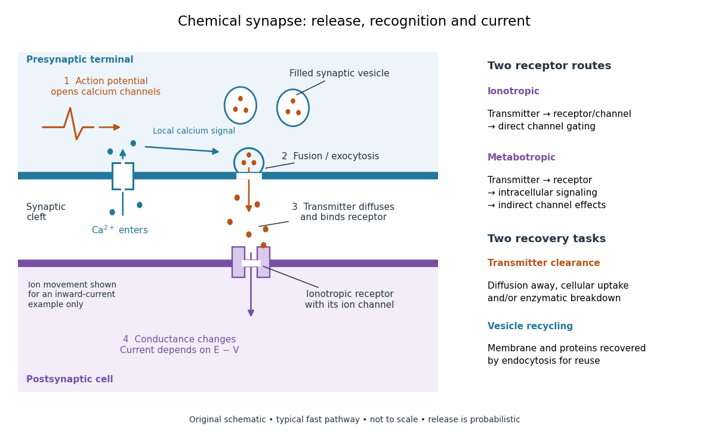

# Chemical synapse

↑ **Parent:** [Synapse](synapse.md)  
ⓦ [Wiki](https://en.wikipedia.org/wiki/Chemical_synapse)

A [chemical synapse](chemical-synapse.md) transmits a signal by releasing [neurotransmitter](neurotransmitter.md) from a presynaptic [neuron](neuron.md) to act on postsynaptic [receptors](receptor-biochemistry.md) across a [synaptic cleft](synaptic-cleft.md). The two [cell membranes](cell-membrane.md) remain separate. A typical fast transmission sequence is:

- An arriving [action potential](action-potential.md) produces presynaptic [depolarization](depolarization.md), opening [voltage-gated ion channels](voltage-gated-ion-channel.md) selective for [calcium](calcium.md).
- [Calcium](calcium.md) [ions](ion.md) enter down their [electrochemical gradient](electrochemical-gradient.md). The local rise in [calcium](calcium.md) [concentration](concentration.md) activates release machinery, allowing already prepared [synaptic vesicles](synaptic-vesicle.md) to fuse with the presynaptic [cell membrane](cell-membrane.md) by [exocytosis](exocytosis.md).
- Released [neurotransmitter](neurotransmitter.md) crosses the [synaptic cleft](synaptic-cleft.md) by [diffusion](diffusion.md) and binds postsynaptic [receptors](receptor-biochemistry.md).
- [Ionotropic receptors](ionotropic-receptor.md) directly gate an [ion channel](ion-channel.md); [metabotropic receptors](metabotropic-receptor.md) activate an intracellular signaling pathway that can alter [ion channels](ion-channel.md) indirectly. Changed [synaptic conductance](synaptic-conductance.md) changes [electric current](electric-current.md) and usually produces a [synaptic potential](synaptic-potential.md).

See [Chemical Synapses](neuroscience-2nd-edition-edited-by-d-purves-and-others/chemical-synapses.md) and [3.1 Synapses](neuronal-dynamics-from-single-neurons-to-networks-and-models-of-cognition-by-wulfram-gerstner-and-others/3-1-synapses.md). The fast pathway uses [synaptic vesicles](synaptic-vesicle.md) prepared near release sites; it does not require a distant [synaptic vesicle](synaptic-vesicle.md) to travel across the terminal after every [action potential](action-potential.md). See [Basic Neurochemistry: calcium entry and vesicles at release sites](https://www.ncbi.nlm.nih.gov/books/NBK27911/). Some [chemical synapses](chemical-synapse.md) release [neurotransmitter](neurotransmitter.md) in response to graded presynaptic [membrane potential](membrane-potential.md) changes rather than [action potentials](action-potential.md).

**[Figure 51](#image-from-an-action-potential-to-neurotransmitter-release-and-postsynaptic-electric-current). From an action potential to neurotransmitter release and postsynaptic electric current**. Original schematic of a typical fast [chemical synapse](chemical-synapse.md), not to scale. [Calcium](calcium.md) entry occurs on the presynaptic side; [neurotransmitter](neurotransmitter.md) crosses the [synaptic cleft](synaptic-cleft.md). The postsynaptic [ionotropic receptor](ionotropic-receptor.md) gates its associated [ion channel](ion-channel.md). The inset contrasts direct [ionotropic receptor](ionotropic-receptor.md) gating with indirect [metabotropic receptor](metabotropic-receptor.md) signaling. Arrows indicate mechanisms, not measured timing or amounts; [neurotransmitter clearance](neurotransmitter-clearance.md) and [synaptic vesicle](synaptic-vesicle.md) recycling are distinct processes.

[Neurotransmitter clearance](neurotransmitter-clearance.md) limits how long released [neurotransmitter](neurotransmitter.md) remains available. Depending on the [neurotransmitter](neurotransmitter.md) and location, [diffusion](diffusion.md) away, uptake through [membrane transport proteins](membrane-transport-protein.md) into the sending or neighboring [biological cells](biological-cell.md), and breakdown by [enzymes](enzyme.md) contribute. [Receptor](receptor-biochemistry.md) binding and unbinding also affect response duration. Recovering [synaptic vesicle](synaptic-vesicle.md) membrane is a separate recycling task; uptake of released [neurotransmitter](neurotransmitter.md) is not the return of an intact [synaptic vesicle](synaptic-vesicle.md). See [General Principles of Cell Communication](molecular-biology-of-the-cell-4th-edition-by-bruce-alberts-and-others/general-principles-of-cell-communication.md).

This electrical-to-chemical-to-electrical sequence offers several places to adjust a signal: [synaptic release probability](synaptic-release-probability.md), [receptor](receptor-biochemistry.md) availability and [neurotransmitter clearance](neurotransmitter-clearance.md) can change its strength or duration. It helps explain why [synaptic plasticity](synaptic-plasticity.md) can modify communication between [neurons](neuron.md), and why an arriving [action potential](action-potential.md) need not cause a postsynaptic [action potential](action-potential.md).

Otto Loewi's 1936 Nobel lecture describes his 1921 experiment: fluid from a frog heart whose nerves had been stimulated produced the corresponding response when transferred to another heart. The transferable substance established chemical mediation in that preparation. This was evidence for released chemical signaling, not yet an identification of [synaptic vesicle](synaptic-vesicle.md) fusion and not a claim that every [synapse](synapse.md) is chemical. See [Loewi, The Chemical Transmission of Nerve Action, Nobel lecture, 12 December 1936](https://www.nobelprize.org/prizes/medicine/1936/loewi/lecture/).

**Table of contents**

- [Neurotransmitter clearance](neurotransmitter-clearance.md)
- [Synaptic cleft](synaptic-cleft.md)
- [Synaptic vesicle](synaptic-vesicle.md)
  - [Quantal neurotransmitter release](quantal-neurotransmitter-release.md)
    - [Synaptic release probability](synaptic-release-probability.md)
- [Shunting inhibition](shunting-inhibition.md)

## ↑ Ancestors (5)

1. [Synapse](synapse.md)
2. [Neuron](neuron.md)
3. [Neuroscience](neuroscience.md)
4. [Biology](biology-split.md)
5. [Codex Wiki](split.md)

## ← Incoming links (8)

- [Chemical synapse](chemical-synapse.md)
- [Endocytosis](endocytosis.md)
- [Ionotropic receptor](ionotropic-receptor.md)
- [Metabotropic receptor](metabotropic-receptor.md)
- [Neuron](neuron.md)
- [Neurotransmitter clearance](neurotransmitter-clearance.md)
- [Synapse](synapse.md)
- [Synaptic cleft](synaptic-cleft.md)
