# Chemistry

↑ **Parent:** [Codex Wiki](README.md)  
ⓦ [Wiki](https://en.wikipedia.org/wiki/Chemistry)

Chemistry connects the composition and structure of [chemical substances](chemical-substance.md) to their properties and transformations. Its central surprise is that rearranging the same [chemical atoms](physics.md#atom-physics) can produce a different substance: [molecular hydrogen](chemical-substance.md#molecular-hydrogen) and [molecular oxygen](chemical-substance.md#molecular-oxygen) can become [water](chemical-substance.md#water) without changing which [chemical elements](chemical-substance.md#chemical-element) are present. [Chemical bonds](chemical-bond.md) explain the connections; [chemical reactions](chemical-reaction.md) describe the transformations; [stoichiometry](chemical-reaction.md#stoichiometry) makes quantitative predictions from the bookkeeping.

This gives a useful route from an invisible world to measurable quantities. A [molecule](molecule.md) has a definite composition, such as two [hydrogen](chemical-substance.md#hydrogen) [chemical atoms](physics.md#atom-physics) and one [oxygen](chemical-substance.md#oxygen) [chemical atom](physics.md#atom-physics) in [water](chemical-substance.md#water). A sample contains an enormous number of such [molecules](molecule.md). Counting them through [amount of substance](physics.md#amount-of-substance), measured in [moles](physics.md#mole-unit), lets the same small-number ratios describe a macroscopic sample. The beauty is that the bookkeeping survives this huge change of scale.

**Table of contents**

- [Biochemistry](biochemistry.md)
- [Chemistry author](chemistry-author.md)
- [Chemistry bibliography](chemistry-bibliography.md)
- [Inorganic compound](#inorganic-compound)
- [Laboratory apparatus](#laboratory-apparatus)
- [Chemical mixture](#chemical-mixture)
- [Reducing substance](#reducing-substance)
- [Atomic theory](#atomic-theory)
- [Chemical nomenclature](#chemical-nomenclature)
- [Pesticide](#pesticide)
- [History of chemistry](#history-of-chemistry)
- [IUPAC](#iupac)
- [Photoexcitation](#photoexcitation)
- [Organometallic chemistry](#organometallic-chemistry)
- [Organophosphorus chemistry](#organophosphorus-chemistry)
- [Cheminformatics](#cheminformatics)
- [Inorganic chemistry](#inorganic-chemistry)
- [Molecular mechanics](#molecular-mechanics)
- [Atmospheric chemistry](#atmospheric-chemistry)
- [Supramolecular chemistry](#supramolecular-chemistry)
- [Isomer](#isomer)
- [Coordination chemistry](#coordination-chemistry)
- [Organic chemistry](#organic-chemistry)
- [Beaker (laboratory equipment)](#beaker-laboratory-equipment)
- [Erlenmeyer flask](#erlenmeyer-flask)
- [Radical (chemistry)](#radical-chemistry)
- [Molecule](molecule.md)
- [Quantum chemistry](#quantum-chemistry)
- [Chemical bond](chemical-bond.md)
- [Molar mass](#molar-mass)
- [Polymer](polymer.md)
- [Ion](#ion)
- [Acid-base chemistry](acid-base-chemistry.md)
- [Chemical reaction](chemical-reaction.md)
- [Electrochemistry](electrochemistry.md)
- [Mixture](mixture.md)
- [Nuclear magnetic resonance](nuclear-magnetic-resonance.md)
- [Analytical chemistry](#analytical-chemistry)
- [Chromatography](chromatography.md)
- [Infrared spectroscopy](#infrared-spectroscopy)
- [Stereochemistry](stereochemistry.md)
- [Functional group](#functional-group)
- [Hydroxy group](#hydroxy-group)
- [Chemical substance](chemical-substance.md)
- [Steady state (chemistry)](#steady-state-chemistry)
- [Physical chemistry](physical-chemistry.md)
- [Thermochemistry](#thermochemistry)
- [Mass spectrometry](#mass-spectrometry)
- [Chemist](#chemist)
- [Distillation](#distillation)

## Biochemistry

↑ **Parent:** [Chemistry](chemistry.md)

[This section is present in another page, follow this link to view it.](biochemistry.md)

## Chemistry author

↑ **Parent:** [Chemistry](chemistry.md)

[This section is present in another page, follow this link to view it.](chemistry-author.md)

## Chemistry bibliography

↑ **Parent:** [Chemistry](chemistry.md)

[This section is present in another page, follow this link to view it.](chemistry-bibliography.md)

## Inorganic compound

↑ **Parent:** [Chemistry](chemistry.md)

### Potassium bicarbonate

↑ **Parent:** [Inorganic compound](#inorganic-compound)

## Laboratory apparatus

↑ **Parent:** [Chemistry](chemistry.md)

### Water bath

↑ **Parent:** [Laboratory apparatus](#laboratory-apparatus)

A vessel of [water](chemical-substance.md#water) used to heat another vessel indirectly and comparatively uniformly.

## Chemical mixture

↑ **Parent:** [Chemistry](chemistry.md)

### Gas mixture

↑ **Parent:** [Chemical mixture](#chemical-mixture)

#### Ideal gas mixture

↑ **Parent:** [Gas mixture](#gas-mixture)

An idealized [gas mixture](#gas-mixture) in which component [partial pressures](ideal-gas.md#partial-pressure) add and component amounts obey the [ideal gas law](ideal-gas.md#ideal-gas-law). At a common [temperature](temperature.md) and [pressure](pressure.md), component gas volumes before mixing can be used to calculate the mixture's [mole fractions](mathematical-biology.md#mole-fraction).

## Reducing substance

↑ **Parent:** [Chemistry](chemistry.md)

## Atomic theory

↑ **Parent:** [Chemistry](chemistry.md)

The account of matter in terms of [chemical atoms](physics.md#atom-physics). Whole-number combinations of [chemical atoms](physics.md#atom-physics) explain the [law of definite proportions](#law-of-definite-proportions) and [law of multiple proportions](#law-of-multiple-proportions) for suitable pure [chemical compounds](chemical-substance.md#chemical-compound).

### Law of multiple proportions

↑ **Parent:** [Atomic theory](#atomic-theory)

For simple [chemical compounds](chemical-substance.md#chemical-compound) of two [chemical elements](chemical-substance.md#chemical-element), the masses of one combining with a fixed [mass](classical-mechanics.md#mass) of the other occur in ratios of small integers.

### Law of definite proportions

↑ **Parent:** [Atomic theory](#atomic-theory)

A pure stoichiometric [chemical compound](chemical-substance.md#chemical-compound) has fixed elemental [mass ratios](classical-mechanics.md#mass-ratio) when [isotopic composition](chemical-substance.md#isotopic-composition) is specified.

## Chemical nomenclature

↑ **Parent:** [Chemistry](chemistry.md)  
ⓦ [Wiki](https://en.wikipedia.org/wiki/Chemical_nomenclature)

A system for naming [chemical substances](chemical-substance.md). Historically, a naming system may encode a theory of composition rather than act as a theoretically neutral list of labels.[Preliminary Discourse](chemistry-bibliography.md#elements-of-chemistry-by-antoine-lavoisier)

## Pesticide

↑ **Parent:** [Chemistry](chemistry.md)  
ⓦ [Wiki](https://en.wikipedia.org/wiki/Pesticide)

An agent used to prevent, suppress or destroy a target pest. Its intended function does not establish ecological selectivity or the absence of effects on other [organisms](organism.md).

## History of chemistry

↑ **Parent:** [Chemistry](chemistry.md)  
ⓦ [Wiki](https://en.wikipedia.org/wiki/History_of_chemistry)

### Phlogiston theory

↑ **Parent:** [History of chemistry](#history-of-chemistry)  
ⓦ [Wiki](https://en.wikipedia.org/wiki/Phlogiston_theory)

A historical account in which burning and related processes involved the release or transfer of a supposed principle, [phlogiston](#phlogiston). Its interpretation of metallic calces differed from the later account of [oxidation](chemical-reaction.md#oxidation).

#### Phlogiston

↑ **Parent:** [Phlogiston theory](#phlogiston-theory)

The hypothetical principle invoked by [phlogiston theory](#phlogiston-theory); it is not a modern [chemical element](chemical-substance.md#chemical-element).

### Chemical Revolution

↑ **Parent:** [History of chemistry](#history-of-chemistry)  
ⓦ [Wiki](https://en.wikipedia.org/wiki/Chemical_Revolution)

## IUPAC

↑ **Parent:** [Chemistry](chemistry.md)

### Work by IUPAC

↑ **Parent:** [IUPAC](#iupac)

## Photoexcitation

↑ **Parent:** [Chemistry](chemistry.md)

Excitation of a material or [molecule](molecule.md) by absorption of light.

## Organometallic chemistry

↑ **Parent:** [Chemistry](chemistry.md)

The chemistry of compounds containing metal–[carbon](chemical-substance.md#carbon) bonds, including their structures, bonding and transformations in stoichiometric and catalytic reactions.

### Beta-carbon elimination

↑ **Parent:** [Organometallic chemistry](#organometallic-chemistry)

Cleavage of a [carbon](chemical-substance.md#carbon)–[carbon](chemical-substance.md#carbon) bond beta to a metal, often from a metal [alkoxide](mathematical-biology.md#alkoxide), coupled to [carbonyl](chemical-bond.md#carbonyl-group) formation and transfer of a [carbon](chemical-substance.md#carbon) fragment to the metal. For a tertiary benzylic [alkoxide](mathematical-biology.md#alkoxide) this can generate a [ketone](chemical-substance.md#ketone) and a metal–aryl bond.

## Organophosphorus chemistry

↑ **Parent:** [Chemistry](chemistry.md)

The chemistry of phosphorus-containing organic compounds.

### Iminophosphorane

↑ **Parent:** [Organophosphorus chemistry](#organophosphorus-chemistry)

A compound with a formal phosphorus–nitrogen double bond, often represented by phosphonium–[amide](chemical-substance.md#amide) resonance structures.

## Cheminformatics

↑ **Parent:** [Chemistry](chemistry.md)

Computational representation, comparison and modelling of chemical structures.

### Molecular descriptor

↑ **Parent:** [Cheminformatics](#cheminformatics)

A numerical molecular property used to represent chemical structure in a model.

### Molecular fingerprint

↑ **Parent:** [Cheminformatics](#cheminformatics)

A fixed-length bit or count vector encoding selected substructures of a molecular graph.

### SMILES string

↑ **Parent:** [Cheminformatics](#cheminformatics)

A linear string encoding atoms, bonds, branches, ring closures and optionally [stereochemistry](stereochemistry.md) of a molecular graph.

## Inorganic chemistry

↑ **Parent:** [Chemistry](chemistry.md)

<h3 id="copper-ii-hydroxide">Copper(II) hydroxide</h3>

↑ **Parent:** [Inorganic chemistry](#inorganic-chemistry)

### Magnesium hydroxide

↑ **Parent:** [Inorganic chemistry](#inorganic-chemistry)

### Aqua regia

↑ **Parent:** [Inorganic chemistry](#inorganic-chemistry)

The oxidizing nitric-acid and hydrochloric-acid mixture historically called nitrohydrochloric acid. Reaction products and metal speciation depend on its composition and conditions.

### Ammonium phosphomolybdate

↑ **Parent:** [Inorganic chemistry](#inorganic-chemistry)

A yellow phosphate-containing precipitate used under suitable acidic conditions in qualitative [phosphate](chemical-substance.md#phosphate) tests.

### Calcium sulfate

↑ **Parent:** [Inorganic chemistry](#inorganic-chemistry)

A [calcium](chemical-substance.md#calcium) salt of [sulfate](#sulfate), including hydrated forms. It separates from phosphate-bearing liquor in historical phosphorus preparation.

### Potassium iodide

↑ **Parent:** [Inorganic chemistry](#inorganic-chemistry)

An ionic [potassium](chemical-substance.md#potassium)–[iodide](chemical-substance.md#iodide) salt. Its preparation and purity tests distinguish [iodide](chemical-substance.md#iodide) from [iodate](chemical-substance.md#iodate) and free [iodine](chemical-substance.md#iodine).

### Potassium nitrate

↑ **Parent:** [Inorganic chemistry](#inorganic-chemistry)

The [potassium](chemical-substance.md#potassium) salt of [nitrate](#nitrate). Controlled heating can give potassium nitrite and [oxygen](chemical-substance.md#oxygen).

### Metal oxide

↑ **Parent:** [Inorganic chemistry](#inorganic-chemistry)

A [chemical compound](chemical-substance.md#chemical-compound) containing a [metal](chemical-substance.md#metal) and [oxygen](chemical-substance.md#oxygen); different metal [oxidation states](chemical-reaction.md#oxidation-state) can give different oxides.

### Prussian blue

↑ **Parent:** [Inorganic chemistry](#inorganic-chemistry)

An iron hexacyanoferrate material, often hydrated and nonstoichiometric; $\mathrm{Fe_4[Fe(CN)_6]_3}$ is an idealized composition used to explain a historical [cyanide](chemical-substance.md#cyanide) recognition test.

### Silver nitrate

↑ **Parent:** [Inorganic chemistry](#inorganic-chemistry)

A [silver](chemical-substance.md#silver) salt used in [precipitation](chemical-reaction.md#precipitation-chemistry) and complex-formation assays.

### Calcium silicate

↑ **Parent:** [Inorganic chemistry](#inorganic-chemistry)

A family of calcium–silicon–oxygen [chemical compounds](chemical-substance.md#chemical-compound). The metasilicate $\mathrm{CaSiO_3}$ is a simple model for one reaction in [slag](engineering.md#slag) formation.

### Iron oxide

↑ **Parent:** [Inorganic chemistry](#inorganic-chemistry)

A class of [iron](chemical-substance.md#iron)–[oxygen](chemical-substance.md#oxygen) [chemical compounds](chemical-substance.md#chemical-compound), including oxides with different [iron](chemical-substance.md#iron) [oxidation states](chemical-reaction.md#oxidation-state).

<h4 id="iron-iii-oxide">Iron(III) oxide</h4>

↑ **Parent:** [Iron oxide](#iron-oxide)

The ferric oxide. Historical medicinal “peroxide of iron” refers to this or a hydrated ferric oxide material, not an oxygen–oxygen [peroxide](chemical-substance.md#peroxide).

### Magnesium oxide

↑ **Parent:** [Inorganic chemistry](#inorganic-chemistry)

The [magnesium](chemical-substance.md#magnesium) oxide historically called magnesia.

### Ammonium nitrate

↑ **Parent:** [Inorganic chemistry](#inorganic-chemistry)

A salt containing [ammonium](#ammonium) and [nitrate](#nitrate). Its [thermal decomposition](chemical-reaction.md#thermal-decomposition) has condition-dependent pathways; the familiar [nitrous oxide](chemical-substance.md#nitrous-oxide) pathway is not universal.

### Potassium perchlorate

↑ **Parent:** [Inorganic chemistry](#inorganic-chemistry)

A [potassium](chemical-substance.md#potassium) salt that can arise as an intermediate in uncatalysed [potassium chlorate](#potassium-chlorate) decomposition.

### Potassium chlorate

↑ **Parent:** [Inorganic chemistry](#inorganic-chemistry)

A [potassium](chemical-substance.md#potassium) salt whose final net [thermal decomposition](chemical-reaction.md#thermal-decomposition) gives [potassium chloride](ionic-bonding.md#potassium-chloride) and [oxygen](chemical-substance.md#oxygen).

### Hypochlorite

↑ **Parent:** [Inorganic chemistry](#inorganic-chemistry)

The [anion](#anion) of [hypochlorous acid](chemical-substance.md#hypochlorous-acid). Its chemistry underlies many chlorine-based bleaching materials.

#### Calcium hypochlorite

↑ **Parent:** [Hypochlorite](#hypochlorite)

A [calcium](chemical-substance.md#calcium) salt of [hypochlorite](#hypochlorite). It must be distinguished from the variable commercial composition of [bleaching powder](#bleaching-powder).

### Calcium oxide

↑ **Parent:** [Inorganic chemistry](#inorganic-chemistry)

The [calcium](chemical-substance.md#calcium) oxide obtained by [calcination](engineering.md#calcination) of [calcium carbonate](ionic-bonding.md#calcium-carbonate).

#### Lime

↑ **Parent:** [Calcium oxide](#calcium-oxide)

A historical material name used for [quicklime](#calcium-oxide) or, in some contexts, hydrated [lime](#lime); the intended composition must be specified.

### Bleaching powder

↑ **Parent:** [Inorganic chemistry](#inorganic-chemistry)

The historical commercial material made by exposing [calcium hydroxide](chemical-substance.md#calcium-hydroxide) to [chlorine](chemical-substance.md#chlorine). Its useful oxidizing content is described by [available chlorine](#available-chlorine); it should not be identified unconditionally with pure [calcium hypochlorite](#calcium-hypochlorite).

#### Available chlorine

↑ **Parent:** [Bleaching powder](#bleaching-powder)

The oxidizing capacity of a bleaching material expressed as the equivalent mass of [chlorine](chemical-substance.md#chlorine).

### Cluster chemistry

↑ **Parent:** [Inorganic chemistry](#inorganic-chemistry)

Chemistry of finite bonded groups of atoms with molecular or metal-like skeletal bonding. Localized bond counts, skeletal-electron rules and delocalized shell models apply in different regimes.

#### Jellium model

↑ **Parent:** [Cluster chemistry](#cluster-chemistry)

An electronic model replacing discrete positive ionic cores by a smooth positive background. Approximately spherical clusters can be stabilized at closed angular-momentum shells.

#### Carbaalane

↑ **Parent:** [Cluster chemistry](#cluster-chemistry)

A cluster whose nonhydrogen skeleton includes both carbon and aluminium. Exocyclic bonding must be distinguished from skeletal bonding when applying electron-counting rules.

## Molecular mechanics

↑ **Parent:** [Chemistry](chemistry.md)

An atomistic model using a fitted potential-energy function of nuclear positions, commonly with bond, angle, torsion and nonbonded terms. Electronic effects enter parametrically rather than through explicit electronic [wavefunctions](wave-function.md) or densities.

### Molecular mechanics force field

↑ **Parent:** [Molecular mechanics](#molecular-mechanics)

The functional form and parameters defining a molecular-mechanics potential. A classical fixed-topology force field normally cannot describe arbitrary changes in bonding or electronic excitation.

## Atmospheric chemistry

↑ **Parent:** [Chemistry](chemistry.md)  
ⓦ [Wiki](https://en.wikipedia.org/wiki/Atmospheric_chemistry)

The chemistry of gases, particles and droplets in planetary atmospheres. Chemical conversion competes with radiation, transport, mixing and removal to surfaces, so local equilibrium is not a general assumption.

### Linear three-reservoir carbon model

↑ **Parent:** [Atmospheric chemistry](#atmospheric-chemistry)

A capacity-weighted exchange model for atmospheric, fast surface and deep [ocean](planetary-science.md#ocean) [carbon dioxide](chemical-substance.md#carbon-dioxide) anomalies. Positive diagonal capacities form $D$, while $L$ is the weighted path-graph [Laplacian matrix](graph-theory.md#laplacian-matrix) with exchange conductances $r,s$. Then $\mathbf C^TL\mathbf C=r(C_a-C_b)^2+s(C_b-C_d)^2\geq0$. The homogeneous generator $-D^{-1}L$ is similar to a symmetric negative-semidefinite [matrix](vector-space.md#matrix), with two decaying [normal modes](wave-equation.md#normal-mode) and one zero [normal mode](wave-equation.md#normal-mode) for equal concentrations. Summing all budgets proves that the capacity-weighted total is conserved after emissions stop. The long-time concentration from total input $M$ is $M/(R_a+R_b+R_d)$, rather than zero.

### HOx radical family

↑ **Parent:** [Atmospheric chemistry](#atmospheric-chemistry)

In the usual atmospheric convention, [hydroxyl radical](#hydroxyl-radical) and HO2 form a rapidly interconverting hydrogen-oxide [radical](#radical-chemistry) family. Some budgets also explicitly include H; state the counting convention. [Radical](#radical-chemistry) production, recycling and termination differ from the abundance of the [water](chemical-substance.md#water) reservoir.

### Iodine monoxide

↑ **Parent:** [Atmospheric chemistry](#atmospheric-chemistry)

A reactive [iodine](chemical-substance.md#iodine) oxide [radical](#radical-chemistry). Its gas-phase abundance need not represent total reactive [iodine](chemical-substance.md#iodine) when particulate reservoirs and multiphase recycling are important.

### Climate-methane chemical-lifetime feedback

↑ **Parent:** [Atmospheric chemistry](#atmospheric-chemistry)

Changes in [temperature](temperature.md), [water vapor](chemical-substance.md#water-vapor) and [radical](#radical-chemistry) chemistry alter [methane](chemical-substance.md#methane) removal. Warming can increase its [hydroxyl radical](#hydroxyl-radical) reaction coefficient and the [hydroxyl radical](#hydroxyl-radical) source from [oxygen singlet D atom](chemical-substance.md#oxygen-singlet-d-atom) plus [water](chemical-substance.md#water), tending to reduce chemical lifetime at fixed precursor conditions. Changed emissions and competing [radical](#radical-chemistry) sinks can modify or reverse that conditional response.

### Tropospheric OH budget

↑ **Parent:** [Atmospheric chemistry](#atmospheric-chemistry)

A local or box-model balance between hydroxyl-radical production and effective losses. For fixed production $P$ and pseudo-first-order total loss frequency $K$, $[\mathrm{OH}]=P/K$. Additional hydrogen, [carbon monoxide](chemical-substance.md#carbon-monoxide) or [methane](chemical-substance.md#methane) consumption can lower [hydroxyl radical](#hydroxyl-radical) if production and other terms stay fixed; [radical](#radical-chemistry) recycling and spatial transport can alter that simple result.

#### Hydrogen-induced methane lifetime response

↑ **Parent:** [Tropospheric OH budget](#tropospheric-oh-budget)

In a fixed-production [hydroxyl radical](#hydroxyl-radical) box, adding hydrogen by $\Delta[\mathrm H_2]$ changes $K$ to $K+k_{\mathrm H_2+OH}\Delta[\mathrm H_2]$. [Methane](chemical-substance.md#methane) lifetime scales as $K/P$ when its [hydroxyl radical](#hydroxyl-radical) reaction coefficient is held fixed. The pre-existing hydrogen contribution is already in $K$ and must not be counted again.

### Humidity-temperature response of OH production

↑ **Parent:** [Atmospheric chemistry](#atmospheric-chemistry)

At fixed [relative humidity](physiology.md#relative-humidity) and fixed excited-oxygen [concentration](mathematical-physics.md#concentration), a water-reaction [hydroxyl radical](#hydroxyl-radical) source scales as $e_s(T)/T$ when [concentrations](mathematical-physics.md#concentration) are number densities. Thus $d\ln P_{\rm OH}/dT=\Delta H_{\rm vap}/(RT^2)-1/T$ under constant [latent heat](thermodynamic-potential.md#latent-heat) and rate coefficient. Using only $e_s$ instead gives a [vapor pressure](thermodynamic-potential.md#vapor-pressure) or fixed-pressure mole-fraction approximation. Neither derivative follows without a [humidity](physiology.md#humidity) condition.

### Dobson unit

↑ **Parent:** [Atmospheric chemistry](#atmospheric-chemistry)

A unit of atmospheric column abundance. One [Dobson unit](#dobson-unit) corresponds to approximately $2.69\times10^{16}$ [molecules](molecule.md) per square centimetre. Multiplying a column decrement by an [absorption cross section](quantum-mechanics.md#absorption-cross-section) gives its contribution to a monochromatic optical-depth decrement.

### Bromine monoxide

↑ **Parent:** [Atmospheric chemistry](#atmospheric-chemistry)

The [radical](#radical-chemistry) $\mathrm{BrO}$ participates in catalytic atmospheric [ozone](chemical-substance.md#ozone) destruction. Its measured abundance is only one partition of the total [bromine](chemical-substance.md#bromine) inventory; precursor delivery, [photodissociation](chemical-bond.md#photodissociation) and reservoir reactions determine the relation between the two.

### Mixed chlorine-bromine ozone-loss cycle

↑ **Parent:** [Atmospheric chemistry](#atmospheric-chemistry)

In the productive mixed-radical pathway, [chlorine monoxide](#chlorine-monoxide) and [BrO](#bromine-monoxide) yield [chlorine](chemical-substance.md#chlorine) and [bromine](chemical-substance.md#bromine) atoms; subsequent atom reactions with [ozone](chemical-substance.md#ozone) regenerate the oxides. The net cycle consumes two [ozone](chemical-substance.md#ozone) [molecules](molecule.md) per radical-pair event, giving $L=2k[\mathrm{ClO}][\mathrm{BrO}]$ when the subsequent steps are fast. The branching of a real [chlorine monoxide](#chlorine-monoxide)–[BrO](#bromine-monoxide) reaction must be included if not already absorbed into its specified effective rate coefficient.

### Chlorine nitrate

↑ **Parent:** [Atmospheric chemistry](#atmospheric-chemistry)

The reservoir species $\mathrm{ClONO_2}$, formed from ClO and NO2 with third-body stabilization. Heterogeneous reaction with [hydrogen chloride](electronegativity.md#hydrogen-chloride) can produce molecular [chlorine](chemical-substance.md#chlorine) and [nitric acid](chemical-substance.md#nitric-acid), activating [chlorine](chemical-substance.md#chlorine) while removing reactive [nitrogen](chemical-substance.md#nitrogen) from the gas phase. It belongs to the wider reactive [nitrogen](chemical-substance.md#nitrogen) family, not to the narrow NO-plus-NO2 definition of NOx.

### Air-sea gas exchange

↑ **Parent:** [Atmospheric chemistry](#atmospheric-chemistry)

Transfer of a gas across the atmosphere–ocean interface, driven by a departure from the gas's interfacial equilibrium and controlled by transfer resistances and mixing. This can move an added atmospheric carbon-dioxide perturbation into the ocean without immediately returning all of that carbon to a permanent geological store.

### Chlorine monoxide dimer cycle

↑ **Parent:** [Atmospheric chemistry](#atmospheric-chemistry)

A low-temperature catalytic [ozone](chemical-substance.md#ozone) destruction pathway involving ClO association to ClOOCl, [photodissociation](chemical-bond.md#photodissociation) of the dimer and regeneration of [chlorine](chemical-substance.md#chlorine) atoms. Combined with two Cl + O3 reactions its net effect is $2\mathrm O_3\to3\mathrm O_2$. Low [temperature](temperature.md) suppresses thermal dimer dissociation, while sunlight is needed for the photolytic step. [Polar stratospheric clouds](planetary-science.md#polar-stratospheric-cloud) can activate reservoir [chlorine](chemical-substance.md#chlorine) before the sunlit cycle becomes rapid.

#### Photolytic branching in the chlorine dimer cycle

↑ **Parent:** [Chlorine monoxide dimer cycle](#chlorine-monoxide-dimer-cycle)

For dimer [photodissociation](chemical-bond.md#photodissociation) frequency $J$ and competing [thermal dissociation](chemical-reaction.md#thermal-dissociation) frequency $k_d[M]$, the successful branch fraction is $f=J/(J+k_d[M])$. With steady dimer abundance and rapid subsequent recycling, [ozone](chemical-substance.md#ozone) destruction is $2f k_a[M][\mathrm{ClO}]^2$. The factor two counts [ozone](chemical-substance.md#ozone) [molecules](molecule.md) consumed per productive dimer event.

#### Chlorine peroxide

↑ **Parent:** [Chlorine monoxide dimer cycle](#chlorine-monoxide-dimer-cycle)

The peroxy-linked [chlorine](chemical-substance.md#chlorine) oxide $\mathrm{ClOOCl}$, often written $\mathrm{Cl_2O_2}$ in a [chlorine monoxide dimer cycle](#chlorine-monoxide-dimer-cycle). Thermal return to two [chlorine monoxide](#chlorine-monoxide) [radicals](#radical-chemistry) competes with a photolytic pathway that ultimately yields two [chlorine](chemical-substance.md#chlorine) atoms. The formula alone should not be taken as specifying every possible dichlorine-dioxide isomer.

### Dry deposition

↑ **Parent:** [Atmospheric chemistry](#atmospheric-chemistry)

Removal of a gas or particle to a surface without precipitation. A simple parameterization uses downward flux $F=v_d C$, where $C$ is the [concentration](mathematical-physics.md#concentration) near the surface and $v_d$ the [deposition velocity](#deposition-velocity). For a well-mixed layer of depth $H$, the loss is first order with coefficient $v_d/H$.

#### Deposition velocity

↑ **Parent:** [Dry deposition](#dry-deposition)

The ratio of a specified downward [dry deposition](#dry-deposition) flux to its reference near-surface [concentration](mathematical-physics.md#concentration). It has units of speed but need not be an actual particle settling speed: transfer resistance and surface uptake can both control gas [dry deposition](#dry-deposition).

### Volatile organic compound

↑ **Parent:** [Atmospheric chemistry](#atmospheric-chemistry)

An organic compound readily present in the gas phase under the conditions of interest. In polluted-air chemistry, its oxidation can generate [peroxy radicals](#peroxy-radical) which convert [nitrogen monoxide](#nitrogen-monoxide) to [nitrogen dioxide](#nitrogen-dioxide) without consuming [ozone](chemical-substance.md#ozone). Volatility alone does not determine reactivity or [ozone](chemical-substance.md#ozone) yield.

### Chlorofluorocarbon

↑ **Parent:** [Atmospheric chemistry](#atmospheric-chemistry)

A compound composed of [carbon](chemical-substance.md#carbon), [chlorine](chemical-substance.md#chlorine) and [fluorine](chemical-substance.md#fluorine), with no [hydrogen](chemical-substance.md#hydrogen). Many such fully halogenated molecules resist lower-atmospheric attack but release reactive [chlorine](chemical-substance.md#chlorine) after stratospheric [photodissociation](chemical-bond.md#photodissociation), contributing to catalytic [ozone](chemical-substance.md#ozone) destruction.

### Ozone-depletion potential

↑ **Parent:** [Atmospheric chemistry](#atmospheric-chemistry)

A relative measure of stratospheric [ozone](chemical-substance.md#ozone) destruction associated with emissions of a substance, conventionally referenced to CFC-11. It depends on atmospheric survival, transport, halogen delivery and catalytic effectiveness, not only the number of [chlorine](chemical-substance.md#chlorine) atoms in the formula. Fluorine-only replacements can have negligible direct [ozone-depletion potential](#ozone-depletion-potential) while remaining strong [greenhouse gases](exoplanet.md#greenhouse-gas).

### Atmospheric lifetime

↑ **Parent:** [Atmospheric chemistry](#atmospheric-chemistry)

For a well-mixed atmospheric burden $B$ removed by a single first-order sink, $dB/dt=-B/\tau$, the [atmospheric lifetime](#atmospheric-lifetime) is the [exponential decay](analysis.md#exponential-decay) time $\tau$. At steady emission rate $E$, this model gives $B=E\tau$. Independent sinks acting on the same burden have additive inverse lifetimes. Local removal times in separate compartments cannot be combined this way without considering exchange and partitioning. A multi-reservoir perturbation, especially atmospheric [carbon dioxide](chemical-substance.md#carbon-dioxide), generally needs more than one timescale.

#### Methane perturbation lifetime

↑ **Parent:** [Atmospheric lifetime](#atmospheric-lifetime)

The e-folding relaxation time of an added [methane](chemical-substance.md#methane) burden after accounting for chemical feedbacks. It need not equal burden divided by the contemporaneous [methane](chemical-substance.md#methane) loss rate: extra [methane](chemical-substance.md#methane) can consume [hydroxyl radical](#hydroxyl-radical) and reduce its own removal. A fixed-OH exponential estimate omits that coupled adjustment.

### Atmospheric chemistry bibliography

↑ **Parent:** [Atmospheric chemistry](#atmospheric-chemistry)

#### The impact of geoengineering aerosols on stratospheric temperature and ozone by P. Heckendorn and others

↑ **Parent:** [Atmospheric chemistry bibliography](#atmospheric-chemistry-bibliography)  
🏷️ **Tags:** [Work by P. Heckendorn](#work-by-p-heckendorn)

Environmental Research Letters 4 (2009), 045108. Coupled aerosol-size and chemistry–climate simulations show why constant forcing per unit injection is an approximation.

[https://doi.org/10.1088/1748-9326/4/4/045108](https://doi.org/10.1088/1748-9326/4/4/045108)

#### The Earth’s Energy Budget, Climate Feedbacks, and Climate Sensitivity by Piers Forster and others

↑ **Parent:** [Atmospheric chemistry bibliography](#atmospheric-chemistry-bibliography)  
🏷️ **Tags:** [Work by Piers Forster](geophysics.md#work-by-piers-forster)

Chapter 7 of [Climate change](geophysics.md#climate-change) 2021: The Physical Science Basis, pp. 923–1054. §§7.3.2–7.3.3 contrast greenhouse-gas and [aerosol](#aerosol) effective [radiative forcing](geophysics.md#radiative-forcing).

[https://www.ipcc.ch/report/ar6/wg1/chapter/chapter-7/](https://www.ipcc.ch/report/ar6/wg1/chapter/chapter-7/)

#### Short-lived Climate Forcers by Sophie Szopa and others

↑ **Parent:** [Atmospheric chemistry bibliography](#atmospheric-chemistry-bibliography)  
🏷️ **Tags:** [Work by Sophie Szopa](#work-by-sophie-szopa)

Chapter 6 of [Climate change](geophysics.md#climate-change) 2021: The Physical Science Basis. Relevant sections are §6.3.1 for [methane](chemical-substance.md#methane) chemical and perturbation lifetime and §6.4.5 for climate–chemistry feedbacks.

[https://www.ipcc.ch/report/ar6/wg1/chapter/chapter-6/](https://www.ipcc.ch/report/ar6/wg1/chapter/chapter-6/)

#### Atmospheric composition and climate impacts of a future hydrogen economy by Nicola J. Warwick and others

↑ **Parent:** [Atmospheric chemistry bibliography](#atmospheric-chemistry-bibliography)  
🏷️ **Tags:** [Work by Nicola J. Warwick](#work-by-nicola-j-warwick)

[Atmospheric chemistry](#atmospheric-chemistry) and Physics 23 (2023), 13451–13467. Coupled chemical modelling distinguishes hydrogen leakage effects from accompanying changes in other precursor emissions.

[https://acp.copernicus.org/articles/23/13451/2023/](https://acp.copernicus.org/articles/23/13451/2023/)

#### Quantitative detection of iodine in the stratosphere by Theodore K. Koenig and others

↑ **Parent:** [Atmospheric chemistry bibliography](#atmospheric-chemistry-bibliography)  
🏷️ **Tags:** [Work by Theodore K. Koenig](#work-by-theodore-k-koenig)

PNAS 117 (2020), 1860–1866. Aircraft [IO](#iodine-monoxide) and particulate-iodine measurements constrain nonzero stratospheric [iodine](chemical-substance.md#iodine) injection and multiphase recycling.

[https://repository.library.noaa.gov/view/noaa/31924](https://repository.library.noaa.gov/view/noaa/31924)

[https://doi.org/10.1073/pnas.1916828117](https://doi.org/10.1073/pnas.1916828117)

#### A single parameter representation of hygroscopic growth and cloud condensation nucleus activity by M. D. Petters and S. M. Kreidenweis

↑ **Parent:** [Atmospheric chemistry bibliography](#atmospheric-chemistry-bibliography)  
🏷️ **Tags:** [Work by M. D. Petters](#work-by-m-d-petters), [Work by S. M. Kreidenweis](#work-by-s-m-kreidenweis)

Atmospheric Chemistry and Physics 7, 1961–1971. DOI 10.5194/acp-7-1961-2007. The hygroscopicity parameter and dry diameter determine approximate activation properties.

[https://acp.copernicus.org/articles/7/1961/2007/](https://acp.copernicus.org/articles/7/1961/2007/)

#### The Influence of Pollution on the Shortwave Albedo of Clouds by S. Twomey

↑ **Parent:** [Atmospheric chemistry bibliography](#atmospheric-chemistry-bibliography)  
🏷️ **Tags:** [Work by S. Twomey](geophysics.md#work-by-s-twomey)

Journal of the Atmospheric Sciences 34, 1149–1152. The theoretical droplet-number and shortwave-reflectance response is distinguished from absorption and subsequent [cloud](geophysics.md#cloud) adjustments.

[https://journals.ametsoc.org/doi/10.1175/1520-0469%281977%29034%3C1149%3ATIOPOT%3E2.0.CO%3B2](https://journals.ametsoc.org/doi/10.1175/1520-0469%281977%29034%3C1149%3ATIOPOT%3E2.0.CO%3B2)

#### The sensitivity of ozone to nitrogen oxides and hydrocarbons in regional ozone episodes by Sanford Sillman and others

↑ **Parent:** [Atmospheric chemistry bibliography](#atmospheric-chemistry-bibliography)  
🏷️ **Tags:** [Work by Sanford Sillman](#work-by-sanford-sillman)

Journal of Geophysical Research 95, 1837–1851. Regional photochemical-model comparison of [ozone](chemical-substance.md#ozone) precursor sensitivity in rural and urban environments.

[https://agupubs.onlinelibrary.wiley.com/doi/10.1029/JD095iD02p01837](https://agupubs.onlinelibrary.wiley.com/doi/10.1029/JD095iD02p01837)

#### Production of chlorine oxide (Cl2O2) from the self-reaction of the chlorine oxide (ClO) radical by L. T. Molina and M. J. Molina

↑ **Parent:** [Atmospheric chemistry bibliography](#atmospheric-chemistry-bibliography)  
🏷️ **Tags:** [Work by L. T. Molina](#work-by-l-t-molina), [Work by M. J. Molina](#work-by-m-j-molina)

Journal of Physical Chemistry 91, 433–436. The NASA abstract describes flow-system dimer production at 220–240 K and infrared/[ultraviolet](optics.md#ultraviolet) identification. Institutional record: [https://ntrs.nasa.gov/citations/19870061046](https://ntrs.nasa.gov/citations/19870061046)

[https://pubs.acs.org/doi/10.1021/j100286a035](https://pubs.acs.org/doi/10.1021/j100286a035)

<h4 id="why-co2-cools-the-middle-atmosphere-a-consolidating-model-perspective-by-helge-f-goessling-and-sebastian-bathiany">Why CO2 cools the middle atmosphere - a consolidating model perspective by Helge F. Goessling and Sebastian Bathiany</h4>

↑ **Parent:** [Atmospheric chemistry bibliography](#atmospheric-chemistry-bibliography)  
🏷️ **Tags:** [Work by Helge F. Goessling](geophysics.md#work-by-helge-f-goessling), [Work by Sebastian Bathiany](geophysics.md#work-by-sebastian-bathiany)

Earth System Dynamics 7, 697–715. DOI 10.5194/esd-7-697-2016. A window-grey radiation model separates the blocking effect from the indirect solar-heating effect.

[https://esd.copernicus.org/articles/7/697/2016/](https://esd.copernicus.org/articles/7/697/2016/)

<h4 id="the-earth-s-energy-budget-climate-feedbacks-and-climate-sensitivity-by-piers-forster-and-others">The Earth's Energy Budget, Climate Feedbacks, and Climate Sensitivity by Piers Forster and others</h4>

↑ **Parent:** [Atmospheric chemistry bibliography](#atmospheric-chemistry-bibliography)  
🏷️ **Tags:** [Work by Piers Forster](geophysics.md#work-by-piers-forster)

Chapter 7 of Climate Change 2021: The Physical Science Basis, pp. 923–1054. DOI 10.1017/9781009157896.009. Cited sections: emissions metrics and [aerosol](#aerosol)–[cloud](geophysics.md#cloud) interactions; this institutional assessment is not an answer set for the Cambridge paper.

[https://www.ipcc.ch/report/ar6/wg1/chapter/chapter-7/](https://www.ipcc.ch/report/ar6/wg1/chapter/chapter-7/)

#### Atmospheric Lifetime of Fossil Fuel Carbon Dioxide by David Archer and others

↑ **Parent:** [Atmospheric chemistry bibliography](#atmospheric-chemistry-bibliography)  
🏷️ **Tags:** [Work by David Archer](#work-by-david-archer)

Annual Review of Earth and Planetary Sciences 37, 117–134. The physical ocean and solid-Earth portions distinguish fast exchange, slow ocean equilibration and a long carbonate/weathering tail. Biological mechanisms are outside the present expansion.

[https://www.annualreviews.org/content/journals/10.1146/annurev.earth.031208.100206](https://www.annualreviews.org/content/journals/10.1146/annurev.earth.031208.100206)

Author-hosted text: [https://climatemodels.uchicago.edu/geocarb/archer.2009.ann_rev_tail.pdf](https://climatemodels.uchicago.edu/geocarb/archer.2009.ann_rev_tail.pdf)

Cited physical-chemistry passages: Table 1, p. 119, and physical ocean/solid-Earth conclusions, p. 131.

#### Scientific Assessment of Ozone Depletion 2022 executive summary

↑ **Parent:** [Atmospheric chemistry bibliography](#atmospheric-chemistry-bibliography)

[https://csl.noaa.gov/assessments/ozone/2022/executivesummary/](https://csl.noaa.gov/assessments/ozone/2022/executivesummary/)

### Aerosol

↑ **Parent:** [Atmospheric chemistry](#atmospheric-chemistry)

#### Aerosol optical depth

↑ **Parent:** [Aerosol](#aerosol)

The dimensionless column [optical depth](astrophysics.md#optical-depth) from [aerosol](#aerosol) extinction measures attenuation by absorption and scattering at a stated wavelength. It depends on particle size, composition, humidity and vertical distribution; it is not a direct count of [cloud condensation nuclei](#cloud-condensation-nucleus). Using it as a proxy for droplet-number forcing requires control of meteorological covariates and cloud-contaminated retrievals.

#### Number size distribution

↑ **Parent:** [Aerosol](#aerosol)

A particle count per stated volume and logarithmic size interval. Its [integral](integral.md) over $d\ln D$ gives a [number density](statistical-physics.md#number-density), unlike an [aerosol](#aerosol) mass distribution. In a [cloud-droplet activation](#cloud-droplet-activation) estimate, integrating the dry-size distribution above the size-dependent [Köhler theory](#kohler-theory) threshold gives activated number for a specified peak [atmospheric supersaturation](critical-phenomenon.md#atmospheric-supersaturation) and composition.

#### Aerosol coagulation

↑ **Parent:** [Aerosol](#aerosol)

Growth by collision and attachment of existing particles. Coagulation reduces particle number while conserving particulate material in a closed system without other sources or sinks. Larger particles can have a different scattering-per-mass efficiency and faster [sedimentation](suspension-chemistry.md#sedimentation), so increasing precursor injection need not increase [albedo](geophysics.md#albedo) proportionally.

#### Sulfate aerosol

↑ **Parent:** [Aerosol](#aerosol)

Atmospheric particles containing [sulfate](#sulfate), commonly in sulfuric-acid/[water](chemical-substance.md#water) or neutralized-salt mixtures. Particle size, [water](chemical-substance.md#water) uptake, acidity and accompanying material determine scattering, absorption, [cloud](geophysics.md#cloud) activation and heterogeneous chemistry; [sulfate](#sulfate) [mass](classical-mechanics.md#mass) alone does not specify [radiative forcing](geophysics.md#radiative-forcing).

#### Aerosol hygroscopicity

↑ **Parent:** [Aerosol](#aerosol)

A particle's tendency to take up [water vapor](chemical-substance.md#water-vapor), which depends on composition, solubility and ambient humidity. In a common parameterization, a dimensionless $\kappa$ summarizes soluble-water uptake for use with dry diameter in [Köhler theory](#kohler-theory). A single composition parameter does not remove the importance of particle size or parcel supersaturation.

#### Aerosol-cloud interaction

↑ **Parent:** [Aerosol](#aerosol)

A change in [cloud](geophysics.md#cloud) microphysics or [cloud](geophysics.md#cloud) properties caused by [aerosol](#aerosol), including droplet activation, precipitation changes and adjustments of [water](chemical-substance.md#water) content or coverage. The [Twomey effect](#twomey-effect) isolates a fixed-water-content optical response; it does not by itself establish the sign or magnitude of every [cloud](geophysics.md#cloud) adjustment.

##### Marine cloud brightening

↑ **Parent:** [Aerosol-cloud interaction](#aerosol-cloud-interaction)

[Marine cloud brightening](#marine-cloud-brightening) proposes increasing suitable [cloud condensation nuclei](#cloud-condensation-nucleus) over the ocean to increase reflected sunlight. At fixed cloud liquid-water content and thickness, the [Twomey effect](#twomey-effect) makes more, smaller droplets increase [cloud albedo](geophysics.md#cloud-albedo). Changes in cloud water, cloud fraction, entrainment and precipitation can reinforce or oppose this fixed-cloud response.

##### Semi-direct aerosol effect

↑ **Parent:** [Aerosol-cloud interaction](#aerosol-cloud-interaction)

[Cloud](geophysics.md#cloud) changes caused by [aerosol](#aerosol) absorption of radiation and the resulting heating. Heating can evaporate [clouds](geophysics.md#cloud) and reduce shortwave reflection, but the effect can reverse when heating changes stability and [cloud](geophysics.md#cloud) maintenance differently. The forcing sign depends on the relative positions of [cloud](geophysics.md#cloud) and absorbing [aerosol](#aerosol) and on dynamical adjustment.

##### Twomey effect

↑ **Parent:** [Aerosol-cloud interaction](#aerosol-cloud-interaction)

Increasing [cloud droplet](geophysics.md#cloud-droplet) number at fixed liquid-water content and [cloud](geophysics.md#cloud) thickness reduces mean droplet size and increases total extinction area, raising shortwave [optical depth](astrophysics.md#optical-depth) and [cloud albedo](geophysics.md#cloud-albedo). This idealized response produces negative shortwave [radiative forcing](geophysics.md#radiative-forcing). Changes in [cloud](geophysics.md#cloud) amount, [water](chemical-substance.md#water) content and dynamics are separate adjustments.[Fixed-water-content droplet-number and [albedo](geophysics.md#albedo) response](#the-influence-of-pollution-on-the-shortwave-albedo-of-clouds-by-s-twomey)

###### Cloud albedo susceptibility

↑ **Parent:** [Twomey effect](#twomey-effect)

For $\tau\propto N_d^{1/3}$ at fixed liquid-water content and thickness, and $A=\tau/(\tau+7)$, the derivative is $dA/dN_d=A(1-A)/(3N_d)$. For a fixed fractional number increase, the initial response is greatest at $A=1/2$. The exact finite-change expression is $A'=sA/(1-A+sA)$ with $s=(N_d'/N_d)^{1/3}$. Uncertain activation of additional particles and changes in [water](chemical-substance.md#water) content limit direct application to real [clouds](geophysics.md#cloud).

#### Cloud condensation nucleus

↑ **Parent:** [Aerosol](#aerosol)

An [aerosol](#aerosol) particle able to activate into a growing [cloud droplet](geophysics.md#cloud-droplet) at the supersaturation attained by a [cloud](geophysics.md#cloud) parcel. Activity depends on particle dry size, hygroscopicity and interfacial properties. The number active at a specified supersaturation differs from total [aerosol](#aerosol) number.

##### Cloud-droplet activation

↑ **Parent:** [Cloud condensation nucleus](#cloud-condensation-nucleus)

An [aerosol](#aerosol) particle becomes a freely growing [cloud droplet](geophysics.md#cloud-droplet) after crossing its [Köhler theory](#kohler-theory) growth barrier under the parcel's [atmospheric supersaturation](critical-phenomenon.md#atmospheric-supersaturation) history. Counting particles whose [critical supersaturation](#critical-supersaturation) is below a specified peak gives an equilibrium-threshold estimate; calculating that peak requires cooling, [water vapor](chemical-substance.md#water-vapor) depletion and condensational-growth kinetics. Neither total [aerosol](#aerosol) number nor dry size alone determines activation.

<h5 id="kohler-theory">Köhler theory</h5>

↑ **Parent:** [Cloud condensation nucleus](#cloud-condensation-nucleus)

The equilibrium water-vapor saturation ratio above a solution droplet combines a curvature effect, which raises [vapor pressure](thermodynamic-potential.md#vapor-pressure), with dissolved-solute reduction of [water](chemical-substance.md#water) activity. Its maximum defines a [critical supersaturation](#critical-supersaturation) for activation. In a dilute hygroscopicity approximation using droplet diameter $D$ and dry diameter $D_d$, $s(D)\simeq A_K/D-\kappa D_d^3/D^3$, where $A_K=4\sigma M_w/(RT\rho_w)$. Then $s_c\simeq\sqrt{4A_K^3/(27\kappa D_d^3)}$. These approximate forms assume the stated diameter convention and dilute solution; composition and [surface tension](surface-tension.md) must be consistent.[Equations describing hygroscopic growth and critical activation supersaturation](#a-single-parameter-representation-of-hygroscopic-growth-and-cloud-condensation-nucleus-activity-by-m-d-petters-and-s-m-kreidenweis)

<h6 id="kohler-curve">Köhler curve</h6>

↑ **Parent:** [Köhler theory](#kohler-theory)

The equilibrium [saturation ratio](critical-phenomenon.md#saturation-ratio) over a [chemical solution](mixture.md#solution-chemistry) droplet as a function of wet radius for fixed solute content. In the dilute radius approximation $S_{\rm eq}\simeq1+A/r-B/r^3$, its maximum occurs at $r_c=\sqrt{3B/A}$. The corresponding [critical supersaturation](#critical-supersaturation) is $2A/(3r_c)$. Diameter and radius coefficients differ and must not be mixed.

<h6 id="dilute-kohler-curve">Dilute Köhler curve</h6>

↑ **Parent:** [Köhler theory](#kohler-theory)

The first-order combination of the [Kelvin equation](thermodynamic-potential.md#kelvin-equation) and [Raoult's law](mixture.md#raoult-s-law) for a [chemical solution](mixture.md#solution-chemistry) droplet with $A/r\ll1$ and $B/r^3\ll1$. Its maximum is at $r_c=\sqrt{3B/A}$, with $S_c-1=2A/(3r_c)$. For ambient [saturation ratio](critical-phenomenon.md#saturation-ratio) $1<S<S_c$, the smaller equilibrium radius is stable and the larger is unstable: the sign of condensational growth is the sign of $S-S_{\rm eq}(r)$. In particular, exceeding $r_c$ alone need not activate continued growth at subcritical [atmospheric supersaturation](critical-phenomenon.md#atmospheric-supersaturation).

<h6 id="radius-and-diameter-conventions-in-kohler-activation">Radius and diameter conventions in Köhler activation</h6>

↑ **Parent:** [Köhler theory](#kohler-theory)

Writing the same curve using diameter $D=2r$ changes its coefficients: $A_D=2A_r$ and $B_D=8B_r$ in $A_D/D-B_D/D^3$. The critical saturation ratio is unchanged, while $D_c=2r_c$. Mixing a diameter curvature coefficient with a radius solute term gives a spurious activation threshold.

###### Critical supersaturation

↑ **Parent:** [Köhler theory](#kohler-theory)

The maximum equilibrium supersaturation along a solution-droplet growth curve. Above this threshold, an [aerosol](#aerosol) particle can grow into an activated [cloud droplet](geophysics.md#cloud-droplet) under the conditions of the parcel. In [Köhler theory](#kohler-theory), larger dry diameter or greater hygroscopicity generally lowers the threshold; [aerosol](#aerosol) number alone does not specify it.

<h6 id="kohler-activation-radius">Köhler activation radius</h6>

↑ **Parent:** [Critical supersaturation](#critical-supersaturation)

In the dilute radius form $\ln S_{\rm eq}=A/r-B/r^3$, the curvature coefficient A has length units and B has volume units. Setting its derivative to zero gives the displayed maximum. Ambient supersaturation above it permits activation into a growing [cloud droplet](geophysics.md#cloud-droplet). Below it, a sufficiently small wet equilibrium can be stable, while the larger-radius intersection is unstable. The approximation should not be extrapolated into the dry core.

### Nitrogen oxides

↑ **Parent:** [Atmospheric chemistry](#atmospheric-chemistry)

In the atmospheric convention used here, $\mathrm{NO}_x$ denotes nitric oxide plus nitrogen dioxide. The broader reactive-nitrogen family $\mathrm{NO}_y$ includes additional oxidized reservoirs; the chosen nitrogen-atom counting convention must be specified.

#### Nitrogen dioxide

↑ **Parent:** [Nitrogen oxides](#nitrogen-oxides)

The atmospheric [nitrogen](chemical-substance.md#nitrogen) oxide $\mathrm{NO_2}$. Daylight [photodissociation](chemical-bond.md#photodissociation) forms [nitrogen monoxide](#nitrogen-monoxide) and an [oxygen](chemical-substance.md#oxygen) atom; subsequent [third-body recombination](chemical-kinetics.md#third-body-recombination) with [oxygen](chemical-substance.md#oxygen) forms [ozone](chemical-substance.md#ozone). Whether this makes net [ozone](chemical-substance.md#ozone) depends on the pathway that regenerated [nitrogen dioxide](#nitrogen-dioxide).

#### Nitrogen monoxide

↑ **Parent:** [Nitrogen oxides](#nitrogen-oxides)

The atmospheric [nitrogen](chemical-substance.md#nitrogen) oxide $\mathrm{NO}$. It consumes [ozone](chemical-substance.md#ozone) when converted to [nitrogen dioxide](#nitrogen-dioxide) by $\mathrm{NO+O_3\to NO_2+O_2}$, but its oxidation by [peroxy radicals](#peroxy-radical) instead enables net [photochemical ozone production](chemical-substance.md#photochemical-ozone-production).

### Odd oxygen

↑ **Parent:** [Atmospheric chemistry](#atmospheric-chemistry)

A chemical-family bookkeeping variable in a simple stratospheric model. Interconversion of atomic oxygen and ozone preserves this count, while $\mathrm O+\mathrm O_3\to2\mathrm O_2$ removes two units. The definition must be extended consistently when including additional reservoirs or excited atomic states.

#### Chapman cycle

↑ **Parent:** [Odd oxygen](#odd-oxygen)

A basic oxygen–ozone mechanism combining oxygen photodissociation, three-body ozone formation, ozone photodissociation and $\mathrm O+\mathrm O_3\to2\mathrm O_2$. The last reaction removes two units of [odd oxygen](#odd-oxygen); a catalytic cycle can add another loss pathway.

##### Nighttime Chapman ozone

↑ **Parent:** [Chapman cycle](#chapman-cycle)

With photolysis switched off, constant molecular oxygen and collider reservoirs give $\dot x=-x(a+by)$ and $\dot y=x(a-by)$ for atomic oxygen $x$, ozone $y$, $a=k_1[\mathrm O_2][M]$ and $b=k_3$. Dividing the equations and integrating gives

$$
x-x_0=y-y_0+\frac{2a}{b}\ln\frac{a-by}{a-by_0}.
$$

For $y_0<a/b$, ozone grows toward a finite-reservoir endpoint below $a/b$. Its value at sunrise depends on the dark-interval duration; $a/b$ is an approximate quasi-steady balance while atomic oxygen remains available.

##### Chapman family lifetime versus relaxation time

↑ **Parent:** [Chapman cycle](#chapman-cycle)

Under fast [Chapman cycle](#chapman-cycle) partitioning, an [odd oxygen](#odd-oxygen) family abundance $X$ can satisfy $\dot X=P-kX^2$. At equilibrium $P=kX_e^2$, its turnover lifetime is $X_e/P=1/(kX_e)$, while linearizing gives $\delta\dot X=-2kX_e\delta X$ and relaxation time $1/(2kX_e)$. A chemical lifetime is therefore not automatically an eigenmode relaxation time. The often-used expression $1/(2k_3[\mathrm O])$ also assumes ozone dominates the family abundance.

##### Temperature sensitivity of a catalytic ozone balance

↑ **Parent:** [Chapman cycle](#chapman-cycle)

Suppose a reduced steady balance is $P=AX^2+BX$, where $X=[\mathrm O_3]$, and hold $P$ and all specified background [concentrations](mathematical-physics.md#concentration) fixed. With $u=1/T$, $d\ln A/du=-a$ and $d\ln B/du=-b$, implicit differentiation gives $d\ln X/du=(aAX^2+bBX)/(2AX^2+BX)$. The quadratic loss term includes temperature-dependent O/O3 partitioning as well as the direct reaction coefficient. Holding the loss ratio fixed over a finite change is an additional approximation; solving the new quadratic provides a check.

### Atmospheric mixing ratio

↑ **Parent:** [Atmospheric chemistry](#atmospheric-chemistry)

A number or mole fraction relative to a specified atmospheric reference population. For ideal gas partial pressures with a consistent wet/dry convention, $x_i=p_i/p$. A quoted ppm or ppb must state whether it denotes this number fraction, rather than a mass fraction.

## Supramolecular chemistry

↑ **Parent:** [Chemistry](chemistry.md)

The study and construction of molecular assemblies held together through noncovalent interactions, including recognition, [host–guest complexes](#host-guest-complex) and self-assembly.

### Chemical fuel

↑ **Parent:** [Supramolecular chemistry](#supramolecular-chemistry)

A reactant consumed irreversibly to drive a transient or maintained chemical state away from its unfuelled equilibrium.

### Subcomponent self-assembly

↑ **Parent:** [Supramolecular chemistry](#supramolecular-chemistry)

Reversible formation of covalent ligands and metal coordination bonds from simpler components in the same mixture. [imine](#imine) condensation around a metal template is a common example.

### Dissipative self-assembly

↑ **Parent:** [Supramolecular chemistry](#supramolecular-chemistry)

Assembly maintained or transiently created by consumption of a [chemical fuel](#chemical-fuel). A fuel-triggered state can decay as the fuel is irreversibly converted to waste, even though rapid binding equilibria hold within each instantaneous composition.

### Self-sorting

↑ **Parent:** [Supramolecular chemistry](#supramolecular-chemistry)

Selective distribution of components among preferred assemblies from a mixture. Competition, concentration, solvent and [protonation](chemical-reaction.md#protonation) determine the distribution; a ranking of individual affinities does not imply perfectly pure species.

#### Homochiral self-sorting

↑ **Parent:** [Self-sorting](#self-sorting)

Preferential assembly of components with matching handedness into an individual assembly. A racemic sample can contain equal populations of homochiral enantiomeric cages.

### Dynamic covalent chemistry

↑ **Parent:** [Supramolecular chemistry](#supramolecular-chemistry)

Use of reversible covalent bond formation and exchange to let molecular connectivities reorganize. A template can shift the equilibrium library, provided exchange remains kinetically accessible.

#### Disulfide exchange

↑ **Parent:** [Dynamic covalent chemistry](#dynamic-covalent-chemistry)

Interchange of sulfur substituents through reactions such as thiolate attack on a [disulfide](chemical-substance.md#disulfide). Rates and equilibria depend on protonation, solvent and redox conditions.

### Triazolophane

↑ **Parent:** [Supramolecular chemistry](#supramolecular-chemistry)

A macrocycle containing triazole and other linking units. Appropriate inward-directed C–H donors can bind anions cooperatively; cavity size and [molecular preorganization](#molecular-preorganization) can produce strong halide selectivity.

### Molecular preorganization

↑ **Parent:** [Supramolecular chemistry](#supramolecular-chemistry)

Restriction of a host or reactant towards a binding- or reaction-competent geometry before association. It can reduce a conformational penalty but may decrease adaptability to other guests.

<h3 id="cation-pi-interaction">Cation–π interaction</h3>

↑ **Parent:** [Supramolecular chemistry](#supramolecular-chemistry)

A noncovalent attraction between a cation and an electron-rich aromatic system, with electrostatic and polarization contributions. Its solution free energy depends strongly on [solvation](ionic-bonding.md#solvation).

<h3 id="host-guest-complex">Host–guest complex</h3>

↑ **Parent:** [Supramolecular chemistry](#supramolecular-chemistry)

A molecular association in which a host provides a binding site or cavity for a guest. Its [equilibrium constant](chemical-potential.md#equilibrium-constant) includes solvent and entropy contributions, not only direct host–guest attraction.

#### Cryptand

↑ **Parent:** [Host–guest complex](#host-guest-complex)

A molecular host with a three-dimensional cavity enclosed by several covalently connected donor-bearing bridges.

#### Crown ether

↑ **Parent:** [Host–guest complex](#host-guest-complex)

A cyclic polyether host that can coordinate cations with inward-directed oxygen donors. Selectivity depends on donor arrangement, solvent and guest size, not ring size alone.

##### Aza-15-crown-5

↑ **Parent:** [Crown ether](#crown-ether)

A fifteen-membered crown with one nitrogen donor and four [oxygen](chemical-substance.md#oxygen) donors; nitrogen substitution can attach a signaling group.

##### 15-crown-5

↑ **Parent:** [Crown ether](#crown-ether)

A [crown ether](#crown-ether) with fifteen ring atoms, including five [oxygen](chemical-substance.md#oxygen) donor atoms.

#### Cyclodextrin

↑ **Parent:** [Host–guest complex](#host-guest-complex)

A cyclic oligosaccharide host with a hydroxyl-rich exterior and a relatively nonpolar cavity. Different ring sizes recognize different organic guests through reversible inclusion. This node concerns its supramolecular chemistry.

## Isomer

↑ **Parent:** [Chemistry](chemistry.md)

### Structural isomer

↑ **Parent:** [Isomer](#isomer)

A [chemical substance](chemical-substance.md) with the same [molecular formula](chemical-substance.md#molecular-formula) as another but a different connectivity of [chemical atoms](physics.md#atom-physics).

## Coordination chemistry

↑ **Parent:** [Chemistry](chemistry.md)

[Coordination chemistry](#coordination-chemistry) studies [coordination complexes](#coordination-complex), including their [ligands in coordination chemistry](#ligand-in-coordination-chemistry), structures and reactions.

### Complexation

↑ **Parent:** [Coordination chemistry](#coordination-chemistry)

Formation of a [coordination complex](#coordination-complex) through association of a central [chemical atom](physics.md#atom-physics) or [ion](#ion) with donor groups. Different [oxidation states](chemical-reaction.md#oxidation-state) can have different complex stabilities, coupling [complexation](#complexation) to [redox equilibrium](chemical-reaction.md#redox-equilibrium).

### Coordination geometry

↑ **Parent:** [Coordination chemistry](#coordination-chemistry)

The spatial arrangement of donor atoms around a central atom. [coordination number](ionic-bonding.md#coordination-number) counts neighbours but does not by itself distinguish geometries with the same number of donors.

### Trigonal bipyramid

↑ **Parent:** [Coordination chemistry](#coordination-chemistry)

A five-coordinate geometry with two axial and three equatorial positions. The ideal geometry has a threefold axis and an equatorial mirror plane.

### Coordination cage

↑ **Parent:** [Coordination chemistry](#coordination-chemistry)

A discrete molecular assembly in which metal–ligand connections surround a cavity. [coordination number](ionic-bonding.md#coordination-number), preferred binding angles and ligand connectivity restrict possible cage stoichiometries.

### Metalloligand

↑ **Parent:** [Coordination chemistry](#coordination-chemistry)

A [coordination complex](#coordination-complex) that retains donor sites capable of binding additional metal [ions](#ion). Distinguishable internal and external coordination sites permit hierarchical construction of heterometallic assemblies.

### Transmetalation

↑ **Parent:** [Coordination chemistry](#coordination-chemistry)

Transfer of an organic group from one element to a metal centre. A rhodium [hydroxide](#hydroxide) and an arylboronic acid can exchange Rh-OH and B-Ar connectivity to form Rh-Ar and boric acid.

### Magnetic orbital

↑ **Parent:** [Coordination chemistry](#coordination-chemistry)

An orbital that contains an unpaired [electron](physics.md#electron) and dominates a center’s exchange interactions.

### Metallocene

↑ **Parent:** [Coordination chemistry](#coordination-chemistry)

A complex in which a [metal](chemical-substance.md#metal) is bound between two cyclopentadienyl-type rings, commonly with [hapticity](#hapticity) $\eta^5$ at each ring. In ionic [electron counting](#electron-counting), each unsubstituted cyclopentadienyl [anion](#anion) donates six [electrons](physics.md#electron).

#### Chromocene

↑ **Parent:** [Metallocene](#metallocene)

The sandwich complex $\mathrm{Cr}(\eta^5\!\text{-}\mathrm{C_5H_5})_2$, with a conventional 16-electron count.

#### Azaferrocene

↑ **Parent:** [Metallocene](#metallocene)

A [ferrocene](#ferrocene) analogue with a pyrrolyl ring replacing one cyclopentadienyl ring, $\mathrm{Fe(\eta^5-C_5H_5)(\eta^5-C_4H_4N)}$. Both anionic rings are six-electron donors.

#### Nickelocene

↑ **Parent:** [Metallocene](#metallocene)

The sandwich compound $\mathrm{Ni(\eta^5-C_5H_5)_2}$, conventionally Ni(II), $d^8$, and 20-electron. The extra [electrons](physics.md#electron) relative to [ferrocene](#ferrocene) occupy [metal](chemical-substance.md#metal)–ring antibonding orbitals.

#### Cobaltocenium

↑ **Parent:** [Metallocene](#metallocene)

The [cation](#cation) $\mathrm{[Co(\eta^5-C_5H_5)_2]^+}$, conventionally Co(III), $d^6$, and 18-electron.

#### Cobaltocene

↑ **Parent:** [Metallocene](#metallocene)

The neutral sandwich compound $\mathrm{Co(\eta^5-C_5H_5)_2}$, conventionally Co(II), $d^7$, with 19 valence [electrons](physics.md#electron). One-electron [oxidation](chemical-reaction.md#oxidation) gives the 18-electron [cobaltocenium](#cobaltocenium) [cation](#cation).

#### Ferrocene

↑ **Parent:** [Metallocene](#metallocene)

The sandwich compound $\mathrm{Fe(\eta^5-C_5H_5)_2}$, conventionally Fe(II), $d^6$, with 18 valence [electrons](physics.md#electron).

### Coordination polymer

↑ **Parent:** [Coordination chemistry](#coordination-chemistry)

A repeating structure in which [metal](chemical-substance.md#metal) centres are connected by [bridging ligands](#bridging-ligand). Its coordination connectivity can extend along one, two or three independent directions.

### Valence tautomerism

↑ **Parent:** [Coordination chemistry](#coordination-chemistry)

Interconversion between electronic forms that differ in the formal distribution of oxidation among [metal](chemical-substance.md#metal) and ligands, without changing overall composition. A [cobalt](chemical-substance.md#cobalt) dioxolene example exchanges low-spin Co(III)–catecholate–semiquinonate and high-spin Co(II)–bis(semiquinonate) forms. This differs from changing only the [spin](angular-momentum-operator.md#spin) state at fixed [metal](chemical-substance.md#metal) and ligand charges.

### Coordination sphere

↑ **Parent:** [Coordination chemistry](#coordination-chemistry)

The set of ligands directly associated with a [metal](chemical-substance.md#metal) centre in the stated structural model. Distinguish primary donor bonds from secondary contacts and outer-sphere ions or lattice [solvent](mixture.md#solvent).

<h3 id="metal-organic-framework">Metal–organic framework</h3>

↑ **Parent:** [Coordination chemistry](#coordination-chemistry)

### Non-innocent ligand

↑ **Parent:** [Coordination chemistry](#coordination-chemistry)

A ligand for which assigning an integer oxidation state separately from the metal can obscure substantial electron delocalization or accessible ligand-centred redox states.

### Ligand substitution

↑ **Parent:** [Coordination chemistry](#coordination-chemistry)

Replacement of one coordinated ligand by another. Formal metal oxidation state need not change, even though local electron count can change while association or dissociation occurs.

#### Intramolecular ligand trapping

↑ **Parent:** [Ligand substitution](#ligand-substitution)

A donor tethered to a complex captures a vacant coordination site created by [coordination ligand](#ligand-in-coordination-chemistry) loss. Its effective proximity can compete favourably with weakly coordinating bulk solvent, provided its geometry allows it to reach the [metal](chemical-substance.md#metal).

#### Photochemical carbonyl substitution

↑ **Parent:** [Ligand substitution](#ligand-substitution)

Photoexcitation can dissociate a [carbonyl ligand](#carbonyl-ligand), creating a coordinatively unsaturated [metal](chemical-substance.md#metal) fragment. Capture by solvent or a tethered donor competes with CO recombination; net substitution therefore depends on both the photochemical step and subsequent trapping.

#### Conjugate-base substitution

↑ **Parent:** [Ligand substitution](#ligand-substitution)

Substitution promoted by prior [deprotonation](acid-base-chemistry.md#deprotonation) of a coordinated ligand. In cobalt(III) ammine complexes, an amido donor can assist departure of another ligand; solvent capture and reprotonation complete the substitution.

### Hydration isomerism

↑ **Parent:** [Coordination chemistry](#coordination-chemistry)

Different distributions of water between the metal coordination sphere and lattice for the same overall composition. Geometrical isomers can occur within one hydration class.

### Mixed valence

↑ **Parent:** [Coordination chemistry](#coordination-chemistry)

The presence of distinguishable formal oxidation states of the same element in a compound. Formal localization need not imply complete physical localization of charge.

### Satraplatin

↑ **Parent:** [Coordination chemistry](#coordination-chemistry)

An octahedral platinum(IV) complex containing two chloride, two acetate and two neutral amine donors; its $d^6$ metal configuration is low spin. This article concerns its coordination chemistry.

### Cisplatin

↑ **Parent:** [Coordination chemistry](#coordination-chemistry)

The square-planar coordination compound cis-diamminedichloroplatinum(II), with Pt(II), a $d^8$ metal configuration and a 16-electron local valence count. This article concerns its coordination chemistry.

### Dewar-Chatt-Duncanson model

↑ **Parent:** [Coordination chemistry](#coordination-chemistry)

The [Dewar-Chatt-Duncanson model](#dewar-chatt-duncanson-model) describes an [alkene](chemical-substance.md#alkene)–[metal](chemical-substance.md#metal) bond through donation from the filled [alkene](chemical-substance.md#alkene) $\pi$ orbital to the [metal](chemical-substance.md#metal) and [pi backbonding](covalent-bond.md#pi-backbonding) from the [metal](chemical-substance.md#metal) into [alkene](chemical-substance.md#alkene) $\pi^*$. Backbonding weakens and lengthens the [alkene](chemical-substance.md#alkene) double bond. A $d^0$ early-[metal](chemical-substance.md#metal) ion has little conventional $d$-[electron](physics.md#electron) backbonding.

### Metal cluster

↑ **Parent:** [Coordination chemistry](#coordination-chemistry)

A [metal cluster](#metal-cluster) contains several connected [metal](chemical-substance.md#metal) centers. A triangular three-[metal cluster](#metal-cluster) can support three edge [metal-metal bonds](chemical-bond.md#metal-metal-bond); early-[metal](chemical-substance.md#metal) clusters often have stable counts below the [18-electron rule](#18-electron-rule).

### Chelation

↑ **Parent:** [Coordination chemistry](#coordination-chemistry)

[Chelation](#chelation) binds multiple donor sites of one ligand to the same central atom, forming a [chelate ring](#chelate-ring). It can retain a donor near a metal even when one attachment temporarily opens.

#### Tridentate ligand

↑ **Parent:** [Chelation](#chelation)

A [coordination ligand](#ligand-in-coordination-chemistry) that coordinates one [metal](chemical-substance.md#metal) through three donor atoms. A facial tridentate donor set occupies the vertices of one face of an octahedron.

#### Macrocyclic effect

↑ **Parent:** [Chelation](#chelation)

Enhanced complex stability associated with donor sites being held in a [macrocycle](chemical-substance.md#macrocycle), relative to comparable open-chain ligands. The comparison depends on donor geometry, solvation and strain.

#### Bite angle

↑ **Parent:** [Chelation](#chelation)

The donor–metal–donor angle imposed by a chelating ligand. Tether length, ring conformation, donor distances and substituent crowding all influence it.

#### Chelate effect

↑ **Parent:** [Chelation](#chelation)

The [chelate effect](#chelate-effect) is the enhanced stability often associated with binding several donor sites from one ligand compared with comparable independent donors. Solvent release, effective local concentration and enthalpic contributions all matter; it is not simply a consequence of satisfying an electron-count rule.

#### Chelate ring

↑ **Parent:** [Chelation](#chelation)

A [chelate ring](#chelate-ring) is a closed bonded path containing the central atom and a ligand with multiple attachments to it. A tethered Cp–pyridyl ligand can close such a path when the pyridyl N coordinates.

### Trans effect

↑ **Parent:** [Coordination chemistry](#coordination-chemistry)

The [trans effect](#trans-effect) is a kinetic influence whereby a ligand accelerates substitution opposite itself, classically in square-planar complexes. It must be distinguished from ground-state bond weakening and from the carbonyl [cis effect](chemical-reaction.md#cis-effect).

### Electron counting

↑ **Parent:** [Coordination chemistry](#coordination-chemistry)

[Electron counting](#electron-counting) records metal valence [electrons](physics.md#electron) plus ligand donations using a declared convention. In ionic counting, subtract metal [oxidation state](chemical-reaction.md#oxidation-state) from its group number, then add donor [electrons](physics.md#electron); in neutral counting, combine neutral metal and ligand fragments consistently. An Fe–Fe single bond contributes one [electron](physics.md#electron) to the count at each metal.

#### 18-electron rule

↑ **Parent:** [Electron counting](#electron-counting)

The [18-electron rule](#18-electron-rule) is a useful closed-shell guideline for many low-valent transition-metal complexes, filling nine valence orbitals. It is not universal: many early-metal $d^0$ complexes have fewer [electrons](physics.md#electron), while stable square-planar $d^8$ complexes are often 16-electron.

### Ligand field

↑ **Parent:** [Coordination chemistry](#coordination-chemistry)

A [ligand field](#ligand-field) describes how ligands split and mix the central metal orbitals. [Sigma donation](covalent-bond.md#sigma-donation), pi donation and [pi backbonding](covalent-bond.md#pi-backbonding) explain trends that a purely electrostatic picture misses.

#### Racah parameter

↑ **Parent:** [Ligand field](#ligand-field)

A parameter in a compact description of intra-atomic [electron](physics.md#electron) repulsion within a configuration. $B$ and $C$ control relative d-shell multiplet energies; $B$ is not the [octahedral splitting](#octahedral-splitting) or a [rotational constant](molecule.md#rotational-constant).

#### Tanabe-Sugano diagram

↑ **Parent:** [Ligand field](#ligand-field)

A plot of many-electron ligand-field term energies relative to the [ground state](quantum-mechanics.md#ground-state) against a normalized ligand-field strength. Axes commonly use $E/B$ and $\Delta_o/B$, with the ratio of other interelectronic parameters stipulated. A change of ground-state term can create a break in the plotted reference.

#### Sigma-only octahedral molecular orbital model

↑ **Parent:** [Ligand field](#ligand-field)

A model in which six donor orbitals of an octahedral complex form $a_{1g}+e_g+t_{1u}$ symmetry-adapted combinations. [metal](chemical-substance.md#metal) s, p and two [d orbitals](#d-orbital) supply matching symmetry partners; the other three [d orbitals](#d-orbital) remain nonbonding $t_{2g}$ orbitals. The model neglects ligand [pi donation](covalent-bond.md#pi-donation), backbonding and departures from octahedral symmetry.

#### Orbital energy barycentre

↑ **Parent:** [Ligand field](#ligand-field)

The degeneracy-weighted mean energy of a specified group of orbitals, $\overline\varepsilon=\sum_i g_i\varepsilon_i/\sum_i g_i$. Keeping it fixed separates level splitting from a common energy shift.

#### Square-planar splitting

↑ **Parent:** [Ligand field](#ligand-field)

A qualitative d-orbital splitting in a square-planar environment, with the strongly in-plane antibonding $d_{x^2-y^2}$ orbital highest. Ordering among the remaining orbitals can depend on the ligand set.

#### Pairing energy

↑ **Parent:** [Ligand field](#ligand-field)

The energetic cost assigned to pairing electrons in an orbital rather than placing them in distinct orbitals within a specified ligand-field model.

#### Spin crossover

↑ **Parent:** [Ligand field](#ligand-field)

[Spin crossover](#spin-crossover) interconverts electronic states with different total [spin](angular-momentum-operator.md#spin), often in response to [temperature](temperature.md). For octahedral [iron](chemical-substance.md#iron)(II), $t_{2g}^4e_g^2$ and $t_{2g}^6$ correspond to $S=2$ and $S=0$. Removing [electrons](physics.md#electron) from [metal](chemical-substance.md#metal)–ligand antibonding $e_g$ orbitals shortens bonds in the low-[spin](angular-momentum-operator.md#spin) state. Crystal packing and [hydrogen bonds](chemical-bond.md#hydrogen-bond) can affect transition temperatures.

#### Electron pairing energy

↑ **Parent:** [Ligand field](#ligand-field)

The [electron pairing energy](#electron-pairing-energy) represents the energetic penalty for putting [electrons](physics.md#electron) into already occupied orbitals rather than suitable separate orbitals. A simple comparison with [octahedral splitting](#octahedral-splitting) explains high-[spin](angular-momentum-operator.md#spin) and low-[spin](angular-momentum-operator.md#spin) alternatives.

#### High-spin complex

↑ **Parent:** [Ligand field](#ligand-field)

A [high-spin complex](#high-spin-complex) retains more [unpaired electrons](#unpaired-electron) when the energy required for pairing exceeds the relevant orbital splitting. An octahedral high-[spin](angular-momentum-operator.md#spin) $d^6$ center has $t_{2g}^4e_g^2$ and $S=2$.

#### Jahn-Teller effect

↑ **Parent:** [Ligand field](#ligand-field)

The [Jahn-Teller effect](#jahn-teller-effect) is an instability of a nonlinear molecular arrangement with an orbitally degenerate electronic ground state toward a symmetry-lowering distortion. An octahedral high-[spin](angular-momentum-operator.md#spin) $d^4$ ion has unequal occupation of its $e_g$ orbitals and often undergoes tetragonal elongation.

##### Tetrahedral doublet distortion-sign ambiguity

↑ **Parent:** [Jahn-Teller effect](#jahn-teller-effect)

For a linearly split orbital doublet occupied by one [electron](physics.md#electron) or one [hole](quantum-mechanics.md#electron-hole), the lower adiabatic branch has a cusp $-g|Q|$. A harmonic elastic cost produces equal minima at $Q=\pm g/K$. Orbital degeneracy therefore establishes instability of the regular geometry, but cannot alone distinguish opposite tetragonal distortions. A symmetry-allowed cubic elastic invariant in the two-component distortion can select one sign.

##### Jahn-Teller stabilization energy

↑ **Parent:** [Jahn-Teller effect](#jahn-teller-effect)

The positive energy reduction from a symmetry-lowering [Jahn-Teller effect](#jahn-teller-effect), measured from the undistorted reference configuration. In the harmonic linear-coupling model $E(Q)=-\alpha Q+\beta Q^2/2$, with $\alpha,\beta>0$, completing the square gives $Q_0=\alpha/\beta$ and $E(Q_0)=-\alpha^2/(2\beta)$. Relating this local energy directly to a cooperative transition temperature is an extra approximation.

##### Linear Jahn-Teller selection rule

↑ **Parent:** [Jahn-Teller effect](#jahn-teller-effect)

For a real nonmagnetic electronic multiplet, a vibrational coordinate can couple linearly through a real symmetric electronic operator only if its representation occurs in the symmetric square. Remove the fully symmetric component when asking about symmetry-lowering distortion. In $T_d$, both $\operatorname{Sym}^2T_1$ and $\operatorname{Sym}^2T_2$ equal $A_1+E+T_2$, so $E$ and $T_2$ modes are symmetry-eligible for either triplet; coupling strengths are not determined by this decomposition.

##### Tetragonal Jahn-Teller distortion

↑ **Parent:** [Jahn-Teller effect](#jahn-teller-effect)

A symmetry-lowering change separating two axial [metal](chemical-substance.md#metal)–ligand distances from four equatorial ones. Occupancy of the split orbitals determines the electronic energy gain, while elastic cost and pre-existing ligand asymmetry affect the observed structure.

#### Crystal field theory

↑ **Parent:** [Ligand field](#ligand-field)

[Crystal field theory](#crystal-field-theory) models the effect of surrounding ligand charges or dipoles on [metal](chemical-substance.md#metal) [atomic orbitals](#atomic-orbital). Directional repulsion splits the $d$ levels. Unlike [molecular orbital theory](#molecular-orbital-theory), the simplest model does not explicitly construct covalent [metal](chemical-substance.md#metal)–ligand bonds.

##### Orbital quenching

↑ **Parent:** [Crystal field theory](#crystal-field-theory)

Suppression of a ground state's orbital [magnetic moment](electromagnetism.md#magnetic-dipole-moment) by the splitting and mixing of free-ion [atomic orbitals](#atomic-orbital) in a crystal. A nondegenerate orbital state can generally be chosen real in zero field, giving zero expectation of the imaginary [orbital angular momentum](quantum-mechanics.md#orbital-angular-momentum) operator. [Spin-orbit coupling](atomic-physics.md#spin-orbit-interaction) to excited states still produces residual [g-factor](electromagnetism.md#g-factor-physics) shifts and anisotropy, so quenching is not absence of every orbital response.

##### Crystal field splitting

↑ **Parent:** [Crystal field theory](#crystal-field-theory)

Separation of [metal](chemical-substance.md#metal) d-orbital energies by the electrostatic field of surrounding [coordination ligands](#ligand-in-coordination-chemistry). An octahedral field puts the three $t_{2g}$ orbitals below the two $e_g$ orbitals.

##### Tetrahedral crystal field splitting

↑ **Parent:** [Crystal field theory](#crystal-field-theory)

In the ideal tetrahedral point-charge model, the five metal [d orbitals](#d-orbital) split into a lower twofold $e$ set and an upper threefold $t_2$ set. Relative to their weighted barycentre their energies are $-3\Delta_t/5$ and $+2\Delta_t/5$, where $\Delta_t>0$ is the separation. For occupancies $e^{n_e}t_2^{n_t}$, the [crystal field stabilization energy](#crystal-field-stabilization-energy) is $(-0.6n_e+0.4n_t)\Delta_t$. Under weak-field high-spin filling it is $-0.6\Delta_t$, $-1.2\Delta_t$, $-0.8\Delta_t$ and zero for $d^6,d^7,d^8,d^{10}$ respectively. Shorter metal–ligand distances generally increase the splitting, so orbital filling can superimpose nonmonotonic bond-length changes on an ionic-size trend. The model alone does not determine an absolute [bond length](chemical-bond.md#bond-length).

##### Crystal field stabilization energy

↑ **Parent:** [Crystal field theory](#crystal-field-theory)

The change in d-electron energy relative to the unsplit barycentre in a crystal-field model, before separately accounting for pairing and other bonding contributions.

#### Low-spin complex

↑ **Parent:** [Ligand field](#ligand-field)

A [low-spin complex](#low-spin-complex) has the smaller-spin occupancy favored when ligand-field splitting outweighs the cost of pairing [electrons](physics.md#electron) in the lower orbitals. An octahedral low-spin $d^6$ center has $t_{2g}^6e_g^0$ and total spin zero.

#### Spectrochemical series

↑ **Parent:** [Ligand field](#ligand-field)

The [spectrochemical series](#spectrochemical-series) orders ligands empirically by the splitting they produce in comparable complexes. [Pi-donor ligands](#pi-donor-ligand) tend toward smaller splittings and [pi-acceptor ligands](#pi-acceptor-ligand) toward larger ones. Metal, geometry and [oxidation state](chemical-reaction.md#oxidation-state) still matter; a sigma-basicity scale is not an interchangeable substitute.

#### Octahedral splitting

↑ **Parent:** [Ligand field](#ligand-field)

In an ideal [octahedral molecular geometry](molecule.md#octahedral-molecular-geometry), the metal $d$ orbitals divide into lower $t_{2g}$ and higher $e_g$ sets. Their separation is $\Delta_o$. Whether [electrons](physics.md#electron) pair in the lower set depends on that separation relative to pairing costs; observed many-electron transition energies need not equal $\Delta_o$ exactly.

### Linkage isomerism

↑ **Parent:** [Coordination chemistry](#coordination-chemistry)

[Linkage isomerism](#linkage-isomerism) occurs when complexes have the same composition but an [ambidentate ligand](#ambidentate-ligand) attaches through different atoms. N-bound and O-bound [nitrite](chemical-substance.md#nitrite) provide the classical example. This is a difference in attachment connectivity, rather than the different spatial arrangements of unchanged connectivity in [stereoisomers](stereochemistry.md#stereoisomer).

#### Linkage isomerization

↑ **Parent:** [Linkage isomerism](#linkage-isomerism)

[Linkage isomerization](#linkage-isomerization) changes which atom of an [ambidentate ligand](#ambidentate-ligand) is bound to a central atom. Its rate depends on a reaction barrier, whereas the final equilibrium depends on relative free energies.

#### Linkage isomer

↑ **Parent:** [Linkage isomerism](#linkage-isomerism)

A [linkage isomer](#linkage-isomer) is one member of a set exhibiting [linkage isomerism](#linkage-isomerism), such as the N-bound or O-bound form of a coordinated [nitrite](chemical-substance.md#nitrite).

### Ligand in coordination chemistry

↑ **Parent:** [Coordination chemistry](#coordination-chemistry)

A [ligand in coordination chemistry](#ligand-in-coordination-chemistry) is an atom, [ion](#ion) or [molecule](molecule.md) attached to a central atom through one or more donor sites. This use is distinct from a protein-binding [ligand](protein.md#ligand-biochemistry). A neutral CO ligand and an anionic chloride ligand can both donate two [electrons](physics.md#electron) in ionic [electron counting](#electron-counting).

#### Bipyrimidine

↑ **Parent:** [Ligand in coordination chemistry](#ligand-in-coordination-chemistry)

Two linked pyrimidine rings; the 2,2′-linked isomer has two N,N donor pockets. It can bind one metal as a [bidentate ligand](#bidentate-ligand), or bridge two metals by using one pocket at each end. In the latter mode it is a bis-bidentate [bridging ligand](#bridging-ligand).

#### Anionic ligand

↑ **Parent:** [Ligand in coordination chemistry](#ligand-in-coordination-chemistry)

A [coordination ligand](#ligand-in-coordination-chemistry) assigned a negative formal charge in ionic [electron counting](#electron-counting). Distinguish the assigned charge from its [electron](physics.md#electron) donation and from the actual distributed charge in the complex.

#### BINAP

↑ **Parent:** [Ligand in coordination chemistry](#ligand-in-coordination-chemistry)

An axially [chiral](stereochemistry.md#chirality-chemistry) binaphthyl diphosphine ligand used in asymmetric transition-metal catalysis.

#### Amidinate ligand

↑ **Parent:** [Ligand in coordination chemistry](#ligand-in-coordination-chemistry)

A commonly anionic N–C–N ligand with delocalized bonding. Substituents and denticity influence both steric protection and the geometry of supported metal centres.

##### Formamidinate ligand

↑ **Parent:** [Amidinate ligand](#amidinate-ligand)

The ligand $[\mathrm{ArNCHNAr}]^-$ in a common diaryl form. Three such bridges can support a lantern-type dimetal unit.

#### Cyanide ligand

↑ **Parent:** [Ligand in coordination chemistry](#ligand-in-coordination-chemistry)

A bound $\mathrm{CN^-}$ ligand, usually C-bound in the strongly pi-accepting coordination mode used in elementary spectrochemical comparisons. It is an anionic two-electron donor in ionic [electron counting](#electron-counting).

#### Silyl ligand

↑ **Parent:** [Ligand in coordination chemistry](#ligand-in-coordination-chemistry)

A silicon-bound $\mathrm{SiR_3^-}$ group, normally a two-electron X-type donor in ionic [electron counting](#electron-counting).

#### Acyl ligand

↑ **Parent:** [Ligand in coordination chemistry](#ligand-in-coordination-chemistry)

A carbon-bound group $\mathrm{-C(O)R}$, formally anionic and normally a two-electron donor in ionic [electron counting](#electron-counting). It differs from a neutral [carbonyl ligand](#carbonyl-ligand) $\mathrm{CO}$.

#### Pincer ligand

↑ **Parent:** [Ligand in coordination chemistry](#ligand-in-coordination-chemistry)

A ligand with three donor sites arranged to bind one [metal](chemical-substance.md#metal) in a meridional pattern. The framework may impose a preferred geometry and may itself undergo redox or proton-transfer changes.

#### Dinitrogen ligand

↑ **Parent:** [Ligand in coordination chemistry](#ligand-in-coordination-chemistry)

An intact $\mathrm N_2$ group coordinated to a [metal](chemical-substance.md#metal). End-on neutral dinitrogen normally counts as a two-electron L-type donor; metal-to-ligand [pi backbonding](covalent-bond.md#pi-backbonding) can weaken its N–N bond without making it a fully cleaved nitride.

#### Pyrrolyl ligand

↑ **Parent:** [Ligand in coordination chemistry](#ligand-in-coordination-chemistry)

The [anion](#anion) formed by N–H deprotonation of [pyrrole](chemical-substance.md#pyrrole). It can bind through [nitrogen](chemical-substance.md#nitrogen) as a two-electron $\eta^1$ donor, or through its [aromatic ring](molecule.md#aromatic-ring) as a six-electron $\eta^5$ donor. Specifying [hapticity](#hapticity) is essential for [electron counting](#electron-counting).

#### Oxo ligand

↑ **Parent:** [Ligand in coordination chemistry](#ligand-in-coordination-chemistry)

A coordinated oxide, formally $\mathrm O^{2-}$. A terminal $\mathrm{M{=}O}$ unit is conventionally counted as an $X_2$ ligand giving four [electrons](physics.md#electron) in ionic [electron counting](#electron-counting). Additional oxygen-to-metal [pi donation](covalent-bond.md#pi-donation) is an orbital-bonding issue and must not be silently mixed with another counting convention.

#### Carboxylate ligand

↑ **Parent:** [Ligand in coordination chemistry](#ligand-in-coordination-chemistry)

A [carboxylate](chemical-substance.md#carboxylate) bound through one or both [oxygen](chemical-substance.md#oxygen) atoms. It can be monodentate, chelating or bridging; its charge is $-1$ regardless of whether one or two [oxygen](chemical-substance.md#oxygen) donors bind.

#### Dioxolene ligand

↑ **Parent:** [Ligand in coordination chemistry](#ligand-in-coordination-chemistry)

An ortho-dioxygen aromatic framework that can bind through both [oxygen](chemical-substance.md#oxygen) atoms in several redox states. The semiquinonate monoanion has a ligand-centred unpaired [electron](physics.md#electron), whereas the catecholate dianion has a filled-shell configuration. [non-innocent ligand](#non-innocent-ligand) behaviour means [metal](chemical-substance.md#metal) [oxidation state](chemical-reaction.md#oxidation-state) cannot be inferred from an overall complex charge without specifying the ligand redox state.

##### Semiquinonate ligand

↑ **Parent:** [Dioxolene ligand](#dioxolene-ligand)

A [free radical](#radical-chemistry) monoanion intermediate in redox state between a quinone and a catecholate; an isolated ligand has [spin](angular-momentum-operator.md#spin) $S=1/2$. Its [spin](angular-momentum-operator.md#spin) may couple to a [metal](chemical-substance.md#metal) [spin](angular-momentum-operator.md#spin) in a complex.

##### Catecholate ligand

↑ **Parent:** [Dioxolene ligand](#dioxolene-ligand)

The dianionic, closed-shell O,O donor obtained by two deprotonations of [catechol](chemical-substance.md#catechol).

#### Bidentate ligand

↑ **Parent:** [Ligand in coordination chemistry](#ligand-in-coordination-chemistry)

A [bidentate ligand](#bidentate-ligand) binds a [metal](chemical-substance.md#metal) through two donor atoms. Simultaneous attachment can produce a [chelate](#chelate) ring; the two donor atoms need not be the same element.

#### Denticity

↑ **Parent:** [Ligand in coordination chemistry](#ligand-in-coordination-chemistry)

The number of donor atoms from one [ligand in coordination chemistry](#ligand-in-coordination-chemistry) bonded to a particular [metal](chemical-substance.md#metal) centre. Unlike [hapticity](#hapticity), it counts distinct donor sites rather than a contiguous bonded fragment.

#### Methyl ligand

↑ **Parent:** [Ligand in coordination chemistry](#ligand-in-coordination-chemistry)

A metal-bound methyl group, formally CH3-minus in ionic [electron counting](#electron-counting); it is commonly an X-type ligand.

#### Pyrazolate

↑ **Parent:** [Ligand in coordination chemistry](#ligand-in-coordination-chemistry)

The anion $\mathrm{C_3H_3N_2^-}$ formed from pyrazole. Bridging through both nitrogen atoms supplies four ligand electrons overall in ionic counting, or three in neutral counting.

#### Nitrosyl ligand

↑ **Parent:** [Ligand in coordination chemistry](#ligand-in-coordination-chemistry)

Coordinated NO is non-innocent. Conventional neutral counting assigns three electrons to a terminal linear NO, one to a terminal bent NO, and three in total to a simple doubly bridging NO.

##### Bent nitrosyl ligand

↑ **Parent:** [Nitrosyl ligand](#nitrosyl-ligand)

A bent M–N–O mode conventionally represented as $\mathrm{NO^-}$, a two-electron ionic donor and a one-electron neutral donor. These are formal bookkeeping limits rather than measured atomic charges.

##### Linear nitrosyl ligand

↑ **Parent:** [Nitrosyl ligand](#nitrosyl-ligand)

A near-linear M–N–O coordination mode conventionally represented as $\mathrm{NO^+}$, a two-electron donor in ionic counting and a three-electron donor in neutral counting.

##### Bridging nitrosyl ligand

↑ **Parent:** [Nitrosyl ligand](#nitrosyl-ligand)

A nitrosyl shared between metal centres. In the simple mu2 counting model it contributes three electrons overall in the neutral method, or can be represented as an $\mathrm{NO^-}$ donor of four electrons overall in ionic counting.

#### Alkoxide ligand

↑ **Parent:** [Ligand in coordination chemistry](#ligand-in-coordination-chemistry)

An oxygen-bound anionic ligand derived formally by removing a proton from an alcohol; it is normally X-type in electron counting.

#### Alkyne ligand

↑ **Parent:** [Ligand in coordination chemistry](#ligand-in-coordination-chemistry)

An alkyne bound through its pi system. The neutral two-electron donor picture and a reduced metallacyclic picture emphasize different limits of the same bonding interaction.

##### Aryne ligand

↑ **Parent:** [Alkyne ligand](#alkyne-ligand)

A coordinated aryne. Strong metal-to-aryne electron transfer can make a dianionic metallacyclopropene description more useful than an unreduced neutral alkyne description.

#### Alkenyl ligand

↑ **Parent:** [Ligand in coordination chemistry](#ligand-in-coordination-chemistry)

A ligand attached through an alkene carbon, commonly an X-type ligand in electron counting.

#### Aryl ligand

↑ **Parent:** [Ligand in coordination chemistry](#ligand-in-coordination-chemistry)

A ligand attached to a metal through an aromatic carbon, commonly counted as an X-type ligand with charge minus one in ionic bookkeeping.

#### Bromide ligand

↑ **Parent:** [Ligand in coordination chemistry](#ligand-in-coordination-chemistry)

A [bromide ligand](#bromide-ligand) is coordinated $\mathrm{Br^-}$, conventionally an anionic two-[electron](physics.md#electron) donor in ionic [electron counting](#electron-counting).

#### Boryl ligand

↑ **Parent:** [Ligand in coordination chemistry](#ligand-in-coordination-chemistry)

A [boryl ligand](#boryl-ligand) attaches through boron as an X-type ligand. In ionic [electron counting](#electron-counting) it is formally anionic and contributes two [electrons](physics.md#electron). It is distinct from a neutral borylene and from attachment to an entire [borazine](chemical-substance.md#borazine) pi face.

#### Alkene ligand

↑ **Parent:** [Ligand in coordination chemistry](#ligand-in-coordination-chemistry)

An [alkene ligand](#alkene-ligand) commonly binds through both double-bond carbons, $\eta^2$. The balance of donation and backbonding is described by the [Dewar-Chatt-Duncanson model](#dewar-chatt-duncanson-model).

#### Phosphite ligand

↑ **Parent:** [Ligand in coordination chemistry](#ligand-in-coordination-chemistry)

A [phosphite ligand](#phosphite-ligand) such as $\mathrm{P(OR)_3}$ binds through a [phosphorus](chemical-substance.md#phosphorus) [lone pair](covalent-bond.md#lone-pair) and can accept [pi backbonding](covalent-bond.md#pi-backbonding). Its donation and acceptance differ from those of both [phosphine ligands](#phosphine-ligand) and [carbonyl ligands](#carbonyl-ligand).

#### Hapticity

↑ **Parent:** [Ligand in coordination chemistry](#ligand-in-coordination-chemistry)

[Hapticity](#hapticity), written $\eta^n$, specifies the number of contiguous ligand atoms involved in attachment to a metal. It differs from denticity, which counts donor sites in a chelate.

##### Ring slippage

↑ **Parent:** [Hapticity](#hapticity)

A change in the number of adjacent ring atoms coordinating a [metal](chemical-substance.md#metal), such as $\eta^5\to\eta^3$. It changes the [coordination ligand](#ligand-in-coordination-chemistry) donation and can open a site without loss of the entire ring [coordination ligand](#ligand-in-coordination-chemistry).

#### Allyl ligand

↑ **Parent:** [Ligand in coordination chemistry](#ligand-in-coordination-chemistry)

An [allyl ligand](#allyl-ligand) can bind as $\eta^3$ $\mathrm{C_3H_5^-}$, donating four [electrons](physics.md#electron) in ionic [electron counting](#electron-counting). Protonation can release an alkene and make coordination sites available.

#### Cyclopentadienyl ligand

↑ **Parent:** [Ligand in coordination chemistry](#ligand-in-coordination-chemistry)

The [cyclopentadienyl ligand](#cyclopentadienyl-ligand) is based on $\mathrm{C_5H_5^-}$. In its common $\eta^5$ mode it binds through five ring carbons and donates six [electrons](physics.md#electron) in ionic [electron counting](#electron-counting). Ring substitution can create distinct NMR environments.

##### Cyclopentadienyl ligand orbital interaction

↑ **Parent:** [Cyclopentadienyl ligand](#cyclopentadienyl-ligand)

The five ring p orbitals form one nondegenerate and two doubly degenerate symmetry-adapted sets. About the ring normal, these match [metal](chemical-substance.md#metal) $d_{z^2}$, $(d_{xz},d_{yz})$, and $(d_{xy},d_{x^2-y^2})$ by sigma, pi and delta symmetry respectively. Matching symmetry permits interaction, but spatial overlap and energy separation determine its strength.

##### Pentamethylcyclopentadienyl ligand

↑ **Parent:** [Cyclopentadienyl ligand](#cyclopentadienyl-ligand)

The [pentamethylcyclopentadienyl ligand](#pentamethylcyclopentadienyl-ligand) is the anion $\mathrm{C_5Me_5^-}$, normally a six-[electron](physics.md#electron) $\eta^5$ donor in ionic [electron counting](#electron-counting). Its methyl substituents change [steric hindrance](stereochemistry.md#steric-hindrance) and [electron](physics.md#electron) donation relative to an unsubstituted [cyclopentadienyl ligand](#cyclopentadienyl-ligand).

#### Amido ligand

↑ **Parent:** [Ligand in coordination chemistry](#ligand-in-coordination-chemistry)

An [amido ligand](#amido-ligand) contains an anionic [nitrogen](chemical-substance.md#nitrogen) donor, such as $\mathrm{NR_2^-}$. A neutral secondary [amine](chemical-substance.md#amine) retaining its N–H bond is a different donor type; confusing them changes formal metal [oxidation state](chemical-reaction.md#oxidation-state).

#### Phenoxide ligand

↑ **Parent:** [Ligand in coordination chemistry](#ligand-in-coordination-chemistry)

A [phenoxide ligand](#phenoxide-ligand) binds through the negatively charged [oxygen](chemical-substance.md#oxygen) of deprotonated [phenol](chemical-substance.md#phenol) or a substituted phenol. It is distinguished from a neutral phenol donor and from an ordinary neutral ether.

#### Chloride ligand

↑ **Parent:** [Ligand in coordination chemistry](#ligand-in-coordination-chemistry)

A [chloride ligand](#chloride-ligand) is coordinated $\mathrm{Cl^-}$. It is an anionic two-electron donor in ionic [electron counting](#electron-counting), with occupied orbitals that can contribute pi donation.

#### Carbonyl ligand

↑ **Parent:** [Ligand in coordination chemistry](#ligand-in-coordination-chemistry)

A [carbonyl ligand](#carbonyl-ligand) is coordinated [carbon monoxide](chemical-substance.md#carbon-monoxide), usually attached through [carbon](chemical-substance.md#carbon). [Sigma donation](covalent-bond.md#sigma-donation) and [pi backbonding](covalent-bond.md#pi-backbonding) cooperate in the metal–[carbon](chemical-substance.md#carbon) bond. Terminal and bridging forms have different electron-counting descriptions.

##### Carbonyl stretching frequency as a probe of backbonding

↑ **Parent:** [Carbonyl ligand](#carbonyl-ligand)

For a series of comparable [metal](chemical-substance.md#metal) carbonyls, greater metal-to-CO [pi backbonding](covalent-bond.md#pi-backbonding) populates CO [antibonding orbitals](#antibonding-orbital), weakens its internal bond and lowers its infrared stretching frequency. Coupled [normal modes](wave-equation.md#normal-mode) and changing geometry must be considered when comparing observed bands.

##### Semibridging carbonyl ligand

↑ **Parent:** [Carbonyl ligand](#carbonyl-ligand)

A [carbonyl](chemical-bond.md#carbonyl-group) attached primarily to one metal but with a secondary interaction with another. Formula alone does not determine whether terminal, bridging or semibridging CO is present.

#### Phosphine ligand

↑ **Parent:** [Ligand in coordination chemistry](#ligand-in-coordination-chemistry)

A [phosphine ligand](#phosphine-ligand) such as $\mathrm{PR_3}$ donates a phosphorus [lone pair](covalent-bond.md#lone-pair). It can also accept [pi backbonding](covalent-bond.md#pi-backbonding) into orbitals with substantial P–R antibonding character; phosphorus $3d$ orbitals need not be essential acceptors. Alkyl substitution generally increases sigma donation relative to electron-withdrawing substituents.

<h5 id="1-3-bis-diphenylphosphino-propane">1,3-bis(diphenylphosphino)propane</h5>

↑ **Parent:** [Phosphine ligand](#phosphine-ligand)

The diphosphine $\mathrm{Ph_2P(CH_2)_3PPh_2}$. Chelation to one metal makes a six-membered ring.

<h5 id="1-2-bis-diphenylphosphino-ethane">1,2-bis(diphenylphosphino)ethane</h5>

↑ **Parent:** [Phosphine ligand](#phosphine-ligand)

The diphosphine $\mathrm{Ph_2PCH_2CH_2PPh_2}$. Chelation to one metal makes a five-membered ring.

<h5 id="bis-diphenylphosphino-methane">Bis(diphenylphosphino)methane</h5>

↑ **Parent:** [Phosphine ligand](#phosphine-ligand)

The diphosphine $\mathrm{Ph_2PCH_2PPh_2}$. Chelation to one metal makes a four-membered metal–P–C–P ring.

<h5 id="1-2-bis-dimethylphosphino-ethane">1,2-Bis(dimethylphosphino)ethane</h5>

↑ **Parent:** [Phosphine ligand](#phosphine-ligand)

[1,2-Bis(dimethylphosphino)ethane](#1-2-bis-dimethylphosphino-ethane) has the connectivity $\mathrm{Me_2PCH_2CH_2PMe_2}$. [Chelation](#chelation) through both [phosphorus](chemical-substance.md#phosphorus) donors contributes four [electrons](physics.md#electron) in ionic [electron counting](#electron-counting).

##### Tolman electronic parameter

↑ **Parent:** [Phosphine ligand](#phosphine-ligand)

The [Tolman electronic parameter](#tolman-electronic-parameter) compares ligand electronic influence using the symmetric CO stretching band of a matched metal-carbonyl probe, classically $\mathrm{Ni(CO)_3L}$. Lower frequency commonly indicates greater net [electron](physics.md#electron) release into the remaining CO ligands. It combines donation and acceptance and is not a direct measurement of [octahedral splitting](#octahedral-splitting).

#### Hydroxo ligand

↑ **Parent:** [Ligand in coordination chemistry](#ligand-in-coordination-chemistry)

A [hydroxo ligand](#hydroxo-ligand) is coordinated $\mathrm{OH^-}$. [Deprotonation](acid-base-chemistry.md#deprotonation) of coordinated [water](chemical-substance.md#water) can make it without first breaking the metal–[oxygen](chemical-substance.md#oxygen) bond.

#### Nitrito ligand

↑ **Parent:** [Ligand in coordination chemistry](#ligand-in-coordination-chemistry)

A [nitrito ligand](#nitrito-ligand) is O-bound [nitrite](chemical-substance.md#nitrite), $\mathrm{M{-}O{-}N{=}O}$. Its [oxygen](chemical-substance.md#oxygen) donor provides [sigma donation](covalent-bond.md#sigma-donation) and can provide pi donation; an N-bound [nitro ligand](#nitro-ligand) is its [linkage isomer](#linkage-isomer).

#### Nitro ligand

↑ **Parent:** [Ligand in coordination chemistry](#ligand-in-coordination-chemistry)

A [nitro ligand](#nitro-ligand) is N-bound [nitrite](chemical-substance.md#nitrite), $\mathrm{M{-}N(O)_2}$, normally treated as a [sigma-donor ligand](#sigma-donor-ligand) and [pi-acceptor ligand](#pi-acceptor-ligand). The word here concerns coordinated [nitrite](chemical-substance.md#nitrite), not an independently introduced organic nitro substituent.

#### Pi-acceptor ligand

↑ **Parent:** [Ligand in coordination chemistry](#ligand-in-coordination-chemistry)

A [pi-acceptor ligand](#pi-acceptor-ligand) has a suitable unoccupied orbital for [pi backbonding](covalent-bond.md#pi-backbonding). Stabilization of metal $t_{2g}$-derived levels increases the usual [octahedral splitting](#octahedral-splitting).

#### Pi-donor ligand

↑ **Parent:** [Ligand in coordination chemistry](#ligand-in-coordination-chemistry)

A [pi-donor ligand](#pi-donor-ligand) has an occupied orbital that can overlap sideways with a metal orbital. In the standard [octahedral splitting](#octahedral-splitting) picture it raises the metal $t_{2g}$-derived levels, tending to reduce their separation from $e_g$.

#### Sigma-donor ligand

↑ **Parent:** [Ligand in coordination chemistry](#ligand-in-coordination-chemistry)

A [sigma-donor ligand](#sigma-donor-ligand) supplies an occupied orbital for [sigma donation](covalent-bond.md#sigma-donation). Additional occupied or empty orbitals can make it a [pi-donor ligand](#pi-donor-ligand) or a [pi-acceptor ligand](#pi-acceptor-ligand) as well.

#### Bridging ligand

↑ **Parent:** [Ligand in coordination chemistry](#ligand-in-coordination-chemistry)

A [bridging ligand](#bridging-ligand) attaches to two or more metal centers. The symbol $\mu$ records bridging; its [electron](physics.md#electron) donation must be apportioned consistently between the metals in [electron counting](#electron-counting).

##### Thiolate-bridged metal dimer

↑ **Parent:** [Bridging ligand](#bridging-ligand)

A pair of [metal](chemical-substance.md#metal) centres connected through one or more [thiolate](#thiolate) [sulfur](chemical-substance.md#sulfur) donors. A $\mathrm{M_2(\mu-SR)_2}$ diamond can coexist with a direct [metal](chemical-substance.md#metal)–[metal](chemical-substance.md#metal) bond; each bridging [thiolate](#thiolate) supplies a donor interaction at both [metals](chemical-substance.md#metal).

##### Face-capping ligand

↑ **Parent:** [Bridging ligand](#bridging-ligand)

A ligand interacting with the vertices of a cluster face. In an Mo6Cl8 core, each inner [chloride](#chloride) caps a triangular face of the metal octahedron.

##### Alkynyl bridge

↑ **Parent:** [Bridging ligand](#bridging-ligand)

An alkynyl-derived group connecting metal centres. Sigma attachment and alkyne pi donation can both contribute; the exact orbital distribution is not established by one averaged NMR resonance.

##### Alkyl bridge

↑ **Parent:** [Bridging ligand](#bridging-ligand)

An alkyl group attached across metal centres. A bridging methyl can form a [three-centre two-electron bond](chemical-bond.md#three-centre-two-electron-bond), rather than two full independent two-electron metal–[carbon](chemical-substance.md#carbon) bonds.

##### Bridging chloride ligand

↑ **Parent:** [Bridging ligand](#bridging-ligand)

A chloride-derived ligand connecting more than one centre. [chlorine](chemical-substance.md#chlorine) lone-pair donation permits a different [electron](physics.md#electron) count from an electron-deficient [alkyl bridge](#alkyl-bridge).

##### Halide-bridged chain

↑ **Parent:** [Bridging ligand](#bridging-ligand)

A coordination chain in which halide ligands connect successive metal sites. Asymmetric short and long metal–halide contacts can accompany mixed valence.

##### Bridging carbonyl ligand

↑ **Parent:** [Bridging ligand](#bridging-ligand)

A [bridging carbonyl ligand](#bridging-carbonyl-ligand) spans more than one metal. A conventional two-metal bridging CO contributes one [electron](physics.md#electron) to each metal in neutral [electron counting](#electron-counting). Its stretching band often lies below terminal-carbonyl bands because of stronger C–O weakening, but assignment should also use composition and structural evidence.

#### Bidentate coordination

↑ **Parent:** [Ligand in coordination chemistry](#ligand-in-coordination-chemistry)

In [bidentate coordination](#bidentate-coordination), two donor atoms from one ligand bind the same metal. Attachment through both oxygens of [nitrite](chemical-substance.md#nitrite) is distinct from choosing between its N and O monodentate modes.

#### Ambidentate ligand

↑ **Parent:** [Ligand in coordination chemistry](#ligand-in-coordination-chemistry)

An [ambidentate ligand](#ambidentate-ligand) has alternative donor atoms through which it can attach, producing different binding modes. [Nitrite](chemical-substance.md#nitrite) can bind through N or O; changing that attachment gives [linkage isomerism](#linkage-isomerism).

### Coordination complex

↑ **Parent:** [Coordination chemistry](#coordination-chemistry)

A [coordination complex](#coordination-complex) contains a central atom, often a metal [ion](#ion), bound to surrounding [ligands in coordination chemistry](#ligand-in-coordination-chemistry). The metal [oxidation state](chemical-reaction.md#oxidation-state) and the ligand donor types are separate pieces of its description.

#### Coordinatively unsaturated complex

↑ **Parent:** [Coordination complex](#coordination-complex)

A complex with an accessible coordination site or low [electron](physics.md#electron) count that permits [coordination ligand](#ligand-in-coordination-chemistry) capture. [electron](physics.md#electron) deficiency and geometric accessibility must both be assessed.

#### Cyclobutenyl complex

↑ **Parent:** [Coordination complex](#coordination-complex)

A complex with a cyclobutenyl ligand. Eta-three binding of its allylic portion can stabilize the ring formed by closure of an appropriately folded metal-dienyl chain.

#### Square-planar complex

↑ **Parent:** [Coordination complex](#coordination-complex)

A four-coordinate complex whose donor atoms lie approximately at the corners of a square. Many low-spin d-eight metal complexes adopt this geometry.

#### Piano-stool complex

↑ **Parent:** [Coordination complex](#coordination-complex)

A complex with a face-bound cyclic pi ligand as the seat and several other ligands as the legs. In $\mathrm{CpFe(CO)_2X}$ the two carbonyls and X form three legs.

#### Chelate

↑ **Parent:** [Coordination complex](#coordination-complex)

A complex in which a ligand binds the same [metal](chemical-substance.md#metal) through at least two distinct donor atoms, closing a coordination ring.

#### Octachlorodimolybdate

↑ **Parent:** [Coordination complex](#coordination-complex)

The idealized eclipsed ion $[\mathrm{Mo_2Cl_8}]^{4-}$ has two formally Mo(II), d$^4$ centres and a [quadruple bond](covalent-bond.md#quadruple-bond). Each metal has four chloride ligands arranged approximately in a square.

## Organic chemistry

↑ **Parent:** [Chemistry](chemistry.md)  
ⓦ [Wiki](https://en.wikipedia.org/wiki/Organic_chemistry)

### Organic molecule

↑ **Parent:** [Organic chemistry](#organic-chemistry)

A molecule belonging to [organic chemistry](#organic-chemistry); its presence alone is not evidence of [life](biology.md#life).

### Organic matter

↑ **Parent:** [Organic chemistry](#organic-chemistry)

Material containing [organic molecules](#organic-molecule), whether produced by [life](biology.md#life) or by abiotic processes.

### Prins cyclization

↑ **Parent:** [Organic chemistry](#organic-chemistry)

Acid-promoted union of a carbonyl-derived [oxocarbenium ion](chemical-substance.md#oxocarbenium-ion) with a tethered [alkene](chemical-substance.md#alkene) to form a ring. Cation trapping and the preferred cyclization conformation determine the final substitution and [stereochemistry](stereochemistry.md).

### Ring strain

↑ **Parent:** [Organic chemistry](#organic-chemistry)

An energetic penalty from bond angles, torsions or nonbonded contacts forced away from favourable values by ring closure.

### Organic synthesis

↑ **Parent:** [Organic chemistry](#organic-chemistry)

Construction of organic compounds through controlled transformations of simpler precursors.

#### Retrosynthetic analysis

↑ **Parent:** [Organic synthesis](#organic-synthesis)

Working backward from a target to identify bonds, functional-group changes and simpler precursors that correspond to plausible forward reactions. Tracking atoms and stereochemistry tests a proposed disconnection.

##### Atom mapping in organic synthesis

↑ **Parent:** [Retrosynthetic analysis](#retrosynthetic-analysis)

Assigning the origin and destination of atoms through a synthetic route. [carbon](chemical-substance.md#carbon) counts and the positions of surviving carbonyls expose chain-length and ring-connectivity errors.

### Stereospecificity

↑ **Parent:** [Organic chemistry](#organic-chemistry)

A mechanistic correlation by which different reactant stereoisomers lead to different product stereoisomers.

### Stereocentre

↑ **Parent:** [Organic chemistry](#organic-chemistry)

An atom at which exchange of two substituents produces a stereoisomer. A tetrahedral carbon with four distinct substituents is a familiar example.

### Hemiaminal

↑ **Parent:** [Organic chemistry](#organic-chemistry)

A carbon bearing both a hydroxyl group and an amino substituent, commonly formed by amine addition to a [carbonyl](chemical-bond.md#carbonyl-group). Cyclic [hemiaminals](#hemiaminal) can equilibrate with open-chain [carbonyl](chemical-bond.md#carbonyl-group) compounds.

### Carbene

↑ **Parent:** [Organic chemistry](#organic-chemistry)

A species with a neutral divalent carbon bearing two nonbonding electrons. Singlet and triplet states differ in their bonding and reaction pathways.

#### Schrock carbene complex

↑ **Parent:** [Carbene](#carbene)

An alkylidene complex with substantial nucleophilic/dianionic [carbene](#carbene) character, commonly involving an early high-oxidation-state metal and strongly donating ancillary ligands.

#### Fischer carbene complex

↑ **Parent:** [Carbene](#carbene)

A metal [carbene](#carbene) with substantial electrophilic character at carbon, commonly stabilized by a heteroatom substituent and attached to a low-oxidation-state metal carrying pi-acceptor ligands.

#### N-heterocyclic carbene

↑ **Parent:** [Carbene](#carbene)

A [carbene](#carbene) centre in a nitrogen-containing heterocycle, often used as a strong sigma-donor ligand. Steric substitution on nitrogen controls access to a coordinated metal.

#### Carbenoid

↑ **Parent:** [Carbene](#carbene)

A species that transfers carbene-like bonding reactivity without requiring an isolated free carbene. Its reaction depends on its metal or other associated group as well as its substituents.

##### Metal carbenoid

↑ **Parent:** [Carbenoid](#carbenoid)

A metal-associated carbene-like reactive centre. Loss of nitrogen from a diazo precursor can generate a centre capable of alkene cyclopropanation; the catalyst and substituents influence its selectivity.

### Ketene acetal

↑ **Parent:** [Organic chemistry](#organic-chemistry)

An alkene with two oxygen substituents on one alkene carbon. Allylic [ketene acetals](#ketene-acetal) rearrange to unsaturated [esters](chemical-substance.md#ester).

### Quinoid ketene

↑ **Parent:** [Organic chemistry](#organic-chemistry)

A ketene conjugated with a nonaromatic quinoid ring. Elimination from suitable para-hydroxybenzoate anions can form a transient exocyclic ketene that is trapped by water.

### Hyperconjugation

↑ **Parent:** [Organic chemistry](#organic-chemistry)

Interaction of a filled sigma bond with a neighboring empty or partially occupied orbital. Orbital alignment controls its stabilizing influence and secondary isotope effects.

### E1cB mechanism

↑ **Parent:** [Organic chemistry](#organic-chemistry)

Elimination through a conjugate base formed before leaving-group departure. The measured kinetic order depends on whether [deprotonation](acid-base-chemistry.md#deprotonation) equilibrates and which step limits the rate.

### Intramolecular Friedel-Crafts reaction

↑ **Parent:** [Organic chemistry](#organic-chemistry)

Intramolecular [electrophilic aromatic substitution](chemical-reaction.md#electrophilic-aromatic-substitution) that closes a carbon ring. Tether geometry and arene substitution control the accessible site and stereochemistry.

<h3 id="2-3-sigmatropic-rearrangement">2,3-sigmatropic rearrangement</h3>

↑ **Parent:** [Organic chemistry](#organic-chemistry)

A five-atom pericyclic rearrangement that shifts a sigma bond across adjacent two- and three-atom fragments. Allylic ammonium [ylides](#ylide) transfer the terminal allyl carbon to the [ylide](#ylide) carbon.

### Ylide

↑ **Parent:** [Organic chemistry](#organic-chemistry)

A neutral species with adjacent formally positive and negative centres. Ammonium [ylides](#ylide) can undergo stereospecific \[2,3\]-sigmatropic rearrangements.

#### Sulfur ylide

↑ **Parent:** [Ylide](#ylide)

A charge-separated species with a nucleophilic carbon adjacent to positively charged sulfur. Conjugate addition followed by displacement of a sulfur leaving group can produce carbocycles or heterocycles.

#### Phosphorus ylide

↑ **Parent:** [Ylide](#ylide)

A [ylide](#ylide) with adjacent phosphorus-positive and carbon-negative descriptions, often represented by a phosphorane form. Its [carbon](chemical-substance.md#carbon) can be coupled to a [carbonyl](chemical-bond.md#carbonyl-group) [carbon](chemical-substance.md#carbon) in Wittig [olefination](chemical-reaction.md#olefination).

### Aza-Michael addition

↑ **Parent:** [Organic chemistry](#organic-chemistry)

Conjugate addition of a nitrogen [nucleophile](chemical-reaction.md#nucleophile) to an electron-poor alkene. Intramolecular addition can close a nitrogen-containing ring.

### Horner-Wadsworth-Emmons reaction

↑ **Parent:** [Organic chemistry](#organic-chemistry)

Olefination of a [carbonyl](chemical-bond.md#carbonyl-group) compound by a stabilized phosphonate carbanion, with phosphate elimination. Many common conditions favor an E alkene.

### Buchner ring expansion

↑ **Parent:** [Organic chemistry](#organic-chemistry)

[Carbene](#carbene) addition to an aromatic bond gives a cyclopropane-containing intermediate that can open to a seven-membered cycloheptatriene.

### Carbonyldiimidazole

↑ **Parent:** [Organic chemistry](#organic-chemistry)

A [carbonyl](chemical-bond.md#carbonyl-group) compound with two imidazolyl leaving groups. It activates carboxylic acids as acyl imidazoles, releasing carbon dioxide and imidazole.

### Claisen rearrangement

↑ **Parent:** [Organic chemistry](#organic-chemistry)

A concerted six-electron \[3,3\]-sigmatropic rearrangement of an allyl vinyl ether into an unsaturated [carbonyl](chemical-bond.md#carbonyl-group) compound. Suprafacial bond reorganization correlates stereochemistry across the allyl fragment.

<h4 id="ireland-claisen-rearrangement">Ireland–Claisen rearrangement</h4>

↑ **Parent:** [Claisen rearrangement](#claisen-rearrangement)

An allylic [ester](chemical-substance.md#ester) is converted to a [silyl ketene acetal](chemical-substance.md#silyl-ketene-acetal), which undergoes a \[3,3\]-[sigmatropic rearrangement](chemical-reaction.md#sigmatropic-rearrangement) to an unsaturated carboxylic-acid derivative.

#### Johnson-Claisen rearrangement

↑ **Parent:** [Claisen rearrangement](#claisen-rearrangement)

An allylic alcohol reacts with an orthoester under weak-acid catalysis to give a [ketene acetal](#ketene-acetal), which rearranges to an unsaturated [ester](chemical-substance.md#ester).

### Achmatowicz rearrangement

↑ **Parent:** [Organic chemistry](#organic-chemistry)

Oxidative conversion of a furfuryl alcohol into a six-membered oxygen heterocycle, often a hydroxypyranone. Oxidation, furan opening and intramolecular [lactol](chemical-substance.md#lactol) formation explain the ring expansion.

### Organolithium aggregate

↑ **Parent:** [Organic chemistry](#organic-chemistry)

A cluster of lithium atoms and carbon-containing ligands in an organolithium solution. Aggregation and exchange depend on solvent, concentration and additional salts.

### Olefin metathesis

↑ **Parent:** [Organic chemistry](#organic-chemistry)

Catalytic redistribution of carbon–carbon double-bond partners. Intramolecular and intermolecular reactions can compete, producing rings, chains and small alkene coproducts.

#### Metallacyclobutane

↑ **Parent:** [Olefin metathesis](#olefin-metathesis)

A four-membered ring containing one metal and three carbon atoms. Its formation and alternate fragmentation exchange alkylidene groups during [olefin metathesis](#olefin-metathesis).

#### Acyclic diene metathesis polymerization

↑ **Parent:** [Olefin metathesis](#olefin-metathesis)

Step-growth polymerization in which terminal diene groups undergo intermolecular [olefin metathesis](#olefin-metathesis). Removing a volatile alkene coproduct can drive conversion.

#### Ring-closing metathesis

↑ **Parent:** [Olefin metathesis](#olefin-metathesis)

Intramolecular [olefin metathesis](#olefin-metathesis) connecting two alkene sites into a ring. Terminal-alkene substrates can release [ethene](polymer.md#ethylene); concentration and preorganization influence competition with chain growth.

### Imine

↑ **Parent:** [Organic chemistry](#organic-chemistry)

A compound containing a carbon–nitrogen double bond. Reversible condensation of an [aldehyde](chemical-substance.md#aldehyde) with a primary [amine](chemical-substance.md#amine) gives an [imine](#imine) and water under suitable conditions.

#### Ketimine

↑ **Parent:** [Imine](#imine)

An [imine](#imine) whose imine [carbon](chemical-substance.md#carbon) bears two [carbon](chemical-substance.md#carbon) substituents. Hydrolysis passes through a [carbinolamine](chemical-substance.md#carbinolamine) and gives a [ketone](chemical-substance.md#ketone).

### Protecting group

↑ **Parent:** [Organic chemistry](#organic-chemistry)

#### Silyl ether deprotection

↑ **Parent:** [Protecting group](#protecting-group)

Cleavage of a silicon–oxygen [protecting group](#protecting-group) to reveal an [alcohol](chemical-substance.md#alcohol). Fluoride can drive the transformation through strong silicon–fluorine bond formation.

#### Tetrahydropyranyl protecting group

↑ **Parent:** [Protecting group](#protecting-group)

A cyclic [acetal](chemical-substance.md#acetal) [protecting group](#protecting-group) made from an [alcohol](chemical-substance.md#alcohol) and dihydropyran. It protects the original [alcohol](chemical-substance.md#alcohol) [oxygen](chemical-substance.md#oxygen) and can be removed under suitable acidic [hydrolysis](chemical-reaction.md#hydrolysis) conditions.

#### Boc protecting group

↑ **Parent:** [Protecting group](#protecting-group)

A tert-butoxycarbonyl group used to protect an [amine](chemical-substance.md#amine) as a carbamate. Acid-promoted cleavage releases [carbon](chemical-substance.md#carbon) dioxide and restores the [amine](chemical-substance.md#amine).

#### Masked carbonyl

↑ **Parent:** [Protecting group](#protecting-group)

A functional group that can later be converted into a [carbonyl](chemical-bond.md#carbonyl-group) at a mapped [carbon](chemical-substance.md#carbon). A secondary nitro group is a useful example when it also enables [carbon](chemical-substance.md#carbon)–[carbon](chemical-substance.md#carbon) bond formation before unmasking.

#### Orthogonal ester protection

↑ **Parent:** [Protecting group](#protecting-group)

Use of ester protecting groups that can be selectively removed under different conditions. A methyl/tert-butyl pair can permit kinetic base hydrolysis at one end and acid-promoted alkyl cleavage at the other.

## Beaker (laboratory equipment)

↑ **Parent:** [Chemistry](chemistry.md)  
ⓦ [Wiki](https://en.wikipedia.org/wiki/Beaker_(laboratory_equipment))

## Erlenmeyer flask

↑ **Parent:** [Chemistry](chemistry.md)

A [conical flask](#erlenmeyer-flask) has a narrow neck and a wider body that permits swirling a [chemical solution](mixture.md#solution-chemistry), as in a [redox titration](chemical-reaction.md#redox-titration).

## Radical (chemistry)

↑ **Parent:** [Chemistry](chemistry.md)  
ⓦ [Wiki](https://en.wikipedia.org/wiki/Radical_(chemistry))

A [radical](#radical-chemistry) has one or more unpaired [electrons](physics.md#electron). In a simple [atomic orbital](#atomic-orbital) or [molecular orbital](#molecular-orbital) occupancy picture, an unpaired [electron](physics.md#electron) occupies a spatial orbital without an opposite-[spin](angular-momentum-operator.md#spin) partner in that orbital. A dot such as $\mathrm H^{\bullet}$ marks this electronic property; it does not mean a missing [electron](physics.md#electron) or positive [electric charge](electric-charge.md). [Free radicals](#radical-chemistry) can be neutral or charged. Terminology also has a boundary: metal [ions](#ion) exhibiting [paramagnetism](electromagnetism.md#paramagnetism) are not normally called [free radicals](#radical-chemistry) just because they have unpaired [electrons](physics.md#electron).[Glossary of Terms Used in Physical Organic Chemistry, IUPAC Recommendations 1994: radical (or free radical), opening definition and metal-ion qualification](chemistry-bibliography.md#glossary-of-terms-used-in-physical-organic-chemistry-iupac-recommendations-1994-r-entries-by-international-union-of-pure-and-applied-chemistry)

Compare three species containing the same single [proton](physics.md#proton). The [hydrogen atom](mathematical-physics.md#hydrogen-atom) $\mathrm H^{\bullet}$ has one [electron](physics.md#electron) in its $1s$ [atomic orbital](#atomic-orbital), and is a neutral [radical](#radical-chemistry). The [hydrogen](chemical-substance.md#hydrogen) [cation](#cation) $\mathrm H^+$ has no [electrons](physics.md#electron), so no unpaired [electron](physics.md#electron). The [hydrogen anion](chemical-substance.md#hydrogen-anion) $\mathrm H^-$ has two [electrons](physics.md#electron) paired in its $1s$ [atomic orbital](#atomic-orbital). It is charged but is not a [radical](#radical-chemistry) in its [ground state](quantum-mechanics.md#ground-state). With $N_p$ [protons](physics.md#proton), $N_e$ [electrons](physics.md#electron), and positive [elementary charge](electric-charge.md#elementary-charge) $e$, the independent [electric charge](electric-charge.md) count is

$$
q=(N_p-N_e)e;\qquad
\mathrm H^+:q=+e,\quad \mathrm H^{\bullet}:q=0,\quad \mathrm H^-:q=-e.
$$

The [electron pair](chemical-bond.md#electron-pair) and [electric charge](electric-charge.md) questions require different information. An odd $N_e$ ensures that not all [electrons](physics.md#electron) can be paired; an even $N_e$ alone does not ensure pairing, as the [molecular orbital](#molecular-orbital) description of [molecular oxygen](chemical-substance.md#molecular-oxygen) illustrates.

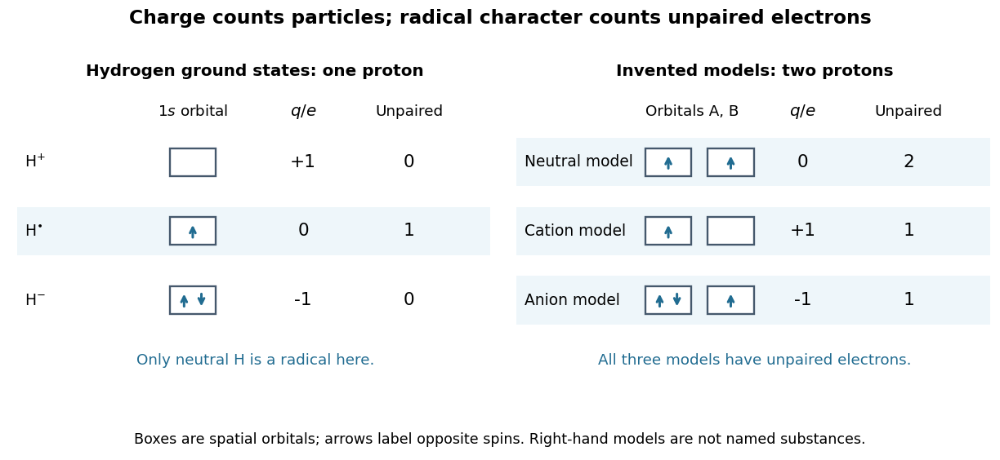

**[Figure 1](#image-radical-charge-and-orbital-occupancy). Electric charge and unpaired electrons are different properties**. Left: actual [ground state](quantum-mechanics.md#ground-state) $1s$ occupancies of $\mathrm H^+$, $\mathrm H^{\bullet}$, and $\mathrm H^-$. Right: stipulated two-orbital models with fixed $N_p=2$ illustrate neutral, positive, and negative [free radicals](#radical-chemistry); those boxes are not assignments for particular [chemical substances](chemical-substance.md). Arrows label [spin](angular-momentum-operator.md#spin) occupancy, not particle trajectories.

The distinction matters whenever a [chemical reaction](chemical-reaction.md) mechanism uses dots and charge signs together. [Homolysis](chemical-bond.md#homolysis) gives one bonding [electron](physics.md#electron) to each fragment, while [heterolysis](chemical-bond.md#heterolysis) assigns both to one fragment. A [radical chain reaction](#radical-chain-reaction) can pass an unpaired [electron](physics.md#electron) from one species to another without generating net [electric charge](electric-charge.md). Detection then exploits the unpaired [electron](physics.md#electron)'s [spin](angular-momentum-operator.md#spin) and [magnetic moment](electromagnetism.md#magnetic-dipole-moment), rather than merely measuring whether the sample carries an [electric charge](electric-charge.md).

### Peroxyl radical

↑ **Parent:** [Radical (chemistry)](#radical-chemistry)

An oxygen-centred [radical](#radical-chemistry) of form $\mathrm{ROO^\bullet}$, often formed by rapid addition of dioxygen to a carbon-centred [radical](#radical-chemistry).

### Chlorine monoxide

↑ **Parent:** [Radical (chemistry)](#radical-chemistry)

The [radical](#radical-chemistry) $\mathrm{ClO}$ formed when a [chlorine](chemical-substance.md#chlorine) atom reacts with [ozone](chemical-substance.md#ozone). Its reaction partners and reservoirs depend on altitude and [temperature](temperature.md); the [chlorine monoxide dimer cycle](#chlorine-monoxide-dimer-cycle) is important under cold, activated polar conditions.

#### ClOOCl dimer

↑ **Parent:** [Chlorine monoxide](#chlorine-monoxide)

The [chlorine](chemical-substance.md#chlorine) peroxide structure formed by association of two ClO radicals with collisional stabilization. Its low-temperature stability and [photodissociation](chemical-bond.md#photodissociation) provide a route for catalytic [ozone](chemical-substance.md#ozone) destruction. In a laboratory flow system, changing among three ClO precursors and examining infrared spectra helped distinguish the predominant ClOOCl product from an alternative ClOClO isomer. Product assignment and [ultraviolet](optics.md#ultraviolet) absorption support the proposed intermediate, but do not alone measure an entire atmospheric cycle's ozone-loss rate.[NASA abstract: precursors, 220–240 K flow system, distinct infrared signatures and [ultraviolet](optics.md#ultraviolet) spectrum](#production-of-chlorine-oxide-cl2o2-from-the-self-reaction-of-the-chlorine-oxide-clo-radical-by-l-t-molina-and-m-j-molina)

### Nitrate radical

↑ **Parent:** [Radical (chemistry)](#radical-chemistry)

A neutral nitrogen-oxide radical, distinct from the nitrate anion. It can add to unsaturated organic molecules and is important in some night-time oxidation pathways.

### Alkoxy radical

↑ **Parent:** [Radical (chemistry)](#radical-chemistry)

### Peroxy radical

↑ **Parent:** [Radical (chemistry)](#radical-chemistry)

A radical with an oxygen-centred peroxyl group, commonly formed when a carbon-centred radical adds molecular oxygen. Its reactions can recycle radicals, form an alkoxy radical, or produce a terminating organic nitrate branch, depending on the reaction partner and structure.

### Hydroperoxyl radical

↑ **Parent:** [Radical (chemistry)](#radical-chemistry)

### Hydroxyl radical

↑ **Parent:** [Radical (chemistry)](#radical-chemistry)

### Imidogen

↑ **Parent:** [Radical (chemistry)](#radical-chemistry)

The NH [free radical](#radical-chemistry), with triplet ground term $X\,{}^3\Sigma^-$. Two unpaired electrons occupy perpendicular approximately nonbonding orbitals in a simple valence model.

### Methylidyne

↑ **Parent:** [Radical (chemistry)](#radical-chemistry)

The CH [free radical](#radical-chemistry), whose ground electronic term is $X\,{}^2\Pi$.

### Methyl radical

↑ **Parent:** [Radical (chemistry)](#radical-chemistry)

The [methyl radical](#methyl-radical) is the neutral [radical](#radical-chemistry) $\mathrm{CH_3}^{\bullet}$, with an unpaired [electron](physics.md#electron). It carries the [methane chlorination chain](#methane-chlorination-chain) between its two propagation steps.

### Radical ion

↑ **Parent:** [Radical (chemistry)](#radical-chemistry)

A [radical ion](#radical-ion) is both a [radical](#radical-chemistry) and an [ion](#ion). Removing one [electron](physics.md#electron) from neutral [benzene](chemical-substance.md#benzene) can produce $\mathrm{C_6H_6}^{\bullet+}$, a [radical cation](#radical-cation); adding one can produce $\mathrm{C_6H_6}^{\bullet-}$, a [radical anion](#radical-anion). These formulae specify net [electric charge](electric-charge.md) and an unpaired [electron](physics.md#electron), without claiming that both reside on one [chemical atom](physics.md#atom-physics).[Glossary of Terms Used in Physical Organic Chemistry, IUPAC Recommendations 1994: radical ion, benzene examples and dot/charge placement](chemistry-bibliography.md#glossary-of-terms-used-in-physical-organic-chemistry-iupac-recommendations-1994-r-entries-by-international-union-of-pure-and-applied-chemistry)

#### Radical cation

↑ **Parent:** [Radical ion](#radical-ion)

A [radical cation](#radical-cation) has positive net [electric charge](electric-charge.md) and an unpaired [electron](physics.md#electron).

#### Radical anion

↑ **Parent:** [Radical ion](#radical-ion)

A [radical anion](#radical-anion) has negative net [electric charge](electric-charge.md) and an unpaired [electron](physics.md#electron).

### Radical chain reaction

↑ **Parent:** [Radical (chemistry)](#radical-chemistry)

A [radical chain reaction](#radical-chain-reaction) regenerates a [radical](#radical-chemistry) during propagation. Initiation supplies [free radicals](#radical-chemistry); propagation consumes one and produces another; termination removes chain-carrying [free radicals](#radical-chemistry). This explains why one initiating event can lead to many product-forming [chemical reactions](chemical-reaction.md). The [chain-growth polymerization](polymer.md#chain-growth-polymerization) article develops the corresponding growth of [polymers](polymer.md).

#### Radical termination

↑ **Parent:** [Radical chain reaction](#radical-chain-reaction)

Removal of propagating [free radicals](#radical-chemistry), for example by combination or disproportionation.

#### Radical chain termination

↑ **Parent:** [Radical chain reaction](#radical-chain-reaction)

Removal of chain carriers without creating a replacement carrier. Pair recombination removes two [free radicals](#radical-chemistry) per elementary event.

#### Radical chain propagation

↑ **Parent:** [Radical chain reaction](#radical-chain-reaction)

A step consuming a chain carrier and producing another while converting stable reactants. Two different carriers can have different concentrations even when their propagation fluxes agree.

#### Radical chain initiation

↑ **Parent:** [Radical chain reaction](#radical-chain-reaction)

Formation of chain carriers from stable reagents or an external source. Initiation events that create two [free radicals](#radical-chemistry) contribute twice their event rate to the radical-number balance.

<h4 id="hydrogen-chlorine-chain-reaction">Hydrogen–chlorine chain reaction</h4>

↑ **Parent:** [Radical chain reaction](#radical-chain-reaction)

A radical chain in which hydrogen and chlorine radical carriers alternate between propagation steps. With M-assisted chlorine initiation and recombination termination, radical steady-state balances can give first order in H2 and half order in Cl2 without requiring equal propagation rate constants.

#### Methane chlorination chain

↑ **Parent:** [Radical chain reaction](#radical-chain-reaction)

Light initiates [methane](chemical-substance.md#methane) chlorination by [photodissociation](chemical-bond.md#photodissociation) of $\mathrm{Cl_2}$ through [homolysis](chemical-bond.md#homolysis). The elementary bookkeeping is

$$
\begin{aligned}
\text{initiation:}\quad &\mathrm{Cl_2}\xrightarrow{h\nu}2\mathrm{Cl}^{\bullet},\\
\text{propagation:}\quad &\mathrm{Cl}^{\bullet}+\mathrm{CH_4}\longrightarrow\mathrm{HCl}+\mathrm{CH_3}^{\bullet},\\
&\mathrm{CH_3}^{\bullet}+\mathrm{Cl_2}\longrightarrow\mathrm{CH_3Cl}+\mathrm{Cl}^{\bullet}.
\end{aligned}
$$

Here $h\nu$ denotes the [photon](quantum-mechanics.md#photon) [energy](energy.md). The first propagation step replaces a [chlorine](chemical-substance.md#chlorine) [radical](#radical-chemistry) with a [methyl radical](#methyl-radical); the second regenerates a [chlorine](chemical-substance.md#chlorine) [radical](#radical-chemistry). Adding the two propagation equations cancels both [free radicals](#radical-chemistry) and gives $\mathrm{CH_4+Cl_2\longrightarrow CH_3Cl+HCl}$: [chloromethane](chemical-substance.md#chloromethane) and [hydrogen chloride](electronegativity.md#hydrogen-chloride) are made while the chain carrier is regenerated.[Organic Chemistry by John McMurry, §6.6: chlorine photolysis and the two-step methane chlorination cycle](chemistry-bibliography.md#organic-chemistry-by-john-mcmurry/6-6-radical-reactions)

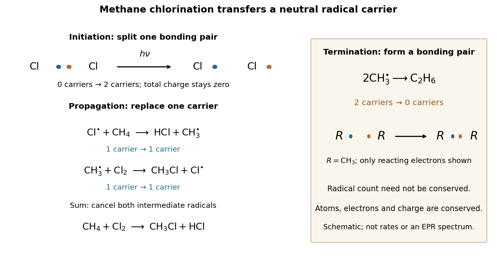

**[Figure 2](#image-methane-chlorination-radical-bookkeeping). Methane chlorination: initiation supplies carriers, propagation replaces them, termination removes them**. The left panel follows the reacting [electron pair](chemical-bond.md#electron-pair) in [homolysis](chemical-bond.md#homolysis), then counts chain carriers through two propagation steps. The right panel shows recombination termination. Every [chemical species](mathematical-biology.md#chemical-species) in this example is neutral. Electron marks are bookkeeping, not a measured electronic [wavefunction](wave-function.md) or a reaction-rate plot.

For example, recombination $2\mathrm{CH_3}^{\bullet}\longrightarrow\mathrm{C_2H_6}$ of [methyl radicals](#methyl-radical) makes [ethane](chemical-substance.md#ethane) and a [covalent bond](covalent-bond.md) from two unpaired [electrons](physics.md#electron), removing two carriers. Recombination of two $\mathrm{Cl}^{\bullet}$ also terminates carriers; in the gas phase, stabilization of the product requires disposal of released [energy](energy.md), for example to a third collision partner. The figure omits that partner. Termination competes with propagation, and further chlorination can consume [chloromethane](chemical-substance.md#chloromethane), so this cycle alone does not predict a pure product or a measured [reaction rate](chemical-kinetics.md#reaction-rate).[Organic Chemistry by John McMurry, §10.2, Figure 10.2 and following paragraphs: radical combination terminates the chain; further substitution gives product mixtures](chemistry-bibliography.md#organic-chemistry-by-john-mcmurry/10-2-preparing-alkyl-halides-from-alkanes-radical-halogenation)

### Stable radical

↑ **Parent:** [Radical (chemistry)](#radical-chemistry)

An unpaired [electron](physics.md#electron) does not set a universal [reaction rate](chemical-kinetics.md#reaction-rate). A [stable radical](#stable-radical) can retain radical character during isolation and storage under specified conditions; a persistent [radical](#radical-chemistry) survives long enough under specified conditions to be observed. These descriptions concern lifetime and handling, rather than immunity to every possible [chemical reaction](chemical-reaction.md). [DPPH](#2-2-diphenyl-1-picrylhydrazyl) is a practical counterexample to the claim that all [free radicals](#radical-chemistry) react immediately.

Two mechanisms help explain persistence. Spreading electronic character over several [chemical atoms](physics.md#atom-physics), represented by [chemical resonance](covalent-bond.md#resonance-chemistry), can lower the [energy](energy.md) relative to a localized description. Bulky surrounding groups can impede approach to a reactive site and slow recombination. Lower [energy](energy.md) and slower [chemical kinetics](chemical-kinetics.md) are different advantages: neither alone guarantees a long lifetime. A primary computational study explicitly separates these effects, using electronic and geometric descriptors; it does not directly measure every predicted lifetime.[A quantitative metric for organic radical stability and persistence using thermodynamic and kinetic features, Shree Sowndarya S. V., Peter C. St. John and Robert S. Paton, 2021: Abstract and Introduction, thermodynamic stabilization versus kinetic persistence](chemistry-bibliography.md#a-quantitative-metric-for-organic-radical-stability-and-persistence-using-thermodynamic-and-kinetic-features-by-shree-sowndarya-s-v-and-others)

<h4 id="2-2-diphenyl-1-picrylhydrazyl">2,2-Diphenyl-1-picrylhydrazyl</h4>

↑ **Parent:** [Stable radical](#stable-radical)  
ⓦ [Wiki](https://en.wikipedia.org/wiki/2,2-Diphenyl-1-picrylhydrazyl)

[DPPH](#2-2-diphenyl-1-picrylhydrazyl) is a neutral organic [radical](#radical-chemistry) used as a [spin](angular-momentum-operator.md#spin) reference in electron paramagnetic resonance (EPR), also called electron spin resonance (ESR). Its unpaired [electron](physics.md#electron) remains bound within the [chemical species](mathematical-biology.md#chemical-species): “free radical” does not mean a freely moving [electron](physics.md#electron). The [DPPH electron spin resonance experiment](#dpph-electron-spin-resonance-experiment) makes its [magnetic moment](electromagnetism.md#magnetic-dipole-moment) observable.

##### DPPH electron spin resonance experiment

↑ **Parent:** [2,2-Diphenyl-1-picrylhydrazyl](#2-2-diphenyl-1-picrylhydrazyl)

The University of Iowa's [Electron Spin Resonance, University of Iowa laboratory protocol](chemistry-bibliography.md#electron-spin-resonance-university-of-iowa-laboratory-protocol) (revised July 2007, Experiment and Resonance Data Analysis, printed pp. 2–6) specifies [DPPH](#2-2-diphenyl-1-picrylhydrazyl) on cotton in a tube inside an RF coil, between [Helmholtz coils](electromagnetism.md#helmholtz-coil). A bridge monitors RF absorption; an [oscilloscope](wave-equation.md#oscilloscope) records this output and the voltage across a $1\,\Omega$ current-monitor resistor. Sweeping the coil current passes through the resonant [magnetic field](magnetic-field.md). The protocol describes two dips when the sweep revisits resonance; these are repeated crossings, not two distinct spectral lines.

Its calibration replaces the sample with a [Hall effect](relativistic-electromagnetism.md#hall-effect) probe, maps the [magnetic field](magnetic-field.md) in $2\,\mathrm{mm}$ steps, and accounts for sample dimensions. At least four RF [frequencies](wave.md#frequency) test the resonance relation. Sweep speed is adjusted to obtain comparable passages. Only a local peak-plus-background fit is prescribed, because the full shape is not Gaussian. The protocol also flags unexplained trailing spikes and possible electronics contributions. These controls constrain field and sweep errors; an empty-tube/cotton blank would be an additional background control, not a reported measurement in this protocol.[Electron Spin Resonance, revised July 2007: printed pp. 4–7, sweep behavior, field mapping, local fitting and anomalous spikes](chemistry-bibliography.md#electron-spin-resonance-university-of-iowa-laboratory-protocol)

For an isolated effective [spin one-half](angular-momentum-operator.md#spin-one-half) with dimensionless positive factor $g$, the basic resonance model is

$$
\Delta E=g\mu_{\rm B}|B|=h\nu,\qquad
g=\frac{h\nu}{\mu_{\rm B}|B_{\rm res}|}.
$$

Here $\mu_{\rm B}$ is the [Bohr magneton](electromagnetism.md#bohr-magneton), $h$ is the [Planck constant](quantum-mechanics.md#planck-constant), $\nu$ is the applied [frequency](wave.md#frequency), and $B_{\rm res}$ is the calibrated resonant [magnetic field](magnetic-field.md). A change in [frequency](wave.md#frequency) should shift the resonance field proportionally in this model. The factor $g$ describes the electronic [magnetic moment](electromagnetism.md#magnetic-dipole-moment) coupling, not the species' net [electric charge](electric-charge.md).

A resonance supports the presence of detectable [paramagnetism](electromagnetism.md#paramagnetism). It does not, by itself, identify an unknown [radical](#radical-chemistry): other species exhibiting [paramagnetism](electromagnetism.md#paramagnetism), impurities, overlapping responses, and interactions with [atomic nuclei](atomic-nucleus.md) can complicate interpretation. Conversely, absence of a detectable resonance need not mean absence of [free radicals](#radical-chemistry); a low [concentration](mathematical-physics.md#concentration), a short lifetime, or an unsuitable measurement range can conceal them. The occupancy and chain diagrams are original bookkeeping illustrations; neither is a measured or simulated [DPPH](#2-2-diphenyl-1-picrylhydrazyl) spectrum.

## Molecule

↑ **Parent:** [Chemistry](chemistry.md)

[This section is present in another page, follow this link to view it.](molecule.md)

## Quantum chemistry

↑ **Parent:** [Chemistry](chemistry.md)  
ⓦ [Wiki](https://en.wikipedia.org/wiki/Quantum_chemistry)

### Density functional theory

↑ **Parent:** [Quantum chemistry](#quantum-chemistry)

A framework describing electronic ground-state properties using the [electron density](#electron-density). Practical approximations require an exchange-correlation functional; this does not mean that explicit [electrons](physics.md#electron) have been replaced by a classical atom-only force field.

#### Exchange-correlation functional

↑ **Parent:** [Density functional theory](#density-functional-theory)

The part of the exact density functional left after subtracting the auxiliary noninteracting kinetic energy and classical [Hartree electrostatic energy](quantum-mechanics.md#hartree-electrostatic-energy). It includes fermionic exchange, correlation and the difference between interacting and noninteracting kinetic energies. Its functional derivative enters the [Kohn-Sham equations](#kohn-sham-equations). Practical approximations to this functional, rather than the existence of a density description itself, are a central source of error.

#### Density functional variational principle

↑ **Parent:** [Density functional theory](#density-functional-theory)

The constrained-search functional $F[n]=\min_{\Psi\to n}\langle\Psi|T+W|\Psi\rangle$ is universal for a fixed interaction. Minimization of $F[n]+\int vn$ over admissible densities with the correct electron number gives the [ground-state energy](quantum-mechanics.md#ground-state-energy). Each trial density represents a constrained set of antisymmetric states, so minimizing over densities and their representing states recovers the ordinary [variational principle](calculus-of-variations.md#variational-principle). The admissible domain and possible degeneracy must be handled explicitly.

#### Kohn-Sham equations

↑ **Parent:** [Density functional theory](#density-functional-theory)

Effective one-electron equations for orbitals whose density represents that of the interacting electronic system. The effective potential contains nuclear attraction, Hartree repulsion and an exchange-correlation contribution.

##### Kohn-Sham energy double-counting correction

↑ **Parent:** [Kohn-Sham equations](#kohn-sham-equations)

Summing the [Kohn-Sham equations](#kohn-sham-equations) over occupied normalized orbitals yields $\sum_i f_i\epsilon_i=T_s+\int nv+2E_H+\int nv_{\rm xc}$. The exact ground-state energy functional is $T_s+\int nv+E_H+E_{\rm xc}$, so subtraction proves the correction in the title. Nuclear or lattice source self-energies must be added consistently. This accounting does not turn all auxiliary orbital eigenvalues into physical excitation energies.

### Configuration interaction

↑ **Parent:** [Quantum chemistry](#quantum-chemistry)

A variational expansion $\Psi=\sum_I c_I\Phi_I$ over [Slater determinants](tensor-product-of-quantum-systems.md#slater-determinant) or spin-adapted configuration functions in a fixed orbital basis. Truncating the configurations restricts the correlation described.

#### Configuration interaction with singles and doubles

↑ **Parent:** [Configuration interaction](#configuration-interaction)

[configuration interaction](#configuration-interaction) retaining a reference [determinant](multilinear-algebra.md#determinant) and its single and double excitations. Conventional matrix-vector iterations have leading $O(o^2v^4)$ work for occupied and virtual dimensions $o,v$, hence $O(N^6)$ when both grow with system size. Truncated [CI](#configuration-interaction) is not generally size extensive.

### Self-consistent field

↑ **Parent:** [Quantum chemistry](#quantum-chemistry)

An iterative orbital calculation in which the effective one-electron operator depends on the density built from its own occupied orbitals. Self-consistency is a stationarity condition, not a guarantee that the solution is the lowest-energy one.

### Hartree-Fock method

↑ **Parent:** [Quantum chemistry](#quantum-chemistry)

A variational approximation restricting a many-electron [wavefunction](wave-function.md) to one [Slater determinant](tensor-product-of-quantum-systems.md#slater-determinant). Minimizing its energy gives self-consistent one-electron equations with Coulomb and exchange operators. It includes exchange from antisymmetry but omits correlation beyond the [determinant](multilinear-algebra.md#determinant).

#### Fock operator

↑ **Parent:** [Hartree-Fock method](#hartree-fock-method)

The self-consistent one-electron operator obtained by varying a [Slater determinant](tensor-product-of-quantum-systems.md#slater-determinant). It contains a local [hartree potential](quantum-mechanics.md#hartree-potential) and a nonlocal exchange action. Its occupied [eigenfunctions](linear-operator-theory.md#eigenfunction) define a stationary determinant; its [eigenvalues](linear-operator-theory.md#eigenvalue) are Lagrange multipliers and are not by themselves the total many-electron [energy](energy.md).

#### Hartree-Fock electron gas

↑ **Parent:** [Hartree-Fock method](#hartree-fock-method)

A variational single-Slater-determinant treatment of interacting [electrons](physics.md#electron) and a neutralizing positive background. For uniform plane-wave occupations the direct background and [electron](physics.md#electron) terms cancel, leaving kinetic and same-spin exchange [energy](energy.md). Allowing [spin](angular-momentum-operator.md#spin) [polarization](wave.md#polarization-waves) or spatially modulated orbitals enlarges the variational class.

##### Contact-interaction Hartree-Fock spin energy

↑ **Parent:** [Hartree-Fock electron gas](#hartree-fock-electron-gas)

In a uniform three-dimensional [Hartree-Fock electron gas](#hartree-fock-electron-gas) with repulsive contact coupling $\gamma$, a spin-independent neutralizing background can cancel the [Hartree energy](physics.md#hartree-energy). The remaining same-spin exchange term is negative and quadratic in each [spin](angular-momentum-operator.md#spin) [density](fluid-mechanics.md#density). Integrating the filled single-spin [Fermi sphere](fermi-liquid.md#fermi-sphere) gives $A=3\hbar^2(6\pi^2)^{2/3}/(10m)$. At fixed total [density](fluid-mechanics.md#density) the exchange term favors [spin polarization](angular-momentum-operator.md#spin-polarization), whereas the kinetic term opposes it.

###### Endpoint and continuous polarization thresholds of a contact electron gas

↑ **Parent:** [Contact-interaction Hartree-Fock spin energy](#contact-interaction-hartree-fock-spin-energy)

Let $r=(\gamma/A)(n/2)^{1/3}$ and $P=(n_\uparrow-n_\downarrow)/n$. In units $2A(n/2)^{5/3}$ the spin-dependent [energy](energy.md) is $[(1+P)^{5/3}+(1-P)^{5/3}]/2-r(1+P^2)/2$. Comparing only $P=0$ and $P=1$ gives the endpoint crossing $r=2^{5/3}-2$. Expanding near $P=0$ gives a quadratic coefficient $5/9-r/2$, so the unpolarized state first loses local stability at $r=10/9$. The endpoint crossing is therefore not the actual continuous onset; intermediate polarizations matter.

##### Overhauser instability

↑ **Parent:** [Hartree-Fock electron gas](#hartree-fock-electron-gas)

The uniform paramagnetic three-dimensional electron-gas determinant is unstable within Hartree-Fock theory to a spin-density-wave deformation, even at high density. Comparing only spatially uniform polarized and unpolarized determinants therefore does not find the unrestricted Hartree-Fock [ground state](quantum-mechanics.md#ground-state).[abstract and p. 1437](physics-bibliography.md#spin-density-waves-in-an-electron-gas-by-a-w-overhauser)

##### Uniform electron-gas exchange energy

↑ **Parent:** [Hartree-Fock electron gas](#hartree-fock-electron-gas)

In a three-dimensional unpolarized gas, exchange [energy](energy.md) per particle is $-3e^2k_F/(16\pi^2\varepsilon)$, with Coulomb convention $e^2/(4\pi\varepsilon r)$. It scales as minus the inverse dimensionless spacing radius, while kinetic [energy](energy.md) scales as its inverse square. Exchange acts only between equal-spin occupied orbitals.

##### Electron-gas spin polarization

↑ **Parent:** [Hartree-Fock electron gas](#hartree-fock-electron-gas)

For number densities $n_\uparrow,n_\downarrow$, $\zeta=(n_\uparrow-n_\downarrow)/(n_\uparrow+n_\downarrow)$. Uniform [spin](angular-momentum-operator.md#spin) [polarization](wave.md#polarization-waves) raises kinetic [energy](energy.md) by concentrating occupation in one Fermi sphere, while lowering exchange [energy](energy.md).

#### Two-electron exchange integral

↑ **Parent:** [Hartree-Fock method](#hartree-fock-method)

For real [spatial orbitals](tensor-product-of-quantum-systems.md#spatial-orbital), $K_{pq}=\iint\phi_p(1)\phi_q(1)r_{12}^{-1}\phi_q(2)\phi_p(2)\,d1\,d2$ in [atomic units](physics.md#atomic-units). It enters the energy of a [Slater determinant](tensor-product-of-quantum-systems.md#slater-determinant) through antisymmetry and becomes small for well-separated localized orbitals.

#### Two-electron Coulomb integral

↑ **Parent:** [Hartree-Fock method](#hartree-fock-method)

The electrostatic repulsion integral $J_{pq}=\iint|\phi_p(1)|^2|\phi_q(2)|^2r_{12}^{-1}\,d1\,d2$ in [atomic units](physics.md#atomic-units). For a normalized hydrogenic 1s orbital of exponent $\zeta$, the same-orbital value is $5\zeta/8$. It is a two-electron integral, unlike a diagonal Hückel one-electron parameter.

#### Koopmans' theorem

↑ **Parent:** [Hartree-Fock method](#hartree-fock-method)

In frozen-orbital Hartree-Fock theory, removing an [electron](physics.md#electron) from occupied orbital $i$ changes the energy by approximately $-\epsilon_i$. Orbital relaxation and correlation are omitted, so a measured [ionization energy](mathematical-physics.md#ionization-energy) is not an exact orbital-energy measurement.

#### Unrestricted Hartree-Fock method

↑ **Parent:** [Hartree-Fock method](#hartree-fock-method)

A Hartree-Fock ansatz allowing different [spatial orbitals](tensor-product-of-quantum-systems.md#spatial-orbital) for alpha and beta spin. This can lower the energy of a stretched bond, but the [determinant](multilinear-algebra.md#determinant) need not be an eigenstate of total spin squared.

#### Restricted Hartree-Fock method

↑ **Parent:** [Hartree-Fock method](#hartree-fock-method)

A Hartree-Fock ansatz in which opposite-spin [electrons](physics.md#electron) in a doubly occupied orbital share the same spatial function. The closed-shell [determinant](multilinear-algebra.md#determinant) is spin-pure but can dissociate incorrectly when a bond requires several [determinants](multilinear-algebra.md#determinant).

### Exchange integral

↑ **Parent:** [Quantum chemistry](#quantum-chemistry)

For two orthonormal spatial [atomic orbitals](#atomic-orbital), the normalized symmetric and antisymmetric two-particle factors have Coulomb energies $J_{ab}+K_{ab}$ and $J_{ab}-K_{ab}$. With common orbitals, the fermionic [singlet state](angular-momentum-operator.md#singlet-state) and [triplet state](angular-momentum-operator.md#spin-one-half-triplet-state) therefore differ by $2K_{ab}$. This is an [exchange interaction](electromagnetism.md#exchange-interaction) resulting from the state symmetry and the Coulomb operator, rather than a separate classical force.

### Coulomb integral

↑ **Parent:** [Quantum chemistry](#quantum-chemistry)

In [atomic units](physics.md#atomic-units), the displayed integral is the direct electrostatic contribution between two normalized [atomic orbitals](#atomic-orbital) $a,b$. It enters a two-electron [energy](energy.md) expectation together with the [exchange integral](#exchange-integral).

### Electron density

↑ **Parent:** [Quantum chemistry](#quantum-chemistry)

The electron density describes the expected number of [electrons](physics.md#electron) per unit [volume](geometry-and-topology.md#volume) at position $\mathbf r$. For a system with a fixed number $N$ of [electrons](physics.md#electron), $\int n(\mathbf r)\,d^3\mathbf r=N$. A [Lewis structure](covalent-bond.md#lewis-structure) allocates electron counts without specifying this spatial density.

### Electron configuration

↑ **Parent:** [Quantum chemistry](#quantum-chemistry)  
ⓦ [Wiki](https://en.wikipedia.org/wiki/Electron_configuration)

An [electron configuration](#electron-configuration) records the occupation of [electron shells](#electron-shell) and [electron subshells](#electron-subshell) by [electrons](physics.md#electron). For neutral [sodium](chemical-substance.md#sodium) in its [ground state](quantum-mechanics.md#ground-state), $1s^2\,2s^2\,2p^6\,3s^1$ gives $2+2+6+1=11$ [electrons](physics.md#electron); adding the occupations within each [electron shell](#electron-shell) gives $(2,8,1)$. A superscript counts [electrons](physics.md#electron), rather than multiplying the preceding labels. Removing the outer [electron](physics.md#electron) gives the [sodium](chemical-substance.md#sodium) [ion](#ion) $\mathrm{Na}^{+}$ with $1s^2\,2s^2\,2p^6$, or $(2,8)$. See [Flowers et al., Chemistry 2e, electron configurations of atoms and ions](https://openstax.org/books/chemistry-2e/pages/6-4-electronic-structure-of-atoms-electron-configurations).

#### Closed electron shell

↑ **Parent:** [Electron configuration](#electron-configuration)

A filled electronic shell has all its orbital and spin states occupied. Its total orbital and spin angular momenta cancel, so a closed core does not supply the valence angular momentum in an elementary alkali-atom term assignment.

#### Aufbau principle

↑ **Parent:** [Electron configuration](#electron-configuration)  
ⓦ [Wiki](https://en.wikipedia.org/wiki/Aufbau_principle)

An approximate scheme for constructing an atomic [electron configuration](#electron-configuration) by filling lower-energy [atomic orbitals](#atomic-orbital) before higher-energy ones, subject to the [Pauli exclusion principle](tensor-product-of-quantum-systems.md#pauli-exclusion-principle). Orbital ordering can change on ionization and has exceptions in interacting [chemical atoms](physics.md#atom-physics). Selecting the free-ion ground term within a specified open-shell configuration additionally requires [Hund's rules](#hund-s-rules) or a more detailed interaction calculation.

#### Isoelectronic species

↑ **Parent:** [Electron configuration](#electron-configuration)

Atoms, molecules or ions with the same [electron](physics.md#electron) count, often compared because their orbital occupations or bonding patterns are related. Equal [electron](physics.md#electron) counts do not guarantee identical energies or geometry.

#### Effective nuclear charge

↑ **Parent:** [Electron configuration](#electron-configuration)

An orbital- and model-dependent parameter representing nuclear attraction after electronic screening. A screening construction writes $Z_{\rm eff}=Z-S$; a binding-energy construction requires an additional orbital-energy model.

##### Atomic-orbital penetration

↑ **Parent:** [Effective nuclear charge](#effective-nuclear-charge)

Probability density within the inner [electron](physics.md#electron) shells. Greater penetration can reduce screening and lower an orbital energy; this helps distinguish many-electron s and p levels with the same principal quantum number.

##### Shielding constant

↑ **Parent:** [Effective nuclear charge](#effective-nuclear-charge)

The screening parameter $S$ in $Z_{\rm eff}=Z-S$. Different atomic orbitals can have different shielding parameters.

<h6 id="slater-s-rules">Slater's rules</h6>

↑ **Parent:** [Shielding constant](#shielding-constant)

An empirical orbital-screening prescription. Other electrons in an $ns,np$ group count $0.35$ each; electrons in shell $n-1$ count $0.85$, deeper electrons $1.00$, and outer electrons zero. For $1s$, the partner contributes $0.30$. d and f groups use separate rules.[1930, printed pp. 58–59](chemistry-bibliography.md#atomic-shielding-constants-by-john-c-slater)

<h4 id="hund-s-rules">Hund's rules</h4>

↑ **Parent:** [Electron configuration](#electron-configuration)  
ⓦ [Wiki](https://en.wikipedia.org/wiki/Hund's_rules)

[Friedrich Hund](atomic-physicist.md#friedrich-hund)'s rules describe the usual ground-term ordering within an atomic [electron configuration](#electron-configuration) in the [LS coupling](angular-momentum-operator.md#ls-coupling) regime. First maximize the total [spin](angular-momentum-operator.md#spin) $S$ subject to the [Pauli exclusion principle](tensor-product-of-quantum-systems.md#pauli-exclusion-principle). Among the terms with that spin, maximize total [orbital angular momentum](quantum-mechanics.md#orbital-angular-momentum) $L$. Within the resulting term, the lowest level has $J=|L-S|$ for a less-than-half-filled open subshell and $J=L+S$ for a more-than-half-filled one. These are ordering rules, not universal replacements for diagonalizing an arbitrary atomic [Hamiltonian operator](quantum-system.md#hamiltonian-quantum-mechanics).

For two equivalent $p$ electrons, parallel spins give $S=1$. Their spatial [wavefunction](wave-function.md) must be antisymmetric; the highest allowed orbital projection with parallel spins is $1+0=1$, giving $L=1$. A $p^2$ subshell is less than half filled, so its lowest [term symbol](atomic-physics.md#term-symbol) is $^3P_0$, followed within that term by $^3P_1$ and $^3P_2$. Closed subshells contribute zero total $L$ and $S$.

<h5 id="hund-s-coupling">Hund's coupling</h5>

↑ **Parent:** [Hund's rules](#hund-s-rules)

An effective local exchange coupling can favor parallel [electron spins](angular-momentum-operator.md#electron-spin) in different orbitals on the same atom. The displayed sign convention represents that preference. It underlies the high-spin tendency in [Hund's rules](#hund-s-rules) and the alignment of itinerant and core spins used in [double exchange](electromagnetism.md#double-exchange-mechanism). The coupling is an effective description of intra-atomic Coulomb and exchange energies, rather than a separate classical magnetic force.

#### Electron shell

↑ **Parent:** [Electron configuration](#electron-configuration)  
ⓦ [Wiki](https://en.wikipedia.org/wiki/Electron_shell)

An [electron shell](#electron-shell) collects the allowed electronic [quantum states](quantum-system.md#quantum-state) sharing a [principal quantum number](mathematical-physics.md#principal-quantum-number) $n$. Its occupancy is the number of [electrons](physics.md#electron) assigned to those states in an [electron configuration](#electron-configuration). An [electron shell](#electron-shell) is not a material surface or a prescribed orbit.

##### K shell

↑ **Parent:** [Electron shell](#electron-shell)

The innermost atomic [electron shell](#electron-shell), with principal quantum number $n=1$. Its $s$ orbital has nonzero nuclear overlap, making its electrons important in [electron capture](physics.md#electron-capture).

###### K-shell electron

↑ **Parent:** [K shell](#k-shell)

An [electron](physics.md#electron) occupying the [K shell](#k-shell), with orbital angular momentum zero and total [angular momentum](momentum.md#angular-momentum) $1/2$.

##### Core electron

↑ **Parent:** [Electron shell](#electron-shell)

An [electron](physics.md#electron) in an inner [electron shell](#electron-shell), contrasted with a [valence electron](chemical-bond.md#valence-electron).

##### Electron subshell

↑ **Parent:** [Electron shell](#electron-shell)

An [electron subshell](#electron-subshell) groups the allowed electronic [quantum states](quantum-system.md#quantum-state) within an [electron shell](#electron-shell) by their [orbital angular momentum](quantum-mechanics.md#orbital-angular-momentum) quantum number $\ell$. Labels $s$ and $p$ mean $\ell=0$ and $\ell=1$, respectively; their capacities are two and six [electrons](physics.md#electron). The leading number in $2p$ identifies the [electron shell](#electron-shell), while $p$ identifies the [electron subshell](#electron-subshell).

#### Unpaired electron

↑ **Parent:** [Electron configuration](#electron-configuration)

An [electron](physics.md#electron) occupying an [atomic orbital](#atomic-orbital) without a partner of opposite [spin](angular-momentum-operator.md#spin) in that [atomic orbital](#atomic-orbital).

### Atomic orbital

↑ **Parent:** [Quantum chemistry](#quantum-chemistry)  
ⓦ [Wiki](https://en.wikipedia.org/wiki/Atomic_orbital)

An atomic orbital is a one-[electron](physics.md#electron) spatial [wavefunction](wave-function.md) used to describe an [electron](physics.md#electron)'s state in a [chemical atom](physics.md#atom-physics). For a one-electron [hydrogen atom](mathematical-physics.md#hydrogen-atom), orbitals can be exact [energy eigenstates](energy-eigenvalue.md#energy-eigenstate); descriptions of many-electron atoms instead use an orbital approximation. A normalized atomic orbital has $\int|\phi|^2\,d^3\mathbf r=1$, and the [Born rule](wave-function.md#born-rule) gives the position [probability density](wave-function.md#probability-density) $|\phi|^2$. It is a function extending through space, not a prescribed classical orbit. [Flowers et al., Chemistry 2e, 6.3: atomic orbitals and the wavefunction description](https://openstax.org/books/chemistry-2e/pages/6-3-development-of-quantum-theory)

The [linear combination of atomic orbitals](#linear-combination-of-atomic-orbitals) combines these single-centre functions to approximate a [molecular orbital](#molecular-orbital). The [orbital overlap](#orbital-overlap) measures their [inner product](inner-product.md), and their relative [quantum phase](quantum-system.md#quantum-phase) controls the [interference](physical-optics.md#interference-wave-propagation) shown in [molecular orbital theory](#molecular-orbital-theory).

#### Mean-square orbital radius

↑ **Parent:** [Atomic orbital](#atomic-orbital)

For a normalized spatial [wavefunction](wave-function.md), $\langle r^2\rangle=\int r^2|\psi(\mathbf r)|^2d^3r$. Its square root is the root-mean-square radius, which differs from the exponential decay length. A spherical [hydrogenic donor state](semiconductor.md#hydrogenic-donor-state) with $\psi\propto e^{-r/a}$ has $\langle r^2\rangle=3a^2$, obtained by dividing the radial integrals of $r^4e^{-2r/a}$ and $r^2e^{-2r/a}$.

#### Radial node

↑ **Parent:** [Atomic orbital](#atomic-orbital)

A radial position at which an orbital radial wavefunction vanishes. A hydrogen-like orbital has $n-l-1$ radial nodes; $2s$ has one and $2p$ none.

#### s orbital

↑ **Parent:** [Atomic orbital](#atomic-orbital)

An [atomic orbital](#atomic-orbital) with orbital angular momentum quantum number zero. Its angular part is spherically symmetric; higher principal shells can have radial nodes.

#### D orbital

↑ **Parent:** [Atomic orbital](#atomic-orbital)

An [atomic orbital](#atomic-orbital) with orbital angular momentum quantum number $l=2$. Five angular functions span the subshell; a [ligand field](#ligand-field) can split their energies.

#### Atomic-orbital nodal plane

↑ **Parent:** [Atomic orbital](#atomic-orbital)

A plane on which an [atomic orbital](#atomic-orbital) [wavefunction](wave-function.md) vanishes. For a real [p orbital](#p-orbital) oriented along $x$, it is the plane $x=0$. The [probability density](wave-function.md#probability-density) also vanishes on that plane.

#### p orbital

↑ **Parent:** [Atomic orbital](#atomic-orbital)

An [atomic orbital](#atomic-orbital) with [orbital angular momentum](quantum-mechanics.md#orbital-angular-momentum) quantum number $l=1$. Real $p_x,p_y,p_z$ combinations have opposite [quantum phases](quantum-system.md#quantum-phase) in their two lobes and a nodal plane through the [atomic nucleus](atomic-nucleus.md). An orbital phase is not an [electric charge](electric-charge.md).

#### Orbital hybridization

↑ **Parent:** [Atomic orbital](#atomic-orbital)

A change of atomic-orbital basis used to construct directed local bonding orbitals. $sp$, $sp^2$ and $sp^3$ describe idealized combinations; they are model descriptions rather than unique experimental labels for every bonded atom.

##### Hybrid orbital

↑ **Parent:** [Orbital hybridization](#orbital-hybridization)

A linear combination of [atomic orbitals](#atomic-orbital) used in a localized description of directional bonding or [lone pairs](covalent-bond.md#lone-pair). Hybrid labels are models rather than directly observable fixed atomic states.

### Molecular orbital theory

↑ **Parent:** [Quantum chemistry](#quantum-chemistry)  
ⓦ [Wiki](https://en.wikipedia.org/wiki/Molecular_orbital_theory)

[Molecular orbital theory](#molecular-orbital-theory) describes the electronic arrangement of a [molecule](molecule.md) using [molecular orbitals](#molecular-orbital): one-[electron](physics.md#electron) spatial [wavefunctions](wave-function.md) extending over the combined [atomic nuclei](atomic-nucleus.md). Filling [bonding molecular orbitals](#bonding-orbital) can stabilize a [chemical bond](chemical-bond.md); filling [antibonding molecular orbitals](#antibonding-orbital) opposes that stabilization. A [molecular orbital](#molecular-orbital) is a building block of a many-[electron](physics.md#electron) description, rather than the entire many-[electron](physics.md#electron) [wavefunction](wave-function.md). See [Robert W. Field, MIT 5.61, lecture 24, pp. 1–4: molecular orbitals and the LCAO approximation](https://ocw.mit.edu/courses/5-61-physical-chemistry-fall-2017/ef9da1132ff6233d732a1d6115099467_MIT5_61F17_lec24.pdf).

First make the [interference](physical-optics.md#interference-wave-propagation) visible with an exactly normalized one-dimensional toy. Replace the three-dimensional $1s$ [atomic orbitals](#atomic-orbital) of the [hydrogen atom](mathematical-physics.md#hydrogen-atom) by two [Gaussian functions](calculus.md#gaussian-function) centred at $x=\pm a$, with [dimensionless](physics.md#dimensionless-quantity) $x$ and $a>0$:

$$
\phi_A(x)=\pi^{-1/4}e^{-(x+a)^2/2},\qquad
\phi_B(x)=\pi^{-1/4}e^{-(x-a)^2/2},\qquad
S=\int_{-\infty}^{\infty}\phi_A\phi_B\,dx=e^{-a^2}.
$$

The normalized sum and difference are $\psi_\pm=(\phi_A\pm\phi_B)/\sqrt{2(1\pm S)}$, following the same [linear combination of atomic orbitals](#linear-combination-of-atomic-orbitals) algebra. At $a=1$, the [orbital overlap](#orbital-overlap) is $S=e^{-1}\approx0.367879$. At the midpoint, $\phi_A(0)=\phi_B(0)\approx0.455581$, giving

$$
\psi_+(0)\approx0.550879,\qquad |\psi_+(0)|^2\approx0.303468,\qquad
\psi_-(0)=|\psi_-(0)|^2=0.
$$

Both [probability densities](wave-function.md#probability-density) have total [integral](integral.md) one: [interference](physical-optics.md#interference-wave-propagation) redistributes [probability](probability-theory.md#probability), rather than creating an extra [electron](physics.md#electron). These are toy [wavefunctions](wave-function.md), not actual [hydrogen atom](mathematical-physics.md#hydrogen-atom) orbitals or predictions of [molecular hydrogen](chemical-substance.md#molecular-hydrogen) [energies](energy.md).

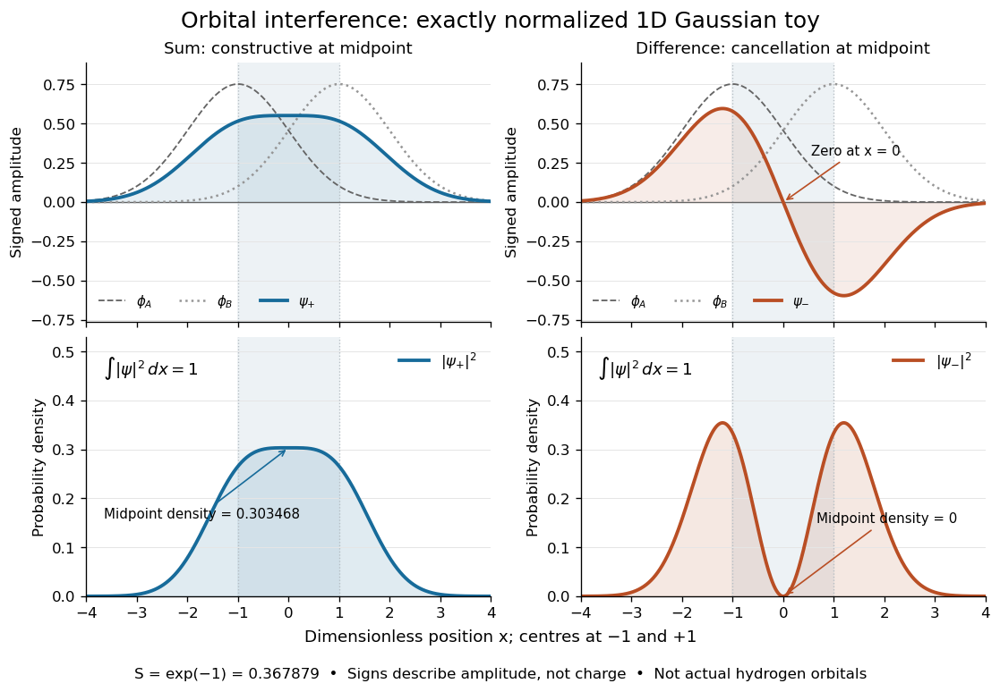

**[Figure 3](#image-normalized-one-dimensional-gaussian-function-toy-signed-probability-amplitudes-add-or-cancel-before-their-squares-give-probability-densities). Normalized one-dimensional Gaussian function toy: signed probability amplitudes add or cancel before their squares give probability densities**. Centres at $x=-1$ and $x=1$ give [orbital overlap](#orbital-overlap) $S=e^{-1}$. The difference has a zero at the midpoint; its negative lobe does not carry positive [electric charge](electric-charge.md). All density curves shown are normalized on the line, rather than in three-dimensional space.

Now fill the two $1s$-derived [molecular orbitals](#molecular-orbital) in the minimal model. The lower [bonding molecular orbital](#bonding-orbital) is labelled $\sigma_g$; the upper [antibonding molecular orbital](#antibonding-orbital) is $\sigma_u^*$. The [Pauli exclusion principle](tensor-product-of-quantum-systems.md#pauli-exclusion-principle) permits at most two [electrons](physics.md#electron) in each spatial [molecular orbital](#molecular-orbital), with opposite [spin](angular-momentum-operator.md#spin) projections along a chosen axis. For the lowest [electron configuration](#electron-configuration) in this model, fill $\sigma_g$ first. The subscripts $g$ and $u$ denote [even](calculus.md#even-function) and [odd](calculus.md#odd-function) behaviour under inversion through the midpoint; the star marks an [antibonding molecular orbital](#antibonding-orbital). See [Flowers et al., Chemistry 2e, 8.4: occupancy and bond order](https://openstax.org/books/chemistry-2e/pages/8-4-molecular-orbital-theory) and [Field, MIT 5.61, lecture 25, pp. 1–3: bonding, antibonding, and symmetry labels](https://ocw.mit.edu/courses/5-61-physical-chemistry-fall-2017/e9f9413400be87f6a0a512e757d52e3c_MIT5_61F17_lec25.pdf).

With $N_b$ [electrons](physics.md#electron) in [bonding molecular orbitals](#bonding-orbital) and $N_a$ in [antibonding molecular orbitals](#antibonding-orbital), the model's [bond order](#bond-order) is $b=(N_b-N_a)/2$. The three elementary counts are:
- [Molecular hydrogen](chemical-substance.md#molecular-hydrogen), $\mathrm H_2$: two [electrons](physics.md#electron) give $(\sigma_g)^2$ and $b=(2-0)/2=1$.
- The [hydrogen](chemical-substance.md#hydrogen) molecular [ion](#ion) $\mathrm H_2^+$: one [electron](physics.md#electron) gives $(\sigma_g)^1$ and $b=(1-0)/2=1/2$.
- Two neutral [helium](chemical-substance.md#helium) [chemical atoms](physics.md#atom-physics), $\mathrm{He}_2$: four [electrons](physics.md#electron) give $(\sigma_g)^2(\sigma_u^*)^2$ and $b=(2-2)/2=0$ in this minimal $1s$ model.

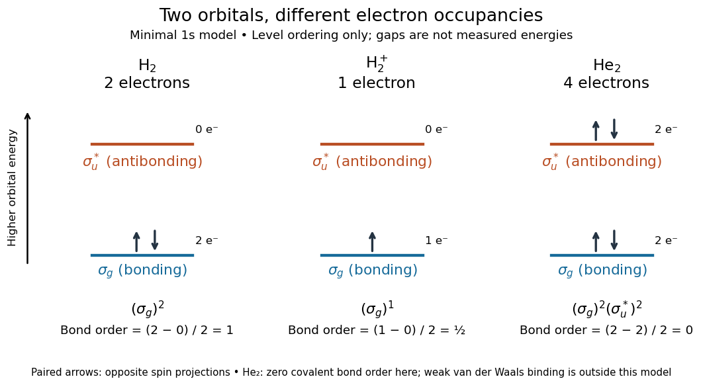

**[Figure 4](#image-schematic-molecular-orbital-occupancy-for-mathrm-h-2-mathrm-h-2-plus-and-mathrm-he-2-bond-orders-one-one-half-and-zero). Schematic molecular orbital occupancy for $\mathrm H_2$, $\mathrm H_2^+$, and $\mathrm{He}_2$: bond orders one, one half, and zero**. Each horizontal line is one spatial [molecular orbital](#molecular-orbital); paired arrows represent opposite [spin](angular-momentum-operator.md#spin) projections. Vertical positions show ordering only, with arbitrary gaps rather than measured [energies](energy.md) or a common scale across species.

The zero [bond order](#bond-order) says this minimal model gives no net [covalent bond](covalent-bond.md) for $\mathrm{He}_2$. It does not rule out every bound pair of [helium](chemical-substance.md#helium) [chemical atoms](physics.md#atom-physics): a very weak [Van der Waals force](force.md#van-der-waals-force) can bind a neutral [helium](chemical-substance.md#helium) dimer, which has been observed experimentally. See [Zeller et al., Imaging the He2 quantum halo state using a free electron laser, PNAS 113, 14651–14655 (2016), p. 14651: van der Waals binding](https://www.atom.uni-frankfurt.de/publications/files/ZellerPNAS-2016.pdf) and [Luo et al., The weakest bond: Experimental observation of helium dimer, Journal of Chemical Physics 98, 3564–3567 (1993)](https://scholarworks.gvsu.edu/chm_articles/6/). The [bond order](#bond-order) count does not include that weak binding mechanism.

The useful surprise is that sharing alone does not determine a [chemical bond](chemical-bond.md): the relative [quantum phase](quantum-system.md#quantum-phase) and the occupancy matter together. The same two shapes explain why adding an [electron](physics.md#electron) to a [bonding molecular orbital](#bonding-orbital) increases the model's [bond order](#bond-order), while adding one to an [antibonding molecular orbital](#antibonding-orbital) decreases it. [Molecular orbital theory](#molecular-orbital-theory) also accounts for the unpaired [electrons](physics.md#electron) and [paramagnetism](electromagnetism.md#paramagnetism) of [molecular oxygen](chemical-substance.md#molecular-oxygen), which its all-paired [Lewis structure](covalent-bond.md#lewis-structure) misses. See [Chemistry 2e, 8.4: the molecular orbital description of oxygen](https://openstax.org/books/chemistry-2e/pages/8-4-molecular-orbital-theory).

#### Isolobal analogy

↑ **Parent:** [Molecular orbital theory](#molecular-orbital-theory)

A correspondence between molecular fragments based on the number, approximate symmetry, shape, energy and occupation of frontier orbitals. Equal total [electron](physics.md#electron) count alone is insufficient; the comparison predicts transferable bonding possibilities rather than identical chemistry.

#### Molecular orbital correlation diagram

↑ **Parent:** [Molecular orbital theory](#molecular-orbital-theory)

A diagram linking reactant and product orbitals by a [symmetry](physics.md#symmetry-physics) conserved along a stipulated reaction path. Orbitals of the same [symmetry](physics.md#symmetry-physics) avoid crossing in a generic one-parameter problem; orbitals of different [symmetry](physics.md#symmetry-physics) can cross. Correlation constrains connectivity, not quantitative barrier heights.

<h4 id="s-p-orbital-mixing">s–p orbital mixing</h4>

↑ **Parent:** [Molecular orbital theory](#molecular-orbital-theory)

Mixing between symmetry-compatible s-derived and p-derived orbital combinations. It shifts energies and changes orbital shapes; in a centrosymmetric diatomic, gerade and ungerade combinations do not mix with one another.

<h4 id="huckel-method">Hückel method</h4>

↑ **Parent:** [Molecular orbital theory](#molecular-orbital-theory)  
ⓦ [Wiki](https://en.wikipedia.org/wiki/Hückel_method)

A model of conjugated $\pi$ [molecular orbitals](#molecular-orbital) with an orthonormal atomic basis, one-centre energies $\alpha_i$, and resonance matrix elements $\beta_{ij}$ between selected neighbouring sites. Solving $H\mathbf c=E\mathbf c$ gives orbital [energies](energy.md) and coefficients. Its simplicity makes symmetry and electron filling explicit, but quantitative charge predictions can depend strongly on the chosen parameters and omitted orbital relaxation.

<h5 id="cube-nearest-neighbour-huckel-model">Cube nearest-neighbour Hückel model</h5>

↑ **Parent:** [Hückel method](#huckel-method)

With one orthonormal site orbital per cube vertex, common site energy $\alpha$, and coupling $\beta$ along every edge, the one-electron [Hamiltonian](hamiltonian-mechanics.md#hamiltonian) is $\alpha I+\beta A$, where $A$ is the cube [adjacency matrix](graph-theory.md#adjacency-matrix). Its [eigenvalues](linear-operator-theory.md#eigenvalue) are $\alpha+3\beta,\alpha+\beta,\alpha-\beta,\alpha-3\beta$ with [multiplicities](polynomial.md#multiplicity-mathematics) $1,3,3,1$.

One proof labels each vertex by three signs. The adjacency operator flips one sign at a time, so a product of $k$ coordinate signs is an [eigenfunction](linear-operator-theory.md#eigenfunction) of $A$ with [eigenvalue](linear-operator-theory.md#eigenvalue) $3-2k$. There are $\binom3k$ such products. For $\beta<0$, eight [electrons](physics.md#electron) fill the lowest four spatial [molecular orbitals](#molecular-orbital), yielding total one-electron energy $8\alpha+12\beta$.

<h5 id="huckel-square-to-trapezium-distortion">Hückel square-to-trapezium distortion</h5>

↑ **Parent:** [Hückel method](#huckel-method)

For a four-site cycle with site [energy](energy.md) $\alpha$, three resonance integrals $\beta<0$ and one weakened integral $n\beta$, $0<n<1$, put $D=\sqrt{(n-1)^2+4}$. In the independent-electron [Hückel method](#huckel-method), filling the two or four lowest spin orbitals gives total electronic energies $E_2=2\alpha+\beta(n+1+D)$ and $E_4=4\alpha+2\beta D$. At the square limit $n=1$, these become $2\alpha+4\beta$ and $4\alpha+4\beta$. The weakened-edge distortion raises the two-electron sum but lowers the four-electron sum. Near $n=1$ the latter change is $\beta(1-n)^2/2+O((1-n)^4)$, so its first-order term cancels. This electronic comparison omits structural repulsion and other restoring forces, and does not determine the open-shell spin at the square limit.

##### Coulson-Rushbrooke pairing theorem

↑ **Parent:** [Hückel method](#huckel-method)

For a bipartite pi system with a common diagonal energy $\alpha$, the orbital spectrum is paired about $\alpha$. If $H=\alpha I+K$ and $P$ changes the sign on one sublattice, then $PKP=-K$; an [eigenvector](linear-operator-theory.md#eigenvector) of energy $\alpha+\epsilon$ is mapped to one of energy $\alpha-\epsilon$. Their site-probability magnitudes are equal.

<h5 id="huckel-pi-bond-order">Hückel pi bond order</h5>

↑ **Parent:** [Hückel method](#huckel-method)

For real [orthonormal](inner-product.md#orthonormal-set) site functions, $p_{ij}=\sum_k f_k c_{ik}c_{jk}$, where $f_k$ is orbital occupation. It measures the off-diagonal pi density [matrix](vector-space.md#matrix); a complete C–C bond also contains a sigma contribution.

<h5 id="huckel-coulomb-parameter">Hückel Coulomb parameter</h5>

↑ **Parent:** [Hückel method](#huckel-method)

The diagonal one-centre energy $\alpha_i$ assigned to a pi-basis orbital. This one-electron parameter is distinct from a two-electron Coulomb repulsion integral in Hartree-Fock theory.

<h5 id="huckel-resonance-integral">Hückel resonance integral</h5>

↑ **Parent:** [Hückel method](#huckel-method)

An off-diagonal [Hamiltonian](hamiltonian-mechanics.md#hamiltonian) [matrix](vector-space.md#matrix) element between selected neighbouring pi-basis functions. The usual bonding convention has $\beta<0$; non-neighbour [matrix](vector-space.md#matrix) elements are neglected.

##### Triangular three-site orbital model

↑ **Parent:** [Hückel method](#huckel-method)

With equal on-site energy $\alpha$ and equal pair interaction $\beta<0$, the three-site Hamiltonian has one eigenvalue $\alpha+2\beta$ and a degenerate pair $\alpha-\beta$. This model explains symmetry and filling but omits ingredients needed for a quantitative dissociation energy.

##### Delocalization energy

↑ **Parent:** [Hückel method](#huckel-method)

The change in [energy](energy.md) on allowing a specified localized orbital reference to delocalize across a [conjugated system](chemical-bond.md#conjugated-system). In a [Hückel method](#huckel-method) calculation, the reference must use the same one-centre parameters and bond types as the delocalized [molecule](molecule.md). With the signed convention $E_\pi-E_{\rm localized}$, stabilization is negative; its positive magnitude is often also called the [delocalization energy](#delocalization-energy), so the sign convention must be stated.

<h5 id="huckel-orbital-charge-density">Hückel orbital charge density</h5>

↑ **Parent:** [Hückel method](#huckel-method)

In an orthonormal [Hückel method](#huckel-method) basis, an occupied [molecular orbital](#molecular-orbital) with occupancy $f_k$ contributes $f_k|c_{ik}|^2$ electrons to site $i$. Adding one electron to a fixed orbital changes the site population by $|c_i|^2$. A coefficient sign indicates orbital phase, not charge sign. A net atomic charge also needs a reference population and treatment of the electrons outside the model.

#### Molecular orbital

↑ **Parent:** [Molecular orbital theory](#molecular-orbital-theory)  
ⓦ [Wiki](https://en.wikipedia.org/wiki/Molecular_orbital)

A [molecular orbital](#molecular-orbital) is a one-[electron](physics.md#electron) spatial [wavefunction](wave-function.md) for the combined [atomic nuclei](atomic-nucleus.md) of a [molecule](molecule.md). For a normalized [molecular orbital](#molecular-orbital), the [Born rule](wave-function.md#born-rule) gives the position [probability density](wave-function.md#probability-density) $|\psi(\mathbf r)|^2$, with $\int_{\mathbb R^3}|\psi|^2\,d^3\mathbf r=1$. The [molecular orbital](#molecular-orbital) is the amplitude, rather than its squared [modulus](complex-analysis.md#modulus) or a classical trajectory.

In the independent-orbital approximation, a doubly occupied [molecular orbital](#molecular-orbital) contributes $2|\psi|^2$ to the [electron](physics.md#electron) number density, whose [integral](integral.md) is two. An empty [molecular orbital](#molecular-orbital) contributes zero, even though its shape is still part of the model. The [molecular hydrogen](chemical-substance.md#molecular-hydrogen) example therefore uses one occupied spatial [molecular orbital](#molecular-orbital) for two [electrons](physics.md#electron), distinguished by their [spins](angular-momentum-operator.md#spin). A negative real [probability amplitude](wave-function.md#probability-amplitude) means a relative [quantum phase](quantum-system.md#quantum-phase) of $\pi$, not positive [electric charge](electric-charge.md); multiplying the whole [wavefunction](wave-function.md) by $-1$ changes only its [global phase](quantum-system.md#global-phase).

##### Frontier molecular orbital

↑ **Parent:** [Molecular orbital](#molecular-orbital)

A [molecular orbital](#molecular-orbital) near the boundary between occupied and unoccupied levels. The [highest occupied molecular orbital](#highest-occupied-molecular-orbital) and [LUMO](#lowest-unoccupied-molecular-orbital) are central examples. Their energies, occupancies, spatial form and symmetry help predict which new [chemical bonds](chemical-bond.md) can form when fragments approach.

##### Nonbonding molecular orbital

↑ **Parent:** [Molecular orbital](#molecular-orbital)

A [molecular orbital](#molecular-orbital) whose occupation changes bonding between the selected centres relatively little. In a real complex, weak bonding or antibonding contributions may replace exact nonbonding character.

##### Open-shell frontier orbital convention

↑ **Parent:** [Molecular orbital](#molecular-orbital)

For an open-shell species, distinguish a singly occupied spatial orbital from a vacant [spin](angular-momentum-operator.md#spin) orbital. Adding an [electron](physics.md#electron) to an [oxygen](chemical-substance.md#oxygen) molecule can fill the opposite-spin vacancy in a pi-star [singly occupied molecular orbital](#singly-occupied-molecular-orbital) even though the next completely empty spatial orbital is sigma-star.

##### Singly occupied molecular orbital

↑ **Parent:** [Molecular orbital](#molecular-orbital)

A spatial [molecular orbital](#molecular-orbital) occupied by one [electron](physics.md#electron). In an open-shell molecule, its empty opposite-spin slot can accept another [electron](physics.md#electron) even though the spatial orbital is occupied.

##### Nonbonding orbital

↑ **Parent:** [Molecular orbital](#molecular-orbital)

A [molecular orbital](#molecular-orbital) with little or no net bonding interaction between the atoms in the stated orbital model. A symmetry-isolated [atomic orbital](#atomic-orbital) can be exactly nonbonding in a minimal basis: the out-of-plane nitrogen $2p_z$ orbital in planar [Ammonia](chemical-substance.md#ammonia) has no matching hydrogen [symmetry orbital](#symmetry-adapted-linear-combination). A mainly localized [lone pair](covalent-bond.md#lone-pair) can acquire bonding admixture when a distortion permits additional mixing.

##### Molecular orbital diagram

↑ **Parent:** [Molecular orbital](#molecular-orbital)

An energy-level scheme showing the occupied molecular orbitals and their relation to atomic orbitals. Occupancies must account for degeneracy and spin.

###### Ammonia molecular orbital diagram

↑ **Parent:** [Molecular orbital diagram](#molecular-orbital-diagram)

In pyramidal [Ammonia](chemical-substance.md#ammonia), the hydrogen [symmetry orbitals](#symmetry-adapted-linear-combination) span $A_1\oplus E$ of the [C3v molecular point group](euclidean-geometry.md#c3v-molecular-point-group). Nitrogen $2s$ and $2p_z$ both have $A_1$ symmetry and $(2p_x,2p_y)$ span $E$. In the planar [D3h molecular point group](euclidean-geometry.md#d3h-molecular-point-group), these become $A_1'$, $A_2''$ and $E'$, respectively, while the hydrogen combinations span $A_1'\oplus E'$. Thus the planar out-of-plane [lone pair](covalent-bond.md#lone-pair) is a symmetry-isolated [nonbonding orbital](#nonbonding-orbital); pyramidalization permits mixing with the other $a_1$ functions.[The ammonia molecule, Figures 7–9 and Tables 4–5: orbital symmetries in both geometries](chemistry-bibliography.md#explaining-the-geometry-of-simple-molecules-using-molecular-orbital-energy-level-diagrams-built-by-using-symmetry-principles-by-sergio-p-machado-and-roberto-b-faria)

##### Highest occupied molecular orbital

↑ **Parent:** [Molecular orbital](#molecular-orbital)

The occupied [molecular orbital](#molecular-orbital) of greatest [energy](energy.md) in a specified reference [electron configuration](#electron-configuration). A fixed-orbital model removes an [electron](physics.md#electron) from this level first; relaxation and [electron correlation](physics.md#electron-correlation) can modify the resulting energy.

##### Orbital degeneracy

↑ **Parent:** [Molecular orbital](#molecular-orbital)

[Orbital degeneracy](#orbital-degeneracy) means distinct spatial orbitals have equal energy within the specified model or symmetry. Two [electrons](physics.md#electron) in degenerate orbitals need not pair; exchange can favor a [triplet state](angular-momentum-operator.md#spin-one-half-triplet-state).

##### Lowest unoccupied molecular orbital

↑ **Parent:** [Molecular orbital](#molecular-orbital)

The lowest-energy unoccupied orbital of a specified reference [electron configuration](#electron-configuration). In a fixed-orbital approximation, adding one electron occupies this orbital; orbital relaxation and electron correlation can alter that picture.

##### Bonding orbital

↑ **Parent:** [Molecular orbital](#molecular-orbital)  
ⓦ [Wiki](https://en.wikipedia.org/wiki/Bonding_orbital)

Occupying a [bonding molecular orbital](#bonding-orbital) favours a [chemical bond](chemical-bond.md). For the two equivalent $1s$ [atomic orbitals](#atomic-orbital) of the [hydrogen atom](mathematical-physics.md#hydrogen-atom), the sum $\sigma_g=\sigma_+$ has constructive [interference](physical-optics.md#interference-wave-propagation) between the [protons](physics.md#proton). The resulting [electron](physics.md#electron) density in that region helps stabilize the combined system. Its lower [energy](energy.md) in this model follows from the [Quantum Hamiltonian](quantum-system.md#hamiltonian-quantum-mechanics), not from the plus sign alone; see [Field, MIT 5.61, lecture 25, pp. 1–2](https://ocw.mit.edu/courses/5-61-physical-chemistry-fall-2017/e9f9413400be87f6a0a512e757d52e3c_MIT5_61F17_lec25.pdf).

For example, $(\sigma_g)^2$ in [molecular hydrogen](chemical-substance.md#molecular-hydrogen) supplies $N_b=2$, hence [bond order](#bond-order) one when $N_a=0$. The sum in the [molecular orbital theory](#molecular-orbital-theory) toy has midpoint [probability density](wave-function.md#probability-density) $0.303468$, whereas the difference has zero there. The normalization factors must be included in this comparison.

##### Antibonding orbital

↑ **Parent:** [Molecular orbital](#molecular-orbital)  
ⓦ [Wiki](https://en.wikipedia.org/wiki/Antibonding_orbital)

Occupying an [antibonding molecular orbital](#antibonding-orbital) opposes a [chemical bond](chemical-bond.md). For equivalent $1s$ [atomic orbitals](#atomic-orbital) of the [hydrogen atom](mathematical-physics.md#hydrogen-atom), the difference $\sigma_u^*=\sigma_-$ vanishes on the plane halfway between the [protons](physics.md#proton): every point there is equally far from both centres, so the amplitudes cancel. This nodal plane removes the contribution of this [molecular orbital](#molecular-orbital) to [electron](physics.md#electron) density on that plane; it does not make an entire finite region empty. The $1s$-derived [antibonding molecular orbital](#antibonding-orbital) lies above its [bonding molecular orbital](#bonding-orbital) partner in [energy](energy.md). See [Field, MIT 5.61, lecture 25, pp. 1–2](https://ocw.mit.edu/courses/5-61-physical-chemistry-fall-2017/e9f9413400be87f6a0a512e757d52e3c_MIT5_61F17_lec25.pdf).

In the $\mathrm{He}_2$ minimal model, $(\sigma_u^*)^2$ adds $N_a=2$ and cancels the [bond order](#bond-order) contribution of $(\sigma_g)^2$. Opposite signs on the two lobes describe [probability amplitudes](wave-function.md#probability-amplitude), while both lobes have nonnegative [probability density](wave-function.md#probability-density) after squaring. The star is an orbital label, not an extra [electron](physics.md#electron) or an [electric charge](electric-charge.md).

#### Linear combination of atomic orbitals

↑ **Parent:** [Molecular orbital theory](#molecular-orbital-theory)  
ⓦ [Wiki](https://en.wikipedia.org/wiki/Linear_combination_of_atomic_orbitals)

The [LCAO](#linear-combination-of-atomic-orbitals) approximation builds a [molecular orbital](#molecular-orbital) as a [linear combination](vector-space.md#linear-combination) of single-centre [atomic orbitals](#atomic-orbital). For two equivalent normalized real $1s$ functions $\phi_A$ and $\phi_B$, choose their signs positive and define their [orbital overlap](#orbital-overlap) $S$. At nonzero separation, $0<S<1$, and the normalized combinations are

$$
\sigma_\pm(\mathbf r)=\frac{\phi_A(\mathbf r)\pm\phi_B(\mathbf r)}{\sqrt{2(1\pm S)}},\qquad
S=\int_{\mathbb R^3}\phi_A(\mathbf r)\phi_B(\mathbf r)\,d^3\mathbf r.
$$

Here $\sigma_+=\sigma_g$ and $\sigma_-=\sigma_u^*$. Equal coefficients use the equivalence of the two centres; a general [LCAO](#linear-combination-of-atomic-orbitals) need not have equal coefficients. See [Field, MIT 5.61, lecture 24, pp. 3–6: LCAO coefficients and overlap integrals](https://ocw.mit.edu/courses/5-61-physical-chemistry-fall-2017/ef9da1132ff6233d732a1d6115099467_MIT5_61F17_lec24.pdf).

For the [Gaussian function](calculus.md#gaussian-function) toy's $a=1$, the two denominators are $\sqrt{2(1+S)}\approx1.654013$ and $\sqrt{2(1-S)}\approx1.124385$. To check [wavefunction normalization](wave-function.md#wavefunction-normalization), expand the square: $\int(\phi_A\pm\phi_B)^2=1+1\pm2S$. Dividing by $2(1\pm S)$ gives one. The local [probability density](wave-function.md#probability-density) is

$$
|\sigma_\pm|^2=\frac{\phi_A^2+\phi_B^2\pm2\phi_A\phi_B}{2(1\pm S)}.
$$

The cross term is the [interference](physical-optics.md#interference-wave-propagation); adding the separate densities first would lose it. These formulas normalize the chosen [linear combination](vector-space.md#linear-combination) exactly, while the restricted choice of [atomic orbitals](#atomic-orbital) remains an approximation to an actual [molecular orbital](#molecular-orbital).

##### Symmetry-adapted linear combination

↑ **Parent:** [Linear combination of atomic orbitals](#linear-combination-of-atomic-orbitals)

A [linear combination of atomic orbitals](#linear-combination-of-atomic-orbitals) chosen to transform under an [irreducible representation](representation-theory.md#irreducible-representation) of the molecular [point group](euclidean-geometry.md#point-group). Relative orbital signs must be transformed as well as the positions of their centres. Such combinations organize a [Hamiltonian operator](quantum-system.md#hamiltonian-quantum-mechanics) into symmetry blocks; combinations of the same symmetry generally still mix and need not themselves be [molecular orbitals](#molecular-orbital).

###### Tetrahedral s-orbital symmetry combinations

↑ **Parent:** [Symmetry-adapted linear combination](#symmetry-adapted-linear-combination)

Four equivalent $s$ [atomic orbitals](#atomic-orbital) at the vertices of a regular [tetrahedron](euclidean-geometry.md#tetrahedron) carry the [tetrahedral symmetry](finite-group-theory.md#tetrahedral-symmetry) representation $A_1\oplus T_2$. The normalized equal sum is $A_1$; three coordinate-sign combinations span $T_2$. Every normalized coefficient vector has entries $\pm1/2$ in a suitable orthonormal real basis. These functions simplify a [Hamiltonian](hamiltonian-mechanics.md#hamiltonian) invariant under the tetrahedral operations, but equivalent symmetry copies on other sites may still mix.

##### Orbital overlap

↑ **Parent:** [Linear combination of atomic orbitals](#linear-combination-of-atomic-orbitals)

The [orbital overlap](#orbital-overlap) of normalized real [atomic orbitals](#atomic-orbital) is their [inner product](inner-product.md) $S=\int\phi_A\phi_B$. It is a [dimensionless](physics.md#dimensionless-quantity) measure of their common amplitude, not an [electron](physics.md#electron) count. For the [Gaussian function](calculus.md#gaussian-function) toy, increasing $a$ from $1$ to $2$ reduces $S$ from $e^{-1}\approx0.367879$ to $e^{-4}\approx0.018316$. As $S$ tends to zero, both [LCAO](#linear-combination-of-atomic-orbitals) normalization denominators tend to $\sqrt2$.

#### Bond order

↑ **Parent:** [Molecular orbital theory](#molecular-orbital-theory)  
ⓦ [Wiki](https://en.wikipedia.org/wiki/Bond_order)

In the elementary [molecular orbital theory](#molecular-orbital-theory) count, [bond order](#bond-order) is half the excess of [electrons](physics.md#electron) in [bonding molecular orbitals](#bonding-orbital) over those in [antibonding molecular orbitals](#antibonding-orbital). Thus adding one [electron](physics.md#electron) to a [bonding molecular orbital](#bonding-orbital) raises $b$ by $1/2$, while adding one to an [antibonding molecular orbital](#antibonding-orbital) lowers it by $1/2$. The configurations drawn above give $1$, $1/2$, and $0$. This count summarizes net [covalent bond](covalent-bond.md) occupancy; it is neither a measured [energy](energy.md) nor a universal test for every kind of binding. See [Chemistry 2e, 8.4: molecular orbital bond order](https://openstax.org/books/chemistry-2e/pages/8-4-molecular-orbital-theory).

## Chemical bond

↑ **Parent:** [Chemistry](chemistry.md)

[This section is present in another page, follow this link to view it.](chemical-bond.md)

## Molar mass

↑ **Parent:** [Chemistry](chemistry.md)  
ⓦ [Wiki](https://en.wikipedia.org/wiki/Molar_mass)

[Molar mass](#molar-mass) turns a weighed sample into a count of specified particles. For a pure [chemical substance](chemical-substance.md) with specified [chemical formula](chemical-substance.md#chemical-formula) and [isotopic abundances](chemical-substance.md#isotopic-abundance), its [molar mass](#molar-mass) is

$$
M=\frac{m}{n},\qquad n=\frac{m}{M},
$$

where $m$ is the sample [mass](classical-mechanics.md#mass) and $n$ its [amount of substance](physics.md#amount-of-substance). The [SI](physics.md#international-system-of-units) unit is $\mathrm{kg\,mol^{-1}}$; the common laboratory unit is $\mathrm{g\,mol^{-1}}$, with $1\,\mathrm{g\,mol^{-1}}=10^{-3}\,\mathrm{kg\,mol^{-1}}$. Equal values of [amount of substance](physics.md#amount-of-substance) correspond to equal counts of specified entities, but heavier entities give greater [masses](classical-mechanics.md#mass).

Combining this definition with [molecular count and amount of substance](chemical-reaction.md#molecular-count-and-amount-of-substance) gives

$$
N=\frac{mN_{\mathrm A}}{M},\qquad \bar m_{\rm particle}=\frac{m}{N}=\frac{M}{N_{\mathrm A}},\qquad N_{\mathrm A}=6.02214076\times10^{23}\,\mathrm{mol^{-1}}.
$$

The [Avogadro constant](physics.md#avogadro-constant) is exact under the modern definition of the [mole](physics.md#mole-unit). The [mass](classical-mechanics.md#mass) $M/N_{\mathrm A}$ is the mean [mass](classical-mechanics.md#mass) per specified entity; if [isotopes](chemical-substance.md#isotope) differ within the sample, individual [molecules](molecule.md) need not all have that mean [mass](classical-mechanics.md#mass).[§2.3.1, The mole, printed p. 131: exact Avogadro constant, specified entities, and M(X) = N\_A m(X)](physics-bibliography.md#the-international-system-of-units-si-ninth-edition-si-brochure)

Specify what $n$ counts: [water](chemical-substance.md#water) [molecules](molecule.md), [hydrogen](chemical-substance.md#hydrogen) [chemical atoms](physics.md#atom-physics), and [oxygen](chemical-substance.md#oxygen) [chemical atoms](physics.md#atom-physics) give different values of [amount of substance](physics.md#amount-of-substance) for the same sample. For a [mixture](mixture.md), dividing total [mass](classical-mechanics.md#mass) by total [amount of substance](physics.md#amount-of-substance) of its chosen entities gives a composition-dependent mean. A [polymer](polymer.md) sample can contain many chain [molar masses](#molar-mass); its [number-average molar mass](#number-average-molar-mass) and [weight-average molar mass](#weight-average-molar-mass) answer different averaging questions. Relating either to [degree of polymerization](polymer.md#degree-of-polymerization) also requires a unit-mass convention and end-group accounting.

### Number-average molar mass

↑ **Parent:** [Molar mass](#molar-mass)

The [number-average molar mass](#number-average-molar-mass) weights each [molecule](molecule.md) equally. For counts $n_i$ with [molar masses](#molar-mass) $M_i$,

$$
M_n=\frac{\sum_i n_iM_i}{\sum_i n_i}.
$$

A mass-proportional [SEC detector response](chromatography.md#sec-detector-response) requires conversion to counts before determining this average.

### Weight-average molar mass

↑ **Parent:** [Molar mass](#molar-mass)

The [weight-average molar mass](#weight-average-molar-mass) weights each population by its contribution to total [mass](classical-mechanics.md#mass):

$$
M_w=\frac{\sum_i n_iM_i^2}{\sum_i n_iM_i}.
$$

Here $n_i$ counts [molecules](molecule.md) with [molar mass](#molar-mass) $M_i$. [SEC light-scattering detection](chromatography.md#sec-light-scattering-detection) can infer this average for an eluting slice under its optical and [concentration](mathematical-physics.md#concentration) assumptions; overlapping species need not have the same individual [molar mass](#molar-mass).

### Relative molecular mass

↑ **Parent:** [Molar mass](#molar-mass)

The [relative molecular mass](#relative-molecular-mass) is the [dimensionless](physics.md#dimensionless-quantity) ratio of a specified mean [molecule](molecule.md) [mass](classical-mechanics.md#mass) to the [unified atomic mass unit](chemical-substance.md#dalton-unit), written $m_{\rm u}$ when treated as a [physical quantity](physics.md#physical-quantity):

$$
M_{\rm r}=\frac{\bar m_{\rm molecule}}{m_{\rm u}},\qquad M=M_{\rm r}M_{\rm u}.
$$

Thus a [relative molecular mass](#relative-molecular-mass) of approximately $18.015$ and a [molar mass](#molar-mass) of approximately $18.015\,\mathrm{g\,mol^{-1}}$ describe related quantities with different units. The conversion uses the [molar mass constant](#molar-mass-constant), rather than identifying a [dimensionless](physics.md#dimensionless-quantity) number with a [mass](classical-mechanics.md#mass) per [mole](physics.md#mole-unit).

### Molar mass constant

↑ **Parent:** [Molar mass](#molar-mass)

The [molar mass constant](#molar-mass-constant) converts [relative atomic mass](chemical-substance.md#relative-atomic-mass) or [relative molecular mass](#relative-molecular-mass) into [molar mass](#molar-mass). It is approximately $1\,\mathrm{g\,mol^{-1}}$. Its [SI](physics.md#international-system-of-units) numerical value is determined experimentally: the exact [Avogadro constant](physics.md#avogadro-constant) multiplies an experimentally determined [unified atomic mass unit](chemical-substance.md#dalton-unit) in kilograms. Treating $M_{\rm u}$ as exactly $1\,\mathrm{g\,mol^{-1}}$ is therefore an excellent elementary-calculation approximation, rather than a defining equality of the modern [SI](physics.md#international-system-of-units).[§2.3.1, The mole, printed p. 131: carbon-12 molar mass no longer exact; M\_u = N\_A m\_u and M(X) = A\_r(X) M\_u](physics-bibliography.md#the-international-system-of-units-si-ninth-edition-si-brochure)

### Water mass to molecular count

↑ **Parent:** [Molar mass](#molar-mass)

Choose approximate [atomic weights](chemical-substance.md#relative-atomic-mass) $A_{\rm r}(\mathrm H)=1.008$ and $A_{\rm r}(\mathrm O)=15.999$, and use $M_{\rm u}\approx1\,\mathrm{g\,mol^{-1}}$. The [chemical formula](chemical-substance.md#chemical-formula) $\mathrm{H_2O}$ then gives [water](chemical-substance.md#water) [molar mass](#molar-mass)

$$
M(\mathrm{H_2O})\approx\bigl(2(1.008)+15.999\bigr)\,\mathrm{g\,mol^{-1}}=18.015\,\mathrm{g\,mol^{-1}}.
$$

These are deliberately chosen rounded inputs, not exact [atomic weights](chemical-substance.md#relative-atomic-mass) or a universal value for every [water](chemical-substance.md#water) sample. Different [isotopic abundances](chemical-substance.md#isotopic-abundance), notably those in [heavy water](ionic-bonding.md#heavy-water), change the mean [molar mass](#molar-mass); [chemical formula](chemical-substance.md#chemical-formula) alone does not specify them. Adding [atomic weights](chemical-substance.md#relative-atomic-mass) also neglects the tiny [mass](classical-mechanics.md#mass) change associated with [chemical bond](chemical-bond.md) [energies](energy.md), immaterial at this rounding precision.

For an illustrative pure [water](chemical-substance.md#water) sample of [mass](classical-mechanics.md#mass) $4.50375\,\mathrm g$, this convention gives

$$
n\approx\frac{4.50375\,\mathrm g}{18.015\,\mathrm{g\,mol^{-1}}}=0.250000\,\mathrm{mol},\qquad N\approx1.50553519\times10^{23}.
$$

The count refers to [water](chemical-substance.md#water) [molecules](molecule.md). Their [hydrogen](chemical-substance.md#hydrogen) [chemical atom](physics.md#atom-physics) count is approximately $2N=3.01107038\times10^{23}$, and their [oxygen](chemical-substance.md#oxygen) [chemical atom](physics.md#atom-physics) count is approximately $N$. The mean [mass](classical-mechanics.md#mass) per [water](chemical-substance.md#water) [molecule](molecule.md) is $M/N_{\mathrm A}\approx2.99146\times10^{-26}\,\mathrm{kg}$. Extra displayed digits expose the arithmetic; they do not imply that the sample composition or [mass](classical-mechanics.md#mass) was measured that precisely.

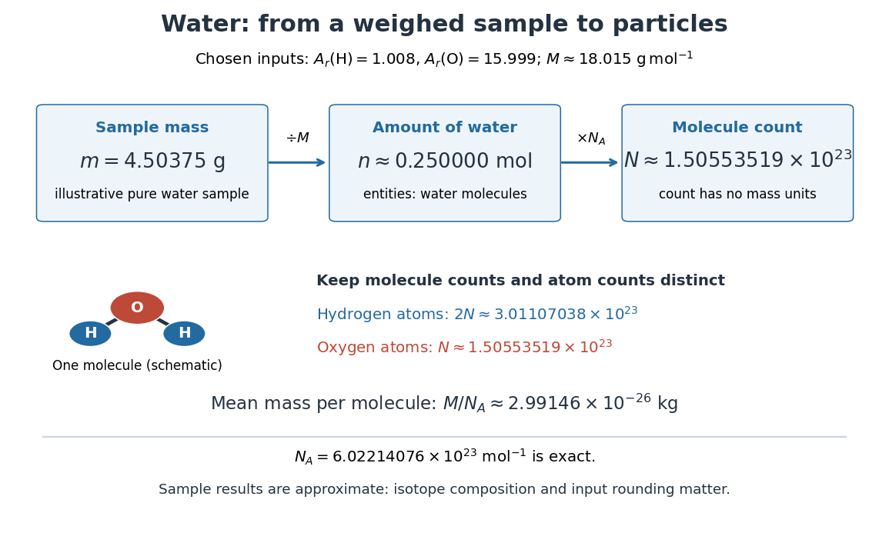

**[Figure 5](#molar-mass-water-particle-map). Mapping water mass through amount of substance to molecule and chemical atom counts using chosen approximate atomic weights**.

The same conversion makes [stoichiometry](chemical-reaction.md#stoichiometry) a [mass](classical-mechanics.md#mass) calculation. For the [chemical equation](chemical-reaction.md#chemical-equation) $2\mathrm{H_2}+\mathrm{O_2}\to2\mathrm{H_2O}$, complete conversion of $0.250000\,\mathrm{mol}$ of [molecular hydrogen](chemical-substance.md#molecular-hydrogen) and $0.125000\,\mathrm{mol}$ of [molecular oxygen](chemical-substance.md#molecular-oxygen) gives $0.250000\,\mathrm{mol}$ of [water](chemical-substance.md#water). With the chosen approximate [atomic weights](chemical-substance.md#relative-atomic-mass), the reactant [masses](classical-mechanics.md#mass) are $0.50400\,\mathrm g$ and $3.99975\,\mathrm g$, summing to $4.50375\,\mathrm g$. The $2:1:2$ ratio belongs to [molecule](molecule.md) counts and [amount of substance](physics.md#amount-of-substance), not to [masses](classical-mechanics.md#mass); this bookkeeping neglects the much smaller reaction [energy](energy.md) contribution to [mass](classical-mechanics.md#mass).

### Two-population molar mass example

↑ **Parent:** [Molar mass](#molar-mass)

Suppose a synthetic [polymer](polymer.md) population contains three chains of [molar mass](#molar-mass) $10000\,\mathrm{g\,mol^{-1}}$ for every one chain of [molar mass](#molar-mass) $40000\,\mathrm{g\,mol^{-1}}$. Multiplying both chain counts by any common factor leaves the averages unchanged. Substitution into the existing [number-average molar mass](#number-average-molar-mass) and [weight-average molar mass](#weight-average-molar-mass) definitions gives

$$
M_n=\frac{3(10000)+40000}{4}\,\mathrm{g\,mol^{-1}}=17500\,\mathrm{g\,mol^{-1}},\qquad M_w=\frac{3(10000)^2+(40000)^2}{3(10000)+40000}\,\mathrm{g\,mol^{-1}}\approx27143\,\mathrm{g\,mol^{-1}}.
$$

The larger chains are only one quarter of the chain count but supply $40000/70000=4/7$ of the [mass](classical-mechanics.md#mass). Thus a [weighted mean](arithmetic.md#weighted-arithmetic-mean) that emphasizes [mass](classical-mechanics.md#mass) gives a larger result than one that weights each [molecule](molecule.md) equally. Total [mass](classical-mechanics.md#mass) divided by total chain [amount of substance](physics.md#amount-of-substance) gives $M_n$, while $M_w/N_{\mathrm A}$ is not the mean [mass](classical-mechanics.md#mass) of a randomly chosen chain. Inferring chain counts from [size-exclusion chromatography](chromatography.md#size-exclusion-chromatography) still requires the existing [SEC detector response](chromatography.md#sec-detector-response) and [SEC molar mass calibration](chromatography.md#sec-molar-mass-calibration) assumptions.

### Vapor-density molar mass measurement

↑ **Parent:** [Molar mass](#molar-mass)

An [ideal gas law](ideal-gas.md#ideal-gas-law) measurement obtains [amount of substance](physics.md#amount-of-substance) without knowing the [chemical formula](chemical-substance.md#chemical-formula) in advance:

$$
n=\frac{pV}{RT},\qquad M_{\rm inferred}=\frac{mRT}{pV}.
$$

Here $p$ is vapor [pressure](pressure.md), $V$ is its occupied [volume](thermodynamics.md#volume-thermodynamics), $T$ is absolute [temperature](temperature.md), $R$ is the [molar gas constant](ideal-gas.md#molar-gas-constant), and $m$ is the [mass](classical-mechanics.md#mass) of vapor occupying that [volume](thermodynamics.md#volume-thermodynamics) at those conditions.

Santa Monica College's teaching experiment uses a $125\,\mathrm{mL}$ [Erlenmeyer flask](#erlenmeyer-flask) with a pinhole foil cap, a $600\,\mathrm{mL}$ water bath on a hot plate, a [thermometer](temperature.md#thermometer), and a barometer. Excess volatile liquid displaces air. A dissolved dye loses its colour and deposits when the liquid evaporates; three more minutes of heating follow. Cooling condenses retained vapor. Subtracting the dry assembly [mass](classical-mechanics.md#mass) from the cooled assembly [mass](classical-mechanics.md#mass) supplies $m$. The flask [volume](thermodynamics.md#volume-thermodynamics) comes from brim-full [water](chemical-substance.md#water) [mass](classical-mechanics.md#mass) and [mass density](fluid-mechanics.md#density) at its measured [temperature](temperature.md). Controls include a dry exterior, excluding bath [water](chemical-substance.md#water), and three trials.[Santa Monica College, 11B, Experimental Set-up steps 1–6; Trials 1–3 steps 1–4: apparatus, dye endpoint, heating, drying and repetition](chemistry-bibliography.md#11b-the-dumas-method-experiment-by-santa-monica-college)

The inference assumes vapor [pressure](pressure.md) equals atmospheric [pressure](pressure.md), vapor and bath reach [thermal equilibrium](thermal-equilibrium.md), the retained vapor [mass](classical-mechanics.md#mass) is recovered on cooling, and the vapor obeys the [ideal gas law](ideal-gas.md#ideal-gas-law). Residual air, [thermal expansion](thermodynamics.md#thermal-expansion) of the flask, and vapor [temperature](temperature.md) below bath [temperature](temperature.md) are explicit error questions in the teaching experiment. Repeating trials assesses repeatability; it does not remove a shared bias.[Lab Report, questions 1–4: residual air, glass expansion, nonideal vapor and incomplete thermal equilibration](chemistry-bibliography.md#11b-the-dumas-method-experiment-by-santa-monica-college)

#### Vapor density

↑ **Parent:** [Vapor-density molar mass measurement](#vapor-density-molar-mass-measurement)

The [density](fluid-mechanics.md#density) of a [vapor](thermodynamics.md#vapor) relative to a specified reference [gas](thermodynamics.md#gas) at the same [temperature](temperature.md) and [pressure](pressure.md).

#### Molar mass measurement model

↑ **Parent:** [Vapor-density molar mass measurement](#vapor-density-molar-mass-measurement)

For a synthetic illustration, choose $m=0.3000\,\mathrm g$, $V=125.0\,\mathrm{mL}$, $p=101325\,\mathrm{Pa}$ and $T=373.15\,\mathrm K$. Using [molar gas constant](ideal-gas.md#molar-gas-constant) $R\approx8.314462618\,\mathrm{J\,mol^{-1}\,K^{-1}}$ gives $n\approx0.00408234\,\mathrm{mol}$ and $M_{\rm inferred}\approx73.4873\,\mathrm{g\,mol^{-1}}$ under the [ideal gas law](ideal-gas.md#ideal-gas-law). These are chosen model inputs, not observations of a particular [chemical substance](chemical-substance.md).

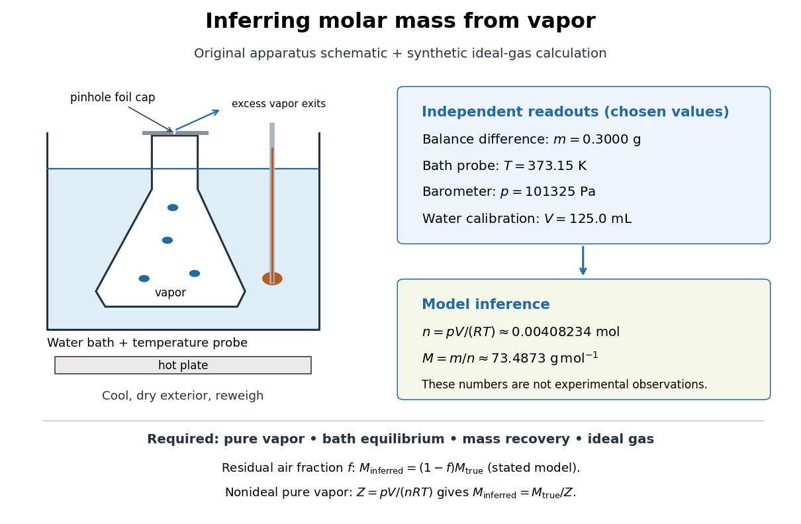

**[Figure 6](#molar-mass-vapor-measurement-model). Vapor molar mass inference: apparatus, independent readouts, and the assumptions behind a synthetic ideal gas law calculation**.

An error's direction follows the model. Extra exterior [water](chemical-substance.md#water) raises the apparent $m$ and hence $M_{\rm inferred}$. If a fraction $f$ of the hot [gas](thermodynamics.md#gas) particles is residual air, and only the unknown vapor contributes to recovered $m$, an otherwise [ideal gas](ideal-gas.md) calculation gives $M_{\rm inferred}=(1-f)M_{\rm true}$. For a pure nonideal vapor, define $Z=pV/(nRT)$; then $M_{\rm inferred}=M_{\rm true}/Z$, so the direction depends on $Z$. The dye endpoint alone cannot establish gas purity, [thermal equilibrium](thermal-equilibrium.md), or ideality. These conditional checks explain why the same apparatus cannot provide a universal [molar mass](#molar-mass) measurement for arbitrary [mixtures](mixture.md) or substances that decompose on heating.

## Polymer

↑ **Parent:** [Chemistry](chemistry.md)

[This section is present in another page, follow this link to view it.](polymer.md)

## Ion

↑ **Parent:** [Chemistry](chemistry.md)

An [ion](#ion) is a [chemical atom](physics.md#atom-physics) or a group of [chemical atoms](physics.md#atom-physics) with a nonzero net [electric charge](electric-charge.md). A positive [ion](#ion) is a [cation](#cation); a negative [ion](#ion) is an [anion](#anion). The whole entity carries the [electric charge](electric-charge.md): a [hydronium](#hydronium) [ion](#ion) is a group of four [chemical atoms](physics.md#atom-physics) with net charge $+e$. This definition agrees with [IUPAC Gold Book: ion](https://goldbook.iupac.org/terms/view/I03158).

For an ordinary [ion](#ion) containing only [atomic nuclei](atomic-nucleus.md) and [electrons](physics.md#electron), let $N_p$ count all its [protons](physics.md#proton) and $N_e$ all its [electrons](physics.md#electron). Each [proton](physics.md#proton) contributes the [elementary charge](electric-charge.md#elementary-charge) $+e$, each [electron](physics.md#electron) contributes $-e$, and [neutrons](neutron.md) contribute zero. Therefore

$$
q=(N_p-N_e)e=ze,\qquad z=N_p-N_e.
$$

The signed integer $z$ is the net [electric charge](electric-charge.md) number. Removing an [electron](physics.md#electron) increases $z$ by one; adding an [electron](physics.md#electron) decreases $z$ by one. Changing the [electron](physics.md#electron) count leaves the [atomic number](chemical-substance.md#atomic-number), and therefore the identity of the [chemical element](chemical-substance.md#chemical-element), unchanged.

For example, a neutral [sodium](chemical-substance.md#sodium) [chemical atom](physics.md#atom-physics) has $11$ [protons](physics.md#proton) and $11$ [electrons](physics.md#electron). Its [cation](#cation) $\mathrm{Na}^+$ still has $11$ [protons](physics.md#proton), but only $10$ [electrons](physics.md#electron), so $q=(11-10)e=+e$. A neutral [chlorine](chemical-substance.md#chlorine) [chemical atom](physics.md#atom-physics) has $17$ [protons](physics.md#proton) and $17$ [electrons](physics.md#electron); its [anion](#anion) $\mathrm{Cl}^-$ has $17$ [protons](physics.md#proton) and $18$ [electrons](physics.md#electron), so $q=(17-18)e=-e$. These are particle inventories, not pictures of [atomic orbitals](#atomic-orbital). See [2.6 Ionic and Molecular Compounds](chemistry-bibliography.md#chemistry-2e-by-paul-flowers-and-others/2-6-ionic-and-molecular-compounds) (§2.6: ions and ionic compounds).

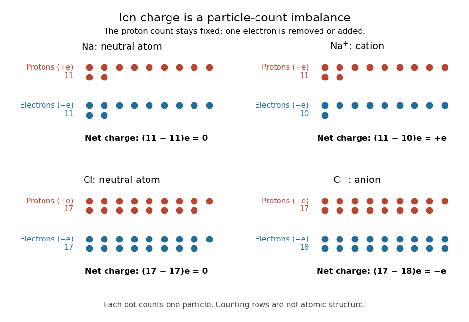

**[Figure 7](#image-ion-electric-charge-bookkeeping-neutral-sodium-and-chlorine-chemical-atoms-compared-with-their-cation-and-anion). Ion electric charge bookkeeping: neutral sodium and chlorine chemical atoms compared with their cation and anion**. Every colored dot counts one [proton](physics.md#proton) or one [electron](physics.md#electron). Rows are counting arrays, not spatial models of [atomic nuclei](atomic-nucleus.md) or [electron shells](#electron-shell). The net [electric charges](electric-charge.md) are $0,+e,0,-e$.

One [sodium chloride](chemical-substance.md#sodium-chloride) [formula unit](chemical-substance.md#formula-unit) accounts for one $\mathrm{Na}^+$ [cation](#cation) and one $\mathrm{Cl}^-$ [anion](#anion), whose net [electric charges](electric-charge.md) sum to zero. Ordinary solid [sodium chloride](chemical-substance.md#sodium-chloride) is an extended arrangement of [ions](#ion), rather than discrete $\mathrm{NaCl}$ [molecules](molecule.md). This is a useful distinction: a neutral material can contain charged constituents, and its [chemical formula](chemical-substance.md#chemical-formula) tells us their ratio without claiming that each pair is a separate [molecule](molecule.md).

[Ion](#ion) bookkeeping connects [chemistry](chemistry.md) to [electric current](electric-charge.md#electric-current): moving [ions](#ion) can transport [electric charge](electric-charge.md), while stationary [ions](#ion) cannot supply a transport [current density](electric-charge.md#current-density). In [electrochemistry](electrochemistry.md), both signs of [ions](#ion) can contribute to the same [conventional current](electric-charge.md#conventional-current). An [ion](#ion) opposing a fixed [electric charge](electric-charge.md) is called a [counterion](#counterion).

### Mercurinium ion

↑ **Parent:** [Ion](#ion)

A bridged cationic intermediate formed when an [alkene](chemical-substance.md#alkene) coordinates an [electrophilic](chemical-reaction.md#electrophilicity) [mercury](chemical-substance.md#mercury-element) species. Unequal [carbon](chemical-substance.md#carbon) substitution can produce unequal positive-charge character and control nucleophilic opening.

### Sulfonium ion

↑ **Parent:** [Ion](#ion)

A positively charged three-coordinate [sulfur](chemical-substance.md#sulfur) centre. Cyclic sulfonium intermediates can transfer a neighbouring [thioether](#thioether) attachment or render formerly distinct [carbon](chemical-substance.md#carbon) paths equivalent.

#### Thietanium ion

↑ **Parent:** [Sulfonium ion](#sulfonium-ion)

A four-membered cyclic [sulfonium ion](#sulfonium-ion) containing [sulfur](chemical-substance.md#sulfur) and three [carbons](chemical-substance.md#carbon). A bridged version with equivalent methylene paths can allow nucleophilic opening to restore either configuration at an initially stereogenic [carbon](chemical-substance.md#carbon).

#### Thiiranium ion

↑ **Parent:** [Sulfonium ion](#sulfonium-ion)

A three-membered ring containing a positively charged [sulfur](chemical-substance.md#sulfur) atom and two [carbon](chemical-substance.md#carbon) atoms. Nucleophilic opening at [carbon](chemical-substance.md#carbon) normally involves [backside attack](chemical-reaction.md#backside-attack) and cleavage of one [sulfur](chemical-substance.md#sulfur)–[carbon](chemical-substance.md#carbon) bond.

### Pyrylium ion

↑ **Parent:** [Ion](#ion)

A six-membered aromatic [cation](#cation) containing [oxygen](chemical-substance.md#oxygen). One [oxygen](chemical-substance.md#oxygen) [lone pair](covalent-bond.md#lone-pair) participates in the pi system while the other remains outside it.

### Bromide

↑ **Parent:** [Ion](#ion)

### Ionic radius

↑ **Parent:** [Ion](#ion)

An effective ion-size parameter defined through a specified structural convention. Comparisons depend on oxidation state and coordination environment.

### Nitrilium ion

↑ **Parent:** [Ion](#ion)

A cationic species with a carbon–nitrogen multiple-bond framework that is electrophilic at carbon. Water addition and proton transfers can convert it to an amide.

### Nitronate

↑ **Parent:** [Ion](#ion)

A [nitronate](#nitronate) has negative charge delocalized between [carbon](chemical-substance.md#carbon) and nitro oxygens. Nitroarene sigma-adducts can have [nitronate](#nitronate)-like resonance descriptions during nucleophilic substitution.

### Guanidinium

↑ **Parent:** [Ion](#ion)

[Guanidinium](#guanidinium) is the resonance-stabilized cationic group found in protonated [arginine](chemical-substance.md#arginine) side chains. Its N–H donors can make paired [hydrogen bonds](chemical-bond.md#hydrogen-bond) to the O6 and N7 acceptors on [guanine](molecule.md#guanine).

### Bromonium ion

↑ **Parent:** [Ion](#ion)

A [bromonium ion](#bromonium-ion) bridges both carbons of an [alkene](chemical-substance.md#alkene)-derived three-membered ring. Bromide opening from the opposite face gives an anti vicinal dibromide and avoids a freely rotating open carbocation.

### Thiolate

↑ **Parent:** [Ion](#ion)

A [thiolate](#thiolate) is $\mathrm{RS^-}$, the [conjugate base](acid-base-chemistry.md#conjugate-base) of a [thiol](chemical-substance.md#thiol). Its polarizable [sulfur](chemical-substance.md#sulfur) is often effective in [conjugate addition](chemical-reaction.md#conjugate-addition). [protonation](chemical-reaction.md#protonation) of the resulting [carbon](chemical-substance.md#carbon) anion can regenerate [thiolate](#thiolate) from another [thiol](chemical-substance.md#thiol) molecule.

#### Methylthiolate

↑ **Parent:** [Thiolate](#thiolate)

The [sulfur](chemical-substance.md#sulfur) donor anion $\mathrm{CH_3S^-}$, which can bind one [metal](chemical-substance.md#metal) or bridge several [metal](chemical-substance.md#metal) centres.

### Anilinium ion

↑ **Parent:** [Ion](#ion)

An [anilinium ion](#anilinium-ion) is an aniline protonated at [nitrogen](chemical-substance.md#nitrogen). [nitrogen](chemical-substance.md#nitrogen) [protonation](chemical-reaction.md#protonation) removes its [lone pair](covalent-bond.md#lone-pair) from donation to the [aromatic ring](molecule.md#aromatic-ring) and usually gives strong deactivation and meta direction in [electrophilic substitution](chemical-reaction.md#electrophilic-substitution).

### Nitronium ion

↑ **Parent:** [Ion](#ion)

The [nitronium ion](#nitronium-ion) is $\mathrm{NO_2^+}$, a strong [electrophile](chemical-reaction.md#electrophile) in mixed-acid [aromatic nitration](chemical-reaction.md#aromatic-nitration). [protonation](chemical-reaction.md#protonation) and dehydration of nitric acid can generate it.

### Triflate

↑ **Parent:** [Ion](#ion)

[Triflate](#triflate) is $\mathrm{CF_3SO_3^-}$, the [conjugate base](acid-base-chemistry.md#conjugate-base) of triflic acid. Its delocalized charge makes it a good leaving group in many substitution reactions.

### Phenoxide

↑ **Parent:** [Ion](#ion)

[Phenoxide](#phenoxide) is the anion formed by deprotonating [phenol](chemical-substance.md#phenol). Its [oxygen](chemical-substance.md#oxygen) is an effective nucleophilic site, while conjugation distributes some [electron](physics.md#electron) density into the [aromatic ring](molecule.md#aromatic-ring).

### Sulfide

↑ **Parent:** [Ion](#ion)

A [sulfide](#sulfide) ion is formally $\mathrm{S^{2-}}$. Relative to [oxide](chemical-substance.md#oxide) it is larger, more polarizable and more readily oxidized; the ability of a [metal](chemical-substance.md#metal) to support a high [oxidation state](chemical-reaction.md#oxidation-state) need not survive replacement of [oxygen](chemical-substance.md#oxygen) by [sulfur](chemical-substance.md#sulfur).

### Ammonium

↑ **Parent:** [Ion](#ion)

[Ammonium](#ammonium) is protonated [Ammonia](chemical-substance.md#ammonia), $\mathrm{NH_4^+}$. Its abundance relative to [Ammonia](chemical-substance.md#ammonia) depends on pH.

### Oxyanion

↑ **Parent:** [Ion](#ion)

An [oxyanion](#oxyanion) carries negative charge on [oxygen](chemical-substance.md#oxygen), often with delocalization onto neighboring atoms. Stabilization of a developing [oxyanion](#oxyanion) is important in many hydrolytic [enzyme](enzyme.md) pathways.

### Polyatomic ion

↑ **Parent:** [Ion](#ion)  
ⓦ [Wiki](https://en.wikipedia.org/wiki/Polyatomic_ion)

A [polyatomic ion](#polyatomic-ion) consists of a bound group of two or more [chemical atoms](physics.md#atom-physics) with nonzero total [electric charge](electric-charge.md). [Hydronium](#hydronium), $\mathrm{H_3O^+}$, contains three [hydrogen](chemical-substance.md#hydrogen) and one [oxygen](chemical-substance.md#oxygen) [chemical atom](physics.md#atom-physics); its net [electric charge](electric-charge.md) is $+e$, where $e$ is the [elementary charge](electric-charge.md#elementary-charge). This is a discrete charged group, while an [ionic crystal](ionic-bonding.md#ionic-crystal) can contain an extended arrangement of [ions](#ion).[polyatomic ions, introductory paragraph and Table 2.5, hydronium](chemistry-bibliography.md#chemistry-2e-by-paul-flowers-and-others/2-6-ionic-and-molecular-compounds)

#### Carbonate

↑ **Parent:** [Polyatomic ion](#polyatomic-ion)

### Cation

↑ **Parent:** [Ion](#ion)  
ⓦ [Wiki](https://en.wikipedia.org/wiki/Cation)

A [cation](#cation) is an [ion](#ion) with positive net [electric charge](electric-charge.md), for example $\mathrm{Na}^+$ or [hydronium](#hydronium).

#### Oxonium ion

↑ **Parent:** [Cation](#cation)

A positively charged species with a formally trivalent [oxygen](chemical-substance.md#oxygen) center.

### Anion

↑ **Parent:** [Ion](#ion)  
ⓦ [Wiki](https://en.wikipedia.org/wiki/Anion)

An [anion](#anion) is an [ion](#ion) with negative net [electric charge](electric-charge.md), for example $\mathrm{Cl}^-$ or [hydroxide](#hydroxide).

#### Fluoride

↑ **Parent:** [Anion](#anion)

The singly charged [anion](#anion) of [fluorine](chemical-substance.md#fluorine). Its affinity for [silicon](chemical-substance.md#silicon) makes it useful for cleaving silyl [protecting groups](#protecting-group).

#### Amide ion

↑ **Parent:** [Anion](#anion)

The [anion](#anion) $\mathrm{NH_2^-}$ is the conjugate base of [Ammonia](chemical-substance.md#ammonia). It is chemically distinct from an organic [amide](chemical-substance.md#amide) functional group and can deprotonate suitable [carbon acids](acid-base-chemistry.md#carbon-acid).

#### Sulfate

↑ **Parent:** [Anion](#anion)  
ⓦ [Wiki](https://en.wikipedia.org/wiki/Sulfate)

##### Ethyl hydrogen sulfate

↑ **Parent:** [Sulfate](#sulfate)

A sulfuric-acid monoester involved in a traditional account of producing [diethyl ether](chemical-substance.md#diethyl-ether) from [ethanol](metabolism.md#ethanol).

##### Magnesium sulfate

↑ **Parent:** [Sulfate](#sulfate)

An ionic compound containing divalent magnesium and sulfate [ions](#ion). Its nominal formula [concentration](mathematical-physics.md#concentration) $c$ contributes [ionic strength](mixture.md#ionic-strength) $4c$ when fully dissociated into these two [ion](#ion) species.

#### Chloride

↑ **Parent:** [Anion](#anion)  
ⓦ [Wiki](https://en.wikipedia.org/wiki/Chloride)

[Chloride](#chloride) is the [anion](#anion) $\mathrm{Cl^-}$, with net [electric charge](electric-charge.md) $-e$. In the [glycine titration](chemical-substance.md#glycine-titration) model, it supplies the negative background [electric charge](electric-charge.md) introduced with [hydrochloric acid](acid-base-chemistry.md#hydrochloric-acid).

#### Permanganate

↑ **Parent:** [Anion](#anion)

A [manganese](chemical-substance.md#manganese)-containing [anion](#anion) with net [electric charge](electric-charge.md) $-e$ and [manganese](chemical-substance.md#manganese) [oxidation state](chemical-reaction.md#oxidation-state) $+7$; $e$ is the positive [elementary charge](electric-charge.md#elementary-charge).

#### Nitrate

↑ **Parent:** [Anion](#anion)  
ⓦ [Wiki](https://en.wikipedia.org/wiki/Nitrate)

The [nitrate ion](#nitrate), $\mathrm{NO}_3^-$, is an [anion](#anion) with one [nitrogen](chemical-substance.md#nitrogen) connected to three [oxygen](chemical-substance.md#oxygen) [chemical atoms](physics.md#atom-physics) and net [electric charge](electric-charge.md) $-1$ in units of [elementary charge](electric-charge.md#elementary-charge). Its 24 [valence electrons](chemical-bond.md#valence-electron) admit three equivalent octet [resonance structures](covalent-bond.md#resonance-structure); see [Lewis structure](covalent-bond.md#lewis-structure) for their construction and [chemical resonance](covalent-bond.md#resonance-chemistry) for their interpretation. The N–O connections are [covalent bonds](covalent-bond.md) within the [ion](#ion). See [7.2 Covalent Bonding](chemistry-bibliography.md#chemistry-2e-by-paul-flowers-and-others/7-2-covalent-bonding).

##### Brown-ring test

↑ **Parent:** [Nitrate](#nitrate)

A historical nitrate-recognition reaction involving reduction by [iron(II)](chemical-substance.md#iron-ii) and formation of a brown iron–nitrosyl species. [Nitrite](chemical-substance.md#nitrite), reagent contamination and procedural conditions can interfere.

### Hydrogen ion

↑ **Parent:** [Ion](#ion)  
ⓦ [Wiki](https://en.wikipedia.org/wiki/Hydrogen_ion)

In [acid-base chemistry](acid-base-chemistry.md), [hydrogen ion](#hydrogen-ion) usually refers to positively charged hydrogen, represented by $\mathrm H^+$. In [water](chemical-substance.md#water), this notation describes solvated species, commonly represented by [hydronium](#hydronium), rather than an isolated bare [proton](physics.md#proton). The [hydrogen ion](#hydrogen-ion) [thermodynamic activity](chemical-potential.md#thermodynamic-activity) defines [pH](acid-base-chemistry.md#ph).

### Hydronium

↑ **Parent:** [Ion](#ion)  
ⓦ [Wiki](https://en.wikipedia.org/wiki/Hydronium)

[Hydronium](#hydronium) is the [ion](#ion) formed when a [water](chemical-substance.md#water) [molecule](molecule.md) accepts a [proton](physics.md#proton). It provides the usual aqueous shorthand for the [hydrogen ion](#hydrogen-ion) used in [pH](acid-base-chemistry.md#ph) calculations.

### Hydroxide

↑ **Parent:** [Ion](#ion)  
ⓦ [Wiki](https://en.wikipedia.org/wiki/Hydroxide)

### Counterion

↑ **Parent:** [Ion](#ion)

A mobile [ion](#ion) whose charge has the opposite sign to a charged macromolecule, surface or other fixed species. Its local [concentration](mathematical-physics.md#concentration) can increase close to that fixed charge; [counterion condensation](electrostatics.md#counterion-condensation) distinguishes a bound fraction that remains localized in an infinite-dilution limit.

## Acid-base chemistry

↑ **Parent:** [Chemistry](chemistry.md)

[This section is present in another page, follow this link to view it.](acid-base-chemistry.md)

## Chemical reaction

↑ **Parent:** [Chemistry](chemistry.md)

[This section is present in another page, follow this link to view it.](chemical-reaction.md)

## Electrochemistry

↑ **Parent:** [Chemistry](chemistry.md)

[This section is present in another page, follow this link to view it.](electrochemistry.md)

## Mixture

↑ **Parent:** [Chemistry](chemistry.md)

[This section is present in another page, follow this link to view it.](mixture.md)

## Nuclear magnetic resonance

↑ **Parent:** [Chemistry](chemistry.md)

[This section is present in another page, follow this link to view it.](nuclear-magnetic-resonance.md)

#### Weakly coordinating anion

↑ **Parent:** [Counterion](#counterion)

A [weakly coordinating anion](#weakly-coordinating-anion) balances charge while binding only weakly to the cationic reaction center. Delocalized charge, low basicity and steric shielding can leave a [metal](chemical-substance.md#metal) coordination site accessible. Weak coordination is relative, not an assertion that ion pairing is absent.

## Analytical chemistry

↑ **Parent:** [Chemistry](chemistry.md)

The branch of [chemistry](chemistry.md) concerned with identifying substances in a sample and measuring their quantities or [concentrations](mathematical-physics.md#concentration). A [bicinchoninic acid assay](#bicinchoninic-acid-assay), for example, estimates [protein](protein.md) content through an optical measurement.

### Analyte

↑ **Parent:** [Analytical chemistry](#analytical-chemistry)

### Mineral analysis

↑ **Parent:** [Analytical chemistry](#analytical-chemistry)

### Total solids

↑ **Parent:** [Analytical chemistry](#analytical-chemistry)

The nonvolatile residue measured by a specified drying procedure; the drying conditions define the operational result.

### Tracer gas

↑ **Parent:** [Analytical chemistry](#analytical-chemistry)

### Spectrophotometric analysis

↑ **Parent:** [Analytical chemistry](#analytical-chemistry)

Analysis based on measured absorption or transmission of [light](optics.md#light), interpreted through calibration and appropriate blanks.

### Organic elemental analysis

↑ **Parent:** [Analytical chemistry](#analytical-chemistry)

Determination of the amounts or identities of [chemical elements](chemical-substance.md#chemical-element) in an organic sample, distinguished from identifying its molecular structure.

#### Sodium fusion test

↑ **Parent:** [Organic elemental analysis](#organic-elemental-analysis)

Conversion of suitable covalently bound [nitrogen](chemical-substance.md#nitrogen), [sulfur](chemical-substance.md#sulfur) or [halogens](chemical-substance.md#halogen) into species detectable in an aqueous extract. Incomplete conversion and interfering species require controls.

### Reagent blank

↑ **Parent:** [Analytical chemistry](#analytical-chemistry)

A preparation containing the reagents but excluding the sample, used to identify responses that do not originate with that sample.

### Chemical test

↑ **Parent:** [Analytical chemistry](#analytical-chemistry)

### Ash

↑ **Parent:** [Analytical chemistry](#analytical-chemistry)

The largely inorganic residue remaining after a specified ignition procedure. Its chemical forms need not be identical with the original mineral species in the sample.

### Proximate analysis

↑ **Parent:** [Analytical chemistry](#analytical-chemistry)

An operational separation into material classes, such as lipid-soluble material, protein-rich residue and mineral matter, rather than a complete molecular inventory.

### Qualitative chemical analysis

↑ **Parent:** [Analytical chemistry](#analytical-chemistry)

Identification of constituents or classes of constituents, distinguished from measuring their amounts.

### Baryta absorption method

↑ **Parent:** [Analytical chemistry](#analytical-chemistry)

Determination of [carbon dioxide](chemical-substance.md#carbon-dioxide) by absorption into standardized [barium hydroxide](chemical-substance.md#barium-hydroxide) and measurement of the remaining base. [Barium carbonate](chemical-substance.md#barium-carbonate) must not be titrated as though it were residual hydroxide.

<h3 id="nessler-s-reagent">Nessler's reagent</h3>

↑ **Parent:** [Analytical chemistry](#analytical-chemistry)

An alkaline tetraiodomercurate reagent used for colour-based detection and estimation of [Ammonia](chemical-substance.md#ammonia), named after [Julius Neßler](#julius-nessler).

### Quality control

↑ **Parent:** [Analytical chemistry](#analytical-chemistry)

Checks using blanks, standards, replicate measurements and recovery experiments to assess the performance of an analytical procedure.

### Titration

↑ **Parent:** [Analytical chemistry](#analytical-chemistry)

Determination of an analyte amount from the measured amount of a standardized reagent reaching a specified [titration endpoint](acid-base-chemistry.md#titration-endpoint).

#### Standardisation of a solution

↑ **Parent:** [Titration](#titration)

Determination of a solution's effective [concentration](mathematical-physics.md#concentration) by reaction with a suitable reference material or another independently established standard.

#### Volumetric analysis

↑ **Parent:** [Titration](#titration)

Quantitative [analytical chemistry](#analytical-chemistry) using the measured [volume](geometry-and-topology.md#volume) of a [standard solution](mixture.md#standard-solution) and a known reaction proportion.

### Gravimetric analysis

↑ **Parent:** [Analytical chemistry](#analytical-chemistry)

Determination of an analyte amount from the [mass](classical-mechanics.md#mass) of a separated product of known composition.

### Chemical tracer

↑ **Parent:** [Analytical chemistry](#analytical-chemistry)

A [chemical tracer](#chemical-tracer) is a constituent whose measured [concentration](mathematical-physics.md#concentration) reveals transport or other processes. An ocean [box model](mathematics.md#box-model) can follow a [chemical tracer](#chemical-tracer) through [ocean circulation](geophysical-fluid-dynamics.md#ocean-circulation), with additional source and sink terms if the constituent is produced or removed internally. A passive, conservative [chemical tracer](#chemical-tracer) changes only by transport and mixing.

### Internal standard

↑ **Parent:** [Analytical chemistry](#analytical-chemistry)

A known amount of a reference substance added to a sample to support quantification and identify losses or instrumental variation. An isotope-labeled analogue can closely track the behavior of the analyte.

### Bicinchoninic acid assay

↑ **Parent:** [Analytical chemistry](#analytical-chemistry)

An assay that estimates [protein](protein.md) [concentration](mathematical-physics.md#concentration) from a colour-producing [chemical reaction](chemical-reaction.md), measured by [absorbance](physical-chemistry.md#absorbance) and compared with known [protein](protein.md) reference samples. [Bovine serum albumin](protein.md#bovine-serum-albumin) is commonly used as the reference [protein](protein.md). The readout estimates [protein](protein.md) content rather than identifying each [protein](protein.md) in a [mixture](mixture.md).

## Chromatography

↑ **Parent:** [Chemistry](chemistry.md)

[This section is present in another page, follow this link to view it.](chromatography.md)

## Infrared spectroscopy

↑ **Parent:** [Chemistry](chemistry.md)

[Infrared spectroscopy](#infrared-spectroscopy) measures a sample's response to [infrared](optics.md#infrared) [electromagnetic radiation](electromagnetic-radiation.md). Absorption associated with stretching or bending motions of [chemical bonds](chemical-bond.md) helps identify groups and their environments. Peak positions are commonly reported as reciprocal [wavelength](wave-equation.md#wavelength), in $\mathrm{cm^{-1}}$; a lower value means lower [frequency](wave.md#frequency). [McMurry: infrared spectroscopy and its wavelength convention](https://openstax.org/books/organic-chemistry/pages/12-6-infrared-spectroscopy)

## Stereochemistry

↑ **Parent:** [Chemistry](chemistry.md)

[This section is present in another page, follow this link to view it.](stereochemistry.md)

<h3 id="carbon-carbon-double-bond-stretching-vibration">Carbon–carbon double-bond stretching vibration</h3>

↑ **Parent:** [Infrared spectroscopy](#infrared-spectroscopy)

A [normal mode](wave-equation.md#normal-mode) involving substantial stretching of a [carbon](chemical-substance.md#carbon)–[carbon](chemical-substance.md#carbon) [double bond](covalent-bond.md#double-bond). [conjugated systems](chemical-bond.md#conjugated-system) alter its force constant and infrared intensity.

### Carbonyl stretching vibration

↑ **Parent:** [Infrared spectroscopy](#infrared-spectroscopy)

A [normal mode](wave-equation.md#normal-mode) with substantial variation of a [carbonyl](chemical-bond.md#carbonyl-group) bond length. Its [wavenumber](wave-equation.md#wavenumber) depends on the effective force constant and coupled motions; substitution, conjugation and measurement conditions matter.

## Functional group

↑ **Parent:** [Chemistry](chemistry.md)

A [functional group](#functional-group) is an identifiable group of [chemical atoms](physics.md#atom-physics) associated with characteristic [chemical reactions](chemical-reaction.md). In [step-growth polymerization](polymer.md#step-growth-polymerization), $A$ and $B$ name compatible reactive groups, not necessarily entire [monomers](polymer.md#monomer) or particular [chemical elements](chemical-substance.md#chemical-element).

### Methine group

↑ **Parent:** [Functional group](#functional-group)

A [carbon](chemical-substance.md#carbon) center bearing one [hydrogen](chemical-substance.md#hydrogen) and three other single bonds.

### Thioether

↑ **Parent:** [Functional group](#functional-group)

A [thioether](#thioether) linkage $\mathrm{R{-}S{-}R\prime}$. [sulfur](chemical-substance.md#sulfur) [lone pair](covalent-bond.md#lone-pair) participation can generate cyclic sulfonium intermediates during substitution.

### Phenylethynyl group

↑ **Parent:** [Functional group](#functional-group)

The group $\mathrm{PhC\equiv C-}$, with the dash indicating attachment. It has no remaining terminal acetylenic [hydrogen](chemical-substance.md#hydrogen).

### Diazo group

↑ **Parent:** [Functional group](#functional-group)

The C–N–N grouping of a [diazo compound](chemical-substance.md#diazo-compound), with important octet contributors $\mathrm{C=N^+=N^-}$ and $\mathrm{C^--N^+\equiv N}$. The electronic structure is delocalized over the connected framework.

### Allyl group

↑ **Parent:** [Functional group](#functional-group)

The group $\mathrm{CH_2{=}CHCH_2{-}}$, attached through the saturated [carbon](chemical-substance.md#carbon) adjacent to the double bond.

### Vinyl group

↑ **Parent:** [Functional group](#functional-group)

The group $\mathrm{CH_2{=}CH{-}}$, attached through an [alkene](chemical-substance.md#alkene) [carbon](chemical-substance.md#carbon). It differs from an [allyl group](#allyl-group), whose attachment includes an intervening methylene.

### Benzyl group

↑ **Parent:** [Functional group](#functional-group)

The group PhCH2−, distinct from the two-carbon linker in a phenethyl group.

### Methylene group

↑ **Parent:** [Functional group](#functional-group)

A divalent CH2 unit within a structure. Its two hydrogens can be equivalent or nonequivalent depending on symmetry, [stereochemistry](stereochemistry.md) and environment.

### Methyl group

↑ **Parent:** [Functional group](#functional-group)

The CH3− structural group, with the dash indicating attachment rather than a negative charge when used as a group formula.

### Phenethyl group

↑ **Parent:** [Functional group](#functional-group)

The group PhCH2CH2−, distinct from benzyl PhCH2−. Counting the two carbons between a phenyl group and the attachment site prevents a common synthetic-target error.

### Sulfonate

↑ **Parent:** [Functional group](#functional-group)

A sulfonic-acid-derived anion or group, with negative charge delocalized over oxygen atoms. Carbon–oxygen substitution of an alkyl sulfonate differs from attack at sulfur.

#### Sodium 4-propoxybutane-1-sulfonate

↑ **Parent:** [Sulfonate](#sulfonate)

The salt $\mathrm{Na}^+[\mathrm{O_3S(CH_2)_4OCH_2CH_2CH_3}]^-$, a product of n-propoxide ring opening of a four-carbon sultone. The ether is at the former oxygen-bound terminal ring carbon.

### Sulfoxide

↑ **Parent:** [Functional group](#functional-group)

A sulfoxide has two carbon substituents, an oxygen and a stereochemically relevant lone pair at sulfur. Different carbon substituents can make sulfur a configurationally persistent stereogenic centre.

### Sulfone

↑ **Parent:** [Functional group](#functional-group)

A sulfone contains an $\mathrm{R{-}S(O)_2{-}R\prime}$ group. An aryl sulfone withdraws electron density and commonly directs electrophilic aromatic substitution to meta positions.

#### Phenyl vinyl sulfone

↑ **Parent:** [Sulfone](#sulfone)

$\mathrm{CH_2=CHSO_2Ph}$, an activated [dienophile](chemical-reaction.md#dienophile) whose sulfone group can be removed reductively after cycloaddition.

### Ethoxy group

↑ **Parent:** [Functional group](#functional-group)

An [ethoxy group](#ethoxy-group) is $\mathrm{-OCH_2CH_3}$. An aryl [ethoxy group](#ethoxy-group) can donate an [oxygen](chemical-substance.md#oxygen) [lone pair](covalent-bond.md#lone-pair) into an [aromatic ring](molecule.md#aromatic-ring).

### Nitro group

↑ **Parent:** [Functional group](#functional-group)

### Methoxy group

↑ **Parent:** [Functional group](#functional-group)

## Hydroxy group

↑ **Parent:** [Chemistry](chemistry.md)  
ⓦ [Wiki](https://en.wikipedia.org/wiki/Hydroxy_group)

A [hydroxy group](#hydroxy-group) is an $\mathrm{OH}$ group attached to the rest of a [molecule](molecule.md). In the illustrated [sugars](chemical-substance.md#sugar), its [oxygen](chemical-substance.md#oxygen) is bonded to [carbon](chemical-substance.md#carbon) and to [hydrogen](chemical-substance.md#hydrogen).

## Chemical substance

↑ **Parent:** [Chemistry](chemistry.md)

[This section is present in another page, follow this link to view it.](chemical-substance.md)

## Steady state (chemistry)

↑ **Parent:** [Chemistry](chemistry.md)  
ⓦ [Wiki](https://en.wikipedia.org/wiki/Steady_state_(chemistry))

A [steady state](#steady-state-chemistry) has time-independent concentrations because formation and removal rates balance for the species considered. Nonzero reaction fluxes can continue, so a steady state need not be [chemical equilibrium](chemical-potential.md#chemical-equilibrium). A [quasi-steady-state approximation](mathematical-biology.md#quasi-steady-state-approximation) imposes this balance approximately for a fast intermediate while slower species evolve.

## Physical chemistry

↑ **Parent:** [Chemistry](chemistry.md)

[This section is present in another page, follow this link to view it.](physical-chemistry.md)

## Thermochemistry

↑ **Parent:** [Chemistry](chemistry.md)  
ⓦ [Wiki](https://en.wikipedia.org/wiki/Thermochemistry)

<h3 id="kirchhoff-s-law-of-thermochemistry">Kirchhoff's law of thermochemistry</h3>

↑ **Parent:** [Thermochemistry](#thermochemistry)

At fixed [pressure](pressure.md), the [temperature](temperature.md) [derivative](calculus.md#derivative) of a reaction or transformation [enthalpy](enthalpy.md) is the corresponding difference in [heat capacity at constant pressure](enthalpy.md#heat-capacity-at-constant-pressure):

$$
\left(\frac{\partial\Delta H}{\partial T}\right)_p=\Delta C_p,\qquad
\Delta H(T_2)=\Delta H(T_1)+\int_{T_1}^{T_2}\Delta C_p(T)\,dT.
$$

Use a consistent molar or mass basis and retain each phase's range of stability when applying the relation. A latent enthalpy evaluated along a pressure-dependent [phase coexistence curve](thermodynamic-potential.md#phase-coexistence-curve) can also have a pressure-variation contribution; the fixed-pressure [derivative](calculus.md#derivative) must not automatically be identified with that full [derivative](calculus.md#derivative).

<h3 id="hess-s-law">Hess's law</h3>

↑ **Parent:** [Thermochemistry](#thermochemistry)  
ⓦ [Wiki](https://en.wikipedia.org/wiki/Hess's_law)

[Hess's law](#hess-s-law) states that compatible [chemical reaction](chemical-reaction.md) [enthalpies](enthalpy.md) add when their equations add. Reversing a [chemical reaction](chemical-reaction.md) reverses its [enthalpy](enthalpy.md) change; multiplying the entire [chemical reaction](chemical-reaction.md) equation by a factor multiplies that change by the same factor. The reason is that [enthalpy](enthalpy.md) is a [state function](thermodynamics.md#state-function): intermediate states cancel from the differences. A cycle supplies one independent balance relation; it cannot determine two unknown inputs without further information.

The law is named after [Germain Henri Hess](#germain-henri-hess).

For specified initial and final [thermodynamic states](thermodynamics.md#thermodynamic-state), the change is $\Delta H=H_{\rm final}-H_{\rm initial}$. Because [enthalpy](enthalpy.md) is an [extensive variable](thermodynamics.md#extensive-quantity), a quoted reaction $\Delta H$ belongs to the [amount of substance](physics.md#amount-of-substance) specified for each species in its [chemical equation](chemical-reaction.md#chemical-equation). Reversing the equation changes the sign; scaling every coefficient scales $\Delta H$; adding compatible equations adds their $\Delta H$ values. A per-[mole](physics.md#mole-unit) value must say which [chemical equation](chemical-reaction.md#chemical-equation) and normalization it uses. Match [temperature](temperature.md), [pressure](pressure.md), [thermodynamic phases](thermodynamics.md#thermodynamic-phase), [chemical solution](mixture.md#solution-chemistry) compositions and reference states before cancellation; the same formula in a [gas](thermodynamics.md#gas) and a [liquid](thermodynamics.md#liquid) represents different states.[Chemistry 2e, §5.3: enthalpy conventions before Example 5.8; Hess’s Law, equation scaling and reversal](chemistry-bibliography.md#chemistry-2e-by-paul-flowers-and-others/5-3-enthalpy)

The value of [Hess's law](#hess-s-law) is that an inaccessible reaction [enthalpy](enthalpy.md) can be obtained from measurable transformations. The algebra does not require those transformations to be steps of the actual [reaction mechanism](chemical-kinetics.md#reaction-mechanism). Neither an [activation energy](chemical-kinetics.md#activation-energy) nor a [reaction rate](chemical-kinetics.md#reaction-rate) follows from the endpoint difference: a [catalyst](chemical-kinetics.md#catalyst) may change the [reaction rate](chemical-kinetics.md#reaction-rate) while preserving the compatible initial and final [enthalpies](enthalpy.md).

#### Enthalpy cycle

↑ **Parent:** [Hess's law](#hess-s-law)

An [enthalpy cycle](#enthalpy-cycle) is a collection of compatible [thermodynamic processes](thermodynamics.md#thermodynamic-process) that returns the entire material inventory to its initial [thermodynamic state](thermodynamics.md#thermodynamic-state). Its signed [enthalpy](enthalpy.md) changes sum to zero. This supplies a consistency check and lets a missing change be recovered from the others.

Consider three abstract [thermodynamic states](thermodynamics.md#thermodynamic-state) $A,B,C$ of the same conserved material inventory at common [temperature](temperature.md) and [pressure](pressure.md). Choose their [molar enthalpies](enthalpy.md#molar-enthalpy), on the same one-[mole](physics.md#mole-unit) basis, as

$$
h_A=0,\qquad h_B=18\,\mathrm{kJ\,mol^{-1}},\qquad h_C=-7\,\mathrm{kJ\,mol^{-1}}.
$$

These are constructed values, not material measurements. Endpoint subtraction gives

$$
\begin{aligned}
\Delta h_{AB}&=h_B-h_A=+18\,\mathrm{kJ\,mol^{-1}},\\
\Delta h_{BC}&=h_C-h_B=-25\,\mathrm{kJ\,mol^{-1}},\\
\Delta h_{AC}&=h_C-h_A=-7\,\mathrm{kJ\,mol^{-1}}.
\end{aligned}
$$

Thus $+18-25=-7$: the two-step route and the direct route have the same [molar enthalpy](enthalpy.md#molar-enthalpy) change. Closing the route with $C\to A$ gives $+18-25+7=0$. Shifting every $h$ by the same arbitrary reference constant leaves all these differences unchanged.

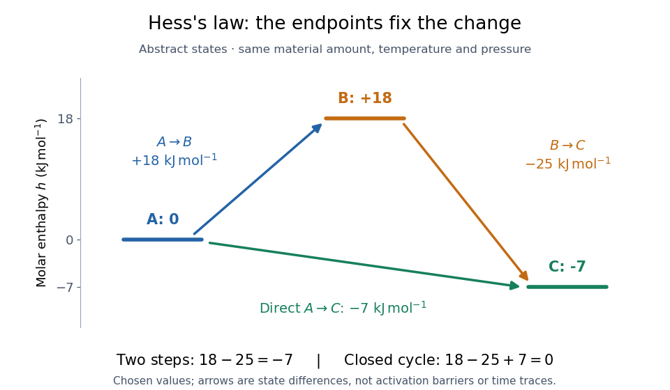

**[Figure 8](#image-hess-law-enthalpy-state-paths). Two routes between the same thermodynamic states give the same enthalpy change**. Original abstract states with [molar enthalpies](enthalpy.md#molar-enthalpy) $0$, $18$, and $-7\,\mathrm{kJ\,mol^{-1}}$ on one common basis. Arrows show signed endpoint differences, not an [activation energy](chemical-kinetics.md#activation-energy) curve, a [reaction mechanism](chemical-kinetics.md#reaction-mechanism), or elapsed time.

The short proof is cancellation:

$$
(H_B-H_A)+(H_C-H_B)=H_C-H_A.
$$

Adding any finite number of consecutive endpoint differences works the same way. For a closed [enthalpy cycle](#enthalpy-cycle) the final $H_A$ cancels the initial $H_A$. A nonzero experimental residual can therefore expose mismatched states or measurement error; it does not identify which individual input is responsible.

<h4 id="hess-s-law-equation-cancellation">Hess's law equation cancellation</h4>

↑ **Parent:** [Hess's law](#hess-s-law)

Keep the [stoichiometry](chemical-reaction.md#stoichiometry) attached to the [enthalpy](enthalpy.md). Use the same abstract $A,B,C$ and suppose each of two entries fixes an [amount of substance](physics.md#amount-of-substance) for every species:

$$
\begin{aligned}
R_1:&\quad 2A\longrightarrow2B, &&\Delta H_1=+36\,\mathrm{kJ},\\
R_2:&\quad C\longrightarrow B, &&\Delta H_2=+25\,\mathrm{kJ}.
\end{aligned}
$$

Here each unit coefficient represents one [mole](physics.md#mole-unit) on the common basis. To obtain $A\to C$, halve $R_1$ and reverse $R_2$. Adding those transformed [chemical equations](chemical-reaction.md#chemical-equation) gives

$$
\begin{aligned}
\tfrac12R_1:&\quad A\longrightarrow B, &&\tfrac12\Delta H_1=+18\,\mathrm{kJ},\\
-R_2:&\quad B\longrightarrow C, &&-\Delta H_2=-25\,\mathrm{kJ},\\
\text{sum}:&\quad A+B\longrightarrow B+C, &&\Delta H=-7\,\mathrm{kJ}.
\end{aligned}
$$

The equal amounts of $B$ on opposite sides cancel, leaving $A\to C$. Doubling this final [chemical equation](chemical-reaction.md#chemical-equation) would give $2A\to2C$ and $\Delta H=-14\,\mathrm{kJ}$; its change per [mole](physics.md#mole-unit) of $A$ would remain $-7\,\mathrm{kJ\,mol^{-1}}$.

More generally, write each [chemical equation](chemical-reaction.md#chemical-equation) as a [stoichiometric vector](mathematical-biology.md#stoichiometric-vector) $\boldsymbol\nu_j$, with negative entries for [reactants](chemical-reaction.md#reactant) and positive entries for [reaction products](chemical-reaction.md#product-chemistry). Finding coefficients $a_j$ with $\boldsymbol\nu_{\rm target}=\sum_j a_j\boldsymbol\nu_j$ also gives $\Delta H_{\rm target}=\sum_j a_j\Delta H_j$, using compatible state and amount conventions. An identical [chemical species](mathematical-biology.md#chemical-species) cancels only with the same [thermodynamic phase](thermodynamics.md#thermodynamic-phase) and composition conditions. A leftover [water](chemical-substance.md#water) or [dilution](mixture.md#dilution) step is a real part of the balance.

<h4 id="hess-s-law-calorimetry-experiment">Hess's law calorimetry experiment</h4>

↑ **Parent:** [Hess's law](#hess-s-law)

A practical test compares three transformations involving [sodium hydroxide](chemical-substance.md#sodium-hydroxide): [dissolution](ionic-bonding.md#dissolution) of the [solid](thermodynamics.md#solid), [neutralization](acid-base-chemistry.md#neutralization) of its [chemical solution](mixture.md#solution-chemistry) by [hydrochloric acid](acid-base-chemistry.md#hydrochloric-acid), and reaction of the [solid](thermodynamics.md#solid) directly with [hydrochloric acid](acid-base-chemistry.md#hydrochloric-acid). In the ideal compatible-state notation, the [hydrogen ion](#hydrogen-ion) and [hydroxide](#hydroxide) give

$$
\begin{aligned}
D:&\quad\mathrm{NaOH(s)\longrightarrow Na^+(aq)+OH^-(aq)},\\
N:&\quad\mathrm{H^+(aq)+OH^-(aq)\longrightarrow H_2O(l)},\\
D+N:&\quad\mathrm{NaOH(s)+H^+(aq)\longrightarrow Na^+(aq)+H_2O(l)}.
\end{aligned}
$$

The [hydroxide](#hydroxide) cancels, whereas the newly formed [water](chemical-substance.md#water) remains. [Sodium](chemical-substance.md#sodium) and [chloride](#chloride) [spectator ions](chemical-reaction.md#spectator-ion) must still be included in the full material inventory when matching actual [chemical solutions](mixture.md#solution-chemistry).

The teaching protocol [Calorimetry: Heat of Neutralization Reaction & Hess's Law](https://www.pc.maricopa.edu/chemistry/151LLWeb/caloimetry.htm), Procedure A–C, uses nested insulated cups, a cardboard lid and a [thermometer](temperature.md#thermometer). It mixes $75\,\mathrm{mL}$ each of $2.0\,\mathrm{mol\,L^{-1}}$ [hydrochloric acid](acid-base-chemistry.md#hydrochloric-acid) and [sodium hydroxide](chemical-substance.md#sodium-hydroxide) [chemical solutions](mixture.md#solution-chemistry); separately it adds $6.00\,\mathrm g$ [solid](thermodynamics.md#solid) [sodium hydroxide](chemical-substance.md#sodium-hydroxide) to diluted [hydrochloric acid](acid-base-chemistry.md#hydrochloric-acid), or to $150\,\mathrm{mL}$ [water](chemical-substance.md#water). It records initial [temperatures](temperature.md), stirs, reads [temperature](temperature.md) every $30\,\mathrm s$, repeats runs, and extrapolates cooling trends to mixing time. Rapid weighing limits moisture uptake. The Introduction neglects vessel [heat capacity](heat.md#heat-capacity) and room losses; these are approximations, not a measured calibration. The readout tests whether the inferred [enthalpies](enthalpy.md) add, rather than directly measuring a [state function](thermodynamics.md#state-function).[Introduction; Procedure A.1–8, B.1–5 and C.1–6; Additional Data Treatment: cup approximation, preparation, repeat runs and mixing-time extrapolation](chemistry-bibliography.md#calorimetry-heat-of-neutralization-reaction-and-hess-s-law-chemistry-151ll)

Matching the [chemical equations](chemical-reaction.md#chemical-equation) alone is insufficient. The direct-acid recipe uses $0.160\,\mathrm{mol}$ [hydrochloric acid](acid-base-chemistry.md#hydrochloric-acid), whereas the solution-mixing recipe uses $0.150\,\mathrm{mol}$. The [dissolution](ionic-bonding.md#dissolution) run also does not automatically reproduce the [water](chemical-substance.md#water) inventory of the mixed-solution run. Exact closure requires matching initial and final [chemical solution](mixture.md#solution-chemistry) compositions and adding any necessary mixing or [dilution](mixture.md#dilution) [enthalpies](enthalpy.md). Agreement after approximate corrections is a limited test, rather than proof of exact cancellation for those recipes.

To improve the [calorimetry](calorimetry.md), use [calorimeter calibration](calorimetry.md#calorimeter-calibration) for the participating hardware, and estimate [calorimeter heat-loss correction](calorimetry.md#calorimeter-heat-loss-correction) under comparable conditions. With an approximately constant total receiving [heat capacity](heat.md#heat-capacity) $C_{\rm tot}=mc_p+C_{\rm cal}$, common initial [temperature](temperature.md), constant external [pressure](pressure.md), only expansion [work](energy.md#work), negligible escaping material and negligible bulk [kinetic energy](energy.md#kinetic-energy) and [potential energy](energy.md#potential-energy) changes, the balance is

$$
q_{\rm rxn}+C_{\rm tot}\Delta T+Q_{\rm loss,out}=0,\qquad
\Delta H_{\rm rxn}=q_{\rm rxn}.
$$

Here $m$ is the [chemical solution](mixture.md#solution-chemistry) [mass](classical-mechanics.md#mass), $c_p$ its [specific heat capacity at constant pressure](heat.md#specific-heat-capacity-at-constant-pressure), $C_{\rm cal}$ the hardware [heat capacity](heat.md#heat-capacity), and $Q_{\rm loss,out}$ the signed outward [heat](heat.md) loss. Different initial [temperatures](temperature.md) require separate warming terms. [Calorimeter calibration](calorimetry.md#calorimeter-calibration) and matching [chemical solution](mixture.md#solution-chemistry) compositions address different errors.

For an original constructed model, choose $C_{\rm tot}=120\,\mathrm{J\,K^{-1}}$ and $\Delta T=3\,\mathrm K$. Neglect outward [heat](heat.md) loss and other corrections. The receiving [chemical solution](mixture.md#solution-chemistry) and hardware gain $q_{\rm receiver}=360\,\mathrm J$, so $q_{\rm rxn}=-360\,\mathrm J$. If the completed [extent of reaction](chemical-reaction.md#extent-of-reaction) is $\xi=0.020\,\mathrm{mol}$ for a unit-coefficient [chemical equation](chemical-reaction.md#chemical-equation), the inferred reaction [enthalpy](enthalpy.md) per [mole](physics.md#mole-unit) of that reaction is

$$
\frac{\Delta H_{\rm rxn}}{\xi}
=\frac{-360\,\mathrm J}{0.020\,\mathrm{mol}}
=-18\,\mathrm{kJ\,mol^{-1}}.
$$

These chosen numbers illustrate the signs and normalization; they are not measured [sodium hydroxide](chemical-substance.md#sodium-hydroxide) data and are independent of the abstract $A,B,C$ example.

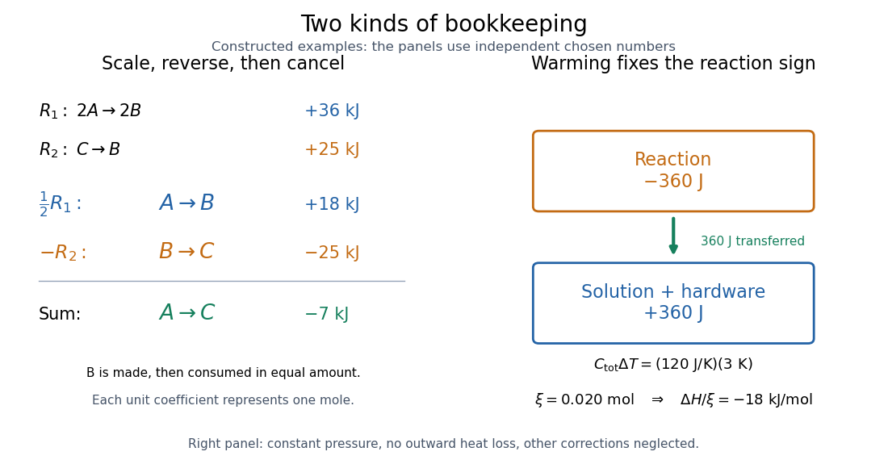

**[Figure 9](#image-hess-law-cancellation-and-calorimetry). Stoichiometry cancels intermediate states; calorimetry converts warming into signed reaction enthalpy**. Left: original abstract [chemical equations](chemical-reaction.md#chemical-equation) use $\tfrac12R_1-R_2$ to give $A\to C$ and $-7\,\mathrm{kJ}$ for one [mole](physics.md#mole-unit). Right: an independent chosen [heat capacity](heat.md#heat-capacity) model gives receiver gain $+360\,\mathrm J$ and reaction change $-360\,\mathrm J$. Neither panel reports experimental measurements.

A loss of [heat](heat.md) to the room makes the uncorrected warming underestimate the magnitude of a heat-releasing reaction. Incomplete [dissolution](ionic-bonding.md#dissolution), incomplete reaction, uncertain [amount of substance](physics.md#amount-of-substance), or a slow [thermometer](temperature.md#thermometer) response can also spoil closure. A useful experimental residual is $r=\Delta H_{\rm direct}-(\Delta H_D+\Delta H_N)$ after all changes have been placed on the same amount and state basis. Compare $r$ with the [measurement uncertainty](physics.md#measurement-uncertainty), accounting for shared calibration errors; averaging repeated runs reduces scatter without removing a common bias.

### Standard enthalpy of formation

↑ **Parent:** [Thermochemistry](#thermochemistry)  
ⓦ [Wiki](https://en.wikipedia.org/wiki/Standard_enthalpy_of_formation)

The [standard enthalpy of formation](#standard-enthalpy-of-formation) is the [enthalpy](enthalpy.md) change for forming one [mole](physics.md#mole-unit) of a specified [chemical substance](chemical-substance.md) from its [chemical elements](chemical-substance.md#chemical-element) in their reference states at the stated [temperature](temperature.md). For [sodium chloride](chemical-substance.md#sodium-chloride) at $298.15\,\mathrm K$, those reactant states are [solid](thermodynamics.md#solid) [sodium](chemical-substance.md#sodium) and diatomic gaseous [chlorine](chemical-substance.md#chlorine). [Standard state](chemical-potential.md#standard-state) specifies conditions; it does not by itself select a [temperature](temperature.md).

### Enthalpy of atomization

↑ **Parent:** [Thermochemistry](#thermochemistry)

An [enthalpy of atomization](#enthalpy-of-atomization) is the [enthalpy](enthalpy.md) change for making one [mole](physics.md#mole-unit) of separated gaseous [chemical atoms](physics.md#atom-physics) from a specified starting [chemical substance](chemical-substance.md). For [sodium](chemical-substance.md#sodium), the relevant step is [sublimation](critical-phenomenon.md#sublimation) to monatomic [gas](thermodynamics.md#gas); for diatomic [chlorine](chemical-substance.md#chlorine), it is half the compatible molar [bond-dissociation energy](chemical-bond.md#bond-dissociation-energy) expressed as an [enthalpy](enthalpy.md).

### Enthalpy change of solution

↑ **Parent:** [Thermochemistry](#thermochemistry)  
ⓦ [Wiki](https://en.wikipedia.org/wiki/Enthalpy_change_of_solution)

An [enthalpy of solution](#enthalpy-change-of-solution) is an [enthalpy](enthalpy.md) difference for dissolution into a specified [solvent](mixture.md#solvent) at stated [temperature](temperature.md) and final [concentration](mathematical-physics.md#concentration). Keep a measured finite-dilution value distinct from an infinite-dilution reference value.

## Mass spectrometry

↑ **Parent:** [Chemistry](chemistry.md)  
ⓦ [Wiki](https://en.wikipedia.org/wiki/Mass_spectrometry)

[Mass spectrometry](#mass-spectrometry) separates and detects [ions](#ion) according to [mass-to-charge ratio](#mass-to-charge-ratio). It can distinguish [isotopes](chemical-substance.md#isotope) which belong to the same [chemical element](chemical-substance.md#chemical-element) but have different [atomic masses](chemical-substance.md#atomic-mass). The instrument measures [ions](#ion): interpreting the result as a neutral [atomic mass](chemical-substance.md#atomic-mass) requires accounting for [electron](physics.md#electron) removal and its [ionization energy](mathematical-physics.md#ionization-energy). For a singly positive [ion](#ion) in its [ground state](quantum-mechanics.md#ground-state), $m_+=m_{\rm a}-m_e+I/c^2$, where $m_e$ is the [electron](physics.md#electron) [rest mass](special-relativity.md#invariant-mass), $I$ is the [ionization energy](mathematical-physics.md#ionization-energy), and $c$ is the [speed of light](special-relativity.md#speed-of-light).

For a simple illustrative analyzer, positive [ions](#ion) of [mass](classical-mechanics.md#mass) $m$ and [electric charge](electric-charge.md) $q=ze$ gain [kinetic energy](energy.md#kinetic-energy) $qV=mv^2/2$ across an [electric potential difference](electric-field.md#electric-potential-difference) $V$ before entering a transverse uniform [magnetic field](magnetic-field.md) $B$. The [Lorentz force](relativistic-electromagnetism.md#lorentz-force) supplies [centripetal acceleration](classical-mechanics.md#centripetal-acceleration), so

$$
qvB=\frac{mv^2}{r},\qquad\frac{m}{q}=\frac{B^2r^2}{2V}.
$$

At fixed $V$ and $B$, the measured bending radius $r$ separates [mass-to-charge ratios](#mass-to-charge-ratio), not [masses](classical-mechanics.md#mass) independently of [electric charge](electric-charge.md). This ideal model assumes negligible initial [kinetic energy](energy.md#kinetic-energy) and speeds small compared with the [speed of light](special-relativity.md#speed-of-light); the historical focusing [mass spectrograph](#mass-spectrograph) used the geometry described below.

The experimental achievement is to turn invisible differences between individual [ions](#ion) into separated, calibrated positions. [Aston velocity focusing](#aston-velocity-focusing) explains how an early [mass spectrograph](#mass-spectrograph) sharpened its images; the [velocity-selected magnetic mass analyzer](#velocity-selected-magnetic-mass-analyzer) provides an independent model whose equations can be checked directly. The [magnesium isotope mass spectrum](#magnesium-isotope-mass-spectrum) shows why position, width, and intensity carry different information.

### Gas chromatography-mass spectrometry

↑ **Parent:** [Mass spectrometry](#mass-spectrometry)

### Liquid chromatography-mass spectrometry

↑ **Parent:** [Mass spectrometry](#mass-spectrometry)

A combined analytical method separating compounds chromatographically before mass-spectrometric characterization. Peptide identification in a gel region can suggest a protein identity, but comigration requires independent validation of an assigned band.

### Hydrogen-deuterium exchange mass spectrometry

↑ **Parent:** [Mass spectrometry](#mass-spectrometry)

[hydrogen-deuterium exchange mass spectrometry](#hydrogen-deuterium-exchange-mass-spectrometry) follows exchange of exchangeable [hydrogen](chemical-substance.md#hydrogen) with [deuterium](chemical-substance.md#deuterium) and measures mass changes, often after digestion into [peptides](protein.md#peptide). Protection can reflect [hydrogen bonds](chemical-bond.md#hydrogen-bond), burial or restricted structural opening; altered exchange is not uniquely diagnostic of a binding interface.

### Chemical cross-linking mass spectrometry

↑ **Parent:** [Mass spectrometry](#mass-spectrometry)

[chemical cross-linking mass spectrometry](#chemical-cross-linking-mass-spectrometry) identifies residue pairs joined by a chemical reagent and uses them as spatial constraints on [protein structures](protein.md#protein-structure) or assemblies. A distance limit depends on linker chemistry, reactive residue positions and accessible conformations.

### Co-fractionation mass spectrometry

↑ **Parent:** [Mass spectrometry](#mass-spectrometry)

[co-fractionation mass spectrometry](#co-fractionation-mass-spectrometry) quantifies [proteins](protein.md) across fractions from a native separation. Similar elution profiles suggest shared assemblies; coincident migration and assemblies that exchange partners are alternative explanations.

### Native mass spectrometry

↑ **Parent:** [Mass spectrometry](#mass-spectrometry)

[native mass spectrometry](#native-mass-spectrometry) transfers intact biomolecular assemblies into the gas phase under conditions intended to preserve noncovalent association sufficiently for mass analysis. Charge-state assignment and possible loss of subunits or bound [lipids](chemical-substance.md#lipid) must be considered when inferring [stoichiometry](chemical-reaction.md#stoichiometry).

### Tandem mass spectrometry

↑ **Parent:** [Mass spectrometry](#mass-spectrometry)

[tandem mass spectrometry](#tandem-mass-spectrometry) selects precursor [ions](#ion), fragments them, and measures the fragments to constrain precursor identity or structure. In [proteomics](biochemistry.md#proteomics), fragmentation of [peptides](protein.md#peptide) provides sequence evidence that can be matched against a database.

#### Electron capture dissociation

↑ **Parent:** [Tandem mass spectrometry](#tandem-mass-spectrometry)

#### Electron transfer dissociation

↑ **Parent:** [Tandem mass spectrometry](#tandem-mass-spectrometry)

Fragmentation of molecular ions induced through electron transfer, useful for preserving and localizing some labile modifications in [protein](protein.md) analysis.

### Accelerator mass spectrometry

↑ **Parent:** [Mass spectrometry](#mass-spectrometry)  
ⓦ [Wiki](https://en.wikipedia.org/wiki/Accelerator_mass_spectrometry)

[Accelerator mass spectrometry](#accelerator-mass-spectrometry) uses ion acceleration and particle identification to count rare isotopes relative to abundant ones. For [radiocarbon dating](physics.md#radiocarbon-dating), it measures [carbon-14](chemical-substance.md#carbon-14) directly rather than waiting to count its [beta decays](physics.md#beta-decay).

### Molecular ion

↑ **Parent:** [Mass spectrometry](#mass-spectrometry)

In the [International Union of Pure and Applied Chemistry](chemistry-author.md#international-union-of-pure-and-applied-chemistry) (IUPAC) [mass spectrometry](#mass-spectrometry) convention, a [molecular ion](#molecular-ion) is formed by removing or adding one or more [electrons](physics.md#electron) to a [molecule](molecule.md) without fragmentation of its molecular structure.[Gold Book, fifth edition, molecular ion in mass spectrometry: formation by electron removal or addition without fragmentation](chemistry-bibliography.md#iupac-compendium-of-chemical-terminology-fifth-edition-gold-book-by-international-union-of-pure-and-applied-chemistry/molecular-ion-in-mass-spectrometry) For example, removing one [electron](physics.md#electron) from intact [water](chemical-substance.md#water) gives $\mathrm{H_2O^{\bullet+}}$: two [hydrogen](chemical-substance.md#hydrogen) and one [oxygen](chemical-substance.md#oxygen) [chemical atom](physics.md#atom-physics), total [electric charge](electric-charge.md) $+e$, and an unpaired [electron](physics.md#electron), hence a [radical cation](#radical-cation). Atom inventory, net [electric charge](electric-charge.md), and electronic state are separate pieces of information. [Hydronium](#hydronium), $\mathrm{H_3O^+}$, has a different inventory; it is a [polyatomic ion](#polyatomic-ion), rather than the [molecular ion](#molecular-ion) obtained by electron removal from [water](chemical-substance.md#water).

#### Trihydrogen cation

↑ **Parent:** [Molecular ion](#molecular-ion)

The H3+ ion. Two electrons occupy a fully bonding three-centre orbital at a triangular geometry; the filled nondegenerate shell differs from the open degenerate shell of neutral ground-state H3.

### Mass spectrograph

↑ **Parent:** [Mass spectrometry](#mass-spectrometry)

A [mass spectrometry](#mass-spectrometry) instrument with a photographic readout. In the 1919 apparatus described in [Chapter V: The Mass-Spectrograph](chemistry-bibliography.md#isotopes-by-francis-william-aston/chapter-v-the-mass-spectrograph), a [gas](thermodynamics.md#gas) discharge produced positive [ions](#ion). Two narrow slits formed a ribbon beam in a [vacuum](physics.md#vacuum); plates applied an [electric field](electric-field.md) to spread it, an aperture selected part of it, and a [magnetic field](magnetic-field.md) bent it oppositely. Focusing reduced the spread caused by differing [ion](#ion) [speeds](classical-mechanics.md#speed), concentrating a given [mass-to-charge ratio](#mass-to-charge-ratio) into a line on a photographic plate.

The observed quantity was line displacement from a fiducial spot. Known reference lines calibrated displacement against [mass-to-charge ratio](#mass-to-charge-ratio); repeated exposures with changed [magnetic field](magnetic-field.md) tested the calibration. Evacuation limited collisions. Comparing line shapes with narrow and wide apertures helped distinguish geometric broadening from photographic spreading. Finite slit widths, plate response, and overlapping molecular or multiply charged [ions](#ion) limited interpretation. See [Chapter V: The Mass-Spectrograph](chemistry-bibliography.md#isotopes-by-francis-william-aston/chapter-v-the-mass-spectrograph) (§§33–40: apparatus and photographic procedure; §§43 and 45–46: calibration, aperture comparisons, and accuracy).

In [Mass spectra and isotopes by Francis William Aston](chemistry-bibliography.md#mass-spectra-and-isotopes-by-francis-william-aston) (Nobel lecture, 12 December 1922), the reported [neon](chemical-substance.md#neon) lines at 20 and 22 have companions at 10 and 11 from doubly charged [ions](#ion). That paired pattern and comparison with reference lines support different [atomic masses](chemical-substance.md#atomic-mass) within one [chemical element](chemical-substance.md#chemical-element), rather than an [atomic mass](chemical-substance.md#atomic-mass) concentrated at the bulk average. The lecture also describes an earlier failed separation by distillation and partial separation by [diffusion](thermodynamics.md#diffusion), showing why the focused [mass spectrum](#mass-spectrum) supplied stronger evidence. These numbers used a historical [oxygen](chemical-substance.md#oxygen)-based reference scale. The lecture's whole-number rule was an empirical approximation at its stated accuracy, not the modern exact definition $A=Z+N$.[pp. 9–13: separation attempts, focusing, reference lines, charge orders, and neon; pp. 15–17: whole-number rule and historical nuclear interpretation](chemistry-bibliography.md#mass-spectra-and-isotopes-by-francis-william-aston)

#### Aston velocity focusing

↑ **Parent:** [Mass spectrograph](#mass-spectrograph)

In [Mass spectra and isotopes by Francis William Aston](chemistry-bibliography.md#mass-spectra-and-isotopes-by-francis-william-aston), printed pp. 10–12, Fig. 1, [Francis William Aston](atomic-physicist.md#francis-william-aston) describes successive electric and magnetic deflections in one plane, with opposite senses. This geometry focuses a range of [ion](#ion) [speeds](classical-mechanics.md#speed); it does not require the straight-through cancellation of a [velocity selector](relativistic-electromagnetism.md#velocity-selector).

The reason compensation is possible follows from the [Lorentz force](relativistic-electromagnetism.md#lorentz-force). In a short region of length $\ell_E$, a small electric deflection angle has magnitude $\theta_E\simeq qE\ell_E/(mv^2)$: the transverse [acceleration](classical-mechanics.md#acceleration) acts for a time $\ell_E/v$, and the deflection angle is the acquired transverse [velocity](classical-mechanics.md#velocity) divided by $v$. A short magnetic region of length $\ell_B$ gives $\theta_B\simeq qB\ell_B/(mv)$, since the magnetic [force](force.md) already contains one factor of [speed](classical-mechanics.md#speed). Slower [ions](#ion) therefore receive a disproportionately larger electric deflection.

An original local approximation makes the focusing idea explicit. At fixed [mass-to-charge ratio](#mass-to-charge-ratio), replace each region by a small angular kick and include the drift distances in two positive constants $a$ and $b$. With $t=v/v_0$, write the detector coordinate as

$$
X(t)=\frac{a}{t^2}-\frac{b}{t},\qquad
\left.\frac{dX}{dt}\right|_{t=1}=-2a+b.
$$

Choosing the geometry and fields so that $b=2a$ eliminates the first-order [speed](classical-mechanics.md#speed) sensitivity. Indeed,

$$
X(t)-X(1)=a\frac{(t-1)^2}{t^2}.
$$

A fractional [speed](classical-mechanics.md#speed) error $\varepsilon=t-1$ then contributes only at order $\varepsilon^2$ in this approximation. This is a local thin-kick explanation, not Aston's exact pole geometry, focal-plane equation, or a prediction of its measured [mass resolution](#mass-resolution). Finite slit widths, initial directions, and field boundaries still matter. Unlike a [velocity selector](relativistic-electromagnetism.md#velocity-selector), focusing can collect nearby [speeds](classical-mechanics.md#speed) into a narrow image instead of discarding all but a narrow accepted range.

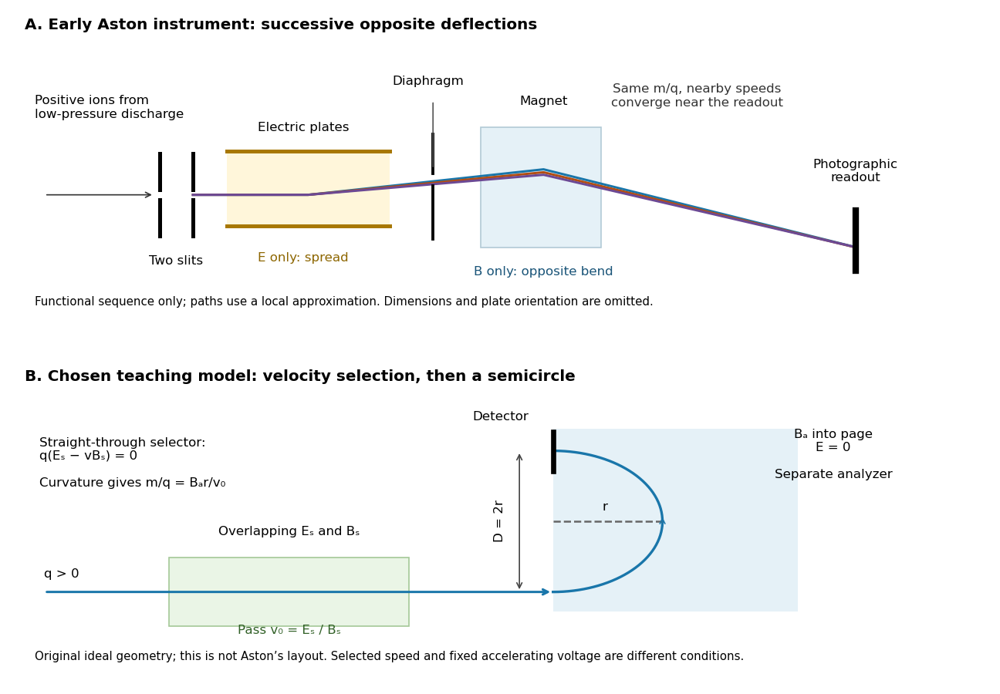

**[Figure 10](#image-aston-focusing-and-velocity-selector). Successive opposite deflections in an early mass spectrograph, compared with a chosen velocity selector and magnetic analyzer**. Top: functional schematic of the sequence described by [Francis William Aston](atomic-physicist.md#francis-william-aston); colored paths indicate one [mass-to-charge ratio](#mass-to-charge-ratio) at nearby [speeds](classical-mechanics.md#speed). Paths use the local thin-kick illustration, and dimensions and plate orientation are not a reconstruction. Bottom: an independently chosen teaching geometry has overlapping selector fields followed by a separate semicircular magnetic path. Both diagrams show positive [ions](#ion); the [Thomson charge-to-mass experiment](relativistic-electromagnetism.md#thomson-charge-to-mass-experiment) gives the corresponding negative-[electric charge](electric-charge.md) example.

### Velocity-selected magnetic mass analyzer

↑ **Parent:** [Mass spectrometry](#mass-spectrometry)

Reuse the [velocity selector](relativistic-electromagnetism.md#velocity-selector) analysis in the [Thomson charge-to-mass experiment](relativistic-electromagnetism.md#thomson-charge-to-mass-experiment), but now send positive [ions](#ion) with $q=ze$ into a separate magnetic analyzer. The selector fields $E_s$ and $B_s$ give $v_0=E_s/B_s$. If the analyzer field $B_a$ is perpendicular to the selected [velocity](classical-mechanics.md#velocity), its [gyroradius](relativistic-electromagnetism.md#gyroradius) gives

$$
\frac{m}{q}=\frac{B_a r}{v_0}=\frac{B_aB_s r}{E_s},\qquad D=2r
$$

for a semicircular return to the entrance plane. The displayed impact separation $D$ is a diameter. This formula is linear in $r$ at fixed selected [speed](classical-mechanics.md#speed); the fixed-[electric potential difference](electric-field.md#electric-potential-difference) model above instead gives $m/q\propto r^2$. They impose different experimental conditions.

For a chosen example, take $E_s=2.00\times10^4\,\mathrm{V/m}$, $B_s=0.200\,\mathrm T$, and $B_a=0.500\,\mathrm T$. Thus $v_0=1.00\times10^5\,\mathrm{m/s}$. Approximating an [ion](#ion) [mass](classical-mechanics.md#mass) by $24\,\mathrm u$ and setting $q=e$ gives $r\approx49.75\,\mathrm{mm}$ and $D\approx99.50\,\mathrm{mm}$. Here $\mathrm u$ denotes the [unified atomic mass unit](chemical-substance.md#dalton-unit). These are stipulated teaching inputs, not a reported Aston measurement or an exact [magnesium](chemical-substance.md#magnesium) [atomic mass](chemical-substance.md#atomic-mass).

A finite accepted [speed](classical-mechanics.md#speed) range broadens the radius distribution. At fixed $m/q$ and $B_a$, $\delta r/r=\delta v/v$. At fixed [electric charge](electric-charge.md) and [mass](classical-mechanics.md#mass), $K=mv^2/2$ gives $\delta v/v\simeq\delta K/(2K)$ for a small [kinetic energy](energy.md#kinetic-energy) spread. A one-percent [kinetic energy](energy.md#kinetic-energy) spread therefore produces roughly a half-percent radius spread before other broadening is included. Its width convention must be specified before converting that statement into a [mass resolving power](#mass-resolution).

### Magnesium isotope mass spectrum

↑ **Parent:** [Mass spectrometry](#mass-spectrometry)

For a modern chosen example, the [National Institute of Standards and Technology](chemistry-author.md#national-institute-of-standards-and-technology) lists neutral [magnesium](chemical-substance.md#magnesium) [atomic masses](chemical-substance.md#atomic-mass) $23.985041697\,\mathrm u$, $24.985836976\,\mathrm u$, and $25.982592968\,\mathrm u$, with reference [isotopic abundances](chemical-substance.md#isotopic-abundance) $0.7899$, $0.1000$, and $0.1101$. They describe the [isotopes](chemical-substance.md#isotope) with [mass numbers](chemical-substance.md#mass-number) 24, 25, and 26, respectively.[NIST, Atomic Weights and Isotopic Compositions for Magnesium: rows 24–26, neutral relative atomic masses and reference compositions](chemistry-bibliography.md#atomic-weights-and-isotopic-compositions-for-magnesium-by-national-institute-of-standards-and-technology) These modern inputs are not a reconstruction of historical observations.

Use the [dimensionless](physics.md#dimensionless-quantity) [mass-to-charge ratio](#mass-to-charge-ratio) coordinate $x=(m/\mathrm u)/z$. For the illustration only, approximate [ion](#ion) [masses](classical-mechanics.md#mass) by the neutral [atomic masses](chemical-substance.md#atomic-mass). The singly charged positions are then near $23.98504$, $24.98584$, and $25.98259$; the doubly charged companions are near $11.99252$, $12.49292$, and $12.99130$. The neutral-to-ion correction already given above is essential at higher accuracy. A peak near $x=12$ alone need not identify a [chemical element](chemical-substance.md#chemical-element): another [ion](#ion) with a different [electric charge](electric-charge.md) can occupy the same [mass-to-charge ratio](#mass-to-charge-ratio) interval.

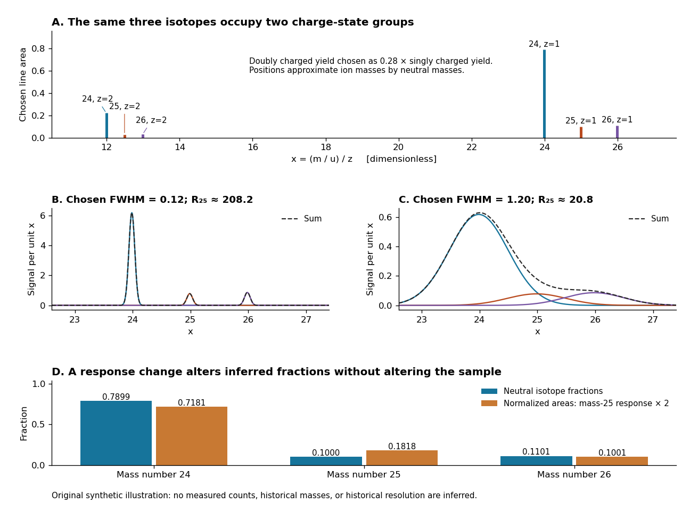

**[Figure 11](#image-magnesium-charge-states-and-resolution). An original synthetic magnesium mass spectrum: charge states, finite mass resolution, and response bias**. All curves are stipulated sums of unit-area [Gaussian functions](calculus.md#gaussian-function), not measured data. The first two panels use equal isotope responses and selected [full width at half maximum](analysis.md#full-width-at-half-maximum) values $0.12$ and $1.20$ in $x$. The last panel keeps the reference [isotopic abundances](chemical-substance.md#isotopic-abundance) fixed but multiplies the mass-25 response by two, then normalizes the areas. Neutral [atomic masses](chemical-substance.md#atomic-mass) approximate [ion](#ion) [masses](classical-mechanics.md#mass); charge-state yields are chosen independently, and no historical intensity or resolving-power claim is made.

For the narrow singly charged peak at $x\approx24.98584$, the chosen [full width at half maximum](analysis.md#full-width-at-half-maximum) $\Delta x=0.12$ gives [mass resolving power](#mass-resolution) $R\approx208.2$; widening to $\Delta x=1.20$ gives $R\approx20.82$. Adjacent isotope spacings here are approximately one unit in $x$. Peaks are visibly separated in the first chosen profile and overlap strongly in the second. A small uncertainty in a fitted peak centre would not by itself make the overlapping components resolved.

Even integrated peak areas need a response model. For isotope fraction $f_i$, let $\eta_{i,z}$ collect the probability of [ionization](atomic-physics.md#ionization) into [electric charge](electric-charge.md) state $z$, transmission through the analyzer, and the detection response. In a linear instrument with overall exposure factor $C$, the component area is

$$
A_{i,z}=C f_i\eta_{i,z}.
$$

Equal $\eta_{i,z}$ at a fixed $z$ makes normalized areas equal the fractions; otherwise it does not. In the chosen example, doubling only the mass-25 response changes the normalized areas to $0.71809$, $0.18182$, and $0.10009$, although the neutral sample is unchanged. Photographic darkening introduces another possible nonlinearity: neither line darkness nor peak height is a universal measure of neutral [isotopic abundance](chemical-substance.md#isotopic-abundance). Calibration of position and calibration of intensity answer different questions. Matched standards, a known [electric charge](electric-charge.md) assignment, and a response correction make isotope analysis useful; a visually impressive set of peaks alone does not supply those controls.

### Mass-to-charge ratio

↑ **Parent:** [Mass spectrometry](#mass-spectrometry)  
ⓦ [Wiki](https://en.wikipedia.org/wiki/Mass-to-charge_ratio)

The ratio of an [ion](#ion)'s [mass](classical-mechanics.md#mass) to its [electric charge](electric-charge.md); in [SI](physics.md#international-system-of-units) it has units $\mathrm{kg/C}$. A convenient numerical [mass spectrum](#mass-spectrum) coordinate is $x=(m/\mathrm u)/z$, with $q=ze$ and positive integer $z$ here. This $x$ is [dimensionless](physics.md#dimensionless-quantity). Doubling $z$ at fixed [mass](classical-mechanics.md#mass) halves $x$, so the [electric charge](electric-charge.md) state must be identified before assigning an [isotope](chemical-substance.md#isotope).

### Mass spectrum

↑ **Parent:** [Mass spectrometry](#mass-spectrometry)  
ⓦ [Wiki](https://en.wikipedia.org/wiki/Mass_spectrum)

A [mass spectrum](#mass-spectrum) displays detected signal against [mass-to-charge ratio](#mass-to-charge-ratio). Peak positions identify candidate [ions](#ion); peak areas give [isotopic abundances](chemical-substance.md#isotopic-abundance) only after the response and overlapping contributions have been accounted for.

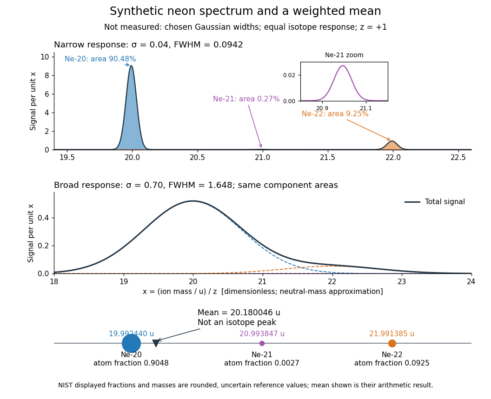

**[Figure 12](#image-synthetic-neon-mass-spectra-and-the-weighted-mean-of-neutral-atomic-masses). Synthetic neon mass spectra and the weighted mean of neutral atomic masses**. This is a model, not a measured [mass spectrum](#mass-spectrum) or a reconstruction of Aston's plate. All [ions](#ion) have $z=+1$; neutral [atomic masses](chemical-substance.md#atomic-mass) approximate [ion](#ion) [masses](classical-mechanics.md#mass). Chosen [Gaussian functions](calculus.md#gaussian-function) have unit area and widths $\sigma=0.04$ and $0.70$ in the [dimensionless](physics.md#dimensionless-quantity) coordinate $x$. Equal responses make component areas equal the displayed reference [isotopic abundances](chemical-substance.md#isotopic-abundance). The inset reveals the small [neon-21](chemical-substance.md#neon-21) peak. The bottom diagram places the [weighted mean](arithmetic.md#weighted-arithmetic-mean) between the component [atomic masses](chemical-substance.md#atomic-mass); it is not an additional [isotope](chemical-substance.md#isotope).

Broadening can hide a weak component without changing its area in this ideal model. An actual [mass spectrum](#mass-spectrum) can also contain molecular [ions](#ion), different [electric charge](electric-charge.md) states, background, and unequal detection responses. A missing visible peak therefore cannot by itself prove the absence of an [isotope](chemical-substance.md#isotope). Conversely, a fractional [atomic weight](chemical-substance.md#relative-atomic-mass) is a property of a population: there is no requirement for an [ion](#ion) peak at the [weighted mean](arithmetic.md#weighted-arithmetic-mean).

### Mass resolution

↑ **Parent:** [Mass spectrometry](#mass-spectrometry)  
ⓦ [Wiki](https://en.wikipedia.org/wiki/Mass_resolution)

[Mass resolving power](#mass-resolution) compares a peak coordinate $x$ with a stated width or separation criterion $\Delta x$. With $\Delta x$ taken as [full width at half maximum](analysis.md#full-width-at-half-maximum), a [Gaussian function](calculus.md#gaussian-function) of [standard deviation](variance.md#standard-deviation) $\sigma$ has

$$
\Delta x=2\sqrt{2\log2}\,\sigma,\qquad R=\frac{x}{\Delta x}.
$$

At the [neon-20](chemical-substance.md#neon-20) coordinate in the synthetic [mass spectrum](#mass-spectrum), $\sigma=0.04$ gives $\Delta x\approx0.0942$ and $R\approx212$, while $\sigma=0.70$ gives $\Delta x\approx1.648$ and $R\approx12.1$. The width criterion and relative peak areas both matter when judging whether a small neighboring [isotope](chemical-substance.md#isotope) can be distinguished. [Mass resolution](#mass-resolution) also differs from the accuracy of a calibrated peak position.

## Chemist

↑ **Parent:** [Chemistry](chemistry.md)  
ⓦ [Wiki](https://en.wikipedia.org/wiki/Chemist)

### Percival Spencer Umfreville Pickering

↑ **Parent:** [Chemist](#chemist)  
ⓦ [Wiki](https://en.wikipedia.org/wiki/Percival_Spencer_Umfreville_Pickering)

**[Figure 13](#image-portrait-of-percival-spencer-umfreville-pickering). Portrait of Percival Spencer Umfreville Pickering**. [Source](https://commons.wikimedia.org/wiki/File:The\_angel\_with\_the\_serpent%2C\_by\_Evelyn\_de\_Morgan.jpg). Evelyn De Morgan (1855–1919); Sotheby’s reproduction; hue adjustment by Jan Arkesteijn. Public domain: creator life plus 100 years or fewer in country of origin and qualifying jurisdictions. [Source usage terms](https://creativecommons.org/publicdomain/mark/1.0/), via Wikimedia Commons.

#### Work by Spencer Umfreville Pickering

↑ **Parent:** [Percival Spencer Umfreville Pickering](#percival-spencer-umfreville-pickering)

### List of chemists

↑ **Parent:** [Chemist](#chemist)

#### Amedeo Avogadro

↑ **Parent:** [List of chemists](#list-of-chemists)

Scientist associated with [Avogadro's law](ideal-gas.md#avogadro-s-law). Authentic institutional portrait: [Science History Institute portrait record](https://digital.sciencehistory.org/works/xq9tzsn).

#### Andrew Ure

↑ **Parent:** [List of chemists](#list-of-chemists)

Chemist and scientific writer. Authentic portrait: [Smithsonian Libraries portrait record](https://library.si.edu/image-gallery/73198).

##### Work by Andrew Ure

↑ **Parent:** [Andrew Ure](#andrew-ure)

#### Holger Fleischer

↑ **Parent:** [List of chemists](#list-of-chemists)

Chemistry educator and author of [The Iodine Test for Reducing Sugars by Holger Fleischer](chemistry-bibliography.md#the-iodine-test-for-reducing-sugars-by-holger-fleischer). The publisher identifies the author with Scheffold-Gymnasium, Schwäbisch Gmünd: [https://www.sciepub.com/WJCE/abstract/10312.](https://www.sciepub.com/WJCE/abstract/10312.) The chemical educator is distinct from the legal scholar with the same name.

##### Work by Holger Fleischer

↑ **Parent:** [Holger Fleischer](#holger-fleischer)

#### Marcellin Berthelot

↑ **Parent:** [List of chemists](#list-of-chemists)

Chemist whose 1856 [formic acid](chemical-substance.md#formic-acid) preparation used [oxalic acid](chemical-substance.md#oxalic-acid) and [glycerol](chemical-substance.md#glycerol). Authentic museum portrait: [https://www.parismuseescollections.paris.fr/en/node/1056491.](https://www.parismuseescollections.paris.fr/en/node/1056491.)

##### Work by Marcellin Berthelot

↑ **Parent:** [Marcellin Berthelot](#marcellin-berthelot)

#### Hermann von Fehling

↑ **Parent:** [List of chemists](#list-of-chemists)

Chemist associated with [Fehling's reagent](chemical-substance.md#fehling-s-reagent). Authentic external portrait: [https://commons.wikimedia.org/wiki/File:Hermann_fehling.jpg.](https://commons.wikimedia.org/wiki/File:Hermann_fehling.jpg.)

#### James Marsh

↑ **Parent:** [List of chemists](#list-of-chemists)

A chemist who developed a sensitive [arsenic detection](biology.md#arsenic-detection) method. External portrait: [Portrait in The Records of the Woolwich District, volume 1, p.340](https://commons.wikimedia.org/wiki/File:Marsh_James.jpg).

##### Work by James Marsh

↑ **Parent:** [James Marsh](#james-marsh)

#### Henry Enfield Roscoe

↑ **Parent:** [List of chemists](#list-of-chemists)

A [chemist](#chemist) and author of [Lessons in Elementary Chemistry by Henry Enfield Roscoe](chemistry-bibliography.md#lessons-in-elementary-chemistry-by-henry-enfield-roscoe).

Verified external portrait reference: [Portrait or portrait collection identifying the sitter](https://www.npg.org.uk/collections/search/person/mp13808/sir-henry-enfield-roscoe).

##### Work by Henry Enfield Roscoe

↑ **Parent:** [Henry Enfield Roscoe](#henry-enfield-roscoe)

#### Hieronymus Theodor Richter

↑ **Parent:** [List of chemists](#list-of-chemists)

A [chemist](#chemist) associated with the identification of [indium](chemical-substance.md#indium).

Verified external portrait reference: [Portrait or portrait collection identifying the sitter](https://en.wikipedia.org/wiki/Hieronymus_Theodor_Richter).

##### Work by Hieronymus Theodor Richter

↑ **Parent:** [Hieronymus Theodor Richter](#hieronymus-theodor-richter)

#### Ferdinand Reich

↑ **Parent:** [List of chemists](#list-of-chemists)

A scientist associated with the identification of [indium](chemical-substance.md#indium).

Verified external portrait reference: [Portrait or portrait collection identifying the sitter](https://commons.wikimedia.org/wiki/File:Ferdinand_Reich.jpg).

##### Work by Ferdinand Reich

↑ **Parent:** [Ferdinand Reich](#ferdinand-reich)

#### William Crookes

↑ **Parent:** [List of chemists](#list-of-chemists)

A [chemist](#chemist) whose spectral observations contributed to identifying [thallium](chemical-substance.md#thallium).

Verified external portrait reference: [Portrait or portrait collection identifying the sitter](https://commons.wikimedia.org/wiki/William_Crookes).

##### Work by William Crookes

↑ **Parent:** [William Crookes](#william-crookes)

#### Robert Bunsen

↑ **Parent:** [List of chemists](#list-of-chemists)

A [chemist](#chemist) associated with [spectrum analysis](physics.md#spectrum-analysis).

Verified external portrait reference: [Portrait or portrait collection identifying the sitter](https://commons.wikimedia.org/wiki/File:Robert_Bunsen.jpg).

##### Work by Robert Bunsen

↑ **Parent:** [Robert Bunsen](#robert-bunsen)

#### Justus von Liebig

↑ **Parent:** [List of chemists](#list-of-chemists)

Chemist who defended a chemical decomposition-by-contact account of fermentation.

Verified external portrait record: [https://digital.sciencehistory.org/works/zb6pn2u/viewer/8nsyo71](https://digital.sciencehistory.org/works/zb6pn2u/viewer/8nsyo71)

#### Charles Albert Browne Jr.

↑ **Parent:** [List of chemists](#list-of-chemists)  
ⓦ [Wiki](https://en.wikipedia.org/wiki/Charles_Albert_Browne_Jr.)

A [chemist](#chemist) who wrote [A Handbook of Sugar Analysis by Charles Albert Browne Jr.](chemistry-bibliography.md#a-handbook-of-sugar-analysis-by-charles-albert-browne-jr).

##### Work by Charles Albert Browne Jr.

↑ **Parent:** [Charles Albert Browne Jr.](#charles-albert-browne-jr)

<h4 id="julius-nessler">Julius Neßler</h4>

↑ **Parent:** [List of chemists](#list-of-chemists)

A [chemist](#chemist) associated with [Nessler's reagent](#nessler-s-reagent). [Deutsche Biographie, identity and dates](https://www.deutsche-biographie.de/sfz71144.html). A verified external portrait appears in [University of Cincinnati, Colorimeters booklet, figure 2 on PDF page 3](https://homepages.uc.edu/~jensenwb/museum-booklets/04.%20Colorimeters.pdf); no standalone portrait URL was established for embedding.

<h5 id="work-by-julius-nessler">Work by Julius Neßler</h5>

↑ **Parent:** [Julius Neßler](#julius-nessler)

#### Edward Frankland

↑ **Parent:** [List of chemists](#list-of-chemists)

Chemist whose 1866 calorimetric argument tested sources of muscular power.

Identity: [https://library.si.edu/image-gallery/73414](https://library.si.edu/image-gallery/73414)

Verified external portrait record: [https://library.si.edu/image-gallery/73414](https://library.si.edu/image-gallery/73414)

#### William Odling

↑ **Parent:** [List of chemists](#list-of-chemists)

Chemist and author of the 1866 [Lectures on Animal Chemistry by William Odling](biochemistry-and-biophysics-bibliography.md#lectures-on-animal-chemistry-by-william-odling).

Identity: [https://history.rcp.ac.uk/inspiring-physicians/william-odling](https://history.rcp.ac.uk/inspiring-physicians/william-odling)

Verified external portrait record: [https://archives.sciencehistory.org/repositories/3/archival_objects/51106](https://archives.sciencehistory.org/repositories/3/archival_objects/51106)

#### Harold Urey

↑ **Parent:** [List of chemists](#list-of-chemists)  
ⓦ [Wiki](https://en.wikipedia.org/wiki/Harold_Urey)

A physical [chemist](#chemist) whose name is used in the planetary [Urey ratio](geophysics.md#urey-ratio).

**[Figure 14](#image-portrait-of-harold-urey). Portrait of Harold Urey**. [Source](https://commons.wikimedia.org/wiki/File:Harold\_Urey.jpg). Portrait from NASA History, photographer not stated on the Commons file page. The file page identifies it as public-domain NASA material.

##### Work by Harold Urey

↑ **Parent:** [Harold Urey](#harold-urey)

<h4 id="antoine-francois-de-fourcroy">Antoine-François de Fourcroy</h4>

↑ **Parent:** [List of chemists](#list-of-chemists)  
ⓦ [Wiki](https://en.wikipedia.org/wiki/Antoine-François_de_Fourcroy)

**[Figure 15](#image-portrait-of-antoine-francois-de-fourcroy). Portrait of Antoine-François de Fourcroy**. [Source](https://commons.wikimedia.org/wiki/File:Portrait\_of\_Comte\_Antoine\_Francois\_de\_Fourcroy\_Wellcome\_L0000364.jpg). Wellcome Library, London / Wellcome Collection; plate published in A. Corlieu, Centenaire de la Faculté de médecine de Paris (1896). [CC BY 4.0](https://creativecommons.org/licenses/by/4.0/), via Wikimedia Commons.

#### Claude Louis Berthollet

↑ **Parent:** [List of chemists](#list-of-chemists)  
ⓦ [Wiki](https://en.wikipedia.org/wiki/Claude_Louis_Berthollet)

**[Figure 16](#image-portrait-of-claude-louis-berthollet). Portrait of Claude Louis Berthollet**. [Source](https://commons.wikimedia.org/wiki/File:Claude\_Louis\_Berthollet.\_Mezzotint\_by\_Allais\_after\_Dutertre\_Wellcome\_V0000499.jpg). Allais, after Dutertre, after Rembrandt Peale; Wellcome Library, London / Wellcome Collection. [CC BY 4.0](https://creativecommons.org/licenses/by/4.0/), via Wikimedia Commons.

#### Louis-Bernard Guyton de Morveau

↑ **Parent:** [List of chemists](#list-of-chemists)  
ⓦ [Wiki](https://en.wikipedia.org/wiki/Louis-Bernard_Guyton_de_Morveau)

**[Figure 17](#image-portrait-of-louis-bernard-guyton-de-morveau). Portrait of Louis-Bernard Guyton de Morveau**. [Source](https://commons.wikimedia.org/wiki/File:Louis-Bernard\_Guyton\_de\_Morveau.jpg). Edme Quenedey (engraver); Library of Congress, Tissandier collection. Public domain; Public Domain Mark 1.0. Source and usage information on the linked Wikimedia file page.

#### Antoine Lavoisier

↑ **Parent:** [List of chemists](#list-of-chemists)  
ⓦ [Wiki](https://en.wikipedia.org/wiki/Antoine_Lavoisier)

[Chemist](#chemist) central to the interpretation of [oxygen](chemical-substance.md#oxygen) in a new account of [combustion](chemical-reaction.md#combustion).

**[Figure 18](#image-portrait-of-antoine-lavoisier). Portrait of Antoine Lavoisier**. [Source](https://commons.wikimedia.org/wiki/File:Biographies\_of\_Scientific\_Men\_008\_Lavoisier.jpg). Johann Friedrich Bolt (1769–1836), engraving dated 1796; reproduced in Biographies of Scientific Men (1912). Public domain: life plus 70 years or fewer; United States publication before 1931. [Source usage terms](https://creativecommons.org/publicdomain/mark/1.0/), via Wikimedia Commons.

#### Joseph Priestley

↑ **Parent:** [List of chemists](#list-of-chemists)  
ⓦ [Wiki](https://en.wikipedia.org/wiki/Joseph_Priestley)

[Chemist](#chemist) whose [Experiments and Observations on Different Kinds of Air by Joseph Priestley (1775)](chemistry-bibliography.md#experiments-and-observations-on-different-kinds-of-air-by-joseph-priestley-1775) describes the investigation of [dephlogisticated air](chemical-substance.md#dephlogisticated-air).

**[Figure 19](#image-portrait-of-joseph-priestley). Portrait of Joseph Priestley**. [Source](https://commons.wikimedia.org/wiki/File:Priestley.jpg). Ellen Sharples (1769–1849), pastel, 1794–1797; National Portrait Gallery, London, NPG 175; scan of a print. Public domain: life plus 100 years or fewer; United States publication before 1931; faithful 2D reproduction. [Source usage terms](https://creativecommons.org/publicdomain/mark/1.0/), via Wikimedia Commons.

#### Carl Wilhelm Scheele

↑ **Parent:** [List of chemists](#list-of-chemists)  
ⓦ [Wiki](https://en.wikipedia.org/wiki/Carl_Wilhelm_Scheele)

[Chemist](#chemist) whose [Chemical Treatise on Air and Fire by Carl Wilhelm Scheele](chemistry-bibliography.md#chemical-treatise-on-air-and-fire-by-carl-wilhelm-scheele) records independent investigations of [oxygen](chemical-substance.md#oxygen).

**[Figure 20](#image-portrait-of-carl-wilhelm-scheele). Portrait of Carl Wilhelm Scheele**. [Source](https://commons.wikimedia.org/wiki/File:Carl\_Wilhelm\_Scheele.png). Ida Falander (1842–1927); turn-of-the-20th-century likeness, sourced by Commons to the Royal Society of Chemistry. Public domain: life plus 70 years or fewer; United States publication before 1930 as stated on File. [Source usage terms](https://creativecommons.org/publicdomain/mark/1.0/), via Wikimedia Commons.

#### Robert Boyle

↑ **Parent:** [List of chemists](#list-of-chemists)  
ⓦ [Wiki](https://en.wikipedia.org/wiki/Robert_Boyle)

[Chemist](#chemist) whose investigations included controlled operations on air in a receiver attached to an [air pump](fluid-mechanics.md#air-pump).

**[Figure 21](#image-portrait-of-robert-boyle). Portrait of Robert Boyle**. [Source](https://commons.wikimedia.org/wiki/File:Robert\_Boyle\_portrait.jpg). Photograph by Eowyn041084, 16 January 2013, of a portrait attributed to Jonathan Richardson (died 1745). [CC BY-SA 4.0](https://creativecommons.org/licenses/by-sa/4.0/), via Wikimedia Commons.

#### Song Lu

↑ **Parent:** [List of chemists](#list-of-chemists)

##### Work by Song Lu

↑ **Parent:** [Song Lu](#song-lu)

#### C.-P. Wong

↑ **Parent:** [List of chemists](#list-of-chemists)

##### Work by C.-P. Wong

↑ **Parent:** [C.-P. Wong](#c-p-wong)

#### Paul Flory

↑ **Parent:** [List of chemists](#list-of-chemists)  
ⓦ [Wiki](https://en.wikipedia.org/wiki/Paul_Flory)

**[Figure 22](#image-portrait-of-paul-flory). Portrait of Paul Flory**. [Source](https://commons.wikimedia.org/wiki/File:Paul\_Flory\_1973.jpg). Unidentified Associated Press photographer; press image labeled 1973; existing 3:4 crop by Materialscientist. Public domain in the United States: publication without copyright notice, 1931–1977. [Source usage terms](https://commons.wikimedia.org/wiki/Template:PD-US-no_notice), via Wikimedia Commons.

##### Work by Paul J. Flory

↑ **Parent:** [Paul Flory](#paul-flory)

#### Victor Goldschmidt

↑ **Parent:** [List of chemists](#list-of-chemists)  
ⓦ [Wiki](https://en.wikipedia.org/wiki/Victor_Goldschmidt)

**[Figure 23](#image-portrait-of-victor-goldschmidt). Portrait of Victor Goldschmidt**. [Source](https://commons.wikimedia.org/wiki/File:Victor\_Goldschmidt\_OB.F05887a.jpg). Unknown author; Oslo Museum, image no. OB.F05887a. [CC BY-SA 4.0](https://creativecommons.org/licenses/by-sa/4.0/), via Wikimedia Commons.

<h4 id="tibor-holtzl">Tibor Höltzl</h4>

↑ **Parent:** [List of chemists](#list-of-chemists)

<h5 id="work-by-tibor-holtzl">Work by Tibor Höltzl</h5>

↑ **Parent:** [Tibor Höltzl](#tibor-holtzl)

<h4 id="balazs-orban">Balázs Orbán</h4>

↑ **Parent:** [List of chemists](#list-of-chemists)

<h5 id="work-by-balazs-orban">Work by Balázs Orbán</h5>

↑ **Parent:** [Balázs Orbán](#balazs-orban)

#### George M. Whitesides

↑ **Parent:** [List of chemists](#list-of-chemists)  
ⓦ [Wiki](https://en.wikipedia.org/wiki/George_M._Whitesides)

**[Figure 24](#image-portrait-of-george-m-whitesides). Portrait of George M. Whitesides**. [Source](https://commons.wikimedia.org/wiki/File:George\_M.\_Whitesides\_HD2007.jpg). Douglas A. Lockard; Science History Institute; Heritage Day, Philadelphia, 9 May 2007. [CC BY-SA 3.0](https://creativecommons.org/licenses/by-sa/3.0/), via Wikimedia Commons.

##### Work by George M. Whitesides

↑ **Parent:** [George M. Whitesides](#george-m-whitesides)

#### Colin D. Bain

↑ **Parent:** [List of chemists](#list-of-chemists)

##### Work by Colin D. Bain

↑ **Parent:** [Colin D. Bain](#colin-d-bain)

#### Tao Du

↑ **Parent:** [List of chemists](#list-of-chemists)

##### Work by Tao Du

↑ **Parent:** [Tao Du](#tao-du)

#### Jacob Israelachvili

↑ **Parent:** [List of chemists](#list-of-chemists)  
ⓦ [Wiki](https://en.wikipedia.org/wiki/Jacob_Israelachvili)

##### Work by Jacob N. Israelachvili

↑ **Parent:** [Jacob Israelachvili](#jacob-israelachvili)

#### L. Gagliano

↑ **Parent:** [List of chemists](#list-of-chemists)

##### Work by L. Gagliano

↑ **Parent:** [L. Gagliano](#l-gagliano)

#### Kyle D. Gilroy

↑ **Parent:** [List of chemists](#list-of-chemists)

##### Work by Kyle D. Gilroy

↑ **Parent:** [Kyle D. Gilroy](#kyle-d-gilroy)

#### R. P. Turcotte

↑ **Parent:** [List of chemists](#list-of-chemists)

##### Work by R. P. Turcotte

↑ **Parent:** [R. P. Turcotte](#r-p-turcotte)

#### Liangyu Li

↑ **Parent:** [List of chemists](#list-of-chemists)

##### Work by Liangyu Li

↑ **Parent:** [Liangyu Li](#liangyu-li)

#### S. Muraoka

↑ **Parent:** [List of chemists](#list-of-chemists)

##### Work by S. Muraoka

↑ **Parent:** [S. Muraoka](#s-muraoka)

#### B. P. McGrail

↑ **Parent:** [List of chemists](#list-of-chemists)

##### Work by B. P. McGrail

↑ **Parent:** [B. P. McGrail](#b-p-mcgrail)

#### M. W. A. Stewart

↑ **Parent:** [List of chemists](#list-of-chemists)

##### Work by M. W. A. Stewart

↑ **Parent:** [M. W. A. Stewart](#m-w-a-stewart)

#### B. D. Begg

↑ **Parent:** [List of chemists](#list-of-chemists)

##### Work by B. D. Begg

↑ **Parent:** [B. D. Begg](#b-d-begg)

#### E. R. Vance

↑ **Parent:** [List of chemists](#list-of-chemists)

##### Work by E. R. Vance

↑ **Parent:** [E. R. Vance](#e-r-vance)

#### P. Heckendorn

↑ **Parent:** [List of chemists](#list-of-chemists)

##### Work by P. Heckendorn

↑ **Parent:** [P. Heckendorn](#p-heckendorn)

#### Sophie Szopa

↑ **Parent:** [List of chemists](#list-of-chemists)

##### Work by Sophie Szopa

↑ **Parent:** [Sophie Szopa](#sophie-szopa)

#### Nicola J. Warwick

↑ **Parent:** [List of chemists](#list-of-chemists)

##### Work by Nicola J. Warwick

↑ **Parent:** [Nicola J. Warwick](#nicola-j-warwick)

#### Theodore K. Koenig

↑ **Parent:** [List of chemists](#list-of-chemists)

##### Work by Theodore K. Koenig

↑ **Parent:** [Theodore K. Koenig](#theodore-k-koenig)

#### Lee J. Todd

↑ **Parent:** [List of chemists](#list-of-chemists)

##### Work by Lee J. Todd

↑ **Parent:** [Lee J. Todd](#lee-j-todd)

#### John C. Huffman

↑ **Parent:** [List of chemists](#list-of-chemists)

##### Work by John C. Huffman

↑ **Parent:** [John C. Huffman](#john-c-huffman)

#### John G. Kester

↑ **Parent:** [List of chemists](#list-of-chemists)

##### Work by John G. Kester

↑ **Parent:** [John G. Kester](#john-g-kester)

#### John L. Little

↑ **Parent:** [List of chemists](#list-of-chemists)

##### Work by John L. Little

↑ **Parent:** [John L. Little](#john-l-little)

#### David Reed

↑ **Parent:** [List of chemists](#list-of-chemists)

##### Work by David Reed

↑ **Parent:** [David Reed](#david-reed)

#### John David Kennedy

↑ **Parent:** [List of chemists](#list-of-chemists)  
ⓦ [Wiki](https://en.wikipedia.org/wiki/John_David_Kennedy)

##### Work by John D. Kennedy

↑ **Parent:** [John David Kennedy](#john-david-kennedy)

#### Norman Greenwood

↑ **Parent:** [List of chemists](#list-of-chemists)  
ⓦ [Wiki](https://en.wikipedia.org/wiki/Norman_Greenwood)

##### Work by Norman N. Greenwood

↑ **Parent:** [Norman Greenwood](#norman-greenwood)

#### Lawrence F. Dahl

↑ **Parent:** [List of chemists](#list-of-chemists)  
ⓦ [Wiki](https://en.wikipedia.org/wiki/Lawrence_F._Dahl)

##### Work by Lawrence F. Dahl

↑ **Parent:** [Lawrence F. Dahl](#lawrence-f-dahl)

#### Trinh-Toan

↑ **Parent:** [List of chemists](#list-of-chemists)

##### Work by Trinh-Toan

↑ **Parent:** [Trinh-Toan](#trinh-toan)

#### Melvin A. Neuman

↑ **Parent:** [List of chemists](#list-of-chemists)

##### Work by Melvin A. Neuman

↑ **Parent:** [Melvin A. Neuman](#melvin-a-neuman)

#### Riley Schaeffer

↑ **Parent:** [List of chemists](#list-of-chemists)

##### Work by Riley Schaeffer

↑ **Parent:** [Riley Schaeffer](#riley-schaeffer)

#### Jerome W. Rathke

↑ **Parent:** [List of chemists](#list-of-chemists)

##### Work by Jerome W. Rathke

↑ **Parent:** [Jerome W. Rathke](#jerome-w-rathke)

#### James D. Glore

↑ **Parent:** [List of chemists](#list-of-chemists)

##### Work by James D. Glore

↑ **Parent:** [James D. Glore](#james-d-glore)

#### A. H. Ali

↑ **Parent:** [List of chemists](#list-of-chemists)

##### Work by A. H. Ali

↑ **Parent:** [A. H. Ali](#a-h-ali)

#### S. M. Husain

↑ **Parent:** [List of chemists](#list-of-chemists)

##### Work by S. M. Husain

↑ **Parent:** [S. M. Husain](#s-m-husain)

#### Thomas C. Coombs

↑ **Parent:** [List of chemists](#list-of-chemists)

##### Work by Thomas C. Coombs

↑ **Parent:** [Thomas C. Coombs](#thomas-c-coombs)

#### Hong-Zhi Tang

↑ **Parent:** [List of chemists](#list-of-chemists)

##### Work by Hong-Zhi Tang

↑ **Parent:** [Hong-Zhi Tang](#hong-zhi-tang)

#### Elies Molins

↑ **Parent:** [List of chemists](#list-of-chemists)

##### Work by Elies Molins

↑ **Parent:** [Elies Molins](#elies-molins)

#### S. Bendjaballah

↑ **Parent:** [List of chemists](#list-of-chemists)

##### Work by S. Bendjaballah

↑ **Parent:** [S. Bendjaballah](#s-bendjaballah)

<h4 id="paul-von-rague-schleyer">Paul von Ragué Schleyer</h4>

↑ **Parent:** [List of chemists](#list-of-chemists)  
ⓦ [Wiki](https://en.wikipedia.org/wiki/Paul_von_Ragué_Schleyer)

**[Figure 25](#image-portrait-of-paul-von-rague-schleyer). Portrait of Paul von Ragué Schleyer**. [Source](https://commons.wikimedia.org/wiki/File:Paul\_schleyer.jpg). Leo Radom, photograph of Paul von Ragué Schleyer in 1987; donated for WATOC use. [CC BY-SA 4.0](https://creativecommons.org/licenses/by-sa/4.0/), via Wikimedia Commons.

<h5 id="work-by-paul-von-rague-schleyer">Work by Paul von Ragué Schleyer</h5>

↑ **Parent:** [Paul von Ragué Schleyer](#paul-von-rague-schleyer)

#### Alan E. Reed

↑ **Parent:** [List of chemists](#list-of-chemists)

##### Work by Alan E. Reed

↑ **Parent:** [Alan E. Reed](#alan-e-reed)

#### Peter Smet

↑ **Parent:** [List of chemists](#list-of-chemists)

##### Work by Peter Smet

↑ **Parent:** [Peter Smet](#peter-smet)

#### Euan N. Bassey

↑ **Parent:** [List of chemists](#list-of-chemists)

##### Work by Euan N. Bassey

↑ **Parent:** [Euan N. Bassey](#euan-n-bassey)

#### W. Ronald Gentry

↑ **Parent:** [List of chemists](#list-of-chemists)

##### Work by W. Ronald Gentry

↑ **Parent:** [W. Ronald Gentry](#w-ronald-gentry)

#### Clayton F. Giese

↑ **Parent:** [List of chemists](#list-of-chemists)

##### Work by Clayton F. Giese

↑ **Parent:** [Clayton F. Giese](#clayton-f-giese)

#### Geunsik Kim

↑ **Parent:** [List of chemists](#list-of-chemists)

##### Work by Geunsik Kim

↑ **Parent:** [Geunsik Kim](#geunsik-kim)

#### George C. McBane

↑ **Parent:** [List of chemists](#list-of-chemists)

##### Work by George C. McBane

↑ **Parent:** [George C. McBane](#george-c-mcbane)

#### Fei Luo

↑ **Parent:** [List of chemists](#list-of-chemists)

##### Work by Fei Luo

↑ **Parent:** [Fei Luo](#fei-luo)

#### Michael C. Heaven

↑ **Parent:** [List of chemists](#list-of-chemists)

##### Work by Michael C. Heaven

↑ **Parent:** [Michael C. Heaven](#michael-c-heaven)

#### Vladimir E. Bondybey

↑ **Parent:** [List of chemists](#list-of-chemists)

##### Work by Vladimir E. Bondybey

↑ **Parent:** [Vladimir E. Bondybey](#vladimir-e-bondybey)

#### Jeremy M. Merritt

↑ **Parent:** [List of chemists](#list-of-chemists)

##### Work by Jeremy M. Merritt

↑ **Parent:** [Jeremy M. Merritt](#jeremy-m-merritt)

#### Eric W. Cochran

↑ **Parent:** [List of chemists](#list-of-chemists)

##### Work by Eric W. Cochran

↑ **Parent:** [Eric W. Cochran](#eric-w-cochran)

#### Yugang Sun

↑ **Parent:** [List of chemists](#list-of-chemists)

##### Work by Yugang Sun

↑ **Parent:** [Yugang Sun](#yugang-sun)

#### Harold W. Woolley

↑ **Parent:** [List of chemists](#list-of-chemists)

NBS author of the [hydrogen](chemical-substance.md#hydrogen) thermodynamic compilation cited in [Compilation of Thermal Properties of Hydrogen in Its Various Isotopic and Ortho-Para Modifications by Harold W. Woolley and others](chemistry-bibliography.md#compilation-of-thermal-properties-of-hydrogen-in-its-various-isotopic-and-ortho-para-modifications-by-harold-w-woolley-and-others). The institutional article byline verifies this author name.

##### Work by Harold W. Woolley

↑ **Parent:** [Harold W. Woolley](#harold-w-woolley)

#### Karl Barry Sharpless

↑ **Parent:** [List of chemists](#list-of-chemists)  
ⓦ [Wiki](https://en.wikipedia.org/wiki/Karl_Barry_Sharpless)

**[Figure 26](#image-portrait-of-karl-barry-sharpless). Portrait of Karl Barry Sharpless**. [Source](https://commons.wikimedia.org/wiki/File:Barry\_Sharpless\_02\_(cropped1).jpg). Bengt Oberger; cropped by JB Hoang Tam. [CC BY-SA 4.0](https://creativecommons.org/licenses/by-sa/4.0/), via Wikimedia Commons.

##### Work by K. Barry Sharpless

↑ **Parent:** [Karl Barry Sharpless](#karl-barry-sharpless)

#### Tsutomu Katsuki

↑ **Parent:** [List of chemists](#list-of-chemists)

##### Work by Tsutomu Katsuki

↑ **Parent:** [Tsutomu Katsuki](#tsutomu-katsuki)

#### Matthias Hardy

↑ **Parent:** [List of chemists](#list-of-chemists)

##### Work by Matthias Hardy

↑ **Parent:** [Matthias Hardy](#matthias-hardy)

#### Vincent Chan

↑ **Parent:** [List of chemists](#list-of-chemists)

##### Work by Vincent Chan

↑ **Parent:** [Vincent Chan](#vincent-chan)

#### Junichi Uenishi

↑ **Parent:** [List of chemists](#list-of-chemists)

##### Work by Junichi Uenishi

↑ **Parent:** [Junichi Uenishi](#junichi-uenishi)

#### Mario Molina

↑ **Parent:** [List of chemists](#list-of-chemists)  
ⓦ [Wiki](https://en.wikipedia.org/wiki/Mario_Molina)

**[Figure 27](#image-portrait-of-mario-molina). Portrait of Mario Molina**. [Source](https://commons.wikimedia.org/wiki/File:Mario\_Molina\_1c389\_8387.jpg). Janwikifoto; [science.in2pic.com](http://science.in2pic.com). [CC BY-SA 3.0](https://creativecommons.org/licenses/by-sa/3.0/), via Wikimedia Commons.

##### Work by M. J. Molina

↑ **Parent:** [Mario Molina](#mario-molina)

#### L. T. Molina

↑ **Parent:** [List of chemists](#list-of-chemists)

##### Work by L. T. Molina

↑ **Parent:** [L. T. Molina](#l-t-molina)

#### David Archer

↑ **Parent:** [List of chemists](#list-of-chemists)

##### Work by David Archer

↑ **Parent:** [David Archer](#david-archer)

#### S. M. Kreidenweis

↑ **Parent:** [List of chemists](#list-of-chemists)

##### Work by S. M. Kreidenweis

↑ **Parent:** [S. M. Kreidenweis](#s-m-kreidenweis)

#### M. D. Petters

↑ **Parent:** [List of chemists](#list-of-chemists)

##### Work by M. D. Petters

↑ **Parent:** [M. D. Petters](#m-d-petters)

#### Sanford Sillman

↑ **Parent:** [List of chemists](#list-of-chemists)

##### Work by Sanford Sillman

↑ **Parent:** [Sanford Sillman](#sanford-sillman)

#### C. N. Hookey

↑ **Parent:** [List of chemists](#list-of-chemists)

##### Work by C. N. Hookey

↑ **Parent:** [C. N. Hookey](#c-n-hookey)

#### W. Gregory Jackson

↑ **Parent:** [List of chemists](#list-of-chemists)

##### Work by W. Gregory Jackson

↑ **Parent:** [W. Gregory Jackson](#w-gregory-jackson)

#### Jianbo Wang

↑ **Parent:** [List of chemists](#list-of-chemists)

##### Work by Jianbo Wang

↑ **Parent:** [Jianbo Wang](#jianbo-wang)

#### Shuanglin Qu

↑ **Parent:** [List of chemists](#list-of-chemists)

##### Work by Shuanglin Qu

↑ **Parent:** [Shuanglin Qu](#shuanglin-qu)

#### Xing-Qi Yao

↑ **Parent:** [List of chemists](#list-of-chemists)

##### Work by Xing-Qi Yao

↑ **Parent:** [Xing-Qi Yao](#xing-qi-yao)

#### Amanda K. Cook

↑ **Parent:** [List of chemists](#list-of-chemists)

##### Work by Amanda K. Cook

↑ **Parent:** [Amanda K. Cook](#amanda-k-cook)

#### Kiana E. Kawamura

↑ **Parent:** [List of chemists](#list-of-chemists)

##### Work by Kiana E. Kawamura

↑ **Parent:** [Kiana E. Kawamura](#kiana-e-kawamura)

#### Shou-Guo Wang

↑ **Parent:** [List of chemists](#list-of-chemists)

##### Work by Shou-Guo Wang

↑ **Parent:** [Shou-Guo Wang](#shou-guo-wang)

#### Giorgio Olivo

↑ **Parent:** [List of chemists](#list-of-chemists)

##### Work by Giorgio Olivo

↑ **Parent:** [Giorgio Olivo](#giorgio-olivo)

#### Santiago Barroso

↑ **Parent:** [List of chemists](#list-of-chemists)

##### Work by Santiago Barroso

↑ **Parent:** [Santiago Barroso](#santiago-barroso)

#### William Clegg

↑ **Parent:** [List of chemists](#list-of-chemists)

##### Work by William Clegg

↑ **Parent:** [William Clegg](#william-clegg)

<h4 id="simon-d-kloss">Simon D. Kloß</h4>

↑ **Parent:** [List of chemists](#list-of-chemists)

<h5 id="work-by-simon-d-kloss">Work by Simon D. Kloß</h5>

↑ **Parent:** [Simon D. Kloß](#simon-d-kloss)

#### Makoto Kumada

↑ **Parent:** [List of chemists](#list-of-chemists)  
ⓦ [Wiki](https://en.wikipedia.org/wiki/Makoto_Kumada)

**[Figure 28](#image-portrait-of-makoto-kumada). Portrait of Makoto Kumada**. [Source](https://www.chem-station.com/chemist-db/archives/2009/07/-makoto-kumada.php). Chem-Station credits titech.ac.jp for the photograph.

#### Kurt Alder

↑ **Parent:** [List of chemists](#list-of-chemists)  
ⓦ [Wiki](https://en.wikipedia.org/wiki/Kurt_Alder)

**[Figure 29](#image-portrait-of-kurt-alder). Portrait of Kurt Alder**. [Source](https://commons.wikimedia.org/wiki/File:Kurt\_Alder\_Nobel.jpg). Unknown author; Nobel Foundation. Public domain. [Source usage terms](https://commons.wikimedia.org/wiki/File:Kurt_Alder_Nobel.jpg), via Wikimedia Commons.

#### Otto Diels

↑ **Parent:** [List of chemists](#list-of-chemists)  
ⓦ [Wiki](https://en.wikipedia.org/wiki/Otto_Diels)

**[Figure 30](#image-portrait-of-otto-diels). Portrait of Otto Diels**. [Source](https://commons.wikimedia.org/wiki/File:Otto\_Paul\_Hermann\_Diels.jpg). Unknown author; Nobel Foundation. Public domain. [Source usage terms](https://commons.wikimedia.org/wiki/File:Otto_Paul_Hermann_Diels.jpg), via Wikimedia Commons.

#### Rainer Ludwig Claisen

↑ **Parent:** [List of chemists](#list-of-chemists)  
ⓦ [Wiki](https://en.wikipedia.org/wiki/Rainer_Ludwig_Claisen)

**[Figure 31](#image-portrait-of-rainer-ludwig-claisen). Portrait of Rainer Ludwig Claisen**. [Source](https://commons.wikimedia.org/wiki/File:Ludwig\_Claisen\_1897\_Kiel.jpg). Unknown author; University of Kiel. Public domain. [Source usage terms](https://commons.wikimedia.org/wiki/File:Ludwig_Claisen_1897_Kiel.jpg), via Wikimedia Commons.

#### Robert E. Ireland

↑ **Parent:** [List of chemists](#list-of-chemists)

#### Kenneth Wade

↑ **Parent:** [List of chemists](#list-of-chemists)

##### Work by Kenneth Wade

↑ **Parent:** [Kenneth Wade](#kenneth-wade)

#### Russell N. Grimes

↑ **Parent:** [List of chemists](#list-of-chemists)

##### Work by Russell N. Grimes

↑ **Parent:** [Russell N. Grimes](#russell-n-grimes)

#### Narayan Sadashiv Hosmane

↑ **Parent:** [List of chemists](#list-of-chemists)  
ⓦ [Wiki](https://en.wikipedia.org/wiki/Narayan_Sadashiv_Hosmane)

**[Figure 32](#image-portrait-of-narayan-sadashiv-hosmane). Portrait of Narayan Sadashiv Hosmane**. [Source](https://www.niu.edu/hosmane/). External portrait hosted by Northern Illinois University Department of Chemistry and Biochemistry.

##### Work by Narayan S. Hosmane

↑ **Parent:** [Narayan Sadashiv Hosmane](#narayan-sadashiv-hosmane)

#### Thomas P. Onak

↑ **Parent:** [List of chemists](#list-of-chemists)

##### Work by Thomas P. Onak

↑ **Parent:** [Thomas P. Onak](#thomas-p-onak)

#### Yi-Chou Tsai

↑ **Parent:** [List of chemists](#list-of-chemists)

##### Work by Yi-Chou Tsai

↑ **Parent:** [Yi-Chou Tsai](#yi-chou-tsai)

#### Samuel Froeschke

↑ **Parent:** [List of chemists](#list-of-chemists)

##### Work by Samuel Froeschke

↑ **Parent:** [Samuel Froeschke](#samuel-froeschke)

#### Travis S. Grimes

↑ **Parent:** [List of chemists](#list-of-chemists)

##### Work by Travis S. Grimes

↑ **Parent:** [Travis S. Grimes](#travis-s-grimes)

#### Matthias Hofmann

↑ **Parent:** [List of chemists](#list-of-chemists)

##### Work by Matthias Hofmann

↑ **Parent:** [Matthias Hofmann](#matthias-hofmann)

#### Roald Hoffmann

↑ **Parent:** [List of chemists](#list-of-chemists)  
ⓦ [Wiki](https://en.wikipedia.org/wiki/Roald_Hoffmann)

**[Figure 33](#image-portrait-of-roald-hoffmann). Portrait of Roald Hoffmann**. [Source](https://commons.wikimedia.org/wiki/File:Roald\_Hoffmann\_04.jpg). Armin Kübelbeck. [CC BY-SA 3.0](https://creativecommons.org/licenses/by-sa/3.0/), via Wikimedia Commons.

##### Work by Roald Hoffmann

↑ **Parent:** [Roald Hoffmann](#roald-hoffmann)

#### Robert Burns Woodward

↑ **Parent:** [List of chemists](#list-of-chemists)  
ⓦ [Wiki](https://en.wikipedia.org/wiki/Robert_Burns_Woodward)

**[Figure 34](#image-portrait-of-robert-burns-woodward). Portrait of Robert Burns Woodward**. [Source](https://commons.wikimedia.org/wiki/File:Robert\_Burns\_Woodward\_portrait.jpg). Dr. Peter Geymayer; derivative work by Chamal. Public domain. [Source usage terms](https://commons.wikimedia.org/wiki/File:Robert_Burns_Woodward_portrait.jpg), via Wikimedia Commons.

#### Jeffrey M. Robertson

↑ **Parent:** [List of chemists](#list-of-chemists)

##### Work by Jeffrey M. Robertson

↑ **Parent:** [Jeffrey M. Robertson](#jeffrey-m-robertson)

#### William S. Johnson

↑ **Parent:** [List of chemists](#list-of-chemists)

##### Work by William S. Johnson

↑ **Parent:** [William S. Johnson](#william-s-johnson)

<h4 id="harald-gunther">Harald Günther</h4>

↑ **Parent:** [List of chemists](#list-of-chemists)

<h5 id="work-by-harald-gunther">Work by Harald Günther</h5>

↑ **Parent:** [Harald Günther](#harald-gunther)

#### Heike Hausmann

↑ **Parent:** [List of chemists](#list-of-chemists)

##### Work by Heike Hausmann

↑ **Parent:** [Heike Hausmann](#heike-hausmann)

#### Thomas Fox

↑ **Parent:** [List of chemists](#list-of-chemists)

##### Work by Thomas Fox

↑ **Parent:** [Thomas Fox](#thomas-fox)

#### Lisa F. Frey

↑ **Parent:** [List of chemists](#list-of-chemists)

##### Work by Lisa F. Frey

↑ **Parent:** [Lisa F. Frey](#lisa-f-frey)

#### Kyoyeon Park

↑ **Parent:** [List of chemists](#list-of-chemists)

##### Work by Kyoyeon Park

↑ **Parent:** [Kyoyeon Park](#kyoyeon-park)

#### David R. Kearns

↑ **Parent:** [List of chemists](#list-of-chemists)

##### Work by David R. Kearns

↑ **Parent:** [David R. Kearns](#david-r-kearns)

#### Inga Fischer-Hjalmars

↑ **Parent:** [List of chemists](#list-of-chemists)  
ⓦ [Wiki](https://en.wikipedia.org/wiki/Inga_Fischer-Hjalmars)

**[Figure 35](#image-portrait-of-inga-fischer-hjalmars). Portrait of Inga Fischer-Hjalmars**. [Source](https://commons.wikimedia.org/wiki/File:Inga\_Fischer\_SPA\_(cropped).jpg). Via Wikimedia Commons; credits and usage information are on the linked source file page.

##### Work by Inga Fischer-Hjalmars

↑ **Parent:** [Inga Fischer-Hjalmars](#inga-fischer-hjalmars)

#### Charles Alfred Coulson

↑ **Parent:** [List of chemists](#list-of-chemists)

##### Work by Charles Alfred Coulson

↑ **Parent:** [Charles Alfred Coulson](#charles-alfred-coulson)

#### Kyoichi Iwamoto

↑ **Parent:** [List of chemists](#list-of-chemists)

##### Work by Kyoichi Iwamoto

↑ **Parent:** [Kyoichi Iwamoto](#kyoichi-iwamoto)

#### Kyoji Kurotsu

↑ **Parent:** [List of chemists](#list-of-chemists)

##### Work by Kyoji Kurotsu

↑ **Parent:** [Kyoji Kurotsu](#kyoji-kurotsu)

#### Takanori Shimazaki

↑ **Parent:** [List of chemists](#list-of-chemists)

##### Work by Takanori Shimazaki

↑ **Parent:** [Takanori Shimazaki](#takanori-shimazaki)

#### E. A. Jeffery

↑ **Parent:** [List of chemists](#list-of-chemists)

##### Work by E. A. Jeffery

↑ **Parent:** [E. A. Jeffery](#e-a-jeffery)

#### Igor Fedorov

↑ **Parent:** [List of chemists](#list-of-chemists)

##### Work by Igor Fedorov

↑ **Parent:** [Igor Fedorov](#igor-fedorov)

<h4 id="joao-g-s-monteiro">João G. S. Monteiro</h4>

↑ **Parent:** [List of chemists](#list-of-chemists)

<h5 id="work-by-joao-g-s-monteiro">Work by João G. S. Monteiro</h5>

↑ **Parent:** [João G. S. Monteiro](#joao-g-s-monteiro)

<h4 id="andre-g-h-barbosa">André G. H. Barbosa</h4>

↑ **Parent:** [List of chemists](#list-of-chemists)

<h5 id="work-by-andre-g-h-barbosa">Work by André G. H. Barbosa</h5>

↑ **Parent:** [André G. H. Barbosa](#andre-g-h-barbosa)

#### William T. Booth Jr.

↑ **Parent:** [List of chemists](#list-of-chemists)

##### Work by William T. Booth Jr.

↑ **Parent:** [William T. Booth Jr.](#william-t-booth-jr)

#### Melvin S. Newman

↑ **Parent:** [List of chemists](#list-of-chemists)

##### Work by Melvin S. Newman

↑ **Parent:** [Melvin S. Newman](#melvin-s-newman)

#### Sergei M. Bachilo

↑ **Parent:** [List of chemists](#list-of-chemists)

##### Work by Sergei M. Bachilo

↑ **Parent:** [Sergei M. Bachilo](#sergei-m-bachilo)

#### Christopher C. Cummins

↑ **Parent:** [List of chemists](#list-of-chemists)  
ⓦ [Wiki](https://en.wikipedia.org/wiki/Christopher_C._Cummins)

**[Figure 36](#image-portrait-of-christopher-c-cummins). Portrait of Christopher C. Cummins**. [Source](https://web.mit.edu/~chemistry/urop/bios/cummins/cummins.html). External portrait hosted by Massachusetts Institute of Technology, Department of Chemistry.

##### Work by Christopher C. Cummins

↑ **Parent:** [Christopher C. Cummins](#christopher-c-cummins)

<h4 id="peter-muller">Peter Müller</h4>

↑ **Parent:** [List of chemists](#list-of-chemists)

<h5 id="work-by-peter-muller">Work by Peter Müller</h5>

↑ **Parent:** [Peter Müller](#peter-muller)

#### Jared S. Silvia

↑ **Parent:** [List of chemists](#list-of-chemists)

##### Work by Jared S. Silvia

↑ **Parent:** [Jared S. Silvia](#jared-s-silvia)

#### Christopher R. Clough

↑ **Parent:** [List of chemists](#list-of-chemists)

##### Work by Christopher R. Clough

↑ **Parent:** [Christopher R. Clough](#christopher-r-clough)

#### Rudolf Pietschnig

↑ **Parent:** [List of chemists](#list-of-chemists)

##### Work by Rudolf Pietschnig

↑ **Parent:** [Rudolf Pietschnig](#rudolf-pietschnig)

#### Ferdinand Belaj

↑ **Parent:** [List of chemists](#list-of-chemists)

##### Work by Ferdinand Belaj

↑ **Parent:** [Ferdinand Belaj](#ferdinand-belaj)

#### Andreas Orthaber

↑ **Parent:** [List of chemists](#list-of-chemists)

##### Work by Andreas Orthaber

↑ **Parent:** [Andreas Orthaber](#andreas-orthaber)

#### Paul J. Chirik

↑ **Parent:** [List of chemists](#list-of-chemists)

##### Work by Paul J. Chirik

↑ **Parent:** [Paul J. Chirik](#paul-j-chirik)

#### Carsten Milsmann

↑ **Parent:** [List of chemists](#list-of-chemists)

##### Work by Carsten Milsmann

↑ **Parent:** [Carsten Milsmann](#carsten-milsmann)

#### Scott P. Semproni

↑ **Parent:** [List of chemists](#list-of-chemists)

##### Work by Scott P. Semproni

↑ **Parent:** [Scott P. Semproni](#scott-p-semproni)

#### Graeme W. Watson

↑ **Parent:** [List of chemists](#list-of-chemists)

##### Work by Graeme W. Watson

↑ **Parent:** [Graeme W. Watson](#graeme-w-watson)

#### Aron Walsh

↑ **Parent:** [List of chemists](#list-of-chemists)

##### Work by Aron Walsh

↑ **Parent:** [Aron Walsh](#aron-walsh)

#### Timothy Hughbanks

↑ **Parent:** [List of chemists](#list-of-chemists)

Texas A&M University institutional profile: [https://artsci.tamu.edu/chemistry/contact/profiles/timothy-hughbanks.html.](https://artsci.tamu.edu/chemistry/contact/profiles/timothy-hughbanks.html.)

##### Work by Timothy Hughbanks

↑ **Parent:** [Timothy Hughbanks](#timothy-hughbanks)

#### Thomas M. McDonald

↑ **Parent:** [List of chemists](#list-of-chemists)

##### Work by Thomas M. McDonald

↑ **Parent:** [Thomas M. McDonald](#thomas-m-mcdonald)

#### Mario Santoro

↑ **Parent:** [List of chemists](#list-of-chemists)

##### Work by Mario Santoro

↑ **Parent:** [Mario Santoro](#mario-santoro)

#### Elham Nour Ghassemi

↑ **Parent:** [List of chemists](#list-of-chemists)

##### Work by Elham Nour Ghassemi

↑ **Parent:** [Elham Nour Ghassemi](#elham-nour-ghassemi)

#### Richard D. Feltham

↑ **Parent:** [List of chemists](#list-of-chemists)

##### Work by Richard D. Feltham

↑ **Parent:** [Richard D. Feltham](#richard-d-feltham)

#### John H. Enemark

↑ **Parent:** [List of chemists](#list-of-chemists)

##### Work by John H. Enemark

↑ **Parent:** [John H. Enemark](#john-h-enemark)

#### Alan MacDiarmid

↑ **Parent:** [List of chemists](#list-of-chemists)  
ⓦ [Wiki](https://en.wikipedia.org/wiki/Alan_MacDiarmid)

**[Figure 37](#image-portrait-of-alan-macdiarmid). Portrait of Alan MacDiarmid**. [Source](https://commons.wikimedia.org/wiki/File:Alan\_MacDiarmid\_2005.017.004e\_crop.tif). Collection: Science History Institute; photographer not established in this pass. Via Wikimedia Commons; credits and usage information are on the linked source file page.

##### Work by Alan G. MacDiarmid

↑ **Parent:** [Alan MacDiarmid](#alan-macdiarmid)

#### John E. McGrady

↑ **Parent:** [List of chemists](#list-of-chemists)

Homepage: [https://mcgrady.chem.ox.ac.uk/](https://mcgrady.chem.ox.ac.uk/)

##### Work by John E. McGrady

↑ **Parent:** [John E. McGrady](#john-e-mcgrady)

#### Herbert G. Bull

↑ **Parent:** [List of chemists](#list-of-chemists)

##### Work by Herbert G. Bull

↑ **Parent:** [Herbert G. Bull](#herbert-g-bull)

#### Qingpin Xiao

↑ **Parent:** [List of chemists](#list-of-chemists)

##### Work by Qingpin Xiao

↑ **Parent:** [Qingpin Xiao](#qingpin-xiao)

#### Harry R. Allcock

↑ **Parent:** [List of chemists](#list-of-chemists)

##### Work by Harry R. Allcock

↑ **Parent:** [Harry R. Allcock](#harry-r-allcock)

<h4 id="serap-besli">Serap Beşli</h4>

↑ **Parent:** [List of chemists](#list-of-chemists)

<h5 id="work-by-serap-besli">Work by Serap Beşli</h5>

↑ **Parent:** [Serap Beşli](#serap-besli)

#### Setharampattu S. Krishnamurthy

↑ **Parent:** [List of chemists](#list-of-chemists)

##### Work by Setharampattu S. Krishnamurthy

↑ **Parent:** [Setharampattu S. Krishnamurthy](#setharampattu-s-krishnamurthy)

#### Sivapackia Ganapathiappan

↑ **Parent:** [List of chemists](#list-of-chemists)

##### Work by Sivapackia Ganapathiappan

↑ **Parent:** [Sivapackia Ganapathiappan](#sivapackia-ganapathiappan)

#### Zin-Min Tun

↑ **Parent:** [List of chemists](#list-of-chemists)

##### Work by Zin-Min Tun

↑ **Parent:** [Zin-Min Tun](#zin-min-tun)

#### Huai Sun

↑ **Parent:** [List of chemists](#list-of-chemists)

##### Work by Huai Sun

↑ **Parent:** [Huai Sun](#huai-sun)

#### Theodore L. Brown

↑ **Parent:** [List of chemists](#list-of-chemists)

##### Work by Theodore L. Brown

↑ **Parent:** [Theodore L. Brown](#theodore-l-brown)

#### Jim D. Atwood

↑ **Parent:** [List of chemists](#list-of-chemists)

##### Work by Jim D. Atwood

↑ **Parent:** [Jim D. Atwood](#jim-d-atwood)

#### Paul S. Bagus

↑ **Parent:** [List of chemists](#list-of-chemists)

##### Work by Paul S. Bagus

↑ **Parent:** [Paul S. Bagus](#paul-s-bagus)

#### Gianfranco Pacchioni

↑ **Parent:** [List of chemists](#list-of-chemists)

##### Work by Gianfranco Pacchioni

↑ **Parent:** [Gianfranco Pacchioni](#gianfranco-pacchioni)

#### Ellika Nordin

↑ **Parent:** [List of chemists](#list-of-chemists)

##### Work by Ellika Nordin

↑ **Parent:** [Ellika Nordin](#ellika-nordin)

#### Ingmar Grenthe

↑ **Parent:** [List of chemists](#list-of-chemists)

##### Work by Ingmar Grenthe

↑ **Parent:** [Ingmar Grenthe](#ingmar-grenthe)

#### Jack D. Dunitz

↑ **Parent:** [List of chemists](#list-of-chemists)

##### Work by Jack D. Dunitz

↑ **Parent:** [Jack D. Dunitz](#jack-d-dunitz)

<h4 id="hans-beat-burgi">Hans-Beat Bürgi</h4>

↑ **Parent:** [List of chemists](#list-of-chemists)

<h5 id="work-by-hans-beat-burgi">Work by Hans-Beat Bürgi</h5>

↑ **Parent:** [Hans-Beat Bürgi](#hans-beat-burgi)

#### Nguyễn Trọng Anh

↑ **Parent:** [List of chemists](#list-of-chemists)

##### Work by Nguyễn Trọng Anh

↑ **Parent:** [Nguyễn Trọng Anh](#nguyễn-trọng-anh)

#### Hugh Felkin

↑ **Parent:** [List of chemists](#list-of-chemists)

##### Work by Hugh Felkin

↑ **Parent:** [Hugh Felkin](#hugh-felkin)

#### Vladimir Prelog

↑ **Parent:** [List of chemists](#list-of-chemists)  
ⓦ [Wiki](https://en.wikipedia.org/wiki/Vladimir_Prelog)

**[Figure 38](#image-portrait-of-vladimir-prelog). Portrait of Vladimir Prelog**. [Source](https://commons.wikimedia.org/wiki/File:Vladimir\_Prelog\_ETH-Bib\_Portr\_13765.jpg). ETH Zürich / ETH-Bibliothek Zürich, Bildarchiv; cropped by Sebastian Wallroth. [CC BY-SA 3.0](https://creativecommons.org/licenses/by-sa/3.0/), via Wikimedia Commons.

##### Work by Vladimir Prelog

↑ **Parent:** [Vladimir Prelog](#vladimir-prelog)

#### Christopher Kelk Ingold

↑ **Parent:** [List of chemists](#list-of-chemists)

##### Work by Christopher Kelk Ingold

↑ **Parent:** [Christopher Kelk Ingold](#christopher-kelk-ingold)

#### Robert Sidney Cahn

↑ **Parent:** [List of chemists](#list-of-chemists)

##### Work by Robert Sidney Cahn

↑ **Parent:** [Robert Sidney Cahn](#robert-sidney-cahn)

#### Martin Karplus

↑ **Parent:** [List of chemists](#list-of-chemists)  
ⓦ [Wiki](https://en.wikipedia.org/wiki/Martin_Karplus)

**[Figure 39](#image-portrait-of-martin-karplus). Portrait of Martin Karplus**. [Source](https://commons.wikimedia.org/wiki/File:Martin\_Karplus\_Nobel\_Prize\_23\_2013.jpg). Bengt Nyman. [CC BY 2.0](https://creativecommons.org/licenses/by/2.0/), via Wikimedia Commons.

##### Work by Martin Karplus

↑ **Parent:** [Martin Karplus](#martin-karplus)

#### Jakob Meisenheimer

↑ **Parent:** [List of chemists](#list-of-chemists)

##### Work by Jakob Meisenheimer

↑ **Parent:** [Jakob Meisenheimer](#jakob-meisenheimer)

#### George Wheland

↑ **Parent:** [List of chemists](#list-of-chemists)

##### Work by George Wheland

↑ **Parent:** [George Wheland](#george-wheland)

#### Robert Robinson (chemist)

↑ **Parent:** [List of chemists](#list-of-chemists)  
ⓦ [Wiki](https://en.wikipedia.org/wiki/Robert_Robinson_(chemist))

**[Figure 40](#image-portrait-of-robert-robinson-chemist). Portrait of Robert Robinson (chemist)** [Source](https://commons.wikimedia.org/wiki/File:Robert\_Robinson\_organic\_chemist.jpg). Unknown author; Nobel Foundation. Public domain. [Source usage terms](https://commons.wikimedia.org/wiki/File:Robert_Robinson_organic_chemist.jpg), via Wikimedia Commons.

##### Work by Robert Robinson

↑ **Parent:** [Robert Robinson (chemist)](#robert-robinson-chemist)

#### Arthur Michael

↑ **Parent:** [List of chemists](#list-of-chemists)

##### Work by Arthur Michael

↑ **Parent:** [Arthur Michael](#arthur-michael)

#### Gilbert Stork

↑ **Parent:** [List of chemists](#list-of-chemists)  
ⓦ [Wiki](https://en.wikipedia.org/wiki/Gilbert_Stork)

**[Figure 41](#image-portrait-of-gilbert-stork). Portrait of Gilbert Stork**. [Source](https://digital.sciencehistory.org/works/fb4949591). Courtesy of John D. Roberts, Science History Institute Collections.

##### Work by Gilbert Stork

↑ **Parent:** [Gilbert Stork](#gilbert-stork)

#### Mark D. Driver

↑ **Parent:** [List of chemists](#list-of-chemists)

##### Work by Mark D. Driver

↑ **Parent:** [Mark D. Driver](#mark-d-driver)

#### Tristan M. McGinnis

↑ **Parent:** [List of chemists](#list-of-chemists)

##### Work by Tristan M. McGinnis

↑ **Parent:** [Tristan M. McGinnis](#tristan-m-mcginnis)

#### William A. Ducker

↑ **Parent:** [List of chemists](#list-of-chemists)

A surface-chemistry researcher whose work includes the [colloidal probe technique](engineering.md#colloidal-probe-technique) for measuring forces with an [atomic force microscope](engineering.md#atomic-force-microscope).

Homepage: [https://surfaces.che.vt.edu/professor-william-ducker.html](https://surfaces.che.vt.edu/professor-william-ducker.html)

**[Figure 42](#image-william-a-ducker). William A. Ducker**.

##### Work by William A. Ducker

↑ **Parent:** [William A. Ducker](#william-a-ducker)

#### Duncan Peck MacDougall

↑ **Parent:** [List of chemists](#list-of-chemists)

A [chemist](#chemist) who served as deputy research director at the Explosives Research Laboratory.[Work at the Explosives Research Laboratory: oral-history recollection identifies physical chemist MacDougall; deputy research director paragraph](physics-bibliography.md#context-and-sources-work-at-the-explosives-research-laboratory)

##### Work by Duncan Peck MacDougall

↑ **Parent:** [Duncan Peck MacDougall](#duncan-peck-macdougall)

#### William Giauque

↑ **Parent:** [List of chemists](#list-of-chemists)  
ⓦ [Wiki](https://en.wikipedia.org/wiki/William_Giauque)

A [chemist](#chemist) at Berkeley whose research and teaching focused on [chemical thermodynamics](physical-chemistry.md#chemical-thermodynamics).[Teaching paragraphs: chemistry instructor in 1922; Advanced Physical Chemistry and Chemical Thermodynamics courses](physics-bibliography.md#william-francis-giauque-by-d-n-lyon-and-others)

**[Figure 43](#image-portrait-of-william-giauque). Portrait of William Giauque**. [Source](https://en.wikipedia.org/wiki/File:William\_Giauque\_Nobel.jpg). The Nobel Foundation, 1949 copyright notice; photographer and capture date unspecified. English Wikipedia identifies the photograph as public domain in Sweden with its United States copyright status unconfirmed.

##### Work by William Francis Giauque

↑ **Parent:** [William Giauque](#william-giauque)

#### Chris A. Michaels

↑ **Parent:** [List of chemists](#list-of-chemists)

A [chemist](#chemist) working on [microscopy](optics.md#microscopy) and [spectroscopy](physics.md#spectroscopy).[About the authors, p.15: research chemist](physics-bibliography.md#stress-measurements-in-alumina-by-optical-fluorescence-revisited-by-robert-f-cook-and-chris-a-michaels)

##### Work by Chris A. Michaels

↑ **Parent:** [Chris A. Michaels](#chris-a-michaels)

#### Hugh Stott Taylor

↑ **Parent:** [List of chemists](#list-of-chemists)

A [chemist](#chemist).[Biography: research and appointments](physics-bibliography.md#professional-profile-of-hugh-stott-taylor-catalogues-royalsociety-org)

##### Work by Hugh Stott Taylor

↑ **Parent:** [Hugh Stott Taylor](#hugh-stott-taylor)

#### Paul Harteck

↑ **Parent:** [List of chemists](#list-of-chemists)

A [chemist](#chemist).[Biography: research and appointments](physics-bibliography.md#kurzbiographie-und-publikationen-von-paul-harteck-1902-1985)

**[Figure 44](#image-portrait-of-paul-harteck). Portrait of Paul Harteck**. [Source](https://commons.wikimedia.org/wiki/File:Bundesarchiv_Bild_183-2005-0331-501,_Paul_Harteck.jpg).

##### Work by Paul Harteck

↑ **Parent:** [Paul Harteck](#paul-harteck)

#### Karl Friedrich Bonhoeffer

↑ **Parent:** [List of chemists](#list-of-chemists)

A [chemist](#chemist).[Biography: research and appointments](#karl-friedrich-bonhoeffer)

**[Figure 45](#image-portrait-of-karl-friedrich-bonhoeffer). Portrait of Karl Friedrich Bonhoeffer**. [Source](https://commons.wikimedia.org/wiki/File:Bonhoeffer%2CKarl_Friedrich_1928_M%C3%BCnchen.jpg).

##### Work by Karl Friedrich Bonhoeffer

↑ **Parent:** [Karl Friedrich Bonhoeffer](#karl-friedrich-bonhoeffer)

#### Michael Faraday

↑ **Parent:** [List of chemists](#list-of-chemists)  
ⓦ [Wiki](https://en.wikipedia.org/wiki/Michael_Faraday)

A [chemist](#chemist) whose route into experimental research began with a bookbinding apprenticeship (1805–1812). He became a laboratory assistant at the Royal Institution in 1813, its laboratory director in 1825, and Fullerian Professor of [chemistry](chemistry.md) from 1833 to 1867.[Biography: Ri positions and bookbinding apprenticeship; Fullerian chemistry professorship, 1833–1867](physics-bibliography.md#michael-faraday-1791-1867)

**[Figure 46](#image-portrait-of-michael-faraday). Portrait of Michael Faraday**. [Source](https://commons.wikimedia.org/wiki/File:Michael\_Faraday\_sitting\_crop.jpg).

##### Work by Michael Faraday

↑ **Parent:** [Michael Faraday](#michael-faraday)

#### Raymond Davis Jr.

↑ **Parent:** [List of chemists](#list-of-chemists)

A [chemist](#chemist).[Independent professional identity](physics-bibliography.md#professional-profile-of-raymond-davis-jr)

**[Figure 47](#image-portrait-of-raymond-davis-jr). Portrait of Raymond Davis Jr.** [Source](https://commons.wikimedia.org/wiki/File:Raymond_Davis%2C_Jr_2001.jpg).

##### Work by Raymond Davis Jr.

↑ **Parent:** [Raymond Davis Jr.](#raymond-davis-jr)

#### Morton B. Panish

↑ **Parent:** [List of chemists](#list-of-chemists)

A [chemist](#chemist) who developed [semiconductor lasers](laser.md#semiconductor-laser) at Bell Laboratories.[Independent professional identity](physics-bibliography.md#professional-profile-of-zhores-ivanovich-alferov)

##### Work by Morton B. Panish

↑ **Parent:** [Morton B. Panish](#morton-b-panish)

#### Saul Dushman

↑ **Parent:** [List of chemists](#list-of-chemists)

Physical chemistry.[Independent professional profile](https://www.americanjewisharchives.org/wp-content/uploads/d-aja-concise-dictionary.pdf)

##### Work by Saul Dushman

↑ **Parent:** [Saul Dushman](#saul-dushman)

#### Thomas Andrews (scientist)

↑ **Parent:** [List of chemists](#list-of-chemists)  
ⓦ [Wiki](https://en.wikipedia.org/wiki/Thomas_Andrews_(scientist))

A [chemist](#chemist).[Independent biographical identity and professional specialization](https://www.qub.ac.uk/News/Allnews/2024/Queens-University-Belfast-pioneer-Thomas-Andrews.html)

**[Figure 48](#image-portrait-of-thomas-andrews). Portrait of Thomas Andrews**. [Source](https://commons.wikimedia.org/wiki/File:Richard\_Hooke\_(1820-1908)\_-\_Professor\_Thomas\_Andrews\_(1813%E2%80%931885)\_-\_QUB\_35\_-\_Queen%27s\_University\_Belfast.jpg). Richard Hooke (1820–1908), painting; reproduction photographer not identified. [No free license verified; external biographical illustration under the user-authorized fair-usage policy](https://www.qub.ac.uk/sites/StaffGateway/staff-blog/blog-celebrating-thomas-andrews-a-founder-of-queens-and-science-in-northern-ireland.html), via Wikimedia Commons.

##### Work by Thomas Andrews

↑ **Parent:** [Thomas Andrews (scientist)](#thomas-andrews-scientist)

#### William Ramsay

↑ **Parent:** [List of chemists](#list-of-chemists)  
ⓦ [Wiki](https://en.wikipedia.org/wiki/William_Ramsay)

A [chemist](#chemist) who led the chemistry department at University College London from 1887 to 1913. His isolation of [argon](chemical-substance.md#argon) followed [John William Strutt, 3rd Baron Rayleigh](physicist.md#john-william-strutt-3rd-baron-rayleigh)'s observation that atmospheric [nitrogen](chemical-substance.md#nitrogen) had greater [density](fluid-mechanics.md#density) than chemically prepared [nitrogen](chemical-substance.md#nitrogen).[History of the Department, Ramsay and the nobel gases: chemistry professorship, headship dates and argon isolation](https://www.ucl.ac.uk/mathematical-physical-sciences/chemistry/about-us/history-department)

**[Figure 49](#image-portrait-of-william-ramsay). Portrait of William Ramsay**. [Source](https://commons.wikimedia.org/wiki/File:Portrait_of_William_Ramsay.jpg). Portrait reproduced from The World's Work; photographer unidentified. [Wikimedia Commons file description and provenance](https://commons.wikimedia.org/wiki/File:Portrait_of_William_Ramsay.jpg).

##### Work by William Ramsay

↑ **Parent:** [William Ramsay](#william-ramsay)

#### George T. Furukawa

↑ **Parent:** [List of chemists](#list-of-chemists)  
🏷️ **Tags:** [Physical chemistry](physical-chemistry.md)

A [chemist](#chemist) specializing in [physical chemistry](physical-chemistry.md) and precision [thermometers](temperature.md#thermometer).[Obituaries, 15 May 2006, George T. Furukawa entry: physical chemistry and precision thermometer calibration](https://cen.acs.org/articles/84/i20/Obituaries.html) His initials [G. T. Furukawa](#george-t-furukawa) appear on the 1997 study of [triple-point cells](thermodynamic-potential.md#triple-point-cell).[NIST publication record, Author(s): G T. Furukawa; Metrologia 34 (1997)](https://www.nist.gov/publications/effects-different-methods-preparation-ice-mantles-triple-point-water-cells-temporal)

##### Work by George T. Furukawa

↑ **Parent:** [George T. Furukawa](#george-t-furukawa)

#### Magdalena Wajrak

↑ **Parent:** [List of chemists](#list-of-chemists)

Her [institutional profile](https://www.ecu.edu.au/schools/science/staff/profiles/senior-lecturers/dr-magdalena-wajrak) identifies her as a [chemist](#chemist) whose research areas include [electrochemistry](electrochemistry.md) and theoretical [chemistry](chemistry.md).

##### Work by Magdalena Wajrak

↑ **Parent:** [Magdalena Wajrak](#magdalena-wajrak)

The cover of the 2021 [Chemical Demonstrations Booklet](https://www.ecu.edu.au/__data/assets/pdf_file/0003/910443/Chemical_Demonstration_Booklet_Interactive_Final_14.2.21.pdf) credits [Magdalena Wajrak](#magdalena-wajrak) and [Tim Harrison](#tim-harrison) as its preparers.

#### Tim Harrison

↑ **Parent:** [List of chemists](#list-of-chemists)

The [University of Bristol tribute, 25 May 2023](https://www.bristol.ac.uk/news/2023/may/tim-harrison.html) identifies him as a [chemistry](chemistry.md) educator who served as Director of Outreach and School Teacher Fellow in its School of Chemistry; it also records his full name and life dates.

Portrait: [Tim Harrison, identified in the University of Bristol tribute](https://www.bristol.ac.uk/media-library/sites/news/2023/may/timh-article.jpg).

##### Work by Tim Harrison

↑ **Parent:** [Tim Harrison](#tim-harrison)

The cover of the 2021 [Chemical Demonstrations Booklet](https://www.ecu.edu.au/__data/assets/pdf_file/0003/910443/Chemical_Demonstration_Booklet_Interactive_Final_14.2.21.pdf) credits [Tim Harrison](#tim-harrison) and [Magdalena Wajrak](#magdalena-wajrak) as its preparers.

#### Delmar S. Larsen

↑ **Parent:** [List of chemists](#list-of-chemists)

Homepage: [https://chemistry.ucdavis.edu/people/delmar-larsen](https://chemistry.ucdavis.edu/people/delmar-larsen)

##### Work by Delmar S. Larsen

↑ **Parent:** [Delmar S. Larsen](#delmar-s-larsen)

#### William E. Moerner

↑ **Parent:** [List of chemists](#list-of-chemists)  
ⓦ [Wiki](https://en.wikipedia.org/wiki/William_E._Moerner)

Homepage: [https://chemistry.stanford.edu/people/w-e-moerner](https://chemistry.stanford.edu/people/w-e-moerner)

**[Figure 50](#image-portrait-of-william-e-moerner). Portrait of William E. Moerner**. [Source](https://commons.wikimedia.org/wiki/File:W.E.\_Moerner\_in\_2024.jpg). Christopher P. Michel (Cmichel67), own photograph, 18 July 2024. [Creative Commons Attribution-Share Alike 4.0 International.](https://creativecommons.org/licenses/by-sa/4.0/), via Wikimedia Commons.

##### Work by William E. Moerner

↑ **Parent:** [William E. Moerner](#william-e-moerner)

#### Andrei Tokmakoff

↑ **Parent:** [List of chemists](#list-of-chemists)

Identity source: [https://chemistry.uchicago.edu/faculty/andrei-tokmakoff](https://chemistry.uchicago.edu/faculty/andrei-tokmakoff)

**[Figure 51](#image-portrait-of-andrei-tokmakoff). Portrait of Andrei Tokmakoff**. Photograph identified on the [University of Chicago Department of Chemistry profile](https://chemistry.uchicago.edu/faculty/andrei-tokmakoff).

##### Work by Andrei Tokmakoff

↑ **Parent:** [Andrei Tokmakoff](#andrei-tokmakoff)

#### Pamela M. Chu

↑ **Parent:** [List of chemists](#list-of-chemists)

Identity source: [https://www.nist.gov/people/pamela-m-chu](https://www.nist.gov/people/pamela-m-chu)

##### Work by Pamela M. Chu

↑ **Parent:** [Pamela M. Chu](#pamela-m-chu)

#### R. S. DaBell

↑ **Parent:** [List of chemists](#list-of-chemists)

Identity source: [https://www.nist.gov/publications/validation-fourier-transform-microwave-spectroscopy-trace-gas-analysis](https://www.nist.gov/publications/validation-fourier-transform-microwave-spectroscopy-trace-gas-analysis)

##### Work by R. S. DaBell

↑ **Parent:** [R. S. DaBell](#r-s-dabell)

#### George C. Rhoderick

↑ **Parent:** [List of chemists](#list-of-chemists)

Identity source: [https://www.nist.gov/publications/search_by_author/1148686](https://www.nist.gov/publications/search_by_author/1148686)

##### Work by George C. Rhoderick

↑ **Parent:** [George C. Rhoderick](#george-c-rhoderick)

#### Gerald T. Fraser

↑ **Parent:** [List of chemists](#list-of-chemists)

Identity source: [https://www.nist.gov/people/gerald-t-fraser](https://www.nist.gov/people/gerald-t-fraser)

##### Work by Gerald T. Fraser

↑ **Parent:** [Gerald T. Fraser](#gerald-t-fraser)

#### Sterling Brown Hendricks

↑ **Parent:** [List of chemists](#list-of-chemists)

A [chemist](#chemist).[American Academy record: full name, physical chemist, 1902–1981; PNAS author roster](https://www.amacad.org/person/sterling-brown-hendricks)

##### Work by Sterling Brown Hendricks

↑ **Parent:** [Sterling Brown Hendricks](#sterling-brown-hendricks)

#### Cheryl Smith

↑ **Parent:** [List of chemists](#list-of-chemists)

A [chemist](#chemist).[Printed p. 299 byline and affiliations; report cover also names all four authors; PDF link fragment page=5](physics-bibliography.md#the-electronic-balance-and-some-gravimetric-applications-the-density-of-solids-and-liquids-pycnometry-and-mass-by-randall-m-schoonover-and-others)

##### Work by Cheryl Smith

↑ **Parent:** [Cheryl Smith](#cheryl-smith)

#### Mircea D. Gheorghiu

↑ **Parent:** [List of chemists](#list-of-chemists)

A [chemist](#chemist) credited with adapting the inspected [acid-base titration](acid-base-chemistry.md#acid-base-titration) experiment to microscale quantities.[Institutional obituary: Mircea D. Gheorghiu, 1941-2023](https://chemistry.mit.edu/chemistry-news/mircea-d-gheorghiu-1941-2023/)

**[Figure 52](#image-portrait-of-mircea-d-gheorghiu). Portrait of Mircea D. Gheorghiu**. Portrait identified in the MIT Department of Chemistry obituary.

##### Work by Mircea D. Gheorghiu

↑ **Parent:** [Mircea D. Gheorghiu](#mircea-d-gheorghiu)

#### Howard DeVoe

↑ **Parent:** [List of chemists](#list-of-chemists)

Identity source: [https://www2.chem.umd.edu/thermobook/v10-screen.pdf](https://www2.chem.umd.edu/thermobook/v10-screen.pdf)

##### Work by Howard DeVoe

↑ **Parent:** [Howard DeVoe](#howard-devoe)

#### Mary Jane Simpson

↑ **Parent:** [List of chemists](#list-of-chemists)

[https://www.middlebury.edu/college/people/mary-jane-simpson](https://www.middlebury.edu/college/people/mary-jane-simpson)

**[Figure 53](#image-portrait-of-mary-jane-simpson). Portrait of Mary Jane Simpson**.

##### Work by Mary Jane Simpson

↑ **Parent:** [Mary Jane Simpson](#mary-jane-simpson)

#### Germain Henri Hess

↑ **Parent:** [List of chemists](#list-of-chemists)  
ⓦ [Wiki](https://en.wikipedia.org/wiki/Germain_Henri_Hess)

A [chemist](#chemist) who studied energy changes during [chemical reactions](chemical-reaction.md); [Hess's law](#hess-s-law) bears his name.

Royal Society of Chemistry biographical notice: [https://edu.rsc.org/resources/on-this-day-aug-08--henri-hess-was-born/10808.article](https://edu.rsc.org/resources/on-this-day-aug-08--henri-hess-was-born/10808.article)

**[Figure 54](#image-portrait-of-germain-henri-hess). Portrait of Germain Henri Hess**. [Source](https://commons.wikimedia.org/wiki/File:Hess_Germain_Henri.jpg).

##### Work by Germain Henri Hess

↑ **Parent:** [Germain Henri Hess](#germain-henri-hess)

#### Stephen F. Mason

↑ **Parent:** [List of chemists](#list-of-chemists)

A [chemist](#chemist) who studied [optical activity](stereochemistry.md#optical-activity).

Royal Society of Chemistry obituary: [https://www.rsc.org/news/obituaries/emeritus-professor-stephen-mason-cchem-frsc-frs](https://www.rsc.org/news/obituaries/emeritus-professor-stephen-mason-cchem-frsc-frs)

##### Work by Stephen F. Mason

↑ **Parent:** [Stephen F. Mason](#stephen-f-mason)

#### Anne Erwin Moody

↑ **Parent:** [List of chemists](#list-of-chemists)

A [chemist](#chemist) identified as Professor Emerita of Chemistry in Truman State University’s May 2026 commencement programme.

University programme: [https://www.truman.edu/wp-content/uploads/2026/05/MayCommencementProgram-2026-WEB.pdf](https://www.truman.edu/wp-content/uploads/2026/05/MayCommencementProgram-2026-WEB.pdf)

##### Work by Anne Erwin Moody

↑ **Parent:** [Anne Erwin Moody](#anne-erwin-moody)

#### Irving Langmuir

↑ **Parent:** [List of chemists](#list-of-chemists)  
ⓦ [Wiki](https://en.wikipedia.org/wiki/Irving_Langmuir)

A [chemist](#chemist) working on [physical chemistry](physical-chemistry.md).

Biographical archive: [https://tile.loc.gov/storage-services/service/gdc/gdcfindingaidpdfs/ms012160/ms012160.pdf](https://tile.loc.gov/storage-services/service/gdc/gdcfindingaidpdfs/ms012160/ms012160.pdf)

**[Figure 55](#image-irving-langmuir). Irving Langmuir**. [Source](https://commons.wikimedia.org/wiki/File:Irving_Langmuir.jpg).

##### Work by Irving Langmuir

↑ **Parent:** [Irving Langmuir](#irving-langmuir)

<h4 id="francois-marie-raoult">François-Marie Raoult</h4>

↑ **Parent:** [List of chemists](#list-of-chemists)  
ⓦ [Wiki](https://en.wikipedia.org/wiki/François-Marie_Raoult)

[Chemist](#chemist).

Biographical sketch: [https://www2.chem.umd.edu/thermobook/v10-screen.pdf](https://www2.chem.umd.edu/thermobook/v10-screen.pdf)

**[Figure 56](#image-portrait-of-francois-marie-raoult). Portrait of François-Marie Raoult**. [Source](https://commons.wikimedia.org/wiki/File:Portrait\_of\_Fran%C3%A7ois-Marie\_Raoult\_-\_DPLA\_-\_af0bc4dcd590fafbbcf5ecf5fd7e71a9.jpg). Science History Institute; contributed through PA Digital and the Digital Public Library of America, record SHI-glazxc0. Original photographer unspecified; associated photogravure credit: Meisenbach, Riffarth & Co. Public Domain Mark 1.0; status supplied by the collecting institution through DPLA. [Source usage terms](https://creativecommons.org/publicdomain/mark/1.0/), via Wikimedia Commons.

<h5 id="work-by-francois-marie-raoult">Work by François-Marie Raoult</h5>

↑ **Parent:** [François-Marie Raoult](#francois-marie-raoult)

#### Alan D. McNaught

↑ **Parent:** [List of chemists](#list-of-chemists)

##### Work by Alan D. McNaught

↑ **Parent:** [Alan D. McNaught](#alan-d-mcnaught)

#### Otto Hahn

↑ **Parent:** [List of chemists](#list-of-chemists)

A [chemist](#chemist).[Independent biography: identity and specialization; printed p. 1, opening paragraph, and life dates](https://www.mpiwg-berlin.mpg.de/Preprints/P203.PDF)

**[Figure 57](#image-portrait-of-otto-hahn). Portrait of Otto Hahn**. [Source](https://commons.wikimedia.org/wiki/File:Otto\_Hahn\_(Nobel).jpg).

##### Work by Otto Hahn

↑ **Parent:** [Otto Hahn](#otto-hahn)

#### Fritz Strassmann

↑ **Parent:** [List of chemists](#list-of-chemists)  
ⓦ [Wiki](https://en.wikipedia.org/wiki/Fritz_Strassmann)

A [chemist](#chemist).[Independent biography: identity and specialization; printed p. 1, opening paragraph, and life dates](https://www.mpiwg-berlin.mpg.de/Preprints/P203.PDF)

**[Figure 58](#image-portrait-of-fritz-strassmann). Portrait of Fritz Strassmann**. [Source](https://www.loc.gov/pictures/item/2003653978/). Library of Congress Prints and Photographs Division, LC-USZ62-70378.

##### Work by Fritz Strassmann

↑ **Parent:** [Fritz Strassmann](#fritz-strassmann)

<h3 id="s-p-l-sorensen">S. P. L. Sørensen</h3>

↑ **Parent:** [Chemist](#chemist)  
ⓦ [Wiki](https://en.wikipedia.org/wiki/S._P._L._Sørensen)

**[Figure 59](#image-portrait-of-s-p-l-sorensen). Portrait of S. P. L. Sørensen**. [Source](https://commons.wikimedia.org/wiki/File:Soeren\_Peter\_Lauritz\_Soerensen\_1868-1939\_by\_Laurberg\_1918.jpg). Julie Laurberg & Franziska Gad (studio attribution stated on Commons). Public domain; Public Domain Mark 1.0. Source and usage information on the linked Wikimedia file page.

### Wilhelm Ostwald

↑ **Parent:** [Chemist](#chemist)  
ⓦ [Wiki](https://en.wikipedia.org/wiki/Wilhelm_Ostwald)

Official lecture page, with a portrait: [https://www.nobelprize.org/prizes/chemistry/1909/ostwald/lecture/](https://www.nobelprize.org/prizes/chemistry/1909/ostwald/lecture/)

**[Figure 60](#image-portrait-of-wilhelm-ostwald). Portrait of Wilhelm Ostwald**. [Source](https://commons.wikimedia.org/wiki/File:Wilhelm\_Ostwald.jpg). Unknown photographer; Smithsonian Institution Libraries source noted on Commons. Public domain (PD-old). Source and usage information on the linked Wikimedia file page.

#### Work by Wilhelm Ostwald

↑ **Parent:** [Wilhelm Ostwald](#wilhelm-ostwald)

<h3 id="jons-jacob-berzelius">Jöns Jacob Berzelius</h3>

↑ **Parent:** [Chemist](#chemist)  
ⓦ [Wiki](https://en.wikipedia.org/wiki/Jöns_Jacob_Berzelius)

**[Figure 61](#image-portrait-of-jons-jacob-berzelius). Portrait of Jöns Jacob Berzelius**. [Source](https://commons.wikimedia.org/wiki/File:J%C3%B6ns\_Jacob\_Berzelius.png). Charles W. Sharpe, after Olof Johan Södermark. Public domain (PD-old; Public Domain Mark). Source and usage information on the linked Wikimedia file page.

## Distillation

↑ **Parent:** [Chemistry](chemistry.md)  
ⓦ [Wiki](https://en.wikipedia.org/wiki/Distillation)

Distillation separates a [mixture](mixture.md) by producing [vapor](thermodynamics.md#vapor) from a [liquid](thermodynamics.md#liquid) and collecting the condensed [liquid](thermodynamics.md#liquid), called the distillate. The more volatile component can have a higher [mole fraction](mathematical-biology.md#mole-fraction) in the [vapor](thermodynamics.md#vapor). [Simple distillation](#simple-distillation) collects this condensate directly; [fractional distillation](#fractional-distillation) adds repeated contact in a [fractionating column](#fractionating-column).[Chem2O06 Laboratory Manual by McMaster University; General Principles; A Mixture of Ideal Liquids; Fractional Distillation](chemistry-bibliography.md#chem2o06-laboratory-manual-by-mcmaster-university/distillation-introduction)

Two questions must be kept separate. [Vapor-liquid equilibrium](critical-phenomenon.md#vapor-liquid-equilibrium) describes which compositions can coexist. A [distillation material balance](#distillation-material-balance) accounts for how much of each component leaves in each product. A product can be enriched without containing all the original component, and even a feasible [distillation material balance](#distillation-material-balance) does not establish that an apparatus can make those products.

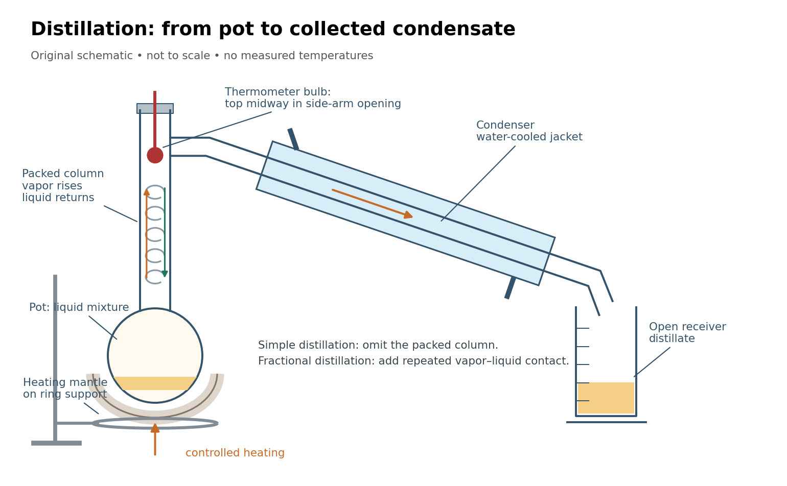

**[Figure 62](#image-distillation-pot-column-and-condenser). Distillation connects a heated pot, a fractionating column, a thermometer, a laboratory condenser, and a receiver**. Original schematic, not a scale drawing. Bulb position and mantle support follow the [paired simple and fractional distillation experiment](#paired-simple-and-fractional-distillation-experiment); blue marks the cooling jacket.

### Vacuum distillation

↑ **Parent:** [Distillation](#distillation)  
ⓦ [Wiki](https://en.wikipedia.org/wiki/Vacuum_distillation)

[Vacuum distillation](#vacuum-distillation) carries out [distillation](#distillation) at reduced [pressure](pressure.md).

### Laboratory condenser

↑ **Parent:** [Distillation](#distillation)

A [laboratory condenser](#laboratory-condenser) removes [heat](heat.md) from [vapor](thermodynamics.md#vapor) so that it becomes [liquid](thermodynamics.md#liquid). In [distillation](#distillation), the downstream [laboratory condenser](#laboratory-condenser) makes collectable distillate. Complete condensation, without loss or reaction, preserves the entering [vapor](thermodynamics.md#vapor)'s overall component [mole fractions](mathematical-biology.md#mole-fraction); cooling alone does not give another enrichment step. Partial condensation can instead leave two streams of different composition, requiring both [vapor-liquid equilibrium](critical-phenomenon.md#vapor-liquid-equilibrium) and a [distillation material balance](#distillation-material-balance).

### Simple distillation

↑ **Parent:** [Distillation](#distillation)

In [simple distillation](#simple-distillation), pot [vapor](thermodynamics.md#vapor) passes directly to the [laboratory condenser](#laboratory-condenser). An initial small condensate sample can approximate [vapor-liquid equilibrium](critical-phenomenon.md#vapor-liquid-equilibrium) with the current pot [liquid](thermodynamics.md#liquid). Removing enriched distillate depletes the pot's more volatile component. A collected fraction averages the changing condensate composition, rather than preserving the first-drop [mole fraction](mathematical-biology.md#mole-fraction).[Chem2O06 Laboratory Manual by McMaster University; A Mixture of Ideal Liquids, discussion of first and later fractions](chemistry-bibliography.md#chem2o06-laboratory-manual-by-mcmaster-university/distillation-introduction)

### Fractional distillation

↑ **Parent:** [Distillation](#distillation)  
ⓦ [Wiki](https://en.wikipedia.org/wiki/Fractional_distillation)

[Fractional distillation](#fractional-distillation) brings rising [vapor](thermodynamics.md#vapor) into contact with descending [liquid](thermodynamics.md#liquid) in a [fractionating column](#fractionating-column). Packing supplies contact area; it does not act as a sieve for individual [molecules](molecule.md). Repeated exchange can enrich the rising [vapor](thermodynamics.md#vapor) in the more volatile component. Some condensed [liquid](thermodynamics.md#liquid) returns downward as [reflux](#reflux), rather than all being withdrawn as distillate.[Introduction, paragraphs on reflux and plates, trays or packing](chemistry-bibliography.md#distillation-by-hong-kong-university-of-science-and-technology)

An [equilibrium stage](#equilibrium-stage) is an idealization of this contact. A real [fractionating column](#fractionating-column) has finite contact time and imperfect wetting and mixing; its length is not automatically a count of [equilibrium stages](#equilibrium-stage). Product withdrawal and [reflux](#reflux) affect the separation together. Thus the [repeated ideal-stage enrichment](#repeated-ideal-stage-enrichment) example illustrates the composition advantage of repeated equilibration, but supplies neither a column design nor a specified [reflux](#reflux) requirement.[Hyper-TVT by ETH Zurich; §5.6 Efficiency, equilibrium versus actual plates and flow-dependent efficiency](chemistry-bibliography.md#hyper-tvt-by-eth-zurich/distillation-efficiency)

#### Fractionating column

↑ **Parent:** [Fractional distillation](#fractional-distillation)  
ⓦ [Wiki](https://en.wikipedia.org/wiki/Fractionating_column)

A [fractionating column](#fractionating-column) provides contact between rising [vapor](thermodynamics.md#vapor) and returning [liquid](thermodynamics.md#liquid) during [fractional distillation](#fractional-distillation). Packing or trays provide contact area; the resulting separation depends on both [vapor-liquid equilibrium](critical-phenomenon.md#vapor-liquid-equilibrium) and the actual flow and exchange between the [thermodynamic phases](thermodynamics.md#thermodynamic-phase).[Introduction, paragraphs 3–4](chemistry-bibliography.md#distillation-by-hong-kong-university-of-science-and-technology)

#### Equilibrium stage

↑ **Parent:** [Fractional distillation](#fractional-distillation)

An [equilibrium stage](#equilibrium-stage) models a contact whose outgoing [liquid](thermodynamics.md#liquid) and [vapor](thermodynamics.md#vapor) satisfy [vapor-liquid equilibrium](critical-phenomenon.md#vapor-liquid-equilibrium) at the stage's [temperature](temperature.md) and [pressure](pressure.md). It is a composition model, not a claim that each piece of packing reaches [thermodynamic equilibrium](thermodynamics.md#thermodynamic-equilibrium).[Hyper-TVT by ETH Zurich; §5.6 Efficiency, opening equilibrium-plate assumption](chemistry-bibliography.md#hyper-tvt-by-eth-zurich/distillation-efficiency)

#### Reflux

↑ **Parent:** [Fractional distillation](#fractional-distillation)  
ⓦ [Wiki](https://en.wikipedia.org/wiki/Reflux)

[Reflux](#reflux) is condensed [liquid](thermodynamics.md#liquid) returned toward the heated part of a [distillation](#distillation) apparatus. In a [fractionating column](#fractionating-column), descending [reflux](#reflux) contacts rising [vapor](thermodynamics.md#vapor). Returning more condensate also changes the amount available for collection, so enrichment and product recovery must be considered together.[Introduction, reflux paragraph; Intended Learning Outcomes, reflux-ratio dependence](chemistry-bibliography.md#distillation-by-hong-kong-university-of-science-and-technology)

### Relative volatility

↑ **Parent:** [Distillation](#distillation)  
ⓦ [Wiki](https://en.wikipedia.org/wiki/Relative_volatility)

For a two-component [mixture](mixture.md), let $x$ be component A's [mole fraction](mathematical-biology.md#mole-fraction) in the [liquid](thermodynamics.md#liquid) and $y$ its [mole fraction](mathematical-biology.md#mole-fraction) in the coexisting [vapor](thermodynamics.md#vapor). At interior compositions, define the relative volatility of A with respect to B by the ratio of composition odds:

$$
\alpha=\frac{y/(1-y)}{x/(1-x)}.
$$

Thus $\alpha>1$ means A is enriched in the [vapor](thermodynamics.md#vapor), while $\alpha=1$ means $y=x$. Solving this definition gives

$$
\alpha x(1-y)=y(1-x),\qquad
 y=\frac{\alpha x}{1+(\alpha-1)x}.
$$

Here a constant [relative volatility](#relative-volatility) is a stipulated model of [vapor-liquid equilibrium](critical-phenomenon.md#vapor-liquid-equilibrium), not a measured property of a named [chemical solution](mixture.md#solution-chemistry). Real [relative volatility](#relative-volatility) can vary with composition, [temperature](temperature.md), and [pressure](pressure.md). The relation specifies no absolute [temperature](temperature.md) scale: even fixing $\alpha=2$ does not determine a [boiling](critical-phenomenon.md#boiling)-[temperature](temperature.md) curve or a [heat](heat.md) requirement.

#### Repeated ideal-stage enrichment

↑ **Parent:** [Relative volatility](#relative-volatility)

Stipulate a constant [relative volatility](#relative-volatility) $\alpha=2$. The [vapor-liquid equilibrium](critical-phenomenon.md#vapor-liquid-equilibrium) model then becomes

$$
y=\frac{2x}{1+x},\qquad y-x=\frac{x(1-x)}{1+x}>0\quad(0<x<1).
$$

An initial [liquid](thermodynamics.md#liquid) [mole fraction](mathematical-biology.md#mole-fraction) $x_0=3/10$ gives an equilibrium [vapor](thermodynamics.md#vapor) [mole fraction](mathematical-biology.md#mole-fraction) $y_0=6/13\approx0.461538$. Now imagine completely condensing a small sample of that [vapor](thermodynamics.md#vapor) and using this condensate as a fresh [liquid](thermodynamics.md#liquid) for another equilibration. Repeating this formal operation gives

$$
x_0=\frac3{10}=0.300000
\;\longmapsto\;
x_1=\frac6{13}\approx0.461538
\;\longmapsto\;
x_2=\frac{12}{19}\approx0.631579
\;\longmapsto\;
x_3=\frac{24}{31}\approx0.774194.
$$

These are original model calculations of ideal-stage enrichment. They are not measured compositions, a [reflux](#reflux) design, or successive compositions of one pot undergoing [simple distillation](#simple-distillation). That pot loses the more volatile component and becomes depleted; each step here instead starts from the previous enriched condensate. The displayed sequence specifies compositions, not the recoverable amount at each step.

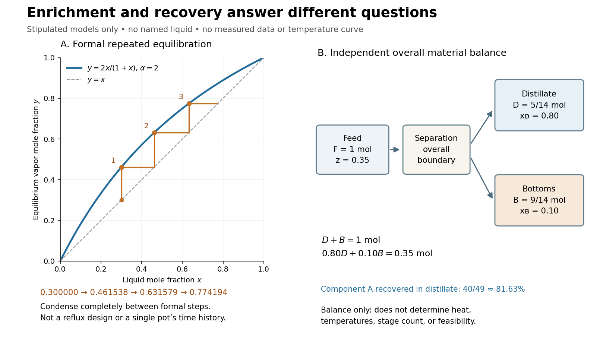

**[Figure 63](#image-distillation-ideal-enrichment-and-material-balance). Stipulated vapor-liquid equilibrium enrichment and a separate distillation material balance**. Left: the model $y=2x/(1+x)$ and formal repeated equilibration from $x_0=0.30$, using complete condensation between steps. The staircase is not a [reflux](#reflux) design or one-pot time history. Right: an independent product split with feed [amount of substance](physics.md#amount-of-substance) $F=1\,\mathrm{mol}$ and specified [mole fractions](mathematical-biology.md#mole-fraction). Neither panel contains measured data or a [boiling](critical-phenomenon.md#boiling)-[temperature](temperature.md) curve.

The algebra makes the enrichment especially transparent. With composition odds $r_n=x_n/(1-x_n)$, every formal step doubles the odds, so

$$
r_n=2^n\frac37,\qquad x_n=\frac{3\,2^n}{7+3\,2^n}.
$$

For every finite $n$, $x_n<1$, although $x_n\to1$ as $n\to\infty$. This explains why repeated ideal equilibration can improve composition without making finite-step perfect separation a consequence of the model.

### Distillation material balance

↑ **Parent:** [Distillation](#distillation)

Consider a nonreacting two-component [mixture](mixture.md) processed into just two products, with no losses or unaccounted inventory. Let $F,D,B$ be feed, distillate, and bottoms [amount of substance](physics.md#amount-of-substance) values in [moles](physics.md#mole-unit), and let $z,x_D,x_B$ be their component-A [mole fractions](mathematical-biology.md#mole-fraction). These are whole-stream compositions; $x_D$ is not automatically the instantaneous equilibrium [vapor](thermodynamics.md#vapor) composition $y$ above the pot. Total and component balances give

$$
F=D+B,\qquad Fz=Dx_D+Bx_B.
$$

The component-B balance follows by subtracting the second equation from the first. Eliminating $B$ gives, for $x_D\ne x_B$,

$$
\frac DF=\frac{z-x_B}{x_D-x_B},\qquad
\frac BF=\frac{x_D-z}{x_D-x_B}.
$$

Nonnegative product amounts require $z$ between $x_B$ and $x_D$. For an original stipulated feed $F=1\,\mathrm{mol}$, $z=0.35$, $x_D=0.80$, and $x_B=0.10$,

$$
D=\frac5{14}\,\mathrm{mol},\qquad B=\frac9{14}\,\mathrm{mol}.
$$

Check the component inventories:

$$
Dx_D=\frac27\,\mathrm{mol},\qquad Bx_B=\frac9{140}\,\mathrm{mol},\qquad
\frac27+\frac9{140}=\frac7{20}=0.35.
$$

The distillate contains a fraction $(Dx_D)/(Fz)=40/49\approx0.816327$ of the original component A, despite its higher [mole fraction](mathematical-biology.md#mole-fraction) $x_D=0.80$. This distinction between composition and recovery is useful when deciding how much enriched product to collect. These balances determine neither [temperatures](temperature.md), [heat](heat.md) input, nor the number of [equilibrium stages](#equilibrium-stage); they do not prove that the specified products are attainable in a particular [fractionating column](#fractionating-column).

### Paired simple and fractional distillation experiment

↑ **Parent:** [Distillation](#distillation)

McMaster University's 1997/98 laboratory manual compares [simple distillation](#simple-distillation) and [fractional distillation](#fractional-distillation) using charges of $25\,\mathrm{mL}$ each of [cyclohexane](chemical-substance.md#cyclohexane) and [p-xylene](chemical-substance.md#p-xylene). Part B uses a $100\,\mathrm{mL}$ round-bottom flask and a [fractionating column](#fractionating-column). The protocol specifies a [boiling chip](critical-phenomenon.md#boiling-chip), a heating mantle on a ring support, and the top of the [thermometer](temperature.md#thermometer) bulb midway in the opening toward the [laboratory condenser](#laboratory-condenser). Heating is adjusted for roughly one drop per second. Students record head [temperature](temperature.md) every $2\,\mathrm{mL}$ collected, up to $45\,\mathrm{mL}$, and plot both runs against collected [volume](thermodynamics.md#volume-thermodynamics) on the same axes.[Chem2O06 Laboratory Manual by McMaster University; Parts A–B, Figure 3.5 position instruction, and Recording of Results](chemistry-bibliography.md#chem2o06-laboratory-manual-by-mcmaster-university/experiment-3-procedures)

Charge, atmospheric operation, and collection rate provide comparison conditions; the [fractionating column](#fractionating-column) is changed. A sharper separation of [temperature](temperature.md) regions would support improved fractionation. It would not directly measure product [mole fractions](mathematical-biology.md#mole-fraction) or prove purity. The manual distinguishes collected [volume](thermodynamics.md#volume-thermodynamics) from composition and states that this pair forms no [azeotrope](#azeotrope). No student dataset is supplied here, and the constant-[relative volatility](#relative-volatility) example is not assigned to these liquids.[Chem2O06 Laboratory Manual by McMaster University; Recording of Results, distinction between temperature–volume and temperature–composition plots; comparison questions](chemistry-bibliography.md#chem2o06-laboratory-manual-by-mcmaster-university/experiment-3-procedures)

### Azeotrope

↑ **Parent:** [Distillation](#distillation)  
ⓦ [Wiki](https://en.wikipedia.org/wiki/Azeotrope)

An [azeotrope](#azeotrope) has equal coexisting [liquid](thermodynamics.md#liquid) and [vapor](thermodynamics.md#vapor) compositions: $y=x$. Ordinary [fractional distillation](#fractional-distillation) cannot cross this composition boundary at fixed [pressure](pressure.md); more packing does not remove it. A constant head [temperature](temperature.md) therefore does not establish a pure [chemical substance](chemical-substance.md).[Chem2O06 Laboratory Manual by McMaster University; Liquids that Form Azeotropes, constant-temperature mixtures and limits on separation](chemistry-bibliography.md#chem2o06-laboratory-manual-by-mcmaster-university/distillation-introduction) The stipulated $\alpha=2$ model has $y>x$ throughout $0<x<1$, so it has no interior [azeotrope](#azeotrope) and cannot represent this limit.

## ↑ Ancestors (1)

1. [Codex Wiki](README.md)

## ← Incoming links (15)

- [Analytical chemistry](#analytical-chemistry)
- [Biochemistry](biochemistry.md)
- [Chemical potential](chemical-potential.md)
- [Electrolyte](electrochemistry.md#electrolyte)
- [Ion](#ion)
- [Magdalena Wajrak](#magdalena-wajrak)
- [Marie Curie](nuclear-physicist.md#marie-curie)
- [Michael Faraday](#michael-faraday)
- [Monomer functionality](polymer.md#monomer-functionality)
- [Solution](past-exam-of-the-chemistry-b-course-of-the-university-of-cambridge/2022/paper-2.md#b8/b/solution)
- [Solution](past-exam-of-the-history-of-science-supplementary-subject-of-the-university-of-oxford/2016.md#6/solution)
- [Solution](past-exam-of-the-history-of-science-supplementary-subject-of-the-university-of-oxford/2022.md#4/solution)
- [Tim Harrison](#tim-harrison)
- [University of Oxford](university-of-oxford.md)
- [Weighing balance](physics.md#weighing-balance)
