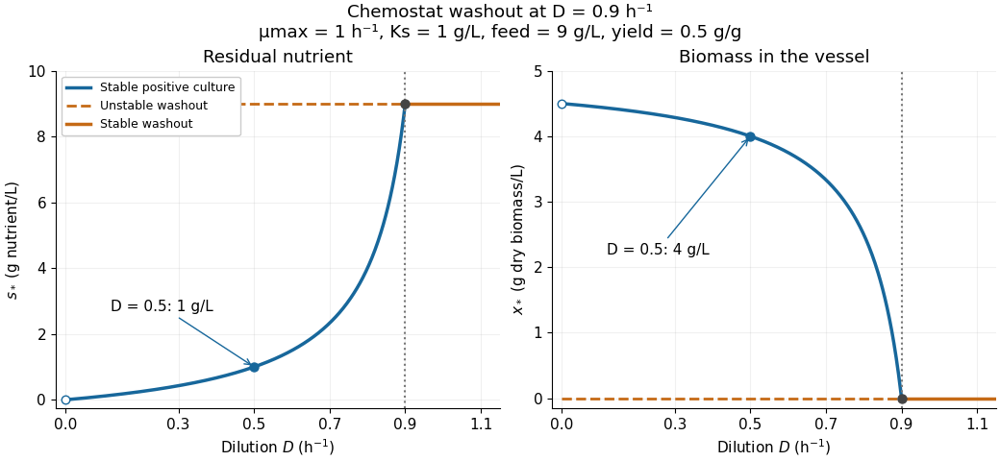

# Chemostat steady state

↑ **Parent:** [Chemostat](chemostat.md)

A [chemostat steady state](chemostat-steady-state.md) has constant nutrient [concentration](concentration.md) and [biomass concentration](biomass-concentration.md) even while nutrient and cells flow through the vessel. It is an [equilibrium](equilibrium-point-of-a-dynamical-system.md) of the [chemostat](chemostat.md) [ordinary differential equations](ordinary-differential-equation.md), rather than a culture in which all growth has stopped. Assume $D>0$ and the [Monod equation](monod-equation.md). Setting both [derivatives](derivative.md) to zero gives the always-existing [chemostat washout](chemostat-washout.md) [equilibrium](equilibrium-point-of-a-dynamical-system.md) $(s_*,x_*)=(s_{\mathrm{in}},0)$. A positive [biomass concentration](biomass-concentration.md) instead requires growth to balance removal, $\mu(s_*)=D$, whence

$$
s_* = \frac{DK_s}{\mu_{\max}-D},\qquad
x_* = Y(s_{\mathrm{in}}-s_*).
$$

The positive [chemostat steady state](chemostat-steady-state.md) exists exactly when

$$
0<D<\mu(s_{\mathrm{in}})=\frac{\mu_{\max}s_{\mathrm{in}}}{K_s+s_{\mathrm{in}}}.
$$

The weaker condition $D<\mu_{\max}$ only makes the denominator positive; it does not ensure $s_*<s_{\mathrm{in}}$ or $x_*>0$. Because the [Monod equation](monod-equation.md) is increasing, the feed must permit a [specific growth rate](specific-growth-rate.md) greater than $D$. At a positive [chemostat steady state](chemostat-steady-state.md), increasing feed nutrient [concentration](concentration.md) at fixed $D$ increases the [biomass concentration](biomass-concentration.md) without changing $s_*$, within the one-nutrient assumptions.

For a concrete [chemostat](chemostat.md), let $\mu_{\max}=1\,\mathrm{h}^{-1}$, $K_s=1\,\mathrm{g}\,\mathrm{L}^{-1}$, $s_{\mathrm{in}}=9\,\mathrm{g}\,\mathrm{L}^{-1}$ and $Y=0.5\,\mathrm{g}\text{ biomass}/(\mathrm{g}\text{ nutrient})$. At $D=0.5\,\mathrm{h}^{-1}$,

$$
s_* = \frac{0.5\times1}{1-0.5}=1\,\mathrm{g}\,\mathrm{L}^{-1},\qquad
x_* = 0.5(9-1)=4\,\mathrm{g}\,\mathrm{L}^{-1}.
$$

The nutrient supply minus outflow is $D(s_{\mathrm{in}}-s_*)=4\,\mathrm{g}\,\mathrm{L}^{-1}\,\mathrm{h}^{-1}$, matching nutrient consumption $\mu(s_*)x_*/Y=4\,\mathrm{g}\,\mathrm{L}^{-1}\,\mathrm{h}^{-1}$. Biomass production and removal both equal $2\,\mathrm{g}\,\mathrm{L}^{-1}\,\mathrm{h}^{-1}$. The [chemostat washout](chemostat-washout.md) threshold is $D_c=\mu(9)=0.9\,\mathrm{h}^{-1}$. For example, $D=0.95\,\mathrm{h}^{-1}<\mu_{\max}$ formally gives $s_*=19\,\mathrm{g}\,\mathrm{L}^{-1}$ and $x_*=-5\,\mathrm{g}\,\mathrm{L}^{-1}$, which cannot describe a physical culture.

**[Figure 2](#image-chemostat-steady-state-nutrient-and-biomass-branches-meeting-at-the-chemostat-washout-threshold). Chemostat steady state nutrient and biomass branches meeting at the chemostat washout threshold**.

There is a useful exact simplification: the nutrient-equivalent [concentration](concentration.md) $z=s+x/Y$ satisfies $\dot z=D(s_{\mathrm{in}}-z)$, so $z(t)=s_{\mathrm{in}}+[z(0)-s_{\mathrm{in}}]e^{-Dt}$. This combines dissolved nutrient and the nutrient equivalent of biomass; it does not assert that these two variables account for every chemical constituent. In coordinates $(z,x)$, the [Jacobian matrix](jacobian-matrix.md) at the positive [chemostat steady state](chemostat-steady-state.md) has [eigenvalues](eigenvalue.md) $-D$ and $-\mu'(s_*)x_*/Y$, both negative. Hence the positive [chemostat steady state](chemostat-steady-state.md) is [locally asymptotically stable](asymptotic-stability.md). In the worked example the [eigenvalues](eigenvalue.md) are $-0.5\,\mathrm{h}^{-1}$ and $-2\,\mathrm{h}^{-1}$.

## ↑ Ancestors (5)

1. [Chemostat](chemostat.md)
2. [Mathematical biology](mathematical-biology-split.md)
3. [Branches of physics](branches-of-physics.md)
4. [Physics](physics-split.md)
5. [Codex Wiki](split.md)

## ← Incoming links (5)

- [Chemostat](chemostat.md)
- [Chemostat steady state](chemostat-steady-state.md)
- [Chemostat washout](chemostat-washout.md)
- [Dilution rate](dilution-rate.md)
- [Monod equation](monod-equation.md)
