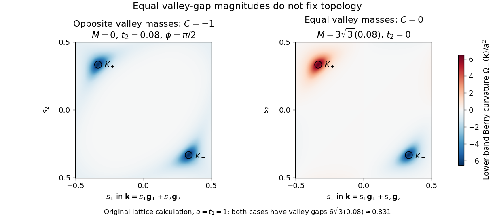

# Chern number of the Haldane model

↑ **Parent:** [Haldane model](haldane-model.md)

For $\mathbf d\ne0$, put $\widehat{\mathbf d}=\mathbf d/|\mathbf d|$. The lower-band [orthogonal projector](orthogonal-projection.md) is $P_-=(I-\widehat{\mathbf d}\cdot\boldsymbol\sigma)/2$. Applying the [Pauli matrix multiplication law](pauli-matrix-multiplication-law.md) to $i\operatorname{Tr}(P_-[\partial_{k_x}P_-,\partial_{k_y}P_-])$ gives

$$
\Omega_-=\frac12\widehat{\mathbf d}\cdot(\partial_{k_x}\widehat{\mathbf d}\times\partial_{k_y}\widehat{\mathbf d})
=\frac{\mathbf d\cdot(\partial_{k_x}\mathbf d\times\partial_{k_y}\mathbf d)}{2|\mathbf d|^3}.
$$

Thus the [Chern number](chern-number.md) is the signed number of times the [Brillouin zone](brillouin-zone.md) covers a [two-sphere](two-sphere.md) under $\widehat{\mathbf d}$. The lower [energy eigenstate](energy-eigenstate.md)'s actual [Bloch vector](bloch-vector.md) is $-\widehat{\mathbf d}$. The [Berry curvature](berry-curvature.md) has the displayed positive sign for this lower band and the stated [Berry connection](berry-connection.md); switching to the upper band changes its sign.

A useful local calculation exposes what each valley contributes. Write $p=\hbar v|\mathbf q|$. The linear [Dirac Hamiltonian](dirac-hamiltonian.md) gives

$$
\Omega_{-,\tau}(\mathbf q)=\frac{\tau m_\tau(\hbar v)^2}{2[(\hbar v|\mathbf q|)^2+m_\tau^2]^{3/2}},
\qquad
\frac1{2\pi}\int_{\mathbb R^2}\Omega_{-,\tau}\,d^2q
=\frac\tau2\int_0^\infty\frac{m_\tau p\,dp}{(p^2+m_\tau^2)^{3/2}}
=\frac\tau2\operatorname{sgn}m_\tau.
$$

Each unbounded continuum cone gives a half-integer in this calculation. It is not a separately realizable half-integer [Chern number](chern-number.md) of an isolated lattice [energy band](energy-band.md). The full [honeycomb lattice](honeycomb-lattice.md) supplies both valleys and the large-momentum completion. Starting with a trivial large-$|M|$ state, each single-valley mass crossing changes the lattice integer by the corresponding unit. There are no other band touchings. This establishes the exact lattice result

$$
C=\frac12\left[\operatorname{sgn}(M-\mu)-\operatorname{sgn}(M+\mu)\right]
=\begin{cases}-\operatorname{sgn}(\sin\phi),&|M|<3\sqrt3t_2|\sin\phi|,\\0,&|M|>3\sqrt3t_2|\sin\phi|,\end{cases}
$$

for $t_2>0$, excluding the boundaries. This sign belongs to our explicit bond vectors, orientation and occupied-band convention.

For an original worked example, choose $t_1=1$, $t_2=0.08$, $\phi=\pi/2$ and $M=0$. Then $\mu\simeq0.415692$, $(m_+,m_-)=(-\mu,+\mu)$, both valley gaps are $2\mu\simeq0.831384$, and $C=-1$. Choosing instead $t_2=0$, $M=\mu$ gives exactly the same valley-gap magnitudes but $C=0$. The first state's two valley contributions reinforce; the second state's cancel.

**[Figure 4](#image-equal-valley-gaps-can-conceal-different-berry-curvature-topology). Equal valley gaps can conceal different Berry-curvature topology**. [Source](haldane-valley-berry-curvature.py). Original calculation of the lower-band Berry curvature of the two explicitly defined lattice Hamiltonians, using the same colour scale. One reciprocal primitive cell is shown in fractional coordinates, with $mathbf g_icdotmathbf a_j=2\pi\delta_{ij}$, $mathbf a_1=\boldsymbol\delta_3-\boldsymbol\delta_1$, and $mathbf a_2=\boldsymbol\delta_2-\boldsymbol\delta_1$. The bond length is $a=1$. The coloured surfaces are model results, not measured curvature or a reconstruction of experimental data.

An independent eigenvector-overlap calculation on periodic $31\times31$, $61\times61$ and $121\times121$ momentum grids gives $C=-1$ for the first example and $C=0$ for the second. Reversing $\phi$ in the first example gives $C=+1$. Direct integration of the analytic lattice [Berry curvature](berry-curvature.md) agrees. For the overlap calculation one can remove the embedding phase from $f$, replacing it by $1+e^{i\mathbf k\cdot\mathbf a_1}+e^{i\mathbf k\cdot\mathbf a_2}$; this makes the cell-basis [Hamiltonian](hamiltonian.md) periodic and prevents a false boundary-seam contribution. The local [Berry curvature](berry-curvature.md) can depend on this basis convention; the integrated [Chern number](chern-number.md) agrees. All mass-zero parameters are excluded before evaluating any integer.

## ↑ Ancestors (7)

1. [Haldane model](haldane-model.md)
2. [Chern insulator](chern-insulator.md)
3. [Topological quantum matter](topological-quantum-matter-split.md)
4. [Quantum theory](quantum-theory-split.md)
5. [Branches of physics](branches-of-physics.md)
6. [Physics](physics-split.md)
7. [Codex Wiki](split.md)
