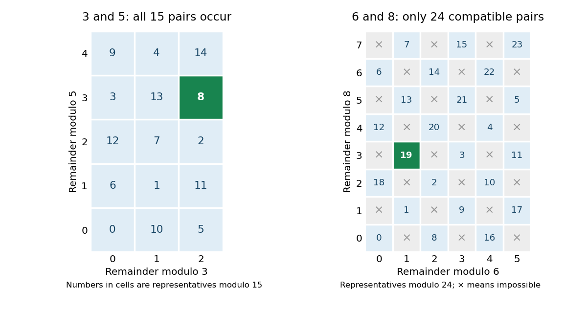

# Chinese remainder theorem

↑ **Parent:** [Mathematics](mathematics-split.md)  
ⓦ [Wiki](https://en.wikipedia.org/wiki/Chinese_remainder_theorem)

The Chinese remainder theorem says that [remainders](remainder.md) modulo pairwise [coprime](coprime-integers.md) positive [integers](integer-split.md) can be specified independently. For $m_1,\ldots,m_r$ pairwise [coprime](coprime-integers.md) and $M=m_1\cdots m_r$, every prescribed list $a_1,\ldots,a_r$ determines **one [congruence class](congruence-class.md) modulo $M$** satisfying $x\equiv a_j\pmod{m_j}$ for all $j$. It determines a class, rather than one unrestricted [integer](integer-split.md): adding a multiple of $M$ preserves every remainder.

For example, combine $x\equiv2\pmod3$ and $x\equiv3\pmod5$. Write $x=2+3k$ from the first condition. The second becomes $3k\equiv1\pmod5$. Since three has [modular inverse](modular-multiplicative-inverse.md) two modulo five, $k\equiv2\pmod5$, giving **$x\equiv8\pmod{15}$**. The [integers](integer-split.md) $8$, $23$ and $-7$ all work. The fifteen possibilities modulo fifteen correspond to the fifteen pairs in a three-by-five grid.

**[Figure 2](#image-coprime-moduli-fill-every-residue-pair-shared-factors-impose-a-compatibility-condition). Coprime moduli fill every residue pair; shared factors impose a compatibility condition**.

The theorem also preserves arithmetic: reducing an [addition](addition.md) or a [multiplication](multiplication.md) modulo each $m_j$ gives the same tuple as performing that operation on the corresponding [congruence classes](congruence-class.md). In the language of [quotient rings](quotient-ring.md), reduction is a [ring isomorphism](ring-isomorphism.md)

$$
\begin{aligned}
\mathbb Z/M\mathbb Z&\longrightarrow\prod_{j=1}^r\mathbb Z/m_j\mathbb Z,\\
[x]_M&\longmapsto([x]_{m_1},\ldots,[x]_{m_r}).
\end{aligned}
$$

One large residue is thus an exact encoding of several smaller residues. This is useful for splitting arithmetic into smaller calculations and then reconstructing the result; MIT's modular arithmetic notes develop both the reconstruction and the product representation. [Moitra, MIT 18.200, Lecture 15, section 4, Chinese remainder theorem](https://ocw.mit.edu/courses/18-200-principles-of-discrete-applied-mathematics-spring-2024/mit18_200_s24_lec15.pdf) For a concrete multiplication, $7$ corresponds to $(1,2)$ and $8$ to $(2,3)$ modulo $(3,5)$. Their componentwise product is $(2,1)$, which reconstructs to $11\pmod{15}$, agreeing with $56\equiv11\pmod{15}$.

A constructive formula explains the independence. For $m_j>1$, put $M_j=M/m_j$ and choose $u_j$ with $M_ju_j\equiv1\pmod{m_j}$, using a [modular multiplicative inverse](modular-multiplicative-inverse.md). Then $e_j=M_ju_j$ is one modulo $m_j$ and zero modulo every other $m_i$. Therefore

$$
x\equiv\sum_{j=1}^r a_je_j\pmod M
$$

has the desired remainders. A modulus equal to one imposes no restriction and can be omitted. Uniqueness follows because a difference divisible by every $m_j$ is divisible by their product when they are pairwise [coprime](coprime-integers.md). This short construction gives a reusable algorithm as well as an existence statement.

The [coprime](coprime-integers.md) hypothesis explains why every cell in the left grid is attainable. With [integer moduli](modulus-in-modular-arithmetic.md) six and eight, a pair must agree modulo their [greatest common divisor](greatest-common-divisor.md), two. There are twenty-four compatible pairs, rather than forty-eight arbitrary pairs; each corresponds to a class modulo the [least common multiple](least-common-multiple.md), twenty-four. The [Chinese remainder theorem for noncoprime moduli](chinese-remainder-theorem-for-noncoprime-moduli.md) states the resulting compatibility rule.

**Table of contents**

- [Garner's algorithm](garner-s-algorithm.md)
- [Chinese remainder theorem for noncoprime moduli](chinese-remainder-theorem-for-noncoprime-moduli.md)
- [Chinese remainder theorem for ideals](chinese-remainder-theorem-for-ideals.md)
- [Prime-power fraction decomposition](prime-power-fraction-decomposition.md)
- [Lagrange theorem for polynomial congruences](lagrange-theorem-for-polynomial-congruences.md)
- [Chinese remainder theorem for unit groups](chinese-remainder-theorem-for-unit-groups.md)
  - [Multiplicative order under the Chinese remainder theorem](multiplicative-order-under-the-chinese-remainder-theorem.md)

## ↑ Ancestors (2)

1. [Mathematics](mathematics-split.md)
2. [Codex Wiki](split.md)

## ← Incoming links (130)

- [Artinian commutative ring is Noetherian theorem](artinian-commutative-ring-is-noetherian-theorem.md)
- [Artinian decomposition into local factors](artinian-decomposition-into-local-factors.md)
- [Carmichael number](carmichael-number.md)
- [Conductor of a Dirichlet character](conductor-of-a-dirichlet-character.md)
- [Congruence of squares](congruence-of-squares.md)
- [Cyclicity of a product of two finite cyclic groups](cyclicity-of-a-product-of-two-finite-cyclic-groups.md)
- [Disconnected reduced spectrum product decomposition](disconnected-reduced-spectrum-product-decomposition.md)
- [Existence of an Euler witness for every odd composite integer](existence-of-an-euler-witness-for-every-odd-composite-integer.md)
- [Factorial graph formula via remainder coding](factorial-graph-formula-via-remainder-coding.md)
- [Fermat test example](fermat-test-example.md)
- [Finite length of a commutative Artinian ring](finite-length-of-a-commutative-artinian-ring.md)
- [Full-period criterion for a mixed congruential generator](full-period-criterion-for-a-mixed-congruential-generator.md)
- [Gödel beta-function sequence coding](godel-beta-function-sequence-coding.md)
- [Ideal approximation theorem](ideal-approximation-theorem.md)
- [Infinitely many prime quadratic nonresidues of a nonsquare integer](infinitely-many-prime-quadratic-nonresidues-of-a-nonsquare-integer.md)
- [Jordan–Chevalley decomposition](jordan-chevalley-decomposition.md)
- [Large sieve upper bound for sifted intervals](large-sieve-upper-bound-for-sifted-intervals.md)
- [Modular arithmetic](modular-arithmetic-split.md)
- [Nonreduced reducible fibre between integral schemes](nonreduced-reducible-fibre-between-integral-schemes.md)
- [Number theory](number-theory-split.md)
- [Passing-base fraction for the Fermat test](passing-base-fraction-for-the-fermat-test.md)
- [Solution](past-exam-of-the-mathematics-course-of-the-university-of-cambridge/2001/iii/paper-75/5/solution.md)
- [Solution](past-exam-of-the-mathematics-course-of-the-university-of-cambridge/2002/iii/paper-2/1/b/solution.md)
- [Solution](past-exam-of-the-mathematics-course-of-the-university-of-cambridge/2002/iii/paper-25/4/solution.md)
- [Solution](past-exam-of-the-mathematics-course-of-the-university-of-cambridge/2003/ib/paper-3/9g/solution.md)
- [Solution](past-exam-of-the-mathematics-course-of-the-university-of-cambridge/2003/iii/paper-2/1/solution.md)
- [Solution](past-exam-of-the-mathematics-course-of-the-university-of-cambridge/2003/iii/paper-23/5/ii/solution.md)
- [Solution](past-exam-of-the-mathematics-course-of-the-university-of-cambridge/2004/ia/paper-4/1e/c/solution.md)
- [Solution](past-exam-of-the-mathematics-course-of-the-university-of-cambridge/2004/ib/paper-3/2f/solution.md)
- [Solution](past-exam-of-the-mathematics-course-of-the-university-of-cambridge/2005/ia/paper-4/1e/solution.md)
- [Solution](past-exam-of-the-mathematics-course-of-the-university-of-cambridge/2005/ib/paper-4/11c/solution.md)
- [Solution](past-exam-of-the-mathematics-course-of-the-university-of-cambridge/2005/iii/paper-28/6/solution.md)
- [Solution](past-exam-of-the-mathematics-course-of-the-university-of-cambridge/2005/iii/paper-31/1/i/solution.md)
- [Solution](past-exam-of-the-mathematics-course-of-the-university-of-cambridge/2005/iii/paper-31/5/ii/solution.md)
- [Solution](past-exam-of-the-mathematics-course-of-the-university-of-cambridge/2006/ii/paper-3/12g/solution.md)
- [Solution](past-exam-of-the-mathematics-course-of-the-university-of-cambridge/2006/iii/paper-23/2/solution.md)
- [Solution](past-exam-of-the-mathematics-course-of-the-university-of-cambridge/2006/iii/paper-28/4/solution.md)
- [Solution](past-exam-of-the-mathematics-course-of-the-university-of-cambridge/2007/ii/paper-3/11f/solution.md)
- [Solution](past-exam-of-the-mathematics-course-of-the-university-of-cambridge/2007/iii/paper-27/1/ii/solution.md)
- [Solution](past-exam-of-the-mathematics-course-of-the-university-of-cambridge/2007/iii/paper-29/5/b/solution.md)
- [Solution](past-exam-of-the-mathematics-course-of-the-university-of-cambridge/2007/iii/paper-30/3/solution.md)
- [Solution](past-exam-of-the-mathematics-course-of-the-university-of-cambridge/2008/ii/paper-2/12g/solution.md)
- [Solution](past-exam-of-the-mathematics-course-of-the-university-of-cambridge/2008/ii/paper-3/11h/solution.md)
- [Solution](past-exam-of-the-mathematics-course-of-the-university-of-cambridge/2008/iii/paper-32/2/i/solution.md)
- [Solution](past-exam-of-the-mathematics-course-of-the-university-of-cambridge/2008/iii/paper-7/4/b/solution.md)
- [Solution](past-exam-of-the-mathematics-course-of-the-university-of-cambridge/2009/ii/paper-1/1g/solution.md)
- [Solution](past-exam-of-the-mathematics-course-of-the-university-of-cambridge/2009/iii/paper-18/3/solution.md)
- [Solution](past-exam-of-the-mathematics-course-of-the-university-of-cambridge/2009/iii/paper-4/4/solution.md)
- [Solution](past-exam-of-the-mathematics-course-of-the-university-of-cambridge/2010/ia/paper-4/1e/b/solution.md)
- [Solution](past-exam-of-the-mathematics-course-of-the-university-of-cambridge/2010/ii/paper-4/11g/solution.md)
- [Solution](past-exam-of-the-mathematics-course-of-the-university-of-cambridge/2010/iii/paper-23/5/solution.md)
- [Solution](past-exam-of-the-mathematics-course-of-the-university-of-cambridge/2010/iii/paper-26/1/solution.md)
- [Solution](past-exam-of-the-mathematics-course-of-the-university-of-cambridge/2010/iii/paper-26/2/i/solution.md)
- [Solution](past-exam-of-the-mathematics-course-of-the-university-of-cambridge/2011/ii/paper-1/12g/solution.md)
- [Solution](past-exam-of-the-mathematics-course-of-the-university-of-cambridge/2011/ii/paper-4/11i/ii/solution.md)
- [Solution](past-exam-of-the-mathematics-course-of-the-university-of-cambridge/2012/ia/paper-4/1d/ii/solution.md)
- [Solution](past-exam-of-the-mathematics-course-of-the-university-of-cambridge/2012/iii/paper-28/3/b/i/solution.md)
- [Solution](past-exam-of-the-mathematics-course-of-the-university-of-cambridge/2012/iii/paper-4/1/a/solution.md)
- [Solution](past-exam-of-the-mathematics-course-of-the-university-of-cambridge/2012/iii/paper-4/2/solution.md)
- [Solution](past-exam-of-the-mathematics-course-of-the-university-of-cambridge/2012/iii/paper-81/1/solution.md)
- [Solution](past-exam-of-the-mathematics-course-of-the-university-of-cambridge/2013/ib/paper-2/11g/iii/solution.md)
- [Solution](past-exam-of-the-mathematics-course-of-the-university-of-cambridge/2013/iii/paper-13/1/solution.md)
- [Solution](past-exam-of-the-mathematics-course-of-the-university-of-cambridge/2013/iii/paper-13/2/solution.md)
- [Solution](past-exam-of-the-mathematics-course-of-the-university-of-cambridge/2013/iii/paper-2/3/solution.md)
- [Solution](past-exam-of-the-mathematics-course-of-the-university-of-cambridge/2013/iii/paper-20/3/solution.md)
- [Solution](past-exam-of-the-mathematics-course-of-the-university-of-cambridge/2013/iii/paper-21/4/solution.md)
- [Solution](past-exam-of-the-mathematics-course-of-the-university-of-cambridge/2013/iii/paper-21/5/solution.md)
- [Solution](past-exam-of-the-mathematics-course-of-the-university-of-cambridge/2013/iii/paper-23/1/a/solution.md)
- [Solution](past-exam-of-the-mathematics-course-of-the-university-of-cambridge/2013/iii/paper-23/5/d/solution.md)
- [Solution](past-exam-of-the-mathematics-course-of-the-university-of-cambridge/2013/iii/paper-58/1/a/solution.md)
- [Solution](past-exam-of-the-mathematics-course-of-the-university-of-cambridge/2014/iii/paper-1/1/solution.md)
- [Solution](past-exam-of-the-mathematics-course-of-the-university-of-cambridge/2015/ia/paper-4/2e/solution.md)
- [Solution](past-exam-of-the-mathematics-course-of-the-university-of-cambridge/2015/ii/paper-2/10g/solution.md)
- [9H](past-exam-of-the-mathematics-course-of-the-university-of-cambridge/2015/ii/paper-4/9h.md)
- [Solution](past-exam-of-the-mathematics-course-of-the-university-of-cambridge/2015/ii/paper-4/9h/ii/solution.md)
- [Solution](past-exam-of-the-mathematics-course-of-the-university-of-cambridge/2015/ii/paper-4/9h/iii/solution.md)
- [Solution](past-exam-of-the-mathematics-course-of-the-university-of-cambridge/2015/ii/paper-4/9h/iv/solution.md)
- [Solution](past-exam-of-the-mathematics-course-of-the-university-of-cambridge/2015/iii/paper-2/3/solution.md)
- [Solution](past-exam-of-the-mathematics-course-of-the-university-of-cambridge/2015/iii/paper-20/2/b/solution.md)
- [Solution](past-exam-of-the-mathematics-course-of-the-university-of-cambridge/2015/iii/paper-25/3/solution.md)
- [Solution](past-exam-of-the-mathematics-course-of-the-university-of-cambridge/2016/ia/paper-4/6e/solution.md)
- [Solution](past-exam-of-the-mathematics-course-of-the-university-of-cambridge/2016/iii/paper-113/2/i/solution.md)
- [Solution](past-exam-of-the-mathematics-course-of-the-university-of-cambridge/2017/ii/paper-4/3g/solution.md)
- [Solution](past-exam-of-the-mathematics-course-of-the-university-of-cambridge/2017/iii/paper-125/3/a/solution.md)
- [Solution](past-exam-of-the-mathematics-course-of-the-university-of-cambridge/2017/iii/paper-137/4/solution.md)
- [Solution](past-exam-of-the-mathematics-course-of-the-university-of-cambridge/2018/ii/paper-1/1g/a/solution.md)
- [Solution](past-exam-of-the-mathematics-course-of-the-university-of-cambridge/2018/ii/paper-1/1g/b/solution.md)
- [Solution](past-exam-of-the-mathematics-course-of-the-university-of-cambridge/2018/ii/paper-4/11g/b/solution.md)
- [Solution](past-exam-of-the-mathematics-course-of-the-university-of-cambridge/2018/iii/paper-101/5/c/solution.md)
- [Solution](past-exam-of-the-mathematics-course-of-the-university-of-cambridge/2019/ia/paper-4/1e/solution.md)
- [Solution](past-exam-of-the-mathematics-course-of-the-university-of-cambridge/2019/ii/paper-1/1i/a/solution.md)
- [Solution](past-exam-of-the-mathematics-course-of-the-university-of-cambridge/2019/iii/paper-123/1/i/solution.md)
- [Solution](past-exam-of-the-mathematics-course-of-the-university-of-cambridge/2019/iii/paper-148/4/solution.md)
- [Solution](past-exam-of-the-mathematics-course-of-the-university-of-cambridge/2019/iii/paper-150/2/c/solution.md)
- [Solution](past-exam-of-the-mathematics-course-of-the-university-of-cambridge/2020/ia/paper-2/7d/a/solution.md)
- [Solution](past-exam-of-the-mathematics-course-of-the-university-of-cambridge/2020/ii/paper-1/1h/solution.md)
- [Solution](past-exam-of-the-mathematics-course-of-the-university-of-cambridge/2020/ii/paper-3/1h/solution.md)
- [Solution](past-exam-of-the-mathematics-course-of-the-university-of-cambridge/2021/ia/paper-4/6e/a/ii/solution.md)
- [Solution](past-exam-of-the-mathematics-course-of-the-university-of-cambridge/2021/ii/paper-2/1i/solution.md)
- [Solution](past-exam-of-the-mathematics-course-of-the-university-of-cambridge/2021/ii/paper-4/11i/c/solution.md)
- [Solution](past-exam-of-the-mathematics-course-of-the-university-of-cambridge/2021/ii/paper-4/3k/solution.md)
- [Solution](past-exam-of-the-mathematics-course-of-the-university-of-cambridge/2021/iii/paper-120/2/solution.md)
- [Solution](past-exam-of-the-mathematics-course-of-the-university-of-cambridge/2021/iii/paper-123/2/solution.md)
- [Solution](past-exam-of-the-mathematics-course-of-the-university-of-cambridge/2022/ia/paper-4/5e/solution.md)
- [Solution](past-exam-of-the-mathematics-course-of-the-university-of-cambridge/2022/ii/paper-2/12k/a/solution.md)
- [Solution](past-exam-of-the-mathematics-course-of-the-university-of-cambridge/2022/ii/paper-2/20h/a/solution.md)
- [Solution](past-exam-of-the-mathematics-course-of-the-university-of-cambridge/2022/ii/paper-3/1i/solution.md)
- [Solution](past-exam-of-the-mathematics-course-of-the-university-of-cambridge/2022/iii/paper-117/1/c/solution.md)
- [Solution](past-exam-of-the-mathematics-course-of-the-university-of-cambridge/2023/ia/paper-4/2e/solution.md)
- [Solution](past-exam-of-the-mathematics-course-of-the-university-of-cambridge/2024/iii/paper-101/2/i/solution.md)
- [Solution](past-exam-of-the-mathematics-course-of-the-university-of-cambridge/2024/iii/paper-136/5/a/solution.md)
- [Solution](past-exam-of-the-mathematics-course-of-the-university-of-cambridge/2025/ia/paper-4/6e/e/solution.md)
- [Solution](past-exam-of-the-mathematics-course-of-the-university-of-cambridge/2025/ib/paper-2/9e/c/solution.md)
- [Solution](past-exam-of-the-mathematics-course-of-the-university-of-cambridge/2025/iii/paper-165/2/vi/solution.md)
- [Solution](past-exam-of-the-mathematics-course-of-the-university-of-cambridge/2026/iii/paper-101/5/c/i/solution.md)
- [Solution](past-exam-of-the-mathematics-course-of-the-year-2-of-the-natural-sciences-course-of-the-university-of-cambridge/2014/paper-2/8/ii/solution.md)
- [Solution](past-exam-of-the-mathematics-course-of-the-year-2-of-the-natural-sciences-course-of-the-university-of-cambridge/2023/paper-2/9/c/solution.md)
- [Solution](past-exam-of-the-mathematics-course-of-the-year-2-of-the-natural-sciences-course-of-the-university-of-cambridge/2024/paper-2/9/b/solution.md)
- [Pólya–Vinogradov inequality](polya-vinogradov-inequality.md)
- [Polynomial root density in a sieve](polynomial-root-density-in-a-sieve.md)
- [Prime-power fraction decomposition](prime-power-fraction-decomposition.md)
- [Primitive representation criterion at discriminant minus thirty-five](primitive-representation-criterion-at-discriminant-minus-thirty-five.md)
- [Proof of Korselt criterion](proof-of-korselt-criterion.md)
- [Quadratic residue](quadratic-residue-split.md)
- [Quotient-ring proof of the Kummer-Dedekind theorem](quotient-ring-proof-of-the-kummer-dedekind-theorem.md)
- [Repeated-message attack on the Rabin cryptosystem](repeated-message-attack-on-the-rabin-cryptosystem.md)
- [Surjectivity of decomposition group reduction](surjectivity-of-decomposition-group-reduction.md)
- [Two generators for an ideal in a Dedekind domain](two-generators-for-an-ideal-in-a-dedekind-domain.md)
- [Two-sample exact period recovery](two-sample-exact-period-recovery.md)
- [Wheel factorization](wheel-factorization.md)
