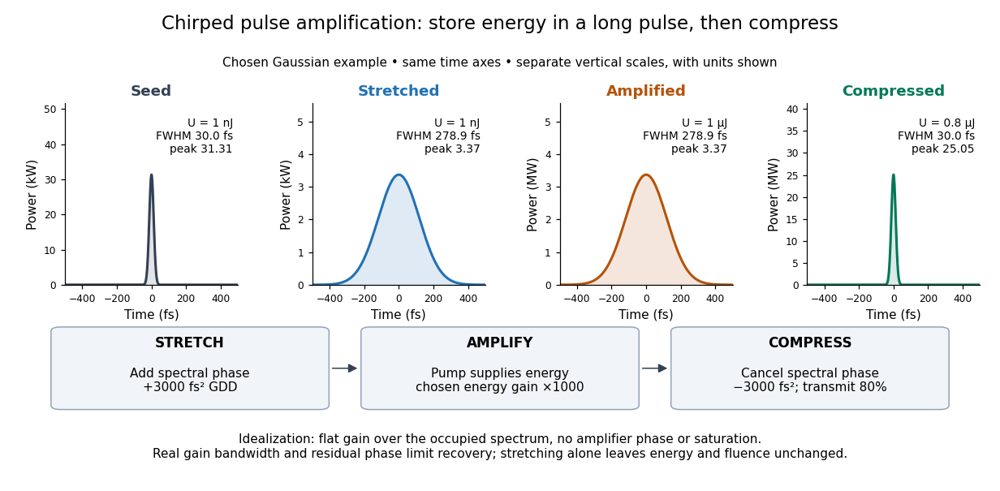

# Chirped pulse amplification

↑ **Parent:** [Laser](laser-split.md)  
ⓦ [Wiki](https://en.wikipedia.org/wiki/Chirped_pulse_amplification)

[Chirped pulse amplification](chirped-pulse-amplification.md) increases an [optical pulse](optical-pulse.md)'s [energy](energy-split.md) while keeping its [peak power](peak-power.md) lower during amplification: stretch the pulse, amplify it, then compress it. A [chirp](chirp.md) is a changing instantaneous [frequency](frequency.md). Stretching separates the arrival times of different [frequencies](frequency.md); [pulse compression](pulse-compression.md) brings their contributions back together. The gain medium supplies [energy](energy-split.md), whereas the compressor concentrates the surviving [energy](energy-split.md) into a shorter time.

[Donna Strickland](donna-strickland.md) and [Gérard Mourou](gerard-mourou.md) demonstrated [chirped pulse amplification](chirped-pulse-amplification.md) at Rochester in 1985. Their experiment used an [optical fiber](optical-fiber.md), a regenerative amplifier and a [diffraction grating](diffraction-grating.md) compressor.[Strickland and Mourou, corrected December 1985 paper, pp.219–221](compression-of-amplified-chirped-optical-pulses-by-donna-strickland-and-gerard-mourou.md)

**[Figure 7](#image-stretch-add-energy-then-recover-a-short-pulse). Stretch, add energy, then recover a short pulse**. Original functional [chirped pulse amplification](chirped-pulse-amplification.md) diagram using chosen [Gaussian functions](gaussian-function.md) for pulse [power](power.md). The common time axes show the stretching; each vertical axis has its own labelled scale. The idealized amplifier has flat [optical gain](optical-gain.md) across the occupied spectrum, and the compressor transmits 80 percent of the incident [energy](energy-split.md). These are teaching assumptions, not a reconstruction of the 1985 apparatus or a measured pulse trace.

The useful idea is to arrange where the large [peak power](peak-power.md) occurs. Lower [light intensity](light-intensity.md) in the amplifier reduces unwanted [self-focusing](self-focusing.md) and [self-phase modulation](self-phase-modulation.md); the compressed output can still drive strong [nonlinear optics](nonlinear-optics.md). Stretching does not remove every damage mechanism, and compression does not manufacture [energy](energy-split.md).

**Table of contents**

- [Chirped pulse amplification energy budget](chirped-pulse-amplification-energy-budget.md)
- [Spectral phase in pulse compression](spectral-phase-in-pulse-compression.md)
- [Gaussian chirped pulse compression](gaussian-chirped-pulse-compression.md)
- [Strickland-Mourou chirped pulse amplification experiment](strickland-mourou-chirped-pulse-amplification-experiment.md)

## ↑ Ancestors (5)

1. [Laser](laser-split.md)
2. [Optics](optics-split.md)
3. [Branches of physics](branches-of-physics.md)
4. [Physics](physics-split.md)
5. [Codex Wiki](split.md)

## ← Incoming links (1)

- [Chirped pulse amplification](chirped-pulse-amplification.md)
