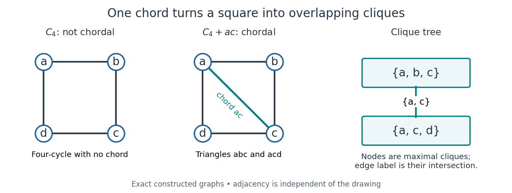

# Chordal graph

↑ **Parent:** [Graph theory](graph-theory-split.md)  
ⓦ [Wiki](https://en.wikipedia.org/wiki/Chordal_graph)

A [chordal graph](chordal-graph.md) is a finite [simple graph](simple-graph.md) with no [induced cycle](induced-cycle.md) of length at least four. Equivalently, every [cycle in a graph](cycle-in-a-graph.md) with at least four [vertices](vertex-graph-theory.md) has a chord: an [edge](edge-of-a-graph.md) joining two nonconsecutive [vertices](vertex-graph-theory.md) of that [graph cycle](cycle-in-a-graph.md). The word "induced" matters: the [induced subgraph](induced-subgraph.md) on the chosen [vertices](vertex-graph-theory.md) must contain exactly the cycle's [edges](edge-of-a-graph.md), with no chords. Triangles are allowed. This definition concerns adjacency, independently of how the [graph](graph-split.md) is drawn.

For the square [cycle graph](cycle-graph.md) $C_4$, take [vertex set](vertex-set.md) $\{a,b,c,d\}$ and set of [edges](edge-of-a-graph.md) $\{ab,bc,cd,da\}$, where $ab$ abbreviates $\{a,b\}$. Its [graph neighbourhoods](graph-neighbourhood.md) are $N(a)=N(c)=\{b,d\}$ and $N(b)=N(d)=\{a,c\}$. The square is an [induced cycle](induced-cycle.md), so $C_4$ is not a [chordal graph](chordal-graph.md). Add the single [edge](edge-of-a-graph.md) $ac$: now $N(a)=\{b,c,d\}$, $N(b)=\{a,c\}$, $N(c)=\{a,b,d\}$, and $N(d)=\{a,c\}$. The only possible four-[vertex](vertex-graph-theory.md) [graph cycle](cycle-in-a-graph.md) has chord $ac$, so this new [graph](graph-split.md) is a [chordal graph](chordal-graph.md). Its [maximal cliques](maximal-clique.md) are exactly $\{a,b,c\}$ and $\{a,c,d\}$.

**[Figure 1](#image-an-induced-cycle-loses-its-obstruction-when-one-diagonal-is-added-the-resulting-maximal-cliques-form-a-junction-tree). An induced cycle loses its obstruction when one diagonal is added; the resulting maximal cliques form a junction tree**.

Connect these two [maximal cliques](maximal-clique.md) by a single [edge](edge-of-a-graph.md) labelled with their intersection $\{a,c\}$. The result is a [junction tree](junction-tree.md), also called a clique tree: its nodes are [maximal cliques](maximal-clique.md), and the nodes containing any fixed original [vertex](vertex-graph-theory.md) induce a [connected graph](connected-graph.md) inside the [tree](tree-graph-theory.md). Here $a,c$ occur in both nodes, while $b,d$ each occur in just one. This is the [running intersection property](running-intersection-property.md). More generally, a nonempty [connected graph](connected-graph.md) is a [chordal graph](chordal-graph.md) exactly when its [maximal cliques](maximal-clique.md) admit such a [tree](tree-graph-theory.md); a disconnected [chordal graph](chordal-graph.md) can be represented by one such [tree](tree-graph-theory.md) per [connected component of a graph](component-graph-theory.md).[§3.1–3.2](an-introduction-to-chordal-graphs-and-clique-trees-by-jean-r-s-blair-and-others.md)

A [chordal graph](chordal-graph.md) need not be a [planar graph](planar-graph.md): the [complete graph](complete-graph.md) $K_5$ is a [chordal graph](chordal-graph.md), since every pair of distinct [vertices](vertex-graph-theory.md) is adjacent, but its ten [edges](edge-of-a-graph.md) violate the [planar graph edge bound](planar-graph-edge-bound.md) $|E|\leq3|V|-6=9$. Conversely, even a plane drawing whose bounded faces are triangles can hide an [induced cycle](induced-cycle.md): a [wheel graph](wheel-graph.md) with a four-[vertex](vertex-graph-theory.md) rim and a central [vertex](vertex-graph-theory.md) joined to the whole rim still has the rim as an [induced cycle](induced-cycle.md). Adding chords to obtain a [chordal graph](chordal-graph.md) is called [triangulation of an undirected graph](triangulation-of-an-undirected-graph.md); this is an adjacency condition, rather than a requirement about planar faces.

Why is this structure useful? The [maximal cliques](maximal-clique.md) collect local interactions, and the [running intersection property](running-intersection-property.md) makes their overlaps sufficient for consistent communication. For [random variables](random-variable-split.md) $x_a,x_b,x_c,x_d$ with finite state sets, a [probabilistic graphical model](probabilistic-graphical-model.md) of the square-plus-diagonal form can have

$$
p(x_a,x_b,x_c,x_d)=Z^{-1}\psi_{abc}(x_a,x_b,x_c)\psi_{acd}(x_a,x_c,x_d),
$$

where the two nonnegative [clique potentials](clique-potential.md) have a positive [normalizing constant](normalizing-constant.md) $Z$. Eliminating $x_b$ produces the two-variable [junction-tree sum-product message](junction-tree-sum-product-message.md)

$$
m(x_a,x_c)=\sum_{x_b}\psi_{abc}(x_a,x_b,x_c),\qquad Z=\sum_{x_a,x_c,x_d}m(x_a,x_c)\psi_{acd}(x_a,x_c,x_d).
$$

The shared [clique](clique-graph-theory.md) $\{a,c\}$ carries everything needed from the eliminated side. For $q$ possible states per [random variable](random-variable-split.md), this example uses two sums over $q^3$ configurations after reusing the message, rather than directly summing over $q^4$ configurations. The example's message is an exact finite sum, with no simulated data. Large [maximal cliques](maximal-clique.md) still make exact inference expensive; [chordal graphs](chordal-graph.md) provide a decomposition, not a universal guarantee of cheap inference.[§1; §6](recitation-8-junction-trees-by-massachusetts-institute-of-technology-department-of-electrical-engineering-and-computer-science.md)

**Table of contents**

- [Triangulation of an undirected graph](triangulation-of-an-undirected-graph.md)
- [Perfect elimination ordering](perfect-elimination-ordering.md)
  - [Simplicial vertex (graph theory)](simplicial-vertex-graph-theory.md)
  - [Maximum cardinality search](maximum-cardinality-search.md)

## ↑ Ancestors (5)

1. [Graph theory](graph-theory-split.md)
2. [Foundations of mathematics](foundations-of-mathematics-split.md)
3. [Area of mathematics](area-of-mathematics.md)
4. [Mathematics](mathematics-split.md)
5. [Codex Wiki](split.md)

## ← Incoming links (10)

- [Chordal graph](chordal-graph.md)
- [Induced cycle](induced-cycle.md)
- [Junction tree](junction-tree.md)
- [Maximum cardinality search](maximum-cardinality-search.md)
- [Solution](past-exam-of-the-mathematics-course-of-the-university-of-cambridge/2001/iii/paper-57/4/solution.md)
- [Solution](past-exam-of-the-mathematics-course-of-the-university-of-cambridge/2002/iii/paper-60/6/solution.md)
- [Solution](past-exam-of-the-mathematics-course-of-the-university-of-cambridge/2004/iii/paper-39/3/e/solution.md)
- [Perfect elimination ordering](perfect-elimination-ordering.md)
- [Simplicial vertex (graph theory)](simplicial-vertex-graph-theory.md)
- [Triangulation of an undirected graph](triangulation-of-an-undirected-graph.md)
