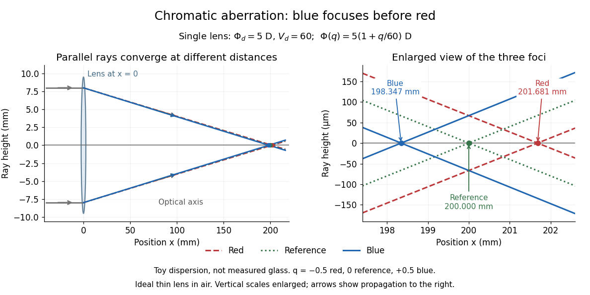

# Chromatic aberration

↑ **Parent:** [Optical aberration](optical-aberration.md)  
ⓦ [Wiki](https://en.wikipedia.org/wiki/Chromatic_aberration)

An [optical camera](optical-camera.md) can focus a white object sharply in one colour while leaving coloured fringes around its edges in another. [Chromatic aberration](chromatic-aberration.md) is the dependence of image position or image scale on [wavelength](wavelength.md), caused by [optical dispersion](dispersion-optics.md) in the [optical lens](lens-optics.md) materials. [Axial chromatic aberration](axial-chromatic-aberration.md) separates the [optical foci](focus-optics.md) along the [optical axis](optical-axis.md); [lateral chromatic aberration](lateral-chromatic-aberration.md) changes the [transverse magnification](transverse-magnification.md) with [wavelength](wavelength.md). Moving the receiving plane can favour one colour without bringing all colours into focus. [Richard Fitzpatrick, University of Texas at Austin, Chromatic aberration](https://farside.ph.utexas.edu/teaching/302l/lectures/node142.html); [Nikon, Comparison of ED glass and ordinary lens](https://imaging.nikon.com/sport-optics/guide/fieldscopes/choosing/choosing_03/).

For ordinary [optical glass](optical-glass.md) in the visible range, the blue [refractive index](refractive-index.md) exceeds the red [refractive index](refractive-index.md). For a fixed positive [thin lens](thin-lens.md) in air, the [lensmaker's equation](lensmaker-s-equation.md) then gives

$$
\Phi(\lambda)=\frac{1}{f(\lambda)}=[n(\lambda)-1]\left(\frac{1}{R_a}-\frac{1}{R_b}\right),\qquad n_{\rm blue}>n_{\rm red}\ \Longrightarrow\ \Phi_{\rm blue}>\Phi_{\rm red}>0,\quad f_{\rm blue}<f_{\rm red}.
$$

Here $\lambda$ is [wavelength](wavelength.md), $n$ is [refractive index](refractive-index.md), $\Phi$ is [optical power](optical-power.md), $f$ is [focal length](focal-length.md), and $R_a,R_b$ are the signed surface [radius of curvature](radius-of-curvature.md) values in the [lensmaker's equation](lensmaker-s-equation.md). The blue [light rays](light-ray.md) therefore bend more strongly and meet sooner. This ordering is a statement about ordinary visible [optical dispersion](dispersion-optics.md), not a universal rule for every material and every spectral range. [Fitzpatrick, Chromatic aberration, colour-dependent focusing](https://farside.ph.utexas.edu/teaching/302l/lectures/node142.html).

For a worked example, take a single positive [thin lens](thin-lens.md) with reference [optical power](optical-power.md) $\Phi_d=5\,\mathrm D$ and [Abbe number](abbe-number.md) $V_d=60$, hence reference [focal length](focal-length.md) $f_d=0.2\,\mathrm m$. Its F–C [optical power](optical-power.md) difference is $\Delta\Phi=\Phi_F-\Phi_C=\Phi_d/V_d=5/60\,\mathrm D\approx0.08333\,\mathrm D$, by the [achromatic doublet power balance](achromatic-doublet-power-balance.md) relation below. This difference alone does not locate the reference [optical power](optical-power.md) within the F–C interval. To draw a transparent example, introduce a synthetic colour coordinate $q$, a [dimensionless quantity](dimensionless-quantity.md), with red $q=-1/2$, reference $q=0$, and blue $q=+1/2$, and choose the toy [optical dispersion](dispersion-optics.md) model

$$
\Phi(q)=\Phi_d\left(1+\frac{q}{V_d}\right),\qquad f(q)=\frac{1}{\Phi(q)}.
$$

The diagram's red and blue endpoints represent the C and F endpoints of this toy model. Its reference point is placed symmetrically in [optical power](optical-power.md) by construction; $q$ is not a measured [wavelength](wavelength.md) scale, and the model is not measured [optical glass](optical-glass.md) data. The endpoint [focal lengths](focal-length.md) are

$$
f_{\rm red}=\frac{1}{5(1-1/120)}\,\mathrm m=\frac{24}{119}\,\mathrm m\approx0.201681\,\mathrm m,\qquad f_{\rm blue}=\frac{1}{5(1+1/120)}\,\mathrm m=\frac{24}{121}\,\mathrm m\approx0.198347\,\mathrm m.
$$

Thus the [axial chromatic aberration](axial-chromatic-aberration.md) in this example separates the endpoint [optical foci](focus-optics.md) by about $3.334\,\mathrm{mm}$. A single receiving plane cannot coincide with both [optical foci](focus-optics.md).

**[Figure 44](#image-chromatic-aberration-the-blue-optical-focus-precedes-the-red-optical-focus-in-a-toy-single-thin-lens). Chromatic aberration: the blue optical focus precedes the red optical focus in a toy single thin lens**. Parallel incoming [light rays](light-ray.md) meet an ideal positive [thin lens](thin-lens.md) at $x=0$. The right panel enlarges the neighbourhood of the three [optical foci](focus-optics.md); the reference [focal length](focal-length.md) is $200\,\mathrm{mm}$. The synthetic model uses $\Phi_d=5\,\mathrm D$, $V_d=60$, and $q=-1/2,0,+1/2$. This is toy [optical dispersion](dispersion-optics.md), not measured [optical glass](optical-glass.md); the vertical scales are enlarged.

The useful design idea is to cancel changes of [optical power](optical-power.md) while retaining a positive total [optical power](optical-power.md). An [achromatic lens](achromatic-lens.md) does this with materials having different [Abbe numbers](abbe-number.md). It greatly reduces [chromatic aberration](chromatic-aberration.md), but correcting two chosen [wavelengths](wavelength.md) still leaves the possibility of a [secondary spectrum](secondary-spectrum.md).

**Table of contents**

- [Axial chromatic aberration](axial-chromatic-aberration.md)
- [Lateral chromatic aberration](lateral-chromatic-aberration.md)
- [Achromatic lens](achromatic-lens.md)
  - [Achromatic doublet](achromatic-doublet.md)
  - [Achromatic doublet power balance](achromatic-doublet-power-balance.md)
  - [Secondary spectrum](secondary-spectrum.md)

## ↑ Ancestors (6)

1. [Optical aberration](optical-aberration.md)
2. [Geometrical optics](geometrical-optics.md)
3. [Optics](optics-split.md)
4. [Branches of physics](branches-of-physics.md)
5. [Physics](physics-split.md)
6. [Codex Wiki](split.md)

## ← Incoming links (10)

- [Achromatic doublet power balance](achromatic-doublet-power-balance.md)
- [Axial chromatic aberration](axial-chromatic-aberration.md)
- [Chromatic aberration](chromatic-aberration.md)
- [Diffraction-limited system](diffraction-limited-system.md)
- [Dispersion (optics)](dispersion-optics.md)
- [Lateral chromatic aberration](lateral-chromatic-aberration.md)
- [Off-axis pinhole test for coma](off-axis-pinhole-test-for-coma.md)
- [Solution](past-exam-of-the-mathematics-course-of-the-university-of-cambridge/2017/iii/paper-338/1/c/i/solution.md)
- [Real image](real-image.md)
- [Secondary spectrum](secondary-spectrum.md)
