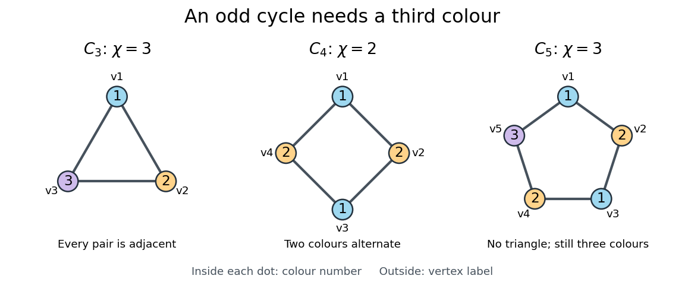

# Chromatic number

↑ **Parent:** [Graph coloring](graph-coloring.md)  
ⓦ [Wiki](https://en.wikipedia.org/wiki/Chromatic_number)

For a nonempty finite [simple graph](simple-graph.md) $G$, the [chromatic number](chromatic-number.md) $\chi(G)$ is the least positive [integer](integer.md) $k$ for which $G$ has a proper vertex [graph coloring](graph-coloring.md) with at most $k$ colours. To establish an exact [chromatic number](chromatic-number.md), give a colouring using that many colours and explain why fewer cannot suffice. A colouring alone gives only an upper bound.[Lehman, Leighton and Meyer, Mathematics for Computer Science, Definition 11.7.1](mathematics-for-computer-science-by-eric-lehman-and-others.md)

**[Figure 19](#image-optimal-graph-colorings-of-the-cycle-graphs-c-3-c-4-c-5). Optimal graph colorings of the cycle graphs $C_3,C_4,C_5$**. Numbers inside dots are colour labels, and labels outside are [vertices](vertex-graph-theory.md). The [cycle graph](cycle-graph.md) $C_4$ alternates two colours. The [odd cycles](odd-cycle.md) $C_3,C_5$ need three, although $C_5$ is a [triangle-free graph](triangle-free-graph.md).

These small [graphs](graph-split.md) show why the [chromatic number](chromatic-number.md) measures more than the presence of [triangles in a graph](triangle-in-a-graph.md):

- The [cycle graph](cycle-graph.md) $C_3$, also the [complete graph](complete-graph.md) $K_3$, has [chromatic number](chromatic-number.md) three. Every pair of [vertices](vertex-graph-theory.md) is adjacent, so three distinct colours are necessary and sufficient.
- The [cycle graph](cycle-graph.md) $C_4$ has [chromatic number](chromatic-number.md) two. Around the [graph cycle](cycle-in-a-graph.md), the assignment $1,2,1,2$ is proper, and a single colour would violate every [edge](edge-of-a-graph.md).
- The [cycle graph](cycle-graph.md) $C_5$ has [chromatic number](chromatic-number.md) three. With two colours, alternation around the [graph cycle](cycle-in-a-graph.md) would force the first and fifth [vertices](vertex-graph-theory.md) to have the same colour despite their joining [edge](edge-of-a-graph.md). The assignment $1,2,1,2,3$ works. Thus a [triangle-free graph](triangle-free-graph.md) can still require more than two colours.
- The [complete graph](complete-graph.md) $K_n$ has [chromatic number](chromatic-number.md) $n$: all $n$ [vertices](vertex-graph-theory.md) are pairwise adjacent, so each must have its own colour.[Meyer, MIT Graph Coloring, slides 18–19](https://ocw.mit.edu/courses/6-042j-mathematics-for-computer-science-fall-2005/5926091844fc3d60fa18eb75c9a2bc03_slides5w.pdf)

For a [cycle graph](cycle-graph.md) of even length, alternating two colours closes consistently; for an [odd cycle](odd-cycle.md), it does not, and a third colour on the final [vertex](vertex-graph-theory.md) suffices. More generally, the [two-colourability criterion for bipartite graphs](two-colourability-criterion-for-bipartite-graphs.md) says that $\chi(G)\leq2$ exactly when $G$ is a [bipartite graph](bipartite-graph.md), and the [odd-cycle characterization of bipartite graphs](odd-cycle-characterization-of-bipartite-graphs.md) identifies the obstruction as an [odd cycle](odd-cycle.md). A nonempty [graph](graph-split.md) with no [edges](edge-of-a-graph.md) has [chromatic number](chromatic-number.md) one; a [bipartite graph](bipartite-graph.md) with at least one [edge](edge-of-a-graph.md) has [chromatic number](chromatic-number.md) exactly two.

In the pairwise-conflict scheduling model of [graph coloring](graph-coloring.md), $\chi(G)$ is the least number of interchangeable slots needed. This turns a drawing into an optimization question: how many groups of compatible activities are unavoidable? [Greedy coloring](greedy-coloring.md) constructs a valid grouping quickly, but its number of colours can exceed the [chromatic number](chromatic-number.md).

**Table of contents**

- [Chromatic number of Euclidean space](chromatic-number-of-euclidean-space.md)
- [Colour-critical vertex](colour-critical-vertex.md)
- [Mycielskian](mycielskian.md)
- [Graphs of arbitrarily high girth and chromatic number](graphs-of-arbitrarily-high-girth-and-chromatic-number.md)
- [Brooks' theorem](brooks-theorem.md)

## ↑ Ancestors (6)

1. [Graph coloring](graph-coloring.md)
2. [Graph theory](graph-theory-split.md)
3. [Foundations of mathematics](foundations-of-mathematics-split.md)
4. [Area of mathematics](area-of-mathematics.md)
5. [Mathematics](mathematics-split.md)
6. [Codex Wiki](split.md)

## ← Incoming links (42)

- [Balanced complete multipartite blow-up](balanced-complete-multipartite-blow-up.md)
- [Chromatic index](chromatic-index.md)
- [Chromatic number](chromatic-number.md)
- [Chromatic number of the half-density binomial random graph](chromatic-number-of-the-half-density-binomial-random-graph.md)
- [Chromatic polynomial](chromatic-polynomial.md)
- [Chromatic polynomial determines a Turán graph](chromatic-polynomial-determines-a-turan-graph.md)
- [Colour-critical vertex](colour-critical-vertex.md)
- [Crown graph](crown-graph.md)
- [Four color theorem](four-color-theorem.md)
- [Graph coloring](graph-coloring.md)
- [Graph minor](graph-minor.md)
- [Greedy coloring](greedy-coloring.md)
- [Independence number](independence-number.md)
- [Lovász number](lovasz-number.md)
- [Lovász theorem on Kneser graphs](lovasz-theorem-on-kneser-graphs.md)
- [Minimum degree of an extremal forbidden-subgraph graph](minimum-degree-of-an-extremal-forbidden-subgraph-graph.md)
- [Modular intersection graph](modular-intersection-graph.md)
- [Octahedral graph](octahedral-graph.md)
- [Solution](past-exam-of-the-mathematics-course-of-the-university-of-cambridge/2001/iii/paper-11/1/i/solution.md)
- [Solution](past-exam-of-the-mathematics-course-of-the-university-of-cambridge/2005/ii/paper-4/17f/solution.md)
- [Solution](past-exam-of-the-mathematics-course-of-the-university-of-cambridge/2005/iii/paper-11/1/solution.md)
- [Solution](past-exam-of-the-mathematics-course-of-the-university-of-cambridge/2008/ii/paper-1/17f/i/solution.md)
- [Solution](past-exam-of-the-mathematics-course-of-the-university-of-cambridge/2008/ii/paper-3/17f/solution.md)
- [Solution](past-exam-of-the-mathematics-course-of-the-university-of-cambridge/2009/ii/paper-3/17f/a/solution.md)
- [Solution](past-exam-of-the-mathematics-course-of-the-university-of-cambridge/2009/ii/paper-3/17f/c/solution.md)
- [Solution](past-exam-of-the-mathematics-course-of-the-university-of-cambridge/2010/ii/paper-4/17f/solution.md)
- [Solution](past-exam-of-the-mathematics-course-of-the-university-of-cambridge/2013/iii/paper-12/4/solution.md)
- [Solution](past-exam-of-the-mathematics-course-of-the-university-of-cambridge/2013/iii/paper-12/5/solution.md)
- [Solution](past-exam-of-the-mathematics-course-of-the-university-of-cambridge/2015/iii/paper-13/1/ii/solution.md)
- [Solution](past-exam-of-the-mathematics-course-of-the-university-of-cambridge/2016/iii/paper-110/1/solution.md)
- [Solution](past-exam-of-the-mathematics-course-of-the-university-of-cambridge/2017/ii/paper-1/16h/solution.md)
- [Solution](past-exam-of-the-mathematics-course-of-the-university-of-cambridge/2018/ii/paper-1/17i/b/solution.md)
- [Solution](past-exam-of-the-mathematics-course-of-the-university-of-cambridge/2018/ii/paper-3/17i/solution.md)
- [Solution](past-exam-of-the-mathematics-course-of-the-university-of-cambridge/2018/iii/paper-110/1/solution.md)
- [Solution](past-exam-of-the-mathematics-course-of-the-university-of-cambridge/2019/ii/paper-3/17g/c/solution.md)
- [Solution](past-exam-of-the-mathematics-course-of-the-university-of-cambridge/2022/ii/paper-1/17f/a/solution.md)
- [Solution](past-exam-of-the-mathematics-course-of-the-university-of-cambridge/2022/ii/paper-3/17f/a/solution.md)
- [Solution](past-exam-of-the-mathematics-course-of-the-university-of-cambridge/2023/ii/paper-1/17h/a/solution.md)
- [Perfect elimination ordering](perfect-elimination-ordering.md)
- [Proper vertex coloring](proper-vertex-coloring.md)
- [Turán density](turan-density.md)
- [Vertex exposure for chromatic number](vertex-exposure-for-chromatic-number.md)
