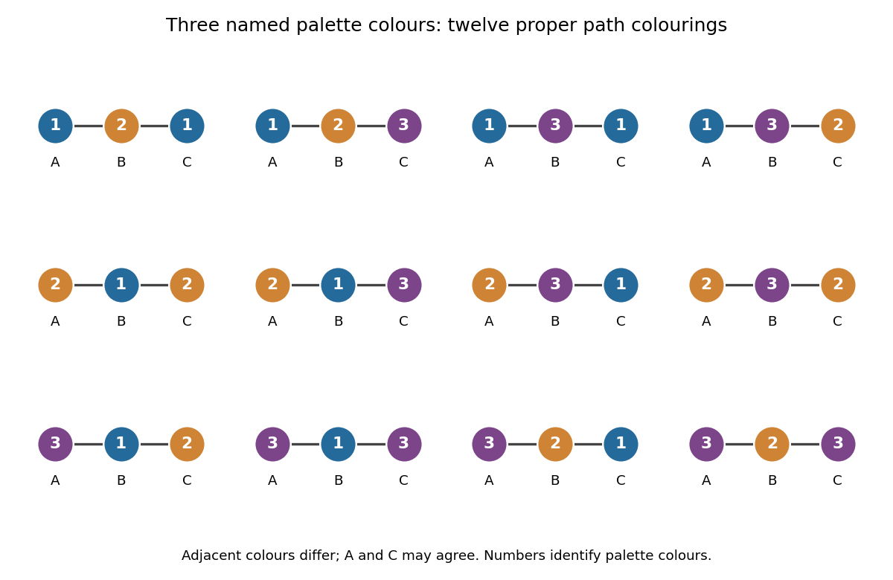

# Chromatic polynomial

↑ **Parent:** [Graph coloring](graph-coloring-split.md)  
ⓦ [Wiki](https://en.wikipedia.org/wiki/Chromatic_polynomial)

The chromatic polynomial turns a [graph coloring](graph-coloring-split.md) problem into a counting problem: **how many choices remain when adjacent [vertices](vertex-graph-theory.md) must have different colours?** For a finite [simple graph](simple-graph.md) $G$ and a positive [integer](integer-split.md) $t$, $P_G(t)$ is the number of [proper vertex colorings](proper-vertex-coloring.md) using a fixed, distinguished palette of $t$ colours. A colouring need not use every available colour, and exchanging two palette colours generally gives a different colouring. Although $P_G$ is a [polynomial](polynomial-split.md), its values at arbitrary noninteger arguments are not counts of colourings.

Consider the three-vertex [path graph](path-graph.md) $A$--$B$--$C$. Choose $A$ in $t$ ways, then $B$ in $t-1$ ways, then $C$ in $t-1$ ways: $A$ and $C$ may agree because they are not adjacent. The [multiplication principle](rule-of-product.md) gives

$$
P_{P_3}(t)=t(t-1)^2=t^3-2t^2+t.
$$

Adding the [edge](edge-of-a-graph.md) $AC$ makes the three-vertex [complete graph](complete-graph.md) $K_3$. Now $C$ must avoid both preceding colours, so

$$
P_{K_3}(t)=t(t-1)(t-2)=t^3-3t^2+2t.
$$

With three available colours, the [path graph](path-graph.md) has **12 colourings**, whereas the triangle has **6**. With two colours the counts are $2$ and $0$: the extra constraint makes the triangle impossible to colour.

**[Figure 7](#image-all-twelve-proper-colourings-of-a-three-vertex-path-using-a-three-colour-palette). All twelve proper colourings of a three-vertex path using a three-colour palette**.

For a nonempty [graph](graph-split.md), the [chromatic number](chromatic-number.md) records only the first positive [integer](integer-split.md) $t$ for which $P_G(t)>0$. The [chromatic polynomial](chromatic-polynomial.md) also counts the choices for every larger palette. For the path the [chromatic number](chromatic-number.md) is $2$, and for the triangle it is $3$. Counting assignments also gives a useful interpretation for scheduling: if adjacent [vertices](vertex-graph-theory.md) represent tasks that must use different slots, the [chromatic polynomial](chromatic-polynomial.md) counts the valid assignments to $t$ named slots. Adding a conflict [edge](edge-of-a-graph.md) can only remove assignments.

The [chromatic polynomial](chromatic-polynomial.md) also remembers some of the graph's structure. For a [simple graph](simple-graph.md) with $n\geq 1$ [vertices](vertex-graph-theory.md) and $m$ [edges](edge-of-a-graph.md), its leading terms are $t^n-mt^{n-1}$; its [degree of a polynomial](degree-of-a-polynomial.md) gives the number of [vertices](vertex-graph-theory.md), and its next coefficient gives the number of [edges](edge-of-a-graph.md). It does not determine the graph completely. A four-vertex [path graph](path-graph.md) and a four-vertex [star graph](star-graph-theory.md) are not related by a [graph isomorphism](graph-isomorphism.md), but both are [trees](tree-graph-theory-split.md) and have [chromatic polynomial](chromatic-polynomial.md) $t(t-1)^3$.

The early connection to map colouring appears in George D. Birkhoff's article [A Determinant Formula for the Number of Ways of Coloring a Map, Annals of Mathematics 14 (1912–1913), pp. 42–46](https://www.jstor.org/stable/1967597). For a derivation of the counting recurrence and its leading coefficients, see [Paul Johnson's MAS 341 lecture on chromatic polynomials](https://ptwiddle.github.io/MAS341-Graph-Theory-2017/lecturenotes/lecturex9.html).

**Table of contents**

- [Chromatic polynomial determines a Turán graph](chromatic-polynomial-determines-a-turan-graph.md)
- [Deletion-contraction recurrence for the chromatic polynomial](deletion-contraction-recurrence-for-the-chromatic-polynomial.md)
- [Chromatic polynomial after attaching a leaf](chromatic-polynomial-after-attaching-a-leaf.md)

## ↑ Ancestors (6)

1. [Graph coloring](graph-coloring-split.md)
2. [Graph theory](graph-theory-split.md)
3. [Foundations of mathematics](foundations-of-mathematics-split.md)
4. [Area of mathematics](area-of-mathematics.md)
5. [Mathematics](mathematics-split.md)
6. [Codex Wiki](split.md)

## ← Incoming links (7)

- [Chromatic polynomial](chromatic-polynomial.md)
- [Chromatic polynomial after attaching a leaf](chromatic-polynomial-after-attaching-a-leaf.md)
- [Chromatic polynomial determines a Turán graph](chromatic-polynomial-determines-a-turan-graph.md)
- [Solution](past-exam-of-the-mathematics-course-of-the-university-of-cambridge/2008/ii/paper-3/17f/solution.md)
- [Solution](past-exam-of-the-mathematics-course-of-the-university-of-cambridge/2023/ii/paper-2/17h/a/solution.md)
- [Solution](past-exam-of-the-mathematics-course-of-the-university-of-cambridge/2026/iii/paper-145/2/f/solution.md)
- [Two-colourability criterion for bipartite graphs](two-colourability-criterion-for-bipartite-graphs.md)
