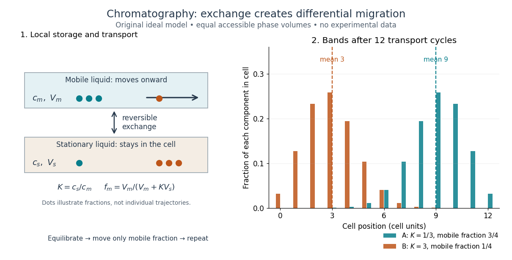

# Chromatographic partition coefficient

↑ **Parent:** [Chromatography](chromatography-split.md)

For a dilute [solute](solute.md) distributed between two liquid regions at local [chemical equilibrium](chemical-equilibrium.md), define the [chromatographic partition coefficient](chromatographic-partition-coefficient.md) as

$$
K=\frac{c_s}{c_m},\qquad
n=c_mV_m+c_sV_s=c_m(V_m+KV_s),\qquad
f_m=\frac{c_mV_m}{n}=\frac{V_m}{V_m+KV_s}.
$$

Here $c_m,c_s$ are [concentrations](concentration.md) expressed in the same units, $V_m,V_s$ specify accessible [volume](volume-thermodynamics.md) in the [chromatographic mobile phase](chromatographic-mobile-phase.md) and immobilized liquid [chromatographic stationary phase](chromatographic-stationary-phase.md), respectively, $n$ is total [solute](solute.md) [amount of substance](amount-of-substance.md), and $f_m$ is the fraction of that [amount of substance](amount-of-substance.md) in the [chromatographic mobile phase](chromatographic-mobile-phase.md). Assume a constant [chromatographic partition coefficient](chromatographic-partition-coefficient.md), rapid exchange, unchanged phases and [temperature](temperature-split.md), and no [chemical reaction](chemical-reaction-split.md). A [chemical equilibrium](chemical-equilibrium.md) population still exchanges [molecules](molecule-split.md); it is not permanently divided into two sets.

The [amount of substance](amount-of-substance.md) balance proves the expression for $f_m$. Increasing either $K$ or $V_s/V_m$ reduces the mobile fraction, illustrating why a [concentration](concentration.md) ratio alone cannot determine retention. For surface [adsorption](adsorption.md), specify an [adsorption](adsorption.md) storage law instead of assigning an arbitrary liquid [volume](volume-thermodynamics.md) to the [solid](solid.md).

An original discrete model makes the separation visible. In each identical cell, first establish local [chemical equilibrium](chemical-equilibrium.md), then advance only the mobile fraction by one cell; let the stationary fraction wait. Repeat twelve times, without any additional spreading. With $V_s=V_m$, stipulated [chromatographic partition coefficients](chromatographic-partition-coefficient.md) $K_A=1/3$ and $K_B=3$ give $f_A=3/4$ and $f_B=1/4$. Each cycle contributes mean displacement $f_m$ cells, so the mean positions after twelve cycles are nine cells and three cells. Redistribution itself broadens each band: the cell positions have a [binomial distribution](binomial-distribution.md) with parameters $12,f_m$. These dimensionless chosen values illustrate transport, not measurements of any particular substances.

**[Figure 1](#image-chromatography-phase-exchange-separation). Reversible phase exchange turns different storage fractions into separated bands**. Original local [chemical equilibrium](chemical-equilibrium.md) model: the same accessible [volume](volume-thermodynamics.md) in each phase, constant [chromatographic partition coefficients](chromatographic-partition-coefficient.md), and twelve discrete transport cycles. Both bands start at cell zero. The plotted fractions sum to one for each component; dashed lines mark mean positions. This is a partition model, not a depiction of [SEC pore access](sec-pore-access.md) or an actual column measurement.

## ↑ Ancestors (3)

1. [Chromatography](chromatography-split.md)
2. [Chemistry](chemistry-split.md)
3. [Codex Wiki](split.md)

## ← Incoming links (2)

- [Chromatographic partition coefficient](chromatographic-partition-coefficient.md)
- [TLC retardation factor](tlc-retardation-factor.md)
