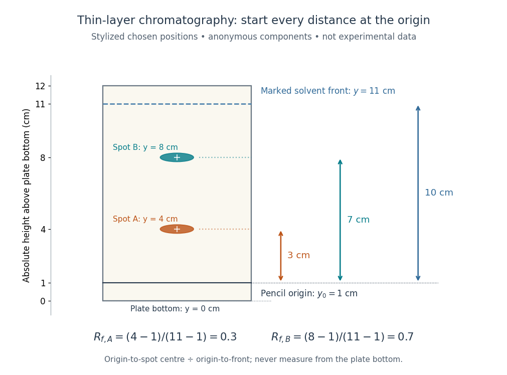
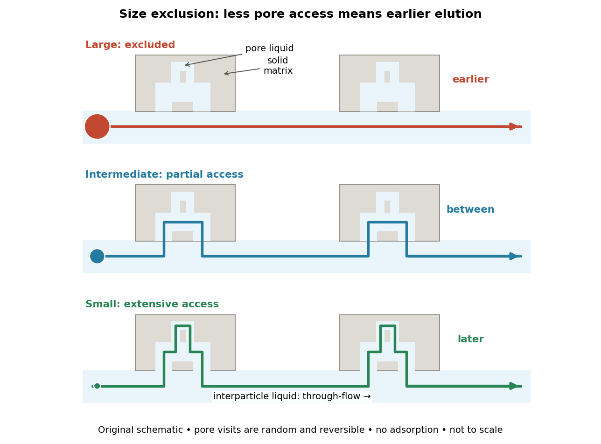
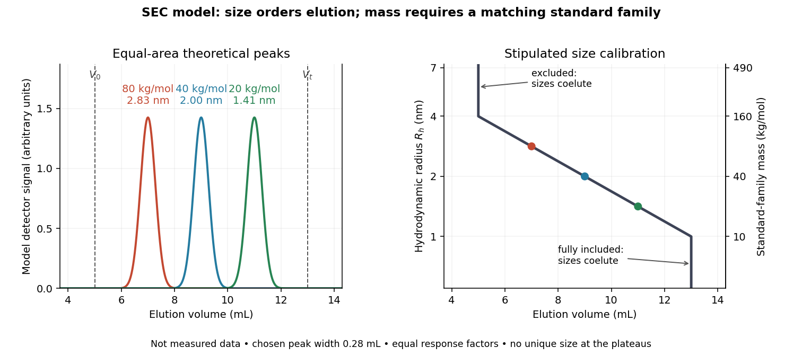

# Chromatography

↑ **Parent:** [Chemistry](chemistry.md)  
ⓦ [Wiki](https://en.wikipedia.org/wiki/Chromatography)

[Chromatography](chromatography.md) separates components of a [mixture](mixture.md) through different migration rates in contact with a [chromatographic stationary phase](#chromatographic-stationary-phase) while a [chromatographic mobile phase](#chromatographic-mobile-phase) transports them. [Liquid chromatography](#liquid-chromatography) describes the physical state of the transporting phase; [size-exclusion chromatography](#size-exclusion-chromatography) describes a separation mechanism. Classification by phase and classification by mechanism answer different questions. In ideal [size-exclusion chromatography](#size-exclusion-chromatography), differential access to liquid-filled pores replaces binding as the source of differential migration.

In many other forms of [chromatography](chromatography.md), a [solute](mixture.md#solute) repeatedly leaves the [chromatographic mobile phase](#chromatographic-mobile-phase) and returns to it. Reversible [adsorption](physical-chemistry.md#adsorption) holds it at a surface; partition distributes it between the [chromatographic mobile phase](#chromatographic-mobile-phase) and an immobilized liquid [chromatographic stationary phase](#chromatographic-stationary-phase). Spending more time stationary means less progress with the moving fluid. Two initially overlapping components can therefore emerge as separate bands without either being permanently trapped. [Chromatography](chromatography.md) is useful both for comparing a sample with reference substances and for collecting separated components; a visible band need not contain just one substance.

Relative retention belongs to the sample together with the chosen [chromatographic stationary phase](#chromatographic-stationary-phase), [chromatographic mobile phase](#chromatographic-mobile-phase), [eluent](#eluent) composition, and [temperature](temperature.md). Changing these conditions can change the separation order. [Chemical polarity](physical-chemistry.md#chemical-polarity) helps explain interactions in some systems but is not a universal ranking rule. In [thin-layer chromatography](#thin-layer-chromatography), a spot's [TLC retardation factor](#tlc-retardation-factor) is consequently conditional evidence about identity, rather than a fixed identifier intrinsic to a [molecule](molecule.md).

**Table of contents**

- [Refractive index detector](#refractive-index-detector)
- [Gas chromatography](#gas-chromatography)
- [Chiral chromatography](#chiral-chromatography)
- [Protein A affinity chromatography](#protein-a-affinity-chromatography)
- [Ion-exchange chromatography](#ion-exchange-chromatography)
- [Immobilized metal affinity chromatography](#immobilized-metal-affinity-chromatography)
- [Chromatographic mobile phase](#chromatographic-mobile-phase)
  - [Eluent](#eluent)
- [Chromatographic stationary phase](#chromatographic-stationary-phase)
- [Chromatographic partition coefficient](#chromatographic-partition-coefficient)
- [Thin-layer chromatography](#thin-layer-chromatography)
  - [TLC retardation factor](#tlc-retardation-factor)
- [Liquid chromatography](#liquid-chromatography)
  - [Size-exclusion chromatography](#size-exclusion-chromatography)
    - [Size-exclusion chromatography with multi-angle light scattering](#size-exclusion-chromatography-with-multi-angle-light-scattering)
    - [SEC pore access](#sec-pore-access)
    - [SEC void volume](#sec-void-volume)
    - [SEC total accessible liquid volume](#sec-total-accessible-liquid-volume)
    - [SEC partition coefficient](#sec-partition-coefficient)
    - [SEC fractionation range](#sec-fractionation-range)
    - [SEC molar mass calibration](#sec-molar-mass-calibration)
    - [SEC chromatogram](#sec-chromatogram)
      - [SEC detector response](#sec-detector-response)
    - [SEC light-scattering detection](#sec-light-scattering-detection)
      - [SEC protein conformation experiment](#sec-protein-conformation-experiment)

## Refractive index detector

↑ **Parent:** [Chromatography](chromatography.md)

A detector that measures changes of [refractive index](electromagnetic-wave.md#refractive-index) between a flowing sample and a reference stream.

## Gas chromatography

↑ **Parent:** [Chromatography](chromatography.md)

## Chiral chromatography

↑ **Parent:** [Chromatography](chromatography.md)

## Protein A affinity chromatography

↑ **Parent:** [Chromatography](chromatography.md)

[protein A affinity chromatography](#protein-a-affinity-chromatography) purifies suitable immunoglobulins through interaction with immobilized protein A. Binding and elution conditions, aggregation and process-related contaminants still require separate control.

## Ion-exchange chromatography

↑ **Parent:** [Chromatography](chromatography.md)

[Ion-exchange chromatography](#ion-exchange-chromatography) separates molecules by interactions with a charged stationary phase. Buffer pH controls charge state, and ionic strength can modulate retention and elution; the relevant charge depends on the whole molecular surface.

## Immobilized metal affinity chromatography

↑ **Parent:** [Chromatography](chromatography.md)

[Immobilized metal affinity chromatography](#immobilized-metal-affinity-chromatography) retains suitable ligands, including polyhistidine-tagged proteins, on a stationary phase bearing coordinated metal ions. Contaminants can also bind, so affinity recovery alone does not establish purity or identity.

## Chromatographic mobile phase

↑ **Parent:** [Chromatography](chromatography.md)

The [chromatographic mobile phase](#chromatographic-mobile-phase) carries [solutes](mixture.md#solute) through the apparatus. In [liquid chromatography](#liquid-chromatography) it is a liquid [solvent](mixture.md#solvent) or [chemical solution](mixture.md#solution-chemistry).

The [eluent](#eluent) is the supplied [chromatographic mobile phase](#chromatographic-mobile-phase). Its composition can alter both [solute](mixture.md#solute) [solubility](ionic-bonding.md#solubility) and competition for [adsorption](physical-chemistry.md#adsorption) sites, so changing the [eluent](#eluent) can change retention even with the same [chromatographic stationary phase](#chromatographic-stationary-phase).

### Eluent

↑ **Parent:** [Chromatographic mobile phase](#chromatographic-mobile-phase)

The [chromatographic mobile phase](#chromatographic-mobile-phase) supplied to a [chromatography](chromatography.md) apparatus.

## Chromatographic stationary phase

↑ **Parent:** [Chromatography](chromatography.md)

The [chromatographic stationary phase](#chromatographic-stationary-phase) remains in place during separation. A porous packing in [size-exclusion chromatography](#size-exclusion-chromatography) supplies internal liquid regions with size-dependent accessibility; ideal separation requires no [adsorption](physical-chemistry.md#adsorption) of the [solute](mixture.md#solute) to the packing.

A [chromatographic stationary phase](#chromatographic-stationary-phase) may instead expose a [solid](thermodynamics.md#solid) surface for [adsorption](physical-chemistry.md#adsorption), or retain an immobilized liquid into which [solutes](mixture.md#solute) partition. In ordinary [silica gel](chemical-substance.md#silica-gel) [thin-layer chromatography](#thin-layer-chromatography), interactions with the surface delay migration. This mechanism differs from ideal [SEC pore access](#sec-pore-access).

## Chromatographic partition coefficient

↑ **Parent:** [Chromatography](chromatography.md)

For a dilute [solute](mixture.md#solute) distributed between two liquid regions at local [chemical equilibrium](chemical-potential.md#chemical-equilibrium), define the [chromatographic partition coefficient](#chromatographic-partition-coefficient) as

$$
K=\frac{c_s}{c_m},\qquad
n=c_mV_m+c_sV_s=c_m(V_m+KV_s),\qquad
f_m=\frac{c_mV_m}{n}=\frac{V_m}{V_m+KV_s}.
$$

Here $c_m,c_s$ are [concentrations](mathematical-physics.md#concentration) expressed in the same units, $V_m,V_s$ specify accessible [volume](thermodynamics.md#volume-thermodynamics) in the [chromatographic mobile phase](#chromatographic-mobile-phase) and immobilized liquid [chromatographic stationary phase](#chromatographic-stationary-phase), respectively, $n$ is total [solute](mixture.md#solute) [amount of substance](physics.md#amount-of-substance), and $f_m$ is the fraction of that [amount of substance](physics.md#amount-of-substance) in the [chromatographic mobile phase](#chromatographic-mobile-phase). Assume a constant [chromatographic partition coefficient](#chromatographic-partition-coefficient), rapid exchange, unchanged phases and [temperature](temperature.md), and no [chemical reaction](chemical-reaction.md). A [chemical equilibrium](chemical-potential.md#chemical-equilibrium) population still exchanges [molecules](molecule.md); it is not permanently divided into two sets.

The [amount of substance](physics.md#amount-of-substance) balance proves the expression for $f_m$. Increasing either $K$ or $V_s/V_m$ reduces the mobile fraction, illustrating why a [concentration](mathematical-physics.md#concentration) ratio alone cannot determine retention. For surface [adsorption](physical-chemistry.md#adsorption), specify an [adsorption](physical-chemistry.md#adsorption) storage law instead of assigning an arbitrary liquid [volume](thermodynamics.md#volume-thermodynamics) to the [solid](thermodynamics.md#solid).

An original discrete model makes the separation visible. In each identical cell, first establish local [chemical equilibrium](chemical-potential.md#chemical-equilibrium), then advance only the mobile fraction by one cell; let the stationary fraction wait. Repeat twelve times, without any additional spreading. With $V_s=V_m$, stipulated [chromatographic partition coefficients](#chromatographic-partition-coefficient) $K_A=1/3$ and $K_B=3$ give $f_A=3/4$ and $f_B=1/4$. Each cycle contributes mean displacement $f_m$ cells, so the mean positions after twelve cycles are nine cells and three cells. Redistribution itself broadens each band: the cell positions have a [binomial distribution](discrete-probability-distribution.md#binomial-distribution) with parameters $12,f_m$. These dimensionless chosen values illustrate transport, not measurements of any particular substances.

**[Figure 1](#image-chromatography-phase-exchange-separation). Reversible phase exchange turns different storage fractions into separated bands**. Original local [chemical equilibrium](chemical-potential.md#chemical-equilibrium) model: the same accessible [volume](thermodynamics.md#volume-thermodynamics) in each phase, constant [chromatographic partition coefficients](#chromatographic-partition-coefficient), and twelve discrete transport cycles. Both bands start at cell zero. The plotted fractions sum to one for each component; dashed lines mark mean positions. This is a partition model, not a depiction of [SEC pore access](#sec-pore-access) or an actual column measurement.

## Thin-layer chromatography

↑ **Parent:** [Chromatography](chromatography.md)  
ⓦ [Wiki](https://en.wikipedia.org/wiki/Thin-layer_chromatography)

[Thin-layer chromatography](#thin-layer-chromatography) spreads a thin [chromatographic stationary phase](#chromatographic-stationary-phase) on a supporting plate. A small sample spot starts on a pencil origin line. The lower edge contacts the [eluent](#eluent), whose level must stay below that origin; [capillary action](surface-tension.md#capillary-action) draws the [chromatographic mobile phase](#chromatographic-mobile-phase) upward. Components exchange with the [chromatographic stationary phase](#chromatographic-stationary-phase) as the wet region advances. The leading wet edge is the solvent front. Mark it after removing the plate, before [solvent](mixture.md#solvent) evaporation erases it.[Thin-Layer Chromatography, Definition; Solvent; Process Overview, steps 1–4](chemistry-bibliography.md#thin-layer-chromatography-university-of-pittsburgh-chem0330)

Juniata College's Science in Motion protocol grinds vegetable tissue with about $5\,\mathrm{mL}$ of [acetone](chemical-substance.md#acetone), transfers the extract, adds about $2\,\mathrm{mL}$ of [hexane](chemical-substance.md#hexane), and specifies sampling the upper layer after separation. It spots a [silica gel](chemical-substance.md#silica-gel) plate with a capillary tube, drying between repeated applications; a reference [pigment](chemical-substance.md#pigment) occupies another lane. A closed jar contains about $0.5\,\mathrm{cm}$ depth of 70:30 [hexane](chemical-substance.md#hexane)–[acetone](chemical-substance.md#acetone) [eluent](#eluent), below the pencil origin. The plate is removed before the front reaches the top; the front is marked immediately. Spot centres and front are measured from the origin.[Thin Layer Chromatography of Vegetable Pigments, pp. 2–3, steps 1–18](chemistry-bibliography.md#thin-layer-chromatography-of-vegetable-pigments-juniata-college-science-in-motion)

The protocol's standard provides a comparison control. It specifies no added [water](chemical-substance.md#water) in this extraction and reports no measured plate positions or [temperature](temperature.md). Its tabulated [pigment](chemical-substance.md#pigment) values are guidance, not observations from this run.[Introduction table; procedure; blank data tables](chemistry-bibliography.md#thin-layer-chromatography-of-vegetable-pigments-juniata-college-science-in-motion)

A useful additional control is an [eluent](#eluent) blank, checking contamination. Compare sample and standard on the same plate, and optionally apply both together at a third origin position. Agreement under identical conditions supports a proposed identity but cannot prove it: different substances can migrate together. A second [eluent](#eluent) giving different selectivity strengthens the comparison. One spot cannot establish purity, and a missing visible spot can reflect poor detection rather than absence. Overloading, broad spots, or an uneven solvent front also weaken the readout. These are interpretation checks, not extra observations claimed for the protocol.

### TLC retardation factor

↑ **Parent:** [Thin-layer chromatography](#thin-layer-chromatography)

For [thin-layer chromatography](#thin-layer-chromatography), define the [TLC retardation factor](#tlc-retardation-factor) using distances along the development direction:

$$
R_f=\frac{d_{\rm spot}}{d_{\rm front}}
=\frac{y_{\rm spot}-y_0}{y_{\rm front}-y_0}.
$$

The origin coordinate is $y_0$; use the centre of a resolved spot and a front marked at the end of development. Both distances begin at the origin, never at the plate bottom. The ratio is dimensionless. An immobile spot has $R_f=0$; a spot at the front has $R_f=1$, where separation from other fast components may be poor. This distance ratio is distinct from the [chromatographic partition coefficient](#chromatographic-partition-coefficient) and from a column retention time.

For an original stylized plate, choose absolute vertical coordinates $y_0=1\,\mathrm{cm}$, $y_{\rm front}=11\,\mathrm{cm}$, $y_A=4\,\mathrm{cm}$ and $y_B=8\,\mathrm{cm}$ above the plate bottom. The [solvent](mixture.md#solvent) distance is therefore $10\,\mathrm{cm}$, while the spot distances are $3\,\mathrm{cm}$ and $7\,\mathrm{cm}$:

$$
R_{f,A}=\frac{4-1}{11-1}=0.3,\qquad
R_{f,B}=\frac{8-1}{11-1}=0.7.
$$

Using $4/11$ or $8/11$ would wrongly include the unused centimetre below the origin. These chosen positions do not represent measured [pigments](chemical-substance.md#pigment) or the protocol's plate dimensions.

**[Figure 2](#image-thin-layer-chromatography-origin-readout). Read TLC retardation factors from the origin, not the plate bottom**. Original stylized [thin-layer chromatography](#thin-layer-chromatography) plate with deliberately chosen coordinates, not experimental data. The pencil origin at $1\,\mathrm{cm}$ lies below both spots and the front at $11\,\mathrm{cm}$. All three measurement arrows start at the origin. The two colours label anonymous components and do not identify particular [pigments](chemical-substance.md#pigment).

The [TLC retardation factor](#tlc-retardation-factor) depends on the sample, [chromatographic stationary phase](#chromatographic-stationary-phase), [eluent](#eluent) composition, and [temperature](temperature.md); plate handling and development conditions must also match when comparing runs. The moving wet front and possible surface [adsorption](physical-chemistry.md#adsorption) require their own transport assumptions. The equilibrium mobile fraction $f_m$ in the [chromatographic partition coefficient](#chromatographic-partition-coefficient) model is not unconditionally equal to $R_f$; even that model depends on the phase [volume](thermodynamics.md#volume-thermodynamics) ratio. Coincident [TLC retardation factors](#tlc-retardation-factor) alone never prove chemical identity.

## Liquid chromatography

↑ **Parent:** [Chromatography](chromatography.md)

### Size-exclusion chromatography

↑ **Parent:** [Liquid chromatography](#liquid-chromatography)  
ⓦ [Wiki](https://en.wikipedia.org/wiki/Size-exclusion_chromatography)

[Size-exclusion chromatography](#size-exclusion-chromatography) separates dissolved [molecules](molecule.md) by their [hydrodynamic size](mixture.md#hydrodynamic-size) in the chosen [solvent](mixture.md#solvent). A larger species that cannot enter the packing's pores travels with the liquid between particles and elutes earlier. Smaller species explore more internal liquid and elute later. The column is not a sieve that permanently traps the large species: exclusion makes them leave first. “[Gel filtration](#size-exclusion-chromatography)” is common for aqueous separations; “[gel permeation chromatography](#size-exclusion-chromatography)” is common for organic-solvent analysis of [polymers](polymer.md). [SEC molar mass calibration](#sec-molar-mass-calibration) translates size-dependent elution into a standard-relative estimate of [molar mass](chemistry.md#molar-mass), rather than a universal absolute measurement.

This makes [SEC](#size-exclusion-chromatography) useful for separating [proteins](protein.md) from small dissolved species, comparing [protein aggregation](protein.md#protein-aggregation), and characterizing dissolved [polymer](polymer.md) chains. The [residual-group monitoring of polyurethane formation](polymer.md#residual-group-monitoring-of-polyurethane-formation) experiment already illustrates [polymer](polymer.md) calibration: its reported [molar masses](chemistry.md#molar-mass) are relative to [polystyrene](polymer.md#polystyrene) standards. [Size-exclusion characterization of chain polymers](polymer.md#size-exclusion-characterization-of-chain-polymers) explains why an elution trace alone cannot count chains or establish their growth mechanism.

#### Size-exclusion chromatography with multi-angle light scattering

↑ **Parent:** [Size-exclusion chromatography](#size-exclusion-chromatography)

[Size-exclusion chromatography with multi-angle light scattering](#size-exclusion-chromatography-with-multi-angle-light-scattering) combines separation by hydrodynamic behaviour with light-scattering and concentration measurements. With appropriate optical parameters it estimates molar mass across a peak, helping distinguish assembly from shape-dependent elution.

#### SEC pore access

↑ **Parent:** [Size-exclusion chromatography](#size-exclusion-chromatography)

In ideal [SEC pore access](#sec-pore-access), geometric exclusion changes the fraction of pore liquid a [solute](mixture.md#solute) can occupy. [Diffusion](thermodynamics.md#diffusion) permits entry into and exit from accessible pores; the through-flow chiefly transports the sample between packing particles. A [hydrodynamic radius](mixture.md#hydrodynamic-radius) is a useful size descriptor, but actual pore entry also depends on shape and pore geometry. A flexible [polymer](polymer.md) coil is not a rigid ball with a perfectly sharp entry diameter.

**[Figure 3](#image-size-exclusion-chromatography-pore-paths). SEC pore access: excluded species leave before species that explore pore liquid**. Original schematic of a porous packing and representative excursions. Colored routes distinguish exclusion, partial access, and extensive access; they are not measured trajectories or a calculation of travel times. The circles represent effective [hydrodynamic sizes](mixture.md#hydrodynamic-size), not actual [molecular geometry](molecule.md#molecular-geometry). There is no [adsorption](physical-chemistry.md#adsorption) in this illustration.

The extra delay is best understood as extra accessible storage, rather than a prescribed longer streamline. Pore visits are reversible and random. An entirely excluded species samples the [SEC void volume](#sec-void-volume); a sufficiently small nonbinding species samples the [SEC total accessible liquid volume](#sec-total-accessible-liquid-volume). Intermediate species lie between these limits. Larger [hydrodynamic size](mixture.md#hydrodynamic-size) generally means earlier elution within the column's [SEC fractionation range](#sec-fractionation-range).

#### SEC void volume

↑ **Parent:** [Size-exclusion chromatography](#size-exclusion-chromatography)

The [SEC void volume](#sec-void-volume) $V_0$ is the interparticle liquid volume, operationally measured by a sufficiently large excluded, nonbinding tracer. It excludes pore liquid. Choose a tracer that does not undergo [adsorption](physical-chemistry.md#adsorption) or change the packing; correct the measured elution for tubing and detector delay before identifying it with a column-only $V_0$.

#### SEC total accessible liquid volume

↑ **Parent:** [Size-exclusion chromatography](#size-exclusion-chromatography)

The [SEC total accessible liquid volume](#sec-total-accessible-liquid-volume) is $V_t=V_0+V_i$: interparticle plus pore liquid. A fully included nonbinding tracer estimates it. Geometric bed volume instead includes solid matrix, $V_c=V_t+V_{\rm matrix}$.[GE Healthcare, Size Exclusion Chromatography: Principles and Methods, revision 18102218 AM, printed pp. 15–16, Figure 1.7: liquid, pore and geometric volumes](chemistry-bibliography.md#size-exclusion-chromatography-principles-and-methods-by-ge-healthcare)

#### SEC partition coefficient

↑ **Parent:** [Size-exclusion chromatography](#size-exclusion-chromatography)

For ideal [SEC](#size-exclusion-chromatography), define the [SEC partition coefficient](#sec-partition-coefficient) by

$$
K_d=\frac{\overline c_{\rm pore}}{c_{\rm interparticle}},\qquad
V_e=V_0+K_dV_i,\qquad
K_d=\frac{V_e-V_0}{V_t-V_0}.
$$

Here $\overline c_{\rm pore}$ averages [solute](mixture.md#solute) [concentration](mathematical-physics.md#concentration) over all pore liquid, including inaccessible regions. $V_e$ is column elution [volume](thermodynamics.md#volume-thermodynamics). Pure steric exclusion gives $0\le K_d\le1$; the endpoints mean exclusion and full access.[GE Healthcare, Size Exclusion Chromatography: Principles and Methods, printed pp. 15–16: concentration-ratio definition and Kd limits](chemistry-bibliography.md#size-exclusion-chromatography-principles-and-methods-by-ge-healthcare)

A storage argument explains the relation. Assume a dilute stable [solute](mixture.md#solute), unchanged packing and [solvent](mixture.md#solvent), constant [volumetric flow rate](fluid-mechanics.md#volumetric-flow-rate) $Q$, rapid local [chemical equilibrium](chemical-potential.md#chemical-equilibrium) between pore liquid and interparticle liquid, negligible binding, and negligible transport through the pores by bulk flow. At interparticle [concentration](mathematical-physics.md#concentration) $c$, the column holds an [amount of substance](physics.md#amount-of-substance) $n=cV_0+K_dcV_i$. Its exit transports $Qc$ per unit time. The ratio $n/(Qc)$ is the mean residence time in this equilibrium transport model; multiplying by $Q$ gives $V_e=V_0+K_dV_i$. For a narrow symmetric [SEC chromatogram](#sec-chromatogram) peak, the peak maximum approximates that mean; a strongly asymmetric peak needs an explicitly stated location convention.

The handbook also uses an operational normalization

$$
K_{av}=\frac{V_e-V_0}{V_c-V_0}
=K_d\frac{V_i}{V_i+V_{\rm matrix}}.
$$

This denominator includes solid matrix, so full access gives $K_{av}<1$ when $V_{\rm matrix}>0$. It differs from the pore-liquid [SEC partition coefficient](#sec-partition-coefficient). Read each source's volume convention before comparing coefficients.[GE Healthcare, Size Exclusion Chromatography: Principles and Methods, printed p. 16, Figure 1.8: Kav uses Vc, not Vt](chemistry-bibliography.md#size-exclusion-chromatography-principles-and-methods-by-ge-healthcare)

For an original numerical example, take $V_0=5\,\mathrm{mL}$, $V_i=8\,\mathrm{mL}$, and $V_{\rm matrix}=3\,\mathrm{mL}$. Then $V_t=13\,\mathrm{mL}$ and $V_c=16\,\mathrm{mL}$. Elution at $9\,\mathrm{mL}$ gives $K_d=1/2$ but $K_{av}=4/11$. Even a fully included tracer gives $K_{av}=8/11$, not $1$. These are stipulated volumes, not experimental measurements.

#### SEC fractionation range

↑ **Parent:** [Size-exclusion chromatography](#size-exclusion-chromatography)

The [SEC fractionation range](#sec-fractionation-range) has differential [SEC pore access](#sec-pore-access). Larger excluded species share $V_e\simeq V_0$; fully included species share $V_e\simeq V_t$. Neither group can be size-ranked by elution. A broader pore distribution can trade separation per size increment for range.[GE Healthcare, Size Exclusion Chromatography: Principles and Methods, printed pp. 17–18, Figures 1.9–1.10: selectivity curves, fractionation and exclusion limits](chemistry-bibliography.md#size-exclusion-chromatography-principles-and-methods-by-ge-healthcare)

#### SEC molar mass calibration

↑ **Parent:** [Size-exclusion chromatography](#size-exclusion-chromatography)

[SEC molar mass calibration](#sec-molar-mass-calibration) measures standards under the same column, [solvent](mixture.md#solvent), and [temperature](temperature.md) conditions as the unknown. Over a suitable fractionation interval, a common empirical approximation is

$$
\log_{10}\!\left(\frac{M_{\rm app}}{M_{\rm ref}}\right)=a-bV_e,\qquad b>0,
$$

where $M_{\rm ref}$ specifies the [molar mass](chemistry.md#molar-mass) unit and $b$ has inverse-[volume](thermodynamics.md#volume-thermodynamics) units. Interpolation is conditional on the standards' size–[molar mass](chemistry.md#molar-mass) relationship. [SEC](#size-exclusion-chromatography) measures access associated with [hydrodynamic size](mixture.md#hydrodynamic-size), so a branched [polymer](polymer.md), an extended chain, and a compact [protein](protein.md) need not share that relationship.

**[Figure 4](#image-size-exclusion-chromatography-theoretical-calibration). Theoretical SEC chromatogram peaks and a stipulated size-to-molar mass calibration**. Original model, not measured data: $V_0=5\,\mathrm{mL}$, $V_t=13\,\mathrm{mL}$, $K_d=\operatorname{clip}(1-\log_4(R_h/\mathrm{nm}),0,1)$, and standard-family $M=10^4(R_h/\mathrm{nm})^2\,\mathrm{g\,mol^{-1}}$. Equal-area [Gaussian distribution](probability-distribution.md#normal-distribution) peaks have a chosen width $0.28\,\mathrm{mL}$ and equal detector response factors. The lower curve includes model exclusion and full-access plateaus; its secondary mass scale applies only to the stipulated standards.

In this model the $80{,}000$, $40{,}000$, and $20{,}000\,\mathrm{g\,mol^{-1}}$ standards have [hydrodynamic radii](mixture.md#hydrodynamic-radius) $2\sqrt2$, $2$, and $\sqrt2\,\mathrm{nm}$ and elute at $7$, $9$, and $11\,\mathrm{mL}$. An unknown at $8\,\mathrm{mL}$ would be assigned $M_{\rm app}=40{,}000\sqrt2\,\mathrm{g\,mol^{-1}}$ by this calibration. But a $40{,}000\,\mathrm{g\,mol^{-1}}$ species that expands from $2$ to $2\sqrt2\,\mathrm{nm}$ elutes at $7\,\mathrm{mL}$ and is assigned $80{,}000\,\mathrm{g\,mol^{-1}}$ without gaining any [mass](classical-mechanics.md#mass). The numbers demonstrate ambiguity, rather than predict a real unfolding transition.

Changes in [conformational isomerism](stereochemistry.md#conformational-isomerism), [protein folding](protein.md#protein-folding), [protein denaturation](protein.md#denaturation-biochemistry), and [protein aggregation](protein.md#protein-aggregation) can therefore shift peaks. Association usually increases size; compaction can reduce size at unchanged [molar mass](chemistry.md#molar-mass). [Adsorption](physical-chemistry.md#adsorption) creates a different ambiguity: delayed elution need not indicate a smaller species. A different [solvent](mixture.md#solvent) can change both [polymer](polymer.md) coil dimensions and interactions with the packing. The [SEC protein conformation experiment](#sec-protein-conformation-experiment) tests these alternatives with additional detectors.

#### SEC chromatogram

↑ **Parent:** [Size-exclusion chromatography](#size-exclusion-chromatography)

A [SEC chromatogram](#sec-chromatogram) plots a detector signal against elapsed time or elution [volume](thermodynamics.md#volume-thermodynamics). At constant [volumetric flow rate](fluid-mechanics.md#volumetric-flow-rate) $Q$, the volume delivered after injection is $Q(t-t_{\rm injection})$; subtraction of extra-column transport volume is needed for a column-only $V_e$. Real peak widths include injection volume, column dispersion, and tubing/detector spreading. Peak position, width, and area answer different questions.

##### SEC detector response

↑ **Parent:** [SEC chromatogram](#sec-chromatogram)

A [SEC detector response](#sec-detector-response) must be specified before interpreting a peak area. [Ultraviolet](optics.md#ultraviolet) [absorbance](physical-chemistry.md#absorbance) depends on a species' response factor and [concentration](mathematical-physics.md#concentration), as described by the [Beer-Lambert law](physical-chemistry.md#beer-lambert-law); differential [refractive index](electromagnetic-wave.md#refractive-index) detection depends on how the dissolved species changes [refractive index](electromagnetic-wave.md#refractive-index). Equal amounts need not produce equal signal areas across unlike species.

Even a calibrated mass-proportional trace is not a chain-count [probability distribution](probability-distribution.md). In an original two-population example, equal recovered [masses](classical-mechanics.md#mass) of chains with [molar masses](chemistry.md#molar-mass) $20{,}000$ and $80{,}000\,\mathrm{g\,mol^{-1}}$ contain four times as many chains in the lighter population. Thus equal signal areas, assuming equal response per unit [mass](classical-mechanics.md#mass), correspond to number fractions $4/5$ and $1/5$: their [number-average molar mass](chemistry.md#number-average-molar-mass) is $32{,}000\,\mathrm{g\,mol^{-1}}$, while their [weight-average molar mass](chemistry.md#weight-average-molar-mass) is $50{,}000\,\mathrm{g\,mol^{-1}}$. Converting a continuous trace additionally requires response correction and the appropriate [change of variables](multivariable-calculus.md#change-of-variables-formula) between elution and [molar mass](chemistry.md#molar-mass) bins.

#### SEC light-scattering detection

↑ **Parent:** [Size-exclusion chromatography](#size-exclusion-chromatography)

[SEC light-scattering detection](#sec-light-scattering-detection) adds information from [scattering of light](optics.md#scattering-of-light) to the separation. Static scattering with a [concentration](mathematical-physics.md#concentration) readout can infer a [weight-average molar mass](chemistry.md#weight-average-molar-mass) for material in an eluting slice without the standard-family retention calibration. Dynamic scattering estimates a [diffusion coefficient](brownian-motion.md#diffusion-coefficient) and hence a [hydrodynamic radius](mixture.md#hydrodynamic-radius). “Absolute” here means independent of a retention-to-[molar mass](chemistry.md#molar-mass) standard curve; it still needs calibrated detectors, optical response parameters, and a valid sample model. Coeluting species produce a mixture-weighted result, rather than individually identified [molecules](molecule.md).

A concrete manufacturer test used a Bio SEC-3 $300\,\mathrm{\mathring A}$ column, $7.8\times300\,\mathrm{mm}$ with $3\,\mathrm{\mu m}$ particles, an Agilent 1260 Infinity G5611A quaternary pump and G5667A autosampler, a $10\,\mathrm{mm}$ diode-array flow cell, and dual-angle/dynamic scattering detectors. A [buffer solution](acid-base-chemistry.md#buffer-solution) at [pH](acid-base-chemistry.md#ph) $7.4$ flowed at $0.75\,\mathrm{mL\,min^{-1}}$; column and scattering detector were at $30\,{}^\circ\mathrm C$. [Absorbance](physical-chemistry.md#absorbance) at $280\,\mathrm{nm}$ supplied a concentration-sensitive readout. [Dilution](mixture.md#dilution) and loading comparisons tested response: seventeen ovalbumin injections spanning $2$–$960\,\mathrm{\mu g}$ gave a reported average $47{,}198\,\mathrm{g\,mol^{-1}}$ with $2\%$ relative standard deviation. The note reports poorer separation of thyroglobulin from aggregates and an elevated mass estimate, illustrating the coelution limit. Its $0.2\,\mathrm{\mu m}$ sample filtration also limits interpretation of larger [protein aggregation](protein.md#protein-aggregation) products removed before injection.[Sonja Schneider, Determination of Protein Molecular Weight and Size Using the Agilent 1260 Infinity Multi-Detector Bio-SEC Solution with Advanced Light Scattering Detection, 5991-3955EN, printed pp. 2–4: apparatus, Table 1, Figure 2 and Table 3](chemistry-bibliography.md#determination-of-protein-molecular-weight-and-size-using-the-agilent-1260-infinity-multi-detector-bio-sec-solution-with-advanced-light-scattering-detection-by-sonja-schneider)

##### SEC protein conformation experiment

↑ **Parent:** [SEC light-scattering detection](#sec-light-scattering-detection)

An authored manufacturer experiment used an Agilent 1260 Infinity Bio-inert Quaternary LC with Bio SEC-3 $300\,\mathrm{\mathring A}$ columns, $7.8\,\mathrm{mm}$ diameter and $150$ or $300\,\mathrm{mm}$ length. Four pump channels mixed [water](chemical-substance.md#water), [sodium chloride](chemical-substance.md#sodium-chloride), and two [phosphate](chemical-substance.md#phosphate) solutions into $20\,\mathrm{mmol\,L^{-1}}$ [phosphate](chemical-substance.md#phosphate) at [pH](acid-base-chemistry.md#ph) $7.0$, varying salt from $0.2$ to $0.6\,\mathrm{mol\,L^{-1}}$. At $1.0\,\mathrm{mL\,min^{-1}}$ and $30\,{}^\circ\mathrm C$, the readouts were diode-array [absorbance](physical-chemistry.md#absorbance), differential [refractive index](electromagnetic-wave.md#refractive-index), and scattering at $15^\circ$ and $90^\circ$. A supplied [protein](protein.md) standard mixture calibrated retention; bovine serum albumin calibrated scattering constants and inter-detector delay. Increasing salt improved separation of two α-chymotrypsinogen A peaks; two $300\,\mathrm{mm}$ columns also resolved peaks that one column did not. At $0.5\,\mathrm{mol\,L^{-1}}$ salt, the two scattering-derived estimates were about $26{,}100$ and $25{,}800\,\mathrm{g\,mol^{-1}}$. The author inferred a possible size-changing conformation difference, rather than doubling of [molar mass](chemistry.md#molar-mass). The same poster shows delayed, tailing [lysozyme](protein.md#lysozyme) peaks from unwanted interactions.[Andrew Coffey, Size Exclusion Chromatography of Biomolecules – Detector Combinations to Obtain Maximum Information with Minimum Effort, HPLC 2013, poster 901: Experimental; Figures 3–7; Table 1](chemistry-bibliography.md#size-exclusion-chromatography-of-biomolecules-detector-combinations-to-obtain-maximum-information-with-minimum-effort-by-andrew-coffey)

The salt comparison and the independent mass readout constrain interpretation, but do not uniquely prove a particular [protein structure](protein.md#protein-structure). Salt can change [protein folding](protein.md#protein-folding), [protein aggregation](protein.md#protein-aggregation), and packing interactions together. In ideal [SEC](#size-exclusion-chromatography) there is no [adsorption](physical-chemistry.md#adsorption); attraction from the [hydrophobic effect](physical-chemistry.md#hydrophobic-effect) or forces described by [electrostatics](electrostatics.md) can cause additional retention, tailing, and loss of recovered sample. Repulsion can instead reduce pore entry. A peak beyond $V_t$ contradicts the simple nonbinding model, rather than extending its size calibration.

Useful proposed controls compare a [solvent](mixture.md#solvent) blank, fresh calibration standards bracketing the sample, several injection amounts and volumes, and recovered sample quantity with injected quantity using an appropriately calibrated detector. Keep [temperature](temperature.md) and [volumetric flow rate](fluid-mechanics.md#volumetric-flow-rate) fixed while testing [pH](acid-base-chemistry.md#ph) or [ionic strength](mixture.md#ionic-strength). Compare an independent mass readout before declaring an early peak an aggregate. Loss of an insoluble species during filtration, on-column association or dissociation, overloading, and broad unresolved peaks can all hide the original sample population. These are interpretation checks and limitations, not measurements invented for the figures.

## ↑ Ancestors (2)

1. [Chemistry](chemistry.md)
2. [Codex Wiki](README.md)

## ← Incoming links (4)

- [Adsorption](physical-chemistry.md#adsorption)
- [Chromatography](chromatography.md)
- [Coupled-enzyme readout of glycolytic ATP formation](biochemistry.md#coupled-enzyme-readout-of-glycolytic-atp-formation)
- [Eluent](#eluent)
