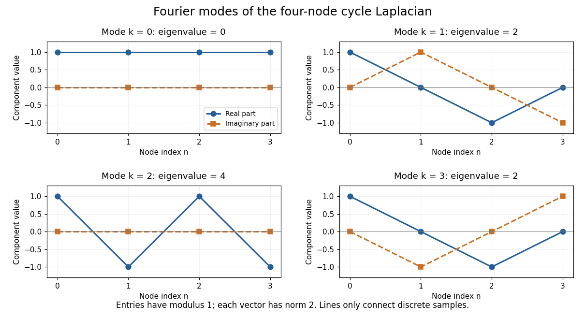

# Circulant matrix

↑ **Parent:** [Linear algebra](linear-algebra-split.md)  
ⓦ [Wiki](https://en.wikipedia.org/wiki/Circulant_matrix)

A circulant [matrix](matrix.md) applies the same rule at every position of a finite ring: moving both the input and output indices one step leaves its entries unchanged. Its first column determines the whole [matrix](matrix.md). For a length-$N$ [vector](vector.md) $c$, index rows and columns by $0,\ldots,N-1$ and define

$$
C_{nj}=c_{(n-j)\bmod N}.
$$

The indices use [modular arithmetic](modular-arithmetic-split.md). Thus each column is the previous column shifted down one place, with the last entry wrapping around to the top. Multiplication is exactly [circular convolution](circular-convolution.md):

$$
(Cx)_n=\sum_{j=0}^{N-1}c_{(n-j)\bmod N}x_j
=\sum_{\ell=0}^{N-1}c_\ell x_{(n-\ell)\bmod N}.
$$

This makes a circulant [matrix](matrix.md) a natural model for a periodic [finite difference](finite-difference-split.md) rule or a filter acting on a periodic record. Strang's MIT lecture develops this connection between circulant [matrices](matrix.md), [circular convolution](circular-convolution.md) and the [discrete Fourier transform](discrete-fourier-transform-split.md).[Strang, MIT 18.065 Lecture 31: eigenvectors of circulant matrices](https://ocw.mit.edu/courses/18-065-matrix-methods-in-data-analysis-signal-processing-and-machine-learning-spring-2018/resources/lecture-31-eigenvectors-of-circulant-matrices-fourier-matrix/)

For example, the first column $c=(2,-1,0,-1)^T$ gives

$$
L=\begin{pmatrix}
2&-1&0&-1\\
-1&2&-1&0\\
0&-1&2&-1\\
-1&0&-1&2
\end{pmatrix},
\qquad (Lx)_n=2x_n-x_{n-1}-x_{n+1}.
$$

Here the indices wrap around modulo four. Each output compares a value with its two neighbors; this is the [Graph Laplacian](laplacian-matrix.md) of a four-vertex [cycle graph](cycle-graph.md). A constant input gives zero, while an alternating input gives a large response. The [Fourier diagonalization of a circulant matrix](fourier-diagonalization-of-a-circulant-matrix.md) makes this distinction exact: its four [eigenvalues](eigenvalue.md) are $0,2,4,2$.

**[Figure 14](#image-fourier-eigenvectors-of-the-four-point-cycle-laplacian). Fourier eigenvectors of the four-point cycle Laplacian**.

The plotted [discrete Fourier modes](discrete-fourier-mode.md) are complex [vectors](vector.md), shown through their real and imaginary parts. Each entry has [modulus](modulus.md) one; the [Euclidean norm](euclidean-norm.md) of each length-four [vector](vector.md) is two. In particular, modes $k=1$ and $k=3$ have the same real part but opposite imaginary parts, so they are distinct [eigenvectors](eigenvector.md) with the same [eigenvalue](eigenvalue.md).

The useful surprise is that every length-$N$ circulant [matrix](matrix.md) shares the same [basis](basis.md) of [eigenvectors](eigenvector.md), whatever its first column. One [change of basis](change-of-basis.md) therefore simplifies an entire family of [linear maps](linear-map.md), instead of requiring a separate [eigenvalue](eigenvalue.md) computation for each one. Bamieh's tutorial develops the [discrete Fourier transform](discrete-fourier-transform-split.md) from precisely this simultaneous [diagonalization](diagonalization-of-a-matrix.md) problem.[Bamieh, Discovering Transforms: A Tutorial on Circulant Matrices, Circular Convolution, and the Discrete Fourier Transform (2018; revised 2022)](https://arxiv.org/abs/1805.05533)

**Table of contents**

- [Fourier diagonalization of a circulant matrix](fourier-diagonalization-of-a-circulant-matrix.md)
- [Periodic Poisson equation on a four-point cycle](periodic-poisson-equation-on-a-four-point-cycle.md)

## ↑ Ancestors (5)

1. [Linear algebra](linear-algebra-split.md)
2. [Algebra](algebra-split.md)
3. [Area of mathematics](area-of-mathematics.md)
4. [Mathematics](mathematics-split.md)
5. [Codex Wiki](split.md)

## ← Incoming links (4)

- [Laplacian matrix](laplacian-matrix.md)
- [Solution](past-exam-of-the-mathematics-course-of-the-university-of-cambridge/2003/iii/paper-67/5/b/solution.md)
- [Solution](past-exam-of-the-mathematics-course-of-the-university-of-cambridge/2007/iii/paper-71/7/solution.md)
- [Semiconvergence of cyclic Poisson iterations](semiconvergence-of-cyclic-poisson-iterations.md)
