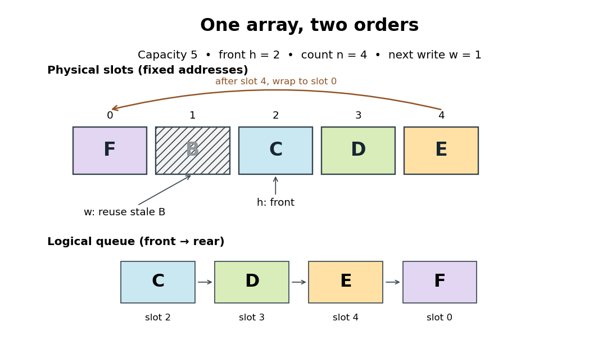

# Circular buffer indices

↑ **Parent:** [Circular buffer](circular-buffer.md)

Let the capacity be a positive [integer](integer-split.md) $C$, and allocate exactly $C$ [array](array-data-structure.md) slots $B_0,\ldots,B_{C-1}$. Store the front [array index](array-index.md) $h$ and count $n$. The [representation invariant](representation-invariant.md) is

$$
|B|=C,\qquad h,n\in\mathbb Z,\qquad 0\leq h<C,\qquad 0\leq n\leq C.
$$

The logical [sequence](sequence.md) and next-write [array index](array-index.md) are

$$
q_i=B_{(h+i)\bmod C}\quad(0\leq i<n),\qquad w=(h+n)\bmod C.
$$

Here $\bmod$ denotes the nonnegative remainder from [modular arithmetic](modular-arithmetic-split.md). The count determines which slots are live: leftover bits in other slots are not members of the [FIFO queue](fifo-queue.md). If $n=0$, $h$ has no current front item; it identifies the position where the next successful insertion begins. If $n=C$, $w=h$ points at a live item, so writing there requires an explicit overwrite policy.

For $n<C$, `enqueue(x)` writes $B_w\leftarrow x$, then increments $n$, leaving $h$ fixed. For $n>0$, `dequeue()` saves and returns $B_h$, then sets $h\leftarrow(h+1)\bmod C$ and $n\leftarrow n-1$. These are sequential updates, completed before the next call. A rejecting interface tests $n=C$ or $n=0$ first and returns `full` or `empty`, respectively, without changing state. `peek` returns $B_h$ only when $n>0$; `size` returns $n$.

One can instead store $w$ and $n$, recovering $h=(w-n)\bmod C$. On insertion, advance $w$ and increment $n$; on removal, keep $w$ fixed and decrement $n$. Thus the next-write [array index](array-index.md) is not necessarily the front [array index](array-index.md).

Names such as `head` and `tail` require checking the actual [API](application-programming-interface.md): the kernel documentation calls the insertion position `head` and the removal position `tail`.[David Howells and Paul E. McKenney, Circular Buffers, What is a circular buffer?: head is insertion, tail is removal](circular-buffers-by-david-howells-and-paul-e-mckenney.md)

**[Figure 12](#image-a-wrapped-circular-buffer-has-one-logical-sequence-across-the-end-of-its-physical-array). A wrapped circular buffer has one logical sequence across the end of its physical array**. Capacity five, front $h=2$, count $n=4$, and next-write index $w=1$. Follow physical slots $2,3,4,0$ to read $C,D,E,F$. Slot 1 still shows the removed label $B$, but it is outside the live [sequence](sequence.md).

The diagram is the state after step 8 of [circular buffer operation trace](circular-buffer-operation-trace.md). Reading the physical [array](array-data-structure.md) from slot zero would give $F,B,C,D,E$, which includes a removed label and puts $F$ first. Reading from $h$ for exactly $n$ items gives $(C,D,E,F)$. The next insertion uses slot $1$, not slot $0$. This distinction also explains why the live [sequence](sequence.md) may need two contiguous pieces of the [array](array-data-structure.md): here slots $2$ through $4$, followed by slot $0$. No items need to move to make this wrap work.

## ↑ Ancestors (4)

1. [Circular buffer](circular-buffer.md)
2. [Data structure](data-structure-split.md)
3. [Computer science](computer-science-split.md)
4. [Codex Wiki](split.md)
