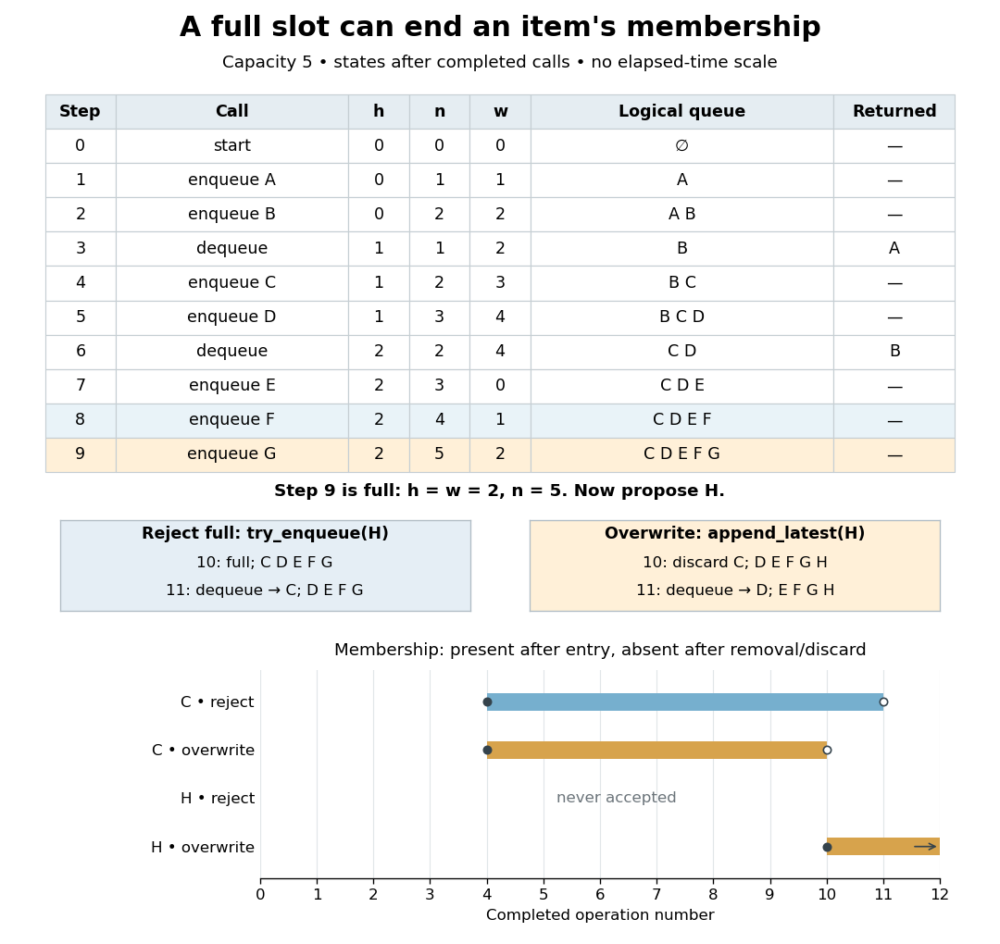

# Circular buffer operation trace

↑ **Parent:** [Circular buffer](circular-buffer.md)

Start with $C=5$, $h=0$, $n=0$ and immutable labels. Perform `enqueue(A)`, `enqueue(B)`, `dequeue()`, `enqueue(C)`, `enqueue(D)`, `dequeue()`, `enqueue(E)`, `enqueue(F)`, `enqueue(G)`. The removals return $A$ and $B$. The interleaved insertions and removals make the front advance before the [array](array-data-structure.md) fills; slot reuse does not require waiting for the [FIFO queue](fifo-queue.md) to become empty.

**[Figure 13](#image-an-interleaved-capacity-five-fifo-queue-trace-branches-at-a-full-insertion). An interleaved capacity-five FIFO queue trace branches at a full insertion**. The table follows completed sequential calls. At step 10, rejecting $H$ retains $C$; overwriting accepts $H$ and discards $C$. Step 11 therefore returns different labels. The lower bars show membership lifetimes for $C$ and $H$ at operation boundaries, not elapsed times or programming-language object lifetimes.

At step 7, $E$ occupies physical slot $4$ and the next-write [array index](array-index.md) wraps to $0$. At step 8, $F$ reuses slot $0$, giving the physical layout in the preceding diagram. At step 9, $G$ replaces the stale contents of slot $1$: the physical [array](array-data-structure.md) is $(F,G,C,D,E)$ but the logical [sequence](sequence.md) is $(C,D,E,F,G)$. Now $h=w=2$, yet $n=5$ makes the state full rather than empty.

The displayed $h,n,w$ values are related by $w=(h+n)\bmod5$ after every call. They are shown together to explain the invariant; an implementation need store only two. For the rejecting [FIFO queue](fifo-queue.md), every successful removal returns the earliest accepted label not already removed. The [representation independence](representation-independence.md) example supplies the general proof through its [abstraction function](abstraction-function.md); this trace makes the wrapped physical storage visible.

## ↑ Ancestors (4)

1. [Circular buffer](circular-buffer.md)
2. [Data structure](data-structure-split.md)
3. [Computer science](computer-science-split.md)
4. [Codex Wiki](split.md)

## ← Incoming links (1)

- [Circular buffer indices](circular-buffer-indices.md)
