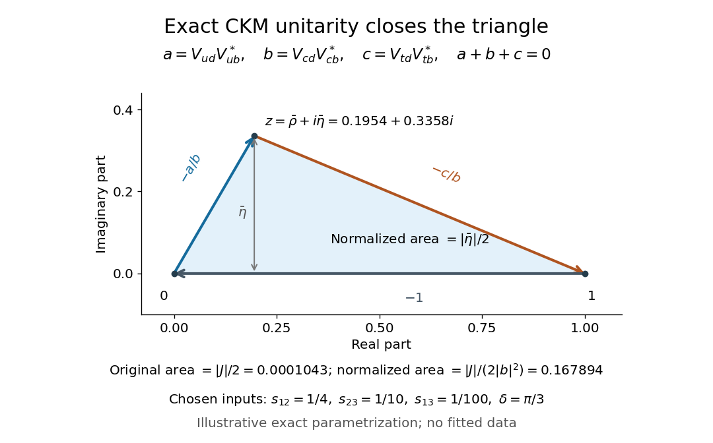

# CKM unitarity triangle

↑ **Parent:** [Cabibbo-Kobayashi-Maskawa matrix](cabibbo-kobayashi-maskawa-matrix.md)

Column [orthogonality](orthogonal-vectors.md) of the [CKM matrix](cabibbo-kobayashi-maskawa-matrix.md) gives three [complex numbers](complex-number.md)

$$
a=V_{ud}V_{ub}^*,\qquad b=V_{cd}V_{cb}^*,\qquad c=V_{td}V_{tb}^*,\qquad a+b+c=0.
$$

Drawing these as successive vectors in the [complex plane](complex-plane.md) produces a closed [triangle](triangle.md). Its area is $\tfrac12|\operatorname{Im}(ab^*)|=|J|/2$, because [unitarity](unitary-operator.md) identifies this imaginary quartet with a signed [Jarlskog invariant](jarlskog-invariant.md). A nonzero area therefore detects physical [CP violation](cp-violation.md) for nondegenerate [quark masses](quark-mass.md).

For a worked example, choose the exact parametrization of the [CKM matrix](cabibbo-kobayashi-maskawa-matrix.md) with $s_{12}=1/4$, $s_{23}=1/10$, $s_{13}=1/100$ and $\delta=\pi/3$. These are illustrative choices, not fitted [quark mixing](quark-mixing.md) parameters. They give $J\simeq2.085597\times10^{-4}$. The unscaled [triangle](triangle.md) has area approximately $1.042799\times10^{-4}$.

Divide the closure relation by $-b$, assuming $b\ne0$, and define the [complex number](complex-number.md)

$$
z=\bar\rho+i\bar\eta=-\frac{a}{b}.
$$

The normalized [triangle](triangle.md) has vertices $0,1,z$, with $z\simeq0.195376+0.335788i$ for these choices. Dividing each side by $|b|$ divides area by $|b|^2$: its area is $|J|/(2|V_{cd}V_{cb}^*|^2)=|\bar\eta|/2$, approximately $0.167894$. The familiar normalized picture therefore does not itself have area $|J|/2$.

**[Figure 11](#image-an-exactly-unitary-illustrative-ckm-matrix-closes-a-triangle). An exactly unitary illustrative CKM matrix closes a triangle**. The [CKM unitarity triangle](ckm-unitarity-triangle.md) is shown after normalization to a unit base; the two area formulas distinguish the original [triangle](triangle.md) from its rescaled version. The chosen parameters are illustrative.

Under [quantum field rephasings](quantum-field-rephasing.md), $a,b,c$ all acquire the same phase, so the original [triangle](triangle.md) merely rotates and $z$ stays fixed. Ratios and angles can thus compare [quark mixing](quark-mixing.md) measurements without dependence on field conventions. If the [Jarlskog invariant](jarlskog-invariant.md) vanishes, the [triangle](triangle.md) collapses; additional [quark mass](quark-mass.md) degeneracies require extra care in interpreting the converse.

## ↑ Ancestors (7)

1. [Cabibbo-Kobayashi-Maskawa matrix](cabibbo-kobayashi-maskawa-matrix.md)
2. [Standard Model fermion](standard-model-fermion.md)
3. [Standard Model](standard-model-split.md)
4. [Quantum field theory](quantum-field-theory-split.md)
5. [Branches of physics](branches-of-physics.md)
6. [Physics](physics-split.md)
7. [Codex Wiki](split.md)

## ← Incoming links (5)

- [CKM unitarity triangle](ckm-unitarity-triangle.md)
- [Jarlskog invariant](jarlskog-invariant.md)
- [Solution](past-exam-of-the-mathematics-course-of-the-university-of-cambridge/2007/iii/paper-53/3/solution.md)
- [Time-dependent neutral-B CP asymmetry](time-dependent-neutral-b-cp-asymmetry.md)
- [Wolfenstein parametrization](wolfenstein-parametrization.md)
