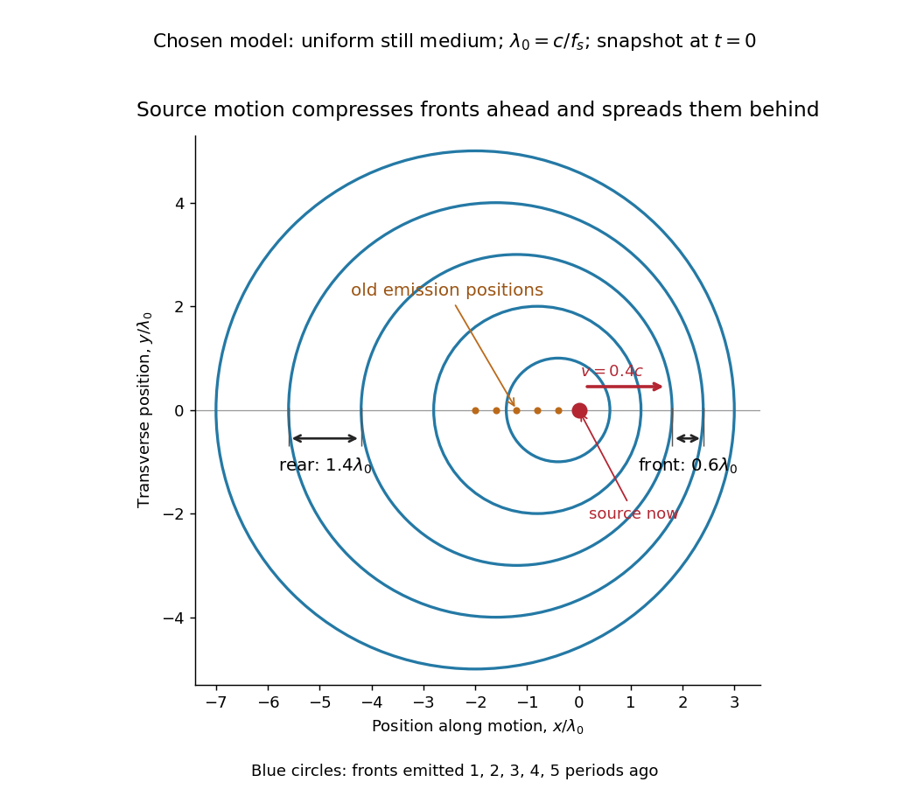

# Classical Doppler effect for sound

↑ **Parent:** [Doppler effect](doppler-effect.md)

Work in the material's rest [reference frame](reference-frame.md), with constant [speed of sound](speed-of-sound.md) $c>0$. For one-dimensional propagation, choose the positive $x$ direction along the travelling [wave](wave-split.md) from its emission point toward the receiver. Define $u_s=dx_s/dt$ and $u_o=dx_o/dt$ as the signed source and receiver [velocities](velocity.md) along that same axis. Both use the same sign convention: positive $u_s$ moves the source toward the receiver ahead, whereas positive $u_o$ moves that receiver away from the incoming [wave](wave-split.md). Assume $|u_s|<c$ and $|u_o|<c$, constant [velocities](velocity.md), and no source-receiver crossing during the interval considered. Then

$$
f_o=f_s\frac{c-u_o}{c-u_s}.
$$

To derive this, let $T_s=1/f_s$ be the emission [wave period](wave-period.md). During $T_s$, one [wave crest](wave-crest.md) travels $cT_s$ while the source advances $u_sT_s$. Successive [wavefronts](wavefront.md) along the chosen direction therefore have [wavelength](wavelength.md)

$$
\lambda=(c-u_s)T_s=\frac{c-u_s}{f_s}.
$$

They overtake the receiver at relative speed $c-u_o$, so counting [wave crests](wave-crest.md) gives $f_o=(c-u_o)/\lambda$. This separates the source's effect on [wavelength](wavelength.md) from the receiver's effect on crossing rate. Even with a moving source, a stationary receiver obeys $f_o\lambda=c$ because the [wave speed](wave-speed.md) through the material remains $c$.

For a stationary receiver and a source approaching at speed $v$, set $u_o=0$ and $u_s=v$: $f_o=f_sc/(c-v)>f_s$. For recession choose the positive axis along the departing [wave](wave-split.md) toward the receiver again, so the source has $u_s=-v$: $f_o=f_sc/(c+v)<f_s$. For the deliberately chosen values $c=343\,\mathrm{m\,s^{-1}}$, $v=20\,\mathrm{m\,s^{-1}}$ and $f_s=500\,\mathrm{Hz}$, the two predictions are

$$
f_{\mathrm{approach}}=500\frac{343}{323}\,\mathrm{Hz}\simeq530.96\,\mathrm{Hz},\qquad f_{\mathrm{recede}}=500\frac{343}{363}\,\mathrm{Hz}\simeq472.45\,\mathrm{Hz}.
$$

The corresponding [wavelengths](wavelength.md) are $0.646\,\mathrm m$ and $0.726\,\mathrm m$, compared with $c/f_s=0.686\,\mathrm m$ for a stationary source. These are calculations for chosen parameters, not reported measurements.

**[Figure 5](#doppler-source-wavefront-spacing). Moving-source wavefront spacing in the classical Doppler effect for sound**. Original [linear acoustics](linear-acoustics-split.md) model at $t=0$, with a deliberately enlarged speed ratio $v/c=0.4$ for readability. Lengths are measured in $\lambda_0=c/f_s$. Successive [circles](circle.md) are sections of spherical [wavefronts](wavefront.md) emitted one [wave period](wave-period.md) apart; their centres stay at the old emission positions. The forward spacing is $0.6\lambda_0$ and the rear spacing $1.4\lambda_0$. These chosen parameters differ from the $20\,\mathrm{m\,s^{-1}}$ worked example.

A receiver approaching a stationary source at $20\,\mathrm{m\,s^{-1}}$ instead has $u_s=0$, $u_o=-20\,\mathrm{m\,s^{-1}}$, giving $f_o=500(363/343)\,\mathrm{Hz}\simeq529.15\,\mathrm{Hz}$. Moving away gives $f_o=500(323/343)\,\mathrm{Hz}\simeq470.85\,\mathrm{Hz}$. The equal closing speeds do not make these equal to the moving-source values. If both source and receiver move together with $u_s=u_o$, however, the numerator and denominator cancel and $f_o=f_s$. For speeds small compared with $c$, the first-order shift is $(f_o-f_s)/f_s\simeq(u_s-u_o)/c$; the difference between moving-source and moving-receiver experiments appears beyond this first order.

## ↑ Ancestors (4)

1. [Doppler effect](doppler-effect.md)
2. [Wave](wave-split.md)
3. [Physics](physics-split.md)
4. [Codex Wiki](split.md)

## ← Incoming links (4)

- [Acoustic Doppler measurement](acoustic-doppler-measurement.md)
- [Classical Doppler effect for sound](classical-doppler-effect-for-sound.md)
- [Doppler effect](doppler-effect.md)
- [Relativistic Doppler effect](relativistic-doppler-effect.md)
