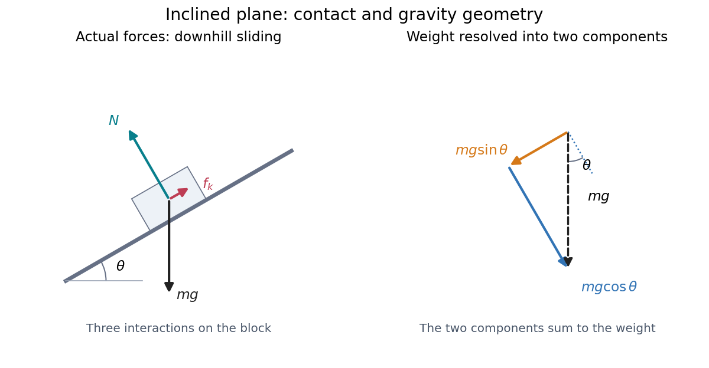
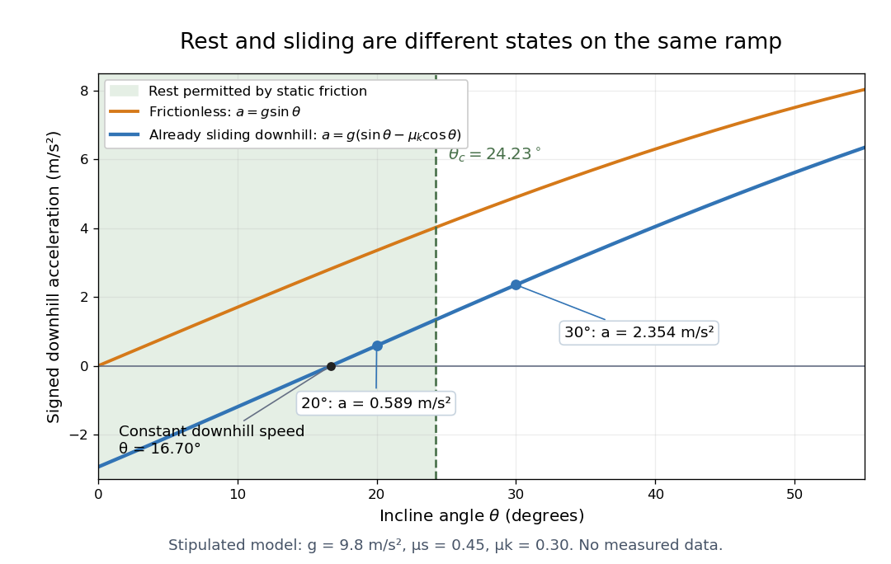
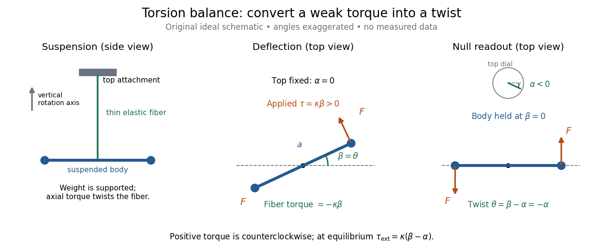
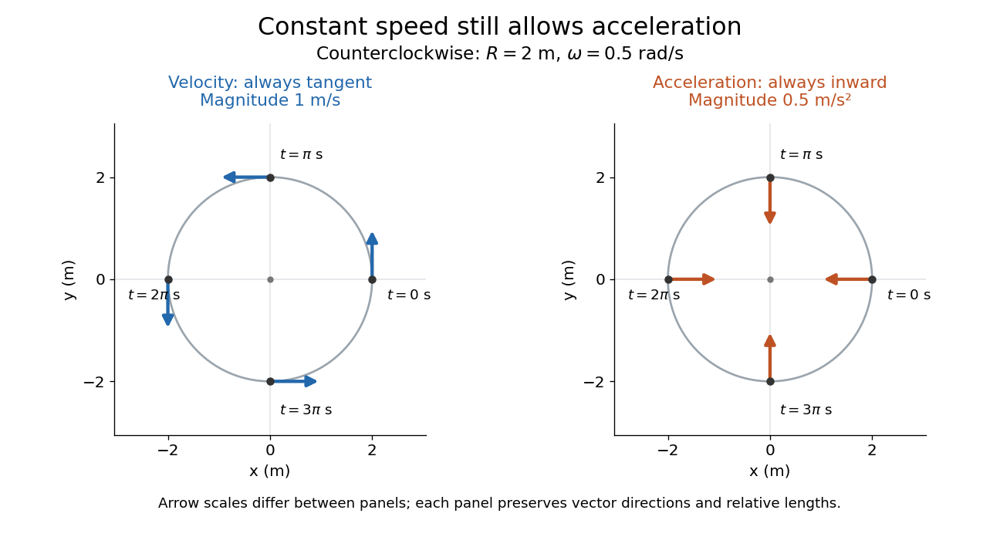
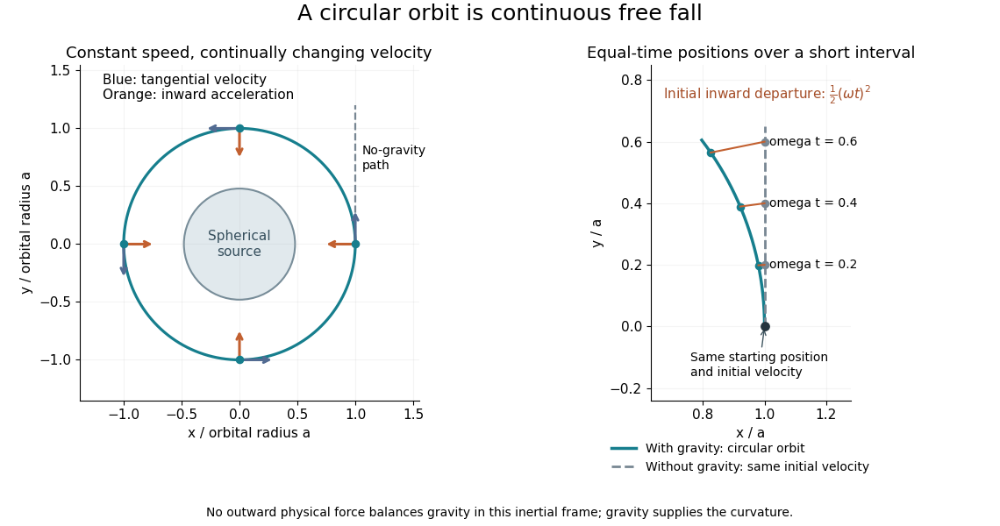
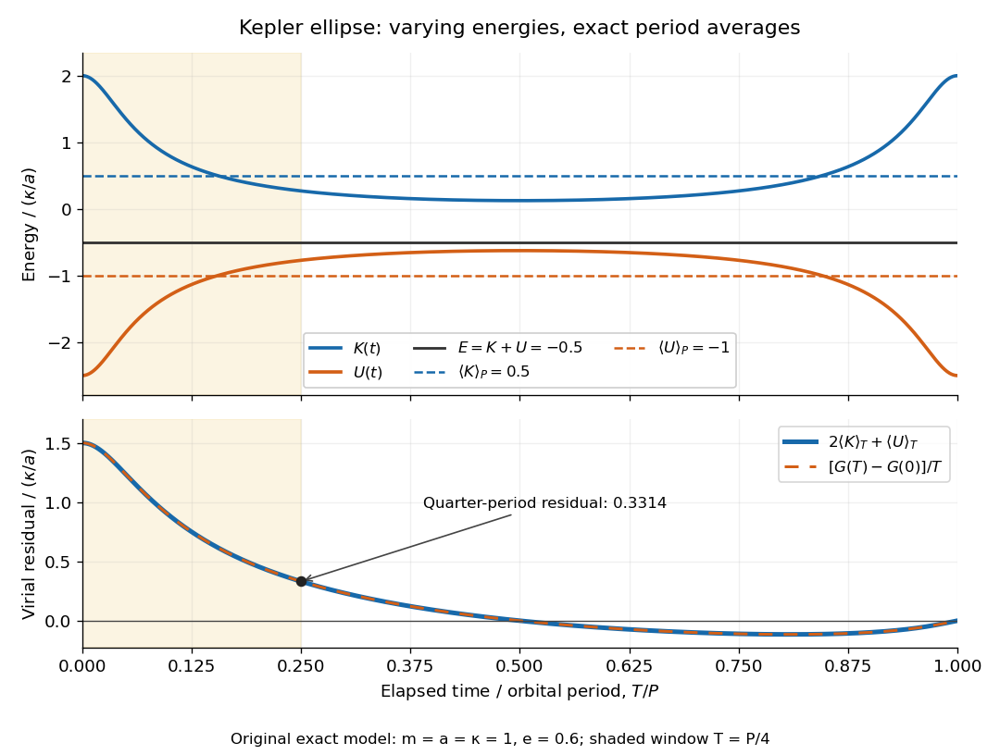
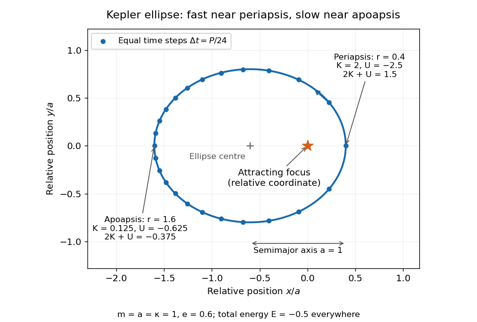
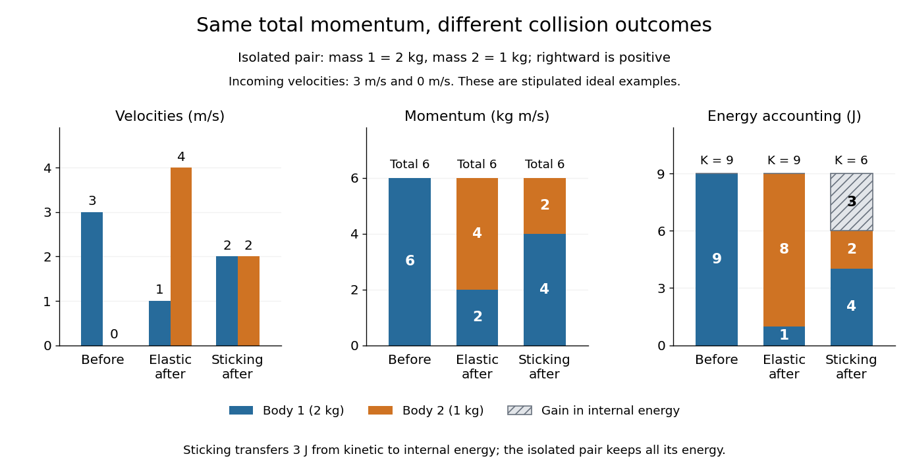
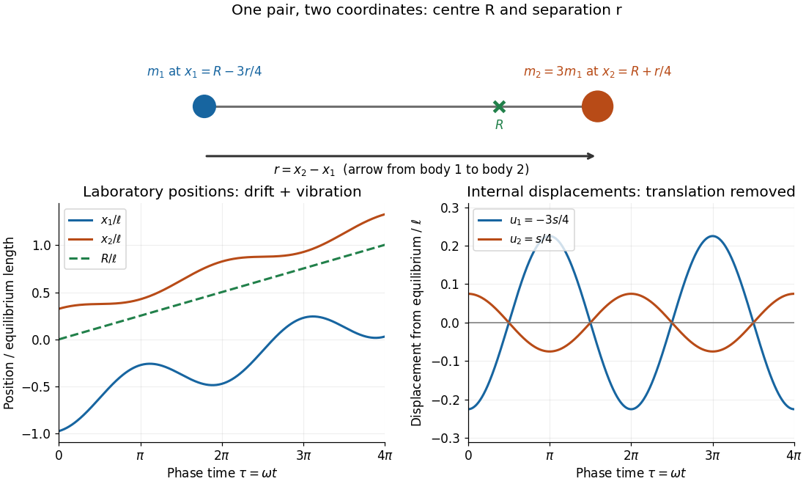

# Classical mechanics

↑ **Parent:** [Branches of physics](physics.md#branches-of-physics)  
ⓦ [Wiki](https://en.wikipedia.org/wiki/Classical_mechanics)

[Classical mechanics](classical-mechanics.md) describes the motion of bodies by assigning [positions](#position) and [velocities](#velocity) and specifying how their interactions change those quantities. A [point mass](#point-mass) is the simplest model: its size and internal structure are ignored, leaving a [mass](#mass) and a moving [position](#position). A [rigid body](rigid-body-dynamics.md) retains orientation and [rotational kinetic energy](energy.md#rotational-kinetic-energy). Choosing a model means deciding which features affect the question being asked; a sliding block may be treated as a [point mass](#point-mass), whereas predicting its [rolling without slipping](rigid-body-dynamics.md#rolling-without-slipping) requires its [moment of inertia](rigid-body-dynamics.md#moment-of-inertia).

Three complementary questions organize the subject. [Newton's second law](force.md#newton-s-second-law) asks how the net [force](force.md) determines the instantaneous [acceleration](#acceleration). The [work-energy theorem](energy.md#work-energy-theorem) asks how that [force](force.md), acting through a [displacement](#displacement), changes [kinetic energy](energy.md#kinetic-energy). [Conservation of mechanical energy](energy.md#conservation-of-mechanical-energy) asks which combinations of [position](#position) and [velocity](#velocity) are accessible when the interactions admit a time-independent [potential energy](energy.md#potential-energy) and no other [force](force.md) supplies net [power](energy.md#power). These descriptions are compatible, but answer different questions: an [energy](energy.md) calculation may find a maximum [speed](#speed) without first solving for [position](#position) at every [time](#time-in-physics).

The [harmonic oscillator](#simple-harmonic-motion) below makes this unity visible. A restoring [force](force.md) produces a repeating [position](#position) trace; the corresponding [phase plane](dynamical-systems.md#phase-plane) has a closed [ellipse](euclidean-geometry.md#ellipse); [kinetic energy](energy.md#kinetic-energy) and [potential energy](energy.md#potential-energy) exchange while their sum stays fixed. [Lagrangian mechanics](lagrangian-mechanics.md) and [Hamiltonian mechanics](hamiltonian-mechanics.md) provide further ways to organize the same dynamics, especially when coordinates or constraints make individual [forces](force.md) awkward to track.

The scope of [classical mechanics](classical-mechanics.md) also matters. [Newtonian mechanics](newtonian-mechanics.md) approximates motion at [speeds](#speed) small compared with the [speed of light](special-relativity.md#speed-of-light); [special relativity](special-relativity.md) changes that description when this approximation fails. [Quantum mechanics](quantum-mechanics.md) is needed for phenomena for which a classical assignment of simultaneous [position](#position) and [momentum](momentum.md) is inadequate. These limitations do not prevent [classical mechanics](classical-mechanics.md) from being a useful predictive model within its regime. [MIT mechanics, Chapter 1: scope and limitations](https://ocw.mit.edu/courses/8-01sc-classical-mechanics-fall-2016/mit8_01scs22_chapter1.pdf)

**Table of contents**

- [Kinematics](#kinematics)
- [Near-surface recoil height with constant downward thrust](#near-surface-recoil-height-with-constant-downward-thrust)
- [Contact loss on a smooth sphere](#contact-loss-on-a-smooth-sphere)
- [Coulomb orbit](#coulomb-orbit)
  - [Classical radiation collapse of a Coulomb orbit](#classical-radiation-collapse-of-a-coulomb-orbit)
- [Projectile motion](#projectile-motion)
  - [Apex-target condition for a ballistic jet](#apex-target-condition-for-a-ballistic-jet)
    - [Jet-area adjustment during ballistic slowing](#jet-area-adjustment-during-ballistic-slowing)
  - [Ballistic orbit insertion with constant gravity](#ballistic-orbit-insertion-with-constant-gravity)
- [Mechanical impedance](#mechanical-impedance)
  - [Displacement coefficients at a string junction](#displacement-coefficients-at-a-string-junction)
    - [String-pulse width mapping at a junction](#string-pulse-width-mapping-at-a-junction)
- [Trajectory](#trajectory)
- [Vibration isolation](#vibration-isolation)
- [Inclined plane](#inclined-plane)
  - [Gravity components on an inclined plane](#gravity-components-on-an-inclined-plane)
  - [Sliding acceleration on an inclined plane](#sliding-acceleration-on-an-inclined-plane)
  - [Photogate measurement of acceleration down an incline](#photogate-measurement-of-acceleration-down-an-incline)
- [Variable-mass system](#variable-mass-system)
  - [Tangential-exhaust rotor with a fixed dry inertia](#tangential-exhaust-rotor-with-a-fixed-dry-inertia)
  - [Surface-fed growth of an accreting sphere](#surface-fed-growth-of-an-accreting-sphere)
    - [Quadratic drag on a sphere with constant radial growth](#quadratic-drag-on-a-sphere-with-constant-radial-growth)
  - [Accreting raindrop with quadratic drag](#accreting-raindrop-with-quadratic-drag)
    - [Speed-radius attractor of an accreting raindrop](#speed-radius-attractor-of-an-accreting-raindrop)
- [Inertia](#inertia)
- [Mechanical configuration space](#mechanical-configuration-space)
  - [Mechanical configuration](#mechanical-configuration)
- [Relational shape space](#relational-shape-space)
- [Simple pendulum](simple-pendulum.md)
  - [Pendulum with a prescribed translating support](simple-pendulum.md#pendulum-with-a-prescribed-translating-support)
    - [Horizontal-vibration averaged pendulum potential](simple-pendulum.md#horizontal-vibration-averaged-pendulum-potential)
  - [Pendulum clock below a uniform-density surface](simple-pendulum.md#pendulum-clock-below-a-uniform-density-surface)
  - [Conical pendulum](simple-pendulum.md#conical-pendulum)
    - [Magnetically charged conical pendulum](simple-pendulum.md#magnetically-charged-conical-pendulum)
    - [Rotating bob experiment for a conical pendulum](simple-pendulum.md#rotating-bob-experiment-for-a-conical-pendulum)
    - [Period and small-angle limit of a conical pendulum](simple-pendulum.md#period-and-small-angle-limit-of-a-conical-pendulum)
  - [Damped pendulum](simple-pendulum.md#damped-pendulum)
    - [Energy dissipation of a damped pendulum](simple-pendulum.md#energy-dissipation-of-a-damped-pendulum)
  - [Foucault pendulum](simple-pendulum.md#foucault-pendulum)
    - [UNSW Foucault pendulum observation](simple-pendulum.md#unsw-foucault-pendulum-observation)
    - [Latitude law of Foucault precession](simple-pendulum.md#latitude-law-of-foucault-precession)
    - [Exact linear Foucault pendulum trajectory](simple-pendulum.md#exact-linear-foucault-pendulum-trajectory)
    - [Controls and limitations of a Foucault pendulum](simple-pendulum.md#controls-and-limitations-of-a-foucault-pendulum)
- [Eisenhart-Duval lift](#eisenhart-duval-lift)
  - [Gauge transformations of an Eisenhart-Duval lift](#gauge-transformations-of-an-eisenhart-duval-lift)
  - [Null Kaluza-Klein reduction of a stationary force](#null-kaluza-klein-reduction-of-a-stationary-force)
- [Newtonian mechanics](newtonian-mechanics.md)
  - [Small-slope particle motion on a height graph](newtonian-mechanics.md#small-slope-particle-motion-on-a-height-graph)
    - [Radial turning points for an inverse-square height well](newtonian-mechanics.md#radial-turning-points-for-an-inverse-square-height-well)
  - [Tangentially driven motion on an axisymmetric surface](newtonian-mechanics.md#tangentially-driven-motion-on-an-axisymmetric-surface)
  - [Friction](newtonian-mechanics.md#friction)
    - [Coefficient of friction](newtonian-mechanics.md#coefficient-of-friction)
    - [Lubricant](newtonian-mechanics.md#lubricant)
    - [Kinetic friction](newtonian-mechanics.md#kinetic-friction)
      - [Pressure-driven cork ejection](newtonian-mechanics.md#pressure-driven-cork-ejection)
      - [Uniform-pressure friction torque on a circular contact](newtonian-mechanics.md#uniform-pressure-friction-torque-on-a-circular-contact)
      - [Coefficient of kinetic friction](newtonian-mechanics.md#coefficient-of-kinetic-friction)
        - [Constant-speed measurement of kinetic friction](newtonian-mechanics.md#constant-speed-measurement-of-kinetic-friction)
        - [Load dependence of kinetic friction](newtonian-mechanics.md#load-dependence-of-kinetic-friction)
        - [Corrections to a pulling measurement of kinetic friction](newtonian-mechanics.md#corrections-to-a-pulling-measurement-of-kinetic-friction)
      - [Two-stage stopping under linear drag and dry friction](newtonian-mechanics.md#two-stage-stopping-under-linear-drag-and-dry-friction)
    - [Contact slip](newtonian-mechanics.md#contact-slip)
    - [Frictional heating](newtonian-mechanics.md#frictional-heating)
  - [Newton–Cartan theory](newtonian-mechanics.md#newton-cartan-theory)
    - [Newton–Cartan gravitational connection](newtonian-mechanics.md#newton-cartan-gravitational-connection)
      - [Newtonian tidal curvature](newtonian-mechanics.md#newtonian-tidal-curvature)
- [Equation of motion](#equation-of-motion)
- [Time reversal in classical mechanics](#time-reversal-in-classical-mechanics)
- [Newton's law of universal gravitation](newton-s-law-of-universal-gravitation.md)
  - [Axial and transverse gravity of a uniform rod](newton-s-law-of-universal-gravitation.md#axial-and-transverse-gravity-of-a-uniform-rod)
    - [Circular orbit perpendicular to a uniform rod](newton-s-law-of-universal-gravitation.md#circular-orbit-perpendicular-to-a-uniform-rod)
  - [Gravitational-electrostatic balance of equal charged spheres](newton-s-law-of-universal-gravitation.md#gravitational-electrostatic-balance-of-equal-charged-spheres)
  - [Free fall](newton-s-law-of-universal-gravitation.md#free-fall)
    - [Free fall in a constant gravitational field](newton-s-law-of-universal-gravitation.md#free-fall-in-a-constant-gravitational-field)
    - [Radial free fall from rest](newton-s-law-of-universal-gravitation.md#radial-free-fall-from-rest)
    - [Rotational deflection of a falling body](newton-s-law-of-universal-gravitation.md#rotational-deflection-of-a-falling-body)
      - [Equatorial Coriolis deflection in free fall](newton-s-law-of-universal-gravitation.md#equatorial-coriolis-deflection-in-free-fall)
  - [Newtonian gravitational field](newton-s-law-of-universal-gravitation.md#newtonian-gravitational-field)
    - [Gravitational field of an infinite plane sheet](newton-s-law-of-universal-gravitation.md#gravitational-field-of-an-infinite-plane-sheet)
      - [Tidal water loading of a spring balance](newton-s-law-of-universal-gravitation.md#tidal-water-loading-of-a-spring-balance)
    - [Axial gravitational field of a uniform ring](newton-s-law-of-universal-gravitation.md#axial-gravitational-field-of-a-uniform-ring)
    - [Gravitational field of a finite uniform line segment](newton-s-law-of-universal-gravitation.md#gravitational-field-of-a-finite-uniform-line-segment)
    - [Gravitational field of an infinite uniform cylinder](newton-s-law-of-universal-gravitation.md#gravitational-field-of-an-infinite-uniform-cylinder)
      - [Plumb-line deflection from cylindrical gravity](newton-s-law-of-universal-gravitation.md#plumb-line-deflection-from-cylindrical-gravity)
      - [Diameter-rod oscillation in cylindrical gravity](newton-s-law-of-universal-gravitation.md#diameter-rod-oscillation-in-cylindrical-gravity)
    - [Gauss's law for gravity](newton-s-law-of-universal-gravitation.md#gauss-s-law-for-gravity)
    - [Uniform gravitational field in an off-center spherical cavity](newton-s-law-of-universal-gravitation.md#uniform-gravitational-field-in-an-off-center-spherical-cavity)
      - [Cavity equilibrium destabilized by a second void](newton-s-law-of-universal-gravitation.md#cavity-equilibrium-destabilized-by-a-second-void)
    - [Newtonian gravitational stress tensor](newton-s-law-of-universal-gravitation.md#newtonian-gravitational-stress-tensor)
      - [Gravitational stress contribution to angular-momentum transport](newton-s-law-of-universal-gravitation.md#gravitational-stress-contribution-to-angular-momentum-transport)
    - [Self-gravity](newton-s-law-of-universal-gravitation.md#self-gravity)
    - [Standard gravitational parameter](newton-s-law-of-universal-gravitation.md#standard-gravitational-parameter)
    - [Tidal tensor](newton-s-law-of-universal-gravitation.md#tidal-tensor)
      - [Newtonian tidal eigenvalues outside a point mass](newton-s-law-of-universal-gravitation.md#newtonian-tidal-eigenvalues-outside-a-point-mass)
      - [Corotating point-mass tidal field](newton-s-law-of-universal-gravitation.md#corotating-point-mass-tidal-field)
      - [Point-mass tidal stretching and squeezing](newton-s-law-of-universal-gravitation.md#point-mass-tidal-stretching-and-squeezing)
      - [Quadrupolar point-mass tidal potential](newton-s-law-of-universal-gravitation.md#quadrupolar-point-mass-tidal-potential)
      - [Tidal disruption](newton-s-law-of-universal-gravitation.md#tidal-disruption)
      - [Tidal force](newton-s-law-of-universal-gravitation.md#tidal-force)
        - [Corotating tidal-disruption estimate for a uniform sphere](newton-s-law-of-universal-gravitation.md#corotating-tidal-disruption-estimate-for-a-uniform-sphere)
        - [Tide](newton-s-law-of-universal-gravitation.md#tide)
          - [Bay of Fundy](newton-s-law-of-universal-gravitation.md#bay-of-fundy)
          - [Semidiurnal tide](newton-s-law-of-universal-gravitation.md#semidiurnal-tide)
          - [Spring tide](newton-s-law-of-universal-gravitation.md#spring-tide)
          - [Neap tide](newton-s-law-of-universal-gravitation.md#neap-tide)
        - [Exact tidal acceleration between separated masses](newton-s-law-of-universal-gravitation.md#exact-tidal-acceleration-between-separated-masses)
        - [Gravity magnitude versus tidal gradient](newton-s-law-of-universal-gravitation.md#gravity-magnitude-versus-tidal-gradient)
        - [Love number](newton-s-law-of-universal-gravitation.md#love-number)
      - [Gravity gradiometry](newton-s-law-of-universal-gravitation.md#gravity-gradiometry)
        - [Atom-cloud gravity-gradient measurement](newton-s-law-of-universal-gravitation.md#atom-cloud-gravity-gradient-measurement)
      - [Quadrupolar tidal forcing](newton-s-law-of-universal-gravitation.md#quadrupolar-tidal-forcing)
    - [Gravitational acceleration](newton-s-law-of-universal-gravitation.md#gravitational-acceleration)
      - [Newtonian central configuration](newton-s-law-of-universal-gravitation.md#newtonian-central-configuration)
        - [Homothetic gravitational motion](newton-s-law-of-universal-gravitation.md#homothetic-gravitational-motion)
    - [Gravitational constant](newton-s-law-of-universal-gravitation.md#gravitational-constant)
      - [Gravitational mass degeneracy](newton-s-law-of-universal-gravitation.md#gravitational-mass-degeneracy)
      - [Gravitational constant measurement sensitivity](newton-s-law-of-universal-gravitation.md#gravitational-constant-measurement-sensitivity)
      - [Cold-atom measurement of the gravitational constant](newton-s-law-of-universal-gravitation.md#cold-atom-measurement-of-the-gravitational-constant)
    - [Poisson equation for Newtonian gravity](newton-s-law-of-universal-gravitation.md#poisson-equation-for-newtonian-gravity)
      - [Dyadic spherical shells with inverse-radius density scaling](newton-s-law-of-universal-gravitation.md#dyadic-spherical-shells-with-inverse-radius-density-scaling)
    - [Newtonian gravitational potential](newton-s-law-of-universal-gravitation.md#newtonian-gravitational-potential)
      - [Gravitational potential of a sinusoidal sheet](newton-s-law-of-universal-gravitation.md#gravitational-potential-of-a-sinusoidal-sheet)
      - [Newtonian gravitational potential of a uniform solid sphere](newton-s-law-of-universal-gravitation.md#newtonian-gravitational-potential-of-a-uniform-solid-sphere)
      - [Planetary quadrupole coefficient](newton-s-law-of-universal-gravitation.md#planetary-quadrupole-coefficient)
        - [Oblate-quadrupole epicyclic precession](newton-s-law-of-universal-gravitation.md#oblate-quadrupole-epicyclic-precession)
      - [Axisymmetric logarithmic gravitational potential](newton-s-law-of-universal-gravitation.md#axisymmetric-logarithmic-gravitational-potential)
        - [Density positivity for an axisymmetric logarithmic potential](newton-s-law-of-universal-gravitation.md#density-positivity-for-an-axisymmetric-logarithmic-potential)
      - [Power-law gravitational potential](newton-s-law-of-universal-gravitation.md#power-law-gravitational-potential)
      - [Gravitational quadrupole potential of a point-mass binary](newton-s-law-of-universal-gravitation.md#gravitational-quadrupole-potential-of-a-point-mass-binary)
      - [Flattened power-law gravitational potential](newton-s-law-of-universal-gravitation.md#flattened-power-law-gravitational-potential)
        - [Density positivity for a flattened power-law potential](newton-s-law-of-universal-gravitation.md#density-positivity-for-a-flattened-power-law-potential)
      - [Newtonian potential of a point mass](newton-s-law-of-universal-gravitation.md#newtonian-potential-of-a-point-mass)
        - [Self-gravity in a thin spherical shell expansion](newton-s-law-of-universal-gravitation.md#self-gravity-in-a-thin-spherical-shell-expansion)
        - [Gravitational potential of a truncated inverse-radius sphere](newton-s-law-of-universal-gravitation.md#gravitational-potential-of-a-truncated-inverse-radius-sphere)
        - [Axisymmetric gravitational potential of a displaced cylindrical interface](newton-s-law-of-universal-gravitation.md#axisymmetric-gravitational-potential-of-a-displaced-cylindrical-interface)
      - [Spherically symmetric potential](newton-s-law-of-universal-gravitation.md#spherically-symmetric-potential)
    - [Newtonian gravitational potential energy](newton-s-law-of-universal-gravitation.md#newtonian-gravitational-potential-energy)
      - [Spherical binding-energy mass integral](newton-s-law-of-universal-gravitation.md#spherical-binding-energy-mass-integral)
      - [Minimum-separation binding-energy bounds](newton-s-law-of-universal-gravitation.md#minimum-separation-binding-energy-bounds)
        - [Negative-energy minimum-separation upper bound](newton-s-law-of-universal-gravitation.md#negative-energy-minimum-separation-upper-bound)
    - [Cavendish experiment](newton-s-law-of-universal-gravitation.md#cavendish-experiment)
      - [Cavendish torsion balance](newton-s-law-of-universal-gravitation.md#cavendish-torsion-balance)
- [Torsion balance](#torsion-balance)
  - [Torsion pendulum](#torsion-pendulum)
    - [Rotating torsion-stabilized inverted pendulum](#rotating-torsion-stabilized-inverted-pendulum)
    - [Coupled torsional pendulums](#coupled-torsional-pendulums)
  - [Torsion constant](#torsion-constant)
    - [Damped torsional oscillation](#damped-torsional-oscillation)
  - [Torsion balance zero drift](#torsion-balance-zero-drift)
- [Degree of freedom](#degree-of-freedom)
- [Constraint (mechanics)](#constraint-mechanics)
  - [Nonholonomic constraint](#nonholonomic-constraint)
  - [Bead on a parabolic wire](#bead-on-a-parabolic-wire)
  - [Constraint surface](#constraint-surface)
  - [Holonomic constraint](#holonomic-constraint)
  - [First-class constraint](#first-class-constraint)
    - [Regular first-class phase-space reduction](#regular-first-class-phase-space-reduction)
    - [Canonical gauge transformation](#canonical-gauge-transformation)
    - [Constraint algebra](#constraint-algebra)
      - [Structure functions of a constraint algebra](#structure-functions-of-a-constraint-algebra)
- [Position](#position)
  - [Plane polar coordinates](#plane-polar-coordinates)
    - [Velocity in polar coordinates](#velocity-in-polar-coordinates)
    - [Acceleration in polar coordinates](#acceleration-in-polar-coordinates)
  - [Velocity](#velocity)
    - [Normal velocity](#normal-velocity)
    - [Speed](#speed)
      - [Time and distance averages of speed](#time-and-distance-averages-of-speed)
    - [Acceleration](#acceleration)
      - [Jerk (kinematics)](#jerk-kinematics)
    - [Constant speed](#constant-speed)
    - [Terminal velocity](#terminal-velocity)
      - [Terminal velocity under linear drag](#terminal-velocity-under-linear-drag)
  - [Position vector](#position-vector)
- [Energy](energy.md)
  - [Energy harvesting](energy.md#energy-harvesting)
  - [Mechanical energy harvesting](energy.md#mechanical-energy-harvesting)
    - [Piezoelectric energy harvesting](energy.md#piezoelectric-energy-harvesting)
      - [Piezoelectric polymer](energy.md#piezoelectric-polymer)
      - [Piezoelectric ceramic](energy.md#piezoelectric-ceramic)
    - [Electromagnetic energy harvesting](energy.md#electromagnetic-energy-harvesting)
    - [Electrostatic energy harvesting](energy.md#electrostatic-energy-harvesting)
  - [Specific energy](energy.md#specific-energy)
    - [Ragone plot](energy.md#ragone-plot)
  - [Q value](energy.md#q-value)
  - [Energy function](energy.md#energy-function)
  - [Mechanical energy](energy.md#mechanical-energy)
    - [Conservation of mechanical energy](energy.md#conservation-of-mechanical-energy)
  - [Work](energy.md#work)
    - [Work done by a constant force](energy.md#work-done-by-a-constant-force)
    - [Work-energy theorem](energy.md#work-energy-theorem)
    - [Power](energy.md#power)
      - [Specific power](energy.md#specific-power)
      - [Peak power](energy.md#peak-power)
      - [Instantaneous power](energy.md#instantaneous-power)
      - [Average power](energy.md#average-power)
  - [Kinetic energy](energy.md#kinetic-energy)
    - [Kinetic energy correction factor](energy.md#kinetic-energy-correction-factor)
    - [Relativistic kinetic energy](energy.md#relativistic-kinetic-energy)
    - [Rigid rotation minimizes kinetic energy at fixed angular momentum](energy.md#rigid-rotation-minimizes-kinetic-energy-at-fixed-angular-momentum)
    - [Kinetic energy decomposition about the center of mass](energy.md#kinetic-energy-decomposition-about-the-center-of-mass)
    - [Unit-direction kinetic-energy identity](energy.md#unit-direction-kinetic-energy-identity)
    - [Kinetic energy density](energy.md#kinetic-energy-density)
    - [Rotational kinetic energy](energy.md#rotational-kinetic-energy)
  - [Potential energy](energy.md#potential-energy)
    - [Lennard-Jones potential](energy.md#lennard-jones-potential)
    - [Harmonic potential](energy.md#harmonic-potential)
    - [Potential well](energy.md#potential-well)
      - [Half-line square-root potential well](energy.md#half-line-square-root-potential-well)
    - [Repulsive inverse-square potential](energy.md#repulsive-inverse-square-potential)
      - [Scattering in a repulsive inverse-square potential](energy.md#scattering-in-a-repulsive-inverse-square-potential)
    - [Gravitational energy](energy.md#gravitational-energy)
    - [Available potential energy](energy.md#available-potential-energy)
      - [Background potential energy](energy.md#background-potential-energy)
    - [Potential function](energy.md#potential-function)
    - [Central potential](energy.md#central-potential)
      - [Newton's theorem of revolving orbits](energy.md#newton-s-theorem-of-revolving-orbits)
    - [Conservative force](energy.md#conservative-force)
      - [Nonconservative force](energy.md#nonconservative-force)
    - [Inverse-square potential](energy.md#inverse-square-potential)
      - [Angular momentum and the escape energy threshold](energy.md#angular-momentum-and-the-escape-energy-threshold)
      - [Falling bodies and lunar motion as tests of gravity](energy.md#falling-bodies-and-lunar-motion-as-tests-of-gravity)
      - [Lunar laser ranging](energy.md#lunar-laser-ranging)
        - [Retroreflector](energy.md#retroreflector)
          - [Corner reflector](energy.md#corner-reflector)
    - [Exponential cusp potential](energy.md#exponential-cusp-potential)
    - [Escape velocity](energy.md#escape-velocity)
      - [Escape by jumping from a uniform-density asteroid](energy.md#escape-by-jumping-from-a-uniform-density-asteroid)
      - [Molecular escape-speed temperature estimate](energy.md#molecular-escape-speed-temperature-estimate)
      - [Escape-energy balance diagram](energy.md#escape-energy-balance-diagram)
      - [Tangential launch trajectories across the escape threshold](energy.md#tangential-launch-trajectories-across-the-escape-threshold)
      - [Zero-energy escape takes infinite time](energy.md#zero-energy-escape-takes-infinite-time)
      - [Escape speed, circular speed, and propulsion](energy.md#escape-speed-circular-speed-and-propulsion)
      - [Spacecraft tracking and the limits of the escape model](energy.md#spacecraft-tracking-and-the-limits-of-the-escape-model)
      - [Spacecraft trajectory](energy.md#spacecraft-trajectory)
        - [Orbit determination](energy.md#orbit-determination)
      - [Escape and circular speeds inside an isolated uniform sphere](energy.md#escape-and-circular-speeds-inside-an-isolated-uniform-sphere)
    - [Equipotential surface](energy.md#equipotential-surface)
      - [Equipotential curve](energy.md#equipotential-curve)
  - [Turning point](energy.md#turning-point)
  - [Binding energy](energy.md#binding-energy)
- [Momentum](momentum.md)
  - [Mechanical momentum](momentum.md#mechanical-momentum)
  - [Momentum conservation](momentum.md#momentum-conservation)
    - [Equal-mass fragmentation energy budget](momentum.md#equal-mass-fragmentation-energy-budget)
    - [Nearly cancelling recoil momenta in payload ejection](momentum.md#nearly-cancelling-recoil-momenta-in-payload-ejection)
    - [Recoil](momentum.md#recoil)
  - [Rocket equation](momentum.md#rocket-equation)
    - [Constant-rate retro-rocket landing](momentum.md#constant-rate-retro-rocket-landing)
    - [Rocket exhaust speed](momentum.md#rocket-exhaust-speed)
    - [Rocket propellant](momentum.md#rocket-propellant)
      - [Rocket dry mass](momentum.md#rocket-dry-mass)
    - [Rocket mass ratio](momentum.md#rocket-mass-ratio)
    - [Rocket thrust](momentum.md#rocket-thrust)
    - [Constant-burn rocket with ground friction](momentum.md#constant-burn-rocket-with-ground-friction)
    - [Constant mass-loss propulsion with quadratic drag](momentum.md#constant-mass-loss-propulsion-with-quadratic-drag)
    - [Zero-relative-velocity mass shedding](momentum.md#zero-relative-velocity-mass-shedding)
    - [Dust-collecting rocket](momentum.md#dust-collecting-rocket)
      - [Rocket equation with stationary mass accretion](momentum.md#rocket-equation-with-stationary-mass-accretion)
        - [Equal-intake-fuel mass-loading rocket](momentum.md#equal-intake-fuel-mass-loading-rocket)
        - [Equal-rate rocket burning and accretion](momentum.md#equal-rate-rocket-burning-and-accretion)
    - [Relativistic rocket equation](momentum.md#relativistic-rocket-equation)
      - [Photon rocket](momentum.md#photon-rocket)
        - [Photon-rocket fuel for acceleration and braking](momentum.md#photon-rocket-fuel-for-acceleration-and-braking)
    - [Two-stage rocket with proportional fuel and body masses](momentum.md#two-stage-rocket-with-proportional-fuel-and-body-masses)
    - [Forward-exhaust rocket equation](momentum.md#forward-exhaust-rocket-equation)
  - [Angular momentum](momentum.md#angular-momentum)
    - [Angular momentum addition](momentum.md#angular-momentum-addition)
    - [Angular momentum under an origin shift](momentum.md#angular-momentum-under-an-origin-shift)
    - [Central axis of a momentum system](momentum.md#central-axis-of-a-momentum-system)
    - [Gyroscope](momentum.md#gyroscope)
      - [Gyroscopic roll torque in a turning vehicle](momentum.md#gyroscopic-roll-torque-in-a-turning-vehicle)
      - [Gyrocompass](momentum.md#gyrocompass)
        - [Gyrocompass oscillation](momentum.md#gyrocompass-oscillation)
      - [Gyroscope vector geometry](momentum.md#gyroscope-vector-geometry)
      - [Spinning-wheel precession experiment](momentum.md#spinning-wheel-precession-experiment)
      - [Slow steady gyroscope precession](momentum.md#slow-steady-gyroscope-precession)
        - [Counterbalanced gyroscope precession](momentum.md#counterbalanced-gyroscope-precession)
      - [Gyroscope direction reference](momentum.md#gyroscope-direction-reference)
    - [Magnetic axial angular-momentum invariant](momentum.md#magnetic-axial-angular-momentum-invariant)
    - [Angular momentum decay under uniform linear drag](momentum.md#angular-momentum-decay-under-uniform-linear-drag)
    - [Generalized angular momentum in a radial monopole field](momentum.md#generalized-angular-momentum-in-a-radial-monopole-field)
    - [Conservation of angular momentum](momentum.md#conservation-of-angular-momentum)
      - [Quasi-static tether contraction](momentum.md#quasi-static-tether-contraction)
      - [Radius change at constant angular momentum](momentum.md#radius-change-at-constant-angular-momentum)
      - [Angular-momentum flux](momentum.md#angular-momentum-flux)
      - [Central-force radial turning point](momentum.md#central-force-radial-turning-point)
        - [Attractive and repulsive inverse-square closest approaches](momentum.md#attractive-and-repulsive-inverse-square-closest-approaches)
    - [Angular momentum transport](momentum.md#angular-momentum-transport)
    - [Torque](momentum.md#torque)
      - [Stopping angle under constant resisting torque](momentum.md#stopping-angle-under-constant-resisting-torque)
      - [Constant-power rotation against dry friction](momentum.md#constant-power-rotation-against-dry-friction)
      - [Angular impulse](momentum.md#angular-impulse)
      - [Lever arm](momentum.md#lever-arm)
      - [Couple (mechanics)](momentum.md#couple-mechanics)
      - [Moment balance](momentum.md#moment-balance)
    - [Areal velocity](momentum.md#areal-velocity)
      - [Signed swept area](momentum.md#signed-swept-area)
      - [Equal-time sectors of a Kepler ellipse](momentum.md#equal-time-sectors-of-a-kepler-ellipse)
      - [Orbital observations behind the area law](momentum.md#orbital-observations-behind-the-area-law)
        - [Armillary sphere](momentum.md#armillary-sphere)
        - [Ecliptic longitude](momentum.md#ecliptic-longitude)
      - [Torque criterion for constant areal velocity](momentum.md#torque-criterion-for-constant-areal-velocity)
        - [Torque-driven circular swept area](momentum.md#torque-driven-circular-swept-area)
  - [Momentum space](momentum.md#momentum-space)
- [Period of an oscillation](#period-of-an-oscillation)
- [Force](force.md)
  - [Force density](force.md#force-density)
  - [Intermolecular force](force.md#intermolecular-force)
    - [Quadrupole interaction](force.md#quadrupole-interaction)
    - [Benzene dimer](force.md#benzene-dimer)
    - [Exchange repulsion](force.md#exchange-repulsion)
    - [Induction interaction](force.md#induction-interaction)
  - [Force field (physics)](force.md#force-field-physics)
  - [Thrust](force.md#thrust)
  - [Entropic force](force.md#entropic-force)
  - [Force per unit length](force.md#force-per-unit-length)
  - [Free-body diagram](force.md#free-body-diagram)
  - [Internal force](force.md#internal-force)
  - [External force](force.md#external-force)
  - [Weight (physics)](force.md#weight-physics)
    - [Apparent weight](force.md#apparent-weight)
      - [Weightlessness](force.md#weightlessness)
  - [Restoring force](force.md#restoring-force)
  - [Tension](force.md#tension)
  - [Van der Waals force](force.md#van-der-waals-force)
    - [Van der Waals potential](force.md#van-der-waals-potential)
    - [Hamaker summation](force.md#hamaker-summation)
      - [Van der Waals pressure between planar half-spaces](force.md#van-der-waals-pressure-between-planar-half-spaces)
    - [London dispersion force](force.md#london-dispersion-force)
    - [Far-field sphere-plane dispersion energy](force.md#far-field-sphere-plane-dispersion-energy)
    - [Sphere-plane dispersion force](force.md#sphere-plane-dispersion-force)
  - [Static friction](force.md#static-friction)
    - [Friction angle](force.md#friction-angle)
      - [Normal versus resultant force in a frictional pinch](force.md#normal-versus-resultant-force-in-a-frictional-pinch)
        - [No-lift threshold of a wedge pinch](force.md#no-lift-threshold-of-a-wedge-pinch)
    - [Coefficient of static friction](force.md#coefficient-of-static-friction)
      - [Static friction on an inclined plane](force.md#static-friction-on-an-inclined-plane)
        - [Inclined-plane measurement of static friction](force.md#inclined-plane-measurement-of-static-friction)
  - [Force balance](force.md#force-balance)
  - [Newton's laws of motion](force.md#newton-s-laws-of-motion)
    - [Newton's first law](force.md#newton-s-first-law)
      - [Balanced forces and constant velocity](force.md#balanced-forces-and-constant-velocity)
      - [Air-track test of inertial motion](force.md#air-track-test-of-inertial-motion)
      - [Inertial motion in an accelerating frame](force.md#inertial-motion-in-an-accelerating-frame)
    - [Newton's second law](force.md#newton-s-second-law)
      - [Avalanche front with linear mass entrainment](force.md#avalanche-front-with-linear-mass-entrainment)
    - [Newton's third law](force.md#newton-s-third-law)
      - [Third-law interaction pair](force.md#third-law-interaction-pair)
      - [Equal interaction forces and unequal accelerations](force.md#equal-interaction-forces-and-unequal-accelerations)
      - [Internal-force cancellation in system momentum](force.md#internal-force-cancellation-in-system-momentum)
      - [Two-cart force-probe test of Newton's third law](force.md#two-cart-force-probe-test-of-newton-s-third-law)
  - [Normal force](force.md#normal-force)
- [Equation of motion in a rotating frame](#equation-of-motion-in-a-rotating-frame)
  - [Astroid motion of a harmonic oscillator in a rotating frame](#astroid-motion-of-a-harmonic-oscillator-in-a-rotating-frame)
- [Circular motion](#circular-motion)
  - [Angular displacement](#angular-displacement)
  - [Centripetal acceleration](#centripetal-acceleration)
  - [Circular orbit](#circular-orbit)
    - [Circular orbital speed from surface gravity](#circular-orbital-speed-from-surface-gravity)
    - [Circular orbit condition for a radial kinetic Lagrangian](#circular-orbit-condition-for-a-radial-kinetic-lagrangian)
    - [Circular-orbit energy ratio in a power-law potential](#circular-orbit-energy-ratio-in-a-power-law-potential)
    - [Circular orbit as continuous free fall](#circular-orbit-as-continuous-free-fall)
    - [Circular-orbit energy gradient](#circular-orbit-energy-gradient)
    - [Circular orbits in an exponential central potential](#circular-orbits-in-an-exponential-central-potential)
    - [Circular-orbit stability for a power-law central force](#circular-orbit-stability-for-a-power-law-central-force)
    - [Circular orbit in a quadratic central potential](#circular-orbit-in-a-quadratic-central-potential)
- [Inverse-square force](#inverse-square-force)
  - [Repulsive inverse-square force](#repulsive-inverse-square-force)
  - [Laplace-Runge-Lenz vector](#laplace-runge-lenz-vector)
    - [Kepler dynamical symmetry algebra](#kepler-dynamical-symmetry-algebra)
    - [Polar equation of a repulsive inverse-square orbit](#polar-equation-of-a-repulsive-inverse-square-orbit)
- [Displacement](#displacement)
  - [Mean displacement](#mean-displacement)
- [Time in physics](#time-in-physics)
- [Mass](#mass)
  - [Gravitational mass](#gravitational-mass)
  - [Inertial mass](#inertial-mass)
  - [Mass distribution](#mass-distribution)
    - [Planar lamina](#planar-lamina)
  - [Point mass](#point-mass)
- [Rolling acceleration with rotational inertia](#rolling-acceleration-with-rotational-inertia)
  - [Sphere rolling in a symmetric groove](#sphere-rolling-in-a-symmetric-groove)
    - [Energy-preserving change of rolling radius](#energy-preserving-change-of-rolling-radius)
- [Angular momentum about the centre of mass](#angular-momentum-about-the-centre-of-mass)
  - [Angular momentum decomposition about the centre of mass](#angular-momentum-decomposition-about-the-centre-of-mass)
- [Legendre transform in mechanics](#legendre-transform-in-mechanics)
  - [Regular Lagrangian](#regular-lagrangian)
    - [Hyperregular Lagrangian](#hyperregular-lagrangian)
  - [Singular Legendre transform of a degree-one velocity Lagrangian](#singular-legendre-transform-of-a-degree-one-velocity-lagrangian)
- [Hamiltonian of a charged particle](#hamiltonian-of-a-charged-particle)
- [Virial theorem](#virial-theorem)
  - [Radiation budget of monatomic cloud collapse](#radiation-budget-of-monatomic-cloud-collapse)
  - [Virialization](#virialization)
  - [Virial theorem on a Kepler ellipse](#virial-theorem-on-a-kepler-ellipse)
  - [Virial mass estimate](#virial-mass-estimate)
  - [Boundary-pressure correction to the virial theorem](#boundary-pressure-correction-to-the-virial-theorem)
  - [Virial theorem derivation and history](#virial-theorem-derivation-and-history)
  - [Virial mean escape speed](#virial-mean-escape-speed)
  - [Virial theorem for a homogeneous pair potential](#virial-theorem-for-a-homogeneous-pair-potential)
  - [Negative heat capacity of a virialized gravitational system](#negative-heat-capacity-of-a-virialized-gravitational-system)
  - [Radiative energy of virialized gravitational collapse](#radiative-energy-of-virialized-gravitational-collapse)
  - [Virial equilibrium](#virial-equilibrium)
  - [Positive-energy linear diameter growth](#positive-energy-linear-diameter-growth)
  - [Pairwise moment-of-inertia identity](#pairwise-moment-of-inertia-identity)
    - [Maximum-separation inertia bounds](#maximum-separation-inertia-bounds)
  - [Virial temperature](#virial-temperature)
    - [Hydrostatic temperature of an inverse-square halo](#hydrostatic-temperature-of-an-inverse-square-halo)
    - [Virial mass contours in a cooling diagram](#virial-mass-contours-in-a-cooling-diagram)
  - [Fixed-energy virial constraint between steady states](#fixed-energy-virial-constraint-between-steady-states)
  - [Gravitational radius](#gravitational-radius)
    - [Gravitational rms escape and collapse speeds](#gravitational-rms-escape-and-collapse-speeds)
- [Hamiltonian mechanics](hamiltonian-mechanics.md)
  - [Adiabatic invariant](hamiltonian-mechanics.md#adiabatic-invariant)
    - [Circular-shell adiabatic contraction](hamiltonian-mechanics.md#circular-shell-adiabatic-contraction)
      - [Inner NFW contraction to a flat rotation curve](hamiltonian-mechanics.md#inner-nfw-contraction-to-a-flat-rotation-curve)
    - [Particle-speed invariant between slowly approaching walls](hamiltonian-mechanics.md#particle-speed-invariant-between-slowly-approaching-walls)
  - [Hamiltonian system](hamiltonian-mechanics.md#hamiltonian-system)
    - [Hénon-Heiles system](hamiltonian-mechanics.md#henon-heiles-system)
      - [Hénon-Heiles potential](hamiltonian-mechanics.md#henon-heiles-potential)
    - [Inverted quartic oscillator phase portrait](hamiltonian-mechanics.md#inverted-quartic-oscillator-phase-portrait)
  - [Conformal mechanics](hamiltonian-mechanics.md#conformal-mechanics)
    - [Special conformal charge of inverse-square mechanics](hamiltonian-mechanics.md#special-conformal-charge-of-inverse-square-mechanics)
  - [Hamilton-Jacobi equation](hamiltonian-mechanics.md#hamilton-jacobi-equation)
    - [Complete integral of the Hamilton-Jacobi equation](hamiltonian-mechanics.md#complete-integral-of-the-hamilton-jacobi-equation)
  - [Phase-space action](hamiltonian-mechanics.md#phase-space-action)
    - [Relativistic particle phase-space action](hamiltonian-mechanics.md#relativistic-particle-phase-space-action)
      - [Pseudoclassical spinning particle](hamiltonian-mechanics.md#pseudoclassical-spinning-particle)
        - [Spinning-particle Dirac quantization](hamiltonian-mechanics.md#spinning-particle-dirac-quantization)
        - [Spin from Grassmann bilinears](hamiltonian-mechanics.md#spin-from-grassmann-bilinears)
      - [Light-cone Hamiltonian](hamiltonian-mechanics.md#light-cone-hamiltonian)
      - [Worldline einbein](hamiltonian-mechanics.md#worldline-einbein)
        - [Proper-time gauge for a massive worldline einbein](hamiltonian-mechanics.md#proper-time-gauge-for-a-massive-worldline-einbein)
        - [Proper-time modulus](hamiltonian-mechanics.md#proper-time-modulus)
          - [Worldline gauge-orbit determinant](hamiltonian-mechanics.md#worldline-gauge-orbit-determinant)
  - [Canonical variables](hamiltonian-mechanics.md#canonical-variables)
    - [Canonical pair](hamiltonian-mechanics.md#canonical-pair)
  - [Leapfrog integration](hamiltonian-mechanics.md#leapfrog-integration)
  - [Hamiltonian flow](hamiltonian-mechanics.md#hamiltonian-flow)
    - [Isotropic harmonic oscillator flow](hamiltonian-mechanics.md#isotropic-harmonic-oscillator-flow)
    - [Uniform support bound from a coercive conserved energy](hamiltonian-mechanics.md#uniform-support-bound-from-a-coercive-conserved-energy)
    - [Global characteristic flow for a Hamiltonian with bounded Hessian](hamiltonian-mechanics.md#global-characteristic-flow-for-a-hamiltonian-with-bounded-hessian)
    - [Quadratic rotational Lie-Poisson dynamics](hamiltonian-mechanics.md#quadratic-rotational-lie-poisson-dynamics)
  - [Integral of motion](hamiltonian-mechanics.md#integral-of-motion)
    - [Jacobi integral of a rigidly rotating potential](hamiltonian-mechanics.md#jacobi-integral-of-a-rigidly-rotating-potential)
    - [Isolating integral](hamiltonian-mechanics.md#isolating-integral)
      - [Isolating integrals and orbital closure dimension](hamiltonian-mechanics.md#isolating-integrals-and-orbital-closure-dimension)
    - [Conserved quantity](hamiltonian-mechanics.md#conserved-quantity)
  - [Canonical momentum](hamiltonian-mechanics.md#canonical-momentum)
    - [Canonical angular momentum across a solenoid fringe](hamiltonian-mechanics.md#canonical-angular-momentum-across-a-solenoid-fringe)
    - [Canonical momentum sign in the affine particle action](hamiltonian-mechanics.md#canonical-momentum-sign-in-the-affine-particle-action)
    - [Boundary-term shift of canonical field momenta](hamiltonian-mechanics.md#boundary-term-shift-of-canonical-field-momenta)
  - [Phase space](hamiltonian-mechanics.md#phase-space)
    - [Velocity space](hamiltonian-mechanics.md#velocity-space)
    - [Phase-space area](hamiltonian-mechanics.md#phase-space-area)
    - [Phase-space trajectory](hamiltonian-mechanics.md#phase-space-trajectory)
  - [Hamiltonian](hamiltonian-mechanics.md#hamiltonian)
    - [Hamilton's equations](hamiltonian-mechanics.md#hamilton-s-equations)
  - [Poisson bracket](hamiltonian-mechanics.md#poisson-bracket)
    - [Poisson-commuting functions](hamiltonian-mechanics.md#poisson-commuting-functions)
    - [Dirac bracket](hamiltonian-mechanics.md#dirac-bracket)
      - [Graded Dirac bracket](hamiltonian-mechanics.md#graded-dirac-bracket)
    - [Graded Poisson bracket](hamiltonian-mechanics.md#graded-poisson-bracket)
    - [Jacobi identity for the Poisson bracket](hamiltonian-mechanics.md#jacobi-identity-for-the-poisson-bracket)
      - [Poisson bracket of conserved quantities](hamiltonian-mechanics.md#poisson-bracket-of-conserved-quantities)
        - [Poisson bracket of time-dependent conserved quantities](hamiltonian-mechanics.md#poisson-bracket-of-time-dependent-conserved-quantities)
    - [Hamiltonian conservation law](hamiltonian-mechanics.md#hamiltonian-conservation-law)
      - [Hamiltonian energy balance](hamiltonian-mechanics.md#hamiltonian-energy-balance)
      - [Energy balance for an autonomous Lagrangian](hamiltonian-mechanics.md#energy-balance-for-an-autonomous-lagrangian)
    - [Phase-space dilation generator](hamiltonian-mechanics.md#phase-space-dilation-generator)
    - [Poisson bracket in complex canonical coordinates](hamiltonian-mechanics.md#poisson-bracket-in-complex-canonical-coordinates)
      - [Anti-Hermitian quadratic Hamiltonian](hamiltonian-mechanics.md#anti-hermitian-quadratic-hamiltonian)
  - [Variational derivative](hamiltonian-mechanics.md#variational-derivative)
    - [Hamiltonian field equation](hamiltonian-mechanics.md#hamiltonian-field-equation)
      - [Hamiltonian evolution equation](hamiltonian-mechanics.md#hamiltonian-evolution-equation)
  - [Canonical transformation](hamiltonian-mechanics.md#canonical-transformation)
    - [First-order canonical removal of a cubic oscillator perturbation](hamiltonian-mechanics.md#first-order-canonical-removal-of-a-cubic-oscillator-perturbation)
      - [Second harmonic and mean displacement of a weakly cubic oscillator](hamiltonian-mechanics.md#second-harmonic-and-mean-displacement-of-a-weakly-cubic-oscillator)
    - [Hyperbolic canonical chart for a quadratic oscillator](hamiltonian-mechanics.md#hyperbolic-canonical-chart-for-a-quadratic-oscillator)
    - [Exact quadratic normal form for a perturbed linear rotor](hamiltonian-mechanics.md#exact-quadratic-normal-form-for-a-perturbed-linear-rotor)
    - [Canonical completion of independent commuting functions](hamiltonian-mechanics.md#canonical-completion-of-independent-commuting-functions)
    - [Type-two generating function for a canonical transformation](hamiltonian-mechanics.md#type-two-generating-function-for-a-canonical-transformation)
    - [Type-one generating function for a canonical transformation](hamiltonian-mechanics.md#type-one-generating-function-for-a-canonical-transformation)
  - [Integrable Hamiltonian system](hamiltonian-mechanics.md#integrable-hamiltonian-system)
    - [Superintegrable Hamiltonian system](hamiltonian-mechanics.md#superintegrable-hamiltonian-system)
    - [Integrals of an irrational two-frequency oscillator](hamiltonian-mechanics.md#integrals-of-an-irrational-two-frequency-oscillator)
    - [Hamiltonian period lattice](hamiltonian-mechanics.md#hamiltonian-period-lattice)
    - [Stäckel potential](hamiltonian-mechanics.md#stackel-potential)
      - [Orbit volume in an axisymmetric Stäckel potential](hamiltonian-mechanics.md#orbit-volume-in-an-axisymmetric-stackel-potential)
      - [Axisymmetric Stäckel third integral](hamiltonian-mechanics.md#axisymmetric-stackel-third-integral)
    - [First integrals in involution](hamiltonian-mechanics.md#first-integrals-in-involution)
    - [Invariant torus](hamiltonian-mechanics.md#invariant-torus)
      - [Quasiperiodic motion](hamiltonian-mechanics.md#quasiperiodic-motion)
        - [Supremum of two incommensurate harmonic modes](hamiltonian-mechanics.md#supremum-of-two-incommensurate-harmonic-modes)
        - [Incommensurate harmonic-oscillator orbit](hamiltonian-mechanics.md#incommensurate-harmonic-oscillator-orbit)
    - [Direct product of integrable Hamiltonian systems](hamiltonian-mechanics.md#direct-product-of-integrable-hamiltonian-systems)
    - [Liouville integrability of the isotropic harmonic oscillator](hamiltonian-mechanics.md#liouville-integrability-of-the-isotropic-harmonic-oscillator)
    - [Liouville–Arnold theorem](hamiltonian-mechanics.md#liouville-arnold-theorem)
    - [Action-angle variables](hamiltonian-mechanics.md#action-angle-variables)
      - [Delaunay variables](hamiltonian-mechanics.md#delaunay-variables)
      - [Action integral](hamiltonian-mechanics.md#action-integral)
      - [Action variable](hamiltonian-mechanics.md#action-variable)
        - [Radial action of a bound Kepler orbit](hamiltonian-mechanics.md#radial-action-of-a-bound-kepler-orbit)
        - [Adiabatic invariance of the action](hamiltonian-mechanics.md#adiabatic-invariance-of-the-action)
          - [Adiabatic particle between moving parallel walls](hamiltonian-mechanics.md#adiabatic-particle-between-moving-parallel-walls)
          - [Adiabatic parameter scaling from an action](hamiltonian-mechanics.md#adiabatic-parameter-scaling-from-an-action)
          - [Adiabatic invariance of an orbital action](hamiltonian-mechanics.md#adiabatic-invariance-of-an-orbital-action)
            - [Adiabatic actions do not preserve orbital closure](hamiltonian-mechanics.md#adiabatic-actions-do-not-preserve-orbital-closure)
        - [Radial action](hamiltonian-mechanics.md#radial-action)
          - [Radial action of a Kepler orbit](hamiltonian-mechanics.md#radial-action-of-a-kepler-orbit)
        - [Action of the one-dimensional Kepler collision orbit](hamiltonian-mechanics.md#action-of-the-one-dimensional-kepler-collision-orbit)
  - [Liouville's theorem (Hamiltonian)](hamiltonian-mechanics.md#liouville-s-theorem-hamiltonian)
- [Particle dynamics](#particle-dynamics)
  - [Test particle](#test-particle)
  - [One-dimensional conservative motion](#one-dimensional-conservative-motion)
    - [Period near a separatrix](#period-near-a-separatrix)
    - [Simple harmonic motion](#simple-harmonic-motion)
      - [U-tube liquid oscillation](#u-tube-liquid-oscillation)
        - [Viscously damped U-tube oscillation](#viscously-damped-u-tube-oscillation)
      - [Harmonic chain](#harmonic-chain)
        - [Quantum harmonic chain](#quantum-harmonic-chain)
          - [Harmonic-chain normal-mode reality condition](#harmonic-chain-normal-mode-reality-condition)
        - [Centre-of-mass zero mode of a harmonic chain](#centre-of-mass-zero-mode-of-a-harmonic-chain)
        - [Continuum limit of a harmonic chain](#continuum-limit-of-a-harmonic-chain)
      - [Natural frequency](#natural-frequency)
      - [Rectangular-pulse cancellation of an undamped oscillator](#rectangular-pulse-cancellation-of-an-undamped-oscillator)
      - [Radial spring oscillator on a rotating guide](#radial-spring-oscillator-on-a-rotating-guide)
      - [Fixed-endpoint harmonic-oscillator action](#fixed-endpoint-harmonic-oscillator-action)
      - [Quartic oscillator](#quartic-oscillator)
      - [Isochronous harmonic motion](#isochronous-harmonic-motion)
  - [Collision mechanics](#collision-mechanics)
    - [Rough-disc collision data requirements](#rough-disc-collision-data-requirements)
    - [Coefficient of restitution](#coefficient-of-restitution)
      - [Geometric bounce sequence](#geometric-bounce-sequence)
    - [Collision](#collision)
    - [Collision cross-section](#collision-cross-section)
    - [Impact parameter](#impact-parameter)
    - [Geometric collision cross-section](#geometric-collision-cross-section)
      - [Cross-section per unit mass](#cross-section-per-unit-mass)
    - [Gravitational focusing](#gravitational-focusing)
      - [Gravitationally focused growth of a planetary core](#gravitationally-focused-growth-of-a-planetary-core)
      - [Grazing impact parameter in gravitational focusing](#grazing-impact-parameter-in-gravitational-focusing)
    - [Elastic collision](#elastic-collision)
      - [Elastic eccentric impact of a thin disc](#elastic-eccentric-impact-of-a-thin-disc)
      - [Smooth equal-disc oblique collision](#smooth-equal-disc-oblique-collision)
      - [Reflection from a translating planar piston](#reflection-from-a-translating-planar-piston)
      - [Symmetric relativistic equal-mass scattering angle](#symmetric-relativistic-equal-mass-scattering-angle)
      - [Maximum laboratory deflection in relativistic elastic scattering](#maximum-laboratory-deflection-in-relativistic-elastic-scattering)
    - [Inelastic collision](#inelastic-collision)
      - [Adhesive collision of two equal discs](#adhesive-collision-of-two-equal-discs)
      - [Perfectly inelastic collision](#perfectly-inelastic-collision)
    - [Oblique collision](#oblique-collision)
    - [Impulse](#impulse)
      - [Impulse-momentum theorem](#impulse-momentum-theorem)
  - [Freely expanding rotating particle ring](#freely-expanding-rotating-particle-ring)
  - [Relative velocity](#relative-velocity)
- [Celestial mechanics](celestial-mechanics.md)
  - [Orbital speed](celestial-mechanics.md#orbital-speed)
  - [Binary system](celestial-mechanics.md#binary-system)
  - [Orbital energy](celestial-mechanics.md#orbital-energy)
  - [Stellar orbit](celestial-mechanics.md#stellar-orbit)
  - [Radial orbit time transformation](celestial-mechanics.md#radial-orbit-time-transformation)
    - [Angular reconstruction of a radial orbit transformation](celestial-mechanics.md#angular-reconstruction-of-a-radial-orbit-transformation)
    - [Kepler–isochrone radial transformation](celestial-mechanics.md#kepler-isochrone-radial-transformation)
      - [Attractive branch of the Kepler–isochrone transformation](celestial-mechanics.md#attractive-branch-of-the-kepler-isochrone-transformation)
    - [Kepler–harmonic radial duality](celestial-mechanics.md#kepler-harmonic-radial-duality)
  - [Two-body problem](celestial-mechanics.md#two-body-problem)
    - [Equal-mass Coulomb circular orbit](celestial-mechanics.md#equal-mass-coulomb-circular-orbit)
    - [Laboratory paths of an equal-mass binary](celestial-mechanics.md#laboratory-paths-of-an-equal-mass-binary)
    - [Equal-mass circular binary](celestial-mechanics.md#equal-mass-circular-binary)
    - [Negative-energy gravitational collision](celestial-mechanics.md#negative-energy-gravitational-collision)
  - [Kepler orbit](celestial-mechanics.md#kepler-orbit)
    - [Asymptotic minimum speed of an unbound Kepler orbit](celestial-mechanics.md#asymptotic-minimum-speed-of-an-unbound-kepler-orbit)
    - [Pericentre-speed qualification of Kepler orbit classes](celestial-mechanics.md#pericentre-speed-qualification-of-kepler-orbit-classes)
    - [Kepler velocity hodograph](celestial-mechanics.md#kepler-velocity-hodograph)
    - [Apsidal speed sum for an attractive inverse-square orbit](celestial-mechanics.md#apsidal-speed-sum-for-an-attractive-inverse-square-orbit)
    - [Velocity kick on a circular Kepler orbit](celestial-mechanics.md#velocity-kick-on-a-circular-kepler-orbit)
      - [Kick-orbit distribution](celestial-mechanics.md#kick-orbit-distribution)
    - [Kepler radial energy equation](celestial-mechanics.md#kepler-radial-energy-equation)
    - [Two-body orbital energy](celestial-mechanics.md#two-body-orbital-energy)
    - [Polar equation of a Kepler orbit](celestial-mechanics.md#polar-equation-of-a-kepler-orbit)
    - [Circumplanetary orbit](celestial-mechanics.md#circumplanetary-orbit)
      - [Planet-synchronous orbit](celestial-mechanics.md#planet-synchronous-orbit)
        - [Planet-stationary orbit](celestial-mechanics.md#planet-stationary-orbit)
      - [Radiation pressure on circumplanetary dust](celestial-mechanics.md#radiation-pressure-on-circumplanetary-dust)
        - [Shadowing of circumplanetary dust](celestial-mechanics.md#shadowing-of-circumplanetary-dust)
    - [Circumstellar orbit](celestial-mechanics.md#circumstellar-orbit)
    - [Binet equation](celestial-mechanics.md#binet-equation)
      - [Circular orbit through an inverse-fifth-power singularity](celestial-mechanics.md#circular-orbit-through-an-inverse-fifth-power-singularity)
      - [Orbit equation for combined inverse-square and inverse-cube attraction](celestial-mechanics.md#orbit-equation-for-combined-inverse-square-and-inverse-cube-attraction)
        - [Apsidal invariant on an unbound central-force branch](celestial-mechanics.md#apsidal-invariant-on-an-unbound-central-force-branch)
        - [Closed orbits with an inverse-cube perturbation](celestial-mechanics.md#closed-orbits-with-an-inverse-cube-perturbation)
        - [Inverse-cube perturbation of Kepler apsidal motion](celestial-mechanics.md#inverse-cube-perturbation-of-kepler-apsidal-motion)
          - [Inferring an inverse-cube perturbation from apsidal precession](celestial-mechanics.md#inferring-an-inverse-cube-perturbation-from-apsidal-precession)
      - [Inferring an inverse-square force from Kepler laws](celestial-mechanics.md#inferring-an-inverse-square-force-from-kepler-laws)
      - [Damped Binet equation](celestial-mechanics.md#damped-binet-equation)
        - [Circularization under radial inverse-square drag](celestial-mechanics.md#circularization-under-radial-inverse-square-drag)
      - [Shifted inverse-radius potential](celestial-mechanics.md#shifted-inverse-radius-potential)
    - [Orbital eccentricity](celestial-mechanics.md#orbital-eccentricity)
      - [Eccentricity vector](celestial-mechanics.md#eccentricity-vector)
        - [Perturbed Kepler-orbit conservation laws](celestial-mechanics.md#perturbed-kepler-orbit-conservation-laws)
      - [Thermal eccentricity distribution](celestial-mechanics.md#thermal-eccentricity-distribution)
        - [Delaunay phase-volume proof of the thermal eccentricity distribution](celestial-mechanics.md#delaunay-phase-volume-proof-of-the-thermal-eccentricity-distribution)
          - [Finite normalization of an energy-only Kepler distribution](celestial-mechanics.md#finite-normalization-of-an-energy-only-kepler-distribution)
    - [Elliptic orbit](celestial-mechanics.md#elliptic-orbit)
    - [Hyperbolic Kepler orbit](celestial-mechanics.md#hyperbolic-kepler-orbit)
      - [Gravitational scattering angle](celestial-mechanics.md#gravitational-scattering-angle)
        - [Non-colliding gravitational velocity-kick bound](celestial-mechanics.md#non-colliding-gravitational-velocity-kick-bound)
      - [Gravitational assist](celestial-mechanics.md#gravitational-assist)
    - [Parabolic trajectory](celestial-mechanics.md#parabolic-trajectory)
      - [Barker equation](celestial-mechanics.md#barker-equation)
        - [Radius-time relation for a parabolic Kepler orbit](celestial-mechanics.md#radius-time-relation-for-a-parabolic-kepler-orbit)
        - [Pericentre-to-crossover flight time](celestial-mechanics.md#pericentre-to-crossover-flight-time)
    - [Periapsis](celestial-mechanics.md#periapsis)
      - [Pericentre distance](celestial-mechanics.md#pericentre-distance)
    - [Apoapsis](celestial-mechanics.md#apoapsis)
      - [Apocentre distance](celestial-mechanics.md#apocentre-distance)
    - [Semi-major axis](celestial-mechanics.md#semi-major-axis)
    - [Semi-minor axis](celestial-mechanics.md#semi-minor-axis)
    - [Orbital element](celestial-mechanics.md#orbital-element)
      - [Radial-velocity semi-amplitude](celestial-mechanics.md#radial-velocity-semi-amplitude)
      - [Argument of periapsis](celestial-mechanics.md#argument-of-periapsis)
      - [True longitude](celestial-mechanics.md#true-longitude)
      - [Orbital plane](celestial-mechanics.md#orbital-plane)
      - [Osculating orbital element](celestial-mechanics.md#osculating-orbital-element)
        - [Astrocentric osculating-element oscillations](celestial-mechanics.md#astrocentric-osculating-element-oscillations)
      - [True anomaly](celestial-mechanics.md#true-anomaly)
      - [Orbital phase](celestial-mechanics.md#orbital-phase)
        - [Phase-mixed orbit](celestial-mechanics.md#phase-mixed-orbit)
          - [Line density on a Kepler orbit](celestial-mechanics.md#line-density-on-a-kepler-orbit)
            - [Cross-sectional-area current](celestial-mechanics.md#cross-sectional-area-current)
          - [Phase-mixed radial probability of a Kepler orbit](celestial-mechanics.md#phase-mixed-radial-probability-of-a-kepler-orbit)
      - [Mean anomaly](celestial-mechanics.md#mean-anomaly)
        - [Kepler's equation](celestial-mechanics.md#kepler-s-equation)
      - [Eccentric anomaly](celestial-mechanics.md#eccentric-anomaly)
      - [Orbital node](celestial-mechanics.md#orbital-node)
        - [Ascending node](celestial-mechanics.md#ascending-node)
          - [Longitude of ascending node](celestial-mechanics.md#longitude-of-ascending-node)
      - [Orbital inclination](celestial-mechanics.md#orbital-inclination)
        - [Orbital-frame rotation from inclination and node](celestial-mechanics.md#orbital-frame-rotation-from-inclination-and-node)
        - [Mutual inclination](celestial-mechanics.md#mutual-inclination)
          - [Mutual inclination of nearly edge-on orbits](celestial-mechanics.md#mutual-inclination-of-nearly-edge-on-orbits)
        - [Invariable plane](celestial-mechanics.md#invariable-plane)
          - [Inclination to the invariable plane of two orbital planes](celestial-mechanics.md#inclination-to-the-invariable-plane-of-two-orbital-planes)
        - [Edge-on orbit](celestial-mechanics.md#edge-on-orbit)
        - [Orbital-plane orientation degeneracy](celestial-mechanics.md#orbital-plane-orientation-degeneracy)
      - [Longitude of periapsis](celestial-mechanics.md#longitude-of-periapsis)
      - [Mean longitude](celestial-mechanics.md#mean-longitude)
      - [Mean motion](celestial-mechanics.md#mean-motion)
        - [Orbital period](celestial-mechanics.md#orbital-period)
          - [Low circular-orbit period measures mean density](celestial-mechanics.md#low-circular-orbit-period-measures-mean-density)
        - [Synodic period](celestial-mechanics.md#synodic-period)
    - [Specific orbital energy](celestial-mechanics.md#specific-orbital-energy)
      - [Orbit-averaged drag work](celestial-mechanics.md#orbit-averaged-drag-work)
      - [Vis-viva equation](celestial-mechanics.md#vis-viva-equation)
    - [Specific angular momentum](celestial-mechanics.md#specific-angular-momentum)
      - [High-eccentricity angular-speed crossover](celestial-mechanics.md#high-eccentricity-angular-speed-crossover)
      - [Periapsis angular speed](celestial-mechanics.md#periapsis-angular-speed)
    - [Circular Kepler orbit](celestial-mechanics.md#circular-kepler-orbit)
      - [Synchronous circular orbit](celestial-mechanics.md#synchronous-circular-orbit)
        - [Geostationary orbit](celestial-mechanics.md#geostationary-orbit)
    - [Hohmann transfer orbit](celestial-mechanics.md#hohmann-transfer-orbit)
      - [Reversed circularization burn in a Hohmann transfer](celestial-mechanics.md#reversed-circularization-burn-in-a-hohmann-transfer)
      - [Hohmann transfer impulse fractions](celestial-mechanics.md#hohmann-transfer-impulse-fractions)
      - [Hohmann transfer time](celestial-mechanics.md#hohmann-transfer-time)
  - [Restricted three-body problem](celestial-mechanics.md#restricted-three-body-problem)
    - [Circular restricted three-body problem](celestial-mechanics.md#circular-restricted-three-body-problem)
      - [Hill equations](celestial-mechanics.md#hill-equations)
        - [Free solution of Hill equations](celestial-mechanics.md#free-solution-of-hill-equations)
          - [Orbital elements from Hill coordinates](celestial-mechanics.md#orbital-elements-from-hill-coordinates)
      - [Photogravitational restricted three-body problem](celestial-mechanics.md#photogravitational-restricted-three-body-problem)
      - [Lagrange point](celestial-mechanics.md#lagrange-point)
        - [Effective-potential geometry of Lagrange points](celestial-mechanics.md#effective-potential-geometry-of-lagrange-points)
        - [Collinear Lagrange point](celestial-mechanics.md#collinear-lagrange-point)
          - [Small-mass-ratio collinear Lagrange points](celestial-mechanics.md#small-mass-ratio-collinear-lagrange-points)
          - [Inner Lagrange point](celestial-mechanics.md#inner-lagrange-point)
          - [L2 Lagrange point](celestial-mechanics.md#l2-lagrange-point)
            - [Linearization at L2](celestial-mechanics.md#linearization-at-l2)
              - [L2 escape e-folding time](celestial-mechanics.md#l2-escape-e-folding-time)
          - [L3 Lagrange point](celestial-mechanics.md#l3-lagrange-point)
        - [Triangular Lagrange point](celestial-mechanics.md#triangular-lagrange-point)
      - [Hill sphere](celestial-mechanics.md#hill-sphere)
        - [Hill radius](celestial-mechanics.md#hill-radius)
          - [Mutual Hill radius](celestial-mechanics.md#mutual-hill-radius)
      - [Jacobi constant](celestial-mechanics.md#jacobi-constant)
  - [Orbital resonance](celestial-mechanics.md#orbital-resonance)
    - [Mean-motion resonance](celestial-mechanics.md#mean-motion-resonance)
      - [Interior eccentricity-type mean-motion resonance](celestial-mechanics.md#interior-eccentricity-type-mean-motion-resonance)
      - [Inclination-type mean-motion resonance](celestial-mechanics.md#inclination-type-mean-motion-resonance)
      - [Exterior mean-motion resonance](celestial-mechanics.md#exterior-mean-motion-resonance)
        - [Resonant semi-major axis](celestial-mechanics.md#resonant-semi-major-axis)
        - [Radiation-pressure shift of a mean-motion resonance](celestial-mechanics.md#radiation-pressure-shift-of-a-mean-motion-resonance)
      - [First-order mean-motion resonance](celestial-mechanics.md#first-order-mean-motion-resonance)
        - [Resonance-overlap encounter estimate](celestial-mechanics.md#resonance-overlap-encounter-estimate)
      - [Resonant argument](celestial-mechanics.md#resonant-argument)
        - [Resonant conjunction geometry](celestial-mechanics.md#resonant-conjunction-geometry)
          - [Phase protection of interior integer resonances](celestial-mechanics.md#phase-protection-of-interior-integer-resonances)
          - [Conjunction-pattern precession near a mean-motion resonance](celestial-mechanics.md#conjunction-pattern-precession-near-a-mean-motion-resonance)
            - [Conjunction-longitude sensitivity to an encounter](celestial-mechanics.md#conjunction-longitude-sensitivity-to-an-encounter)
        - [Resonant-argument libration](celestial-mechanics.md#resonant-argument-libration)
          - [Pendulum approximation of a mean-motion resonance](celestial-mechanics.md#pendulum-approximation-of-a-mean-motion-resonance)
            - [Resonant pendulum energy](celestial-mechanics.md#resonant-pendulum-energy)
          - [Asymmetric resonant-argument libration](celestial-mechanics.md#asymmetric-resonant-argument-libration)
          - [Symmetric libration centres of an eccentricity resonance](celestial-mechanics.md#symmetric-libration-centres-of-an-eccentricity-resonance)
            - [Low-eccentricity correction to a first-order resonance center](celestial-mechanics.md#low-eccentricity-correction-to-a-first-order-resonance-center)
          - [Libration amplitude of a resonant argument](celestial-mechanics.md#libration-amplitude-of-a-resonant-argument)
          - [Resonance protection](celestial-mechanics.md#resonance-protection)
      - [Resonance capture](celestial-mechanics.md#resonance-capture)
- [Lagrangian mechanics](lagrangian-mechanics.md)
  - [Pendulum with a freely sliding support](lagrangian-mechanics.md#pendulum-with-a-freely-sliding-support)
    - [Elliptic bob path at zero horizontal momentum](lagrangian-mechanics.md#elliptic-bob-path-at-zero-horizontal-momentum)
  - [Degenerate Lagrangian](lagrangian-mechanics.md#degenerate-lagrangian)
  - [Charged circular elastic ring in a uniform magnetic field](lagrangian-mechanics.md#charged-circular-elastic-ring-in-a-uniform-magnetic-field)
    - [Turning radius of an initially stationary magnetic ring](lagrangian-mechanics.md#turning-radius-of-an-initially-stationary-magnetic-ring)
    - [Zero-canonical-angular-momentum ring oscillation](lagrangian-mechanics.md#zero-canonical-angular-momentum-ring-oscillation)
    - [Canonical Hamiltonian of a magnetic elastic ring](lagrangian-mechanics.md#canonical-hamiltonian-of-a-magnetic-elastic-ring)
  - [Moving mechanical constraint](lagrangian-mechanics.md#moving-mechanical-constraint)
  - [Hoop with a suspended counterweight](lagrangian-mechanics.md#hoop-with-a-suspended-counterweight)
  - [Generalized coordinate](lagrangian-mechanics.md#generalized-coordinate)
  - [Cartan form of a regular mechanical Lagrangian](lagrangian-mechanics.md#cartan-form-of-a-regular-mechanical-lagrangian)
  - [Helical symmetry of a potential](lagrangian-mechanics.md#helical-symmetry-of-a-potential)
  - [Cyclic coordinate](lagrangian-mechanics.md#cyclic-coordinate)
  - [Action](lagrangian-mechanics.md#action)
    - [Principle of stationary action](lagrangian-mechanics.md#principle-of-stationary-action)
  - [Total-time-derivative invariance of a Lagrangian](lagrangian-mechanics.md#total-time-derivative-invariance-of-a-lagrangian)
  - [Charged-particle electromagnetic Lagrangian](lagrangian-mechanics.md#charged-particle-electromagnetic-lagrangian)
    - [Hamiltonian of a charged particle in an electromagnetic field](lagrangian-mechanics.md#hamiltonian-of-a-charged-particle-in-an-electromagnetic-field)
    - [Gauge variation of the charged-particle Lagrangian](lagrangian-mechanics.md#gauge-variation-of-the-charged-particle-lagrangian)
    - [Canonical momentum parallel to a uniform magnetic field](lagrangian-mechanics.md#canonical-momentum-parallel-to-a-uniform-magnetic-field)
  - [Generalized momentum](lagrangian-mechanics.md#generalized-momentum)
    - [Ignorable coordinate](lagrangian-mechanics.md#ignorable-coordinate)
  - [Conserved quantities from cyclic coordinates](lagrangian-mechanics.md#conserved-quantities-from-cyclic-coordinates)
  - [Axially symmetric isotropic-mass Lagrangian](lagrangian-mechanics.md#axially-symmetric-isotropic-mass-lagrangian)
  - [Double pendulum](lagrangian-mechanics.md#double-pendulum)
    - [Double pendulum with an end-to-end spring](lagrangian-mechanics.md#double-pendulum-with-an-end-to-end-spring)
    - [Double pendulum Lagrangian](lagrangian-mechanics.md#double-pendulum-lagrangian)
    - [Double pendulum equations of motion](lagrangian-mechanics.md#double-pendulum-equations-of-motion)
    - [Double pendulum demonstration](lagrangian-mechanics.md#double-pendulum-demonstration)
  - [Kinetic energy from Cartesian position vectors](lagrangian-mechanics.md#kinetic-energy-from-cartesian-position-vectors)
  - [Small oscillation](lagrangian-mechanics.md#small-oscillation)
    - [Normal modes of a four-bead spring ring](lagrangian-mechanics.md#normal-modes-of-a-four-bead-spring-ring)
    - [Harmonic approximation](lagrangian-mechanics.md#harmonic-approximation)
    - [Singular kinetic matrix in small oscillations](lagrangian-mechanics.md#singular-kinetic-matrix-in-small-oscillations)
    - [Normal modes of a spring-mounted pendulum cart](lagrangian-mechanics.md#normal-modes-of-a-spring-mounted-pendulum-cart)
      - [Pendulum with a massless spring-mounted support](lagrangian-mechanics.md#pendulum-with-a-massless-spring-mounted-support)
    - [Normal modes of three beads connected by springs on a circular hoop](lagrangian-mechanics.md#normal-modes-of-three-beads-connected-by-springs-on-a-circular-hoop)
    - [Normal modes of two spring-coupled coaxial rotors](lagrangian-mechanics.md#normal-modes-of-two-spring-coupled-coaxial-rotors)
    - [Small oscillations of a disk attached to prestretched radial springs](lagrangian-mechanics.md#small-oscillations-of-a-disk-attached-to-prestretched-radial-springs)
    - [Stable equilibrium in Lagrangian mechanics](lagrangian-mechanics.md#stable-equilibrium-in-lagrangian-mechanics)
    - [Angular frequency](lagrangian-mechanics.md#angular-frequency)
    - [Two vertically suspended springs](lagrangian-mechanics.md#two-vertically-suspended-springs)
      - [Vertical normal modes of two equal suspended masses](lagrangian-mechanics.md#vertical-normal-modes-of-two-equal-suspended-masses)
    - [Small-oscillation mass and stiffness matrices](lagrangian-mechanics.md#small-oscillation-mass-and-stiffness-matrices)
    - [Generalized eigenvalue problem for small oscillations](lagrangian-mechanics.md#generalized-eigenvalue-problem-for-small-oscillations)
      - [Mechanical stiffness matrix](lagrangian-mechanics.md#mechanical-stiffness-matrix)
      - [Mechanical mass matrix](lagrangian-mechanics.md#mechanical-mass-matrix)
      - [Normal modes of an equilateral spring triangle](lagrangian-mechanics.md#normal-modes-of-an-equilateral-spring-triangle)
      - [Vertical modes of a horizontally constrained suspended bar](lagrangian-mechanics.md#vertical-modes-of-a-horizontally-constrained-suspended-bar)
      - [Normal modes of three vertically suspended masses with a branched spring connection](lagrangian-mechanics.md#normal-modes-of-three-vertically-suspended-masses-with-a-branched-spring-connection)
      - [Normal modes of three masses connected by two equal springs](lagrangian-mechanics.md#normal-modes-of-three-masses-connected-by-two-equal-springs)
        - [Impulse on an end mass of a free symmetric three-mass chain](lagrangian-mechanics.md#impulse-on-an-end-mass-of-a-free-symmetric-three-mass-chain)
      - [Mass-matrix orthogonality of normal modes](lagrangian-mechanics.md#mass-matrix-orthogonality-of-normal-modes)
      - [Normal modes of a double pendulum](lagrangian-mechanics.md#normal-modes-of-a-double-pendulum)
        - [Three-to-one mass double-pendulum modes](lagrangian-mechanics.md#three-to-one-mass-double-pendulum-modes)
        - [Release of a double pendulum into both normal modes](lagrangian-mechanics.md#release-of-a-double-pendulum-into-both-normal-modes)
      - [Square-root splitting of nearly degenerate frequencies](lagrangian-mechanics.md#square-root-splitting-of-nearly-degenerate-frequencies)
      - [Degenerate normal modes from permutation symmetry](lagrangian-mechanics.md#degenerate-normal-modes-from-permutation-symmetry)
        - [Normal modes of an anchored complete spring graph](lagrangian-mechanics.md#normal-modes-of-an-anchored-complete-spring-graph)
          - [Octave tuning in a two-mass complete spring graph](lagrangian-mechanics.md#octave-tuning-in-a-two-mass-complete-spring-graph)
        - [Normal modes of three equal masses with a symmetric gap potential](lagrangian-mechanics.md#normal-modes-of-three-equal-masses-with-a-symmetric-gap-potential)
        - [Normal modes of three symmetrically coupled trapped masses](lagrangian-mechanics.md#normal-modes-of-three-symmetrically-coupled-trapped-masses)
      - [Normal modes of two equal masses between three springs](lagrangian-mechanics.md#normal-modes-of-two-equal-masses-between-three-springs)
  - [Conservation of energy from time-translation invariance](lagrangian-mechanics.md#conservation-of-energy-from-time-translation-invariance)
- [Rigid body dynamics](rigid-body-dynamics.md)
  - [Bell-clapper loss of contact](rigid-body-dynamics.md#bell-clapper-loss-of-contact)
  - [Major-axis relaxation theorem](rigid-body-dynamics.md#major-axis-relaxation-theorem)
  - [Centre of percussion](rigid-body-dynamics.md#centre-of-percussion)
    - [Hinge impulse of an edge-pivoted square plate](rigid-body-dynamics.md#hinge-impulse-of-an-edge-pivoted-square-plate)
  - [Rotational equation of motion](rigid-body-dynamics.md#rotational-equation-of-motion)
  - [Constant-power rotational acceleration](rigid-body-dynamics.md#constant-power-rotational-acceleration)
  - [Vehicle rollover threshold](rigid-body-dynamics.md#vehicle-rollover-threshold)
  - [Two hinged rods with both ends sliding on a floor](rigid-body-dynamics.md#two-hinged-rods-with-both-ends-sliding-on-a-floor)
  - [Endpoint collision of two freely rotating equal rods](rigid-body-dynamics.md#endpoint-collision-of-two-freely-rotating-equal-rods)
  - [Two hinged rods sliding on a floor](rigid-body-dynamics.md#two-hinged-rods-sliding-on-a-floor)
  - [Solid-body rotation](rigid-body-dynamics.md#solid-body-rotation)
  - [Symmetric top](rigid-body-dynamics.md#symmetric-top)
    - [Prolate symmetric top](rigid-body-dynamics.md#prolate-symmetric-top)
    - [Oblate symmetric top](rigid-body-dynamics.md#oblate-symmetric-top)
    - [Torque-free precession of a symmetric top](rigid-body-dynamics.md#torque-free-precession-of-a-symmetric-top)
      - [Body-frame and space-frame frequencies of free symmetric-top precession](rigid-body-dynamics.md#body-frame-and-space-frame-frequencies-of-free-symmetric-top-precession)
    - [Heavy symmetric top](rigid-body-dynamics.md#heavy-symmetric-top)
      - [Symmetry-axis equation of a heavy symmetric top](rigid-body-dynamics.md#symmetry-axis-equation-of-a-heavy-symmetric-top)
      - [Nutation](rigid-body-dynamics.md#nutation)
      - [Uniform precession of a heavy symmetric top](rigid-body-dynamics.md#uniform-precession-of-a-heavy-symmetric-top)
        - [Slow and fast steady precession](rigid-body-dynamics.md#slow-and-fast-steady-precession)
  - [Precession](rigid-body-dynamics.md#precession)
    - [Precession period](rigid-body-dynamics.md#precession-period)
  - [Angular velocity](rigid-body-dynamics.md#angular-velocity)
    - [Angular acceleration](rigid-body-dynamics.md#angular-acceleration)
    - [Angular speed](rigid-body-dynamics.md#angular-speed)
  - [Fixed space frame](rigid-body-dynamics.md#fixed-space-frame)
  - [Principal body frame](rigid-body-dynamics.md#principal-body-frame)
    - [Principal axis](rigid-body-dynamics.md#principal-axis)
    - [Derivative of a body-fixed basis vector](rigid-body-dynamics.md#derivative-of-a-body-fixed-basis-vector)
    - [Body-frame derivative of a space-fixed vector](rigid-body-dynamics.md#body-frame-derivative-of-a-space-fixed-vector)
  - [Euler's equations (rigid body dynamics)](rigid-body-dynamics.md#euler-s-equations-rigid-body-dynamics)
    - [Euler equations for a torque-free rigid body](rigid-body-dynamics.md#euler-equations-for-a-torque-free-rigid-body)
      - [Torque-free rigid-body invariants](rigid-body-dynamics.md#torque-free-rigid-body-invariants)
        - [Quartic equation for one component of torque-free angular velocity](rigid-body-dynamics.md#quartic-equation-for-one-component-of-torque-free-angular-velocity)
      - [Coplanarity in a torque-free axisymmetric rigid body](rigid-body-dynamics.md#coplanarity-in-a-torque-free-axisymmetric-rigid-body)
      - [Intermediate axis theorem](rigid-body-dynamics.md#intermediate-axis-theorem)
        - [Fixed-angular-momentum energy test for principal-axis rotation](rigid-body-dynamics.md#fixed-angular-momentum-energy-test-for-principal-axis-rotation)
        - [Normalized intermediate-axis model](rigid-body-dynamics.md#normalized-intermediate-axis-model)
        - [Torque-free tumbling](rigid-body-dynamics.md#torque-free-tumbling)
        - [Spinning-book demonstration](rigid-body-dynamics.md#spinning-book-demonstration)
        - [Linear stability of principal-axis rotation](rigid-body-dynamics.md#linear-stability-of-principal-axis-rotation)
        - [Intermediate-axis separatrix](rigid-body-dynamics.md#intermediate-axis-separatrix)
  - [Moment of inertia](rigid-body-dynamics.md#moment-of-inertia)
    - [Density-power cylindrical moment of inertia](rigid-body-dynamics.md#density-power-cylindrical-moment-of-inertia)
    - [Axial moment of inertia of a hollow cylinder](rigid-body-dynamics.md#axial-moment-of-inertia-of-a-hollow-cylinder)
    - [Axial moment of inertia of a solid of revolution](rigid-body-dynamics.md#axial-moment-of-inertia-of-a-solid-of-revolution)
    - [Moment-of-inertia triangle inequalities](rigid-body-dynamics.md#moment-of-inertia-triangle-inequalities)
    - [Moment of inertia of a uniform square plate](rigid-body-dynamics.md#moment-of-inertia-of-a-uniform-square-plate)
      - [Off-axis angular momentum of a square lamina](rigid-body-dynamics.md#off-axis-angular-momentum-of-a-square-lamina)
      - [In-plane inertia isotropy of a square plate](rigid-body-dynamics.md#in-plane-inertia-isotropy-of-a-square-plate)
    - [Moment of inertia of a uniform solid hemisphere](rigid-body-dynamics.md#moment-of-inertia-of-a-uniform-solid-hemisphere)
    - [Moment of inertia of a uniform solid cylinder](rigid-body-dynamics.md#moment-of-inertia-of-a-uniform-solid-cylinder)
    - [Reflected inertia of a no-slip wheel and roller](rigid-body-dynamics.md#reflected-inertia-of-a-no-slip-wheel-and-roller)
    - [Moment of inertia of a uniform annulus](rigid-body-dynamics.md#moment-of-inertia-of-a-uniform-annulus)
    - [Moment of inertia of a uniform disc](rigid-body-dynamics.md#moment-of-inertia-of-a-uniform-disc)
    - [Moment of inertia of a uniform solid sphere](rigid-body-dynamics.md#moment-of-inertia-of-a-uniform-solid-sphere)
    - [Mass second-moment tensor](rigid-body-dynamics.md#mass-second-moment-tensor)
    - [Inertia tensor](rigid-body-dynamics.md#inertia-tensor)
      - [Inertia tensor of a uniform cube](rigid-body-dynamics.md#inertia-tensor-of-a-uniform-cube)
      - [Inertia tensor of a displaced uniform ball](rigid-body-dynamics.md#inertia-tensor-of-a-displaced-uniform-ball)
      - [Positive second-moment matrix test for an inertia tensor](rigid-body-dynamics.md#positive-second-moment-matrix-test-for-an-inertia-tensor)
      - [Inertia tensor of a sheared rectangular lamina](rigid-body-dynamics.md#inertia-tensor-of-a-sheared-rectangular-lamina)
      - [Inertia tensor of paired point masses](rigid-body-dynamics.md#inertia-tensor-of-paired-point-masses)
      - [Rotational inertia measurement with a falling mass](rigid-body-dynamics.md#rotational-inertia-measurement-with-a-falling-mass)
        - [Rotary encoder](rigid-body-dynamics.md#rotary-encoder)
      - [Tensor parallel-axis theorem](rigid-body-dynamics.md#tensor-parallel-axis-theorem)
      - [Principal moment of inertia](rigid-body-dynamics.md#principal-moment-of-inertia)
        - [Rotational energy ellipsoid](rigid-body-dynamics.md#rotational-energy-ellipsoid)
        - [Degeneracy of principal moments of inertia](rigid-body-dynamics.md#degeneracy-of-principal-moments-of-inertia)
      - [Poinsot's ellipsoid](rigid-body-dynamics.md#poinsot-s-ellipsoid)
        - [Herpolhode](rigid-body-dynamics.md#herpolhode)
        - [Polhode](rigid-body-dynamics.md#polhode)
    - [Parallel axis theorem](rigid-body-dynamics.md#parallel-axis-theorem)
      - [Tangent-axis inertia of a spherical shell](rigid-body-dynamics.md#tangent-axis-inertia-of-a-spherical-shell)
    - [Perpendicular axis theorem](rigid-body-dynamics.md#perpendicular-axis-theorem)
    - [Angular rocket equation](rigid-body-dynamics.md#angular-rocket-equation)
    - [Moment of inertia of a solid cone about its vertex](rigid-body-dynamics.md#moment-of-inertia-of-a-solid-cone-about-its-vertex)
    - [Moment of inertia of a pointed cubic-profile solid of revolution](rigid-body-dynamics.md#moment-of-inertia-of-a-pointed-cubic-profile-solid-of-revolution)
  - [Lagrange, Euler, and Kovalevskaya tops](rigid-body-dynamics.md#lagrange-euler-and-kovalevskaya-tops)
  - [Euler angles](rigid-body-dynamics.md#euler-angles)
    - [Euler angles for a symmetric top](rigid-body-dynamics.md#euler-angles-for-a-symmetric-top)
      - [Heavy symmetric top Lagrangian](rigid-body-dynamics.md#heavy-symmetric-top-lagrangian)
        - [Lagrange top](rigid-body-dynamics.md#lagrange-top)
          - [Steady precession of a Lagrange top](rigid-body-dynamics.md#steady-precession-of-a-lagrange-top)
        - [Heavy symmetric top Hamiltonian](rigid-body-dynamics.md#heavy-symmetric-top-hamiltonian)
          - [Heavy symmetric top reduction](rigid-body-dynamics.md#heavy-symmetric-top-reduction)
            - [Gyroscopic stabilization of an inverted symmetric top](rigid-body-dynamics.md#gyroscopic-stabilization-of-an-inverted-symmetric-top)
  - [Rolling without slipping](rigid-body-dynamics.md#rolling-without-slipping)
    - [Rolling-cylinder loop contact threshold](rigid-body-dynamics.md#rolling-cylinder-loop-contact-threshold)
      - [Finite-friction qualification of a marginal rolling loop](rigid-body-dynamics.md#finite-friction-qualification-of-a-marginal-rolling-loop)
    - [Rolling constraint inside a moving circular track](rigid-body-dynamics.md#rolling-constraint-inside-a-moving-circular-track)
    - [Impulse-driven slipping-to-rolling transition of a sphere](rigid-body-dynamics.md#impulse-driven-slipping-to-rolling-transition-of-a-sphere)
      - [Cue height for immediate rolling](rigid-body-dynamics.md#cue-height-for-immediate-rolling)
    - [Ball bearing](rigid-body-dynamics.md#ball-bearing)
      - [Rolling ball between concentric races](rigid-body-dynamics.md#rolling-ball-between-concentric-races)
    - [Effective mass of a rolling rigid body](rigid-body-dynamics.md#effective-mass-of-a-rolling-rigid-body)
      - [Pulley coupled to a rolling disc](rigid-body-dynamics.md#pulley-coupled-to-a-rolling-disc)
    - [Spring-mounted rolling cylinder](rigid-body-dynamics.md#spring-mounted-rolling-cylinder)
    - [Rolling-time factor on a straight incline](rigid-body-dynamics.md#rolling-time-factor-on-a-straight-incline)
    - [Rolling uniform solid hemisphere](rigid-body-dynamics.md#rolling-uniform-solid-hemisphere)
    - [Slipping solid cylinder on an incline](rigid-body-dynamics.md#slipping-solid-cylinder-on-an-incline)
    - [Rolling inside a fixed circular cylinder](rigid-body-dynamics.md#rolling-inside-a-fixed-circular-cylinder)
      - [Small oscillations inside a circular cylinder](rigid-body-dynamics.md#small-oscillations-inside-a-circular-cylinder)
  - [Rigid body orientation](rigid-body-dynamics.md#rigid-body-orientation)
- [Center of mass](#center-of-mass)
  - [Center of mass of a cone with a power-law radial density](#center-of-mass-of-a-cone-with-a-power-law-radial-density)
  - [Barycenter (astronomy)](#barycenter-astronomy)
  - [Centre of mass after removing material](#centre-of-mass-after-removing-material)
  - [Center-of-mass motion](#center-of-mass-motion)
    - [Center-of-mass reduction](#center-of-mass-reduction)
      - [Kinetic-energy decomposition about the centre of mass](#kinetic-energy-decomposition-about-the-centre-of-mass)
      - [Jacobi coordinates](#jacobi-coordinates)
        - [Jacobi coordinates for three particles](#jacobi-coordinates-for-three-particles)
          - [Angular momentum decomposition in three-body Jacobi coordinates](#angular-momentum-decomposition-in-three-body-jacobi-coordinates)
      - [Collective rotation and gap coordinates on a circle](#collective-rotation-and-gap-coordinates-on-a-circle)
  - [Reduced mass](#reduced-mass)
    - [Two-particle relative coordinate](#two-particle-relative-coordinate)
    - [Free two-mass spring](#free-two-mass-spring)
    - [Isotope scaling of diatomic vibration](#isotope-scaling-of-diatomic-vibration)
      - [HCl and DCl vibrational isotope experiment](#hcl-and-dcl-vibrational-isotope-experiment)
- [Uniform gravitational field](#uniform-gravitational-field)
- [Normal coordinate](#normal-coordinate)
  - [Antisymmetric molecular vibration](#antisymmetric-molecular-vibration)
- [Virtual work](#virtual-work)
  - [Generalized forces](#generalized-forces)

## Kinematics

↑ **Parent:** [Classical mechanics](classical-mechanics.md)

The description of motion through [position](#position), [velocity](#velocity) and [acceleration](#acceleration), before specifying the forces responsible. For constant acceleration these are related by integrating time derivatives. [Projectile motion](#projectile-motion) under an approximately uniform gravitational acceleration is an elementary example.

## Near-surface recoil height with constant downward thrust

↑ **Parent:** [Classical mechanics](classical-mechanics.md)

With upward initial speed $v$ and a constant downward force $F$ on remaining mass $M$, the near-surface excursion is $H=v^2/[2(g+F/M)]$. A spherical body's surface gravity can be inferred from its escape speed: $g=v_{\rm esc}^2/(2R)$. The approximation needs $H\ll R$ and no additional tether constraint.

## Contact loss on a smooth sphere

↑ **Parent:** [Classical mechanics](classical-mechanics.md)

A particle released from an infinitesimal displacement near the top of a smooth sphere has $v^2=2gR(1-\cos\theta)$. The [normal reaction](force.md#normal-force) vanishes when $mg\cos\theta=mv^2/R$, giving $\cos\theta=2/3$. The travelled arc is $R\arccos(2/3)$, whereas the vertical drop is $R/3$.

## Coulomb orbit

↑ **Parent:** [Classical mechanics](classical-mechanics.md)

A classical two-body trajectory in an inverse-distance [Coulomb potential](electrostatics.md#coulomb-potential-energy). With an effectively fixed centre and coupling $C$, a circular orbit has $v^2=C/(mr)$ and mechanical energy $-C/(2r)$.

### Classical radiation collapse of a Coulomb orbit

↑ **Parent:** [Coulomb orbit](#coulomb-orbit)

An accelerating classical charge radiates according to the [Larmor formula](electromagnetic-radiation.md#larmor-formula). For a slowly evolving nonrelativistic circular electron orbit, energy balance gives $d(r^3)/dt=-4cr_0^2$, with $r_0$ the [classical electron radius](physics.md#classical-electron-radius). The finite formal collapse time exposes classical atomic instability; it is not a model of a stable quantum atom.

## Projectile motion

↑ **Parent:** [Classical mechanics](classical-mechanics.md)

Motion after launch under a specified [gravitational field](physics.md#gravitational-field), with negligible [drag force](fluid-mechanics.md#drag-physics) and no thrust. In a constant downward [gravitational acceleration](newton-s-law-of-universal-gravitation.md#gravitational-acceleration) $g$, horizontal [velocity](#velocity) is constant and vertical [position](#position) obeys $y(t)=y_0+v_{y0}t-gt^2/2$. Eliminating time gives a [parabola](euclidean-geometry.md#parabola) when horizontal velocity is nonzero. Over larger distances the changing direction and magnitude of gravity require an orbital model instead.

### Apex-target condition for a ballistic jet

↑ **Parent:** [Projectile motion](#projectile-motion)

For a jet arriving horizontally at a target displaced horizontally by w and upward by h, the target lies at the projectile apex. Vertical [kinematics](#kinematics) gives $u_y^2=2gh$ and flight time $u_y/g$; the horizontal travel then fixes the displayed $u_x$. The launch speed is $\sqrt{u_x^2+u_y^2}$ and $\tan\theta=2h/w$. The ideal ballistic approximation neglects air drag, breakup and internal jet stresses after launch.

#### Jet-area adjustment during ballistic slowing

↑ **Parent:** [Apex-target condition for a ballistic jet](#apex-target-condition-for-a-ballistic-jet)

Steady incompressible [mass flow rate](fluid-mechanics.md#mass-flow-rate) stays constant along a jet, while speed and cross-sectional area can change under gravity. At a horizontal apex the arriving speed is the initial horizontal component. The force on a target that stops this horizontal momentum is $\dot m v_{\rm hit}$, using the conserved nozzle mass flux. Substituting the nozzle area into $\rho A_{\rm hit}v_{\rm hit}^2$ without adjusting the area gives the wrong result.

### Ballistic orbit insertion with constant gravity

↑ **Parent:** [Projectile motion](#projectile-motion)

In the flat-surface, constant-[gravitational acceleration](newton-s-law-of-universal-gravitation.md#gravitational-acceleration) model, a coasting projectile conserves horizontal [velocity](#velocity). If it arrives at the top of its trajectory with horizontal [speed](#speed) $v_o$, its earlier [velocity](#velocity) at [angle](geometry-and-topology.md#angle) $\theta$ above the horizontal has vertical component $v_o\tan\theta$. Its remaining height gain is therefore $v_o^2\tan^2\theta/(2g)$. The displayed burnout height follows. This is a local [projectile motion](#projectile-motion) approximation, not an exact [Kepler orbit](celestial-mechanics.md#kepler-orbit). Computing $v_o=\sqrt{g(R_E+h_o)}$ assumes constant gravitational magnitude also at the orbit; computing $v_o=\sqrt{g_0R_E^2/(R_E+h_o)}$ instead assumes an [inverse-square law](physics.md#inverse-square-law) with surface value $g_0$. Those assumptions must be distinguished.

## Mechanical impedance

↑ **Parent:** [Classical mechanics](classical-mechanics.md)  
ⓦ [Wiki](https://en.wikipedia.org/wiki/Mechanical_impedance)

[Mechanical impedance](#mechanical-impedance) is the ratio of a driving [force](force.md) [complex amplitude](wave.md#complex-amplitude) to the resulting [velocity](#velocity) [complex amplitude](wave.md#complex-amplitude) at a specified point and in a specified direction. Its units are $\mathrm{N\,s\,m^{-1}}$. The direction of the [force](force.md), the time convention and whether one is describing a travelling component or a total field must be stated. A positive real travelling-wave [mechanical impedance](#mechanical-impedance) transfers mean [power](energy.md#power) $\langle P\rangle=Z|v|^2/2$ when $|v|$ is the peak [velocity](#velocity) [wave amplitude](wave.md#wave-amplitude).

### Displacement coefficients at a string junction

↑ **Parent:** [Mechanical impedance](#mechanical-impedance)

For transverse waves on two strings at common [tension](force.md#tension), displacement continuity gives $1+r=t$, while transverse-force continuity gives $(1-r)/c_1=t/c_2$. Solving gives the displayed displacement-amplitude coefficients. A denser transmitted string has lower speed and a negative reflected coefficient. The energy fractions are $r^2$ and $(c_1/c_2)t^2$, summing to1. These are displacement coefficients; force or power-normalized wave amplitudes use different conventions.

#### String-pulse width mapping at a junction

↑ **Parent:** [Displacement coefficients at a string junction](#displacement-coefficients-at-a-string-junction)

At an ideal nondispersive string junction, every temporal feature is scattered with the same constant coefficients. The reflected spatial width equals the incident width, while the transmitted width changes in proportion to wave speed. A reflected asymmetric spatial profile is reversed left-to-right as well as receiving the reflection sign. For a denser second string the transmitted amplitude is smaller but its spatial slopes can be steeper, because its width is compressed.

## Trajectory

↑ **Parent:** [Classical mechanics](classical-mechanics.md)

## Vibration isolation

↑ **Parent:** [Classical mechanics](classical-mechanics.md)

[Vibration isolation](#vibration-isolation) reduces the transmission of unwanted mechanical [oscillations](wave.md#oscillation) between an apparatus and its surroundings. Compliant supports and [damping](wave-equation.md#damping) can reduce transmitted motion, but their effectiveness depends on the disturbance [frequency](wave.md#frequency) and the support's [resonance](dynamical-systems.md#resonance).

## Inclined plane

↑ **Parent:** [Classical mechanics](classical-mechanics.md)  
ⓦ [Wiki](https://en.wikipedia.org/wiki/Inclined_plane)

An [inclined plane](#inclined-plane) is a flat surface tilted through an [angle](geometry-and-topology.md#angle) $\theta$ above horizontal. A ramp exchanges a smaller lifting [force](force.md) for a longer travel distance; for a released body, it reduces the downhill component of [gravitational weight](force.md#weight-physics) and makes the resulting [acceleration](#acceleration) easier to measure. Its simplest dynamical model is a nonrotating block on a stationary, rigid surface, with constant [mass](#mass) $m>0$, uniform [gravitational acceleration](newton-s-law-of-universal-gravitation.md#gravitational-acceleration) of magnitude $g>0$, and $0\le\theta<\pi/2$. Assume continued contact, negligible [drag force](fluid-mechanics.md#drag-physics), no tipping, and no applied pull. The only [forces](force.md) are [gravitational weight](force.md#weight-physics), the [normal force](force.md#normal-force), and any tangential [friction](newtonian-mechanics.md#friction).

The central distinction is between a block resting on the [inclined plane](#inclined-plane) and one already sliding. [Static friction](force.md#static-friction) supplies the [force](force.md) needed to maintain rest, up to its bound; [kinetic friction](newtonian-mechanics.md#kinetic-friction) has a prescribed magnitude in the ideal constant-coefficient model. These laws are empirical approximations whose range depends on the contacting surfaces.[University Physics Volume 1 by William Moebs and others; “Magnitude of Static Friction” and “Magnitude of Kinetic Friction”, equations 6.1–6.2; empirical-law limitations before Example 6.10](physics-bibliography.md#university-physics-volume-1-by-william-moebs-and-others/6-2-friction)

### Gravity components on an inclined plane

↑ **Parent:** [Inclined plane](#inclined-plane)

Choose a unit [vector](vector-space.md#vector) $\mathbf e_d$ pointing downhill and a perpendicular unit [vector](vector-space.md#vector) $\mathbf e_n$ pointing outward from the [inclined plane](#inclined-plane). The [gravitational weight](force.md#weight-physics) points vertically downward. Its [scalar projections](inner-product.md#scalar-projection) onto these directions give

$$
\mathbf W=mg\sin\theta\,\mathbf e_d-mg\cos\theta\,\mathbf e_n.
$$

The [angle](geometry-and-topology.md#angle) between the downward vertical and the inward normal is $\theta$: the inward component uses [cosine](geometry-and-topology.md#cosine), and the downhill component uses [sine](geometry-and-topology.md#sine). These are two components of one [force](force.md). They replace its vertical arrow in a component calculation; adding them to that same arrow would count [gravitational weight](force.md#weight-physics) twice.

**[Figure 1](#image-actual-contact-forces-and-a-separate-decomposition-of-gravitational-weight-on-an-inclined-plane). Actual contact forces and a separate decomposition of gravitational weight on an inclined plane**. Original geometry for a block sliding downhill at $30^\circ$. Left: its [free-body diagram](force.md#free-body-diagram) shows [gravitational weight](force.md#weight-physics), [normal force](force.md#normal-force), and uphill [kinetic friction](newtonian-mechanics.md#kinetic-friction). Right: the [gravitational weight](force.md#weight-physics) is resolved into downhill and inward-normal components; the dashed arrow is their sum. Arrow lengths are illustrative.

Continued contact with a stationary straight [inclined plane](#inclined-plane) gives zero perpendicular [acceleration](#acceleration). The perpendicular component of [Newton's second law](force.md#newton-s-second-law) therefore gives

$$
N-mg\cos\theta=0,\qquad N=mg\cos\theta.
$$

This is why the [normal force](force.md#normal-force) generally differs from $mg$: it balances the inward component, rather than the whole [gravitational weight](force.md#weight-physics). An extra lifting [force](force.md), a curved surface, or motion of the support would require a new perpendicular balance.[University Physics Volume 1 by William Moebs and others; “Friction and the Inclined Plane”, Example 6.11 strategy and Figure 6.14; perpendicular balance and $N=mg\cos\theta$](physics-bibliography.md#university-physics-volume-1-by-william-moebs-and-others/6-2-friction)

The same geometry explains the ramp's usefulness. A frictionless block pulled uphill at constant [velocity](#velocity) needs a parallel [force](force.md) $P=mg\sin\theta$. Travelling a distance $L$ raises it through height $h=L\sin\theta$, so the pulling [work](energy.md#work) is $PL=mgh$, its gain in [gravitational potential energy](energy.md#gravitational-energy). The smaller [force](force.md) costs a larger [displacement](#displacement); the [work-energy theorem](energy.md#work-energy-theorem) keeps the accounting consistent.

### Sliding acceleration on an inclined plane

↑ **Parent:** [Inclined plane](#inclined-plane)

First test rest. With no other tangential [forces](force.md), the required uphill [static friction](force.md#static-friction) is $f_s=mg\sin\theta$. Its maximum is $\mu_sN$, where $\mu_s$ is the [coefficient of static friction](force.md#coefficient-of-static-friction). Thus

$$
mg\sin\theta\le\mu_smg\cos\theta
\quad\Longleftrightarrow\quad
\tan\theta\le\mu_s,\qquad
\theta_c=\arctan\mu_s.
$$

The [tangent function](geometry-and-topology.md#tangent-function) is increasing on this [angle](geometry-and-topology.md#angle) range, and its [inverse tangent](geometry-and-topology.md#inverse-tangent) determines the last permitted resting [angle](geometry-and-topology.md#angle) $\theta_c$. At equality, the ideal model still permits limiting rest; a larger [angle](geometry-and-topology.md#angle) excludes it. Below the threshold, setting $f_s=\mu_sN$ would incorrectly impose the maximum [static friction](force.md#static-friction) even when less is required. [Static friction on an inclined plane](force.md#static-friction-on-an-inclined-plane) and [inclined-plane measurement of static friction](force.md#inclined-plane-measurement-of-static-friction) develop this onset criterion further.

For a block already sliding downhill, uphill [kinetic friction](newtonian-mechanics.md#kinetic-friction) has magnitude $f_k=\mu_kN$, where $\mu_k$ is the [coefficient of kinetic friction](newtonian-mechanics.md#coefficient-of-kinetic-friction). Taking downhill as positive, [Newton's second law](force.md#newton-s-second-law) becomes

$$
ma=mg\sin\theta-\mu_kmg\cos\theta,
\qquad a=g(\sin\theta-\mu_k\cos\theta).
$$

Every term in the [force](force.md) balance scales with [mass](#mass); division by $m>0$ removes it. Doubling [mass](#mass) doubles both [gravitational weight](force.md#weight-physics) and the contact [forces](force.md), while leaving this [acceleration](#acceleration) unchanged if the coefficients remain unchanged. A mass-independent result is a prediction of these assumptions, rather than a universal property of every ramp.

For an original numerical model, stipulate $m=3\,\mathrm{kg}$, $g=9.8\,\mathrm{m/s^2}$, $\mu_s=0.45$ and $\mu_k=0.30$. The critical [angle](geometry-and-topology.md#angle) is $\theta_c\simeq24.23^\circ$. At $20^\circ$, the [normal force](force.md#normal-force) is $27.627\,\mathrm N$; rest requires $10.055\,\mathrm N$ of uphill [static friction](force.md#static-friction), below its $12.432\,\mathrm N$ bound. A resting block can stay there. If it is already sliding downhill, however, the [kinetic friction](newtonian-mechanics.md#kinetic-friction) is only $8.288\,\mathrm N$, giving downhill [acceleration](#acceleration) $a\simeq0.5891\,\mathrm{m/s^2}$. Specifying the initial state matters.

At $30^\circ$, the downhill component of [gravitational weight](force.md#weight-physics) is $14.700\,\mathrm N$, while $N\simeq25.461\,\mathrm N$ and the [static friction](force.md#static-friction) bound is only $11.458\,\mathrm N$. Rest is impossible. During downhill sliding,

$$
f_k\simeq7.638\,\mathrm N,\qquad
F_{\mathrm{net}}\simeq7.062\,\mathrm N,\qquad
a\simeq2.3539\,\mathrm{m/s^2}.
$$

Released from rest on a sufficiently long ramp, this ideal block covers its first $1.00\,\mathrm m$ in $t=\sqrt{2L/a}\simeq0.9218\,\mathrm s$, reaching [speed](#speed) $v=\sqrt{2aL}\simeq2.1697\,\mathrm{m/s}$. As an independent [energy](energy.md) calculation, the lost [gravitational potential energy](energy.md#gravitational-energy) is $mgL\sin\theta=14.700\,\mathrm J$ and [kinetic friction](newtonian-mechanics.md#kinetic-friction) removes $f_kL\simeq7.638\,\mathrm J$ of [mechanical energy](energy.md#mechanical-energy). The remaining $7.062\,\mathrm J$ equals $mv^2/2$ by the [work-energy theorem](energy.md#work-energy-theorem).

**[Figure 2](#image-rest-threshold-and-downhill-sliding-acceleration-for-the-stipulated-inclined-plane-model). Rest threshold and downhill sliding acceleration for the stipulated inclined-plane model**. Original model predictions with $g=9.8\,\mathrm{m/s^2}$, $\mu_s=0.45$ and $\mu_k=0.30$; no experimental measurements. The shaded range permits rest. The blue curve applies only while downhill [contact slip](newtonian-mechanics.md#contact-slip) persists, including inside that range. The orange curve gives the frictionless [acceleration](#acceleration). Markers show the $20^\circ$ and $30^\circ$ examples.

At $\theta=\arctan\mu_k$, downhill sliding has zero [acceleration](#acceleration) and therefore constant [velocity](#velocity). Below that [angle](geometry-and-topology.md#angle), a downhill-moving block slows; when it stops, test the [static friction](force.md#static-friction) bound again. For uphill sliding, [kinetic friction](newtonian-mechanics.md#kinetic-friction) points downhill, so the signed downhill [acceleration](#acceleration) instead is $g(\sin\theta+\mu_k\cos\theta)$. The sign follows [contact slip](newtonian-mechanics.md#contact-slip), and the downhill formula cannot be used unchanged after a reversal.

### Photogate measurement of acceleration down an incline

↑ **Parent:** [Inclined plane](#inclined-plane)

A modern teaching experiment slows gravity-driven motion enough to resolve it with a [photogate](physics.md#photogate). PASCO scientific's [Inclined Plane Dynamics Set, ME-6966, Instruction Manual 012-10874A](https://cdn.pasco.com/product_document/Inclined-Plane-Dynamics-Set-Manual-ME-6966.pdf) describes “Acceleration Down an Incline” on printed pages 15–16. Its apparatus is a GOcar on a PAStrack with an adjustable incline support, a bracket-mounted [photogate](physics.md#photogate), a cart-mounted picket fence, and an interface with recording software. For the interface method, the fence's $1\,\mathrm{cm}$ pattern is aligned to interrupt the beam. Recording starts before release from rest; the cart is caught at the bottom bumper. The procedure specifies three runs per [angle](geometry-and-topology.md#angle), starting at $14^\circ$ and reducing by $2^\circ$, with the release [position](#position) fixed. The readout is [velocity](#velocity) against [time](#time-in-physics); its slope estimates [acceleration](#acceleration). Mean [accelerations](#acceleration) are plotted against $\sin\theta$, testing the ideal slope $g$. An added-[mass](#mass) comparison is also requested. These are protocol settings, not observed results.[Printed pp. 15–16, equipment, procedure steps 1–8, analysis steps 1–3 and question 2; interface timing note](physics-bibliography.md#inclined-plane-dynamics-set-me-6966-instruction-manual-012-10874a-by-pasco-scientific)

The cart undergoes [rolling without slipping](rigid-body-dynamics.md#rolling-without-slipping) at its wheels, whereas the worked block undergoes [contact slip](newtonian-mechanics.md#contact-slip). Even ideal wheel [moment of inertia](rigid-body-dynamics.md#moment-of-inertia) changes the cart prediction. For total cart [mass](#mass) $M$, wheel radii $r_i$ and axial [moments of inertia](rigid-body-dynamics.md#moment-of-inertia) $I_i$, rigid wheels with fixed axles and no losses give

$$
a=\frac{g\sin\theta}{1+\displaystyle\sum_i I_i/(Mr_i^2)}.
$$

To derive it, combine translational [kinetic energy](energy.md#kinetic-energy) $Mv^2/2$ with wheel [rotational kinetic energy](energy.md#rotational-kinetic-energy) $\sum_i I_i(v/r_i)^2/2$, then equate their rate of change to the release of [gravitational potential energy](energy.md#gravitational-energy) $Mg\sin\theta\,v$. This is the multiwheel counterpart of [rolling acceleration with rotational inertia](#rolling-acceleration-with-rotational-inertia). Neglecting wheel [moment of inertia](rigid-body-dynamics.md#moment-of-inertia) yields $a\simeq g\sin\theta$; treating a cart as a solid rolling cylinder would give a different correction.

Useful additional controls are repeated releases without a push, checking the fence alignment and spacing, and checking that the recorded [velocity](#velocity) trace is straight over the fitted interval. A gently moving cart on a level track can expose losses or unintended tilt. These checks help distinguish an [angle](geometry-and-topology.md#angle) or timing error from neglected wheel [moment of inertia](rigid-body-dynamics.md#moment-of-inertia), bearing [friction](newtonian-mechanics.md#friction), or [drag force](fluid-mechanics.md#drag-physics). The three-run spread measures repeatability but cannot by itself reveal a shared calibration error. The inspected protocol makes the gravity component measurable; it does not measure the sliding block's [coefficient of kinetic friction](newtonian-mechanics.md#coefficient-of-kinetic-friction).

## Variable-mass system

↑ **Parent:** [Classical mechanics](classical-mechanics.md)  
ⓦ [Wiki](https://en.wikipedia.org/wiki/Variable-mass_system)

A body exchanging [mass](#mass) with material of inertial [velocity](#velocity) $\mathbf u$ satisfies the displayed [momentum conservation](momentum.md#momentum-conservation) law for one stream, with signed $\dot m$ positive for entry and negative for exit. The [force](force.md) $\mathbf F$ excludes the incoming or outgoing momentum flux. A short time interval gives $d(m\mathbf v)/dt=\mathbf F+\mathbf u\dot m$, proving the formula. For stationary incoming matter, $d(m\mathbf v)/dt=\mathbf F$; for matter leaving at the body's own [velocity](#velocity), $m\dot{\mathbf v}=\mathbf F$. The [rocket equation](momentum.md#rocket-equation) and accreting-drop motion are applications.

### Tangential-exhaust rotor with a fixed dry inertia

↑ **Parent:** [Variable-mass system](#variable-mass-system)

Let fuel of remaining mass $M_f$ be carried at radius $a$ on a rotor whose dry [moment of inertia](rigid-body-dynamics.md#moment-of-inertia) is $I_d$. Then $I=I_d+a^2M_f$. Fuel leaves tangentially backwards with speed $v_e$ relative to the rim, so its inertial tangential velocity is $a\omega-v_e$. Conserving [angular momentum](momentum.md#angular-momentum) of rotor plus newly emitted fuel during $dM_f<0$ gives

$$
I\,d\omega+\omega\,dI-dM_f\,a(a\omega-v_e)=0,\qquad I\,d\omega=-av_e\,dM_f.
$$

Since $dI=a^2dM_f$, integration yields $\omega_f-\omega_i=(v_e/a)\log(I_i/I_f)$. Including the fuel's co-rotation is essential: the rotor alone is an open system and its angular momentum is not conserved. For three radial rods of mass $m$ and length $a$, each carrying a point rocket of dry mass $m$ and fuel mass $m_f$, $I_i=(4m+3m_f)a^2$ and $I_f=4ma^2$.

### Surface-fed growth of an accreting sphere

↑ **Parent:** [Variable-mass system](#variable-mass-system)

For a [sphere](euclidean-geometry.md#sphere) with constant [mass density](fluid-mechanics.md#density) $\rho$ collecting [mass](#mass) at rate $\beta$ per unit surface [area](differential-geometry.md#surface-area), $\dot m=4\pi r^2\beta$ and $m=4\pi\rho r^3/3$ give $\dot r=\beta/\rho$. If it falls through stationary material under constant [gravitational acceleration](newton-s-law-of-universal-gravitation.md#gravitational-acceleration) $g$ without [drag](fluid-mechanics.md#drag-physics), its [velocity](#velocity) satisfies $\dot v+3\dot r\,v/r=g$. With $v(0)=0$, an [integrating factor](linear-ordinary-differential-equation.md#integrating-factor) $r^3$ gives $v=g[r-r_0^4/r^3]/(4\dot r)$.

#### Quadratic drag on a sphere with constant radial growth

↑ **Parent:** [Surface-fed growth of an accreting sphere](#surface-fed-growth-of-an-accreting-sphere)

For [surface-fed growth of an accreting sphere](#surface-fed-growth-of-an-accreting-sphere) with $\mu=\dot r>0$, stationary incoming material, and [quadratic drag](fluid-mechanics.md#quadratic-drag) $F_D=C_D\rho_a\pi r^2v^2/2$, the [variable-mass system](#variable-mass-system) obeys $\dot v+3\mu v/r=g-3C_D\rho_av^2/(8\rho r)$. For constant positive parameters, $r\sim\mu t$ and the late balance gives the displayed [speed](#speed). The omitted acceleration and accretion terms are both $O(t^{-1/2})$, consistent with the balance. Thus this growing sphere has unbounded [speed](#speed) with vanishing [acceleration](#acceleration), rather than a finite [terminal velocity](#terminal-velocity). This model has a different growth law from the existing [accreting raindrop with quadratic drag](#accreting-raindrop-with-quadratic-drag), whose growth rate is proportional to speed.

### Accreting raindrop with quadratic drag

↑ **Parent:** [Variable-mass system](#variable-mass-system)

For a spherical drop of constant [mass density](fluid-mechanics.md#density) $\rho$, radius $a>0$ and downward [velocity](#velocity) $v>0$, suppose its volume grows at rate $c\pi a^2v$ by collecting stationary mist and its upward [quadratic drag](fluid-mechanics.md#quadratic-drag) is $k\rho\pi a^2v^2$, with $c,k>0$. The drop [mass](#mass) is $4\pi\rho a^3/3$. Its incoming [mass accretion rate](astrophysical-black-hole.md#mass-accretion-rate) and the [variable-mass system](#variable-mass-system) momentum law give the displayed equations. The accreted matter must be accelerated from rest, producing the additional $c$ term alongside drag.

#### Speed-radius attractor of an accreting raindrop

↑ **Parent:** [Accreting raindrop with quadratic drag](#accreting-raindrop-with-quadratic-drag)

For the [accreting raindrop with quadratic drag](#accreting-raindrop-with-quadratic-drag), set $q=v^2/a$ and $B=7c/8+3k/4$. Its exact equation is $\dot q=2(v/a)(g-Bq)$. Dividing by $\dot a=cv/4$ gives $q(a)=g/B+(q(a_0)-g/B)(a_0/a)^{7+6k/c}$. Thus $q$ stays between its positive initial value and positive equilibrium. Since $d\sqrt a/dt=c\sqrt q/8$, the radius grows without finite-time divergence and tends to infinity. The power correction then vanishes, proving both limits. Positive drag makes the limiting [acceleration](#acceleration) strictly less than $g/7$.

## Inertia

↑ **Parent:** [Classical mechanics](classical-mechanics.md)

[Inertia](#inertia) is a body's persistence in its state of rest or constant [velocity](#velocity) when the net [external force](force.md#external-force) vanishes in an [inertial frame](mathematical-physics.md#inertial-frame). It is not an extra [force](force.md) that pushes a moving body forward. [Newton's first law](force.md#newton-s-first-law) describes this persistence; for a [point mass](#point-mass), [Newton's second law](force.md#newton-s-second-law) quantifies how a nonzero net [external force](force.md#external-force) changes its [momentum](momentum.md). At constant [mass](#mass), $\mathbf F_{\mathrm{net}}=m\mathbf a$, so a larger [mass](#mass) gives a smaller [acceleration](#acceleration) for the same net [force](force.md).

A moving cart does not need a forward net [force](force.md) to maintain its [velocity](#velocity). Ordinary carts slow because [friction](newtonian-mechanics.md#friction) and [drag force](fluid-mechanics.md#drag-physics) produce an opposing net [external force](force.md#external-force); reducing those interactions reveals [Newton's first law](force.md#newton-s-first-law) more clearly. The [air-track test of inertial motion](force.md#air-track-test-of-inertial-motion) separates this persistence from the initial push. In [overdamped particle dynamics](fluid-mechanics.md#overdamped-particle-dynamics), the inertial [acceleration](#acceleration) term is small compared with [drag force](fluid-mechanics.md#drag-physics) over the [time](#time-in-physics) scales considered; that approximation does not mean that [inertia](#inertia) has disappeared.

## Mechanical configuration space

↑ **Parent:** [Classical mechanics](classical-mechanics.md)

The [configuration space](#mechanical-configuration-space) of a mechanical system is the space of its allowed positions or generalized coordinates. Its tangent bundle describes configurations and velocities, and its cotangent bundle describes configurations and conjugate momenta. For smooth holonomic constraints it is a manifold on which geometric Lagrangian and Hamiltonian descriptions can be built. Singular constraints or symmetry quotients can require strata rather than one global smooth manifold.

### Mechanical configuration

↑ **Parent:** [Mechanical configuration space](#mechanical-configuration-space)

A mechanical configuration specifies the [positions](#position) and [orientations](algebraic-topology.md#orientation-of-a-simplex) of all parts of a system, subject to its constraints. It is a point of the [mechanical configuration space](#mechanical-configuration-space) $Q$; [generalized coordinates](lagrangian-mechanics.md#generalized-coordinate) label such points locally. A configuration does not by itself specify [velocities](#velocity), so it generally does not determine the system's full dynamical state. For a bead on a fixed circular hoop, its [angle](geometry-and-topology.md#angle) specifies its configuration, while its angular velocity is additional data.

## Relational shape space

↑ **Parent:** [Classical mechanics](classical-mechanics.md)

The [relational shape space](#relational-shape-space) of a particle configuration is obtained by removing collective translations and rotations; here scale is retained. For generic collision-free, noncollinear configurations of $N\ge3$ labelled particles in three dimensions, the resulting configuration dimension is $3N-6$. Collinear configurations have nontrivial rotational stabilizers and require singular strata. Removing position and orientation does not automatically remove conserved angular momentum or its centrifugal effect; a dynamically faithful reduction must retain the appropriate momentum-level data.

## Simple pendulum

↑ **Parent:** [Classical mechanics](classical-mechanics.md)

[This section is present in another page, follow this link to view it.](simple-pendulum.md)

## Eisenhart-Duval lift

↑ **Parent:** [Classical mechanics](classical-mechanics.md)

A mechanical Lagrangian quadratic in velocities can be represented by [geodesics](riemannian-geometry.md#geodesic) of a [Lorentzian metric](general-relativity.md#lorentzian-metric) with an extra null coordinate. For $L=\tfrac12|\dot{\mathbf x}|^2-2\mathbf A\cdot\dot{\mathbf x}-U$, use $g=d\mathbf x^2+2dt(du-2\mathbf A\cdot d\mathbf x-Udt)$. The null [Killing vector field](killing-vector-field.md) $\partial_u$ gives the conserved momentum $p_u=t\prime$. Fixing $p_u=1$ projects the [geodesic equation](riemannian-geometry.md#geodesic-equation) to the mechanical [Euler-Lagrange equations](analysis.md#euler-lagrange-equation). This is useful for relating mechanical forces to spacetime geometry.

### Gauge transformations of an Eisenhart-Duval lift

↑ **Parent:** [Eisenhart-Duval lift](#eisenhart-duval-lift)

A time-independent [gauge transformation](electromagnetism.md#gauge-transformation) $\mathbf A\mapsto\mathbf A+\nabla\chi$ in an [Eisenhart-Duval lift](#eisenhart-duval-lift) is the coordinate change $u\mapsto u+2\chi$. It preserves the metric one-form $du-2\mathbf A\cdot d\mathbf x-Udt$ and adds only $-2d\chi/dt$ to the reduced Lagrangian.

### Null Kaluza-Klein reduction of a stationary force

↑ **Parent:** [Eisenhart-Duval lift](#eisenhart-duval-lift)

For an [Eisenhart-Duval lift](#eisenhart-duval-lift), reduction along the null isometry fixes a nonzero conserved $p_u=t\prime$ and projects [geodesics](riemannian-geometry.md#geodesic) to $(t,\mathbf x)$. One never divides by $g_{uu}=0$. When $\mathbf E=-\nabla U$ and $\nabla\times\mathbf A=\mathbf B$, the reduced equation is $\ddot{\mathbf x}=\mathbf E+2\mathbf B\times\dot{\mathbf x}$. Every trajectory admits a null lift by choosing $\dot u=U+2\mathbf A\cdot\dot{\mathbf x}-\tfrac12|\dot{\mathbf x}|^2$.

## Newtonian mechanics

↑ **Parent:** [Classical mechanics](classical-mechanics.md)

[This section is present in another page, follow this link to view it.](newtonian-mechanics.md)

## Equation of motion

↑ **Parent:** [Classical mechanics](classical-mechanics.md)

An equation of motion determines how a physical state evolves. A variational action gives [Euler-Lagrange equations](analysis.md#euler-lagrange-equation); a [phase-space action](hamiltonian-mechanics.md#phase-space-action) instead gives canonical [Hamiltonian mechanics](hamiltonian-mechanics.md) equations together with any imposed [constraints](#constraint-mechanics).

## Time reversal in classical mechanics

↑ **Parent:** [Classical mechanics](classical-mechanics.md)

[Time reversal in classical mechanics](#time-reversal-in-classical-mechanics) reverses the order of a trajectory's states and the sign of its velocities. A coordinate is time-even, while its velocity is time-odd. [Microscopic reversibility](stochastic-thermodynamics.md#microscopic-reversibility) compares a path with this physical reversal, including the correct equilibrium initial weights.

<h2 id="newton-s-law-of-universal-gravitation">Newton's law of universal gravitation</h2>

↑ **Parent:** [Classical mechanics](classical-mechanics.md)

[This section is present in another page, follow this link to view it.](newton-s-law-of-universal-gravitation.md)

## Torsion balance

↑ **Parent:** [Classical mechanics](classical-mechanics.md)

A [torsion balance](#torsion-balance) measures a weak [torque](momentum.md#torque) by suspending a body from a thin fiber and reading its twist [angle](geometry-and-topology.md#angle). The fiber supports the body's [gravitational weight](force.md#weight-physics) while permitting rotation about the suspension axis. In the range of [linear elasticity](elasticity-physics.md#linear-elasticity), a twist $\theta$ in [radians](geometry-and-topology.md#radian), measured from the untwisted reference orientation, produces a restoring [torque](momentum.md#torque)

$$
\tau_{\mathrm{fiber}}=-\kappa\theta,\qquad \kappa>0.
$$

The [torsion constant](#torsion-constant) $\kappa$ sets the sensitivity. At static [equilibrium](dynamical-systems.md#equilibrium-point-of-a-dynamical-system) with an applied [torque](momentum.md#torque) $\tau_{\mathrm{ext}}$ and no other axial [torque](momentum.md#torque), $\tau_{\mathrm{ext}}=\kappa\theta$. A perpendicular [force](force.md) $F$ at [lever arm](momentum.md#lever-arm) $a$ therefore gives $\theta=aF/\kappa$. The [torsion balance](#torsion-balance) measures a turning effect: a [force](force.md) whose line of action passes through the suspension axis gives no axial [torque](momentum.md#torque). The [Cavendish torsion balance](newton-s-law-of-universal-gravitation.md#cavendish-torsion-balance) is the gravitational application; [Coulomb's law](electrostatics.md#coulomb-s-law) supplies an electrical one. [Bruce Lee, PASCO ES-9070 Coulomb Balance manual, pp. 1 and 7: twist measurement of electric force](https://cdn.pasco.com/product_document/Coulombs-Law-Apparatus-Manual-ES-9070.pdf)

**[Figure 3](#image-torsion-balance-readout-fiber-twist-force-geometry-and-returning-the-body-to-a-fixed-angle). Torsion balance readout: fiber twist, force geometry, and returning the body to a fixed angle**.

The original schematic separates two ways of reading the same [torque](momentum.md#torque). In deflection operation the top attachment stays fixed and the body rotates. In null operation the experimenter rotates the top attachment by $\alpha$ while returning the body's laboratory [angle](geometry-and-topology.md#angle) $\beta$ to its original value. If the initially untwisted configuration has $\alpha=\beta=0$, the fiber twist is $\theta=\beta-\alpha$, not $\beta$ alone. Thus

$$
\tau_{\mathrm{fiber}}=-\kappa(\beta-\alpha),\qquad \tau_{\mathrm{ext}}=\kappa(\beta-\alpha).
$$

For a positive applied [torque](momentum.md#torque), holding $\beta=0$ requires $\alpha=-\tau_{\mathrm{ext}}/\kappa$. Keeping the body at the same [angle](geometry-and-topology.md#angle) keeps the [lever arm](momentum.md#lever-arm) and source geometry fixed, making comparison of different applied [forces](force.md) easier. Either readout still requires a calibrated [torsion constant](#torsion-constant) and a stable reference orientation.

An illustrative calculation shows the amplification: with $a=0.050\,\mathrm m$, $F=2.0\times10^{-9}\,\mathrm N$, and $\kappa=1.0\times10^{-8}\,\mathrm{N\,m/rad}$, the applied [torque](momentum.md#torque) is $1.0\times10^{-10}\,\mathrm{N\,m}$ and the [equilibrium](dynamical-systems.md#equilibrium-point-of-a-dynamical-system) twist is $0.010\,\mathrm{rad}\simeq0.573^\circ$. These are stipulated values, not measured data. Reducing the [torsion constant](#torsion-constant) tenfold increases this twist tenfold, provided the fiber remains in its calibrated [linear elasticity](elasticity-physics.md#linear-elasticity) range. The cost is a slower response, explained by the [oscillation period](#period-of-an-oscillation) in [torsion constant](#torsion-constant).

A concrete laboratory experiment is PASCO's Coulomb balance: level its counterbalanced rod, discharge both conducting spheres, and set the unloaded zero. Charge the spheres at maximum separation; switch off the charging supply. Move the second sphere to a known center separation $R$, then turn the suspension dial until the rod returns to its index mark. Record the dial change and $R$, recharge, and repeat at several separations. The manual recommends a draft-free room, clean insulating supports, and recharging before each reading: leakage, especially in humid conditions, otherwise changes the [electric charges](electric-charge.md) during the sequence. At close separations the conducting spheres redistribute charge, so the [point charge](electric-field.md#point-charge) approximation needs correction. [Bruce Lee, PASCO ES-9070 manual, pp. 4–8: setup, force-versus-distance procedure, and corrections](https://cdn.pasco.com/product_document/Coulombs-Law-Apparatus-Manual-ES-9070.pdf)

For constant [electric charges](electric-charge.md) and a fixed perpendicular [lever arm](momentum.md#lever-arm), the [Coulomb's law](electrostatics.md#coulomb-s-law) prediction is $|\theta|\propto R^{-2}$. Plotting the [logarithm](calculus.md#logarithm) of twist magnitude against the [logarithm](calculus.md#logarithm) of separation gives $\log|\theta|=\text{constant}-2\log R$, so the predicted slope is $-2$. Absolute [force](force.md) measurement additionally needs the [torsion constant](#torsion-constant); comparing ratios can eliminate it if it remains stable. Repeating a reference separation between other settings distinguishes a separation effect from a changing signal. A declining reading at the reference separation would invalidate the assumption of unchanged [electric charges](electric-charge.md), even if a distance plot looks smooth.

The historical electrical example is Coulomb's first memoir of 1785. His apparatus enclosed a suspended needle with a small ball and a second ball; an adjustable head twisted the suspension. After charging the balls by contact, he reported angular separations $36^\circ$, $18^\circ$, and $8.5^\circ$ with head settings $0^\circ$, $126^\circ$, and $567^\circ$. The total twists were approximately $36^\circ$, $144^\circ$, and $576^\circ$: fourfold restoring [torque](momentum.md#torque) accompanied approximately halved separation. These are his reported observations, not data from our diagrams. [Coulomb, Premier mémoire (1785), reprinted in Mémoires de Coulomb, pp. 104–109, CNAM digitization](https://cnum.cnam.fr/pgi/redir.php?ident=8CA121-1&onglet=c) A precise reconstruction must use center distances and the changing [lever arm](momentum.md#lever-arm), rather than identify angular separation exactly with distance; Alberto A. Martínez's replication explicitly analyzes that geometry. [Martínez, Replication of Coulomb's Torsion Balance Experiment (2006), pp. 522–525](https://martinezwritings.com/m/Coulomb_files/CoulombExperiment-1.pdf)

Sensitivity also exposes changes of the apparatus itself. Fleischer and colleagues' cryogenic [torsion balance](#torsion-balance) used a temperature-controlled enclosure to reduce vacuum-vessel top-plate [temperature](temperature.md) fluctuations to approximately $\pm0.01\,\mathrm K$, limiting changes in suspension geometry from [thermal expansion](thermodynamics.md#thermal-expansion). They used a mild bake-out near $40^\circ\mathrm C$ to speed initial fiber relaxation and reduce slow zero motion. Their optical readout compared the pendulum mirror with an internal reference mirror to reject shared optical motion. Room-temperature [thermal radiation](electromagnetic-radiation.md#thermal-radiation) entering through the optical opening heated the pendulum; a cold filter reduced that load. The authors could not directly measure the pendulum's [temperature](temperature.md) without disturbing it, and explicitly distinguished the cold shield's [temperature](temperature.md) from the body's. Cooling therefore requires checking the actual noise and thermal environment, rather than assuming that the fiber and body share the shield's [temperature](temperature.md). [Fleischer et al., A Cryogenic Torsion Balance Using a Liquid-Cryogen Free, Ultra-Low Vibration Cryostat (2022), §§II B–C and III A](https://arxiv.org/pdf/2206.02890)

A useful control strategy is to record unloaded readings and [temperature](temperature.md) before and after each signal sequence, recalibrate the [torsion constant](#torsion-constant) under the same conditions, and compare forward and reverse settings. The algebra of [torsion balance zero drift](#torsion-balance-zero-drift) shows precisely which offsets such comparisons can cancel. A fine angular scale alone does not establish a small [measurement error](probability-and-statistics.md#measurement-error).

### Torsion pendulum

↑ **Parent:** [Torsion balance](#torsion-balance)

A [harmonic oscillator](#simple-harmonic-motion) in which a restoring [torque](momentum.md#torque) is proportional to angular [displacement](#displacement); its [moment of inertia](rigid-body-dynamics.md#moment-of-inertia) and [torsion constant](#torsion-constant) set the natural [angular frequency](lagrangian-mechanics.md#angular-frequency).

#### Rotating torsion-stabilized inverted pendulum

↑ **Parent:** [Torsion pendulum](#torsion-pendulum)

A rigid pendulum tilted from the upward vertical and driven at fixed azimuthal [angular velocity](rigid-body-dynamics.md#angular-velocity) $\Omega$ has effective potential $\mu\theta^2/2+mga\cos\theta-ma^2\Omega^2\sin^2\theta/2$. With $\mu=2mga$, its upright [equilibrium](dynamical-systems.md#equilibrium-point-of-a-dynamical-system) loses [linear stability](dynamical-systems.md#linear-stability) when $\Omega^2$ passes $g/a$. At equality the leading restoring [torque](momentum.md#torque) is cubic and the potential has a positive quartic minimum. This gives a stable [quartic oscillator](#quartic-oscillator) with zero infinitesimal harmonic [frequency](wave.md#frequency), rather than a freely drifting neutral state.

#### Coupled torsional pendulums

↑ **Parent:** [Torsion pendulum](#torsion-pendulum)

Two identical torsional loads of [moment of inertia](rigid-body-dynamics.md#moment-of-inertia) $I$ hang in series from massless fibres of lengths $\ell_1,\ell_2$ and common [filament torsional stiffness](elasticity-physics.md#filament-torsional-stiffness) $K_t$. Put $R=\ell_2/\ell_1$ and $\omega_0^2=K_t/(I\ell_1)$. The elastic [energy](energy.md) is $K_t\phi_1^2/(2\ell_1)+K_t(\phi_2-\phi_1)^2/(2\ell_2)$ and the kinetic [energy](energy.md) is $I(\dot\phi_1^2+\dot\phi_2^2)/2$. Their [normal modes](wave-equation.md#normal-mode) have the displayed squared [angular frequencies](lagrangian-mechanics.md#angular-frequency). Writing $\lambda=\omega^2/\omega_0^2$, their amplitude ratio is $A_2/A_1=1/(1-R\lambda)$. The lower mode twists in phase and approaches a combined inertia $2I$ as $R\to0$, giving $\omega_-^2\to\omega_0^2/2$. The upper mode approaches the original single-load oscillation as $R\to\infty$, giving $\omega_+^2\to\omega_0^2$.

### Torsion constant

↑ **Parent:** [Torsion balance](#torsion-balance)

The [torsion constant](#torsion-constant), or [torsional spring constant](#torsion-constant), is the positive restoring [torque](momentum.md#torque) per unit twist [angle](geometry-and-topology.md#angle) of a complete suspension in its [linear elasticity](elasticity-physics.md#linear-elasticity) range:

$$
\tau_{\mathrm{fiber}}=-\kappa\theta,\qquad \kappa=-\frac{d\tau_{\mathrm{fiber}}}{d\theta}>0.
$$

Its [SI](physics.md#international-system-of-units) unit is $\mathrm{N\,m/rad}$. The minus sign describes restoration toward the untwisted orientation. The derivative specifies a local stiffness if the response is not globally linear; using one constant over a finite range additionally requires a straight calibration curve. Return to the same zero after unloading tests recoverable [elastic deformation](elasticity-physics.md#elastic-deformation); repeat loading in both directions to check whether the response depends on its previous loading. Staying below permanent deformation is necessary, but does not alone prove proportionality between [torque](momentum.md#torque) and twist.

For an ideal uniform circular wire of [length](physics.md#length) $\ell$, radius $r$, and [shear modulus](elasticity-physics.md#shear-modulus) $G_s$, the [filament torsional stiffness](elasticity-physics.md#filament-torsional-stiffness) is $C=G_sJ_p$, with polar [second moment of area](elasticity-physics.md#second-moment-of-area) $J_p=\pi r^4/2$. Uniform twist gives $\theta/\ell$ as the twist per unit [length](physics.md#length), so

$$
\kappa=\frac C\ell=\frac{\pi G_s r^4}{2\ell},\qquad U=\frac12\kappa\theta^2.
$$

Here $U$ is stored [elastic energy](elasticity-physics.md#elastic-energy). Doubling the wire's radius multiplies the ideal [torsion constant](#torsion-constant) by $16$; doubling its [length](physics.md#length) halves it. This explains why a long thin fiber is useful for weak [torque](momentum.md#torque) measurement. The formula assumes [linear elasticity](elasticity-physics.md#linear-elasticity) with uniform material and circular section; it does not calibrate arbitrary ribbons, clamps, or a compound suspension. Within this ideal model, the [equipartition theorem](canonical-ensemble.md#equipartition-theorem) predicts an equilibrium thermal mean-square angular displacement $\langle\theta^2\rangle=k_B\mathcal T/\kappa$, where $k_B$ is the [Boltzmann constant](thermodynamics.md#boltzmann-constant) and $\mathcal T$ the uniform absolute [temperature](temperature.md). A softer suspension magnifies both the signal and its [thermal fluctuations](statistical-physics.md#thermal-fluctuation).

Static calibration supplies known [torques](momentum.md#torque) without assuming the unknown interaction being measured. Apply a known perpendicular [force](force.md) $F$ at [lever arm](momentum.md#lever-arm) $a$, record the change from the unloaded twist, and use

$$
\tau_{\mathrm{cal}}=aF,\qquad \kappa=\frac{\tau_{\mathrm{cal}}}{\Delta\theta}.
$$

Several positive and negative settings test proportionality; fit the slope of applied [torque](momentum.md#torque) against twist and retain a possible intercept. A nonzero intercept must not be silently absorbed into the slope. Convert degrees to [radians](geometry-and-topology.md#radian) before reporting $\mathrm{N\,m/rad}$. PASCO's procedure turns the Coulomb balance on its side and adds small known [masses](#mass) to generate a [gravitational weight](force.md#weight-physics) at the sphere's [lever arm](momentum.md#lever-arm), returning the rod to its index mark by turning the dial. Its tabulated coefficient is [force](force.md) per degree: multiply by the [lever arm](momentum.md#lever-arm) and $180/\pi$ to obtain our [torsion constant](#torsion-constant). [Bruce Lee, PASCO ES-9070 manual, pp. 9–10: mass calibration and force-per-degree convention](https://cdn.pasco.com/product_document/Coulombs-Law-Apparatus-Manual-ES-9070.pdf)

**[Figure 4](#image-toy-torsion-calibrations-static-slope-and-a-period-corrected-for-viscous-damping). Toy torsion calibrations: static slope and a period corrected for viscous damping**.

The figure's ideal static calibration uses $\kappa=1.0\times10^{-8}\,\mathrm{N\,m/rad}$: an applied [torque](momentum.md#torque) of $2.0\times10^{-10}\,\mathrm{N\,m}$ gives $0.020\,\mathrm{rad}$. Both signs lie on the same straight line. The plotted points are calculated examples, not experimental observations; they cannot demonstrate a real fiber's linearity.

Dynamic calibration instead measures the [oscillation period](#period-of-an-oscillation) $T_0$ with known total suspended [moment of inertia](rigid-body-dynamics.md#moment-of-inertia) $I$. For negligible [damping](wave-equation.md#damping), small free [oscillations](wave.md#oscillation) about a fixed reference obey [simple harmonic motion](#simple-harmonic-motion):

$$
I\ddot\theta+\kappa\theta=0,\qquad T_0=2\pi\sqrt{\frac I\kappa},\qquad \kappa=\frac{4\pi^2I}{T_0^2}.
$$

Include the rod, mirrors, and any attachments in $I$ unless their contributions are demonstrably negligible. Keep the applied [torque](momentum.md#torque) absent or independent of [angle](geometry-and-topology.md#angle). If an external [torque](momentum.md#torque) has derivative $g_\tau=d\tau_{\mathrm{ext}}/d\theta$ at [equilibrium](dynamical-systems.md#equilibrium-point-of-a-dynamical-system), linearization gives effective stiffness $\kappa-g_\tau$: timing alone then measures that combination, and stability requires $\kappa-g_\tau>0$. A constant applied [torque](momentum.md#torque) merely shifts [equilibrium](dynamical-systems.md#equilibrium-point-of-a-dynamical-system). Non-negligible [damping](wave-equation.md#damping) changes the measured period; [damped torsional oscillation](#damped-torsional-oscillation) gives a correction under a specified damping model. Agreement between static and dynamic calibrations is a useful check on the assumed [moment of inertia](rigid-body-dynamics.md#moment-of-inertia), reference stability, and restoring law, rather than a reason to ignore their assumptions.

#### Damped torsional oscillation

↑ **Parent:** [Torsion constant](#torsion-constant)

A [damped torsional oscillation](#damped-torsional-oscillation) is rotation about a fiber's fixed reference orientation with a restoring [torque](momentum.md#torque) and dissipative [torque](momentum.md#torque). In the ideal viscous model, [damping](wave-equation.md#damping) contributes $-b\dot\theta$ with constant $b\geq0$. This is a rotational [damped harmonic oscillator](analysis.md#damped-harmonic-oscillator). For known constant [moment of inertia](rigid-body-dynamics.md#moment-of-inertia) $I$ and [torsion constant](#torsion-constant) $\kappa$, define $\gamma=b/(2I)$. In the oscillatory regime $\gamma^2<\kappa/I$,

$$
\theta(t)=A e^{-\gamma t}\cos(\omega_dt+\varphi),\qquad \omega_d^2=\frac\kappa I-\gamma^2,\qquad T_d=\frac{2\pi}{\omega_d}.
$$

$A$ and $\varphi$ are set by the initial state. Successive positive peaks measured from the same [equilibrium](dynamical-systems.md#equilibrium-point-of-a-dynamical-system) have magnitudes $p_n$ and $p_{n+1}$; their ratio gives $\delta=\ln(p_n/p_{n+1})=\gamma T_d$. Consequently a measured damped [oscillation period](#period-of-an-oscillation) and decay together recover

$$
\boxed{\kappa=I\left[\left(\frac{2\pi}{T_d}\right)^2+\gamma^2\right]=\frac I{T_d^2}(4\pi^2+\delta^2).}
$$

Using only $4\pi^2I/T_d^2$ underestimates the [torsion constant](#torsion-constant) in this model. The toy curve in [torsion constant](#torsion-constant) sets $I=2.0\times10^{-6}\,\mathrm{kg\,m^2}$, $\kappa=1.0\times10^{-8}\,\mathrm{N\,m/rad}$, and $\gamma=0.020\,\mathrm{s^{-1}}$. It gives $T_0\simeq88.86\,\mathrm s$, $T_d\simeq92.64\,\mathrm s$, and $\delta\simeq1.853$. Ignoring the decay recovers $9.2\times10^{-9}\,\mathrm{N\,m/rad}$, an $8\%$ underestimate; including it recovers the stipulated [torsion constant](#torsion-constant).

These equations assume a single rotational mode, a stationary zero, [linear elasticity](elasticity-physics.md#linear-elasticity), and viscous [damping](wave-equation.md#damping). Internal fiber losses need not behave as a constant viscous coefficient: Fleischer and colleagues model their precision apparatus using a loss angle. Their response is evidence for specifying a damping model, not for applying the viscous correction universally. [Fleischer et al. (2022), §I, equation (1): thermal torque noise and internal damping represented by a loss angle](https://arxiv.org/pdf/2206.02890)

### Torsion balance zero drift

↑ **Parent:** [Torsion balance](#torsion-balance)

[Torsion balance zero drift](#torsion-balance-zero-drift) is slow motion of the unloaded reference [angle](geometry-and-topology.md#angle) $\beta_0(t)$ during a measurement. If the [torsion constant](#torsion-constant) remains fixed, a constant applied [torque](momentum.md#torque) gives $\beta_{\mathrm{eq}}=\beta_0(t)+\tau_{\mathrm{ext}}/\kappa$. For two equal and opposite applied [torques](momentum.md#torque) measured at the same reference zero, their [equilibrium](dynamical-systems.md#equilibrium-point-of-a-dynamical-system) [angles](geometry-and-topology.md#angle) differ by $2\tau_{\mathrm{ext}}/\kappa$. A stable offset cancels; a changing zero contributes $\beta_0(t_+)-\beta_0(t_-)$ and does not cancel automatically.

A simple symmetric sequence makes the limitation explicit. Let $b_1,b_2,b_3$ be settled [equilibrium](dynamical-systems.md#equilibrium-point-of-a-dynamical-system) [angles](geometry-and-topology.md#angle) for applied [torques](momentum.md#torque) $+\tau,-\tau,+\tau$ at equally spaced times $t_0-h,t_0,t_0+h$. If the unloaded zero is linear in [time](#time-in-physics), $\beta_0(t)=u+vt$, and $\kappa$ and $\tau$ remain fixed, then

$$
\widehat\tau=\frac\kappa2\left(\frac{b_1+b_3}{2}-b_2\right)=\tau.
$$

The arithmetic average of the outer zero values equals the middle zero, so both the constant offset and linear drift cancel. Curved zero motion, unequal time spacing, changing [torsion constant](#torsion-constant), changing signal strength, or unsettled [oscillations](wave.md#oscillation) violate these assumptions. This is an algebraic control example, not a claim that every [torsion balance](#torsion-balance) follows a linear drift law.

## Degree of freedom

↑ **Parent:** [Classical mechanics](classical-mechanics.md)

A degree of freedom is an independent coordinate needed to specify a mechanical configuration after all [mechanical constraints](#constraint-mechanics) have been imposed.

## Constraint (mechanics)

↑ **Parent:** [Classical mechanics](classical-mechanics.md)  
ⓦ [Wiki](https://en.wikipedia.org/wiki/Constraint_(mechanics))

A mechanical constraint restricts the allowed configurations or velocities of a system and reduces its [degrees of freedom](#degree-of-freedom).

### Nonholonomic constraint

↑ **Parent:** [Constraint (mechanics)](#constraint-mechanics)

A [nonholonomic constraint](#nonholonomic-constraint) is a nonintegrable restriction on allowed [velocities](#velocity): it cannot locally be replaced by relations among [generalized coordinates](lagrangian-mechanics.md#generalized-coordinate) and time. In contrast, a velocity equation $r\dot\phi-R\dot\theta=0$ with constant radii integrates to a [holonomic constraint](#holonomic-constraint) $r\phi-R\theta=C$. [Rolling without slipping](rigid-body-dynamics.md#rolling-without-slipping) is therefore not automatically nonholonomic: planar rolling on a prescribed curve can be holonomic, whereas rolling with additional directional freedoms can impose nonintegrable velocity constraints. Unwrapped angles may be needed to record the winding of a rolling trajectory.

### Bead on a parabolic wire

↑ **Parent:** [Constraint (mechanics)](#constraint-mechanics)

For a smooth stationary wire $z=x^2/(4a)$ and release from rest at height $h$, the [normal reaction](force.md#normal-force) does no work. The energy equation is $[1+x^2/(4a^2)]\dot x^2/2+gx^2/(4a)=gh$. Integrating the travel time between turning points gives the displayed period. Its small-amplitude expansion is $T=2\pi\sqrt{2a/g}[1+h/(4a)+O((h/a)^2)]$. The mass cancels because both gravitational and inertial forces are proportional to it.

### Constraint surface

↑ **Parent:** [Constraint (mechanics)](#constraint-mechanics)

The common zero locus of constraint functions $C_a$ in [phase space](hamiltonian-mechanics.md#phase-space) is the constraint surface. A physical trajectory lies on this surface, but off-surface identities are often needed when analyzing a [constraint algebra](#constraint-algebra).

### Holonomic constraint

↑ **Parent:** [Constraint (mechanics)](#constraint-mechanics)  
ⓦ [Wiki](https://en.wikipedia.org/wiki/Holonomic_constraint)

A [holonomic constraint](#holonomic-constraint) is a relation $f(q,t)=0$ involving generalized coordinates and possibly time, rather than a genuinely nonintegrable velocity relation. Independent smooth constraints of full row rank define a local configuration submanifold. Ideal constraint forces are normal to its tangent virtual displacements and can be represented by [Lagrange multipliers](mathematical-optimization.md#lagrange-multiplier). A time-dependent [holonomic constraint](#holonomic-constraint) need not conserve mechanical [energy](energy.md).

### First-class constraint

↑ **Parent:** [Constraint (mechanics)](#constraint-mechanics)

A first-class constraint has [Poisson brackets](hamiltonian-mechanics.md#poisson-bracket) with all constraints that vanish on the constraint surface. For a regular constrained [Hamiltonian](hamiltonian-mechanics.md#hamiltonian) system, first-class constraints generate [gauge transformations](electromagnetism.md#gauge-transformation); each independent constraint and its gauge direction remove one [canonical pair](hamiltonian-mechanics.md#canonical-pair).

#### Regular first-class phase-space reduction

↑ **Parent:** [First-class constraint](#first-class-constraint)

For $n$ independent regular [first-class constraints](#first-class-constraint) in a $2N$-dimensional phase space, imposing the equations removes $n$ dimensions and quotienting independent gauge orbits removes another $n$. Reducibility, singular strata or vanishing gauge directions can invalidate that elementary count. Closure of the [constraint algebra](#constraint-algebra) is necessary but does not by itself establish regularity.

#### Canonical gauge transformation

↑ **Parent:** [First-class constraint](#first-class-constraint)

A [first-class constraint](#first-class-constraint) generates an infinitesimal [canonical transformation](hamiltonian-mechanics.md#canonical-transformation) $\delta F=\{F,\epsilon^i\varphi_i\}$. For the [phase-space action](hamiltonian-mechanics.md#phase-space-action) $I=\int(p\dot q-\lambda^i\varphi_i)dt$, the multiplier transformation $\delta\lambda^k=\dot\epsilon^k-\lambda^i\epsilon^jC_{ij}{}^k$ cancels the bulk variation when $\{\varphi_i,\varphi_j\}=C_{ij}{}^k\varphi_k$. The remaining temporal boundary term vanishes for parameters that vanish at the endpoints.

#### Constraint algebra

↑ **Parent:** [First-class constraint](#first-class-constraint)

The [Poisson brackets](hamiltonian-mechanics.md#poisson-bracket) of [first-class constraints](#first-class-constraint) close on the constraints. When the constraints are independent and the coefficients are constant, the [Jacobi identity for the Poisson bracket](hamiltonian-mechanics.md#jacobi-identity-for-the-poisson-bracket) makes the coefficients [structure constants](algebra-over-a-field.md#structure-constant) of a [Lie algebra](lie-algebra.md).

##### Structure functions of a constraint algebra

↑ **Parent:** [Constraint algebra](#constraint-algebra)

The coefficients $C_{ij}{}^k(q,p)$ in $\{\varphi_i,\varphi_j\}=C_{ij}{}^k\varphi_k$ are structure functions. A finite real span of [first-class constraints](#first-class-constraint) is a [Lie algebra](lie-algebra.md) when it closes with constant coefficients. General structure functions instead describe closure with phase-space-dependent coefficients, while still permitting [canonical gauge transformations](#canonical-gauge-transformation).

## Position

↑ **Parent:** [Classical mechanics](classical-mechanics.md)  
ⓦ [Wiki](https://en.wikipedia.org/wiki/Position_(geometry))

Position specifies the location of a particle relative to a coordinate system.

### Plane polar coordinates

↑ **Parent:** [Position](#position)

Plane polar coordinates describe a point by its radial distance $r$ and polar angle $\theta$.

These are the planar [polar coordinates](multivariable-calculus.md#polar-coordinates); the general coordinate-system definition and transformations belong to that canonical concept.

#### Velocity in polar coordinates

↑ **Parent:** [Plane polar coordinates](#plane-polar-coordinates)

For a differentiable path in [plane polar coordinates](#plane-polar-coordinates) with $r>0$, the moving [unit vectors](vector-space.md#unit-vector) are $\widehat{\mathbf r}=(\cos\theta,\sin\theta)$ and $\widehat{\boldsymbol\theta}=(-\sin\theta,\cos\theta)$. Differentiating the [position](#position) $\mathbf r=r\widehat{\mathbf r}$ and using $\dot{\widehat{\mathbf r}}=\dot\theta\widehat{\boldsymbol\theta}$ proves the displayed [velocity](#velocity). Its signed radial and transverse [vector components](vector-space.md#coordinate-linear-algebra) are $\dot r$ and $r\dot\theta$. A second differentiation gives the [acceleration in polar coordinates](#acceleration-in-polar-coordinates). The complex representatives of the two moving [unit vectors](vector-space.md#unit-vector) are $e^{i\theta}$ and $ie^{i\theta}$.

#### Acceleration in polar coordinates

↑ **Parent:** [Plane polar coordinates](#plane-polar-coordinates)

Differentiating $\mathbf r=r\widehat{\mathbf r}$ twice and using $\dot{\widehat{\mathbf r}}=\dot\theta\widehat{\boldsymbol\theta}$ and $\dot{\widehat{\boldsymbol\theta}}=-\dot\theta\widehat{\mathbf r}$ gives the displayed [acceleration](#acceleration). For a [central force](mathematical-physics.md#central-force), its angular component vanishes, so $r^2\dot\theta$ is constant and expresses [conservation of angular momentum](momentum.md#conservation-of-angular-momentum).

### Velocity

↑ **Parent:** [Position](#position)  
ⓦ [Wiki](https://en.wikipedia.org/wiki/Velocity)

[Velocity](#velocity) is the [vector](vector-space.md#vector) giving the rate of change of [position](#position) with [time](#time-in-physics), measured in a specified [reference frame](mathematical-physics.md#reference-frame). For a differentiable path $\mathbf r(t)$, its instantaneous [velocity](#velocity) and its average [velocity](#velocity) between two [times](#time-in-physics) are

$$
\mathbf v(t)=\frac{d\mathbf r}{dt},\qquad \mathbf v_{\mathrm{avg}}=\frac{\mathbf r(t_2)-\mathbf r(t_1)}{t_2-t_1},\qquad t_2>t_1.
$$

The [displacement](#displacement) in the numerator retains direction. In [Cartesian coordinates](linear-algebra.md#cartesian-coordinate-system), each [vector component](vector-space.md#coordinate-linear-algebra) is a [derivative](calculus.md#derivative), for example $v_x=dx/dt$; its sign tells whether the corresponding coordinate is increasing or decreasing. The [SI](physics.md#international-system-of-units) unit of [velocity](#velocity) is $\mathrm{m/s}$. [Ling, Sanny and Moebs, University Physics Volume 1, section 3.2: instantaneous velocity and speed](https://openstax.org/books/university-physics-volume-1/pages/3-2-instantaneous-velocity-and-speed)

For a concrete reversal, let $x(t)=(1\,\mathrm m)+(1\,\mathrm{m/s^2})t^2-(2\,\mathrm{m/s})t$ for $0\le t\le2\,\mathrm s$. Its signed [velocity](#velocity) is $v_x(t)=(2\,\mathrm{m/s^2})t-2\,\mathrm{m/s}$: at $t=0$ it is $-2\,\mathrm{m/s}$, at $t=1\,\mathrm s$ it is zero, and at $t=2\,\mathrm s$ it is $+2\,\mathrm{m/s}$. The opposite endpoint [velocities](#velocity) describe opposite directions, although the endpoint [speeds](#speed) agree. The [position](#position) moves from $1\,\mathrm m$ to $0$ and back to $1\,\mathrm m$.

Recovering [displacement](#displacement) from a measured [velocity](#velocity) is an [integration](integral.md) problem: $\mathbf r(t_2)-\mathbf r(t_1)=\int_{t_1}^{t_2}\mathbf v(t)\,dt$, with the [integral](integral.md) taken component by component. In the reversal example, $\int_0^{2\,\mathrm s}v_x(t)\,dt=0$: the negative and positive contributions cancel. This distinction is useful in navigation, where the final [position](#position) depends on direction as well as [speed](#speed).

#### Normal velocity

↑ **Parent:** [Velocity](#velocity)

The [normal velocity](#normal-velocity) is the scalar component of a [velocity](#velocity) in a specified unit-normal direction. Its sign depends on the orientation of the normal. At a material interface, no penetration equates the fluid and interface [normal velocities](#normal-velocity); it does not require their tangential components to agree. [Surface acoustic impedance](elasticity-physics.md#surface-acoustic-impedance) uses a fixed inward normal-velocity convention to determine the sign of energy absorbed by a boundary.

#### Speed

↑ **Parent:** [Velocity](#velocity)  
ⓦ [Wiki](https://en.wikipedia.org/wiki/Speed)

[Speed](#speed) is the nonnegative magnitude of [velocity](#velocity), a [scalar](vector-space.md#scalar) rather than a [vector](vector-space.md#vector). In orthonormal [Cartesian coordinates](linear-algebra.md#cartesian-coordinate-system),

$$
v(t)=|\mathbf v(t)|=\sqrt{v_x(t)^2+v_y(t)^2+v_z(t)^2}.
$$

Its [SI](physics.md#international-system-of-units) unit is $\mathrm{m/s}$. In the reversal example under [velocity](#velocity), the endpoint [velocities](#velocity) $-2\,\mathrm{m/s}$ and $+2\,\mathrm{m/s}$ both have [speed](#speed) $2\,\mathrm{m/s}$, but the [speed](#speed) falls to zero between them. A [speed](#speed) reading alone therefore cannot tell which way the body is moving.

For a smooth path, the total distance traveled is its [arc length](riemannian-geometry.md#arc-length), $L=\int_{t_1}^{t_2}v(t)\,dt$. Unlike the [integral](integral.md) of a signed [velocity](#velocity) component, this [integral](integral.md) cannot cancel outward and return motion. The reversal example travels $2\,\mathrm m$ in $2\,\mathrm s$, giving an average [speed](#speed) of $1\,\mathrm{m/s}$, while its average [velocity](#velocity) is zero. This makes [speed](#speed) useful for estimating travel duration or fuel use, while [velocity](#velocity) also tracks progress toward a destination. [Ling, Sanny and Moebs, section 3.2: distance traveled versus displacement](https://openstax.org/books/university-physics-volume-1/pages/3-2-instantaneous-velocity-and-speed)

##### Time and distance averages of speed

↑ **Parent:** [Speed](#speed)

For forward motion with nonnegative [speed](#speed) $v(t)$ over duration $T>0$ and distance $L=\int_0^Tv(t)\,dt>0$, define the time-averaged [speed](#speed) $V_t=L/T$ and distance-averaged [speed](#speed) $V_x=L^{-1}\int v\,dx$. The [change of variables](multivariable-calculus.md#change-of-variables-formula) $dx=v\,dt$ gives $V_x=\mathbb E_t[v^2]/\mathbb E_t[v]$, where $\mathbb E_t$ averages uniformly over time. Therefore

$$
V_x-V_t=\frac{\mathbb E_t[v^2]-(\mathbb E_t[v])^2}{\mathbb E_t[v]}=\frac{\operatorname{Var}_t(v)}{V_t}\geq0.
$$

Equality holds exactly for constant [speed](#speed) almost everywhere. This also follows directly from the [Cauchy-Schwarz inequality](probability-and-statistics.md#cauchy-schwarz-inequality) applied to $v$ and one on the time interval. The reason for the difference is that distance averaging puts more weight on periods when the vehicle covers more distance per unit time. These formulas assume a finite second time moment; if that moment is infinite, the distance average is infinite and the inequality holds in the extended sense.

#### Acceleration

↑ **Parent:** [Velocity](#velocity)  
ⓦ [Wiki](https://en.wikipedia.org/wiki/Acceleration)

[Acceleration](#acceleration) is the [time](#time-in-physics) [derivative](calculus.md#derivative) of [velocity](#velocity), equivalently the second [derivative](calculus.md#derivative) of [position](#position):

$$
\mathbf a(t)=\frac{d\mathbf v}{dt}=\frac{d^2\mathbf r}{dt^2}.
$$

It is a [vector](vector-space.md#vector) with [SI](physics.md#international-system-of-units) unit $\mathrm{m/s^2}$. A change in direction produces [acceleration](#acceleration) even if [speed](#speed) stays constant. For example, a car rounding a bend at steady [speed](#speed) needs an inward resultant [force](force.md) by [Newton's second law](force.md#newton-s-second-law). Thus [acceleration](#acceleration) does not mean only speeding up. When $v>0$, the [dot product](inner-product.md#dot-product) gives $dv/dt=\mathbf v\cdot\mathbf a/v$: a perpendicular [acceleration](#acceleration) changes direction without changing [speed](#speed) at that instant.

Take counterclockwise [circular motion](#circular-motion) about the origin with [radius](topology.md#radius) $R=2\,\mathrm m$ and constant [angular speed](rigid-body-dynamics.md#angular-speed) $\omega=0.5\,\mathrm{rad/s}$. The [position](#position), [velocity](#velocity) and [acceleration](#acceleration) are

$$
\begin{aligned}
\mathbf r(t)&=(R\cos(\omega t),R\sin(\omega t)),\\
\mathbf v(t)&=(-R\omega\sin(\omega t),R\omega\cos(\omega t)),\\
\mathbf a(t)&=(-R\omega^2\cos(\omega t),-R\omega^2\sin(\omega t))=-\omega^2\mathbf r(t).
\end{aligned}
$$

The [speed](#speed) is $R\omega=1\,\mathrm{m/s}$ throughout, while the inward [centripetal acceleration](#centripetal-acceleration) has magnitude $R\omega^2=v^2/R=0.5\,\mathrm{m/s^2}$. At the four cardinal points, reached at $t=0,\pi,2\pi,3\pi\,\mathrm s$, the [velocities](#velocity) in $\mathrm{m/s}$ are $(0,1),(-1,0),(0,-1),(1,0)$; the [accelerations](#acceleration) in $\mathrm{m/s^2}$ are $(-0.5,0),(0,-0.5),(0.5,0),(0,0.5)$. The [vectors](vector-space.md#vector) turn together, remaining perpendicular. [Ling, Sanny and Moebs, section 4.4: uniform circular motion](https://openstax.org/books/university-physics-volume-1/pages/4-4-uniform-and-nonuniform-circular-motion)

**[Figure 5](#image-constant-speed-with-changing-velocity-and-inward-acceleration-at-four-points-of-a-circle). Constant speed with changing velocity and inward acceleration at four points of a circle**.

The proof outline is just two applications of the [chain rule](calculus.md#chain-rule) to $\mathbf r(t)$; $\sin^2(\omega t)+\cos^2(\omega t)=1$ then fixes both magnitudes. The usefulness is geometric: turning requires a [force](force.md) even when a [speed](#speed) reading remains steady, and doubling [speed](#speed) at fixed [radius](topology.md#radius) quadruples the required [centripetal acceleration](#centripetal-acceleration). The same mechanism appears in a [circular orbit](#circular-orbit).

Historically, Newton's _Principia_, Book I, Section II, Proposition IV, relates the inward [forces](force.md) of uniform [circular motion](#circular-motion) to the squared arcs traversed in equal [times](#time-in-physics), divided by their [radii](topology.md#radius). In modern notation, its dependence on [speed](#speed) and [radius](topology.md#radius) is $v^2/R$; Newton presents a geometric argument rather than the coordinate [derivatives](calculus.md#derivative) above. [Newton, Principia, Book I, Proposition IV; Motte's 1729 translation](https://en.wikisource.org/wiki/The_Mathematical_Principles_of_Natural_Philosophy_(1729)/Book_1/Section_2)

##### Jerk (kinematics)

↑ **Parent:** [Acceleration](#acceleration)  
ⓦ [Wiki](https://en.wikipedia.org/wiki/Jerk_(physics))

The kinematic jerk is the time derivative of [acceleration](#acceleration). For a [Kepler orbit](celestial-mechanics.md#kepler-orbit) with relative position $\mathbf r$, relative velocity $\mathbf v$, $r=|\mathbf r|$, $\dot r=\mathbf r\cdot\mathbf v/r$ and total [mass](#mass) $M$, differentiation of [Newton's law of universal gravitation](newton-s-law-of-universal-gravitation.md) gives $\mathbf j=-GM(\mathbf v-3\dot r\,\mathbf r/r)/r^3$.

#### Constant speed

↑ **Parent:** [Velocity](#velocity)

A path has [constant speed](#constant-speed) when the magnitude of its [velocity](#velocity) does not vary with [time](#time-in-physics). Its [acceleration](#acceleration) may still be nonzero: uniform [circular motion](#circular-motion) has turning [velocity](#velocity) and inward [centripetal acceleration](#centripetal-acceleration). Constant [velocity](#velocity) is stronger, requiring unchanged direction as well as unchanged [speed](#speed).

#### Terminal velocity

↑ **Parent:** [Velocity](#velocity)  
ⓦ [Wiki](https://en.wikipedia.org/wiki/Terminal_velocity)

[Terminal velocity](#terminal-velocity) is a constant limiting [velocity](#velocity) approached when a [velocity](#velocity)-dependent resistance balances the other applied [forces](force.md). A falling body may keep moving while its net [force](force.md) and [acceleration](#acceleration) tend to zero. For downward motion in a stationary medium, its limiting [speed](#speed) is set by balancing [gravitational weight](force.md#weight-physics) against [drag force](fluid-mechanics.md#drag-physics), including [buoyancy](fluid-mechanics.md#buoyancy) if appreciable. The balance, rather than a universal numerical value, is the defining idea. [Ling, Sanny and Moebs, section 6.4: drag and terminal speed](https://openstax.org/books/university-physics-volume-1/pages/6-4-drag-force-and-terminal-speed)

The [terminal velocity under linear drag](#terminal-velocity-under-linear-drag) gives a simple example with an explicit approach to the limit. Real falling objects need an appropriate resistance model: [linear drag](fluid-mechanics.md#linear-drag) is useful for slow motion of a small sphere in [Stokes flow](stokes-flow.md), whereas many faster falling objects require [quadratic drag](fluid-mechanics.md#quadratic-drag). Changing [mass](#mass) also changes the question: the existing [accreting raindrop with quadratic drag](#accreting-raindrop-with-quadratic-drag) has a [speed-radius attractor of an accreting raindrop](#speed-radius-attractor-of-an-accreting-raindrop), rather than the fixed-[mass](#mass) balance used below.

##### Terminal velocity under linear drag

↑ **Parent:** [Terminal velocity](#terminal-velocity)

Consider a [point mass](#point-mass) of fixed [mass](#mass) $M>0$ released from rest in a stationary medium. Choose downward as positive, assume constant [gravitational acceleration](newton-s-law-of-universal-gravitation.md#gravitational-acceleration) $g>0$, neglect [buoyancy](fluid-mechanics.md#buoyancy), and impose [linear drag](fluid-mechanics.md#linear-drag) $F_d=-bv$ with constant [linear friction coefficient](fluid-mechanics.md#linear-friction-coefficient) $b>0$. Here $v$ is the signed downward [velocity](#velocity) component; it equals [speed](#speed) during this descent. [Newton's second law](force.md#newton-s-second-law) becomes

$$
M\frac{dv}{dt}=Mg-bv,\qquad v(0)=0,\qquad v_T=\frac{Mg}{b},\quad\tau=\frac{M}{b}.
$$

The [terminal velocity](#terminal-velocity) balances the two [forces](force.md), and the [time constant](analysis.md#time-constant) $\tau$ controls how quickly that balance is approached:

$$
v(t)=v_T(1-e^{-t/\tau}),\qquad a(t)=\frac{dv}{dt}=ge^{-t/\tau},\qquad t\ge0.
$$

For the illustrative parameters $M=1\,\mathrm{kg}$, $b=2\,\mathrm{kg/s}$ and $g=9.8\,\mathrm{m/s^2}$, the [time constant](analysis.md#time-constant) is $0.5\,\mathrm s$ and the [terminal velocity](#terminal-velocity) is $4.9\,\mathrm{m/s}$ downward. At $t=1\,\mathrm s=2\tau$, the downward [velocity](#velocity) is $4.9(1-e^{-2})\,\mathrm{m/s}\simeq4.23686\,\mathrm{m/s}$ and the downward [acceleration](#acceleration) is $9.8e^{-2}\,\mathrm{m/s^2}\simeq1.32629\,\mathrm{m/s^2}$. This is a toy [linear drag](fluid-mechanics.md#linear-drag) model, not a claim that every $1\,\mathrm{kg}$ falling object has this resistance law.

**[Figure 6](#image-exponential-approach-to-terminal-velocity-and-decay-of-acceleration-in-an-illustrative-linear-drag-model). Exponential approach to terminal velocity and decay of acceleration in an illustrative linear drag model**.

For a proof outline, subtract the equilibrium value: $u=v-v_T$ obeys $du/dt=-u/\tau$. The [exponential decay](analysis.md#exponential-decay) solution and the initial condition give $u=-v_Te^{-t/\tau}$; one [derivative](calculus.md#derivative) gives the [acceleration](#acceleration). Every [time constant](analysis.md#time-constant) multiplies the remaining gap $v_T-v$ by $e^{-1}$. The exact limit is reached only as $t\to\infty$. This makes the model useful for estimating a settling duration without mistaking vanishing [acceleration](#acceleration) for vanishing [velocity](#velocity).

Newton already analyzed vertical motion under uniform [gravity](physics.md#gravity) and resistance proportional to [velocity](#velocity) in Book II, Section I, Proposition III of the _Principia_. His geometric construction includes a greatest downward [velocity](#velocity), illustrating that a limiting rate can emerge from balancing a driving [force](force.md) and resistance. [Newton, Principia, Book II, Proposition III; Motte's 1729 translation](https://en.wikisource.org/wiki/The_Mathematical_Principles_of_Natural_Philosophy_(1729)/Book_2/Section_1)

## Energy

↑ **Parent:** [Classical mechanics](classical-mechanics.md)

[This section is present in another page, follow this link to view it.](energy.md)

## Momentum

↑ **Parent:** [Classical mechanics](classical-mechanics.md)

[This section is present in another page, follow this link to view it.](momentum.md)

### Position vector

↑ **Parent:** [Position](#position)

A [position vector](#position-vector) is the [vector](vector-space.md#vector) from a chosen origin to a point. Its [time](#time-in-physics) derivative is the [velocity](#velocity); differences of [position vectors](#position-vector) give [displacement](#displacement).

## Period of an oscillation

↑ **Parent:** [Classical mechanics](classical-mechanics.md)

The period is the time required for a periodic motion to complete one full cycle.

## Force

↑ **Parent:** [Classical mechanics](classical-mechanics.md)

[This section is present in another page, follow this link to view it.](force.md)

## Equation of motion in a rotating frame

↑ **Parent:** [Classical mechanics](classical-mechanics.md)

For a frame rotating with constant angular velocity $\boldsymbol\omega$,

$$
\mathbf a_{\rm inertial}
=\ddot{\mathbf x}+2\boldsymbol\omega\times\dot{\mathbf x}
+\boldsymbol\omega\times(\boldsymbol\omega\times\mathbf x).
$$

The extra terms produce the Coriolis and centrifugal forces in the rotating-frame equation.

### Astroid motion of a harmonic oscillator in a rotating frame

↑ **Parent:** [Equation of motion in a rotating frame](#equation-of-motion-in-a-rotating-frame)

For an isotropic [harmonic oscillator](#simple-harmonic-motion) with inertial frequency $2\omega$, viewed in a frame rotating at $\omega$, initial rotating coordinates $(1,0)$ and zero relative [velocity](#velocity) produce the displayed [astroid](algebraic-geometry.md#astroid) trajectory. The complex coordinate satisfies $\ddot\zeta+2i\omega\dot\zeta+3\omega^2\zeta=0$, with solution $\zeta=\tfrac34e^{i\omega t}+\tfrac14e^{-3i\omega t}$. The relative [speed](#speed) is $(3|\omega|/2)|\sin2\omega t|$, attaining its first maximum at $\pi/(4|\omega|)$ for nonzero $\omega$.

## Circular motion

↑ **Parent:** [Classical mechanics](classical-mechanics.md)  
ⓦ [Wiki](https://en.wikipedia.org/wiki/Circular_motion)

Uniform circular motion of radius $a$ and angular frequency $\omega$ has centripetal acceleration of magnitude $a\omega^2$ toward the centre.

### Angular displacement

↑ **Parent:** [Circular motion](#circular-motion)

The signed accumulated rotation about a specified fixed axis. Unlike an angle specified only modulo $2\pi$, [angular displacement](#angular-displacement) counts complete revolutions as well as the final orientation. Its [derivative](calculus.md#derivative) with respect to [time](#time-in-physics) is [angular velocity](rigid-body-dynamics.md#angular-velocity). The displayed formula therefore follows from the [fundamental theorem of calculus](calculus.md#fundamental-theorem-of-calculus).

### Centripetal acceleration

↑ **Parent:** [Circular motion](#circular-motion)

For uniform [circular motion](#circular-motion) of radius $R$ and [angular speed](rigid-body-dynamics.md#angular-speed) $\omega$, the [acceleration](#acceleration) is directed toward the centre and has magnitude $\omega^2R=v^2/R$. Writing $\mathbf r$ for the [position](#position) relative to the centre gives $\ddot{\mathbf r}=-\omega^2\mathbf r$. The required resultant [force](force.md) is $m\ddot{\mathbf r}$; it may be supplied by a [normal force](force.md#normal-force), gravity, or another physical interaction.

### Circular orbit

↑ **Parent:** [Circular motion](#circular-motion)

A circular orbit maintains constant distance from its centre of attraction. Its [velocity](#velocity) changes direction even when its [speed](#speed) stays constant. The inward [centripetal acceleration](#centripetal-acceleration) has magnitude $v^2/r$, so the radial [force](force.md) must satisfy $F_r=-mv^2/r$. For a [Newtonian gravitational field](newton-s-law-of-universal-gravitation.md#newtonian-gravitational-field) with [standard gravitational parameter](newton-s-law-of-universal-gravitation.md#standard-gravitational-parameter) $\mu$, this gives $v=\sqrt{\mu/r}$.

#### Circular orbital speed from surface gravity

↑ **Parent:** [Circular orbit](#circular-orbit)

For a spherical central body of radius $R$ with [surface gravity](general-relativity.md#surface-gravity) $g_s=GM/R^2$, a circular test-particle orbit at radius $r$ has $v=\sqrt{g_sR^2/r}$. [surface gravity](general-relativity.md#surface-gravity) is used to infer $GM$, not incorrectly kept constant at orbital height.

#### Circular orbit condition for a radial kinetic Lagrangian

↑ **Parent:** [Circular orbit](#circular-orbit)

Let a planar [Lagrangian](calculus-of-variations.md#lagrangian) have the form $L=a(r)\dot r^2+b(r)\dot\theta^2+c(r)$, with smooth coefficients and $b(r)>0$. Its [cyclic coordinate](lagrangian-mechanics.md#cyclic-coordinate) $\theta$ has constant [conjugate momentum](hamiltonian-mechanics.md#canonical-momentum) $p_\theta=2b(r)\dot\theta$. For a [circular orbit](#circular-orbit) $r=R$, the radial [Euler-Lagrange equation](analysis.md#euler-lagrange-equation) reduces to $b'(R)\dot\theta^2+c'(R)=0$. If $b'(R)\ne0$, eliminating $\dot\theta$ gives the displayed condition. A real orbit requires $-c'(R)/b'(R)\geq0$; the radial kinetic coefficient $a$ does not enter this constant-radius condition, although it affects radial perturbations. If $b'(R)=0$, the original condition must be used rather than divided by zero.

#### Circular-orbit energy ratio in a power-law potential

↑ **Parent:** [Circular orbit](#circular-orbit)

A [circular orbit](#circular-orbit) in a [central potential](energy.md#central-potential) $U(r)=Ar^s$ requires inward [force](force.md) $U'(r)=mv^2/r>0$. Thus $2K=rU'(r)=sU$, giving $K/U=s/2$ for the specified zero of potential. The ratio depends on that choice of zero; adding a constant to $U$ leaves the orbit unchanged but changes $K/U$. This is the circular special case of the [virial theorem](#virial-theorem).

#### Circular orbit as continuous free fall

↑ **Parent:** [Circular orbit](#circular-orbit)

For a fixed spherical gravitating source, place a [test particle](#test-particle) at $(a,0)$ with initial [velocity](#velocity) $(0,\sqrt{\mu/a})$, where $a$ is outside the source. Its exact [circular orbit](#circular-orbit) is

$$
\mathbf r(t)=a(\cos\omega t,\sin\omega t),\qquad \omega=\sqrt{\frac{\mu}{a^3}}.
$$

Differentiating twice gives $\ddot{\mathbf r}=-\omega^2\mathbf r=-\mu\mathbf r/a^3$, precisely the [Newtonian gravitational field](newton-s-law-of-universal-gravitation.md#newtonian-gravitational-field) at each point of that circle. There is no outward physical [force](force.md) to cancel gravity in this [inertial frame](mathematical-physics.md#inertial-frame). Gravity supplies the inward [centripetal acceleration](#centripetal-acceleration) that continually changes the [velocity](#velocity)'s direction.

**[Figure 7](#image-a-circular-free-fall-orbit-inward-acceleration-and-the-straight-path-the-same-initial-velocity-would-produce-without-gravity). A circular free-fall orbit, inward acceleration, and the straight path the same initial velocity would produce without gravity**.

Over a short interval, the displacement from the straight tangent path begins inward with magnitude $\tfrac12(\mu/a^2)t^2$. The [curvature](differential-geometry.md#curvature) of the orbit matters at the same order: the particle moves sideways while continually falling away from its instantaneous tangent. The full circular solution remains at radius $a$ rather than striking the source.

Its [speed](#speed) is $\sqrt{\mu/a}$, its [oscillation period](#period-of-an-oscillation) is $2\pi\sqrt{a^3/\mu}$, and its [specific orbital energy](celestial-mechanics.md#specific-orbital-energy) is $-\mu/(2a)$. Removing gravity while keeping the initial [velocity](#velocity) would give the straight path $(a,a\omega t)$, rather than a stationary particle. This contrast explains why orbital [weightlessness](force.md#weightlessness) is compatible with a substantial gravitational [force](force.md): a freely coasting spacecraft and its contents fall together. [NASA Glenn: orbit as continuous free fall and the origin of weightlessness](https://www.nasa.gov/centers-and-facilities/glenn/what-is-microgravity/)

#### Circular-orbit energy gradient

↑ **Parent:** [Circular orbit](#circular-orbit)

In a spherically symmetric [gravitational potential](newton-s-law-of-universal-gravitation.md#newtonian-potential-of-a-point-mass) $\Phi(r)$, a [circular orbit](#circular-orbit) has $r\Omega^2=\Phi'(r)$, [specific orbital energy](celestial-mechanics.md#specific-orbital-energy) $\varepsilon=\Phi+r^2\Omega^2/2$ and [specific angular momentum](celestial-mechanics.md#specific-angular-momentum) $\mathbf h=r^2\Omega\mathbf n$, with $|\mathbf n|=1$. Differentiating gives $\varepsilon'=2r\Omega^2+r^2\Omega\Omega'=\Omega(r^2\Omega)'$. Changes in orbital orientation have $\mathbf n\cdot d\mathbf n=0$, so $\boldsymbol\Omega\cdot d\mathbf h=\Omega\,d(r^2\Omega)=d\varepsilon$. For a particle of variable [mass](#mass) $M$ and total [angular momentum](momentum.md#angular-momentum) $\mathbf H=M\mathbf h$, this implies $d(M\varepsilon)=(\varepsilon-\Omega h)dM+\boldsymbol\Omega\cdot d\mathbf H$. Moreover $d(\varepsilon-\Omega h)/dr=-h\Omega'$, which is positive when the orbital [angular velocity](rigid-body-dynamics.md#angular-velocity) decreases outward.

#### Circular orbits in an exponential central potential

↑ **Parent:** [Circular orbit](#circular-orbit)

For unit mass with specific [angular momentum](momentum.md#angular-momentum) $l$ in $V(r)=-e^{-r}$, the [effective potential](mathematical-physics.md#effective-potential) is $-e^{-r}+l^2/(2r^2)$. A positive-radius [circular orbit](#circular-orbit) satisfies the displayed equation. Since $r^3e^{-r}$ has its unique maximum $27/e^3$ at $r=3$, exactly two radii occur for $0<l^2<27/e^3$. Their radial stability follows from $V_{\rm eff}''=e^{-r}(3/r-1)$: the inner orbit is stable at fixed [angular momentum](momentum.md#angular-momentum), the outer unstable. The case $l=0$ has no finite-radius [circular orbit](#circular-orbit) despite satisfying the upper bound.

#### Circular-orbit stability for a power-law central force

↑ **Parent:** [Circular orbit](#circular-orbit)

For the radial [acceleration](#acceleration) $-kr^n$ with $k>0$, a [circular orbit](#circular-orbit) of radius $a$ has squared [specific angular momentum](celestial-mechanics.md#specific-angular-momentum) $h^2=ka^{n+3}$. At fixed $h$, its radial [small oscillations](lagrangian-mechanics.md#small-oscillation) have squared frequency $(n+3)ka^{n-1}$, so the orbit is stable for $n>-3$. This is a special case of the [effective potential stability criterion](mathematical-physics.md#effective-potential-stability-criterion).

#### Circular orbit in a quadratic central potential

↑ **Parent:** [Circular orbit](#circular-orbit)

For $V(r)=kmr^2$, fixed nonzero [angular momentum](momentum.md#angular-momentum) $h$ gives the [effective potential](mathematical-physics.md#effective-potential) $V_{\rm eff}=h^2/(2mr^2)+kmr^2$. A positive-radius circular orbit exists when $k>0$, at the displayed radius, and $V_{\rm eff}''(r_0)=8km>0$ proves radial stability by the [effective potential stability criterion](mathematical-physics.md#effective-potential-stability-criterion). Its angular speed has magnitude $\sqrt{2k}$ and its small radial oscillation frequency is $\sqrt{8k}$. If $k\le0$, no such orbit with nonzero angular momentum exists; for $h=0,k>0$, the sole minimum is at the origin, not a positive-radius circular orbit.

## Inverse-square force

↑ **Parent:** [Classical mechanics](classical-mechanics.md)

An inverse-square central force has magnitude proportional to the reciprocal square of the separation.

### Repulsive inverse-square force

↑ **Parent:** [Inverse-square force](#inverse-square-force)

The repulsive inverse-square force $\mathbf F=k\mathbf r/r^3$ has [potential energy](energy.md#potential-energy) $V(r)=k/r$ and scatters positive-energy trajectories along hyperbolic conics.

### Laplace-Runge-Lenz vector

↑ **Parent:** [Inverse-square force](#inverse-square-force)  
ⓦ [Wiki](https://en.wikipedia.org/wiki/Laplace–Runge–Lenz_vector)

For the signed [inverse-square force](#inverse-square-force) $\boldsymbol F=-\kappa\boldsymbol r/r^3$ on a particle of [mass](#mass) $m$, with Hamiltonian $H=p^2/(2m)-\kappa/r$, the [Laplace-Runge-Lenz vector](#laplace-runge-lenz-vector) $\boldsymbol A=\boldsymbol p\times\boldsymbol L-m\kappa\widehat{\boldsymbol r}$ is conserved. Attraction has $\kappa>0$ and repulsion has $\kappa<0$. It obeys $\boldsymbol A\cdot\boldsymbol L=0$ and $A^2=m^2\kappa^2+2mHL^2$. For unit [mass](#mass) in a [Kepler orbit](celestial-mechanics.md#kepler-orbit), $\kappa=GM$.

#### Kepler dynamical symmetry algebra

↑ **Parent:** [Laplace-Runge-Lenz vector](#laplace-runge-lenz-vector)

For $H=p^2/2-\kappa/r$, the [angular momentum](momentum.md#angular-momentum) and [Laplace-Runge-Lenz vector](#laplace-runge-lenz-vector) obey $\{K_i,K_j\}=-2H\epsilon_{ijk}L_k$. On negative or positive energy regions use $K/\sqrt{|2H|}$ to obtain the compact or Lorentz [Lie algebra](lie-algebra.md), respectively. At zero energy the algebra on the characteristic orbit quotient is the Euclidean motion algebra. Global [group actions](group-action.md) require complete generators or collision regularization; simply replacing $H$ by a constant inside a Hamiltonian-vector-field derivative is not valid on the unreduced energy hypersurface.

#### Polar equation of a repulsive inverse-square orbit

↑ **Parent:** [Laplace-Runge-Lenz vector](#laplace-runge-lenz-vector)

Taking the dot product of the [Laplace-Runge-Lenz vector](#laplace-runge-lenz-vector) with $\widehat{\mathbf r}$ gives $A\cos\theta=L^2/r+mk$. Thus

$$
r=\frac{\lambda}{e\cos\theta-1},
\qquad
\lambda=\frac{L^2}{mk},
\qquad
e=\frac{A}{mk}.
$$

## Displacement

↑ **Parent:** [Classical mechanics](classical-mechanics.md)  
ⓦ [Wiki](https://en.wikipedia.org/wiki/Displacement_(geometry))

Displacement is the change in position between two points.

### Mean displacement

↑ **Parent:** [Displacement](#displacement)

The mean displacement is the [expected value](expected-value.md) of a particle's [displacement](#displacement) over a time interval. It describes systematic transport, while the [mean squared displacement](brownian-motion.md#mean-squared-displacement) also measures fluctuations. For one component with finite second moment,

$$
\langle(\Delta x)^2\rangle=\operatorname{Var}(\Delta x)+\langle\Delta x\rangle^2.
$$

For constant drift speed $u$ and ordinary [diffusion](thermodynamics.md#diffusion) of coefficient $D$, the mean displacement is $ut$ and its centered [variance](variance.md) is $2Dt$, so the uncentered [mean squared displacement](brownian-motion.md#mean-squared-displacement) is $u^2t^2+2Dt$. With fixed initial velocity $v_0$ and free inertial [Langevin dynamics](stochastic-process.md#langevin-dynamics), the mean displacement is $v_0\tau_v(1-e^{-t/\tau_v})$, where $\tau_v$ is the [velocity relaxation time](stochastic-process.md#velocity-relaxation-time). Its fluctuation variance is given by the [integrated Ornstein-Uhlenbeck displacement](gaussian-process.md#integrated-ornstein-uhlenbeck-displacement).

## Time in physics

↑ **Parent:** [Classical mechanics](classical-mechanics.md)  
ⓦ [Wiki](https://en.wikipedia.org/wiki/Time_in_physics)

Time parametrizes physical change and orders events.

## Mass

↑ **Parent:** [Classical mechanics](classical-mechanics.md)  
ⓦ [Wiki](https://en.wikipedia.org/wiki/Mass)

Mass measures inertia and acts as the source of Newtonian gravity.

### Gravitational mass

↑ **Parent:** [Mass](#mass)

Passive gravitational [mass](#mass) is the coefficient in $\mathbf F=m_{\rm g}\mathbf g$ for an imposed [Newtonian gravitational field](newton-s-law-of-universal-gravitation.md#newtonian-gravitational-field). Active gravitational [mass](#mass) instead measures a body's contribution to the source of that field in [Newton's law of universal gravitation](newton-s-law-of-universal-gravitation.md). Universality of the ratio of passive gravitational [mass](#mass) to [inertial mass](#inertial-mass) is the Newtonian content of the [weak equivalence principle](general-relativity.md#weak-equivalence-principle). In [general relativity](general-relativity.md), the source is the full [stress-energy tensor](stress-energy-tensor.md), rather than a single scalar gravitational [mass](#mass).

### Inertial mass

↑ **Parent:** [Mass](#mass)

In [Newtonian mechanics](newtonian-mechanics.md), inertial [mass](#mass) is the coefficient in $\mathbf F=m_{\rm i}\mathbf a$, measuring a body's response to a net [force](force.md). The [weak equivalence principle](general-relativity.md#weak-equivalence-principle) makes its ratio to passive [gravitational mass](#gravitational-mass) universal; choosing compatible units then sets the two equal.

### Mass distribution

↑ **Parent:** [Mass](#mass)

A description of how [mass](#mass) is assigned to positions, expressed for example by [point masses](#point-mass), a [mass density](fluid-mechanics.md#density), or a [measure](measure.md). Writing $dm$ allows [centre of mass](#center-of-mass) and [moment of inertia](rigid-body-dynamics.md#moment-of-inertia) formulas to cover both discrete and continuous cases.

#### Planar lamina

↑ **Parent:** [Mass distribution](#mass-distribution)

A planar lamina is an ideal [mass distribution](#mass-distribution) confined to a [plane](geometry-and-topology.md#plane), with [surface mass density](fluid-mechanics.md#projected-surface-mass-density) $\sigma$ and infinitesimal [mass](#mass) $dm=\sigma\,dA$. Its [moment of inertia](rigid-body-dynamics.md#moment-of-inertia) about an axis is the [integral](integral.md) of squared perpendicular distance against this mass element. Three mutually perpendicular axes through one point, with two in the lamina's plane, obey the [perpendicular axis theorem](rigid-body-dynamics.md#perpendicular-axis-theorem) even when the density is nonuniform.

### Point mass

↑ **Parent:** [Mass](#mass)

A point mass idealizes a localized body's mass density as $\rho(\mathbf x,t)=m\delta^{(3)}(\mathbf x-\mathbf z(t))$, using the [Dirac delta function](distribution-theory.md#dirac-delta-function). Its [second mass moment tensor](gravitational-wave.md#second-mass-moment-tensor) is $I_{ij}=mz_i z_j$. The approximation ignores its internal size and structure.

## Rolling acceleration with rotational inertia

↑ **Parent:** [Classical mechanics](classical-mechanics.md)

For a round body with $I=\gamma Ma^2$ rolling without slipping down an incline, static friction gives

$$
a_{\rm cm}=\frac{g\sin\alpha}{1+\gamma}.
$$

### Sphere rolling in a symmetric groove

↑ **Parent:** [Rolling acceleration with rotational inertia](#rolling-acceleration-with-rotational-inertia)

A [sphere](euclidean-geometry.md#sphere) of [radius](topology.md#radius) $a$ touching both faces of a symmetric groove of opening angle $\phi$ rotates instantaneously about the line joining its contacts. The centre is a distance $h=a\sin(\phi/2)$ from this line, so [rolling without slipping](rigid-body-dynamics.md#rolling-without-slipping) means $v=h\omega$. For a homogeneous [sphere](euclidean-geometry.md#sphere), $K=mv^2/2+I\omega^2/2=mv^2[1+2/(5\sin^2(\phi/2))]/2$. Differentiating this [kinetic energy](energy.md#kinetic-energy) with respect to distance down an incline gives the displayed [acceleration](#acceleration). Both contact [forces](force.md) do no work for fixed faces and no slip.

#### Energy-preserving change of rolling radius

↑ **Parent:** [Sphere rolling in a symmetric groove](#sphere-rolling-in-a-symmetric-groove)

A [rigid body](rigid-body-dynamics.md) rolling with effective [radius](topology.md#radius) $h$ has [kinetic energy](energy.md#kinetic-energy) $(m+I/h^2)v^2/2$. If a transition changes the rolling constraint while preserving this total [energy](energy.md), the translational [speed](#speed) changes according to the title formula. Maintaining the same [speed](#speed) would generally require [energy](energy.md) loss or gain. The energy-preserving condition is an assumption about the transition, not a generic property of sudden impacts.

## Angular momentum about the centre of mass

↑ **Parent:** [Classical mechanics](classical-mechanics.md)

The derivative of angular momentum about the moving centre of mass equals the total external torque about that centre, because total relative momentum vanishes and internal central torques cancel.

### Angular momentum decomposition about the centre of mass

↑ **Parent:** [Angular momentum about the centre of mass](#angular-momentum-about-the-centre-of-mass)

Write each position and velocity as its [centre of mass](#center-of-mass) value plus a relative value. Expanding the total [angular momentum](momentum.md#angular-momentum) gives the displayed split into orbital angular momentum of the centre and internal angular momentum about it. The cross terms vanish because $\sum_i m_i\boldsymbol r_i'=\sum_i m_i\boldsymbol v_i'=0$.

## Legendre transform in mechanics

↑ **Parent:** [Classical mechanics](classical-mechanics.md)

For a regular Lagrangian, $p=\partial L/\partial\dot q$ and $H=p\dot q-L$. Regularity means the velocity Hessian is invertible.

### Regular Lagrangian

↑ **Parent:** [Legendre transform in mechanics](#legendre-transform-in-mechanics)

A [Lagrangian](calculus-of-variations.md#lagrangian) is regular when its velocity [Hessian matrix](multivariable-calculus.md#hessian-matrix) is invertible. The [inverse function theorem](multivariable-calculus.md#inverse-function-theorem) then makes the fiber derivative $p_i=L_{v^i}$ locally invertible, allowing a local [Legendre transform in mechanics](#legendre-transform-in-mechanics) to a [Hamiltonian](hamiltonian-mechanics.md#hamiltonian). If that fiber derivative is globally invertible, the [Lagrangian](calculus-of-variations.md#lagrangian) is called a [hyperregular Lagrangian](#hyperregular-lagrangian). Regularity alone does not assert global invertibility, and singular [Lagrangians](calculus-of-variations.md#lagrangian) may give constrained rather than ordinary unconstrained [Hamilton's equations](hamiltonian-mechanics.md#hamilton-s-equations).

#### Hyperregular Lagrangian

↑ **Parent:** [Regular Lagrangian](#regular-lagrangian)

A [Lagrangian](calculus-of-variations.md#lagrangian) is hyperregular when its fiber derivative, sending a velocity to its conjugate momentum, is a global [diffeomorphism](geometry-and-topology.md#diffeomorphism) from the [tangent bundle](vector-bundle.md#tangent-bundle) to the [cotangent bundle](symplectic-geometry.md#cotangent-bundle). This gives a globally defined [Legendre transform in mechanics](#legendre-transform-in-mechanics) and a global equivalence between the [Euler-Lagrange equations](analysis.md#euler-lagrange-equation) and [Hamilton's equations](hamiltonian-mechanics.md#hamilton-s-equations). With time dependence this requirement is imposed at each time, with a smooth inverse depending on time.

### Singular Legendre transform of a degree-one velocity Lagrangian

↑ **Parent:** [Legendre transform in mechanics](#legendre-transform-in-mechanics)

For $L=mc|\dot x|-V(x)$,

$$
p=mc\frac{\dot x}{|\dot x|},
\qquad |p|=mc,
\qquad H=V(x).
$$

The momentum loses the speed, so the velocity cannot be recovered from $(x,p)$ and the ordinary inverse Legendre transform does not exist.

## Hamiltonian of a charged particle

↑ **Parent:** [Classical mechanics](classical-mechanics.md)

For $L=m\dot r^2/2-e\phi+e\dot r\cdot A$, $p=m\dot r+eA$ and $H=|p-eA|^2/(2m)+e\phi$.

## Virial theorem

↑ **Parent:** [Classical mechanics](classical-mechanics.md)  
ⓦ [Wiki](https://en.wikipedia.org/wiki/Virial_theorem)

The virial theorem relates the [average value of a function](integral.md#average-value-of-a-function) along a trajectory to the [forces](force.md) that bind it. For an [isolated system](thermodynamics.md#isolated-system) of particles interacting through [Newtonian gravitational potential energy](newton-s-law-of-universal-gravitation.md#newtonian-gravitational-potential-energy), it gives $2\langle K\rangle+\langle U\rangle=0$: the average [kinetic energy](energy.md#kinetic-energy) is half the magnitude of the average negative [potential energy](energy.md#potential-energy). An eccentric [Kepler orbit](celestial-mechanics.md#kepler-orbit) makes the distinction vivid: [kinetic energy](energy.md#kinetic-energy) and [potential energy](energy.md#potential-energy) vary throughout the [orbit](dynamical-systems.md#orbit-dynamical-system), although their sum is constant. The relation concerns their [time](#time-in-physics) averages, rather than their values at every instant. It underlies the [virial mass estimate](#virial-mass-estimate) and the [negative heat capacity of a virialized gravitational system](#negative-heat-capacity-of-a-virialized-gravitational-system).

Use constant positive particle [masses](#mass) $m_i$, [positions](#position) $\mathbf r_i$, mechanical [momenta](momentum.md) $\mathbf p_i=m_i\dot{\mathbf r}_i$, and total [kinetic energy](energy.md#kinetic-energy) $K=\sum_i\mathbf p_i^2/(2m_i)$. The auxiliary quantity $G(t)$ is a sum of [dot products](inner-product.md#dot-product), not the [gravitational constant](newton-s-law-of-universal-gravitation.md#gravitational-constant), which we denote here by $G_{\!N}$:

$$
G(t)=\sum_i\mathbf p_i(t)\cdot\mathbf r_i(t),\qquad
\langle A\rangle_T=\frac1T\int_0^T A(t)\,dt,\qquad
2\langle K\rangle_T+\left\langle\sum_i\mathbf r_i\cdot\mathbf F_i\right\rangle_T
=\frac{G(T)-G(0)}{T}.
$$

This finite-$T$ identity is exact wherever [Newton's second law](force.md#newton-s-second-law) holds along a regular trajectory; $\mathbf F_i$ must include every [force](force.md). The endpoint term is what a finite observation window leaves behind. For the infinite-[time](#time-in-physics) theorem, suppose the averages on the left exist and $(G(T)-G(0))/T\to0$. A sufficient condition is uniformly bounded [positions](#position) and [velocities](#velocity) for finitely many particles. More generally $G(T)=o(T)$ suffices, even without those individual bounds. Bounded [positions](#position) alone do not supply a bound on [momenta](momentum.md), especially near a singular [potential energy](energy.md#potential-energy); nor does a small endpoint term prove [thermodynamic equilibrium](thermodynamics.md#thermodynamic-equilibrium). Periodic motion with $G(T)=G(0)$ gives the identity without an endpoint term at that finite $T$. For an [isolated system](thermodynamics.md#isolated-system), use an inertial [centre of mass](#center-of-mass) frame so translational drift does not contribute bulk [kinetic energy](energy.md#kinetic-energy).[Cosmology by David Tong, §1.4.3, “The Virial Theorem and Galaxy Clusters”: bounded positions and velocities, existence of averages, equation (1.74) and endpoint limit](physics-bibliography.md#cosmology-by-david-tong/1-the-expanding-universe)

For a differentiable [potential energy](energy.md#potential-energy) that is a [homogeneous function](real-analysis.md#homogeneous-function) of degree $q$, choose its additive constant so that the scaling law really holds. With [conservative forces](energy.md#conservative-force), the [Euler theorem for homogeneous functions](real-analysis.md#euler-theorem-for-homogeneous-functions) gives

$$
U(\lambda\mathbf r_1,\ldots,\lambda\mathbf r_N)=\lambda^qU(\mathbf r_1,\ldots,\mathbf r_N),\qquad
\sum_i\mathbf r_i\cdot\mathbf F_i=-qU,\qquad
2\langle K\rangle_T-q\langle U\rangle_T=\frac{G(T)-G(0)}T.
$$

Thus a [harmonic oscillator](#simple-harmonic-motion) has $q=2$ and $\langle K\rangle=\langle U\rangle$. An [isolated system](thermodynamics.md#isolated-system) with [Newtonian gravitational potential energy](newton-s-law-of-universal-gravitation.md#newtonian-gravitational-potential-energy) has

$$
U=-G_{\!N}\sum_{i<j}\frac{m_im_j}{|\mathbf r_i-\mathbf r_j|},\qquad q=-1,\qquad
2\langle K\rangle+\langle U\rangle=0,\qquad
E=\langle K\rangle+\langle U\rangle=-\langle K\rangle.
$$

Each interacting pair occurs once, and $U=0$ at infinite separation. Here the total [energy](energy.md) $E=K+U$ is conserved. An external field or a mixture of different scaling powers requires its own [force](force.md) term; one cannot assign the whole [potential energy](energy.md#potential-energy) a single degree $q$. The [virial theorem for a homogeneous pair potential](#virial-theorem-for-a-homogeneous-pair-potential) states the corresponding general [energy](energy.md) relation.

### Radiation budget of monatomic cloud collapse

↑ **Parent:** [Virial theorem](#virial-theorem)

For a hydrostatic monatomic [ideal gas](ideal-gas.md) with negligible external [pressure](pressure.md), $2U+\Omega_f=0$, where [gravitational potential energy](energy.md#gravitational-energy) is negative. The final total [energy](energy.md) is therefore $\Omega_f/2$, giving the displayed radiated [energy](energy.md) when no [mass](#mass) or other [energy](energy.md) carrier escapes. The common $-\Omega_f/2$ result additionally takes the initial total [energy](energy.md) to be negligible. Initial rest does not remove initial self-gravitational [binding energy](energy.md#binding-energy).

### Virialization

↑ **Parent:** [Virial theorem](#virial-theorem)

[virialization](#virialization) is relaxation toward a gravitationally supported bulk state satisfying an appropriate virial balance. For an isolated approximately stationary Newtonian system with negligible boundary terms, $2K+W\simeq0$. It does not require every collisionless constituent to reach collisional [thermal equilibrium](thermal-equilibrium.md), and ongoing infall, tides or pressure at a boundary modify the balance.

### Virial theorem on a Kepler ellipse

↑ **Parent:** [Virial theorem](#virial-theorem)

Consider the exact [two-body problem](celestial-mechanics.md#two-body-problem) with [masses](#mass) $m_1,m_2$. In the inertial [centre of mass](#center-of-mass) frame, its internal [kinetic energy](energy.md#kinetic-energy) is $K=m|\dot{\mathbf r}|^2/2$, where $\mathbf r$ is their relative [position](#position), $m=m_1m_2/(m_1+m_2)$ is the [reduced mass](#reduced-mass), and $U=-\kappa/r$ with $\kappa=G_{\!N}m_1m_2$. Take a noncollision [elliptic Kepler orbit](celestial-mechanics.md#elliptic-orbit) with [semi-major axis](celestial-mechanics.md#semi-major-axis) $a$ and [orbital eccentricity](celestial-mechanics.md#orbital-eccentricity) $0<e<1$. Write $\eta$ for [eccentric anomaly](celestial-mechanics.md#eccentric-anomaly), to avoid confusing it with total [energy](energy.md) $E$. With [mean motion](celestial-mechanics.md#mean-motion) $n=\sqrt{\kappa/(ma^3)}$ and [orbital period](celestial-mechanics.md#orbital-period) $P=2\pi/n$, [Kepler's equation](celestial-mechanics.md#kepler-s-equation) and the [orbit](dynamical-systems.md#orbit-dynamical-system) geometry give

$$
nt=\eta-e\sin\eta,\qquad r=a(1-e\cos\eta),\qquad
K=\frac{\kappa}{r}-\frac{\kappa}{2a},\qquad U=-\frac{\kappa}{r},\qquad E=-\frac{\kappa}{2a}.
$$

The [time](#time-in-physics) origin is [periapsis](celestial-mechanics.md#periapsis). Since $dt=(1-e\cos\eta)\,d\eta/n$, the [time](#time-in-physics) average of $1/r$ over one [orbital period](celestial-mechanics.md#orbital-period) is exactly $1/a$. Therefore $\langle K\rangle_P=\kappa/(2a)$ and $\langle U\rangle_P=-\kappa/a$, independently of [orbital eccentricity](celestial-mechanics.md#orbital-eccentricity). Equal steps in [eccentric anomaly](celestial-mechanics.md#eccentric-anomaly) are not equal [time](#time-in-physics) steps; unweighted averaging of a drawing of the [ellipse](euclidean-geometry.md#ellipse) gives the wrong answer.

**[Figure 8](#virial-kepler-ellipse-energy-time-averages). Instantaneous kinetic energy and potential energy, their orbital period averages, and the finite-window virial residual on an eccentric Kepler orbit**.

The original dimensionless example in both diagrams has $m=a=\kappa=1$ and $e=0.6$. At [periapsis](celestial-mechanics.md#periapsis), $r=0.4$, $K=2$, $U=-2.5$; at [apoapsis](celestial-mechanics.md#apoapsis), $r=1.6$, $K=0.125$, $U=-0.625$. Both have $E=-0.5$, but $2K+U$ is respectively $1.5$ and $-0.375$. Only the [orbital period](celestial-mechanics.md#orbital-period) averages are $\langle K\rangle_P=0.5$ and $\langle U\rangle_P=-1$. The instantaneous zero of $2K+U$ occurs at $r=a$, not at every point of the [orbit](dynamical-systems.md#orbit-dynamical-system).

**[Figure 9](#virial-kepler-ellipse-orbit-configuration). Relative orbit of the same two-body problem, with equal-time markers, the attracting focus, and periapsis and apoapsis energies**.

The endpoint term can also be evaluated exactly: $G=m\mathbf r\cdot\dot{\mathbf r}=mna^2e\sin\eta$. Starting at [periapsis](celestial-mechanics.md#periapsis), a window ending at [eccentric anomaly](celestial-mechanics.md#eccentric-anomaly) $\eta$ has

$$
2\langle K\rangle_T+\langle U\rangle_T
=\frac{\kappa}{a}\frac{e\sin\eta}{\eta-e\sin\eta}.
$$

At $T=P/4$, [Kepler's equation](celestial-mechanics.md#kepler-s-equation) gives $\eta\simeq2.09133$ and a positive residual $\simeq0.3314\kappa/a$. At $T=P/2$ or $P$, $G$ returns to zero and the residual vanishes exactly. The lower panel shows the running residual and its endpoint expression coinciding; the shaded quarter-[orbital period](celestial-mechanics.md#orbital-period) window explains why a short observation need not satisfy the infinite-[time](#time-in-physics) theorem.

### Virial mass estimate

↑ **Parent:** [Virial theorem](#virial-theorem)

Motion can weigh a system whose [mass](#mass) is otherwise inaccessible. For a self-gravitating [isolated system](thermodynamics.md#isolated-system) in [virial equilibrium](#virial-equilibrium), let $K$ and $U$ denote equilibrium averages and use its [gravitational radius](#gravitational-radius) $R_g=-G_{\!N}M^2/U$ and a mass-weighted mean squared [speed](#speed) relative to its [centre of mass](#center-of-mass). Then $K=M\langle v^2\rangle/2$ gives $M=R_g\langle v^2\rangle/G_{\!N}$. If random [velocities](#velocity) are [isotropic](continuum-mechanics.md#isotropy) and mean streaming has been removed, $\langle v^2\rangle=3\sigma_{\rm los}^2$, where $\sigma_{\rm los}$ is the one-dimensional line-of-sight [velocity dispersion](galaxy.md#velocity-dispersion). Observations sample many objects at one epoch; replacing a [time](#time-in-physics) average by that sample requires a representative, approximately stationary population, beyond the trajectory identity itself.[Cosmology by David Tong, §1.4.3, “The Virial Theorem and Galaxy Clusters”: self-averaging assumption and mass estimate (1.75)](physics-bibliography.md#cosmology-by-david-tong/1-the-expanding-universe)

A practical measurement route uses an [optical telescope](optical-instrument.md#optical-telescope) to locate members and a [spectrograph](optical-instrument.md#spectrograph) to measure [Doppler shifts](wave.md#doppler-effect) of identified [spectral lines](stellar-astrophysics.md#spectral-line). Their shifts relative to the system's mean give radial [velocities](#velocity); angular separations plus a distance estimate constrain its size. Subtracting instrumental broadening and measurement variance, testing membership, and looking for coherent rotation or subgroups help control the inference. The projected luminous size need not equal $R_g$, and luminous tracers need not have the same distribution as all gravitating [mass](#mass). Unknown [velocity-anisotropy parameters](galaxy.md#velocity-anisotropy-parameter), interlopers, mergers, external [tidal forces](newton-s-law-of-universal-gravitation.md#tidal-force) and appreciable boundary stresses can bias a naive estimate. A large [velocity dispersion](galaxy.md#velocity-dispersion) alone does not establish [virial equilibrium](#virial-equilibrium).

### Boundary-pressure correction to the virial theorem

↑ **Parent:** [Virial theorem](#virial-theorem)

An external [pressure](pressure.md) changes the balance even if the system remains confined. For a material boundary acted on by spatially uniform inward [pressure](pressure.md) $P_s$, the surface [force](force.md) contributes $-P_s\int_{\partial\mathcal V}\mathbf r\cdot\mathbf n\,dS=-3P_s\mathcal V$, by the [divergence theorem](multivariable-calculus.md#divergence-theorem). For [Newtonian gravitational potential energy](newton-s-law-of-universal-gravitation.md#newtonian-gravitational-potential-energy), the finite-window identity becomes

$$
\frac{G(T)-G(0)}T=2\langle K\rangle_T+\langle U\rangle_T-3\langle P_s\mathcal V\rangle_T.
$$

Here $\mathcal V$ is the enclosed [volume](geometry-and-topology.md#volume), $\mathbf n$ the outward [unit normal](differential-geometry.md#unit-normal), and $K$ includes the microscopic translational [kinetic energy](energy.md#kinetic-energy) of the confined particles. Do not also add the same random motions as a separate internal [pressure](pressure.md) term. A nonuniform external stress needs its surface integral; a fixed observational boundary crossed by matter also needs flux terms.[Negative Specific Heat in Astronomy, Physics and Chemistry by D. Lynden-Bell, p. 2, §1: external-pressure virial relation](physics-bibliography.md#negative-specific-heat-in-astronomy-physics-and-chemistry-by-d-lynden-bell)

With negligible surface [pressure](pressure.md), the [negative heat capacity of a virialized gravitational system](#negative-heat-capacity-of-a-virialized-gravitational-system) follows from $E=-\langle K\rangle$: after a slow loss of total [energy](energy.md) and readjustment to [virial equilibrium](#virial-equilibrium), the average [kinetic energy](energy.md#kinetic-energy) rises. For fixed $N$ classical particles with three translational [degrees of freedom](#degree-of-freedom), define kinetic [temperature](temperature.md) $\Theta$ by $\langle K\rangle=3Nk_B\Theta/2$. Along this isolated equilibrium sequence, $dE/d\Theta=-3Nk_B/2$. The system contracts and its binding [potential energy](energy.md#potential-energy) becomes more negative, supplying both the outgoing [energy](energy.md) and the increased [kinetic energy](energy.md#kinetic-energy). This is an endpoint comparison, not a claim that every transient contraction obeys the average relation. A [collisionless stellar system](galaxy.md#collisionless-stellar-system) need not have a common thermodynamic [temperature](temperature.md); a pressure-confined system instead has $E=-\langle K\rangle+3\langle P_s\mathcal V\rangle$. A stable [canonical ensemble](canonical-ensemble.md) in contact with a large [thermal reservoir](thermal-equilibrium.md#heat-bath) does not support this negative [heat capacity](heat.md#heat-capacity) branch.[Negative Specific Heat in Astronomy, Physics and Chemistry by D. Lynden-Bell, pp. 2-3, §1: isolated-system energy, negative heat capacity and instability in a large heat bath](physics-bibliography.md#negative-specific-heat-in-astronomy-physics-and-chemistry-by-d-lynden-bell)

### Virial theorem derivation and history

↑ **Parent:** [Virial theorem](#virial-theorem)

The proof is a single [time derivative](multivariable-calculus.md#time-derivative). Apply the [product rule](calculus.md#product-rule) to each [dot product](inner-product.md#dot-product) and use [Newton's second law](force.md#newton-s-second-law):

$$
\dot G=\sum_i\dot{\mathbf p}_i\cdot\mathbf r_i+\sum_i\mathbf p_i\cdot\dot{\mathbf r}_i
=\sum_i\mathbf F_i\cdot\mathbf r_i+2K.
$$

Integrating from $0$ to $T$ gives the endpoint identity; the stated sublinear condition removes the endpoint term only in the infinite-[time](#time-in-physics) limit. Equivalently, for the scalar inertia $I=\tfrac12\sum_i m_i|\mathbf r_i|^2$ used in the [pairwise moment-of-inertia identity](#pairwise-moment-of-inertia-identity), $\dot I=G$ and $\ddot I=2K+\sum_i\mathbf r_i\cdot\mathbf F_i$. Specifying this factor of one half avoids confusion with another common inertia convention.

In [On a Mechanical Theorem applicable to Heat by R. Clausius](physics-bibliography.md#on-a-mechanical-theorem-applicable-to-heat-by-r-clausius) (1870, pp. 123-124), the author defines stationary motion through bounded [positions](#position) and [velocities](#velocity), includes planetary [orbits](dynamical-systems.md#orbit-dynamical-system) and elastic vibrations, and names the average negative half of the force-position sum the “virial”. That historical convention differs from the auxiliary $G(t)$ defined above. His proof on pp. 126-127 keeps an endpoint term, then explains why it vanishes over a complete period or becomes small in a long bounded irregular motion. The same paper separates internal and external [forces](force.md) and includes uniform boundary [pressure](pressure.md) on pp. 125-126: confinement was already part of the formulation, rather than a reason to omit external stresses.[On a Mechanical Theorem applicable to Heat by R. Clausius (1870), pp. 123-127; p. 122 footnote dates the lecture to 13 June 1870](physics-bibliography.md#on-a-mechanical-theorem-applicable-to-heat-by-r-clausius)

### Virial mean escape speed

↑ **Parent:** [Virial theorem](#virial-theorem)

For an isolated equilibrium of equal-mass points, the [virial theorem](#virial-theorem) gives $\langle v^2\rangle=-W/M$. A particle's instantaneous [escape velocity](energy.md#escape-velocity) satisfies $v_{\rm esc}^2=-2\Phi$ with zero potential at infinity. Since $W=\tfrac12\sum_i m\Phi_i$, averaging gives $\langle v_{\rm esc}^2\rangle=-4W/M$. These are three-dimensional mean-square speeds, not one-component [velocity dispersions](galaxy.md#velocity-dispersion).

### Virial theorem for a homogeneous pair potential

↑ **Parent:** [Virial theorem](#virial-theorem)

For a differentiable total pair [potential energy](energy.md#potential-energy) homogeneous of degree $q$ in all particle positions, the [Euler theorem for homogeneous functions](real-analysis.md#euler-theorem-for-homogeneous-functions) gives $\sum_i\boldsymbol r_i\cdot\nabla_iW=qW$. Since $\boldsymbol F_i=-\nabla_iW$, the force virial is $-qW$. The bounded-motion time-averaged [virial theorem](#virial-theorem) consequently gives the displayed equation. For $q\ne0$, total energy is $E=(q+2)\langle K\rangle/q$. A positive kinetic-temperature coefficient makes its [heat capacity](heat.md#heat-capacity) negative exactly when $-2<q<0$. For a pair potential proportional to $r^{p+1}$ this means $-3<p<-1$.

### Negative heat capacity of a virialized gravitational system

↑ **Parent:** [Virial theorem](#virial-theorem)

An isolated Newtonian system in [virial equilibrium](#virial-equilibrium) has total [energy](energy.md) $E=K+W=-K$. Along an equilibrium sequence at fixed particle number, define the kinetic [temperature](temperature.md) by $K=3Nk_B\Theta/2$. Its [heat capacity](heat.md#heat-capacity) is therefore negative, as displayed: losing total energy increases the kinetic temperature. A [collisionless stellar system](galaxy.md#collisionless-stellar-system) need not have a thermodynamic temperature; this is a kinetic-temperature statement unless thermal equilibrium is additionally specified. Boundary pressure and external confinement can change the energy relation.

### Radiative energy of virialized gravitational collapse

↑ **Parent:** [Virial theorem](#virial-theorem)

For an isolated final [stellar population](stellar-astrophysics.md#stellar-population) with isotropic one-dimensional [velocity dispersion](galaxy.md#velocity-dispersion) $\sigma$, kinetic energy is $K=3M\sigma^2/2$. The [virial theorem](#virial-theorem) gives $W=-2K$ and total energy $E=-K$. Collapse from a diffuse nearly unbound gas reservoir therefore requires removal of approximately $K$ of energy. The radiated fraction can differ if there are outflows, appreciable initial binding energy, or boundary stresses.

### Virial equilibrium

↑ **Parent:** [Virial theorem](#virial-theorem)

A bounded gravitational system in statistical equilibrium satisfies the time-averaged [virial theorem](#virial-theorem). For inverse-distance gravity with negligible boundary stresses, $2K+W=0$. This relation does not require static particles or a homogeneous density profile, and reaching it does not erase the system's dynamical history.

### Positive-energy linear diameter growth

↑ **Parent:** [Virial theorem](#virial-theorem)

For an isolated Newtonian point-mass system, $\ddot I=T+E\geq E>0$. Twice integrating gives a quadratic lower bound on $I$. The [maximum-separation inertia bounds](#maximum-separation-inertia-bounds) then give at-least-linear asymptotic growth of the diameter $R$ for a trajectory existing for arbitrarily large times. The bound does not assert instantaneous monotonicity or escape of every particle.

### Pairwise moment-of-inertia identity

↑ **Parent:** [Virial theorem](#virial-theorem)

For positive [masses](#mass) in their [centre of mass](#center-of-mass) frame, $\sum_{j<k}m_jm_k|\boldsymbol r_j-\boldsymbol r_k|^2=M\sum_km_kr_k^2$. Thus the scalar inertia $I=\tfrac12\sum_km_kr_k^2$ equals $(2M)^{-1}\sum_{j<k}m_jm_kr_{jk}^2$. The identity compares total spatial extent with pairwise separations.

#### Maximum-separation inertia bounds

↑ **Parent:** [Pairwise moment-of-inertia identity](#pairwise-moment-of-inertia-identity)

Let $R$ be the actual largest pairwise separation of positive [masses](#mass) in their [centre of mass](#center-of-mass) frame. The [pairwise moment-of-inertia identity](#pairwise-moment-of-inertia-identity) gives $m_{(1)}m_{(2)}R^2/(2M)\leq I\leq R^2\sum_{j<k}m_jm_k/(2M)$. Consequently the scalar inertia is comparable to $R^2$, independently of configuration.

### Virial temperature

↑ **Parent:** [Virial theorem](#virial-theorem)

The [virial temperature](#virial-temperature) characterizes the thermal energy of gas supported in a gravitational potential. It is of order $\mu m_pGM/(k_BR)$, with a structural coefficient determined by the density profile. For a uniform self-gravitating gas sphere the [virial theorem](#virial-theorem) gives $k_BT=GM\mu m_p/(5R)$; a conventional halo circular-speed definition often uses $k_BT\simeq\mu m_pv_c^2/2$.

#### Hydrostatic temperature of an inverse-square halo

↑ **Parent:** [Virial temperature](#virial-temperature)

Suppose an isothermal [gas](thermodynamics.md#gas) with $\rho_g\propto r^{-2}$ is supported in a spherical halo with $M(r)=Mr/R$. Then [hydrostatic equilibrium](statistical-physics.md#hydrostatic-equilibrium) and $P=\rho_gk_BT/\bar m$ give $-2\rho_gk_BT/(\bar m r)=-\rho_gGM/(Rr)$, hence $k_BT=\bar mGM/(2R)$. Here $\bar m$ is the dimensionful [mean particle mass](ideal-gas.md#mean-particle-mass). The factor two follows from the [density](fluid-mechanics.md#density) slope and isothermal [pressure](pressure.md) response; it is not the uniform-sphere virial coefficient. The singular profile and finite boundary are idealizations.

#### Virial mass contours in a cooling diagram

↑ **Parent:** [Virial temperature](#virial-temperature)

Combining a virial-temperature relation with the density of a uniform self-gravitating sphere gives $M\propto T^{3/2}n_H^{-1/2}$. Thus contours of constant mass in a density-temperature plane satisfy $n_H\propto T^3/M^2$. Structural coefficients, composition and the distinction between baryonic and total gravitating mass matter when giving numerical labels.

### Fixed-energy virial constraint between steady states

↑ **Parent:** [Virial theorem](#virial-theorem)

Two finite isolated steady gravitational systems at the same conserved energy obey $2T+W=0$ at each endpoint, so both have $T=-E$ and $W=2E$. Redistribution can increase central concentration without making the global potential energy more negative. Escaping matter or an external reservoir requires a different energy accounting.

### Gravitational radius

↑ **Parent:** [Virial theorem](#virial-theorem)  
ⓦ [Wiki](https://en.wikipedia.org/wiki/Gravitational_radius)

For a self-gravitating system of mass $M$ and [Newtonian gravitational potential energy](newton-s-law-of-universal-gravitation.md#newtonian-gravitational-potential-energy) $W<0$, its gravitational radius is defined by

$$
R_g=-\frac{GM^2}{W}.
$$

It converts the total binding energy into a characteristic size without assuming a particular density profile.

#### Gravitational rms escape and collapse speeds

↑ **Parent:** [Gravitational radius](#gravitational-radius)

For identical point masses of total mass $M$, let $W=-GM^2/R_g$ exclude self-interactions. The [virial theorem](#virial-theorem) gives $\langle v_{\rm eq}^2\rangle=GM/R_g$. Since the sum of individual potential energies counts each pair twice, the mass-weighted mean frozen-potential [escape velocity](energy.md#escape-velocity) squared is $-4W/M$. A dissipation-free collapse from zero total [energy](energy.md) instead has kinetic energy $-W$, hence mean squared speed $-2W/M$. These are three-dimensional speeds relative to the [centre of mass](#center-of-mass); a coherent collapse speed is not a local random [velocity dispersion](galaxy.md#velocity-dispersion).

## Hamiltonian mechanics

↑ **Parent:** [Classical mechanics](classical-mechanics.md)

[This section is present in another page, follow this link to view it.](hamiltonian-mechanics.md)

## Particle dynamics

↑ **Parent:** [Classical mechanics](classical-mechanics.md)  
ⓦ [Wiki](https://en.wikipedia.org/wiki/Particle_dynamics)

Particle dynamics studies motion determined by forces through Newton’s laws.

### Test particle

↑ **Parent:** [Particle dynamics](#particle-dynamics)  
ⓦ [Wiki](https://en.wikipedia.org/wiki/Test_particle)

A [test particle](#test-particle) is an idealized body whose own fields and effect on its environment are negligible. Its motion probes an externally prescribed field. A gravitational [test particle](#test-particle) follows a [timelike geodesic](general-relativity.md#timelike-geodesic) when nongravitational forces are absent; appreciable self-gravity requires a more complete treatment.

### One-dimensional conservative motion

↑ **Parent:** [Particle dynamics](#particle-dynamics)  
ⓦ [Wiki](https://en.wikipedia.org/wiki/One-dimensional_conservative_motion)

For force minus the derivative of a potential, total kinetic plus potential energy is conserved.

#### Period near a separatrix

↑ **Parent:** [One-dimensional conservative motion](#one-dimensional-conservative-motion)  
ⓦ [Wiki](https://en.wikipedia.org/wiki/Period_near_a_separatrix)

A trajectory approaching a [nondegenerate](multivariable-calculus.md#nondegenerate-critical-point) unstable maximum of its [potential energy](energy.md#potential-energy) has a logarithmically divergent period.

#### Simple harmonic motion

↑ **Parent:** [One-dimensional conservative motion](#one-dimensional-conservative-motion)  
ⓦ [Wiki](https://en.wikipedia.org/wiki/Simple_harmonic_motion)

[Simple harmonic motion](#simple-harmonic-motion) is motion in which the [acceleration](#acceleration) is proportional to the [displacement](#displacement) from [equilibrium](dynamical-systems.md#equilibrium-point-of-a-dynamical-system) and points back towards it:

$$
\ddot x=-\omega^2x,\qquad \omega>0.
$$

Here $x$ is measured from [equilibrium](dynamical-systems.md#equilibrium-point-of-a-dynamical-system), and $\omega$ is the constant [angular frequency](lagrangian-mechanics.md#angular-frequency). For a [point mass](#point-mass) attached to an ideal [spring](elasticity-physics.md#spring), [Hooke's law](elasticity-physics.md#hooke-s-law) gives the restoring [force](force.md) $F=-kx$, with stiffness $k>0$, and [Newton's second law](force.md#newton-s-second-law) yields $\omega=\sqrt{k/m}$. The minus sign matters: for $x>0$ the [force](force.md) is negative, and for $x<0$ it is positive. A restoring [force](force.md) need not oppose [velocity](#velocity); on the return towards [equilibrium](dynamical-systems.md#equilibrium-point-of-a-dynamical-system) it increases [speed](#speed).

The general solution is

$$
x(t)=A\cos(\omega t+\varphi),\qquad
v(t)=-A\omega\sin(\omega t+\varphi),\qquad
P=\frac{2\pi}{\omega}.
$$

The [amplitude](wave.md#wave-amplitude) $A\geq0$ and [oscillation phase](wave.md#phase-waves) $\varphi$ encode the [initial conditions](differential-equation.md#initial-condition). We use $P$ for the [oscillation period](#period-of-an-oscillation) to distinguish it from [kinetic energy](energy.md#kinetic-energy) $T$. For $A>0$, the [oscillation period](#period-of-an-oscillation) is independent of [amplitude](wave.md#wave-amplitude), the property of [isochronous harmonic motion](#isochronous-harmonic-motion). At $A=0$ the body remains at [equilibrium](dynamical-systems.md#equilibrium-point-of-a-dynamical-system). [MIT mechanics, Chapter 23, sections 23.2 and 23.3](https://ocw.mit.edu/courses/8-01sc-classical-mechanics-fall-2016/mit8_01scs22_chapter23.pdf)

Choose $m=0.5\,\mathrm{kg}$, $k=2\,\mathrm{N/m}$, and release the [mass](#mass) from rest at [displacement](#displacement) $A=0.3\,\mathrm m$. Then $\omega=2\,\mathrm{s^{-1}}$, $P=\pi\,\mathrm s$, and $\varphi=0$. Writing [time](#time-in-physics) $t$ in seconds,

$$
x(t)=0.3\cos(2t)\,\mathrm m,\qquad
v(t)=-0.6\sin(2t)\,\mathrm{m/s}.
$$

At $t=0$ the [velocity](#velocity) vanishes, but the [acceleration](#acceleration) is $-1.2\,\mathrm{m/s^2}$: a [turning point](energy.md#turning-point) is not a state of rest that persists. At $t=\pi/4\,\mathrm s$, the body crosses [equilibrium](dynamical-systems.md#equilibrium-point-of-a-dynamical-system) with [velocity](#velocity) $-0.6\,\mathrm{m/s}$ and zero [acceleration](#acceleration). At $t=\pi/2\,\mathrm s$ it reaches the opposite [turning point](energy.md#turning-point), $x=-0.3\,\mathrm m$.

Taking [potential energy](energy.md#potential-energy) zero at [equilibrium](dynamical-systems.md#equilibrium-point-of-a-dynamical-system), the same solution gives

$$
V(t)=\frac12kx(t)^2=0.09\cos^2(2t)\,\mathrm J,\qquad
T(t)=\frac12mv(t)^2=0.09\sin^2(2t)\,\mathrm J,
\qquad E=T+V=0.09\,\mathrm J.
$$

At each [turning point](energy.md#turning-point) all [mechanical energy](energy.md#mechanical-energy) is [potential energy](energy.md#potential-energy); at each [equilibrium](dynamical-systems.md#equilibrium-point-of-a-dynamical-system) crossing it is [kinetic energy](energy.md#kinetic-energy). Both repeat twice during one complete [position](#position) cycle because squaring removes the sign. At $t=\pi/8\,\mathrm s$, for example, each contributes $0.045\,\mathrm J$.

**[Figure 10](#image-position-velocity-phase-ellipse-and-energy-exchange-for-a-mass-of-0-5-kg-on-a-spring-of-stiffness-2-n-m). Position, velocity, phase ellipse and energy exchange for a mass of 0.5 kg on a spring of stiffness 2 N/m**.

The physical [position](#position) trace covers a line segment, $-0.3\leq x\leq0.3$ in metres. In the [phase plane](dynamical-systems.md#phase-plane), the paired [position](#position) and [velocity](#velocity) instead trace the [ellipse](euclidean-geometry.md#ellipse)

$$
\frac{x^2}{(0.3\,\mathrm m)^2}+\frac{v^2}{(0.6\,\mathrm{m/s})^2}=1.
$$

This is precisely $mv^2/2+kx^2/2=E$, rewritten: the single conserved [mechanical energy](energy.md#mechanical-energy) fixes the [amplitude](wave.md#wave-amplitude) and the whole [ellipse](euclidean-geometry.md#ellipse). It does not fix the starting [oscillation phase](wave.md#phase-waves). At $x=0$ both $v=-0.6\,\mathrm{m/s}$ and $v=+0.6\,\mathrm{m/s}$ lie on it; [position](#position) alone cannot distinguish them. Replacing $v$ by [momentum](momentum.md) $p=mv$ gives the equivalent [phase-space trajectory](hamiltonian-mechanics.md#phase-space-trajectory). The arrows show increasing [time](#time-in-physics), clockwise in $(x,v)$ coordinates.

This closed [ellipse](euclidean-geometry.md#ellipse) assumes a time-independent [spring](elasticity-physics.md#spring) and no [damping](wave-equation.md#damping) or applied drive. Adding a resisting [force](force.md) $-bv$, $b>0$, gives $m\ddot x+b\dot x+kx=0$ and $dE/dt=-bv^2\leq0$. An underdamped [damped harmonic oscillator](analysis.md#damped-harmonic-oscillator) spirals inward in the [phase plane](dynamical-systems.md#phase-plane), crossing successively smaller [energy](energy.md) contours. The ideal [harmonic oscillator](#simple-harmonic-motion) is also useful beyond [springs](elasticity-physics.md#spring): near a smooth [potential energy](energy.md#potential-energy) minimum with $V''(0)>0$, its [Taylor expansion](calculus.md#taylor-expansion) begins with $V(0)+V''(0)x^2/2$. For sufficiently small [displacements](#displacement), this gives the same restoring [force](force.md) to leading order, explaining why [small oscillations](lagrangian-mechanics.md#small-oscillation) share one solvable pattern.

##### U-tube liquid oscillation

↑ **Parent:** [Simple harmonic motion](#simple-harmonic-motion)

In a uniform U-tube containing incompressible liquid of [density](fluid-mechanics.md#density) $\rho$, cross section $A$ and total moving length $l$, let one surface fall by $y$ while the other rises by $y$. The height difference is $2y$, and [potential energy](energy.md#potential-energy) relative to equilibrium is $U=\rho gAy^2$. The whole moving [mass](#mass) is $\rho Al$, so $K=\rho Al\dot y^2/2$. [Newton's second law](force.md#newton-s-second-law) or [energy](energy.md) conservation gives $\ddot y+(2g/l)y=0$ and $\omega_0=\sqrt{2g/l}$. This assumes small excursions that keep the free surfaces in the uniform vertical limbs.

###### Viscously damped U-tube oscillation

↑ **Parent:** [U-tube liquid oscillation](#u-tube-liquid-oscillation)

If resisting [force](force.md) per unit moving length is $\beta v$, the total resistance is $\beta l\dot y$ and $\ddot y+\Gamma\dot y+\omega_0^2y=0$, where $\Gamma=\beta/(\rho A)$. For $\Gamma<2\omega_0$, an initial [velocity](#velocity) $v_0$ from zero displacement gives $y=(v_0/\omega_d)e^{-\Gamma t/2}\sin\omega_dt$, with $\omega_d^2=\omega_0^2-\Gamma^2/4$. Its quality parameter is $Q=\omega_0/\Gamma$, and the [amplitude](wave.md#wave-amplitude) envelope decays at half the energy-decay exponent. The effective [damping](wave-equation.md#damping) model is an assumption, not a derivation of detailed viscous flow near the wall.

##### Harmonic chain

↑ **Parent:** [Simple harmonic motion](#simple-harmonic-motion)

A uniform [harmonic chain](#harmonic-chain) couples neighbouring [displacements](#displacement) by quadratic [spring](elasticity-physics.md#spring) energies. With periodic boundaries and spacing $a$, a [Fourier transform](fourier-transform.md) gives $\omega_k=2\sqrt{\kappa/m_0}|\sin(ka/2)|$. Quantization makes each nonzero [normal mode](wave-equation.md#normal-mode) a [phonon](quantum-ideal-gas-statistics.md#phonon). The zero-frequency uniform [displacement](#displacement) is a free centre-of-mass coordinate unless pinned, not an ordinary oscillator.[§§4.1.1 and4.1.4, monatomic chain and quantized vibrations](physics-bibliography.md#applications-of-quantum-mechanics-by-david-tong)

###### Quantum harmonic chain

↑ **Parent:** [Harmonic chain](#harmonic-chain)

A [quantum harmonic chain](#quantum-harmonic-chain) has quadratic couplings between canonical coordinates and momenta. A [normal mode](wave-equation.md#normal-mode) transformation turns it into independent [quantum harmonic oscillators](quantum-harmonic-oscillator.md). A continuum elastic [action](lagrangian-mechanics.md#action) with [time](#time-in-physics) coefficient $\chi$ and spatial stiffness $\kappa$ has long-wave [frequency](wave.md#frequency) $\omega^2=(\kappa/\chi)q^2$, the structure of a smooth condensate phase [action](lagrangian-mechanics.md#action).

###### Harmonic-chain normal-mode reality condition

↑ **Parent:** [Quantum harmonic chain](#quantum-harmonic-chain)

The [discrete Fourier transform](discrete-fourier-transform.md) of real displacement operators produces complex coordinates obeying $Q_k^\dagger=Q_{-k}$. They are not independent real oscillators. The canonical expansion $Q_k=\sqrt{\hbar/(2m\omega_k)}(a_k+a_{-k}^\dagger)$ and $P_k=-i\sqrt{m\hbar\omega_k/2}(a_k-a_{-k}^\dagger)$ has independent occupation operators for all nonzero wavevectors, with the uniform free coordinate handled separately. At self-inverse zone-boundary wavevectors the same formulas reduce to one ordinary real oscillator.

###### Centre-of-mass zero mode of a harmonic chain

↑ **Parent:** [Harmonic chain](#harmonic-chain)

The uniform [displacement](#displacement) $X=N^{-1}\sum_j u_j$ and total [momentum](momentum.md) $P=\sum_jp_j$ satisfy $[X,P]=i\hbar$. The nonzero-frequency [phonon](quantum-ideal-gas-statistics.md#phonon) expansion alone yields the site [commutator](lie-algebra.md#commutator) $i\hbar(\delta_{jl}-1/N)$; including $X,P$ restores the missing uniform part. The thermal free-coordinate factor requires a specified volume, pinning or a fixed [centre of mass](#center-of-mass). Substituting zero frequency into an oscillator [partition function](canonical-ensemble.md#canonical-partition-function) instead produces a spurious divergence without defining the physical [zero mode](linear-operator-theory.md#zero-mode).

###### Continuum limit of a harmonic chain

↑ **Parent:** [Harmonic chain](#harmonic-chain)

At wavelengths much longer than the lattice spacing, $u_{j+1}-u_j\simeq a\partial_xu$ gives $L=\int dx[\rho(\partial_tu)^2-K(\partial_xu)^2]/2$. The field obeys a [wave equation](wave-equation.md) with [sound speed](compressible-flow.md#speed-of-sound) $v=\sqrt{K/\rho}$. Its conjugate [momentum](momentum.md) density is $\Pi=\rho\partial_tu$ and [canonical quantization](quantum-mechanics.md#canonical-quantization) gives $[u(x),\Pi(x')]=i\hbar\delta(x-x')$. The lattice remains the [ultraviolet cutoff](quantum-field-theory.md#ultraviolet-cutoff) of this long-wave theory.

##### Natural frequency

↑ **Parent:** [Simple harmonic motion](#simple-harmonic-motion)

A system's [natural frequency](#natural-frequency) describes a free oscillation in the absence of external driving. Distinguish the undamped [angular frequency](lagrangian-mechanics.md#angular-frequency) $\omega_0$ from a damped oscillation frequency and from the driving frequency that maximizes a particular measured response.

##### Rectangular-pulse cancellation of an undamped oscillator

↑ **Parent:** [Simple harmonic motion](#simple-harmonic-motion)

For $x''+\omega_0^2x=F$ during $0<t<T$ and zero force afterwards, with zero initial displacement and velocity, the [causal Green function](green-s-function.md#causal-green-function) gives $x(t)=F[1-\cos(\omega_0t)]/\omega_0^2$ during the pulse. For $t\geq T$ it gives $x(t)=F[\cos(\omega_0(t-T))-\cos(\omega_0t)]/\omega_0^2$. For $F\ne0$, both outgoing displacement and velocity vanish precisely when $T$ is an integer number of full natural periods. Cancellation requires both initial data for the subsequent homogeneous equation, not only zero displacement at switch-off.

##### Radial spring oscillator on a rotating guide

↑ **Parent:** [Simple harmonic motion](#simple-harmonic-motion)

A [point mass](#point-mass) constrained to a straight guide through the axis of a uniformly [rotating reference frame](mathematical-physics.md#rotating-reference-frame), with signed central displacement $x$ and [Hooke's law](elasticity-physics.md#hooke-s-law) [force](force.md) $-kx$, satisfies $m\ddot x=-kx+m\Omega^2x$. The transverse [Coriolis force](mathematical-physics.md#coriolis-force) is balanced by the guide. The central [equilibrium](dynamical-systems.md#equilibrium-point-of-a-dynamical-system) is stable for $\Omega^2<k/m$, neutral at equality and unstable above it. The [angular frequency](lagrangian-mechanics.md#angular-frequency) is the positive square root in the title.

##### Fixed-endpoint harmonic-oscillator action

↑ **Parent:** [Simple harmonic motion](#simple-harmonic-motion)

For $S=\tfrac12\int_0^T(\dot x^2-\omega^2x^2)dt$ and fixed endpoint values $a,b$, the [Euler-Lagrange equation](analysis.md#euler-lagrange-equation) is $\ddot x+\omega^2x=0$. When $\sin\omega T\ne0$, solve the endpoint equations for the unique trajectory and use $\dot x^2-\omega^2x^2=(x\dot x)'$ on that trajectory to obtain the displayed [action](lagrangian-mechanics.md#action). For $\omega\ne0$, at $\omega T=k\pi$ a solution exists only if $b=(-1)^ka$; then there is a family of solutions and their action is zero. At $\omega=0$ the nonresonant formula has the limit $(b-a)^2/(2T)$.

##### Quartic oscillator

↑ **Parent:** [Simple harmonic motion](#simple-harmonic-motion)

A quartic oscillator adds an anharmonic term to the quadratic potential, for example $H=(p^2+q^2)/2+\epsilon q^4$.

The quartic term is a specific [anharmonicity](wave.md#anharmonicity) of the oscillator potential.

##### Isochronous harmonic motion

↑ **Parent:** [Simple harmonic motion](#simple-harmonic-motion)

Harmonic trajectories are isochronous: all nonconstant oscillations with a fixed frequency have the same period, regardless of amplitude.

### Collision mechanics

↑ **Parent:** [Particle dynamics](#particle-dynamics)  
ⓦ [Wiki](https://en.wikipedia.org/wiki/Collision_mechanics)

Collision mechanics uses impulse together with conservation of momentum and, for elastic collisions, kinetic energy.

#### Rough-disc collision data requirements

↑ **Parent:** [Collision mechanics](#collision-mechanics)

A rough contact may transmit both normal and tangential [impulses](#impulse). Conservation of linear and [angular momentum](momentum.md#angular-momentum) fixes totals but does not specify their division between translation and rotation. Predicting outgoing states requires constitutive data such as normal restitution and a [friction](newtonian-mechanics.md#friction) or tangential restitution law. Rough contact is not synonymous with adhesive contact.

#### Coefficient of restitution

↑ **Parent:** [Collision mechanics](#collision-mechanics)  
ⓦ [Wiki](https://en.wikipedia.org/wiki/Coefficient_of_restitution)

The restitution law applies to velocities of the actual contact points, including any rotational velocities of rigid bodies. A perfectly [elastic collision](#elastic-collision) has $e=1$; $e=0$ gives zero immediate normal separation speed, but does not by itself require all parts of colliding bodies to share the same velocity.

// Target: classical-mechanics.bigb

##### Geometric bounce sequence

↑ **Parent:** [Coefficient of restitution](#coefficient-of-restitution)

For repeated vertical collisions with a fixed plate and constant [coefficient of restitution](#coefficient-of-restitution) $0\le\gamma<1$, each collision multiplies the upward speed by $\gamma$, so successive peak heights form the displayed [geometric sequence](sequence-and-series.md#geometric-progression). The initial fall plus both legs of every rebound have total distance $h_0(1+\gamma^2)/(1-\gamma^2)$. The idealized impact times accumulate in finite time when $\gamma<1$; real contact mechanics replaces the limiting sequence by rest.

#### Collision

↑ **Parent:** [Collision mechanics](#collision-mechanics)

A collision is an interaction between approaching bodies or particles that changes their motion. [Momentum conservation](momentum.md#momentum-conservation) and [conservation of energy](mathematical-physics.md#conservation-of-energy) constrain the outcomes; [inelastic collisions](#inelastic-collision) can transfer mechanical energy into internal degrees of freedom.

#### Collision cross-section

↑ **Parent:** [Collision mechanics](#collision-mechanics)

A collision cross-section is the effective area that converts a target [number density](statistical-physics.md#number-density) and incident particle speed into a [collision](#collision) rate. It can depend on particle species, relative speed, and long-range forces, and need not equal a purely [geometric collision cross-section](#geometric-collision-cross-section).

#### Impact parameter

↑ **Parent:** [Collision mechanics](#collision-mechanics)  
ⓦ [Wiki](https://en.wikipedia.org/wiki/Impact_parameter)

The impact parameter is the perpendicular distance between an incoming particle's asymptotic straight-line trajectory and the centre of a scattering potential. In central-force scattering it determines the deflection angle whenever the scattering map is single-valued.

#### Geometric collision cross-section

↑ **Parent:** [Collision mechanics](#collision-mechanics)

Two spheres of diameters $D_1,D_2$ collide geometrically when their projected centre separation is at most $(D_1+D_2)/2$, giving cross-section $\sigma=\pi(D_1+D_2)^2/4$.

##### Cross-section per unit mass

↑ **Parent:** [Geometric collision cross-section](#geometric-collision-cross-section)

For an equal-density sphere of diameter $D$, the ratio of geometric cross-section to mass is

$$
\frac{\pi D^2/4}{\pi\rho D^3/6}=\frac{3}{2\rho D}.
$$

Breaking a fixed mass into smaller pieces therefore increases its total cross-section in inverse proportion to fragment size.

#### Gravitational focusing

↑ **Parent:** [Collision mechanics](#collision-mechanics)  
ⓦ [Wiki](https://en.wikipedia.org/wiki/Gravitational_focusing)

Gravitational focusing increases a physical collision cross-section because mutual gravity bends initially non-colliding trajectories toward one another.

##### Gravitationally focused growth of a planetary core

↑ **Parent:** [Gravitational focusing](#gravitational-focusing)

Conservation of orbital energy and [angular momentum](momentum.md#angular-momentum) in a two-body encounter gives $\sigma=\pi R_c^2(1+v_{\rm esc}^2/v_\infty^2)$. At fixed [density](fluid-mechanics.md#density) and encounter speed in the strong-focusing limit, $R_c\propto M_c^{1/3}$ and $\sigma\propto M_c^{4/3}$. This yields runaway fractional growth until stirring or supply changes the assumptions.

##### Grazing impact parameter in gravitational focusing

↑ **Parent:** [Gravitational focusing](#gravitational-focusing)

For a point projectile approaching an absorbing spherical body of radius $R$ in a prescribed exterior [inverse-square force](#inverse-square-force), [conservation of energy](mathematical-physics.md#conservation-of-energy) and [angular momentum](momentum.md#angular-momentum) give $b^2=r_p^2+2GMr_p/v_\infty^2$. This is increasing in the [periapsis](celestial-mechanics.md#periapsis) radius $r_p$, so $r_p=R$ gives the collision threshold displayed above. The [gravitational scattering angle](celestial-mechanics.md#gravitational-scattering-angle) obeys $\tan(\chi/2)=GM/(bv_\infty^2)$. On the grazing family its deflection approaches zero at high asymptotic speed and $\pi$ as $v_\infty\to0^+$. Strict noncollision requires $b>b_{\rm crit}$; the equality is the tangency limit.

#### Elastic collision

↑ **Parent:** [Collision mechanics](#collision-mechanics)  
ⓦ [Wiki](https://en.wikipedia.org/wiki/Elastic_collision)

An [elastic collision](#elastic-collision) preserves total [kinetic energy](energy.md#kinetic-energy) between the incoming and outgoing states. For isolated colliding bodies, [momentum conservation](momentum.md#momentum-conservation) also holds. The [kinetic energy](energy.md#kinetic-energy) condition supplies information beyond [momentum conservation](momentum.md#momentum-conservation) alone. [OpenStax University Physics Volume 1, section 9.4: Types of Collisions](https://openstax.org/books/university-physics-volume-1/pages/9-4-types-of-collisions)

Consider a stipulated one-dimensional example with rightward positive: $m_1=2\,\mathrm{kg}$, $m_2=1\,\mathrm{kg}$, incoming [velocities](#velocity) $u_1=3\,\mathrm{m/s}$ and $u_2=0$. The total [momentum](momentum.md) is $P=6\,\mathrm{kg\,m/s}$ and total [kinetic energy](energy.md#kinetic-energy) is $K=9\,\mathrm J$. In [SI](physics.md#international-system-of-units) numerical values, outgoing [velocities](#velocity) $v_1,v_2$ satisfy

$$
2v_1+v_2=6,\qquad v_1^2+\frac12v_2^2=9.
$$

Substituting $v_2=6-2v_1$ gives $3(v_1-1)(v_1-3)=0$. The root $v_1=3$, $v_2=0$ repeats the incoming state; the outgoing separating state is $v_1=1\,\mathrm{m/s}$, $v_2=4\,\mathrm{m/s}$. Its [momenta](momentum.md) add to $2+4=6\,\mathrm{kg\,m/s}$ and its [kinetic energies](energy.md#kinetic-energy) add to $1+8=9\,\mathrm J$. The incoming and outgoing [relative velocities](#relative-velocity) both have magnitude $3\,\mathrm{m/s}$, consistent with [coefficient of restitution](#coefficient-of-restitution) $e=1$.

**[Figure 11](#image-the-same-incoming-momentum-gives-different-elastic-and-sticking-collision-outcomes). The same incoming momentum gives different elastic and sticking collision outcomes**.

The [inelastic collision](#inelastic-collision) example below uses exactly these incoming data. Both outcomes preserve total [momentum](momentum.md), while only the [elastic collision](#elastic-collision) preserves total [kinetic energy](energy.md#kinetic-energy). These are ideal numerical examples, not experimental measurements.

##### Elastic eccentric impact of a thin disc

↑ **Parent:** [Elastic collision](#elastic-collision)

Let a nonrotating disc initially move downwards at [speed](#speed) $u$ and strike a stationary point support offset $d$ from its centre. If the [impulse](#impulse) is vertical and the normal [coefficient of restitution](#coefficient-of-restitution) is one, its upward [impulse](#impulse) satisfies $J(1/M+d^2/I)=2u$. The signed upward centre [velocity](#velocity) is therefore the title formula, where $I$ is the [moment of inertia](rigid-body-dynamics.md#moment-of-inertia) about the horizontal diameter perpendicular to the impact lever arm. At $d=a/2$ for a thin circular disc, $I=Ma^2/4=Md^2$, so its centre instantaneously stops and all initial [kinetic energy](energy.md#kinetic-energy) becomes rotation. A fixed support can absorb [momentum](momentum.md) without doing work.

##### Smooth equal-disc oblique collision

↑ **Parent:** [Elastic collision](#elastic-collision)

Let one equal-mass disc arrive with [velocity](#velocity) $\mathbf v$ while the other is stationary, and let $\mathbf n$ be the unit line of centres at contact. A smooth central elastic [impulse](#impulse) exchanges their normal [velocity](#velocity) components and leaves tangential components unchanged: $\mathbf v_A'=\mathbf v-(\mathbf v\cdot\mathbf n)\mathbf n$ and $\mathbf v_B'=(\mathbf v\cdot\mathbf n)\mathbf n$. The final translational [velocities](#velocity) are orthogonal when both are nonzero, and no rotation about a disc centre is generated by the normal [impulse](#impulse). This result concerns nonrelativistic smooth discs; roughness introduces tangential contact dynamics.

##### Reflection from a translating planar piston

↑ **Parent:** [Elastic collision](#elastic-collision)

A massive piston at velocity $-u\hat{\mathbf x}$ reverses a particle's normal velocity in its own frame. Transforming back gives $v_x\mapsto-v_x-2u$, with transverse components unchanged. The particle energy gain is $2muv_x+2mu^2$.

##### Symmetric relativistic equal-mass scattering angle

↑ **Parent:** [Elastic collision](#elastic-collision)

A particle of [kinetic energy](energy.md#kinetic-energy) $\alpha mc^2$ hitting an equal mass at rest, with equal and opposite outgoing angles $\theta$, obeys $\tan\theta=\sqrt{2/(\alpha+2)}$. Conservation of total energy gives equal final energies, and longitudinal [momentum conservation](momentum.md#momentum-conservation) fixes the angle.

##### Maximum laboratory deflection in relativistic elastic scattering

↑ **Parent:** [Elastic collision](#elastic-collision)

A projectile of [mass](#mass) $m_1$ elastically scattering from a stationary target of [mass](#mass) $m_2<m_1$ has the displayed maximum laboratory angle. In $c=1$ units, let its incident [energy](energy.md) be $E>m_1$ and $s=m_1^2+m_2^2+2m_2E$. Boosting the outgoing [four-momentum](special-relativity.md#four-momentum) from the [center-of-momentum frame](special-relativity.md#center-of-momentum-frame) gives $\tan\theta=\sin\varphi/[\Gamma(\cos\varphi+B)]$, with $\Gamma=(E+m_2)/\sqrt s$ and $B=(m_1^2+m_2E)/[m_2(E+m_2)]>1$. The maximum at $\cos\varphi=-1/B$ has $\tan\theta_{\max}=1/[\Gamma\sqrt{B^2-1}]=m_2/\sqrt{m_1^2-m_2^2}$. Equality is allowed; a strict upper bound would exclude a realizable outgoing direction. The angular cap is independent of incident [energy](energy.md).

#### Inelastic collision

↑ **Parent:** [Collision mechanics](#collision-mechanics)  
ⓦ [Wiki](https://en.wikipedia.org/wiki/Inelastic_collision)

An [inelastic collision](#inelastic-collision) changes total [kinetic energy](energy.md#kinetic-energy). In the dissipative case it decreases, transferring [energy](energy.md) to [internal energy](internal-energy.md), including [deformation](continuum-mechanics.md#deformation-mechanics) and microscopic motion. Isolated colliding bodies still obey [momentum conservation](momentum.md#momentum-conservation); [conservation of energy](mathematical-physics.md#conservation-of-energy) requires accounting for the transferred [energy](energy.md). Bodies need not stick in every [inelastic collision](#inelastic-collision). The decrease in translational [kinetic energy](energy.md#kinetic-energy) drives [dissipative spreading of a planetary ring](gravitational-instability-of-an-astrophysical-disk.md#dissipative-spreading-of-a-planetary-ring).

For the incoming [masses](#mass) and [velocities](#velocity) in the [elastic collision](#elastic-collision) example, stipulate that the bodies stick. This [perfectly inelastic collision](#perfectly-inelastic-collision) has a shared outgoing [velocity](#velocity)

$$
v=\frac{m_1u_1+m_2u_2}{m_1+m_2}
=\frac{6\,\mathrm{kg\,m/s}}{3\,\mathrm{kg}}
=2\,\mathrm{m/s}.
$$

The outgoing [momenta](momentum.md) are $4$ and $2\,\mathrm{kg\,m/s}$, totaling $6\,\mathrm{kg\,m/s}$. The outgoing [kinetic energies](energy.md#kinetic-energy) are $4$ and $2\,\mathrm J$, totaling $6\,\mathrm J$. Thus $9-6=3\,\mathrm J$ of [kinetic energy](energy.md#kinetic-energy) becomes [internal energy](internal-energy.md) within the isolated pair. Nothing in [momentum conservation](momentum.md#momentum-conservation) requires this $3\,\mathrm J$ to remain as [kinetic energy](energy.md#kinetic-energy). [OpenStax University Physics Volume 1, section 9.4: elastic and perfectly inelastic outcomes](https://openstax.org/books/university-physics-volume-1/pages/9-4-types-of-collisions)

##### Adhesive collision of two equal discs

↑ **Parent:** [Inelastic collision](#inelastic-collision)

Two uniform discs of [mass](#mass) m and radius a stick at first edge contact. One initially translates at [speed](#speed) v and the other rests, with neither initially spinning. If the incoming [velocity](#velocity) makes angle $\theta$ to the line of centres, the composite axial [moment of inertia](rigid-body-dynamics.md#moment-of-inertia) about its [centre of mass](#center-of-mass) is $3ma^2$. Conserved angular-momentum magnitude is $mav|\sin\theta|$, so the [angular velocity](rigid-body-dynamics.md#angular-velocity) magnitude is $v|\sin\theta|/(3a)$. The centre-of-mass [speed](#speed) is v/2. Splitting [kinetic energy](energy.md#kinetic-energy) into translation and rotation gives $K_f=mv^2(1/4+\sin^2\theta/6)$. The difference from $mv^2/2$ is dissipated internally; it cannot be removed from angular-momentum conservation.

##### Perfectly inelastic collision

↑ **Parent:** [Inelastic collision](#inelastic-collision)

A [perfectly inelastic collision](#perfectly-inelastic-collision) is an [inelastic collision](#inelastic-collision) in which the bodies stick and share one outgoing [velocity](#velocity). For two isolated [point masses](#point-mass), [momentum conservation](momentum.md#momentum-conservation) gives $v=(m_1u_1+m_2u_2)/(m_1+m_2)$. At fixed total [momentum](momentum.md), common [velocity](#velocity) minimizes the outgoing translational [kinetic energy](energy.md#kinetic-energy), so sticking gives the greatest loss of that [kinetic energy](energy.md#kinetic-energy) for the specified incoming state.

#### Oblique collision

↑ **Parent:** [Collision mechanics](#collision-mechanics)  
ⓦ [Wiki](https://en.wikipedia.org/wiki/Oblique_collision)

In a frictionless oblique collision, impulse acts along the common normal and tangential velocity components remain unchanged.

#### Impulse

↑ **Parent:** [Collision mechanics](#collision-mechanics)  
ⓦ [Wiki](https://en.wikipedia.org/wiki/Impulse)

The [impulse](#impulse) of a [force](force.md) over a [time](#time-in-physics) interval is its [vector](vector-space.md#vector) [integral](integral.md):

$$
\mathbf J=\int_{t_i}^{t_f}\mathbf F(t)\,dt.
$$

Its [International System of Units](physics.md#international-system-of-units) unit is $\mathrm{N\,s}=\mathrm{kg\,m/s}$. The [impulse-momentum theorem](#impulse-momentum-theorem) equates the net [impulse](#impulse) to the change in [momentum](momentum.md). For one fixed-[mass](#mass) [point mass](#point-mass), integrate its net [force](force.md); for a closed collection obeying [Newton's third law](force.md#newton-s-third-law), integrate the sum of external [forces](force.md). In one dimension, the signed area under the [force](force.md) versus [time](#time-in-physics) graph gives the [impulse](#impulse); negative [force](force.md) contributes negative area. [OpenStax University Physics Volume 1, section 9.2: Impulse and Collisions](https://openstax.org/books/university-physics-volume-1/pages/9-2-impulse-and-collisions)

Three stipulated rightward net [force](force.md) pulses illustrate the same $J=6\,\mathrm{N\,s}$: constant $12\,\mathrm N$ for $0.5\,\mathrm s$, a triangle rising from zero to $24\,\mathrm N$ at $0.25\,\mathrm s$ and falling to zero at $0.5\,\mathrm s$, and constant $3\,\mathrm N$ for $2\,\mathrm s$. Their areas are

$$
(12\,\mathrm N)(0.5\,\mathrm s)
=\frac12(24\,\mathrm N)(0.5\,\mathrm s)
=(3\,\mathrm N)(2\,\mathrm s)
=6\,\mathrm{N\,s}.
$$

Applied separately to the same fixed [mass](#mass) $m=2\,\mathrm{kg}$, each gives $\Delta v=J/m=3\,\mathrm{m/s}$. Their peak [forces](force.md) differ: $12$, $24$, and $3\,\mathrm N$. Thus [impulse](#impulse) fixes the final [momentum](momentum.md) change, while the [force](force.md) history determines how abruptly it occurs.

**[Figure 12](#image-three-force-pulses-have-the-same-impulse-but-different-durations-and-peak-forces). Three force pulses have the same impulse but different durations and peak forces**.

The mean net [force](force.md) over the chosen interval is $\overline{\mathbf F}=\mathbf J/(t_f-t_i)$. Extending the interval for a fixed [impulse](#impulse) reduces this mean [force](force.md). A lower peak [force](force.md) additionally depends on the pulse shape: the two short pulses above have the same mean $12\,\mathrm N$ but different peaks. This explains why controlling the duration and shape of a stopping [impulse](#impulse) matters in cushioning a [collision](#collision).

##### Impulse-momentum theorem

↑ **Parent:** [Impulse](#impulse)

Integrating the closed-collection balance in [momentum conservation](momentum.md#momentum-conservation) and applying the [fundamental theorem of calculus](calculus.md#fundamental-theorem-of-calculus) gives

$$
\mathbf J_{\mathrm{ext}}
=\int_{t_i}^{t_f}\sum_i\mathbf F_i^{\mathrm{ext}}(t)\,dt
=\mathbf P(t_f)-\mathbf P(t_i).
$$

For one fixed-[mass](#mass) [point mass](#point-mass), this becomes $\mathbf J_{\mathrm{net}}=\Delta\mathbf p=m\Delta\mathbf v$. Zero external [impulse](#impulse) implies equal initial and final total [momenta](momentum.md); [momentum conservation](momentum.md#momentum-conservation) throughout the interval requires zero net external [force](force.md) throughout it.

### Freely expanding rotating particle ring

↑ **Parent:** [Particle dynamics](#particle-dynamics)

Particles initially on a circle of radius $R$ with common tangential speed $v$ move freely on tangent lines. They remain on a circle of radius

$$
R(t)=\sqrt{R^2+v^2t^2},
$$

rotated through $\theta(t)=\arctan(vt/R)$, while total angular momentum remains $mRv$.

### Relative velocity

↑ **Parent:** [Particle dynamics](#particle-dynamics)  
ⓦ [Wiki](https://en.wikipedia.org/wiki/Relative_velocity)

The relative velocity of body 1 with respect to body 2 is $\mathbf v_{12}=\mathbf v_1-\mathbf v_2$.

## Celestial mechanics

↑ **Parent:** [Classical mechanics](classical-mechanics.md)

[This section is present in another page, follow this link to view it.](celestial-mechanics.md)

## Lagrangian mechanics

↑ **Parent:** [Classical mechanics](classical-mechanics.md)

[This section is present in another page, follow this link to view it.](lagrangian-mechanics.md)

## Rigid body dynamics

↑ **Parent:** [Classical mechanics](classical-mechanics.md)

[This section is present in another page, follow this link to view it.](rigid-body-dynamics.md)

## Center of mass

↑ **Parent:** [Classical mechanics](classical-mechanics.md)  
ⓦ [Wiki](https://en.wikipedia.org/wiki/Center_of_mass)

For masses $m_i$ at positions $\mathbf r_i$, the center of mass is $\mathbf R=(\sum_i m_i\mathbf r_i)/(\sum_i m_i)$, with the analogous mass-density integral for a continuous body.

### Center of mass of a cone with a power-law radial density

↑ **Parent:** [Center of mass](#center-of-mass)

For a solid cone of base radius $a$, height $h$ and density $\rho(r)=\rho_0(r/a)^p$, take $p>-2$ so the axis singularity, if present, is integrable. In [cylindrical coordinates](multivariable-calculus.md#cylindrical-coordinate-system), at fixed radius $r$ the vertical range is $0\leq z\leq h(1-r/a)$. Integrating over height first gives

$$
M_p=2\pi\rho_0\int_0^a(r/a)^p r h(1-r/a)dr=\frac{2\pi\rho_0a^2h}{(p+2)(p+3)}.
$$

The first height moment is $\pi\rho_0\int_0^a(r/a)^p r h^2(1-r/a)^2dr=2\pi\rho_0a^2h^2/[(p+2)(p+3)(p+4)]$. Dividing proves $d_p=h/(p+4)$. Thus uniform density has centroid $h/4$, while density proportional to radius has centroid $h/5$. For sums of such density components, total masses and first moments add, giving a mass-weighted centroid.

### Barycenter (astronomy)

↑ **Parent:** [Center of mass](#center-of-mass)  
ⓦ [Wiki](https://en.wikipedia.org/wiki/Barycenter_(astronomy))

The [centre of mass](#center-of-mass) of an astronomical system. In an isolated [two-body problem](celestial-mechanics.md#two-body-problem), both bodies follow [orbits](dynamical-systems.md#orbit-dynamical-system) around their shared astronomical barycenter; the [Kepler orbit](celestial-mechanics.md#kepler-orbit) of their relative displacement has a [semi-major axis](celestial-mechanics.md#semi-major-axis) equal to the sum of their individual [semi-major axes](celestial-mechanics.md#semi-major-axis).

### Centre of mass after removing material

↑ **Parent:** [Center of mass](#center-of-mass)

Suppose a body of [mass](#mass) $M_0$ has [centre of mass](#center-of-mass) $\mathbf R_0$, and material of [mass](#mass) $M_c<M_0$ with [centre of mass](#center-of-mass) $\mathbf R_c$ is removed. Additivity of the first [mass](#mass) moment gives the remaining [centre of mass](#center-of-mass)

$$
\mathbf R=\frac{M_0\mathbf R_0-M_c\mathbf R_c}{M_0-M_c}.
$$

When the original [centre of mass](#center-of-mass) is at the origin, the remaining [centre of mass](#center-of-mass) points opposite the removed material's first [mass](#mass) moment. For a constrained [rigid body](rigid-body-dynamics.md) rotating about a fixed axis, this displaced [centre of mass](#center-of-mass) undergoes [centripetal acceleration](#centripetal-acceleration) even if the applied axial [torque](momentum.md#torque) is zero.

### Center-of-mass motion

↑ **Parent:** [Center of mass](#center-of-mass)

The center of mass moves as if the total external force acted on the total mass; internal forces cancel in its equation.

#### Center-of-mass reduction

↑ **Parent:** [Center-of-mass motion](#center-of-mass-motion)

Center-of-mass reduction separates translational motion from internal coordinates by using the conserved or externally forced center coordinate.

##### Kinetic-energy decomposition about the centre of mass

↑ **Parent:** [Center-of-mass reduction](#center-of-mass-reduction)

For fixed particle [masses](#mass) and positive total [mass](#mass), write $\mathbf x_i=\mathbf R+\mathbf y_i$ with $\mathbf R$ the [centre of mass](#center-of-mass). The weighted relative [velocities](#velocity) sum to zero, so expanding the [kinetic energy](energy.md#kinetic-energy) eliminates the mixed term and yields the displayed decomposition. For a [rigid body](rigid-body-dynamics.md), the relative contribution is the [rotational kinetic energy](energy.md#rotational-kinetic-energy) $I\omega^2/2$ about the chosen centre-of-mass axis.

##### Jacobi coordinates

↑ **Parent:** [Center-of-mass reduction](#center-of-mass-reduction)  
ⓦ [Wiki](https://en.wikipedia.org/wiki/Jacobi_coordinates)

For particles with masses $m_j$ and positions $r_j$, [Jacobi coordinates](#jacobi-coordinates) consist of the total [center of mass](#center-of-mass) and successive relative coordinates $\rho_j=r_{j+1}-(\sum_{l=1}^j m_l r_l)/(\sum_{l=1}^j m_l)$. They separate translation from internal motion and diagonalize the [kinetic energy](energy.md#kinetic-energy) with the corresponding reduced masses.

###### Jacobi coordinates for three particles

↑ **Parent:** [Jacobi coordinates](#jacobi-coordinates)

For three particles, choose the relative position of particles one and two, the position of their center of mass relative to particle three, and the total center of mass. The kinetic energy diagonalizes with masses

$$
\frac{m_1m_2}{m_1+m_2},
\qquad
\frac{(m_1+m_2)m_3}{m_1+m_2+m_3},
\qquad
m_1+m_2+m_3.
$$

###### Angular momentum decomposition in three-body Jacobi coordinates

↑ **Parent:** [Jacobi coordinates for three particles](#jacobi-coordinates-for-three-particles)

For Jacobi coordinates $\mathbf a,\mathbf b,\mathbf c$ and their corresponding reduced masses $\alpha,\beta,\gamma$, total angular momentum is

$$
\mathbf L
=\alpha\mathbf a\times\dot{\mathbf a}
+\beta\mathbf b\times\dot{\mathbf b}
+\gamma\mathbf c\times\dot{\mathbf c}.
$$

##### Collective rotation and gap coordinates on a circle

↑ **Parent:** [Center-of-mass reduction](#center-of-mass-reduction)

For three ordered angular positions $q_1,q_2,q_3$, define consecutive gaps

$$
\alpha=q_2-q_1,
\qquad
\beta=q_3-q_2,
\qquad
\gamma=2\pi-q_3+q_1
$$

and the collective angle $\Phi=(q_1+q_2+q_3)/3$. Then $\alpha+\beta+\gamma=2\pi$. For three equal masses on a circle of radius $r$,

$$
T=\frac{3mr^2}{2}\dot\Phi^2
+\frac{mr^2}{3}
\left(\dot\alpha^2+\dot\alpha\dot\beta+\dot\beta^2\right).
$$

Thus the [ignorable coordinate](lagrangian-mechanics.md#ignorable-coordinate) $\Phi$ decouples from the relative gap dynamics whenever the potential depends only on the gaps.

### Reduced mass

↑ **Parent:** [Center of mass](#center-of-mass)  
ⓦ [Wiki](https://en.wikipedia.org/wiki/Reduced_mass)

The [reduced mass](#reduced-mass) is the effective [mass](#mass) for the [two-particle relative coordinate](#two-particle-relative-coordinate) of two bodies with constant positive [masses](#mass) $m_1,m_2$:

$$
\mu=\frac{m_1m_2}{m_1+m_2},\qquad \frac1\mu=\frac1{m_1}+\frac1{m_2}.
$$

Both bodies can respond to their mutual [force](force.md), so their relative [acceleration](#acceleration) is greater than if one were fixed. Consequently $0<\mu<\min(m_1,m_2)$. This explains why using either individual [mass](#mass), or their sum, generally gives the wrong internal [oscillation](wave.md#oscillation) rate. The same [reduced mass](#reduced-mass) describes a [two-body problem](celestial-mechanics.md#two-body-problem), a [free two-mass spring](#free-two-mass-spring), and the approximate [molecular vibration](molecule.md#molecular-vibration) of a [diatomic molecule](molecule.md#diatomic-molecule).[Reduced Mass, equations 322–328: equal-opposite forces, relative acceleration and reduced mass](physics-bibliography.md#newtonian-dynamics-by-richard-fitzpatrick)

For equal [masses](#mass) $m_1=m_2=m$, $\mu=m/2$. Two $1\,\mathrm{kg}$ bodies therefore have $\mu=0.5\,\mathrm{kg}$: in their stationary [centre of mass](#center-of-mass) frame a relative [speed](#speed) $2\,\mathrm{m/s}$ means individual [speeds](#speed) $1\,\mathrm{m/s}$ and total [kinetic energy](energy.md#kinetic-energy) $1\,\mathrm J$. With $m_1=1\,\mathrm{kg}$ and $m_2=100\,\mathrm{kg}$, instead $\mu=100/101\,\mathrm{kg}\approx0.990099\,\mathrm{kg}$. At the same relative [speed](#speed), the individual [speeds](#speed) are $200/101$ and $2/101\,\mathrm{m/s}$, and the total [kinetic energy](energy.md#kinetic-energy) is $200/101\,\mathrm J$. These are calculations for stipulated [masses](#mass) and [velocities](#velocity).

For fixed $m_1$ and $q=m_2/m_1>0$, $\mu/m_1=q/(1+q)$. The heavy-partner limit $q\to\infty$ gives $\mu\to m_1$ from below; the relative error incurred by replacing $\mu$ with $m_1$ is $(m_1-\mu)/\mu=1/q$. At $q=100$ this is $1\%$. Treating the heavy body as fixed is thus a controlled approximation to internal motion, rather than an exact consequence of its being heavier.

#### Two-particle relative coordinate

↑ **Parent:** [Reduced mass](#reduced-mass)

Choose [positions](#position) in one [inertial frame](mathematical-physics.md#inertial-frame) and let $M=m_1+m_2$. The [centre of mass](#center-of-mass) and [two-particle relative coordinate](#two-particle-relative-coordinate) are

$$
\mathbf R=\frac{m_1\mathbf r_1+m_2\mathbf r_2}{M},\qquad \mathbf r=\mathbf r_2-\mathbf r_1,\qquad
\mathbf r_1=\mathbf R-\frac{m_2}{M}\mathbf r,\quad \mathbf r_2=\mathbf R+\frac{m_1}{M}\mathbf r.
$$

The lighter body is farther from the [centre of mass](#center-of-mass). Reconstructing both [positions](#position) from these equations is part of solving the [two-body problem](celestial-mechanics.md#two-body-problem); $\mathbf r$ alone describes their separation, not either body's laboratory [position](#position).[Reduced Mass, equations 324–326: centre and reconstruction of both particle positions](physics-bibliography.md#newtonian-dynamics-by-richard-fitzpatrick)

**[Figure 13](#image-reduced-mass-center-of-mass-relative-motion). Centre of mass translation and internal two-particle relative coordinate for a pair with mass ratio three**. Original illustrative [free two-mass spring](#free-two-mass-spring) model, with $m_2=3m_1$, equilibrium separation $\ell$, relative extension $s/\ell=0.3\cos\tau$, $\tau=\omega t$, and $R/\ell=0.08\tau$. The right plot subtracts both the translating [centre of mass](#center-of-mass) and each body's equilibrium offset. It shows internal [displacements](#displacement), not full distances from the [centre of mass](#center-of-mass).

Substitute the reconstructed [velocities](#velocity) into the [kinetic energy](energy.md#kinetic-energy). The result is the exact two-particle instance of [kinetic-energy decomposition about the centre of mass](#kinetic-energy-decomposition-about-the-centre-of-mass):

$$
T=\frac12m_1|\dot{\mathbf r}_1|^2+\frac12m_2|\dot{\mathbf r}_2|^2
=\frac12M|\dot{\mathbf R}|^2+\frac12\mu|\dot{\mathbf r}|^2.
$$

The mixed [dot product](inner-product.md#dot-product) has coefficient $-m_1m_2/M+m_2m_1/M=0$; the coefficient of $|\dot{\mathbf r}|^2$ is $(m_1m_2^2+m_2m_1^2)/M^2=\mu$. This algebra needs constant positive [masses](#mass) but no particular [force](force.md) law. In the stationary [centre of mass](#center-of-mass) frame, the fraction of internal [kinetic energy](energy.md#kinetic-energy) carried by body 1 is $m_2/M$, and by body 2 is $m_1/M$: the lighter body carries more.

For a closed pair with no external [forces](force.md), write $\mathbf F$ for the [force](force.md) on body 2 and $-\mathbf F$ for that on body 1, as required by [Newton's third law](force.md#newton-s-third-law). Adding and subtracting their [Newton's second law](force.md#newton-s-second-law) equations yields

$$
M\ddot{\mathbf R}=\mathbf0,\qquad
\ddot{\mathbf r}=\left(\frac1{m_2}+\frac1{m_1}\right)\mathbf F,\qquad
\mu\ddot{\mathbf r}=\mathbf F.
$$

Thus the [centre of mass](#center-of-mass) moves uniformly while the [two-particle relative coordinate](#two-particle-relative-coordinate) behaves like one body of [reduced mass](#reduced-mass). Equal-opposite internal [forces](force.md) suffice for these equations. For an internal [central force](mathematical-physics.md#central-force), $\mathbf F=f(r)\widehat{\mathbf r}$ with $r=|\mathbf r|>0$, the internal [torque](momentum.md#torque) vanishes and [conservation of angular momentum](momentum.md#conservation-of-angular-momentum) gives constant $\mathbf L_{\rm rel}=\mu\mathbf r\times\dot{\mathbf r}$. If the [central force](mathematical-physics.md#central-force) comes from a time-independent [potential energy](energy.md#potential-energy) $U(r)$, then $f(r)=-dU/dr$ and the internal [mechanical energy](energy.md#mechanical-energy) $E_{\rm rel}=\mu|\dot{\mathbf r}|^2/2+U(r)$ is conserved. The [kinetic energy](energy.md#kinetic-energy) split alone does not establish either conservation law.

#### Free two-mass spring

↑ **Parent:** [Reduced mass](#reduced-mass)

Take two [point masses](#point-mass) joined by a massless [spring](elasticity-physics.md#spring) of [spring constant](elasticity-physics.md#spring-constant) $k>0$ and equilibrium length $\ell>0$. Assume one-dimensional motion along the [spring](elasticity-physics.md#spring), no external [force](force.md), no [damping](wave-equation.md#damping), and an extension $s=x_2-x_1-\ell$ satisfying [Hooke's law](elasticity-physics.md#hooke-s-law); keep $x_2>x_1$. For a real [spring](elasticity-physics.md#spring) this is a model within its elastic range. Its [potential energy](energy.md#potential-energy) is $U=ks^2/2$, so

$$
\mu\ddot s=-ks,\qquad s(t)=A\cos(\omega t+\phi),\qquad
\omega=\sqrt{\frac{k}{\mu}}=\sqrt{k\left(\frac1{m_1}+\frac1{m_2}\right)},\qquad \nu=\frac\omega{2\pi}.
$$

Here $\omega$ is [angular frequency](lagrangian-mechanics.md#angular-frequency) and $\nu$ is [frequency](wave.md#frequency). Choose $|A|<\ell$ so the model bodies do not cross. The internal [normal mode](wave-equation.md#normal-mode) has [displacements](#displacement) $u_1=-m_2s/M$ and $u_2=m_1s/M$ about equilibrium offsets from the [centre of mass](#center-of-mass); its [amplitude](wave.md#wave-amplitude) ratio is $|u_1|/|u_2|=m_2/m_1$. The other [normal mode](wave-equation.md#normal-mode) is collective translation with zero [frequency](wave.md#frequency) and no [spring](elasticity-physics.md#spring) extension. This free pair has different boundary conditions from [normal modes of two equal masses between three springs](lagrangian-mechanics.md#normal-modes-of-two-equal-masses-between-three-springs).

For $k=10\,\mathrm{N/m}$ and two $1\,\mathrm{kg}$ [masses](#mass), $\omega=\sqrt{20}\,\mathrm{s^{-1}}\approx4.47214\,\mathrm{s^{-1}}$ and $\nu\approx0.711763\,\mathrm{Hz}$. Replacing the second [mass](#mass) by $100\,\mathrm{kg}$ gives $\omega=\sqrt{10.1}\,\mathrm{s^{-1}}\approx3.17805\,\mathrm{s^{-1}}$ and $\nu\approx0.505802\,\mathrm{Hz}$. Fixing the second endpoint instead would give $\sqrt{10}\,\mathrm{s^{-1}}$: the free heavy partner still moves. The free pair's [angular frequency](lagrangian-mechanics.md#angular-frequency) exceeds that fixed-end limit by the factor $\sqrt{1+1/q}$, about $1.004988$ at $q=100$.

**[Figure 14](#image-reduced-mass-ratio-spring-frequency). Reduced mass and free two-mass spring angular frequency as the partner becomes heavier**. Original dimensionless model with $m_1$ and $k$ held fixed, $q=m_2/m_1>0$, $\mu/m_1=q/(1+q)$ and $\omega/\sqrt{k/m_1}=\sqrt{1+1/q}$. The marks at $q=1$ and $q=100$ correspond to the computed examples; curves are predictions, not measured data.

#### Isotope scaling of diatomic vibration

↑ **Parent:** [Reduced mass](#reduced-mass)

Near a stable equilibrium [bond length](chemical-bond.md#bond-length) $r_e$, a [Taylor expansion](calculus.md#taylor-expansion) of a [diatomic molecule](molecule.md#diatomic-molecule)'s [potential energy](energy.md#potential-energy) gives $U(r)\simeq U(r_e)+k(r-r_e)^2/2$, with $k=U''(r_e)>0$. Treat the internal stretch as a [harmonic oscillator](#simple-harmonic-motion) of [reduced mass](#reduced-mass), initially omitting [molecular rotation](molecule.md#molecular-rotation). If replacing an [isotope](chemical-substance.md#isotope) leaves this local [potential energy](energy.md#potential-energy) curvature unchanged, then

$$
\frac{\nu'}\nu\simeq\sqrt{\frac\mu{\mu'}},\qquad
\widetilde\nu_{\rm harm}=\frac1{2\pi c}\sqrt{\frac{k}{\mu}}.
$$

Here $c$ is the [speed of light](special-relativity.md#speed-of-light) and $\widetilde\nu_{\rm harm}$ a [spectroscopic wavenumber](wave-equation.md#spectroscopic-wavenumber); use consistent length units for $c$ and $\widetilde\nu_{\rm harm}$. The [quantum harmonic oscillator](quantum-harmonic-oscillator.md) gives adjacent [energy eigenvalues](energy-eigenvalue.md) separated by $h\nu$, with $h$ the [Planck constant](quantum-mechanics.md#planck-constant). Consequently a vibrational [photon absorption](quantum-mechanics.md#photon-absorption) can probe the same [frequency](wave.md#frequency) scale, subject to [electric-dipole selection rules](quantum-mechanics.md#electric-dipole-selection-rule).

For an explicitly approximate [isotope](chemical-substance.md#isotope) example, assign the [atomic masses](chemical-substance.md#atomic-mass) of $^{1}\mathrm H$, $^{2}\mathrm H$, $^{35}\mathrm{Cl}$, and $^{37}\mathrm{Cl}$ the mass-number values $1u,2u,35u,37u$, respectively, with $u$ the [unified atomic mass unit](chemical-substance.md#dalton-unit). These are stipulated approximations to individual [atomic masses](chemical-substance.md#atomic-mass), not measured [masses](#mass) of [molecules](molecule.md) or natural-abundance averages. They give

$$
\mu_{\mathrm H^{35}\mathrm{Cl}}=\frac{35}{36}u,\quad
\mu_{\mathrm D^{35}\mathrm{Cl}}=\frac{70}{37}u,\quad
\frac{\nu_{\mathrm D^{35}\mathrm{Cl}}}{\nu_{\mathrm H^{35}\mathrm{Cl}}}\simeq\sqrt{\frac{37}{72}}\approx0.716860,
\qquad
\frac{\nu_{\mathrm H^{37}\mathrm{Cl}}}{\nu_{\mathrm H^{35}\mathrm{Cl}}}\simeq\sqrt{\frac{665}{666}}\approx0.999249.
$$

The symbol $\mathrm D$ means [deuterium](chemical-substance.md#deuterium), $^{2}\mathrm H$. Doubling the light partner's approximate [atomic mass](chemical-substance.md#atomic-mass) therefore produces a large predicted shift, whereas changing the already heavy [chlorine](chemical-substance.md#chlorine) partner by two mass units produces a much smaller one. A quantitative comparison with [infrared spectroscopy](chemistry.md#infrared-spectroscopy) requires actual [isotope](chemical-substance.md#isotope)-specific [atomic masses](chemical-substance.md#atomic-mass), fitted band parameters, and uncertainties, rather than identifying any arbitrary peak with $\widetilde\nu_{\rm harm}$.

##### HCl and DCl vibrational isotope experiment

↑ **Parent:** [Isotope scaling of diatomic vibration](#isotope-scaling-of-diatomic-vibration)

An actual [infrared spectroscopy](chemistry.md#infrared-spectroscopy) route is to compare gaseous [hydrogen chloride](electronegativity.md#hydrogen-chloride) containing ordinary [hydrogen](chemical-substance.md#hydrogen) with its [deuterium](chemical-substance.md#deuterium) counterpart. A documented teaching experiment uses a stopcock-equipped gas cell with potassium bromide windows and a Nicolet Avatar instrument for [Fourier transform spectroscopy](optical-instrument.md#fourier-transform-spectroscopy). A nitrogen-purged flask and drying tube supply the mixture; the sample also contains sulfur dioxide. An empty sample-chamber background precedes the filled-cell scan. The [absorbance](physical-chemistry.md#absorbance) trace and peak-picked [spectroscopic wavenumbers](wave-equation.md#spectroscopic-wavenumber) are the readout. The analysis assigns and indexes $^{1}\mathrm H^{35}\mathrm{Cl}$ and $^{2}\mathrm H^{35}\mathrm{Cl}$ transitions separately and propagates transition uncertainties. The instructions distinguish resolvable [chlorine](chemical-substance.md#chlorine) [isotope](chemical-substance.md#isotope) peaks from adequate precision for the intended parameter analysis. [McCormick, Introduction; Experimental, Laboratory Component, Figures 1–2 and background/peak-picking paragraphs; Analysis and Discussion, first three paragraphs](physics-bibliography.md#vibrational-rotational-spectroscopy-of-hcl-by-james-m-mccormick)

A separate published teaching dataset reports a Nicolet Nexus 670 instrument, a $10\,\mathrm{cm}$ gas cell at $20\,\mathrm{Torr}$, and [chlorine](chemical-substance.md#chlorine) [isotope](chemical-substance.md#isotope) peaks resolved to baseline. These apparatus details describe that dataset, not the preceding experiment. [Gutow, HCl and DCl IR absorption spectra, dataset description: instrument, path length, pressure and resolved chlorine isotope peaks](physics-bibliography.md#hcl-and-dcl-ir-absorption-spectra-by-jonathan-gutow)

The inference connects several models. Fit correctly assigned transitions to separate [molecular rotation](molecule.md#molecular-rotation) from [molecular vibration](molecule.md#molecular-vibration), then compare the inferred vibrational scales using [isotope scaling of diatomic vibration](#isotope-scaling-of-diatomic-vibration). Agreement supports the approximate separation between a nearly unchanged [chemical bond](chemical-bond.md) stiffness and a changed nuclear [mass](#mass). It does not make a real [molecule](molecule.md) an exact classical [spring](elasticity-physics.md#spring): [anharmonicity](wave.md#anharmonicity) shifts the fundamental transition away from the local [harmonic oscillator](#simple-harmonic-motion) scale, and coupling to [molecular rotation](molecule.md#molecular-rotation) shifts individual lines.

For an independent test, calculate the [reduced masses](#reduced-mass) from the specified [isotopes](chemical-substance.md#isotope) and compare the inferred values $k=\mu(2\pi c\widetilde\nu_{\rm harm})^2$. Agreement within uncertainty tests the common-curvature assumption; choosing separate $k$ values just to fit each [frequency](wave.md#frequency) would not test it. The documented background addresses instrument and ambient contributions, but does not by itself subtract window absorption, identify contaminating species, or calibrate the [spectroscopic wavenumber](wave-equation.md#spectroscopic-wavenumber) scale. Those require separate controls. Finite spectral resolution, blended peaks, incorrect [isotope](chemical-substance.md#isotope) assignments, and departure from the [harmonic approximation near a potential minimum](bloch-s-theorem.md#harmonic-approximation-near-a-potential-minimum) limit the comparison. No numerical measured line positions are assumed here.

## Uniform gravitational field

↑ **Parent:** [Classical mechanics](classical-mechanics.md)

In a uniform gravitational field, every freely falling center of mass has constant acceleration $-g$.

## Normal coordinate

↑ **Parent:** [Classical mechanics](classical-mechanics.md)

A normal coordinate diagonalizes the linearized kinetic and potential forms so that its motion decouples as a harmonic oscillator.

### Antisymmetric molecular vibration

↑ **Parent:** [Normal coordinate](#normal-coordinate)

In an antisymmetric vibration of a symmetric linear triatomic molecule, the outer atoms move oppositely and the central atom does not couple to that mode.

## Virtual work

↑ **Parent:** [Classical mechanics](classical-mechanics.md)  
ⓦ [Wiki](https://en.wikipedia.org/wiki/Virtual_work)

Virtual work is the work of applied forces through an infinitesimal displacement compatible with the system's instantaneous constraints. Equilibrium or overdamped force balance requires the total virtual work to vanish for every admissible virtual displacement.

### Generalized forces

↑ **Parent:** [Virtual work](#virtual-work)  
ⓦ [Wiki](https://en.wikipedia.org/wiki/Generalized_forces)

[Generalized forces](#generalized-forces) are the coefficients of [virtual work](#virtual-work) in a set of [generalized coordinates](lagrangian-mechanics.md#generalized-coordinate). A translational coordinate has a [force](force.md) as its coefficient, while an angular coordinate has a [torque](momentum.md#torque). A generalized [force](force.md) conjugate to $q_i$ has units of [energy](energy.md) divided by the units of $q_i$. [Forces](force.md) not already included in the [Lagrangian](calculus-of-variations.md#lagrangian) enter the [Euler-Lagrange equations](analysis.md#euler-lagrange-equation) as $d(\partial L/\partial\dot q_i)/dt-\partial L/\partial q_i=Q_i$.

## ↑ Ancestors (3)

1. [Branches of physics](physics.md#branches-of-physics)
2. [Physics](physics.md)
3. [Codex Wiki](README.md)

## ← Incoming links (13)

- [Circular-orbit derivation of the Bohr model](mathematical-physics.md#circular-orbit-derivation-of-the-bohr-model)
- [Classical mechanics](classical-mechanics.md)
- [Cyclotron resonance condition](particle-accelerator.md#cyclotron-resonance-condition)
- [Equipartition theorem](canonical-ensemble.md#equipartition-theorem)
- [Geodesic](riemannian-geometry.md#geodesic)
- [Gyroradius](relativistic-electromagnetism.md#gyroradius)
- [Ideal gas](ideal-gas.md)
- [Lorentz force](relativistic-electromagnetism.md#lorentz-force)
- [Solution](past-exam-of-the-physics-a-course-of-the-university-of-cambridge/2015/paper-1.md#section-c/c11/c/solution)
- [Solution](past-exam-of-the-quantum-condensed-matter-field-theory-course-of-the-university-of-cambridge/2015/paper-1.md#2/b/solution)
- [Physics](physics.md)
- [Quantum mechanics](quantum-mechanics.md)
- [Schrödinger equation](mathematical-physics.md#schrodinger-equation)
