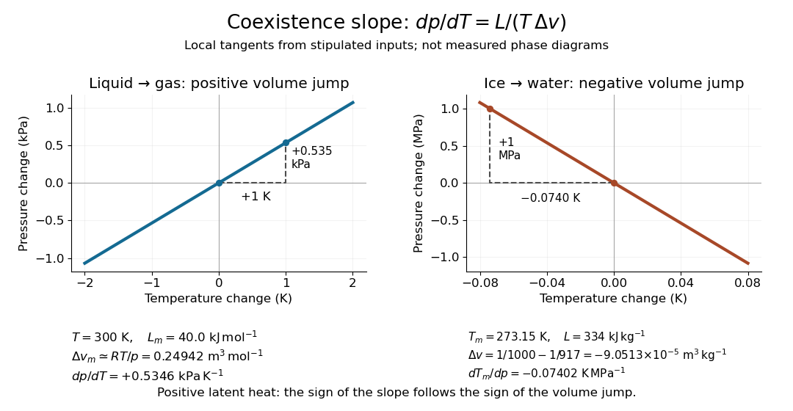

# Clausius-Clapeyron relation

↑ **Parent:** [Latent heat](latent-heat.md)  
ⓦ [Wiki](https://en.wikipedia.org/wiki/Clausius–Clapeyron_relation)

The [Clapeyron equation](clausius-clapeyron-relation.md) connects the slope of a [phase coexistence curve](phase-coexistence-curve.md) to the [latent heat](latent-heat.md) and the change in [volume](volume-thermodynamics.md) during a [first-order phase transition](first-order-phase-transition.md). A steep boundary can indicate a large [latent heat](latent-heat.md), a small change in [volume](volume-thermodynamics.md), or both. This lets a measured boundary constrain caloric properties and predicts how changing [pressure](pressure-split.md) shifts a [melting](melting.md) [temperature](temperature-split.md).

For a pure substance in bulk [phase coexistence](phase-coexistence.md), label the initial and final [thermodynamic phases](thermodynamic-phase.md) $\alpha$ and $\beta$. Both have the same absolute [temperature](temperature-split.md) $T$, [pressure](pressure-split.md) $p$, and [chemical potential](chemical-potential-split.md). With $s$, $h$, and $v$ denoting [entropy](entropy-split.md), [enthalpy](enthalpy-split.md), and [volume](volume-thermodynamics.md) on one common basis, define $\Delta s=s_\beta-s_\alpha$, $\Delta h=h_\beta-h_\alpha$, and $\Delta v=v_\beta-v_\alpha$. Then

$$
\boxed{\frac{dp}{dT}=\frac{\Delta s}{\Delta v}=\frac{L}{T\Delta v}},\qquad L=\Delta h=T\Delta s.
$$

The [derivative](derivative.md) follows the [phase coexistence curve](phase-coexistence-curve.md); it is not a [partial derivative](partial-derivative.md) within one [thermodynamic phase](thermodynamic-phase.md). Use [molar volume](molar-volume.md) $v_m$ with molar [latent heat](latent-heat.md) $L_m$ in $\mathrm{J\,mol^{-1}}$, or [specific volume](specific-volume.md) $v$ with [latent heat](latent-heat.md) $L$ in $\mathrm{J\,kg^{-1}}$. Both give $dp/dT$ in $\mathrm{Pa\,K^{-1}}$. For [molar mass](molar-mass.md) $M$, $L_m=ML$ and $\Delta v_m=M\Delta v$, so the predicted slope is independent of the chosen basis. This formulation assumes a [simple compressible system](simple-compressible-system.md), fixed composition, and negligible interface contributions; a curved interface can instead require the [Young–Laplace equation](young-laplace-equation.md).

For positive [latent heat](latent-heat.md) in the stated conversion direction, the sign of the slope is the sign of $\Delta v$. Converting [liquid](liquid.md) to [gas](gas.md) normally increases [volume](volume-thermodynamics.md) and gives a positive slope. The [negative melting-point slope of water](negative-melting-point-slope-of-water.md) illustrates the opposite sign. At a [thermodynamic critical point](thermodynamic-critical-point.md), the coexisting [gas](gas.md) and [liquid](liquid.md) merge: both $L$ and $\Delta v$ vanish, so their ratio needs a limiting analysis rather than substitution of zero into the [Clapeyron equation](clausius-clapeyron-relation.md).[§5.1.2, equation (5.185) and the discussion of the critical endpoint](statistical-physics-by-david-tong.md)

**[Figure 6](#image-phase-coexistence-curve-tangents-positive-vaporization-slope-and-negative-water-melting-slope). Phase coexistence curve tangents: positive vaporization slope and negative water melting slope**.

A short derivation uses the molar [Gibbs free energy](gibbs-free-energy.md) $g_m$, equal to the [chemical potential](chemical-potential-split.md) for a pure substance. Equality persists along the boundary, so $dg_{m,\alpha}=dg_{m,\beta}$ with $dg_m=-s_m\,dT+v_m\,dp$. Therefore $-\Delta s_m\,dT+\Delta v_m\,dp=0$. Equality of $g_m=h_m-Ts_m$ also gives $\Delta h_m=T\Delta s_m$. Eliminating $\Delta s_m$ yields the [Clapeyron equation](clausius-clapeyron-relation.md).

**Table of contents**

- [Melting pressure inferred from flotation and latent heats](melting-pressure-inferred-from-flotation-and-latent-heats.md)
- [Solid-phase Clapeyron slope from cell volumes](solid-phase-clapeyron-slope-from-cell-volumes.md)
- [Ideal-vapor Clausius-Clapeyron approximation](ideal-vapor-clausius-clapeyron-approximation.md)
  - [Integrated Clausius-Clapeyron relation](integrated-clausius-clapeyron-relation.md)
    - [Stipulated vapor-pressure calculation](stipulated-vapor-pressure-calculation.md)
    - [Latent heat from a vapor-pressure slope](latent-heat-from-a-vapor-pressure-slope.md)
- [Saturation-pressure equilibrium measurement](saturation-pressure-equilibrium-measurement.md)
- [Common-pressure melting-point slope](common-pressure-melting-point-slope.md)
  - [Negative melting-point slope of water](negative-melting-point-slope-of-water.md)

## ↑ Ancestors (10)

1. [Latent heat](latent-heat.md)
2. [Phase coexistence curve](phase-coexistence-curve.md)
3. [Gibbs free energy](gibbs-free-energy.md)
4. [Thermodynamic free energy](thermodynamic-free-energy.md)
5. [Thermodynamic potential](thermodynamic-potential-split.md)
6. [Thermodynamics](thermodynamics-split.md)
7. [Statistical physics](statistical-physics-split.md)
8. [Branches of physics](branches-of-physics.md)
9. [Physics](physics-split.md)
10. [Codex Wiki](split.md)

## ← Incoming links (6)

- [Melting pressure inferred from flotation and latent heats](melting-pressure-inferred-from-flotation-and-latent-heats.md)
- [Solution](past-exam-of-the-mathematics-course-of-the-university-of-cambridge/2015/iii/paper-78/1/solution.md)
- [Solution](past-exam-of-the-mathematics-course-of-the-university-of-cambridge/2020/ii/paper-2/36a/solution.md)
- [Solution](past-exam-of-the-mathematics-course-of-the-university-of-cambridge/2024/ii/paper-4/35b/b/solution.md)
- [Solution](past-exam-of-the-mathematics-course-of-the-university-of-cambridge/2025/ii/paper-4/35c/a/solution.md)
- [Solution](past-exam-of-the-physics-b-course-of-the-university-of-cambridge/2016/paper-2/section-c/c13/solution.md)
