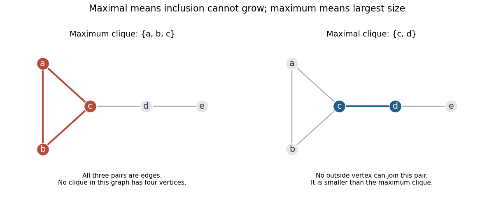

# Clique (graph theory)

↑ **Parent:** [Complete graph](complete-graph.md)  
ⓦ [Wiki](https://en.wikipedia.org/wiki/Clique_(graph_theory))

A [clique](clique-graph-theory.md) in a [simple graph](simple-graph.md) $G$ is a [set](set-split.md) $C$ of [vertices](vertex-graph-theory.md) such that every pair of distinct members is adjacent. Equivalently, its [induced subgraph](induced-subgraph.md) $G[C]$ is a [complete graph](complete-graph.md). The surrounding [graph](graph-split.md) need not itself be complete: a [clique](clique-graph-theory.md) describes complete pairwise connectivity within a selected group.

Consider the original [graph](graph-split.md) with

$$
V=\{a,b,c,d,e\},\qquad
E=\{ab,ac,bc,cd,de\}.
$$

The [set](set-split.md) $\{a,b,c\}$ is a [clique](clique-graph-theory.md) because all three pairs $ab,ac,bc$ are [edges](edge-of-a-graph.md). The [set](set-split.md) $\{b,c,d\}$ is not a [clique](clique-graph-theory.md): the [edge](edge-of-a-graph.md) $bd$ is missing. A [path in a graph](path-in-a-graph.md) connecting all selected [vertices](vertex-graph-theory.md) is therefore insufficient; every pair must have a direct [edge](edge-of-a-graph.md).

**[Figure 16](#image-a-maximum-clique-and-a-smaller-maximal-clique-in-the-same-graph). A maximum clique and a smaller maximal clique in the same graph**. Left: the three highlighted [vertices](vertex-graph-theory.md) $a,b,c$ form the unique [maximum clique](maximum-clique.md). Right: the [edge](edge-of-a-graph.md) $cd$ gives a [maximal clique](maximal-clique.md) of size two, because no outside [vertex](vertex-graph-theory.md) is adjacent to both endpoints. Both panels use the same original [graph](graph-split.md); highlighted [vertices](vertex-graph-theory.md) and [edges](edge-of-a-graph.md) select different [cliques](clique-graph-theory.md).

Here the [clique number](clique-number.md) is $3$. The [maximum clique](maximum-clique.md) is $\{a,b,c\}$, but $\{c,d\}$ and $\{d,e\}$ are also [maximal cliques](maximal-clique.md). This distinction is useful when an [algorithm](algorithm-split.md) stops as soon as its current [clique](clique-graph-theory.md) cannot be enlarged: that stopping condition establishes maximality, while finding the largest possible [clique](clique-graph-theory.md) is a separate requirement.

**Table of contents**

- [Maximum clique](maximum-clique.md)
- [Maximal clique](maximal-clique.md)
- [Edge-disjoint clique packing](edge-disjoint-clique-packing.md)
  - [Clique-packing amplification of moment bounds](clique-packing-amplification-of-moment-bounds.md)
  - [Clique conflict graph](clique-conflict-graph.md)
- [Clique number](clique-number.md)
- [Pairwise intersections need not give a common intersection](pairwise-intersections-need-not-give-a-common-intersection.md)

## ↑ Ancestors (6)

1. [Complete graph](complete-graph.md)
2. [Graph theory](graph-theory-split.md)
3. [Foundations of mathematics](foundations-of-mathematics-split.md)
4. [Area of mathematics](area-of-mathematics.md)
5. [Mathematics](mathematics-split.md)
6. [Codex Wiki](split.md)
