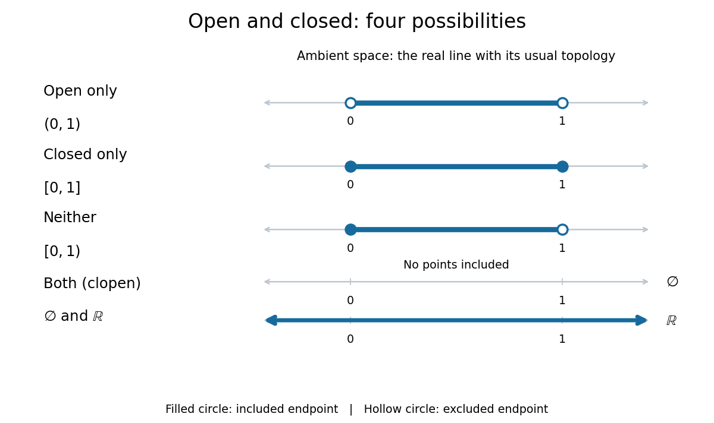

# Closed set

↑ **Parent:** [Topology](topology-split.md)  
ⓦ [Wiki](https://en.wikipedia.org/wiki/Closed_set)

A [subset](subset.md) $F$ of a [topological space](topological-space.md) $(X,\tau)$ is [closed](closed-set.md) when its [complement](complement-of-a-set.md) in that same ambient space is [open](open-set.md): $X\setminus F\in\tau$. For example, the [closed interval](closed-real-interval.md) $[0,1]$ is [closed](closed-set.md) in the usual [real line](real-line.md) because its [complement](complement-of-a-set.md) is the [open set](open-set.md) $(-\infty,0)\cup(1,\infty)$. Always specify the ambient [topological space](topological-space.md): a [subset](subset.md) can be [closed](closed-set.md) in a [subspace topology](subspace-topology.md) without being [closed](closed-set.md) in the surrounding space. [Richard Haydon, Oxford topology preliminaries, Section 0.1](https://www.maths.ox.ac.uk/system/files/attachments/Preliminary%20Reading%20%281%29.pdf)

Being [closed](closed-set.md) is not the logical negation of being [open](open-set.md). In the usual [real line](real-line.md), all four combinations occur: $(0,1)$ is [open](open-set.md) but not [closed](closed-set.md); $[0,1]$ is [closed](closed-set.md) but not [open](open-set.md); the half-open [interval](interval-mathematics.md) $[0,1)$ is neither [open](open-set.md) nor [closed](closed-set.md); and both the [empty set](empty-set.md) and the whole [real line](real-line.md) are [open](open-set.md) and [closed](closed-set.md), hence [clopen](clopen-set.md). Nor does being [closed](closed-set.md) imply being a [bounded set](bounded-set.md): $[0,\infty)$ is [closed](closed-set.md) because its [complement](complement-of-a-set.md) $(-\infty,0)$ is [open](open-set.md), but it is not a [bounded set](bounded-set.md). The symbol $\infty$ is not an extra point that this [interval](interval-mathematics.md) must contain.

**[Figure 3](#image-the-four-combinations-of-openness-and-closedness-in-the-real-line). The four combinations of openness and closedness in the real line**.

The coloured strokes mark membership; filled endpoint circles mean included points, and hollow endpoint circles mean excluded points. The [empty set](empty-set.md) has no coloured points, while arrows at both ends of the coloured [real line](real-line.md) indicate that membership continues indefinitely. These examples use the usual [topology](topology-split.md) of the [real line](real-line.md).

In a [metric space](metric-space.md) $X$, a [subset](subset.md) $F$ is [closed](closed-set.md) exactly when every [convergent sequence](convergent-sequence.md) $(x_n)$ in $F$ whose [limit of a sequence](limit-of-a-sequence.md) $x$ lies in $X$ has $x\in F$. For example, $x_n=1-1/n$ lies in $[0,1)$ for $n\geq1$ and has [limit of a sequence](limit-of-a-sequence.md) $1$, which is missing; thus this half-open [interval](interval-mathematics.md) is not [closed](closed-set.md) in the [real line](real-line.md). This criterion is useful for keeping limiting constructions inside a prescribed [set](set-split.md). [MIT Real Analysis, Lecture 13, closed sets and convergent sequences](https://ocw.mit.edu/courses/18-100b-real-analysis-spring-2025/mit18_100b_s25_lec_full.pdf)

In every [topological space](topological-space.md), the general criterion is $F=\overline F$, using [closure](closure-topology.md); equivalently, $F$ contains all its [limit points](limit-point.md). A [closed set](closed-set.md) is always a [sequentially closed set](sequentially-closed-set.md), but the converse can fail outside [metric spaces](metric-space.md). Arbitrary [intersections](set-intersection.md) and finite [unions](set-union.md) of [closed sets](closed-set.md) are [closed](closed-set.md), by taking [complements](complement-of-a-set.md) in the [topology axioms](topology-axiom.md).

**Table of contents**

- [Sequentially closed set](sequentially-closed-set.md)
- [Limit point](limit-point.md)

## ↑ Ancestors (5)

1. [Topology](topology-split.md)
2. [Geometry and topology](geometry-and-topology-split.md)
3. [Area of mathematics](area-of-mathematics.md)
4. [Mathematics](mathematics-split.md)
5. [Codex Wiki](split.md)

## ← Incoming links (94)

- [A good rate function is separated from zero away from its minimizer](a-good-rate-function-is-separated-from-zero-away-from-its-minimizer.md)
- [Announcement-and-challenge covering of a closed payoff](announcement-and-challenge-covering-of-a-closed-payoff.md)
- [Boundary of a set](boundary-of-a-set.md)
- [Brouwer fixed-point theorem](brouwer-fixed-point-theorem.md)
- [Clopen set](clopen-set.md)
- [Closed ball](closed-ball.md)
- [Closed convex cone](closed-convex-cone.md)
- [Closed cover](closed-cover.md)
- [Closed point](closed-point.md)
- [Closed set](closed-set.md)
- [Closed subgroup](closed-subgroup.md)
- [Closed vector subspace](closed-vector-subspace.md)
- [Closest point theorem for a closed convex subset of Lp](closest-point-theorem-for-a-closed-convex-subset-of-lp.md)
- [Closure (topology)](closure-topology.md)
- [Closure under a binary operation](closure-under-a-binary-operation.md)
- [Compact space](compact-space.md)
- [Compact subset of a Hausdorff space](compact-subset-of-a-hausdorff-space.md)
- [Completely regular Hausdorff space](completely-regular-hausdorff-space.md)
- [Cone on an infinite coinfinite ground set](cone-on-an-infinite-coinfinite-ground-set.md)
- [Conic hull](conic-hull.md)
- [Countable unions of Ellentuck clopen sets need not be closed](countable-unions-of-ellentuck-clopen-sets-need-not-be-closed.md)
- [Dirac measure](dirac-measure.md)
- [Discrete metric](discrete-metric.md)
- [Distance from a point to a closed set](distance-from-a-point-to-a-closed-set.md)
- [Ellentuck topology](ellentuck-topology.md)
- [Exponential tightness upgrades a weak large deviation principle](exponential-tightness-upgrades-a-weak-large-deviation-principle.md)
- [Fenchel–Young inequality](fenchel-young-inequality.md)
- [Heine-Borel theorem](heine-borel-theorem.md)
- [Homeomorphism](homeomorphism.md)
- [Local uniform Cauchy control for pointwise convergent continuous functions](local-uniform-cauchy-control-for-pointwise-convergent-continuous-functions.md)
- [Lusternik–Schnirelmann theorem](lusternik-schnirelmann-theorem.md)
- [Open and closed maps](open-and-closed-maps.md)
- [Open set](open-set.md)
- [Solution](past-exam-of-the-mathematics-course-of-the-university-of-cambridge/2001/iii/paper-26/2/a/solution.md)
- [Solution](past-exam-of-the-mathematics-course-of-the-university-of-cambridge/2001/iii/paper-26/2/b/solution.md)
- [Solution](past-exam-of-the-mathematics-course-of-the-university-of-cambridge/2001/iii/paper-26/2/d/solution.md)
- [Solution](past-exam-of-the-mathematics-course-of-the-university-of-cambridge/2001/iii/paper-6/1/solution.md)
- [Solution](past-exam-of-the-mathematics-course-of-the-university-of-cambridge/2002/iii/paper-77/2/a/solution.md)
- [Solution](past-exam-of-the-mathematics-course-of-the-university-of-cambridge/2002/iii/paper-77/3/solution.md)
- [Solution](past-exam-of-the-mathematics-course-of-the-university-of-cambridge/2003/ib/paper-1/1f/i/solution.md)
- [Solution](past-exam-of-the-mathematics-course-of-the-university-of-cambridge/2003/ib/paper-1/1f/iii/solution.md)
- [Solution](past-exam-of-the-mathematics-course-of-the-university-of-cambridge/2003/iii/paper-79/2/a/solution.md)
- [Solution](past-exam-of-the-mathematics-course-of-the-university-of-cambridge/2003/iii/paper-79/2/c/solution.md)
- [Solution](past-exam-of-the-mathematics-course-of-the-university-of-cambridge/2003/iii/paper-79/4/solution.md)
- [Solution](past-exam-of-the-mathematics-course-of-the-university-of-cambridge/2004/ib/paper-2/14g/solution.md)
- [Solution](past-exam-of-the-mathematics-course-of-the-university-of-cambridge/2004/iii/paper-31/2/a/solution.md)
- [Solution](past-exam-of-the-mathematics-course-of-the-university-of-cambridge/2004/iii/paper-6/2/i/solution.md)
- [Solution](past-exam-of-the-mathematics-course-of-the-university-of-cambridge/2004/iii/paper-6/3/i/solution.md)
- [Solution](past-exam-of-the-mathematics-course-of-the-university-of-cambridge/2005/ib/paper-1/12a/solution.md)
- [Solution](past-exam-of-the-mathematics-course-of-the-university-of-cambridge/2005/ii/paper-2/22f/solution.md)
- [Solution](past-exam-of-the-mathematics-course-of-the-university-of-cambridge/2005/iii/paper-13/2/solution.md)
- [Solution](past-exam-of-the-mathematics-course-of-the-university-of-cambridge/2005/iii/paper-36/1/a/solution.md)
- [Solution](past-exam-of-the-mathematics-course-of-the-university-of-cambridge/2005/iii/paper-36/2/a/solution.md)
- [Solution](past-exam-of-the-mathematics-course-of-the-university-of-cambridge/2006/ii/paper-4/2g/a/solution.md)
- [Solution](past-exam-of-the-mathematics-course-of-the-university-of-cambridge/2007/ib/paper-1/12a/ii/solution.md)
- [Solution](past-exam-of-the-mathematics-course-of-the-university-of-cambridge/2007/ib/paper-4/14a/a/solution.md)
- [Solution](past-exam-of-the-mathematics-course-of-the-university-of-cambridge/2007/iii/paper-26/10/solution.md)
- [Solution](past-exam-of-the-mathematics-course-of-the-university-of-cambridge/2008/ii/paper-3/2f/a/solution.md)
- [Solution](past-exam-of-the-mathematics-course-of-the-university-of-cambridge/2009/ib/paper-1/12f/iii/solution.md)
- [Solution](past-exam-of-the-mathematics-course-of-the-university-of-cambridge/2009/iii/paper-10/2/solution.md)
- [Solution](past-exam-of-the-mathematics-course-of-the-university-of-cambridge/2011/ii/paper-1/2f/i/solution.md)
- [Solution](past-exam-of-the-mathematics-course-of-the-university-of-cambridge/2011/ii/paper-1/2f/ii/solution.md)
- [Solution](past-exam-of-the-mathematics-course-of-the-university-of-cambridge/2011/ii/paper-4/22g/solution.md)
- [Solution](past-exam-of-the-mathematics-course-of-the-university-of-cambridge/2013/ib/paper-2/4g/ii/solution.md)
- [Solution](past-exam-of-the-mathematics-course-of-the-university-of-cambridge/2014/ib/paper-4/13e/ii/solution.md)
- [Solution](past-exam-of-the-mathematics-course-of-the-university-of-cambridge/2014/ib/paper-4/13e/solution.md)
- [Solution](past-exam-of-the-mathematics-course-of-the-university-of-cambridge/2014/iii/paper-8/1/solution.md)
- [Solution](past-exam-of-the-mathematics-course-of-the-university-of-cambridge/2015/ii/paper-4/2i/solution.md)
- [Solution](past-exam-of-the-mathematics-course-of-the-university-of-cambridge/2015/iii/paper-13/1/i/solution.md)
- [Solution](past-exam-of-the-mathematics-course-of-the-university-of-cambridge/2015/iii/paper-6/2/solution.md)
- [Solution](past-exam-of-the-mathematics-course-of-the-university-of-cambridge/2016/ib/paper-3/3e/solution.md)
- [Solution](past-exam-of-the-mathematics-course-of-the-university-of-cambridge/2017/ib/paper-3/3e/b/solution.md)
- [Solution](past-exam-of-the-mathematics-course-of-the-university-of-cambridge/2017/ib/paper-4/13e/a/solution.md)
- [Solution](past-exam-of-the-mathematics-course-of-the-university-of-cambridge/2017/ib/paper-4/13e/b/i/solution.md)
- [Solution](past-exam-of-the-mathematics-course-of-the-university-of-cambridge/2017/ib/paper-4/13e/b/ii/solution.md)
- [Solution](past-exam-of-the-mathematics-course-of-the-university-of-cambridge/2017/iii/paper-136/2/solution.md)
- [Solution](past-exam-of-the-mathematics-course-of-the-university-of-cambridge/2017/iii/paper-339/1/c/solution.md)
- [Solution](past-exam-of-the-mathematics-course-of-the-university-of-cambridge/2018/ib/paper-3/3e/solution.md)
- [Solution](past-exam-of-the-mathematics-course-of-the-university-of-cambridge/2018/iii/paper-101/1/a/solution.md)
- [Solution](past-exam-of-the-mathematics-course-of-the-university-of-cambridge/2018/iii/paper-130/4/iii/solution.md)
- [Solution](past-exam-of-the-mathematics-course-of-the-university-of-cambridge/2019/ib/paper-4/13g/b/solution.md)
- [Solution](past-exam-of-the-mathematics-course-of-the-university-of-cambridge/2019/ii/paper-2/11h/b/solution.md)
- [Solution](past-exam-of-the-mathematics-course-of-the-university-of-cambridge/2019/ii/paper-2/2h/a/solution.md)
- [Solution](past-exam-of-the-mathematics-course-of-the-university-of-cambridge/2019/ii/paper-2/2h/b/solution.md)
- [Solution](past-exam-of-the-mathematics-course-of-the-university-of-cambridge/2021/ib/paper-1/2f/solution.md)
- [Solution](past-exam-of-the-mathematics-course-of-the-university-of-cambridge/2025/ii/paper-4/12i/ii/solution.md)
- [Point-evaluation kernel is not closed in the integral norm](point-evaluation-kernel-is-not-closed-in-the-integral-norm.md)
- [Preference relation](preference-relation.md)
- [Projection with a compact factor is closed](projection-with-a-compact-factor-is-closed.md)
- [Residual reachability certificate for maximum flow](residual-reachability-certificate-for-maximum-flow.md)
- [Sequentially closed set](sequentially-closed-set.md)
- [Slower-speed degeneration of a large deviation principle](slower-speed-degeneration-of-a-large-deviation-principle.md)
- [Subsequential limit](subsequential-limit.md)
- [Zero set](zero-set.md)
